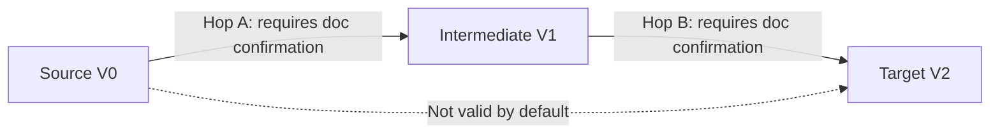
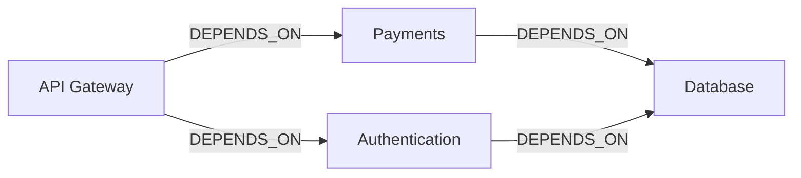
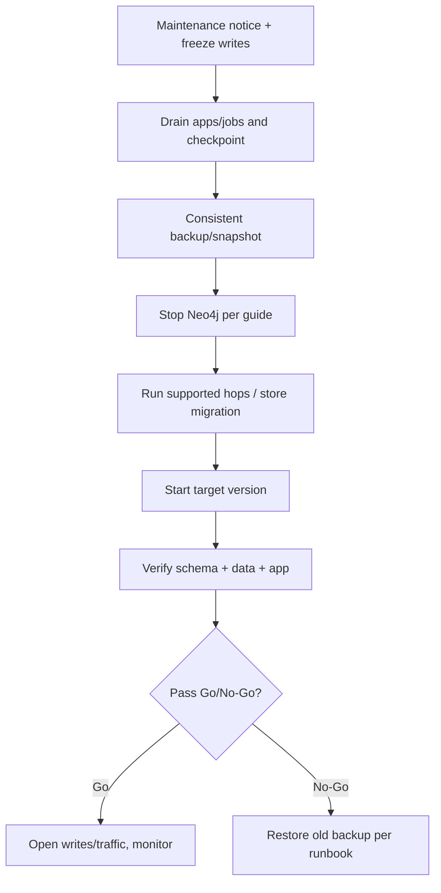
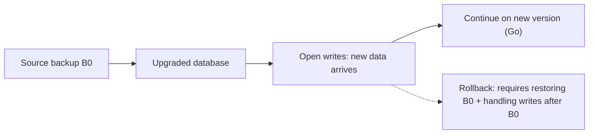

# Planning Upgrades Along Vendor-Supported Paths in Neo4j

## 1. Context: Upgrading Neo4j Is a System-Wide Change

An application using **Neo4j** to manage a **property graph** typically involves multiple interconnected components: node and relationship data, indexes/constraints, **Cypher** queries, **Neo4j Java Driver**, **Spring Data Neo4j**, plugins such as **APOC** and **Graph Data Science (GDS)**, backup mechanisms, TLS configuration, and server topology. When changing the database version, you cannot simply pull a new image and assume the entire system stays compatible.

In particular, a Neo4j release may change the storage format, `neo4j.conf` settings, functions/procedures, driver compatibility rules, and cluster upgrade methods. If you transition across a step the vendor **does not support**, the system may fail to open the database, fail to roll back to the old version, or suffer business logic errors after the application begins receiving write traffic.

This lesson belongs to the **Upgrades and Migration** chapter of the `DATABASE_ENGINE_GRAPH_NEO4J` module. Its direct topic is **planning along vendor-published and supported upgrade paths**, rather than giving a fixed one-size-fits-all upgrade command.

After this lesson, you will be able to:

1. Identify **the source version, target version, and every intermediate hop** using official documentation for the exact versions.
2. Build compatibility tables covering database, store format, edition, cluster, Java/JDK, Driver, SDN, APOC, and GDS.
3. Inventory data, schema, privileges, backups, configuration, and queries before making changes.
4. Design upgrade tests on a copy of the data, validating node/relationship correctness, indexes, and Cypher behavior.
5. Choose offline, rolling, or managed upgrade options **only when officially supported** and define traffic-opening conditions.
6. Design a practical rollback plan when **store downgrade is unsupported**, accounting for the risk of losing post-cutover writes.
7. Write Go/No-Go criteria, operational checklists, and auditable upgrade result reports.

> **Version scope:** Examples describe planning approaches for the Neo4j 4.x/5.x families and newer releases. They do **not** claim that any specific version pair (such as any 4.x → any newer release) can be upgraded directly. Support policies, intermediate version requirements, Java versions, and migration commands vary by release, edition, and deployment model. Implementers must verify the **official Upgrade and Migration Guide / Operations Manual for the exact target version** at execution time.

## 2. What Does a "Supported Path" Mean?

### 2.1. Not Every Version Arrow Is Valid

Suppose a team writes:

```text
Running: V0
Want to reach: V2
```

That **is not enough** to conclude you can upgrade directly `V0 → V2`. The vendor may require an intermediate version `V1`, require applying the final patch of a branch first, or restrict transitions by store format or edition.

Conceptual diagram:



`V0`, `V1`, and `V2` are **placeholders**, not real version names. Only when vendor documentation confirms **Hop A** and **Hop B** does that sequence become a substantiated path. If source and target are allowed to upgrade directly by the vendor, there is no need to invent extra intermediate steps.

### 2.2. A "Supported" Edge Must Have Concrete Evidence

For **each hop**, answer:

| Question | Evidence to record |
| --- | --- |
| Is the source version supported for upgrading to the target version? | Official documentation link, version/revision, and lookup date |
| Is a minimum patch level required for source or intermediate versions? | Specific version prerequisites in the docs |
| Must we **migrate the store** or only upgrade binaries / rolling restart? | Vendor-documented procedure and required stop/lock steps |
| Do the edition and topology allow this procedure? | Community/Enterprise, single instance/cluster, managed service |
| Are backups, free disk space, or downtime required? | Preconditions and estimates measured on real data |
| What must be checked before and after upgrading? | Post-upgrade checks, schema/indexes, config, query/runtime |
| Can we roll back using the old binary? | **Rollback conditions stated by the vendor**; otherwise, design a restore |
| Are Java/Driver/APOC/GDS and the application compatible? | Separate compatibility matrices for each product |

Practical definition:

> **Valid upgrade path = a sequence of documented hops, each satisfying version + data format + deployment + dependency conditions and verified via testing on a representative environment.**

"The test machine booted after swapping the image" **is not** evidence that replaces vendor support policy.

### 2.3. Do Not Mix Three Concepts

1. **Supported:** Neo4j publishes that a method/version pair is supported under stated conditions.
2. **Technically boots:** the process happens to start or open the store after some sequence of actions.
3. **Operationally safe:** on your organization's actual workload, data is accurate, plugins are compatible, backups exist, performance is acceptable, and rollback is executable.

To **Go Live**, you need both **(1)** and **(3)**; item (2) alone is insufficient.

## 3. Build the Upgrade Map Before Editing Any File

### 3.1. Collect Exact Versions

Do not plan from "we use Neo4j 5" or the Docker tag `latest`. Record precisely:

- Server version on each host node and each database, including patch level.
- Edition, standalone/cluster mode, member count, on-prem, VM, Docker/Kubernetes, or managed service environment.
- Storage type and version, database status, index health, and any existing startup/transaction errors.
- Docker image, Helm chart, or Operator version if used, along with data and config mount paths.
- Neo4j Java Driver per service, Spring Boot/SDN/JDK, APOC Core/Extended, GDS, and custom procedures.
- Backup sources, number of restore rehearsals completed, recovery time, and desired recovery point objective.

Where Neo4j permissions allow, you can read version details with:

```cypher
CALL dbms.components()
YIELD name, versions, edition
RETURN name, versions, edition;
```

This command is a **starting point**, not a full topology or store format report. In a cluster, reconcile the status of **all members** using operational tools supported by that version. For Aura, use the version and change capability information provided by the managed service.

### 3.2. Illustrative Inventory Table

| Group | Values to record | Why does it affect the upgrade path? |
| --- | --- | --- |
| Neo4j server | Version/patch, edition, system DB, user DB | Supported hop prerequisites and database migration |
| Cluster | Members, roles, routing, data storage locations | Rolling/offline eligibility and maintaining quorum |
| Store | Format, size, transaction logs, free disk | Tools and disk space needed for migration |
| Schema | Unique/key constraints, indexes, population state | `MERGE` correctness and post-upgrade performance |
| Cypher | Critical queries, legacy syntax, planner hints | Language and query plan compatibility |
| Plugins | APOC/GDS/custom procedures and JARs | Whether new plugin builds or recompilation are needed |
| Application | Spring Boot, SDN, Java Driver, JDK | Protocol, API, and runtime compatibility |
| Security | TLS, cert SANs, roles, databases, secrets | Post-change connectivity and authorization |
| Operations | Backup/restore, alerts, metrics, dashboards | Observability, rollback, and Go/No-Go decisions |

Do not store passwords, tokens, private keys, or full connection URIs containing credentials in the inventory table. If secrets must be listed, record the **reference name** in the secret manager, owner, and rotation deadline.

### 3.3. Inspect Existing Databases and Schema

On a Neo4j version that supports these commands, with an authorized account:

```cypher
SHOW DATABASES
YIELD name, currentStatus, requestedStatus
RETURN name, currentStatus, requestedStatus
ORDER BY name;
```

```cypher
SHOW INDEXES
YIELD name, type, state, populationPercent
RETURN name, type, state, populationPercent
ORDER BY name;
```

```cypher
SHOW CONSTRAINTS
YIELD name, type, labelsOrTypes, properties
RETURN name, type, labelsOrTypes, properties
ORDER BY name;
```

These statements establish a pre-upgrade **baseline**. They do not modify the graph. Column names and privileges can differ across versions: if you are on Neo4j 4.x, use the syntax/tools matching **the source version** to collect data instead of forcing target-version commands.

In multi-database environments, record each database, including the **system database** and related administrative metadata per the vendor's backup/migration procedure. Do not assume backing up only business databases is enough to recover all users, roles, or configuration.

## 4. Check Official Docs and Lock Each Hop

### 4.1. Sources to Verify

Prioritize sources in order:

1. **Neo4j Operations Manual — Upgrade/Migration** for the target version.
2. **Release notes / breaking changes** for every intermediate version and the target version.
3. Documentation on **backup, restore, store migration**, and topology for your edition.
4. Compatibility matrices for **Neo4j Java Driver** and the Cypher language.
5. Release notes and compatibility docs for **Spring Boot / Spring Data Neo4j**, **APOC**, and **GDS**.
6. **Helm/Operator/Aura** documentation if upgrade orchestration belongs to the provider or deployment platform.

Internet content without version numbers or examples from old blog posts **is not enough** to prove a hop is supported.

### 4.2. Upgrade Decision Matrix

Create the following table **before** the deployment window:

| Hop | Source → Target | Confirming documentation | Preconditions | Execution method | Status |
| --- | --- | --- | --- | --- | --- |
| A | `V0 → V1` | Link + section + lookup date | Min patch, backup, disk | Offline/rolling per docs | Unverified/verified |
| B | `V1 → V2` | Link + section + lookup date | Migration/plugin/JDK | Offline/rolling per docs | Unverified/verified |
| Application | `Driver/SDN old → new` | Compatibility matrix | API/Cypher tests | Rolling app per contract | Unverified/verified |

This is a **governance template**, not a real vendor-confirmed path. Fill in `SUPPORTED` only after reading documentation for **the exact source/target pair**, never by guessing "most likely compatible".

**Go/No-Go rule:** Any hop marked `UNKNOWN` or `UNSUPPORTED` must halt execution planning. You may open a vendor support request or design an approved alternative data transfer path (such as export/import), but never self-label it supported.

### 4.3. Examples for 4.x, 5.x, and Newer Releases

For systems running **4.x**, some upgrade guides impose requirements on **specific source branches** before advancing to **5.x**; newer releases have their own rules. You cannot write a generic rule "4.0 → 5.latest" and treat it as valid for every 4.x release, nor invent a chain "5.x → calendar-year release" without verification.

What can vary by hop:

- Mandatory source patch version.
- Tooling and timing for **store migration**.
- Backup formats accepted by the target version.
- Offline/rolling rules for clusters.
- Configuration settings, Cypher runtime, and removed functions/procedures.
- Compatible plugins/drivers and required Java runtime.

Example of a valid criterion: "Target documentation confirms upgrading from **the required source patch of V0** to `V1` in standalone mode, after running a specified migration command; restore has been tested and verification checks passed." In this example, `V0` and `V1` are merely **version placeholders to pin down**, not actual release names.

## 5. Compatibility Scope Extends Beyond the Neo4j Server

### 5.1. Database Layer and Store Format

Neo4j maintains on-disk data structures, transaction logs, and metadata required to open a database. An upgrade step may require converting the store format. A store **migrated** to a newer version **cannot by default be read by the older binary**.

The plan must determine:

- Must the database be stopped for migration, and at which step?
- Will additional data files, indexes, or transaction logs be created during conversion?
- How much **temporary** disk space is needed beyond the total store size?
- Have backup size and restore duration been measured on real data?
- Should migration run on a **copy** or sequentially per database?
- After upgrading, must indexes wait for population or be rebuilt per vendor instructions?
- On failure, do we restore from an **old backup/snapshot** or is there a supported rollback tool?

**Do not try to "downgrade" by attaching an old binary to an upgraded data directory** unless documentation explicitly allows it. Doing so can fail or corrupt data.

### 5.2. Cypher, Schema, Indexes, and Constraints

A graph application may depend on areas prone to change:

- `MATCH`, `OPTIONAL MATCH`, variable-length patterns, and shortest-path syntax.
- `MERGE` on business keys requiring unique constraints/indexes.
- `CALL { ... }`, `CALL { ... } IN TRANSACTIONS`, or corresponding batching procedures.
- Index providers, full-text/vector indexes, and edition-specific constraint types.
- Query planner hints or APIs returning node/relationship identifiers.

In newer Neo4j releases, multiple **Cypher language versions** or different default query runtimes may exist. Check the **actual Cypher language mode your application runs under** and default changes in release notes, rather than only confirming that queries have no syntax errors.

For critical queries:

1. Save query templates and sample parameters **with sensitive data scrubbed**.
2. Test them against the target version using representative data.
3. Compare node/relationship results, ordering, null semantics, and cardinality.
4. Use `EXPLAIN`/`PROFILE` **safely** to inspect index seeks/scans, DB Hits, and rows.
5. Compare p95/p99, CPU, locks, and memory; a query with **correct results** can still suffer a performance regression.

`PROFILE` executes the query; never run it on write queries in production solely to inspect execution plans.

### 5.3. Java Driver, Spring Data Neo4j, and Spring Boot

Compatibility here spans at least **four versions**:

```text
Java Runtime (JDK)
     │
Spring Boot / Spring Data Neo4j
     │
Neo4j Java Driver
     │
Neo4j Server / Bolt / Cypher
```

Do not assume that because the driver connects, every SDN API in use works properly. Verify:

- The **JDK** version supported across Boot, driver, plugins, and server.
- The driver version managed by Boot/SDN and its ability to connect to source and target Neo4j during transition windows.
- Session behavior, bookmarks, transaction timeouts, retries, and routing.
- `@Node`, `@Relationship`, `@Id` mappings, `@Query` methods, and DTOs.
- Repository/mapper migration steps when Spring Data Neo4j changes APIs or defaults.
- Connection pools, TLS trust, roles, and database selection.

**Two-way compatibility strategy:** if an application release will run against **both old and new databases** during a rolling phase, the application's dependencies and queries must be proven compatible **with both** by vendor docs and engineering tests. If this cannot be guaranteed, plan a maintenance window and freeze traffic appropriately.

### 5.4. APOC, GDS, and Custom Procedures

APOC, GDS, and custom procedures/plugins have **independent version lifecycles**.

```cypher
SHOW PROCEDURES
YIELD name, signature
WHERE name STARTS WITH 'apoc.'
   OR name STARTS WITH 'gds.'
RETURN name, signature
ORDER BY name;
```

```cypher
SHOW FUNCTIONS
YIELD name, signature
WHERE name STARTS WITH 'apoc.'
   OR name STARTS WITH 'gds.'
RETURN name, signature
ORDER BY name;
```

These check **which functions/procedures are registered and visible to your permissions**, not a full report of JAR/plugin versions. Inspect installation metadata and plugin docs for your deployment form.

When upgrading:

1. Inventory every procedure/function actually called by the application and ETL jobs.
2. Verify the plugin version **supports the target Neo4j**; update JARs/plugins per instructions.
3. For custom Java procedures, check binary/API compatibility and recompile/retest as needed.
4. Verify `EXECUTE PROCEDURE` privileges and unrestricted/load configuration; never loosen permissions carelessly.
5. For GDS, **in-memory named graph projections are not durable data that gets migrated automatically**. After restart/upgrade, plan to **re-create projections** and validate algorithms and scores; do not treat a store backup as backing up GDS in-memory state.

If a required plugin has no compatible version for the target, that can be a **No-Go blocker**, even when core Neo4j has a supported upgrade path.

## 6. Measure Source Data with an Independent Baseline

To confirm no node/relationship data was lost or corrupted, establish a **pre-upgrade baseline**.

### 6.1. Service Dependency Example

A business graph models:



If a dependency-management query after upgrading fails to return the `Payments → Database` edge due to an altered relationship type, the application can misjudge blast radius when a service fails. Therefore, beyond counts, compare **relationship endpoints and directions**.

Read-only Cypher examples:

```cypher
MATCH (s:Service)
RETURN count(s) AS totalServices;
```

```cypher
MATCH (a:Service)-[r:DEPENDS_ON]->(b:Service)
RETURN count(r) AS dependencyRelationships;
```

```cypher
MATCH (a:Service)-[:DEPENDS_ON]->(b:Service)
RETURN a.id AS callerId, b.id AS dependencyId
ORDER BY callerId, dependencyId
LIMIT 100;
```

**The labels and properties above are business-schema examples** and are not guaranteed to exist in your database. Substitute your real schema. For billions of relationships, avoid full scans during peak hours; build the baseline on a cloned environment or scheduled window using audited counting/hashing methods.

### 6.2. Why Total Counts Are Not Enough

Two graphs can both have **1 million nodes and 2 million relationships**, yet one relationship flipped direction or points to the wrong tenant. Validation therefore needs multiple layers:

| Layer | Checks |
| --- | --- |
| **Topology** | Node/relationship counts by label/type; endpoints, edge direction, self-loops/parallel edges |
| **Identity** | Unique business keys, null/duplicate key counts, tenant mapping |
| **Property** | Data types, required values, checksums across samples/batches |
| **Schema** | Constraints/indexes, ONLINE index state, full-text/vector indexes where present |
| **Query** | Result sets, aggregations, pagination, ordering, and key path counts |
| **Application** | DTOs from SDN, Java Driver, error messages, access rights, and transactions |
| **Operations** | Backup/restore, login, TLS, metrics, and dashboards |

If records are actively changing **during testing**, you cannot directly compare snapshots captured at two different timestamps and conclude migration broke data. Pin a **consistent snapshot/LSN/bookmark** or design point-in-time reconciliation checks.

### 6.3. Store a Reproducible Baseline

A baseline manifest can contain:

```yaml
baseline:
  sourceVersion: "V0-exact-version"
  snapshotId: "backup-or-snapshot-id"
  capturedAtUtc: "2026-10-01T00:00:00Z"
  databases:
    - name: catalog
      nodeCount: 1500000
      relationshipCount: 3600000
      indexesOnline: 8
      constraints: 5
  checks:
    - name: unique-service-ids
      expected: "no duplicates"
    - name: authorized-tenant-paths
      expected: "matches baseline"
```

These are **hypothetical numbers for practice**, not data from a real system. `capturedAtUtc` is only an illustrative timestamp string. In real projects, also store schema versions, backup storage locations, checksums, and sign-off owners.

## 7. Backup, Restore, and Recovery Testing Before Changing Versions

### 7.1. "Having a Backup File" Is Different from "Being Able to Restore"

A rollback plan is trustworthy only if operations has **successfully restored the corresponding backup using a supported procedure**. Do not rely on a backup directory having non-zero size or being uploaded to object storage.

Distinguish:

- **Online backup:** backing up a running database, subject to edition and version feature support.
- **Offline dump/export:** taking a logical/binary copy when the database is in an appropriate state per commands/guides; not synonymous with online backup.
- **Filesystem/volume snapshot:** merely a file-level copy; consistency depends on capture method, database state, and vendor-supported procedures.
- **Logical export/import:** extracting and recreating data; can lose metadata/specific attributes unless thoroughly designed, and is not automatically equivalent to binary restore.

Commands such as `neo4j-admin database dump`, `backup`, `load`, `restore`, or `migrate` have **specific syntax, preconditions, editions, and versions**. This lesson **does not** provide copy-paste commands that mutate or overwrite data directories; obtain exact commands from the vendor runbook matching your source/target versions.

### 7.2. Pre-Upgrade Backup Checklist

- Backup/dump succeeded using a mechanism supported by the **source version**.
- For multi-database systems, specify how to back up **business databases**, `system`, and any metadata/roles required for recovery.
- Record checksums, timestamp, coverage scope, and storage location.
- Keep at least one **immutable copy outside the blast radius** of the cluster or volume being upgraded.
- Test restoring into an isolated environment, verify opening the database, and run reconciliation queries.
- Measure restore duration and compare against **RTO** (Recovery Time Objective).
- Define **RPO** (Recovery Point Objective) for writes occurring after cutover.
- Verify source backups can be read by **the right tools/binaries**; never assume old backups are universally readable by the target or vice versa.

**Key point:** If an upgrade makes the store incompatible with the old version, "reverting to the old container image" **is not a rollback**. Actual rollback usually means **restoring the pre-upgrade backup** into a system running the old version, then handling writes generated after the snapshot.

### 7.3. RPO and Post-Snapshot Writes

Suppose:

```text
10:00  Capture backup B0
10:15  Upgrade database and open write traffic
10:30  Critical failure detected
```

If you restore B0 into the old database version at 10:30, writes from 10:15–10:30 **do not magically appear** in B0. You must have a valid plan:

1. **Freeze writes** for the entire upgrade window until the Go/No-Go decision is finalized.
2. Maintain a reliable **change log/replay** or event log tested for ordered, idempotent recovery.
3. Or accept a business-approved data loss window (non-zero RPO).

Never write "5-minute zero-data-loss rollback" without proving both **store recovery and post-cutover write recovery**.

## 8. Choosing the Upgrade Mode: Offline, Rolling, or Managed Service

### 8.1. Offline Upgrade

This option fits when:

- The vendor requires offline store migration or the topology does not support rolling upgrades.
- The system has an acceptable maintenance window.
- You must guarantee **zero writers** during snapshot/migrate/validate.

Conceptual flow:



The steps in the diagram **are not a fixed shell script**. Exact ordering per hop is dictated by the Operations Manual. If multiple hops are needed, you may need to repeat backup/validation steps at intermediate points or prepare separate copies.

### 8.2. Rolling Upgrade Only When Supported

On a cluster, rolling upgrades aim to avoid full downtime, but **you cannot assume** simply swapping Pod images one by one is safe. You must prove:

- The vendor supports a **mixed-version cluster** for the exact source/target pair, **duration, and sequence**.
- Members can leave/rejoin while preserving quorum and required roles.
- Routing/drivers handle read/write servers while some members are upgrading.
- Store formats and replicated data remain compatible during the transition window.
- Applications/plugins/Cypher remain compatible before and after each step.
- Capacity is sufficient to serve load with reduced available members.
- There is a stop point and recovery path if a new member fails to rejoin.

**If documentation does not explicitly confirm rolling is supported, do not call it zero-downtime.** You may need offline migration or a vendor-approved cluster replacement strategy.

### 8.3. Aura or Managed Neo4j

In a managed service, the provider may orchestrate versions, maintenance windows, backups, and server-side operations. Your application must still:

- Monitor release/maintenance notices and change windows.
- Verify compatibility for drivers, SDN, APOC/GDS, and queries.
- Measure before/after performance and prepare retries and graceful degradation.
- Clarify backup/restore ownership and RPO/RTO boundaries.

**Do not** assume access to run `neo4j-admin`, edit `neo4j.conf`, or intervene on individual database Pods in a managed service.

## 9. Organizing Rehearsals: Testing Upgrades on a Copy Before Production

### 9.1. The Rehearsal Environment Must Be Representative

At minimum include:

- A **data snapshot** from source with proper access controls or anonymization.
- Schema, database count, indexes, constraints, and users/roles matching test needs.
- Production-like topology: standalone/cluster, routing, TLS, storage, and memory.
- Real application versions of Java Driver/SDN/API.
- APOC/GDS/custom procedures under allowed configurations.
- Representative workload: deep graph reads, `MERGE` writes, batch imports, and critical API queries.

Rehearsing on 1,000 nodes when production holds 500 million relationships **is not enough** to estimate migration/index population time or query p99. Smaller environments can test logic, but **sizing and downtime** must be measured on representative scale.

### 9.2. Execute Each Hop with Verification

For each vendor-confirmed hop:

1. Verify source version, snapshot ID, and data copy readiness.
2. Execute preparation steps per docs (patch level, format, config, backups).
3. Perform migration/rolling upgrade using the approved method.
4. Wait for databases, schemas/indexes, and cluster members to reach required states.
5. Verify nodes/relationships, constraints, plugins, permissions, and Cypher queries.
6. Run workload/API smoke tests with real timeouts and TLS configuration.
7. Record duration, memory, disk, errors, and warnings.
8. **Advance to the next hop only** when acceptance criteria for the current hop pass.

Do not collapse a multi-hop plan into "switch all images straight to target", or you lose the chance to validate intermediate states required by the vendor.

### 9.3. Test Results Must Have Quantitative Criteria

Example decision table — **thresholds are illustrative for the project team to approve**:

| Item | Illustrative Go condition | Evidence |
| --- | --- | --- |
| Data | 100% of critical business invariants hold | Test/checksum/reconciliation results |
| Schema | Required constraints exist; key indexes ONLINE | `SHOW INDEXES`/`SHOW CONSTRAINTS` |
| Application | 100% of critical smoke tests pass | API/Driver/SDN test output |
| Compatibility | No missing required plugins/procedures | Procedure catalog, GDS/APOC tests |
| Performance | Critical API p95 does not increase beyond approved threshold | Load benchmark results |
| Stability | No abnormal timeouts or rollbacks | Dashboards + logs |
| Backup | Restore rehearsal succeeded within target RTO | Restore log/report |
| Cluster | Member count, roles, and routing match design | Cluster operational status |
| Security | TLS, login, roles, and tenant isolation pass | Security integration tests |

Do not use a coarse metric like "CPU under 70%" to ignore lost relationships or wrong Cypher results. **Data correctness is a hard blocker**.

## 10. Budgeting Downtime, Disk, and Staffing

### 10.1. Estimating Time from Rehearsal

For an offline approach, the maintenance window can be modeled as:

```text
DowntimeBudget ≈
  DrainAndFreezeWrites
  + ConsistentBackupOrCheckpoint
  + StopAndMigrate
  + StartAndRecover
  + ValidateCriticalWorkflows
  + ReopenTraffic
  + SafetyBuffer
```

**Hypothetical** example:

| Step | Rehearsal duration |
| --- | ---: |
| Drain and stop write jobs | 5 minutes |
| Capture consistent snapshot/backup | 15 minutes |
| Per-hop migration | 20 minutes |
| Open database and complete required recovery/indexes | 10 minutes |
| Smoke tests and invariant checks | 10 minutes |
| Reopen traffic | 5 minutes |
| **Total without buffer** | **65 minutes** |

If the project team adds a 30-minute safety buffer, the planned window is **95 minutes**. These numbers only illustrate the calculation; do not treat them as commitments for any specific Neo4j database.

**Note:** some verification steps can run before traffic opens; some backups can be captured prior to maintenance via supported mechanisms. Adjust the formula to your **actual flow**, avoiding double-counting parallel steps or omitting checkpoint/sync steps.

### 10.2. Disk and Memory

Do not use `store size` alone as total disk requirement. Also account for:

- Temporary backups/dumps and snapshots.
- Migration/rewrite space, index population, and transaction logs.
- WAL/system logs, filesystem overhead, and monitoring.
- Storage for every cluster member or staging copy.

Take minimum requirements from vendor docs, then **measure peak usage during rehearsal** and add policy headroom. Also check heap, page cache, native/off-heap memory, and container limits if running Neo4j in Kubernetes.

### 10.3. Who Decides at Each Point?

An upgrade must clarify:

| Role | Decision / responsibility |
| --- | --- |
| DBA/Neo4j operator | Verify supported path, backup/restore, migration, cluster/schema health |
| Backend owner | Driver/SDN/APOC/GDS compatibility, API smoke tests, transaction handling |
| SRE/Platform | DNS/TLS, Kubernetes, routing, capacity, alerts, rollback orchestration |
| QA/Data owner | Node/relationship invariants, business rules, validation data |
| Security | Roles, certs/secrets, and post-upgrade privileges |
| Change approver | Approve window, finalize Go/No-Go and RPO/RTO |

A checklist without **explicit sign-off owners** easily degenerates into unverified "checked" claims without evidence.

## 11. Cutover: Freezing Writes, Shifting Traffic, and the Point of No Return

### 11.1. Pre-Cutover Procedure

1. Send maintenance notices, pick a low-traffic window, and stop background jobs/importers that can write.
2. Put APIs in maintenance mode or lock write paths through a controlled mechanism.
3. Wait for in-flight transactions to commit/roll back and record bookmarks/checkpoints per design.
4. Confirm **no unauthorized writers remain**: batch queues, crons, ETL jobs, admin scripts, and direct connections.
5. Create/verify a consistent data copy and rollback point.
6. Record source version, snapshot ID, config, and start timestamp.
7. Execute each hop strictly per vendor docs, recording status after every step.

Avoid "exposing an admin toggle for upgrade status" while external jobs still write directly into Neo4j. If multiple writers exist, enforce a unified **freeze protocol**.

### 11.2. Verification Before Opening Writes

In the upgraded environment:

```cypher
CALL dbms.components()
YIELD name, versions, edition
RETURN name, versions, edition;
```

```cypher
SHOW DATABASES
YIELD name, currentStatus
RETURN name, currentStatus
ORDER BY name;
```

Then:

- Reconcile data and schema against the **same-snapshot** baseline manifest.
- Verify login using **the application account**, target database, and least-privilege permissions.
- Verify TLS, DNS, routing, read queries, and controlled test writes.
- Verify required procedures/functions, GDS projections/jobs, and updated APIs.
- Run smoke tests, evaluate latency/timeouts, and inspect logs.
- Only after the designated owner declares **Go** should writes and traffic open.

**Do not** use a passing `RETURN 1` as sufficient proof to open production: that is merely a basic connectivity probe.

### 11.3. The Point of No Return Is Usually Opening Writes on the New System

Before opening writers, rollback can be relatively straightforward if the **source snapshot** is intact and no new writes occurred. Once writers open, data begins diverging between the old and new systems.



To achieve **zero-data-loss rollback**, you must design and test an approved sync/replay/reconciliation mechanism. **Do not assume dual-write** across two versions is easy: distributed transactions, event ordering, retry/idempotency, and schema differences can introduce data drift.

If bidirectional sync cannot be proven, the conservative choice is **holding a read/write freeze until Go/No-Go** or accepting a business-approved RPO.

## 12. Application Rollout Sequence to Avoid Incompatible Schema

When shipping a new application release alongside a new Neo4j version, avoid changing both server and all application instances simultaneously if you can isolate failure causes.

### 12.1. Expand → Migrate → Contract

One way to manage application schema changes:

1. **Expand:** add new constraints/indexes/properties in a way compatible with the old application, if supported by the database version.
2. **Migrate:** backfill data in checkpointed, idempotent batches; ensure both formats coexist during transition if needed.
3. **Switch application:** deploy code reading/writing the new contract; retire incompatible older instances.
4. **Contract:** clean up legacy properties/relationships/indexes after confirming zero remaining consumers.

For instance, if a service moves from using only `Product.sku` to a composite key `(tenantId, sku)`, plan duplicate detection per tenant, property backfill, constraint creation, and repository updates. Do not simply add a unique constraint and expect dirty legacy data to become valid automatically.

### 12.2. Connections and Transactions During Server Changes

Neo4j Java Driver and SDN must be tested for:

- `neo4j+s://` or `bolt+s://`, CA trust, and hostname SANs on the new endpoint.
- Routing table updates when servers change roles or advertised addresses.
- Connection pool replacement after restarts/failovers; do not rely on old sessions surviving.
- Retry logic on transient errors: do not repeat external side effects outside transactions, and guard against duplicate writes if a commit response is lost.
- `@Transactional` boundaries, `executeRead`/`executeWrite` callbacks, bookmarks, and explicit database selection.

Do not hold long-running transactions across server swaps or routing changes. For batch imports, use batch checkpoints and resume capability.

## 13. Post-Upgrade Checks with Java Driver

Example of a small program (Java 17+, Java Driver 5.x) checking a **TLS-verified URI**, target database, and a read-only Cypher query:

```java
import java.net.URI;
import java.util.Set;
import org.neo4j.driver.AuthTokens;
import org.neo4j.driver.Driver;
import org.neo4j.driver.GraphDatabase;
import org.neo4j.driver.Session;
import org.neo4j.driver.SessionConfig;

public final class GraphUpgradeSmokeCheck {
    private static String requireEnv(String key) {
        String value = System.getenv(key);
        if (value == null || value.isBlank()) {
            throw new IllegalStateException(
                "Missing required configuration: " + key
            );
        }
        return value;
    }

    public static void main(String[] args) {
        String uriText = requireEnv("NEO4J_URI");
        String username = requireEnv("NEO4J_USERNAME");
        String password = requireEnv("NEO4J_PASSWORD");
        String database = requireEnv("NEO4J_DATABASE");

        URI uri = URI.create(uriText);
        if (!Set.of("neo4j+s", "bolt+s")
                .contains(uri.getScheme())
            || uri.getUserInfo() != null) {
            throw new IllegalArgumentException(
                "A verified TLS URI without embedded credentials is required"
            );
        }

        try (Driver driver = GraphDatabase.driver(
                 uriText, AuthTokens.basic(username, password))) {
            driver.verifyConnectivity();

            try (Session session =
                     driver.session(SessionConfig.forDatabase(database))) {
                int value = session.executeRead(tx ->
                    tx.run("RETURN 1 AS ok")
                      .single()
                      .get("ok")
                      .asInt()
                );
                if (value != 1) {
                    throw new IllegalStateException(
                        "Unexpected database response"
                    );
                }
            }
            System.out.println("Connectivity check passed");
        }
    }
}
```

**Limitations of this check:**

- It verifies basic connectivity and running a read query on the specified database.
- It **does not** verify constraints/indexes, node/relationship counts, APOC/GDS compatibility, `MERGE` throughput, or connectivity to every cluster member.
- Requiring `+s` is a sample **production** policy, not a claim that test environments only have one valid URI scheme.
- Do not print passwords, AuthTokens, or full environments to logs.
- With Spring Data Neo4j, build an application smoke test via `Neo4jClient`/repositories to validate DTOs, transactions, and real read/write privileges instead of testing only `Driver`.

If the program fails, classify whether the root cause is TLS, DNS, routing, authentication, missing/offline database, or transaction failure; **do not** work around it by using an administrator account or disabling TLS.

## 14. Go/No-Go Matrix and Rollback

### 14.1. Mandatory Stop Conditions

| Signal | Recommended decision |
| --- | --- |
| Unable to verify a hop in vendor documentation | **No-Go:** no confirmed supported path |
| Backup has not been restore-tested in an isolated environment | **No-Go:** rollback is unproven |
| Required plugin is incompatible with target version | **No-Go**, or adjust scope/architecture and re-test |
| Node/relationship data fails invariants | **No-Go**, keep writes frozen, investigate |
| Required index is not online and critical queries are too slow | **No-Go** for traffic depending on that index |
| TLS/roles/databases misconfigured | **No-Go**, do not weaken security |
| Critical smoke test fails | **No-Go**, revert to remediation step |
| p95 exceeds approved threshold | Investigate/evaluate capacity before Go |
| All conditions met and authorized owners sign off | **Go**, open traffic per plan |

Distinguish **database rollback** from **application rollback**: sometimes you only need to revert to a compatible application release; other times store format changes require restoring the database from backup. Decide based on what changed and vendor docs.

### 14.2. What the Rollback Runbook Must Specify

1. **Trigger:** which failures mandate rollback rather than hotfix.
2. **Cutoff:** when to halt traffic and writes; stop writers from generating further data.
3. **Source of truth:** which backup/snapshot is trusted and which Neo4j version can read it.
4. **Restore:** supported tooling, version, edition, and restoration sequence.
5. **Data after backup:** how events/writes after the snapshot are handled per approved RPO.
6. **Application:** app/driver/SDN version compatible with the restored DB.
7. **Validation:** data reconciliation, schema, privileges, routing/TLS, smoke tests, p95.
8. **Reopen:** who has authority to reopen traffic and sign off.

**Never** write "rollback = redeploy old Docker image" if the database has migrated to a store format the old image cannot read.

### 14.3. When You Cannot Roll Back Within RTO

If rehearsal shows that restoring the entire graph takes longer than RTO, the team must decide **before upgrading**, such as:

- Changing backup/snapshot strategy to shorten restore time using supported mechanisms.
- Using a **parallel cluster** and vendor-approved cutover strategy with tested sync/reconciliation.
- Selecting a longer maintenance window and approving revised RTO/RPO.
- Postponing the upgrade until infrastructure has adequate disk/capacity.

Do not treat a desire for "zero downtime" as proof that cluster rolling upgrades and downgrades are supported.

## 15. Post-Upgrade Monitoring and Stabilization Period

After opening traffic, monitor for at least a predefined stabilization period:

| Layer | Metrics |
| --- | --- |
| API/Spring Boot | HTTP throughput, 4xx/5xx, p95/p99, readiness, restart counts |
| Java Driver | connection pool pending, retries, timeouts, routing/TLS errors |
| Neo4j transactions | active/commit/rollback counts, lock waits, transaction timeouts |
| Cypher | slow queries, DB Hits, row cardinality, index scans, planner changes |
| JVM/storage | CPU, heap/GC, page cache hits/faults, disk latency, free space |
| Data | node/edge counts by scope, schema state, event replay lag, validation errors |
| Plugins | procedure/function errors, GDS job durations, projection status |

Before/after metrics must compare **the same API group, comparable load, and equivalent data**. A drop in p95 during a holiday lull does not prove the new Neo4j version is faster.

### 15.1. Classifying Post-Upgrade Errors

| Symptom | Hypothesis to check |
| --- | --- |
| App connects, but `MATCH` fails | Privileges, database name, schema, or Cypher changes |
| `MERGE` is slower | Constraint/index not online, query plan, lock contention |
| APOC procedure not found | Wrong plugin version installed or renamed/changed signature/permissions |
| GDS job cannot find named graph | In-memory projection has not been recreated |
| Some Pods fail routing | Advertised address, TLS SAN, driver, cluster topology |
| Errors after changing Driver/SDN | Incompatible API, mapping, or transaction semantics |
| OOM/disk full during index startup | Sizing, temporary migration space, page cache/heap |
| Duplicate business keys in data | Missing constraint or dirty source data pre-migration |
| Only one query type is slow | Planner statistics/index/data skew, not the entire DB |

Do not change a batch of settings, plugins, and queries simultaneously to fix an incident when variables can be isolated. During investigation, tie every change to a clear timeline and measurement.

## 16. Practice Exercises with Solutions

### Exercise 1 — A "Clean" Yet Unverified Upgrade Path

The development team plans `V0 → V2` because "V2 is higher than V0". Official documentation only confirms `V0 → V1`, while conditions for `V1 → V2` have not been found yet.

**Question:** Can deployment proceed?

**Answer:** **No-Go**. Hop B must be verified in vendor documentation for the exact versions, preconditions, migration mechanism, and dependency compatibility; without it, do not treat it as a supported path.

### Exercise 2 — Unrestorable Backup

Operations created a 300 GB backup file but has not tested restoring it. Cutover is scheduled in 6 hours.

**Question:** Which requirement is missing?

**Answer:** You have not proven that the backup **is restorable** with the right tool/edition/version, that restore time meets RTO, that restored data/schema match the baseline, and that post-cutover writes have a recovery plan. Postpone or run a restore rehearsal before Go.

### Exercise 3 — Plugin Compatibility Cannot Be Ignored

The target Neo4j version is vendor-approved, but a custom procedure used by 30% of API endpoints has not been compiled or tested against the new version.

**Answer:** Not ready for Go. You must assess procedure API compatibility, test behavior/signatures/permissions on the target, and produce a compatible build. Core database support does not mean every application plugin is supported.

### Exercise 4 — Rollback After Opening Writes

Backup B0 was taken at 10:00. The upgraded database opened for writes at 10:15. At 11:00, the team wants to restore B0 and claim zero data loss.

**Answer:** That claim cannot be made. Writes after 10:00 will not exist in B0. You need a tested and reconciled event log/replay pipeline or explicit business sign-off on an RPO allowing data loss. Reverting binaries to the old version may also be unsupported once the store has migrated.

### Exercise 5 — Is a Rolling Upgrade Truly "Zero Downtime"?

A 3-member cluster is running. The team proposes swapping each member's image sequentially without checking quorum rules, version-mixing, routing, or store migration requirements.

**Answer:** This cannot yet be called a supported rolling path. You must check documentation for **the exact version pair, edition/topology**, upgrade sequence, capacity, and recovery mechanics, and rehearse under load first. If unsupported, choose offline or another vendor-sanctioned method.

### Exercise 6 — Complete Planning

An application uses Neo4j server, Java Driver, Spring Data Neo4j, APOC, and GDS; 8 databases, 2 TB of graph data, 5 ETL jobs, and index-dependent APIs. List the pre-upgrade checklist items covering:

1. **Documentation sources** to verify each hop.
2. **Inventories** to capture beforehand: versions, schema, data invariants, plugins.
3. **Restore/rollback** conditions that must be tested.
4. **Cutover/new-write** handling and how RPO is protected.
5. Smoke tests, p95/p99, plugin errors, schema, and tenant isolation.

**Hint:** use the tables in sections 4, 6, 7, 9, and 14; assign owners to sign off each gate. Never base downtime on estimates from a tiny graph; measure rehearsal on representative data and topology.

## 17. Checklist for Upgrades Along Vendor-Supported Paths

- [ ] **Exact source + target versions**, patches, and editions documented.
- [ ] Official Operations Manual/Upgrade Guide checked **for every hop**.
- [ ] Zero `UNKNOWN` or `UNSUPPORTED` hops; all patch/store/topology preconditions clear.
- [ ] Verified single server/cluster/Aura mode and whether offline/rolling is truly supported.
- [ ] Inventoried databases, system metadata, schemas, indexes, unique constraints, and data/log sizes.
- [ ] Recorded baseline counts for nodes/relationships/properties, business keys, tenants, and critical invariants.
- [ ] Verified Java/JDK, Neo4j Driver, Spring Boot/SDN, APOC, GDS, and custom procedures.
- [ ] Listed critical Cypher queries and tested behavior/plans on the target version.
- [ ] Planned GDS projection rebuilds and required API/procedure updates.
- [ ] Source backup/snapshot **tested via restore**, stored immutably, and meeting RTO/RPO.
- [ ] Calculated free disk, heap, page cache, transaction logs, and migration scratch space.
- [ ] Rehearsed every hop on representative snapshot/topology; measured downtime and rollback.
- [ ] Prepared write-freeze, ETL stop, transaction drain, and checkpoint procedures.
- [ ] Separated migration/schema/index steps from API requests and repeated readiness checks.
- [ ] Assigned Go/No-Go approvers and clear stop criteria after each hop.
- [ ] Wrote rollback runbook from old backups, not relying on unsupported store downgrades.
- [ ] Planned handling of post-cutover data via replay or approved RPO.
- [ ] Smoke tests cover databases, TLS/roles, Cypher, nodes/edges, constraints, plugins, Java/SDN.
- [ ] Verified p95/p99, transaction/locks, pools, page cache, CPU, disk, and alerts post-upgrade.
- [ ] Prepared communications plan, maintenance window, owners, and audit timeline.
- [ ] Do not widen traffic until all **critical gates** pass and are signed off.

## Conclusion

**A safe Neo4j upgrade does not start with an image-swap command; it starts by proving a supported upgrade path.** Every step from source to target requires vendor evidence, preflight conditions, an allowed migration method, and rehearsal results. Dependencies outside the core database cannot be overlooked: Cypher, indexes/constraints, Java Driver, Spring Data Neo4j, APOC, GDS, cluster routing, TLS, and business data. Most importantly, **backups must be restorable**, and rollback plans must account for store format conversions and post-cutover writes. With baselines, Go/No-Go gates, testing on representative data, and post-deployment monitoring, an upgrade becomes a controlled, auditable change.

### References

- [Neo4j Operations Manual — Upgrade and migration](https://neo4j.com/docs/operations-manual/current/upgrade/)
- [Neo4j Operations Manual — Backup and restore](https://neo4j.com/docs/operations-manual/current/backup-restore/)
- [Neo4j Operations Manual — Configuration](https://neo4j.com/docs/operations-manual/current/configuration/)
- [Neo4j Cypher Manual](https://neo4j.com/docs/cypher-manual/current/)
- [Neo4j Java Driver Manual](https://neo4j.com/docs/java-manual/current/)
- [Neo4j APOC Documentation](https://neo4j.com/docs/apoc/current/)
- [Neo4j Graph Data Science Documentation](https://neo4j.com/docs/graph-data-science/current/)
- [Spring Data Neo4j Reference](https://docs.spring.io/spring-data/neo4j/reference/)
- [Spring Boot Reference](https://docs.spring.io/spring-boot/reference/)
