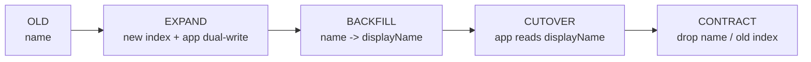
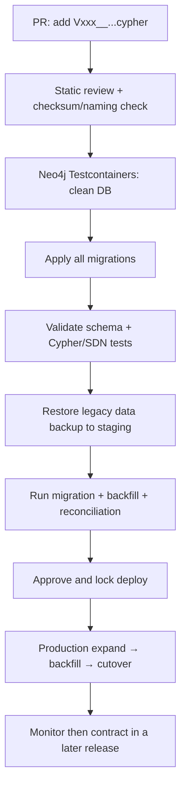

# Managing Model Changes with Versioned Migration Scripts in Neo4j

## 1. Why Does a Graph Also Need Migrations?

Neo4j uses a **property graph** model: nodes have labels and properties, while relationships have types, directions, and properties. Unlike relational databases with fixed tables and columns, Neo4j allows nodes sharing the same label to carry different properties. That brings flexibility, yet **it does not mean the data model can change arbitrarily without version control**.

Suppose a Java/Spring Data Neo4j application currently uses:

```text
(:AppUser {userId: 'u-101', name: 'Lan'})
  -[:MEMBER_OF {role: 'DEV'}]->
(:Project {projectId: 'p-001', title: 'Graph Platform'})
```

The engineering team wants to rename property `name` to `displayName`, add a lookup index, and later change relationship type `MEMBER_OF` to `PARTICIPATES_IN`. These seemingly small changes simultaneously impact:

- Cypher `MATCH`, `MERGE`, `SET`, and `RETURN` statements.
- Spring Data Neo4j `@Node`, `@Property`, `@Relationship`, and `@Id` mappings.
- Indexes, constraints, and business keys used to locate or merge nodes.
- Historical data in production and new data written during deployment.
- Dashboard read queries, ingestion workers, APIs, and integrated systems.
- Rollback procedures if a new application release introduces a bug.

If every developer runs ad-hoc Cypher locally and "remembers" to patch production, environments quickly drift apart. **Versioned migration** solves this by storing change history as **files tracked in Git**, executing them in order, recording applied history, and detecting tampering.

### 1.1. Distinguishing Three Types of Changes

| Change type | Example | Nature |
| --- | --- | --- |
| **Schema/index/constraint** | `CREATE CONSTRAINT`, `CREATE INDEX`, `DROP INDEX` | Alters structural rules and lookup paths |
| **Data migration** | Copying `u.name` to `u.displayName` | Modifies existing records; can be massive |
| **Graph refactoring** | Changing labels, relationship types/directions, splitting/merging nodes | Alters topology and query semantics |

In Neo4j, many "model changes" are **data transformations** rather than pure metadata edits. For instance, renaming a relationship type is not a single catalog alter statement: in practice, you may have to create new relationships, copy properties, verify directions, and only then delete old relationships.

### 1.2. Data Model Migration Differs from Server Version Upgrades

**Model migration** changes an application's labels, types, properties, schemas, and query patterns. **DBMS upgrade** changes the Neo4j server version, store format, Cypher/APIs, and operational layers. Both can happen within a single release program, yet you should **separate planning, testing, and rollback points**.

Starting with Neo4j 2025.01, Neo4j Server uses a year/month (*CalVer*) versioning format. When authoring Cypher migrations, verify syntax against the **target Neo4j/Cypher version** rather than blindly running Neo4j 4.x scripts (`ON ... ASSERT ...`) on newer servers (`FOR ... REQUIRE ...`).

## 2. Principles of Versioned Migration Scripts

Each change is represented as a **migration** with a unique identity, stored alongside source code and reviewed like application changes.

```text
src/main/resources/neo4j/migrations/
    V001__Create_app_user_id_constraint.cypher
    V002__Create_display_name_index.cypher
    V003__Enforce_display_name_presence.cypher
```

This naming convention follows **Neo4j-Migrations**. Other runners may define different naming schemes; what matters is **deterministic ordering and stable identifiers**.

A controlled migration system should track metadata:

| Field | Role |
| --- | --- |
| `version` | Sequential milestone, e.g., `001`, `002`, `003` |
| `description` | Reason and summary of the change |
| `checksum` | Detects edits to an already-applied script |
| `appliedAt` | Completion timestamp |
| `status` / error | Applied, in progress, failed, or needing intervention |
| `target database` | Database targeted by the change, e.g., `appgraph` |
| `tool version` | Useful for compatibility checks and incident triage |

Some fields are managed internally by the migration tool; they **do not necessarily appear as literal property names** inside the database. Never assume a SQL table named `schema_history` exists: Neo4j-Migrations stores history as a **subgraph** inside the schema management database, which may be the target database itself or a separate one.

### 2.1. Versioned Migrations: Applied Once Only

For `V002__Create_display_name_index.cypher`:

1. The runner detects the file has never been applied to the target database.
2. The runner checks prior state/versions.
3. It executes the Cypher using the configured transaction mode.
4. It records completion and the script checksum on success.
5. On future runs, it **skips** scripts already recorded in history rather than re-running arbitrarily.

**Never edit V002 after it has run in any shared environment.** To adjust an index or business rule, create `V004__...`. Modifying V002 and redeploying typically triggers a **checksum mismatch**—which is a legitimate safeguard, not an error to bypass by deleting history.

### 2.2. Repeatable Migrations vs. Versioned Migrations

Some tools support **repeatable migrations**: scripts that re-execute whenever their checksum changes. Use them solely for operations genuinely safe to re-run (such as rebuilding non-destructive derived metadata) and only when ordering relative to versioned migrations is clear.

Never place into repeatable scripts:

- `CREATE (n:...)` without deduplication keys.
- `SET n.counter = n.counter + 1`.
- Unbounded `DELETE`/`DETACH DELETE`.
- Automated relationship conversions that risk dropping properties or duplicating edges.

In this lesson's examples, **all critical migrations are versioned**. Repeatables never replace idempotent logic or impact reviews.

### 2.3. Only One Migration Coordinator Should Run at a Time

If three Spring Boot instances boot simultaneously and all attempt to execute `V003`, you risk DDL collisions, duplicate data migrations, timeouts, and divergent history. You need:

- A **migration tool with verified locking/coordination** on your exact version.
- Or a **dedicated CI/CD migration job** holding a deploy lock and completing before app rollout.
- Never invent a naive Cypher `MERGE (:MigrationLock)` and assume it is a safe distributed lock without solving transactions, leases, crash recovery, and retries.

**Accurate history does not guarantee safe concurrency**: both history recording and change execution must be coordinated. If a cluster leader changes mid-migration, the runner must handle uncertain commit outcomes and inspect history before retrying.

## 3. Assess the Current Model Before Writing Scripts

Suppose the application database `appgraph` currently holds:

```cypher
MERGE (u:AppUser {userId: 'u-101'})
SET u.name = 'Lan'
MERGE (p:Project {projectId: 'p-001'})
SET p.title = 'Graph Platform'
MERGE (u)-[m:MEMBER_OF]->(p)
SET m.role = 'DEV';
```

**Run fixtures only on test databases**; never seed or clean up demo records in production. In production, run **read-only** queries to inspect live data instead:

```cypher
MATCH (u:AppUser)
RETURN count(u) AS totalUsers,
       count(u.userId) AS hasBusinessId,
       count(u.name) AS hasOldName,
       count(u.displayName) AS hasNewName;
```

Read `count(property)` carefully: it **skips nulls**, unlike `count(*)` or `count(u)`. To find missing business keys:

```cypher
MATCH (u:AppUser)
WHERE u.userId IS NULL
RETURN count(u) AS missingUserIds;
```

To find duplicate business IDs:

```cypher
MATCH (u:AppUser)
WHERE u.userId IS NOT NULL
WITH u.userId AS businessId, count(*) AS occurrences
WHERE occurrences > 1
RETURN businessId, occurrences
ORDER BY occurrences DESC, businessId
LIMIT 20;
```

The following query checks duplicate legacy edges per node pair:

```cypher
MATCH (u:AppUser)-[r:MEMBER_OF]->(p:Project)
WITH u.userId AS userId,
     p.projectId AS projectId,
     count(r) AS relationships
WHERE relationships > 1
RETURN userId, projectId, relationships
ORDER BY relationships DESC, userId, projectId;
```

If a user-project pair validly holds **multiple** `MEMBER_OF` relationships representing distinct meanings (such as separate participation terms), `MERGE (u)-[:PARTICIPATES_IN]->(p)` would **accidentally collapse** them during migration. Decide on stable relationship keys or promote them into dedicated membership nodes with unique IDs before writing scripts.

### 3.1. Inventory Existing Schema

```cypher
SHOW CONSTRAINTS
YIELD name, type, entityType, labelsOrTypes, properties
RETURN name, type, entityType, labelsOrTypes, properties
ORDER BY name;
```

```cypher
SHOW INDEXES
YIELD name, type, entityType, labelsOrTypes,
      properties, state, populationPercent
RETURN name, type, entityType,
       labelsOrTypes, properties, state, populationPercent
ORDER BY name;
```

These are administrative Cypher statements requiring appropriate privileges. **Do not mistake Spring Data Neo4j's `@Id` for an existing database uniqueness constraint**. Java annotations govern entity mapping, whereas constraints/indexes are physical schema objects enforced by the Neo4j engine.

In production models, record:

- Identity keys for nodes and relationships, including upstream source identifiers.
- Labels/types used by APIs and ingestion pipelines.
- Existing constraints and exact index/constraint names (including constraint-owned indexes).
- Data volume needing backfill, high-degree node skew, and current write throughput.
- Versions of Neo4j, Cypher 5/25, APOC, Java Driver, Spring Data Neo4j, and the migration runner.

## 4. First DDL Migrations: Business Keys and Indexes

### 4.1. V001 — Enforce `userId` Uniqueness

Contents of `V001__Create_app_user_id_constraint.cypher`:

```cypher
CREATE CONSTRAINT app_user_id_unique IF NOT EXISTS
FOR (u:AppUser)
REQUIRE u.userId IS UNIQUE;
```

Node uniqueness constraints are broadly supported across Neo4j editions; in current releases they are **backed by a range index**. Before creating one, check for duplicate keys and clean up violating records.

**Do not misunderstand `IF NOT EXISTS`:**

- If an equivalent constraint already exists, the statement is a no-op.
- If a conflicting index/constraint name, duplicate data, or incompatible schema exists, it can still fail.
- It **does not merge duplicate nodes** or generate `userId` values for nodes missing IDs.
- Uniqueness does not enforce property presence on every node. To require **both non-null existence and uniqueness**, evaluate a **node key constraint** (Enterprise) and data cleanliness.

On Neo4j Enterprise, you may consider:

```cypher
// Alternative when both existence and uniqueness are required.
// Do not blindly create alongside another constraint on the same schema.
CREATE CONSTRAINT app_user_id_key IF NOT EXISTS
FOR (u:AppUser)
REQUIRE u.userId IS NODE KEY;
```

Choosing uniqueness **or** a key constraint depends on version/edition, existing data, DDL privileges, and domain rules; never copy both onto the same schema without analyzing interactions.

### 4.2. V002 — Create the New Property Index Before Shifting Reads

Contents of `V002__Create_display_name_index.cypher`:

```cypher
CREATE RANGE INDEX app_user_display_name_idx IF NOT EXISTS
FOR (u:AppUser)
ON (u.displayName);
```

Key points:

- An index can be created **before** new data is backfilled. It indexes nodes carrying the property according to index rules.
- Index creation may return before population finishes. Before relying on it in new queries, verify `state = 'ONLINE'`.
- Indexes accelerate matching lookups yet add write overhead during dual-write and backfill.

Verify the index:

```cypher
SHOW INDEXES
YIELD name, type, state, populationPercent
WHERE name = 'app_user_display_name_idx'
RETURN name, type, state, populationPercent;
```

Wait until `ONLINE` before benchmarking or rolling out dependent queries. Never assume every `WHERE u.displayName = $value` query automatically picks the index: the Cypher planner weighs cardinality and predicates; confirm with `EXPLAIN`/`PROFILE`.

### 4.3. Schema Operations Do Not Automatically Rewrite Existing Data

`CREATE INDEX` does not copy `u.name` into `u.displayName`. Nor is there a universal SQL-style `RENAME COLUMN` across all node properties. Model migrations require a **data backfill** step, planning for missing/null nodes and any services still writing the old schema.

## 5. Zero-Downtime Model Migration: Expand → Backfill → Cutover → Contract

A change can roll out across phases:



### 5.1. EXPAND — Add New Structures Without Breaking the Old

Deploy `V001`/`V002`, then put the application into **dual-compatible mode**:

```cypher
// Example read query during the transition phase.
MATCH (u:AppUser {userId: $userId})
RETURN u.userId AS userId,
       coalesce(u.displayName, u.name) AS displayName;
```

When writing a user:

```cypher
MATCH (u:AppUser {userId: $userId})
SET u.name = $newName,
    u.displayName = $newName
RETURN u.userId AS userId;
```

Why is **dual-write** needed? During rolling deployments, old instances still read `name` while new instances read `displayName`. If the new release writes only the new field, old instances miss updates; if old instances write only the old field after backfill, the new field goes **stale**.

**Warning:** true zero-downtime requires controlling when legacy writers retire or continuously syncing both properties. A one-off backfill **cannot** stop an old instance from mutating `name` afterward. In Spring Data Neo4j, merely changing `@Property("name")` to `@Property("displayName")` **does not implement dual-write**; you need explicit custom queries, converters, or service logic.

### 5.2. BACKFILL — Migrate Existing Data

For small datasets, a single Cypher transaction may suffice:

```cypher
MATCH (u:AppUser)
WHERE u.displayName IS NULL AND u.name IS NOT NULL
SET u.displayName = u.name;
```

This copy is **non-destructive to the old field**. Re-running after failure is safe under "fill only if missing" logic, yet it **will not resync** a `displayName` that diverged after a legacy writer modified `name`. Hence dual-write, retiring legacy writers, and pre-cutover reconciliation remain necessary.

For large datasets (millions of nodes), batch to bound memory and locks:

```cypher
MATCH (u:AppUser)
WHERE u.displayName IS NULL AND u.name IS NOT NULL
CALL (u) {
  SET u.displayName = u.name
} IN TRANSACTIONS OF 1000 ROWS;
```

**This is a separate operational backfill job—do not drop it straight into V003 run by a default migration runner.** Neo4j only allows `CALL { ... } IN TRANSACTIONS` inside an **implicit transaction**. Standard versioned runners execute scripts inside explicit transactions, causing failures if mixed. Use `:auto` in Neo4j Browser; in Java Driver, execute via implicit `session.run(...)` and call `consume()` to await completion—**never** inside `executeWrite(tx -> ...)`.

Once a batch commits, earlier batches **do not roll back** if a later batch fails. You need:

- A job/run ID, progress *checkpoint*, and accountable owner.
- Idempotent logic capable of resuming unfinished nodes.
- Counts of processed, remaining, and failed nodes.
- Concurrency limits to avoid lock contention, replication lag, and overload.
- Snapshot/source watermarks if consistency demands an immutable cutoff.

When a backfill scans a massive graph over hours, query plan efficiency and proper indexing/partitioning matter far more than arbitrarily bumping `1000`.

### 5.3. CUTOVER — Shift Readers to the New Schema

After backfill finishes, verify:

```cypher
MATCH (u:AppUser)
WHERE u.name IS NOT NULL AND u.displayName IS NULL
RETURN count(u) AS missingNewName;
```

For every node whose `name` business rules require migrating, expect `missingNewName = 0`.

Check divergent values (across the window where apps synced both fields):

```cypher
MATCH (u:AppUser)
WHERE u.name IS NOT NULL
  AND u.displayName IS NOT NULL
  AND u.name <> u.displayName
RETURN count(u) AS inconsistentNames;
```

Expect `inconsistentNames = 0` when domain rules require both properties to stay identical. If the business intentionally allows `displayName` to differ from `name`, **do not** use this assertion; define domain-specific transforms and expected states.

Once checks pass, deploy the new reader code:

```cypher
MATCH (u:AppUser {userId: $userId})
RETURN u.displayName AS displayName;
```

Keep dual-write active temporarily so application rollback remains viable. Monitor legacy writer counts, nodes missing fields, latency, error rates, and query plans. If external APIs, mobile clients, or downstream pipelines read the model directly, update **every consumer**.

### 5.4. CONTRACT — Remove Legacy Schema in a Controlled Way

Only after all readers/writers have moved to `displayName` and the app rollback window has closed should you remove `name`:

```cypher
// Illustrative on a test copy or after explicit plan approval.
MATCH (u:AppUser)
WHERE u.name IS NOT NULL
REMOVE u.name;
```

On large datasets, run this as a separate checkpointed batch job too. **Removing a property destroys the original data**; rolling back by redeploying the old app will not restore `name`. Before running, ensure verified backups/PITR or proven reconstruction from `displayName` plus formal sign-off.

When a standalone legacy index is no longer used by any query:

```cypher
DROP INDEX app_user_old_name_idx IF EXISTS;
```

**Never run `DROP` without verifying that exact index name is the intended target.** Backing indexes for uniqueness/node-key constraints **belong to the constraint** and must be managed via `DROP CONSTRAINT`, never dropped casually as standalone indexes.

### 5.5. When Should You Add a Mandatory Constraint on the New Property?

On Neo4j **Enterprise**, if business rules require every `:AppUser` to have `displayName`:

```cypher
CREATE CONSTRAINT app_user_display_name_exists IF NOT EXISTS
FOR (u:AppUser)
REQUIRE u.displayName IS NOT NULL;
```

This fits `V003__Enforce_display_name_presence.cypher` **only when**:

1. Backfill is complete.
2. No writer still creates nodes without `displayName`.
3. Invalid legacy records missing the property have been remediated.
4. Your version/edition supports existence constraints.

Otherwise `CREATE CONSTRAINT` fails on violating rows. Never "fix" violations by deleting nodes without data governance approval. Existence constraints can also add validation cost during writes, so factor that into operational windows.

## 6. Renaming Relationship Types Is Topology Migration, Not Just Renaming a Java Field

Another scenario: a service wants to migrate from:

```text
(u:AppUser)-[:MEMBER_OF {role: 'DEV'}]->(p:Project)
```

to:

```text
(u:AppUser)-[:PARTICIPATES_IN {role: 'DEV'}]->(p:Project)
```

There is no generic `RENAME RELATIONSHIP TYPE` Cypher statement applied automatically across the graph. Instead, you **create new relationships, copy properties, switch consumers, and delete old relationships**.

### 6.1. Prepare Mapping Rules

First confirm:

| Dimension | Question |
| --- | --- |
| Identity | Can a `(u,p)` pair have only **one** membership or multiple over time? |
| Direction | Does `AppUser -> Project` stay identical or reverse? |
| Properties | Which `role`, `createdAt`, `sourceId`, `validFrom/validTo` fields must be copied? |
| Duplicates | Can the same pair hold multiple legacy relationships with different properties? |
| Consumers | Which queries, GDS projections, reports, or APOC procedures filter on the old type? |
| Rollback | While old app instances run, must both old and new types coexist? |

If historical data permits multiple memberships between the same two nodes, **do not** `MERGE` solely by endpoints without adding a discriminator key. This example holds only when business rules allow **at most one membership per user-project pair**.

### 6.2. Create New Relationships While Keeping Old Ones

In a test database where uniqueness and single-relationship-per-pair rules were verified:

```cypher
MATCH (u:AppUser)-[old:MEMBER_OF]->(p:Project)
MERGE (u)-[new:PARTICIPATES_IN]->(p)
ON CREATE SET new = properties(old);
```

Meaning:

- `MATCH` reads every legacy `MEMBER_OF` edge.
- `MERGE` ensures the new edge exists for that node pair within the matched pattern.
- `ON CREATE SET new = properties(old)` copies properties when **newly creating** the edge.
- **Does not delete** `old`: older application releases continue working during expand/backfill.

**Important caveat:** if `new` already existed with stale properties, `ON CREATE SET` will not update it; add a reconciliation query or property-merge policy. If multiple `old` edges connect the same pair, this query can collapse business distinctions or pick arbitrary properties. Never assume accuracy just because total relationship counts match.

### 6.3. Verify the Graph Post-Migration

```cypher
MATCH (:AppUser)-[r:MEMBER_OF]->(:Project)
RETURN count(r) AS oldCount;
```

```cypher
MATCH (:AppUser)-[r:PARTICIPATES_IN]->(:Project)
RETURN count(r) AS newCount;
```

Under one relationship per pair and unchanged scope, counts should match. Also check pairs having only the old type:

```cypher
MATCH (u:AppUser)-[old:MEMBER_OF]->(p:Project)
WHERE NOT EXISTS {
  MATCH (u)-[:PARTICIPATES_IN]->(p)
}
RETURN u.userId AS userId,
       p.projectId AS projectId,
       old.role AS oldRole
ORDER BY userId, projectId
LIMIT 100;
```

Expect **0 rows**. Also reconcile `role` and other properties per domain rules, not counts alone.

Query detecting property drift on new relationships:

```cypher
MATCH (u:AppUser)-[old:MEMBER_OF]->(p:Project)
MATCH (u)-[new:PARTICIPATES_IN]->(p)
WHERE old.role <> new.role
RETURN u.userId AS userId,
       p.projectId AS projectId,
       old.role AS oldRole,
       new.role AS newRole;
```

Remember `<>` does not return `true` when either side is `null`. If `role` is nullable, add explicit null checks (e.g., comparing `old.role IS NULL` against `new.role IS NULL`). To compare **all** properties, normalize maps/keys and verify at the appropriate layer.

### 6.4. Switch Code and Remove Legacy Relationships

During compatibility phases, queries can read both types:

```cypher
MATCH (u:AppUser {userId: $userId})
      -[r:MEMBER_OF|PARTICIPATES_IN]->
      (p:Project)
RETURN DISTINCT p.projectId AS projectId
ORDER BY projectId;
```

`DISTINCT` is needed when both relationship types coexist; otherwise a project appears twice. However, never abuse `DISTINCT` to hide genuine duplicate edges: in membership counts or event handlers, clarify whether you are counting **participants** or **relationships**.

Only after every consumer has switched, app dual-write has stopped cleanly, and backups/rollback plans are ready:

```cypher
// Run ONLY after approval; example for migrated objects.
MATCH (:AppUser)-[old:MEMBER_OF]->(:Project)
DELETE old;
```

For large relationship volumes, run a **batch job** rather than putting a full-graph delete inside an application request. Because endpoint nodes belong to other relationships, use `DELETE old` so nodes stay intact; **never use `DETACH DELETE`** when replacing relationship types.

### 6.5. Changing Node Labels Also Requires Two Compatibility Steps

Suppose nodes carry legacy label `:LegacyUser` and must move to `:AppUser`. During expand/backfill, **add** the new label while retaining the old one:

```cypher
MATCH (u:LegacyUser)
SET u:AppUser;
```

A node carrying **two labels** remains the exact same node—no duplicate is created. Inspect `AppUser` constraints/indexes before broad execution: newly labeled nodes might collide on `userId` with existing `AppUser` nodes, causing constraints to reject the transaction.

Only once every app, query, import, and GDS projection reads the new label should you consider:

```cypher
// Run only after verification in a test environment.
MATCH (u:LegacyUser:AppUser)
REMOVE u:LegacyUser;
```

On large graphs, batch both steps with checkpoints. Never run `DELETE u` to "remove the old label"—that deletes **the node and all its data/relationships**, not just the label. Likewise, changing `@Node("AppUser")` in Java **does not automatically rewrite stored database labels**.

## 7. Choosing an Execution Tool: Neo4j-Migrations, Liquibase, or Custom Runner?

### 7.1. What Is Neo4j-Migrations?

**Neo4j-Migrations** is a Neo4j Labs ecosystem project inspired by Flyway that operates over the **Neo4j Java Driver/Bolt**. It is neither built into `neo4j-admin` on every Neo4j server nor a default feature of Spring Data Neo4j.

Its components include:

- **CLI** for applying/inspecting status from pipelines or operator workstations.
- **Core Java API** for programmatic integration and custom migrations.
- **Spring Boot starter** and **Maven plugin** per compatible tool version.
- **Versioned Cypher scripts**, alongside other migration formats.
- **Migration history** with checksums and concurrency guards.

Neo4j Labs 2.0 documentation notes a default migration location of `classpath:neo4j/migrations` for Java/Spring integrations; the CLI requires specifying the location explicitly. Before adopting it, select a **Neo4j-Migrations release actually compatible with your Neo4j Server, Java, and Spring Boot versions**; never copy stale dependency versions from old blog snippets.

### 7.2. File Naming and Ordering Conventions

```text
src/main/resources/neo4j/migrations/
  V001__Create_app_user_id_constraint.cypher
  V002__Create_display_name_index.cypher
  V003__Enforce_display_name_presence.cypher
  V004__Create_participation_indexes.cypher
```

Under Neo4j-Migrations conventions:

- `V` marks a **versioned migration**.
- The numeric segment controls deterministic ordering (e.g., `001`, `002`, or segmented versions).
- `__` is **two underscores** separating version and description.
- `.cypher` is the Cypher migration file extension.
- The description clearly summarizes a cohesive change unit.

Keep versions **unique** and never modify applied files; review script contents and preconditions for every migration. If two Git branches both create a `V004` with different contents, **resolve the version collision before merging**.

**Caution:** `V003` can only run after backfill and verification; if your deployment pipeline auto-runs every `V` file on startup, it may execute prematurely. Separate stages across releases or configure controlled migration locations/flags. **Placing V001–V004 into the same release does not magically create zero-downtime.**

### 7.3. Common CLI Commands

Syntax examples (assuming a compatible CLI version installed; endpoint and username are samples):

```bash
# View help for the exact installed version.
neo4j-migrations --help

# List applied and pending migrations.
neo4j-migrations \
  --address neo4j+s://graph.internal.example:7687 \
  --username migration_runner \
  --database appgraph \
  --location file:./migrations \
  info

# Validate history and checksums.
neo4j-migrations \
  --address neo4j+s://graph.internal.example:7687 \
  --username migration_runner \
  --database appgraph \
  --location file:./migrations \
  validate

# Apply pending migrations (in an approved environment).
neo4j-migrations \
  --address neo4j+s://graph.internal.example:7687 \
  --username migration_runner \
  --database appgraph \
  --location file:./migrations \
  migrate
```

Never place real passwords on the command line or in source control; inject credentials via **CLI/runtime/CI secret managers**. Commands may prompt for credentials or require extra auth configuration before connecting. Do not execute these inside lesson directories: they illustrate a **DBA-authorized pipeline**.

In the Neo4j-Migrations CLI, `migrate`/`apply` manages **history**, unlike `run --migration ...` which acts as a one-off script runner that may **omit migration history** and skip idempotency tracking. Never use `run` as a substitute for versioned tracking when applied state must be audited.

The tool's `clean` command can wipe migration metadata; **never** treat it as a "schema rollback" or proper fix for checksum mismatches. Manually editing or deleting history blinds the system to its actual state.

### 7.4. Alternatives and Custom Runners

Alternatives include the Neo4j plugin for **Liquibase** or internal runners. Regardless of tool choice, require at minimum:

1. Explicit migration versioning and ordering.
2. Per-**target-database** history and checksums to detect drift.
3. Single-runner locking and crash recovery mechanisms.
4. Separation between transactional DDL, multi-transaction data backfills, and out-of-band tasks.
5. Logging, error reporting, auditing, and ability to **halt deployment** on failure.
6. Pre/post-conditions, multi-edition/version testing, and rollback policies.

**Relational/JDBC Flyway does not natively manage Neo4j versioned migrations** without a supporting integration. Nor should you assume Hibernate `ddl-auto=update` or Spring Data Neo4j `save(...)` manages Neo4j schemas on your behalf.

## 8. Transactions, Backfills, and Re-Run Safety

### 8.1. One Migration File Is Not Always One Transaction

Per Neo4j-Migrations docs, Cypher statements inside a script execute in **a single transaction** by default per configuration. Transaction behavior differs when:

- The runner selects transaction-per-statement mode.
- The script contains database admin commands needing a separate context.
- Data volume demands moving work to a standalone backfill job.
- A workflow spans app deployment, DDL, data migration, verification, and cleanup.

Never assume "the script has 50 Cypher statements so they always roll back together" if the runner commits per statement or spans multiple transactions. Know your runner's exact transaction boundaries.

### 8.2. Why `CALL ... IN TRANSACTIONS` Needs Its Own Process

```cypher
MATCH (u:AppUser)
WHERE u.displayName IS NULL AND u.name IS NOT NULL
CALL (u) {
  SET u.displayName = u.name
} IN TRANSACTIONS OF 500 ROWS;
```

This query executes batches as **inner transactions**. If batch 7 fails, batches 1–6 **already committed** and do not roll back; remaining rows must be resumed. Therefore:

- A `Vxxx` migration marker **does not automatically represent** completion of every batch.
- Maintain a job-managed progress table/graph or durable audit log (without mutating the migration tool's history).
- Write idempotent queries and verify record counts actually reach the target state.
- Jobs should fail loudly and **block cutover** if incomplete; never log "success" merely because execution started.

If a data migration touches hub nodes or shared edges, large/concurrent batches can trigger lock contention or deadlocks. Increase concurrency only with disjoint partition keys and load testing.

### 8.3. Checkpoint by Business Key, Not Internal ID

A large pipeline can partition by an indexed/constrained `userId` and track:

```text
jobId: rename-app-user-name-2026-11
targetDatabase: appgraph
lastCompletedBusinessId: u-0800000
processed: 800000
failed: 0
sourceModelVersion: v-old
targetModelVersion: v-new
```

These fields are **example metadata**, not automatically generated by Cypher. On resume, the runner must verify whether new source rows entered below the watermark, keep input ordering deterministic, and safely skip already-migrated rows. Never use `id(n)` or `elementId(n)` as long-term keys because they can shift across database lifecycles.

Another option is filtering `WHERE u.displayName IS NULL` in loops until count reaches 0, while still preventing old writers from reintroducing stale values and budgeting index/scan cost on large graphs.

### 8.4. Never Bypass Collisions by Dropping Validation

Migrations fail due to:

- Duplicate business IDs.
- Missing required properties.
- Index/constraint names already claimed by other objects.
- Insufficient schema privileges.
- Transaction rollbacks, deadlocks, timeouts, or writer/quorum loss.

The proper response is to **inspect actual state**, fix underlying data or preconditions, and re-run per runbook—never edit checksums/history to force a "green" pipeline without the intended schema.

## 9. Spring Data Neo4j and Application Compatibility Planning

### 9.1. Java Mappings Can Change Before Data Does

Legacy class example:

```java
@Node("AppUser")
public class AppUser {
    @Id
    private String userId;

    @Version
    private Long version;

    @Property("name")
    private String displayName;
}
```

When changed to:

```java
@Property("displayName")
private String displayName;
```

SDN begins reading/writing **a different database property**. This **is not** a data rename command and does not make rolling deployments safe. You need a controlled dual-read/dual-write phase (such as custom `Neo4jClient` queries, transition services, or adapters) before retiring the old field.

**Note on entity versioning:** when using natural business IDs with SDN, `@Version` detects new entities and enforces optimistic locking. Never mutate `version` blindly inside backfill scripts without analyzing repository concurrency impact; if an external pipeline modifies rows without bumping/coordinating `version`, applications can overwrite new fields with stale object state. Define clear write ownership and transaction boundaries.

### 9.2. An API Supporting Both Old and New

Example service reading users while preferring the new property:

```java
import java.util.Map;
import java.util.Optional;
import org.springframework.data.neo4j.core.Neo4jClient;
import org.springframework.stereotype.Service;

@Service
public class AppUserReadService {
    private final Neo4jClient neo4jClient;

    public AppUserReadService(Neo4jClient neo4jClient) {
        this.neo4jClient = neo4jClient;
    }

    public Optional<String> displayName(String userId) {
        return neo4jClient.query("""
            MATCH (u:AppUser {userId: $id})
            RETURN coalesce(u.displayName, u.name) AS displayName
            """)
            .bind(userId).to("id")
            .fetchAs(String.class)
            .mappedBy((typeSystem, record) ->
                record.get("displayName").asString()
            )
            .one();
    }
}
```

This snippet illustrates transition-phase reads; if both properties are null, `record.get(...).asString()` can fail. Production code must handle null checks, missing-data rules, and exact types. Once every node holds `displayName`, simplify the query to the single new property.

### 9.3. Zero-Downtime Deployment Matrix

| Phase | Application version | Database | Safety condition |
| --- | --- | --- | --- |
| Before change | App v1 reads/writes `name` | Only `name` exists | Complete baseline/backup |
| Expand | App v1 and v2 support dual-read/write | New index present, `name` intact | v2 does not require `displayName` to be non-null |
| Backfill | v2 covers all writers or equivalent sync runs | Gradually populates `displayName` | Checkpointed job; no legacy writer skewing values |
| Cutover | App v3 reads `displayName`, temporarily keeps dual-write | Both properties still exist | Verification PASS; app rollback remains viable |
| Contract | App v4 uses only `displayName` | Drop `name` and old index | All consumers switched; backup and approval ready |

**Never label a rollout zero-downtime** if constraint creation blocks queries too long, data migration saturates writers, or an older app version keeps writing the old field after the new field becomes the source of truth.

## 10. Testing Migrations in CI/CD and Staging

### 10.1. Recommended Pipeline Flow



Testing **on a blank database** is necessary yet insufficient: production holds duplicates, nulls, odd relationships, and historical anomalies absent from clean fixtures. **Testing on a scrubbed production copy or approved staging backup** uncovers real backfill issues.

### 10.2. Mandatory Tests for Schema Migrations

**Before migration**:

```cypher
MATCH (u:AppUser)
WITH u.userId AS id, count(*) AS n
WHERE id IS NOT NULL AND n > 1
RETURN count(*) AS duplicateKeyGroups;
```

Expect 0 before creating a uniqueness constraint. Next:

```cypher
SHOW CONSTRAINTS
YIELD name, type, labelsOrTypes, properties
WHERE name = 'app_user_id_unique'
RETURN name, type, labelsOrTypes, properties;
```

Expect the constraint to match label `AppUser` and property `userId`, **not merely** a similar name. Verify the index:

```cypher
SHOW INDEXES
YIELD name, state, populationPercent, labelsOrTypes, properties
WHERE name = 'app_user_display_name_idx'
RETURN name, state, populationPercent, labelsOrTypes, properties;
```

Expect `state = 'ONLINE'` and matching schema configuration.

**After backfill**:

```cypher
MATCH (u:AppUser)
RETURN count(u) AS total,
       count(u.displayName) AS hasDisplayName,
       count(u.name) AS hasOldName;
```

State the business rule explicitly: if every `AppUser` must have a name, `total` must equal `hasDisplayName`. If valid anonymous users exist, segment them in the test instead of forcing non-null values everywhere.

### 10.3. JUnit Example Using Neo4j Java Driver

In a test where the pipeline provisioned the database and **applied V001/V002**, assert:

```java
import static org.junit.jupiter.api.Assertions.*;
import org.junit.jupiter.api.Test;
import org.neo4j.driver.Driver;
import org.neo4j.driver.Session;
import org.neo4j.driver.SessionConfig;

class MigrationVerificationTest {
    private final Driver driver;

    MigrationVerificationTest(Driver driver) {
        this.driver = driver;
    }

    @Test
    void appUserIdConstraintShouldExist() {
        try (Session session = driver.session(
                SessionConfig.forDatabase("appgraph"))) {
            long count = session.run("""
                SHOW CONSTRAINTS
                YIELD name
                WHERE name = 'app_user_id_unique'
                RETURN count(*) AS n
                """).single().get("n").asLong();
            assertEquals(1L, count);
        }
    }

    @Test
    void displayNameIndexShouldBeOnline() {
        try (Session session = driver.session(
                SessionConfig.forDatabase("appgraph"))) {
            String state = session.run("""
                SHOW INDEXES
                YIELD name, state
                WHERE name = 'app_user_display_name_idx'
                RETURN state
                """).single().get("state").asString();
            assertEquals("ONLINE", state);
        }
    }
}
```

This example shows **verification logic**, not a zero-setup standalone class: `Driver` must be injected by a JUnit extension/fixture or Testcontainer, database `appgraph` must exist, and the runner must have migrated it. Also assert constraint type/schema, not just name, in official suites. Do not infer from `@Test` here that every environment has Docker or `SHOW CONSTRAINTS` privileges.

For end-to-end app verification, add integration tests exercising `repository.save(...)`/`MATCH` on the new SDN model, uniqueness violations, and queries over the new relationship type. Test failure recovery during backfill by interrupting the job midway and **resuming**, verifying zero duplicate nodes or edges.

### 10.4. Migration Status Must Gate Releases

In CI/CD, halt rollout if:

- Migrations are missing, duplicated in version, or checksums changed.
- DDL fails or an index remains `POPULATING` when the release depends on it.
- Backfill is incomplete or checkpoints failed.
- Post-checks reveal records still violating the new model.
- No backup/rollback runbook exists for destructive data or constraint removals.
- An older service or external consumer still reads labels/properties/types slated for deletion.

Never ship a broken migration to production expecting the new app to silently "patch" records on every incoming request.

## 11. Rollback, Roll-Forward, and Recoverability

### 11.1. Not Every Migration Has a Safe `down()` Script

| Change | Reversible via DDL? | Risk |
| --- | --- | --- |
| Create new index | Usually `DROP INDEX` by exact name | Loses new query performance; dropping wrong backing index errors |
| Create uniqueness constraint | Approved constraint drop possible | Duplicates can re-enter while constraint is absent |
| Copy `name` to `displayName`, keep `name` | App can revert to reading old field | Values diverge if dual-write was incomplete |
| Remove `name` from all nodes | **Cannot automatically** recover deleted values | Must rely on backups, external sources, or proven inverse transforms |
| Merge nodes / delete legacy edges | Often irreversible | Original IDs, directions, properties, and events may be lost |
| Multi-transaction backfill | Does not roll back whole job | Committed batches persist; requires resume or compensation |

**Roll-forward** is usually safer than "tampering with migration history": author a new fix migration, or deploy a compatible app version and resume backfill. To return to an earlier data point, restore via backups/PITR and the database runbook, accounting for valid updates written after the restore point.

### 11.2. Incident Procedure for Failed Migrations

1. Halt running migration agents and app rollouts; preserve logs and original errors.
2. Identify the exact file/version, transaction boundaries, and whether batches committed.
3. Inspect migration history **through the tool**, never manually editing metadata nodes.
4. Compare real schema with `SHOW INDEXES`/`SHOW CONSTRAINTS` and real data via reconciliation queries.
5. Classify root cause: constraint-violating data, missing privileges, connection/leader loss, version syntax mismatch, or partial batch.
6. Choose **resume** if idempotent, **a new corrective migration** if semantics shifted, or **restore** if critical data was corrupted.
7. Run post-verification, validate apps against source data, and decide whether to proceed with rollout.

Never run `DELETE` on migration history nodes, run `clean`, or bypass checksums solely to turn a pipeline green. If state repair is truly required, get DBA approval, take backups, verify history, and audit-log the action; each tool's repair API has strict rules.

### 11.3. Backups and PITR Must Exist Before Contract

Before dropping old properties, deleting relationships, or merging nodes:

- Create/verify edition-appropriate backups (online backup for Enterprise; offline dump per rules for Community).
- Pin recovery timestamp/transaction ID; verify backup chain, format, and version.
- Run a **restore drill** in an isolated environment on representative data.
- Define RPO/RTO and time budget for **replaying valid events** if restoring earlier.
- Designate a cutover decision maker to sign off on post-recovery data integrity.

Cluster replication **does not replace backups**: erroneous `DELETE` or `REMOVE` operations faithfully replicate across primaries and secondaries. On AuraDB, snapshot/restore policies and permissions depend on service tier rather than running `neo4j-admin` on self-managed hosts.

## 12. Multiple Environments, Multiple Databases, and Clusters

### 12.1. Never Share One History Without Distinguishing Target Databases

Neo4j Enterprise can host `system`, `appgraph`, `analytics`, and per-tenant databases. Each database has its own:

- Model and dataset.
- Indexes and constraints.
- Rollout schedule and migration lag.
- Migration runner roles and permissions.

Neo4j-Migrations supports separating the **target database** and **schema/history database** in configuration. When one schema database tracks multiple targets, maintain explicit target IDs. Never treat "`V002` ran on `appgraph`" as proof that `analytics` already has the same index.

### 12.2. Clusters: Migrations Must Target a Valid Writer

In a Neo4j Enterprise cluster, each database has primaries and **one writer/leader at a time**. Runners should use routing URIs like `neo4j+s://...`, target the exact database, and hold required schema/write privileges. During quorum loss, leader elections, or read-only states:

- Migrations may fail transiently or block.
- Retries must check commit/history state; never blindly re-run a completed migration after a network timeout.
- Heavy backfills can elevate replication lag, disk I/O, and app write latency.
- Never launch independent runners against every primary as if they were separate databases.

When targeting multiple tenant databases, pipelines must **enumerate and verify each target** strictly within approved boundaries; never use unchecked wildcards to run destructive scripts.

### 12.3. Least Privilege for the Migration Identity

The migration service account should hold tailored **RBAC** (*role-based access control*) privileges:

- `CREATE/DROP INDEX` and `CREATE/DROP CONSTRAINT` on the target DB only.
- Read/write access to nodes, relationships, and properties needed for backfill.
- Schema inspection via `SHOW INDEXES`/`SHOW CONSTRAINTS`.
- Access to the separate history database if split, plus migration metadata management.
- Database/user administration privileges **only when** migrations legitimately manage those objects.

Never grant full DBMS admin to the runtime application solely to run startup migrations. Separate **the migration runner identity** from `app_reader`/`app_writer` accounts in operations.

## 13. Common File-Based Migration Errors

| Symptom | Cause | Mitigation |
| --- | --- | --- |
| Environment A has constraint, B lacks it | Manual Cypher bypassed migration runner | Reconcile schemas and track all changes in history |
| Same `V002`, different checksum | Someone edited an applied migration | Restore original file; add a new migration |
| New app doesn't see `displayName` | Changed `@Property` without backfilling | Expand/dual-read/write/backfill and verify |
| `CREATE CONSTRAINT` fails | Duplicates, missing properties (key/existence), or name/schema conflict | Clean data and inspect exact constraint conflict |
| `IF NOT EXISTS` "succeeds", yet schema differs | Another constraint/index blocked creation | `SHOW INDEXES/CONSTRAINTS`, inspect exact signatures |
| Index stays `POPULATING` | Index population still running | Wait for `ONLINE` before latency-sensitive queries |
| Batch 80% done, runner errors | Inner transactions committed partially | Resume via checkpoint/idempotency; never mark complete |
| App migrations run from multiple instances | Missing orchestration or strong lock | Single CI/CD job or proper runner coordination |
| User name updates lost during rolling deploy | Old writers update `name` while v2 reads `displayName` | Enforce dual-write and monitor all writers |
| Renaming relationship type duplicates results | Readers match both old/new or duplicate edges exist | Apply domain deduplication and verify endpoints/properties |
| `MERGE` collapses valid multiple memberships | Missing relationship business key | Design relationship IDs or temporal membership nodes |
| Old app rollback fails to read DB | Contract already dropped old properties/types | Delay contract, keep backups/PITR, and plan forward fixes |
| Neo4j-Migrations `run` shows no history | Script runner omits versioned history | Use `migrate/apply` per documentation |
| DDL succeeds, yet old queries time out | Index/plan changed or resource contention | Benchmark, stage rollouts, and inspect `PROFILE` |
| Migration fails after leader failover | Uncertain transaction outcome | Check history/schema/data before safely retrying |
| Tests PASS on empty DB, FAIL in production | Production holds duplicates/nulls/legacy edges | Test on PII-scrubbed production clones |

## 14. Hands-On Exercise: End-to-End Versioned Change

Execute on a **test Neo4j database** using Neo4j-Migrations or a safely configured runner.

1. **Seed legacy graph:** two `:AppUser` nodes with `userId` and `name`, one `:Project`, and `:MEMBER_OF` edges carrying `role`.
2. **Audit data:** run `MATCH ... count(*)`, check missing/duplicate user IDs, and count relationships per pair. Explain when `MERGE` would wrongly collapse edges.
3. **Write V001:** create uniqueness constraint `app_user_id_unique`. Run runner, inspect history. Re-run runner and confirm the applied migration **does not re-execute**.
4. **Write V002:** create range index `app_user_display_name_idx`. Check `SHOW INDEXES` and wait for `ONLINE`.
5. **Expand:** update demo app to read `coalesce(u.displayName, u.name)` and write both properties.
6. **Backfill:** run single-transaction backfill on small data, or `CALL (u) ... IN TRANSACTIONS` in an implicit transaction on large data. Count nodes holding `displayName`.
7. **Drift check:** simulate a legacy writer modifying `name` after backfill; observe why property migration cannot be considered done until every writer is controlled.
8. **Cutover:** once all writers are compatible, switch readers to `displayName` only. Run Cypher and Spring Data Neo4j integration tests.
9. **V003:** if data is valid and Enterprise is available, create an existence constraint on `displayName`. Explain why running it before backfill would fail.
10. **Relationship migration:** in an environment with one membership per pair, create `PARTICIPATES_IN` from `MEMBER_OF`, reconciling counts, properties, and directions.
11. **Contract:** only inside the backed-up demo DB, drop `name` and the old edge type, confirming no queries still depend on legacy fields.
12. **CI verification:** run against both an empty database **and** a database holding legacy data. Edit the already-applied V001 to observe the checksum mismatch error, then restore the original file and add a new version instead of altering history.

### Self-Assessment Questions

- Why does `IF NOT EXISTS` provide idempotency yet **not replace** migration history and checksums?
- Why should a `V002` file already applied to production never be edited directly?
- Why can't a `CALL ... IN TRANSACTIONS` backfill run inside a migration runner's default managed explicit transaction?
- What happens if you add an existence constraint while nodes missing `displayName` still exist?
- Why can't changing relationship type from `MEMBER_OF` to `PARTICIPATES_IN` be done solely by editing `@Relationship` annotations?
- Why doesn't rolling back the application version restore data after `REMOVE` deleted a property?
- When three Spring Boot instances start simultaneously, who should hold authority to run migrations?

**Completion criteria:** learners can manage scripts by version and checksum, audit graphs before changes, apply DDL/indexes/constraints accurately, execute expand–backfill–cutover–contract, handle partial batches, identify relationship-migration risks, and ensure CI/CD + backup/rollback readiness before deleting legacy data.

## Official and Tooling References

- [Neo4j Cypher Manual — Constraint syntax](https://neo4j.com/docs/cypher-manual/current/schema/syntax/): `CREATE/DROP CONSTRAINT`, index-backed constraints, and `IF NOT EXISTS` behavior.
- [Neo4j Cypher Manual — Create constraints](https://neo4j.com/docs/cypher-manual/current/schema/constraints/create-constraints/): uniqueness, existence, key constraints, and violating data.
- [Neo4j Cypher Manual — Index syntax](https://neo4j.com/docs/cypher-manual/current/indexes/syntax/): `CREATE RANGE INDEX`, `DROP INDEX`, and schema/index names.
- [Neo4j Cypher Manual — Show indexes](https://neo4j.com/docs/cypher-manual/current/indexes/search-performance-indexes/managing-indexes/): `SHOW INDEXES`, `ONLINE` states, and index population.
- [Neo4j Cypher Manual — CALL subqueries in transactions](https://neo4j.com/docs/cypher-manual/current/subqueries/subqueries-in-transactions/): implicit transactions, partial commits, and batch updates.
- [Neo4j Upgrade and Migration Guide](https://neo4j.com/docs/upgrade-migration-guide/current/): version changes, Cypher compatibility, and upgrade test planning.
- [Neo4j Labs — Neo4j-Migrations](https://neo4j.com/labs/neo4j-migrations/): overview of the Java/CLI/Spring migration tool.
- [Neo4j-Migrations — Concepts](https://neo4j.com/labs/neo4j-migrations/2.0/concepts/): versioned scripts, checksums, history, schema database, and transactions; verify against your exact tool version.
- [Neo4j-Migrations — Usage](https://neo4j.com/labs/neo4j-migrations/2.0/usage/): CLI `info`, `validate`, `migrate` vs. `run`.
- [Spring Data Neo4j — Object mapping](https://docs.spring.io/spring-data/neo4j/reference/object-mapping/metadata-based-mapping.html): mapping `@Node`, `@Property`, `@Relationship`, and IDs from Java.
- [Neo4j Java Driver Manual — Transactions](https://neo4j.com/docs/java-manual/current/transactions/): managed/implicit transactions, commits, and retries.
