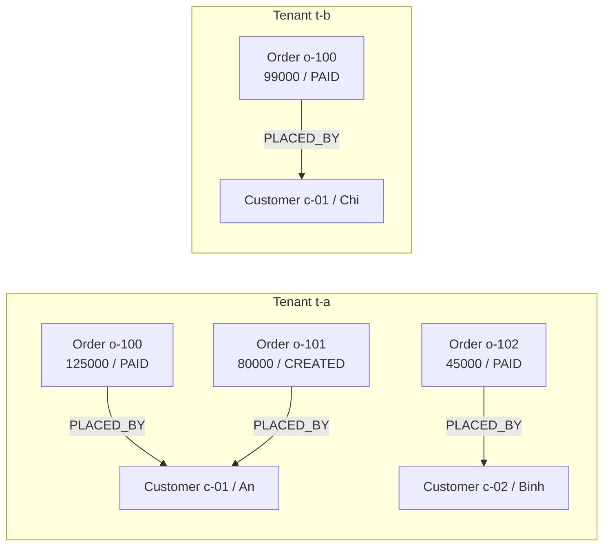
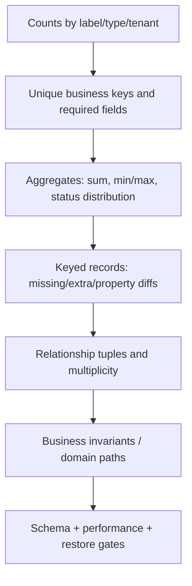
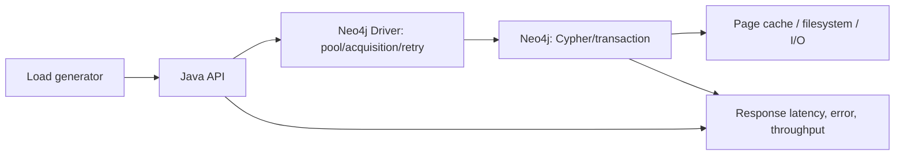
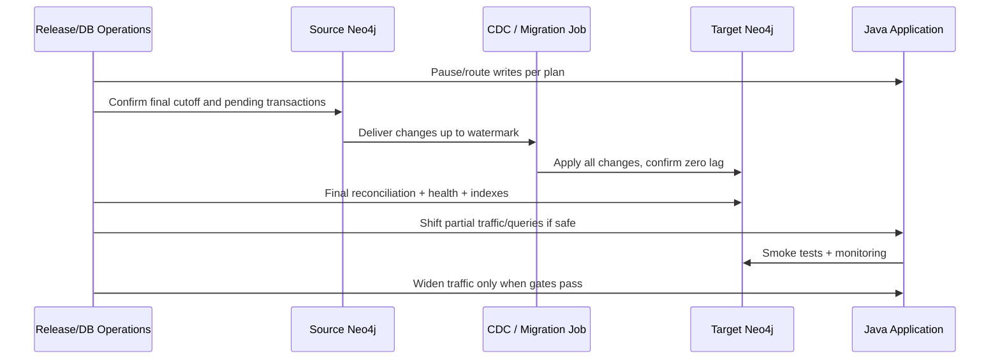

# Reconciling Data, Measuring Performance, and Defining Rollback Criteria During Neo4j Upgrades and Migrations

## 1. A "Working" Upgrade Is Not Automatically Successful

Neo4j stores data as a **property graph**: nodes represent entities, relationships represent links, and properties hold business values. Applications use Cypher, **Neo4j Java Driver**, and **Spring Data Neo4j** to read, write, and traverse graphs. When moving a database to a new environment or upgrading Neo4j, seeing the database report `ONLINE` proves only a fraction of technical health; it does not guarantee **zero data loss, preserved relationship semantics, or unchanged application speed**.

For example: after a migration, node counts match, yet `PLACED_BY` relationships for two orders were wired to customers in different tenants. A simple `count(n)` check misses this completely. In another case, the graph loses no data, yet an index is not ready, pushing order-lookup API P99 from 150 ms to 900 ms. Both cases must count as **failed acceptance criteria**, even though the application connects successfully.

This lesson belongs to the **Upgrades and Migration** chapter of the `DATABASE_ENGINE_GRAPH_NEO4J` module. Its focus spans three questions:

1. **Data reconciliation:** Are source and target equivalent across entities, relationships, properties, constraints, and business invariants?
2. **Performance measurement:** Does the new version/environment meet throughput, latency, and resource budgets under identical workloads?
3. **Rollback criteria:** When can you proceed, when must you pause, when should you *forward-fix*, and when must you restore from a verified recovery point?

### Learning Objectives

After this lesson, you will be able to:

- Design a **reconciliation manifest** covering scope, data cutoff, business keys, and pass/fail criteria.
- Reconcile node/relationship counts, duplicate keys, properties, edge directions, endpoints, multiplicity, and graph invariants.
- Distinguish **point-in-time dataset matching** from naive counting across two live databases accepting concurrent writes.
- Organize measurements for `EXPLAIN`/`PROFILE`, P50/P95/P99, CPU, heap, page cache, I/O, and transaction latency.
- Establish **GO/NO-GO** gates and **pause/rollback/forward-fix/restore** decisions with clear owners and evidence.
- Understand why **rolling back app images, rolling back schemas, and restoring databases** are distinct actions.

> **Version note:** Examples below use common **Neo4j 5.x** syntax. Upgrade paths, store formats, clustering, CDC, administrative procedures, and downgrade options vary by version and edition. Never apply a single "rolling upgrade" or "downgrade" runbook blindly across all version pairs. Technical checks in this step do not replace testing on real Neo4j running your target build.

## 2. Before Testing, Define Exactly What You Are Migrating

| Change type | What actually changes | Risk that must be proven safe |
| --- | --- | --- |
| Neo4j Server upgrade | Binary, config, potentially store format and planner behavior | Database opens cleanly, Driver/plugin compatibility, no query regressions |
| Infrastructure move | Hosts, containers, PVCs, clusters, or deployment regions | Complete data/metadata, networking/TLS/RBAC, RPO/RTO |
| Data migration | Reloading nodes, relationships, IDs, and properties | Zero loss/duplicates, exact edge directions, tenants, and types |
| Application schema change | Properties, labels, relationship types, indexes/constraints | New invariants, old/new app compatibility, complete backfill |
| Access path change | Cypher queries, Java Driver, Spring Data Neo4j | Accurate results, no load spike or transaction failures |
| Single-node to cluster | Topology, routing, primary/secondary roles | Write availability, quorum, required read consistency, failover |

A release can combine multiple change types. Whenever possible, **split into observable steps**: create indexes first, backfill next, switch applications afterward, and delete legacy structures only once the rollback window closes.

**Do not equate**:

- *Data exists* with *data is business-correct*.
- *Query returns 10 correct rows* with *query meets performance under real load*.
- *One pod is Ready* with *database serves proper roles and holds quorum*.
- *Reverting image to old version* with *returning the database to its prior state*.

## 3. Build a Reconciliation Contract Before Starting

Every migration must agree on **baselines and acceptance criteria before** execution begins.

### 3.1. Essential Fields in a Reconciliation Manifest

```yaml
reconciliationRun:
  runId: mig-2026-11-25-01
  source:
    database: neo4j
    environment: source-cluster
  target:
    database: neo4j
    environment: target-cluster
  dataCutoff: "2026-11-25T00:00:00Z"
  consistencyStrategy: writer-freeze-or-verified-change-capture
  scopes:
    - MigCustomer
    - MigOrder
    - PLACED_BY
  keys:
    MigCustomer: [tenantId, customerId]
    MigOrder: [tenantId, orderId]
  gates:
    duplicateBusinessKeys: 0
    missingBusinessEntities: 0
    incorrectRelationships: 0
    propertyMismatches: 0
  evidence:
    rowLevelDiff: required
    schemaCheck: required
    performanceBaseline: required
    restoreDrill: required
```

This is an **illustrative manifest template**, not a file Neo4j reads natively. In real projects, add **Neo4j/Driver/plugin versions, index configs, write-freeze time or verifiable watermarks, run owner, report storage location, checksums, and backup IDs**.

### 3.2. Four Categories of Acceptance Criteria

| Category | What must hold | Source of evidence |
| --- | --- | --- |
| Data | Exact entity counts, keys, properties, and topology | Cypher + source/target keyed-row diffs |
| Schema | Constraints/indexes exist, match definitions, and are ready | `SHOW CONSTRAINTS`, `SHOW INDEXES` |
| Performance | Throughput, latency, and resources meet SLOs | Load tests, query metrics, Driver/server monitoring |
| Recovery | Valid recovery points and procedures fit within RPO/RTO | Backup artifacts, restore drills, runbooks |

A **strict zero-tolerance threshold** fits business keys, cross-tenant edges, or lost orders. For fields intentionally normalized during migration, comparisons must apply **approved transformation rules** instead of demanding byte-for-byte identity with source.

## 4. Practice Dataset: Customers, Orders, and Order Relationships

Suppose the domain models:

```text
(:MigCustomer {tenantId, customerId, name, active})
      ^
      |
  [:PLACED_BY]
      |
(:MigOrder {tenantId, orderId, amountCents, state, status?})
```

Relationships point from **order to customer**. Each order belongs to exactly one customer **in the same tenant**; `orderId` and `customerId` are unique only within a tenant.



### 4.1. Create Constraints and Nodes

Run examples on a **clean lab database**, never on production. `Mig*` labels are isolated to this lesson:

```cypher
CREATE CONSTRAINT mig_customer_unique IF NOT EXISTS
FOR (c:MigCustomer)
REQUIRE (c.tenantId, c.customerId) IS UNIQUE;

CREATE CONSTRAINT mig_order_unique IF NOT EXISTS
FOR (o:MigOrder)
REQUIRE (o.tenantId, o.orderId) IS UNIQUE;
```

```cypher
UNWIND [
  {tenantId: 't-a', customerId: 'c-01', name: 'An'},
  {tenantId: 't-a', customerId: 'c-02', name: 'Binh'},
  {tenantId: 't-b', customerId: 'c-01', name: 'Chi'}
] AS row
MERGE (c:MigCustomer {
  tenantId: row.tenantId,
  customerId: row.customerId
})
SET c.name = row.name,
    c.active = true;
```

```cypher
UNWIND [
  {tenantId: 't-a', orderId: 'o-100', customerId: 'c-01',
   amountCents: 125000, state: 'PAID'},
  {tenantId: 't-a', orderId: 'o-101', customerId: 'c-01',
   amountCents: 80000, state: 'CREATED'},
  {tenantId: 't-a', orderId: 'o-102', customerId: 'c-02',
   amountCents: 45000, state: 'PAID'},
  {tenantId: 't-b', orderId: 'o-100', customerId: 'c-01',
   amountCents: 99000, state: 'PAID'}
] AS row
MERGE (o:MigOrder {
  tenantId: row.tenantId,
  orderId: row.orderId
})
SET o.amountCents = row.amountCents,
    o.state = row.state;
```

### 4.2. Create Relationships with Exact Endpoints

```cypher
UNWIND [
  {tenantId: 't-a', orderId: 'o-100', customerId: 'c-01'},
  {tenantId: 't-a', orderId: 'o-101', customerId: 'c-01'},
  {tenantId: 't-a', orderId: 'o-102', customerId: 'c-02'},
  {tenantId: 't-b', orderId: 'o-100', customerId: 'c-01'}
] AS row
MATCH (o:MigOrder {
  tenantId: row.tenantId,
  orderId: row.orderId
})
MATCH (c:MigCustomer {
  tenantId: row.tenantId,
  customerId: row.customerId
})
MERGE (o)-[:PLACED_BY]->(c);
```

When run on a clean lab dataset, expect:

- **3** `MigCustomer` nodes.
- **4** `MigOrder` nodes.
- **4** `PLACED_BY` relationships from order to customer.
- Tenant `t-a` has 3 orders totaling `250000` cents; tenant `t-b` has 1 order totaling `99000` cents.
- After a `state → status` migration, all four orders have `status` equal to `state`.

These numbers serve as the **test oracle** for this example, not production targets.

## 5. Level 1 Reconciliation: Entity and Relationship Counts

### 5.1. Count by Type and Tenant

```cypher
MATCH (c:MigCustomer)
RETURN c.tenantId AS tenantId,
       count(c) AS customerCount
ORDER BY tenantId;
```

```cypher
MATCH (o:MigOrder)
RETURN o.tenantId AS tenantId,
       count(o) AS orderCount,
       sum(o.amountCents) AS amountCentsTotal
ORDER BY tenantId;
```

```cypher
MATCH (o:MigOrder)-[r:PLACED_BY]->(c:MigCustomer)
RETURN o.tenantId AS tenantId,
       count(r) AS placedByCount
ORDER BY tenantId;
```

Checking per tenant matters more than database-wide totals: if source loses one customer in tenant A while target creates an extra customer in tenant B, **total counts still match**.

### 5.2. Source vs. Target Comparison Table

| Example metric | Expected source | Required target |
| --- | ---: | ---: |
| Total `MigCustomer` | 3 | 3 |
| Total `MigOrder` | 4 | 4 |
| Total `PLACED_BY` | 4 | 4 |
| Orders in tenant `t-a` | 3 | 3 |
| Orders in tenant `t-b` | 1 | 1 |
| Total `amountCents` in `t-a` | 250000 | 250000 |
| Total `amountCents` in `t-b` | 99000 | 99000 |

On large systems, reconcile by **tenant, creation date, status, and relationship type** rather than four grand totals. Archive reports with `runId` and `dataCutoff` for traceability if discrepancies appear.

### 5.3. Why Counts Are Not Enough

Two databases can share identical node counts yet:

- An order moved from customer `c-01` to `c-02`.
- Two orders swapped `amountCents`.
- One extra relationship and one missing relationship cancel out in the total.
- Identical `customerId` values landed in the wrong tenant.
- A new property remained null on some nodes while node count stayed unchanged.

Counts are therefore only a **preliminary check gate**, never proof of full data equivalence.

## 6. Level 2 Reconciliation: Business Identity and Duplicate/Missing Entities

### 6.1. Detect Duplicate Keys

```cypher
MATCH (c:MigCustomer)
WITH c.tenantId AS tenantId,
     c.customerId AS customerId,
     count(*) AS occurrences
WHERE occurrences > 1
RETURN tenantId, customerId, occurrences
ORDER BY occurrences DESC, tenantId, customerId;
```

```cypher
MATCH (o:MigOrder)
WITH o.tenantId AS tenantId,
     o.orderId AS orderId,
     count(*) AS occurrences
WHERE occurrences > 1
RETURN tenantId, orderId, occurrences;
```

With valid composite unique constraints active, the database rejects committing two nodes sharing the constrained pair. However, standard uniqueness constraints **do not replace property existence constraints**: check separately for nodes missing `tenantId`/`orderId`, and consider **node key constraints** (by edition/version) or application validation.

```cypher
MATCH (o:MigOrder)
WHERE o.tenantId IS NULL OR o.orderId IS NULL
RETURN count(o) AS ordersMissingBusinessKey;
```

The lab dataset expects zero duplicate or missing keys.

### 6.2. Compare by Business Key, Never Internal Node ID

Before and after migration, internal `id(node)` or `elementId(node)` is not a durable identity contract across exports/reimports, clones, restores, or environment changes.

Reconciliation should use **canonical keys**:

```text
CustomerKey = (tenantId, customerId)
OrderKey    = (tenantId, orderId)
```

Two mandatory matching directions:

- **Source → Target:** no entity slated for migration is missing.
- **Target → Source:** no unplanned extra entities were created.

If **policy-based filtering** applies—such as migrating only orders from the past two years—compare against **the filtered source subset**, not the unfiltered source, to avoid false mismatches.

### 6.3. Reconciling Across Two Environments

Neo4j does not natively execute a `FULL OUTER JOIN` across two independent DBMS instances in one Cypher query. A reconciler can open **two Java Driver connections** (or read two consistent exports), sort by business key, and merge-diff:

```text
sourceRows = stream(source, ORDER BY tenantId, orderId)
targetRows = stream(target, ORDER BY tenantId, orderId)

while source or target has next:
    keySource < keyTarget -> MISSING_IN_TARGET
    keySource > keyTarget -> UNEXPECTED_IN_TARGET
    equal keys:
        compare normalized properties
        if differs -> PROPERTY_MISMATCH
        advance both
```

This is **merge-join pseudocode**, not Neo4j commands. On large datasets, use keyset pagination or streaming with bounded memory; never call `collect(n)` or `Result.list()` to pull tens of millions of nodes onto the JVM heap.

## 7. Level 3 Reconciliation: Properties and Transformation Rules

### 7.1. Check Required Fields, Types, and Values

For orders, sample rules include:

- `tenantId` and `orderId` are non-empty.
- `amountCents` is a non-negative integer.
- `state`/`status` falls within business-approved enum values.
- During transition, `status` equals `state` once backfilled.

```cypher
MATCH (o:MigOrder)
WHERE o.tenantId IS NULL
   OR o.orderId IS NULL
   OR o.amountCents IS NULL
   OR o.amountCents < 0
RETURN o.tenantId AS tenantId,
       o.orderId AS orderId,
       o.amountCents AS amountCents
LIMIT 100;
```

This is an **illustrative filter**: if records contain wrong types incompatible with numeric comparison, the query can throw. Detecting type mismatches requires explicit type checks per Neo4j version (e.g., `valueType(...)` in supporting releases) or validation inside export/import tooling. Never silently coerce a string `"125000"` into a number as if it matched an integer business field.

### 7.2. Avoid False Comparisons from Ad-Hoc Normalization

| Property | Risk on direct comparison | Rule needing approval |
| --- | --- | --- |
| Email/name | Case, whitespace, Unicode differences | Trim/case-fold or preserve exact? |
| Datetime | Timezone/offset and precision differences | Normalize instant and precision |
| Decimal/money | Float rounding or numeric type differences | Use integer cents or domain Decimal |
| List | Does element ordering carry meaning? | Preserve order or canonicalize as set |
| Null/missing | `null` in Neo4j equals absent property | Distinguish per API/domain definition |
| Boolean | String `"true"` differs from Boolean `true` | Validate types instead of arbitrary coercion |
| Text/description | Line endings, encoding, special characters | Normalize only if approved |

**Never turn data bugs into "passes" via arbitrary normalization.** Every source-to-target transformation must be business-driven, versioned, and tested.

### 7.3. Reconcile Old and New Properties After Backfill

```cypher
MATCH (o:MigOrder)
RETURN count(o) AS totalOrders,
       sum(CASE WHEN o.status IS NULL THEN 1 ELSE 0 END)
           AS missingStatus,
       sum(CASE WHEN o.state IS NULL THEN 1 ELSE 0 END)
           AS missingState,
       sum(CASE
             WHEN o.status IS NOT NULL
              AND o.state IS NOT NULL
              AND o.status <> o.state
             THEN 1 ELSE 0 END)
           AS changedMeaning;
```

If `status` must always mirror `state` during transition, all three anomaly counters must equal **0**. After the *contract* phase intentionally removes the legacy field, **stop running that check**; update the manifest and switch to the new invariant.

## 8. Level 4 Reconciliation: Topology, Direction, and Relationship Multiplicity

### 8.1. Do Not Simply Count `PLACED_BY`

Two conditions must be verified:

1. Every `MigOrder` has **exactly one** outgoing `PLACED_BY`.
2. That relationship points to a **`MigCustomer` with the same `tenantId`**.

```cypher
MATCH (o:MigOrder)
OPTIONAL MATCH (o)-[r:PLACED_BY]->(target)
WITH o,
     count(r) AS outgoingCount,
     sum(CASE
           WHEN target:MigCustomer
            AND target.tenantId = o.tenantId
           THEN 1 ELSE 0 END) AS validCount
WHERE outgoingCount <> 1 OR validCount <> 1
RETURN o.tenantId AS tenantId,
       o.orderId AS orderId,
       outgoingCount,
       validCount
ORDER BY tenantId, orderId;
```

On the sample data, this query must return **0 rows**.

Using `OPTIONAL MATCH` prevents **skipping orders with 0 edges**. It inspects every outgoing `PLACED_BY` relationship and checks the target's label and tenant. To catch **reversed relationships**, run a dedicated check:

```cypher
MATCH (c:MigCustomer)-[r:PLACED_BY]->(o:MigOrder)
RETURN c.tenantId AS customerTenant,
       c.customerId AS customerId,
       o.orderId AS orderId
LIMIT 100;
```

Expect zero rows in the sample graph; if an importer accidentally reversed edges, the first query spots orders missing outgoing links while this query pinpoints the cause.

### 8.2. Distinguish Business-Level Missing-Endpoint Errors

Neo4j **cannot store a physical relationship without start and end nodes** like a dangling foreign-key record in relational tables. "Missing endpoint" bugs during graph migration usually mean:

- The importer **failed to create the edge** because a node wasn't found by business key.
- The edge linked **two wrong nodes** with similar-looking keys.
- The relationship has the right type yet **wrong direction**.
- **Extra or missing parallel edges** exist where the source allowed multiple edges per pair.

Therefore, verify mappings by business keys and **multiplicity**, not merely whether a relationship has `startNode` and `endNode`.

### 8.3. Reconcile Edges by Endpoint Identities

```cypher
MATCH (o:MigOrder)-[r:PLACED_BY]->(c:MigCustomer)
RETURN
  o.tenantId AS tenantId,
  o.orderId AS orderId,
  c.tenantId AS customerTenantId,
  c.customerId AS customerId,
  count(r) AS multiplicity
ORDER BY tenantId, orderId, customerTenantId, customerId;
```

Compare tuples `(type, direction, tenantId, orderId, customerTenantId, customerId, multiplicity)` between source and target. For edge types allowing **parallel relationships** or properties such as `createdAt`/`eventId`, include the **relationship business key** in the tuple. Comparing endpoint pairs alone misses collapsed multi-event edges.

### 8.4. Check Business-Meaningful Subgraphs

After matching edges, add representative **cross-relationship queries**:

```cypher
MATCH (c:MigCustomer {tenantId: $tenantId, customerId: $customerId})
      <-[:PLACED_BY]-(o:MigOrder)
RETURN count(o) AS orderCount,
       coalesce(sum(o.amountCents), 0) AS totalAmount;
```

This catches bugs invisible to per-tenant node counts. If app queries traverse multiple hops, compare outputs/topology per use case rather than running unbounded traversals just to "check everything".

## 9. From Aggregates to Row-by-Row Matching

### 9.1. Multi-Layer Checks, Cheapest to Deepest



This sequence catches **gross errors fast** via statistics before drilling into anomalous partitions. Yet cheaper layers **never replace** exact checks: swapped monetary amounts leave sums identical.

### 9.2. Canonical Keyed Checksums

For large datasets, compute checksums outside Neo4j:

```text
canonicalRow(order):
    fields = [
      encode(tenantId),
      encode(orderId),
      encode(amountCents as integer),
      encode(status according to approved migration rule)
    ]
    return lengthPrefixed(fields)

for each partition (tenantId, dateBucket):
    sort rows by immutable business key
    stream canonical rows into SHA-256
    compare sourceHash and targetHash

if hash differs:
    compare key-by-key and produce actionable diff report
```

This is **pseudocode**, not a `sha256()` function guaranteed to exist in Cypher. Encoding rules must stay fixed: types, `null` markers, lengths, Unicode, integers, timezones, ordering, excluded fields, and transformation version. **Never join fields using a delimiter character** if values might contain that character; use length-prefixed or canonical encoding.

Matching strong hashes carry negligible collision probability, yet **never replace checking keys, scope, and read-time consistency**. A checksum omitting a column from the manifest still matches even when that omitted column is corrupted.

### 9.3. Partitioning Large Comparisons

When source and target are huge:

- Partition by **tenant, date, region, or business-key range** with balanced distribution.
- Compute counts, aggregates, hashes, and diff counts **per partition**.
- Never drop nodes/relationships crossing partition boundaries; assign edges using keys from both endpoints.
- Track `runId` and checkpoints so failed jobs resume accurately.
- Separate **expected migration deltas** from unexpected anomalies.

In multi-tenant systems, a 0.01% aggregate error can represent **100% data loss for a small tenant**. Enforce zero-tolerance gates per sensitive tenant.

## 10. Comparison Timing: Live Writes Cause "False Mismatches"

### 10.1. The Two-Live-Writers Problem

Suppose:

```text
10:00:00  Begin counting source
10:00:02  User inserts a new order on source
10:00:04  Query counts target before CDC applies the change
10:00:05  Reports source 1,001, target 1,000
10:00:07  CDC loads the new order into target
```

Concluding "one order was lost" at 10:00:05 may be a **read-skew artifact**, not an importer bug. Conversely, if target has one duplicated order, totals might match despite missing another real order.

### 10.2. Three Strategies for Consistent Cutoffs

| Strategy | Operation | Residual risk |
| --- | --- | --- |
| **Writer freeze / quiesce** | Pause source writers, drain active transactions, reconcile, then cut over | Downtime, queued backlogs, missed writers |
| **Consistent point-in-time backup/export** | Restore or export from a verified consistent snapshot | Data freshness, export method, edition, and workflow |
| **CDC/change capture with checkpoints/watermarks** | Load baseline, apply ordered changes, reconcile up to confirmed watermark | CDC mechanics, ordering/duplicates, lag, transaction boundaries |

Neo4j supports varying CDC capabilities across versions, editions, and deployments. **Never assume every instance has CDC**, and never treat application wall-clock timestamps as reliable transaction offsets without an explicit synchronization contract.

### 10.3. Read Committed Is Not a Multi-Query Snapshot

Neo4j defaults to **read committed** isolation. If a job sequentially runs `count(customer)`, `count(order)`, and `count(relationship)` during active writes, each query can observe different committed transactions. **Reusing one Session does not create a fixed snapshot** across separate queries; even within transactions, understand your version's exact isolation guarantees.

To claim "source and target match at cutoff X", document **how cutoff X was enforced across all measurements**, not merely a YAML timestamp.

### 10.4. Cutover Requires One Authoritative Write Source

A typical online migration sequence:

1. Target receives baseline data.
2. CDC/backfill catches up verifiably.
3. Reconcile partitions up to the locked watermark.
4. Pause or coordinate writers so **two independent write paths never diverge**.
5. Confirm zero unprocessed transactions remain per policy.
6. Shift traffic to target.
7. Monitor and reconcile post-cutover writes.

Never enable **bidirectional source/target dual-write** without idempotency protocols, per-side error handling, ordering, conflict resolution, and recovery for split commits.

## 11. Verifiable `state → status` Property Migration Example

### 11.1. Expand Phase

The app currently uses `MigOrder.state`; the new release queries `MigOrder.status`. First add an index if needed:

```cypher
CREATE RANGE INDEX mig_order_tenant_status IF NOT EXISTS
FOR (o:MigOrder)
ON (o.tenantId, o.status);
```

```cypher
SHOW INDEXES
YIELD name, state, type, labelsOrTypes, properties
WHERE name = 'mig_order_tenant_status'
RETURN name, state, type, labelsOrTypes, properties;
```

Index creation succeeding **does not mean it is immediately ONLINE**. Wait for ready status before enabling high-volume new queries.

### 11.2. Bounded Backfill Phase

```cypher
MATCH (o:MigOrder)
WHERE o.status IS NULL
  AND o.state IS NOT NULL
WITH o
ORDER BY o.tenantId, o.orderId
LIMIT $batchSize
SET o.status = o.state
RETURN count(o) AS updated;
```

Loop via a job using bounded `$batchSize` (e.g., 100–1000 depending on measured load), each inside an explicit transaction. Never mutate millions of nodes in one giant transaction, which spikes transaction memory, locks, logs, and rollback costs.

**Backfill-level idempotency:** if `status` is already populated, the query skips that node. Yet if the app concurrently updates `state` on an order, filling nulls alone **does not guarantee both fields stay synced**. Pair with compatibility dual-write or writer isolation, plus post-backfill reconciliation.

### 11.3. Switch and Contract Phases

Switch readers to `status` only when:

1. `missingStatus = 0` and `changedMeaning = 0` per the transition manifest.
2. Active writers no longer write `state` without updating `status`.
3. New indexes are ready and query plans plus P95/P99 pass gates.
4. Legacy instances still running during canary **are not broken**.

Delete `state` only after **the legacy app rollback window closes**, backup/restore drills pass, and no other consumers depend on it. Dropping the old field **cannot be reversed merely by redeploying the old app**.

## 12. Reconciling Schemas, Indexes, and Access Rights

### 12.1. Schema Is Part of Correctness

Two databases can hold identical nodes/relationships yet differ on:

- Unique constraints on tenant + ID keys.
- Property existence/type/key constraints per edition.
- Range/text/point/full-text/vector indexes.
- Index state `POPULATING` vs. `ONLINE`.
- Query planner defaults/configs/behaviors or required procedures.

Inspection commands:

```cypher
SHOW CONSTRAINTS
YIELD name, type, labelsOrTypes, properties
RETURN name, type, labelsOrTypes, properties
ORDER BY name;
```

```cypher
SHOW INDEXES
YIELD name, type, entityType, labelsOrTypes, properties, state
RETURN name, type, entityType, labelsOrTypes, properties, state
ORDER BY name;
```

```cypher
SHOW DATABASES;
```

**Do not compare only index counts.** An index on `(tenantId, status)` differs from `(status, tenantId)` in prefix selectivity and plan usage; a `POPULATING` index differs from `ONLINE`. Differently named constraints can still be semantically equivalent; manifests must separate **definition matching** from **name matching**.

### 12.2. Avoid Double-Counting Constraint-Backing Indexes

Unique constraints typically own backing indexes. When reporting storage size or rebuild progress, **do not count** a backing index twice as both a standalone index and separate constraint overhead if already measured from physical index files.

### 12.3. Security and Runtime Environment

Also verify:

- Users/roles/grants and application account privileges.
- TLS/certificates, DNS, routing URIs, and cluster database names.
- Versions/compatibility of **Java Driver, Spring Data Neo4j, APOC, and GDS** if used.
- Queries executed under the real app service account, not only the `neo4j` admin user.
- Memory/transaction timeout settings and Bolt connection limits.

A graph with accurate data that the application lacks privileges to query or write **fails deployment gates**.

## 13. Establishing a Performance Baseline Before Changes

### 13.1. What Makes a Fair Comparison?

A trustworthy benchmark holds as many variables constant as possible:

| Factor | What to record / match |
| --- | --- |
| Data | Node/relationship counts, degree distribution, properties, indexes, and cutoff time |
| Workload | Read/write mix, query text, parameters, result sizes, and concurrency |
| Infrastructure | CPU, RAM, page cache, disk IOPS, network, topology, and region |
| Software | Neo4j version, Driver/SDN, config, plugins, and index providers |
| Cache state | Cold/warm page cache, JVM warm-up, index state |
| Test protocol | Warm-up, steady state, burst, duration, load tool, percentile math |
| Results | Throughput, P50/P95/P99 latency, error rate, saturation, and correctness |

Never compare a warmed-up **8 CPU / 32 GiB** machine against a freshly booted **4 CPU / 16 GiB** box and blame a regression solely on the new Neo4j version.

### 13.2. Measure at Least Three Query Shapes

A representative graph workload typically includes:

1. **Point lookup:** finding a Customer or Order via an indexed key.
2. **Traversal:** walking from customer through relationships to orders with tenant filters.
3. **Aggregation/write:** summing amounts by status or writing orders/relationships under constraints.

If your app runs shortest-path, vector/full-text search, or GDS algorithms, add separate categories for them; their plans and memory profiles differ sharply from simple lookups.

### 13.3. Tie Baselines to SLOs

**Illustrative** pre-upgrade baseline contract:

| Metric | Measured baseline | Proposed post-change gate |
| --- | ---: | --- |
| Point lookup P95 | 35 ms | ≤ 45 ms |
| Traversal P99 | 150 ms | ≤ 180 ms |
| Sustained write throughput | 800 ops/s | ≥ 760 ops/s |
| Unexpected transaction errors | 0.1% | ≤ 0.2% |
| Data inaccuracies | 0 records | **0 records** |

These **are not standard Neo4j SLOs**. Teams must approve thresholds based on SLAs, workload variance, sample sizes, and error impact. Record measurement duration, sample counts, confidence intervals, and resource caps; a P99 computed over 20 requests is statistically weak.

## 14. `EXPLAIN` and `PROFILE`: Inspecting Queries Before and After

### 14.1. Lookup and Index Example

```cypher
EXPLAIN
MATCH (o:MigOrder {tenantId: $tenantId, orderId: $orderId})
RETURN o.amountCents AS amountCents,
       o.state AS state;
```

A composite-key index enables selective entry points. To measure execution:

```cypher
PROFILE
MATCH (o:MigOrder {tenantId: $tenantId, orderId: $orderId})
RETURN o.amountCents AS amountCents,
       o.state AS state;
```

In `PROFILE`, examine:

- Selected operators, such as **NodeIndexSeek** vs. scan, per planner/version.
- Actual **Rows** flowing through each operator and intermediate fan-out.
- **DB Hits**, CPU/time/memory depending on runtime/version.
- Returned record count, server fetch time, and client processing time.

**Never treat DB Hits as a sole proxy for wall-clock latency.** Two plans with similar DB Hits can have vastly different latencies due to page cache misses, I/O, networking, serialization, or concurrency.

### 14.2. Bounded Traversal Example

```cypher
PROFILE
MATCH (c:MigCustomer {tenantId: $tenantId, customerId: $customerId})
      <-[:PLACED_BY]-(o:MigOrder)
RETURN o.orderId AS orderId,
       o.amountCents AS amountCents
ORDER BY orderId
LIMIT 100;
```

Check entry selectivity, customer degree, and sorting cost. `LIMIT 100` bounds output size yet does not eliminate full expansion/sorting overhead before taking 100 rows.

Across versions:

- Plans can change while **outputs and latency still pass**; that is not necessarily a bug.
- Plans can look identical while **latency degrades** due to cache/index/storage shifts.
- When comparing query results, enforce **deterministic ordering**; without `ORDER BY`, result order is unguaranteed.

### 14.3. Be Careful Running `PROFILE` on Write Queries

`PROFILE` **executes** the query. Profiling a `CREATE`, `DELETE`, or `MERGE` mutates the database. Only profile write queries in test environments or controlled rollback transactions. In production, never run `PROFILE` on a destructive migration just to "peek at the plan"; use `EXPLAIN` or test safely on a data clone.

## 15. End-to-End Benchmarking: From Driver to Neo4j Server

### 15.1. Minimum Metrics



On both source and target, record at minimum:

- API P50/P95/P99 per endpoint.
- Query/transaction latency and error rates by group.
- Successful throughput, queued requests, and concurrency.
- Driver **connection acquisition delay**, retries, and timeouts where observable.
- CPU usage/throttling, heap, GC, and transaction memory.
- Neo4j page cache hits/faults, storage latency/IOPS, and log growth.
- Cluster routing, database availability, and topology-dependent read latency if applicable.

Do not assume every Driver version exposes identical built-in pool metrics. Combine app instrumentation with official Neo4j server metrics/logs.

### 15.2. Repeatable Load-Testing Protocol

1. **Warm-up:** drive enough load to stabilize JIT and caches; separate cold-start numbers.
2. **Steady state:** sustain fixed QPS/concurrency long enough to observe GC and transaction logs.
3. **Burst:** simulate traffic spikes; watch queues and acquisition timeouts.
4. **Write mix:** exercise constrained writes and deadlock/retry behavior under control.
5. **Failure injection:** simulate dropped connections, member restarts, or unready indexes on staging.
6. **Repeat:** run multiple trials and compare variance instead of relying on a single lucky run.

After every trial, verify **written data integrity**; a fast benchmark that duplicates orders during retries fails acceptance.

### 15.3. Do Not Confuse Workload Differences with Performance Regressions

A new deployment might face:

- 40% higher request volume due to shifted traffic patterns.
- Background index population.
- Cold page cache after restart.
- A new supernode created by evolving data.
- I/O contention from concurrent backups or logging.

Before blaming the query planner, compare **baseline conditions**. If identical workloads cannot be maintained, document differences and confidence bounds in the report.

## 16. Separate "Wrong Data" from "Slow" in Release Decisions

A system can hit latency targets while corrupting data, or preserve exact data while breaching SLA latency.

| Observation | Recommended action |
| --- | --- |
| Lost committed orders or cross-tenant links | **NO-GO**; preserve evidence and block cutover |
| Duplicate unique business keys | **NO-GO**; fix data and constraints first |
| Expected mismatches matching approved conversion rules | Can **GO** when documented and proven |
| New index not ONLINE while API relies on it | **Pause** new query rollout |
| Sustained P99 SLO breach | **Pause or roll back app/config** if safe |
| Slight CPU rise with P99, errors, and headroom healthy | Can proceed with gated monitoring |
| Backup/restore drill failed before irreversible step | **NO-GO** for that step |
| Cluster lost quorum or critical DB offline | **STOP**; prioritize operational recovery |

**Data correctness outweighs a pretty benchmark.** In many domains, any cross-tenant leak or lost financial transaction is an absolute hard stop.

## 17. Define GO/NO-GO Using Measurable Gates

### 17.1. Sample Acceptance Gate

```yaml
goNoGo:
  scope: mig-2026-11-25-01
  correctness:
    missingKeys: 0
    unexpectedKeys: 0
    crossTenantEdges: 0
    relationshipMultiplicityMismatches: 0
    unapprovedPropertyDiffs: 0
  schema:
    requiredConstraintsPresent: true
    requiredIndexesOnline: true
  performance:
    workloadProfile: release-baseline-v3
    lookupP95MaxMs: 45
    traversalP99MaxMs: 180
    writeThroughputMinPerSec: 760
  recovery:
    backupVerified: true
    restoreDrillPassed: true
    rpoApproved: true
    rtoApproved: true
  decision:
    owner: release-owner
    actionOnFailure: pause-and-escalate
```

This is a **policy template**, not a Neo4j config file. Performance numbers mirror section 13 examples and **do not apply universally**.

### 17.2. Why Must a Human Decision Owner Exist?

Telemetry may report `traversalP99 = 195 ms` breaching the 180 ms gate, yet the right response—

- Delay shifting traffic;
- Toggle off a feature flag;
- Tune Cypher and redeploy;
- Scale resources within budget;
- Restore the database;

—depends on **change type, whether data is corrupted, and reversibility**. Runbooks need an explicit **decision owner**, on-call operator, and deadline to trigger recovery.

### 17.3. Never Default to "0.1% Error Tolerance"

For financial ledgers, tenant keys, or authorization relationships, even one bad record can be a **hard stop**. For approximate vector similarity recommendations, criteria may track **recall@K, ranking stability, and latency** rather than 100% identical outputs when algorithms carry inherent approximation.

Define **error tolerances per business semantics**, never as one blanket graph-wide percentage.

## 18. Rollback: Separate App, Schema, Data, and Store

### 18.1. Reversibility Matrix

| Change | Reversible action | Limitation |
| --- | --- | --- |
| Canary new Java service | Route traffic back / flip feature flag | Safe only while data/schema remain compatible |
| New Cypher queries | Revert old queries | Does not undo bad writes already committed |
| Pool/timeout/config | Restore old config and restart per plan | Check resource budgets and cluster impact |
| Added new index | Keep or drop if unused | Dropping may slow queries; does not restore data |
| Added constraint | Change only after data analysis | Dropping weakens protection; does not undo data |
| Backfilled `status` property | Stop reading new, revert to `state` | Ensure writers still maintain old field |
| Deleted `state` or nodes/edges | Rebuild from trusted source/backup | Redeploying old app **does not restore** data |
| Upgraded Neo4j binary | Follow version-supported paths | New store formats may be unreadable by old binaries |
| Lost/corrupted database | Restore from valid backup/dump/snapshot | May lose valid writes after recovery point |

### 18.2. Three Response Strategies

**Pause/Stop:** halt rollout or migration jobs to contain blast radius while root cause is investigated and data remains intact.

**Rollback:** revert config, queries, or app binaries when **two-way compatibility** holds without data loss—e.g., disabling a new app before running contract.

**Forward-Fix/Restore:** when data mutated irreversibly for old code, repair forward from authoritative sources/event logs or restore from a verified backup.

> **HA replicas do not replace historical backups.** Erroneous committed writes replicate to every replica. Nor is `helm rollback` a safe recovery after store format upgrades; verify version-pair downgrade support and restore runbooks.

## 19. Decision Runbook Before and After Cutover

### 19.1. Pre-Cutover — Gate A

1. Verify source/target endpoints, versions, topology, database names, and accounts.
2. Lock scope, cutoff/watermark, owners, and backup artifacts.
3. Verify recoverability within approved **RPO/RTO**.
4. Run **bidirectional reconciliation** across business keys, properties, and relationships.
5. Verify schemas/constraints/indexes and Driver/SDN/plugin compatibility.
6. Execute smoke + comparable load tests and finalize the acceptance report.
7. Declare **GO** only when hard stops equal zero and performance gates pass.

### 19.2. During Cutover — Gate B



Exact steps vary by topology and CDC tooling. What never changes is maintaining **one authoritative write source at a time** or a thoroughly tested write-reconciliation protocol.

### 19.3. Post-Cutover — Gate C

- Reconcile **new transactions created post-cutover**, not only pre-cutoff data.
- Monitor **P95/P99, errors, transaction retries, driver pools, heap/GC, and I/O**.
- Validate **business invariants** on critical write paths.
- Record exact start and end timestamps of the rollback window.
- Never delete old data/properties or decommission source until **retention and recovery gates** clear.

### 19.4. When Gate B or C Fails

1. **Pause** rollouts or replication jobs risking further data drift.
2. Capture checkpoints, status, query metrics, and a reconciliation report tagged with `runId`.
3. Identify **which changes committed**, whether on source or target, and whether they are reversible.
4. Classify response: revert old app, fix query, forward-fix data, or restore.
5. If restoring, approve RPO and list valid writes at risk of loss.
6. Isolate test target database, restore, and **verify before shifting production traffic**.
7. Close the incident only after fresh reconciliation and smoke tests pass.

**Never automatically restore a database over a live system accepting writes** merely because a metric crossed a gate. Restores directly impact committed data and require formal approval and cutover coordination.

## 20. Three Illustrative Scenarios

### Scenario A — Order Totals Match, Yet Customers Are Mislinked

Source has `(t-a, o-102) → (t-a, c-02)`. Target holds all four orders and four relationships, yet `o-102` links to `c-01`.

**Check results:**

- Node and relationship counts: **PASS**.
- Per-tenant monetary totals: **PASS**.
- Business-key relationship tuple check: **FAIL**.
- Per-customer summary queries: likely **FAIL**.

**Decision:** **NO-GO**; fix relationship mapping and run full reconciliation before cutover. Do not try to fix this by tweaking indexes or scaling hardware.

### Scenario B — Data Accurate, P99 Spikes Due to Query Plan

Source `MigOrder` lookup uses an index; target hasn't finished index population. Under high load, P99 jumps from 150 ms to 600 ms.

**Check results:** Reconciliation **PASS**, performance **FAIL**.

**Decision:** **Pause** new traffic/query rollout; inspect `SHOW INDEXES`, `PROFILE`, cache, CPU, page faults, and load. Resume only once metrics pass gates; never restore data for a pure performance issue.

### Scenario C — Migration Deleted Old Field and New Writes Already Arrived

Migration dropped `state` after adding `status`, yet an un-updated app still reads `state`. Over the next 20 minutes, target accepts many new orders.

**Decision:** Rolling back the old app binary **is insufficient**. Forward-fix the app to read `status` or backfill/reconstruct `state` from an authoritative source. If restoring to the pre-migration backup is forced, **explicitly evaluate and approve the loss of valid post-backup writes**, or run a consistent event replay.

## 21. Automating Reconciliation Gates

### 21.1. Testing Pyramid

| Level | Typical tooling | Assertions |
| --- | --- | --- |
| Transformation unit tests | JUnit, pure Java functions | Normalization, field mapping, IDs, checksums |
| Repository integration | Testcontainers Neo4j, Driver/SDN | Constraints, Cypher, mappings, rollbacks |
| Dataset reconciliation | Two snapshots/exports or two DBMSs | Missing/extra keys, property diffs, edge tuples |
| Concurrency/migration | Dual Sessions, batch jobs, checkpoints | Idempotent retries, zero duplicates |
| Performance regression | Load generators and Neo4j/Driver metrics | P95/P99, throughput, errors, CPU/heap/I/O |
| Restore/failover | Staging/DR environments | RPO/RTO, schema/RBAC, smoke queries |

Never run tests capable of **deleting data or causing write conflicts** against production. Use isolated environments and datasets.

### 21.2. Minimum Assertions

```text
assert missingCustomerKeys == 0
assert unexpectedCustomerKeys == 0
assert missingOrderKeys == 0
assert unexpectedOrderKeys == 0
assert incorrectPlacedByTuples == 0
assert ordersWithoutExactlyOneCustomer == 0
assert duplicateBusinessKeys == 0
assert unapprovedPropertyDiffs == 0
assert requiredIndexesAreOnline
assert criticalQueriesWithinSlo
assert restoreDrillPassed
```

This is **acceptance-test pseudocode**, not assertions built into Neo4j natively. In real Java suites, attach **data sources, cutoffs, and error messages traceable to exact tenant/keys**.

### 21.3. Archiving Reconciliation Evidence

Minimum report:

```json
{
  "runId": "mig-2026-11-25-01",
  "sourceDatabase": "neo4j",
  "targetDatabase": "neo4j",
  "dataCutoff": "2026-11-25T00:00:00Z",
  "customerCountSource": 3,
  "customerCountTarget": 3,
  "orderCountSource": 4,
  "orderCountTarget": 4,
  "wrongRelationshipTuples": 0,
  "unapprovedPropertyDiffs": 0,
  "schemaGate": "PASS",
  "performanceGate": "PASS",
  "recoveryGate": "PASS",
  "decision": "GO"
}
```

This is an **illustrative report format** with sample figures. Never stamp `"PASS"` from a single ad-hoc query; publish only after all checks genuinely ran over the same scope and cutoff.

## 22. Common Pitfalls and How to Avoid Them

| Pitfall | Why it is dangerous | Mitigation |
| --- | --- | --- |
| Comparing only `count(n)` | Misses swapped nodes, altered properties, reversed edges | Compare keyed rows, relationship tuples, invariants |
| Comparing source and target at different times | False mismatches or hidden discrepancies | Writer freeze, consistent snapshots/cutoffs, CDC watermarks |
| Using `id(n)`/`elementId(n)` as reconciliation keys | Unstable across environments/migrations | Use tenant-scoped business keys |
| Summing counts across overlapping labels | Multi-labeled nodes get counted multiple times | Count specific populations using `DISTINCT` where needed |
| Assuming Neo4j edges can physically dangle | Misdiagnoses importer failures | Check endpoint key mapping, missing edges, wrong directions |
| Ignoring multiplicity | Parallel events get silently collapsed | Compare exact edge counts or relationship business keys |
| Hashing without canonical encoding | Identical data hashes differently or masks fields | Version format and normalize per explicit rules |
| Measuring P99 on tiny loads or cold vs. warm mismatches | Baseless regression conclusions | Match workloads, warm up caches, collect large samples |
| Checking only `EXPLAIN` without execution tests | Misses real latency, locks, and I/O | Run `PROFILE` safely + full load tests |
| Running `PROFILE` on deletes in production | Actually mutates/deletes production data | Use `EXPLAIN` or isolated lab/controlled transactions |
| Assuming named index means ready | Index may still be `POPULATING` | Verify `state` and actual query plans |
| Thinking 5% app canary limits schema blast radius to 5% | All instances share the same database | Separate migration/schema gates from app canaries |
| Treating image revert as undoing data changes | Committed writes remain un-reverted | Forward-fix or restore from verified backups |
| Relying on HA replicas instead of backups | Accidental deletes replicate everywhere | Independent backups, RPO/RTO, restore drills |
| Restoring immediately when P99 spikes | Risks wiping valid committed transactions | Investigate performance and pause/revert app first |
| Deleting source immediately post-cutover | Loses reconciliation and replay safety net | Follow approved retention and verified recovery |

## 23. Practice Exercises with Answers

### Exercise 1. Is Total Count Enough?

Source has 1,000 orders; target also has 1,000 orders. Target is missing `(t-a, o-100)` and has an extra `(t-b, o-999)`. Will `count(o)` detect this?

**Answer:** No. Perform a two-way comparison of `(tenantId, orderId)` key sets and report `MISSING_IN_TARGET` / `UNEXPECTED_IN_TARGET`.

### Exercise 2. Multi-Tenant Key Collisions

Two tenants both have `customerId = 'c-01'`. A migration merges them by using `customerId` alone as the unique key. Where is the bug?

**Answer:** True business identity is `(tenantId, customerId)`; the importer dropped tenant scope. Constraints, lookups, and reconciliation must all use the composite key.

### Exercise 3. Relationship Counts Miss Direction Bugs

Both source and target have 4 `PLACED_BY` relationships. Target contains one `(Customer)-[:PLACED_BY]->(Order)` edge. Why is `count(r)` insufficient?

**Answer:** Counts carry no direction or endpoint info. Compare `(type, sourceKey, targetKey)` tuples, match directed patterns, and assert one outgoing `PLACED_BY` per order.

### Exercise 4. Data Changes Between Reads

A job queries source at 14:00 and target at 14:02 while CDC lags. Target shows 15 fewer orders. Can you conclude the importer dropped 15 orders?

**Answer:** Not yet. Pin a cutoff/watermark, account for CDC lag, and verify transactions applied up to the exact milestone before classifying true missing records.

### Exercise 5. Performance Gate Decisions

Lookup P95 moved from 35 ms to 42 ms, while traversal P99 jumped from 150 ms to 195 ms. Gates are 45 ms and 180 ms respectively. Should you declare GO?

**Answer:** **NO-GO or pause** per runbook because traversal P99 breached its gate, even though lookup passed. Inspect query plans, page cache, and workload before proceeding.

### Exercise 6. App Rollback After Contract

The new app uses `status`, and migration deleted `state`. Does reverting to the old app reading only `state` resolve an incident?

**Answer:** No. You must restore compatible data (if a trusted source exists) or forward-fix the app. This is why `contract` is separated from the initial rollout.

### Exercise 7. Choosing a Checksum Format

A team joins fields with `|` and hashes with SHA-256. What is the risk if a field value contains `|`?

**Answer:** Encodings become ambiguous across different field combinations. Use unambiguous length-prefixed encoding with explicit types, null markers, deterministic key order, and versioned transformations.

### Exercise 8. Accurate Data Without Proven Recovery

Reconciliation and load tests PASS, yet the pre-upgrade backup was never restore-tested and the target changes store format. Should deployment proceed?

**Answer:** Do not cross a **hard-to-reverse** boundary yet. Verify backup/restore, compatibility, and RPO/RTO; reverting binaries may fail to read an upgraded store format.

### Exercise 9. Targeted Fix vs. Full Historical Restore

Migration corrupted display names for 20 customers, yet an authoritative source mapping table remains intact. Must you restore the entire database?

**Answer:** Not necessarily. You can **forward-fix** those exact 20 records inside an audited, verified transaction to avoid losing unrelated valid writes—guided by source trust and business rules.

## 24. Final Pre-Release Approval Checklist

- [ ] Clearly identified **change type**: server, schema, data, infrastructure, or application.
- [ ] Locked scope, business keys, data cutoff/watermark, and reconciliation granularity.
- [ ] Checked node and relationship counts per label/type/tenant.
- [ ] Checked duplicate/missing business keys and bidirectional source ↔ target entity sets.
- [ ] Reconciled properties, data types, normalization rules, and business totals.
- [ ] Compared relationship tuples including **type, direction, endpoints, and multiplicity**.
- [ ] Verified topology invariants, tenant isolation, and critical business queries.
- [ ] Confirmed semantic schema/constraint/index equivalence and `ONLINE` indexes.
- [ ] Tested application under real service accounts, Driver, SDN, and plugins.
- [ ] Captured baseline `EXPLAIN`/`PROFILE` and comparable load test results.
- [ ] Collected P50/P95/P99, throughput, errors, retries, heap/GC, page cache, and I/O.
- [ ] Defined GO/NO-GO gates with clear thresholds, evidence, and decision owners.
- [ ] Verified backup chains, restore drills, and version/store-format rollback limits.
- [ ] Prepared separate runbooks for app rollback, forward-fix, and database restore.
- [ ] Enforced one authoritative writer at cutover with checkpointed sync jobs.
- [ ] Configured post-cutover monitoring and verification of writes after transition.
- [ ] Retained source data and legacy properties until rollback/retention windows expire.
- [ ] Final report includes `runId`, diff results, and sign-off signatures.

## 25. Summary

A successful **Neo4j upgrade or migration** must pass three independent gates. **Data reconciliation** proves nodes, relationships, properties, business keys, schemas, and graph invariants hold across **the exact same scope and data cutoff**. **Performance testing** proves Cypher queries, Java Driver, and applications meet SLOs under equivalent workloads—not merely that the database started. **Rollback criteria** ensure incidents can be halted cleanly and resolved via the right choice among app/config rollback, forward-fix, or database restore within RPO/RTO.

Most importantly, **never let one metric stand in for the entire process**: `count(n)` does not prove topology, low P99 does not prove data accuracy, and HA replicas do not replace historical backups. Establish **a reconciliation manifest, business-key oracles, benchmark evidence, acceptance gates, and rehearsed runbooks** before shifting production traffic to the new environment.

### References

- [Neo4j Operations Manual – Upgrade and migration](https://neo4j.com/docs/operations-manual/current/upgrade/)
- [Neo4j Operations Manual – Backup and restore](https://neo4j.com/docs/operations-manual/current/backup-restore/)
- [Neo4j Operations Manual – Clustering](https://neo4j.com/docs/operations-manual/current/clustering/)
- [Neo4j Operations Manual – Essential metrics](https://neo4j.com/docs/operations-manual/current/monitoring/metrics/essential/)
- [Neo4j Cypher Manual – Constraints](https://neo4j.com/docs/cypher-manual/current/constraints/)
- [Neo4j Cypher Manual – Indexes](https://neo4j.com/docs/cypher-manual/current/indexes/)
- [Neo4j Cypher Manual – Query tuning](https://neo4j.com/docs/cypher-manual/current/planning-and-tuning/)
- [Neo4j Java Driver Manual – Transactions](https://neo4j.com/docs/java-manual/current/transactions/)
- [Neo4j Java Driver Manual – Performance](https://neo4j.com/docs/java-manual/current/performance/)
- [Spring Data Neo4j Reference](https://docs.spring.io/spring-data/neo4j/reference/)
