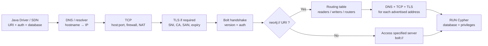
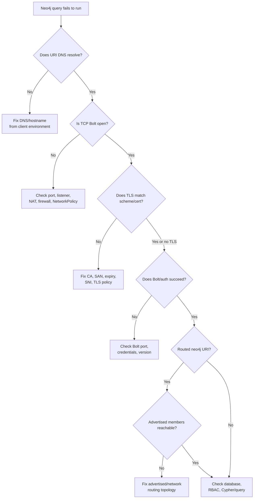

# Bolt Connection, DNS, TLS, and Routing Address Errors

## 1. Context: The Application Cannot Connect to Neo4j Even Though the Database Appears to Be Running

Neo4j stores a **property graph** consisting of nodes, relationships, properties, indexes, and constraints. A Java Driver or Spring Data Neo4j application communicates with Neo4j over **Bolt** to execute Cypher. Before a query such as `MATCH (n) RETURN n LIMIT 1` can run, the client must pass through multiple layers: reading the right URI, resolving the hostname, opening a socket, negotiating TLS if encryption is enabled, performing the Bolt handshake, authenticating, and—for routing URIs—discovering the addresses of subsequent servers.

Therefore, the message **“Unable to connect to Neo4j”** is only a *generic symptom*. The root cause may lie in DNS, a firewall, certificates, the wrong port, a misconfigured advertised hostname, the routing table, or the account. Increasing timeouts without identifying the failing layer usually makes the situation harder to observe.

For example, a Neo4j instance runs in Docker, Neo4j Browser at `http://localhost:7474` opens fine, yet a Java service running in another container cannot connect to `bolt://localhost:7687`. **`localhost` inside the Java container refers to the Java container itself**, not the Neo4j container. Another scenario: `bolt://db.example.test:7687` connects successfully, but `neo4j://db.example.test:7687` fails because the cluster returns a routing table containing internal hostnames that the Java machine cannot resolve or reach.

This lesson belongs to the **Troubleshooting** chapter of the `DATABASE_ENGINE_GRAPH_NEO4J` module. It focuses on connection diagnostics for Cypher, the Java Driver, Spring Data Neo4j, clusters, and Docker/Kubernetes environments; graph/index optimization or read/write business logic should only be addressed **after** the connection path is healthy.

**After this lesson, you will be able to:**

1. Identify the failing layer using a **low-risk diagnostic sequence**, from DNS up to a simple read query.
2. Choose and explain the right `bolt://`, `neo4j://`, `+s`, and `+ssc` URI based on server configuration.
3. Distinguish between **listen address**, **advertised address**, client-side DNS, and the addresses returned in the routing table.
4. Diagnose TLS: CA/trust chain, hostname/SAN, expired certificates, and client–server TLS mismatches.
5. Write a Java Driver smoke test with `verifyConnectivity()`, a session with an explicit database, and a simple query.
6. Investigate issues specific to running through Docker, NAT, proxies, load balancers, or clusters.
7. Build a runbook, record evidence, and avoid “quick fixes” such as disabling security or granting overly broad privileges.

## 2. Diagram of Connection Layers



**Key takeaway:** a successful TCP connection does **not** confirm that TLS, Bolt, authentication, or routing will succeed. Conversely, Neo4j Browser loading over HTTP `7474` does **not** prove that the Bolt service on `7687` is reachable. Each layer requires its own evidence.

| Layer | Diagnostic question | Common symptoms |
|---|---|---|
| Client configuration | Are the URI, database, hostname, and scheme correct? | Driver connects to the wrong environment or port |
| DNS | What does the hostname resolve to **from where the application runs**? | `UnknownHostException`, `Name or service not known` |
| TCP / network | Can a socket be opened to the exact IP:port? | Connection refused, timeout, no route |
| TLS | Do both sides agree on encryption and verify certificates? | SSL handshake/certificate/hostname failure |
| Bolt | Is the remote endpoint actually Neo4j Bolt with a compatible version? | Handshake/version error, connection closed |
| Authentication | Are the credentials and auth mechanism valid? | `Unauthorized` / authentication failure |
| Routing | Are the addresses in the routing table reachable? | `Unable to retrieve routing information`, no reader/writer |
| Database/RBAC | Is the database online and does the user have privileges? | `DatabaseNotFound`, `Forbidden`, or privilege errors |

## 3. Choose the URI Before Starting Diagnostics

The Java Driver supports the following URI forms; **the scheme is part of the connection contract**, not an optional prefix just to avoid errors:

| Scheme | Routing | TLS | Characteristics |
|---|---|---|---|
| `bolt://` | No; connects directly to the specified server | Not enabled via scheme | Useful for testing a single Neo4j server in a lab or a specific target |
| `bolt+s://` | No | Yes, verifies CA/hostname | Direct connection with TLS and certificate validation |
| `bolt+ssc://` | No | Yes, accepts self-signed certificates per driver mechanism | Use only when certificate policy allows, typically lab/test |
| `neo4j://` | Yes, fetches routing table | Not enabled via scheme | Routed connection in permitted environments |
| `neo4j+s://` | Yes | Yes, verifies CA/hostname | Typically the connection option specified by cluster/Aura providers |
| `neo4j+ssc://` | Yes | Yes, accepts self-signed certificates per driver mechanism | Controlled self-managed environments, requires risk assessment |

**Do not switch `neo4j+s://` to `bolt://` in production just because it temporarily connects.** Doing so both changes routing/failover behavior and can drop TLS encryption. You must find and fix the actual root cause; the exact URI is determined by the Neo4j infrastructure.

Example URIs:

```text
bolt://localhost:7687                    # A self-managed instance on a lab machine
bolt://neo4j:7687                        # Container on the same Docker network
neo4j+s://graph.example.test:7687        # Published cluster with valid TLS
bolt+s://db-node-1.example.test:7687     # Direct access to a single member with TLS
```

The `example.test` addresses are for illustration only, **not live servers**. Do not confuse Bolt URIs with HTTP:

```text
http://localhost:7474     # Neo4j Browser/HTTP, NOT Bolt
https://localhost:7473    # HTTPS, NOT Bolt
bolt://localhost:7687     # Neo4j Driver/Cypher Shell
```

The driver does not accept URIs with an HTTP path such as `neo4j+s://host:7687/neo4j`. The database is selected using `SessionConfig.withDatabase(...)` or framework configuration, **not** placed in a REST-style URL path.

### 3.1. Run Checks in the Right Environment

| Application location | What does “localhost” point to? | Commonly used address |
|---|---|---|
| Java running on the Docker host machine | The host machine | `bolt://127.0.0.1:<published-port>` |
| Java in another Compose container | The Java container itself | `bolt://neo4j:7687` by service name |
| Java in another Kubernetes Pod | The Java Pod/container itself | Appropriate Service DNS and published port |
| Java on a machine outside the cluster | The Java machine itself | Provided FQDN/LB/public endpoint |

Do not test DNS/TCP only from your laptop and assume the same result inside the application container: split DNS, NetworkPolicy, proxies, and container networks can behave differently.

## 4. Minimal Runbook: Diagnose in Order

**Rule:** record evidence at each step before changing configuration. If an earlier step has not passed, do not dive deeply into later steps yet.

### Step 1 — Identify the Exact Path

Record (without putting passwords into tickets):

- Where does the application run: which host, container, Pod, VM, zone/VPC?
- **Redacted** URI, database name, Neo4j/Driver versions, error timestamp, and request/trace ID.
- Self-managed single instance, Enterprise cluster, or Neo4j Aura? Is there a proxy/LB/NAT/TLS termination?
- Does the error happen **at startup**, **on the first query**, or **during queries after a successful connection**?
- Were there recent changes to DNS, certificates, containers/networks, database topology, or firewalls?

`GraphDatabase.driver(...)` creates the driver object but may **not establish a connection** immediately. To test immediately, call `driver.verifyConnectivity()` or execute a query; do not conclude success just because the constructor returns an object.

### Step 2 — Resolve DNS Where the Application Actually Runs

On a Linux host/container with the appropriate tools:

```bash
getent ahosts graph.example.test
nslookup graph.example.test
```

If you need to inspect A/AAAA/CNAME records with `dig`:

```bash
dig graph.example.test A
dig graph.example.test AAAA
dig graph.example.test CNAME
```

On PowerShell/Windows:

```powershell
Resolve-DnsName graph.example.test
```

Compare the IP and CNAME from the **machine executing Java**. If DNS fails to resolve, check for typos, nameserver configuration, search domains, split-horizon DNS, container networks, Kubernetes Service/namespace, and firewall rules to the DNS resolver.

**Important:** a hostname can resolve to multiple IPs (DNS load balancing, IPv4/IPv6). Check reachability for **each address**, because errors will look intermittent if one IP is broken while another is healthy. Successful DNS only proves name-to-IP mapping; it does not prove the Bolt port is open.

### Step 3 — Check the TCP Port

On a Linux host/container with `nc`:

```bash
nc -vz -w 3 graph.example.test 7687
```

On PowerShell/Windows:

```powershell
Test-NetConnection graph.example.test -Port 7687
```

If it fails:

- **Connection refused**: the IP is reachable, but the remote side is not accepting connections on that port or a network device actively rejected it; check the Bolt listener, port publishing, and destination.
- **Connection timed out**: could be a firewall, security group, ACL, network routing, proxy, or unresponsive target host.
- **No route to host**: check routing table/IP/subnet, NetworkPolicy/VPC/VPN.
- **TCP succeeds**: only proves the TCP handshake completed; TLS/Bolt/auth/routing still need to be checked.

For self-managed Neo4j, on the **server machine** you can inspect socket listeners:

```bash
ss -lnt | grep 7687
```

On a Docker host:

```bash
docker compose ps
docker compose logs --tail 100 neo4j
```

`ss` runs on the server/container, and `docker compose` must target the right project. Do not run commands to alter firewalls, strip TLS, or open ports to the Internet just because a TCP check failed.

### Step 4 — Check TLS If the Endpoint Requires It

Example when the server requires TLS on the Bolt port:

```bash
openssl s_client \
  -connect graph.example.test:7687 \
  -servername graph.example.test \
  -showcerts
```

Check the certificate chain, expiration dates, issuer, `subjectAltName`, negotiated TLS protocol/cipher, and verification errors. `-servername` sends **SNI** so the proxy/endpoint selects the certificate matching the hostname.

**Warning:** `openssl s_client` only tests the TLS handshake; it **does not indicate that Bolt authentication succeeded**. This command is not suitable for Bolt endpoints with **TLS disabled**; a `wrong version number` error there does not by itself prove the server is broken. Never send a username/password through `openssl`.

You can inspect a PEM certificate **that you are authorized to read**:

```bash
openssl x509 -in public.crt -noout -dates -issuer -subject -ext subjectAltName
```

When Java reports a certificate error, check the exact **JDK/truststore** used by the real application. `openssl` verifies against the calling environment's trust store, whereas the JVM may use a different truststore. Never use “disable certificate verification” as a production fix.

### Step 5 — Check Bolt and Authentication

If Cypher Shell is available:

```bash
# Username and password are entered via the environment's secure mechanism.
# Do not place literal passwords in command history.
cypher-shell -a neo4j+s://graph.example.test:7687 \
  -u app_reader -d neo4j
```

After authenticating, run a simple read query:

```cypher
RETURN 1 AS ok;
```

Expect `ok = 1`. If Cypher Shell prompts for a password, enter it over a trusted terminal channel. In automation environments, use a secret manager or protected environment variables; never paste `-p <password>` into a ticket or shell history.

If this query succeeds but a `MATCH` by label fails, the issue has likely moved into **database/RBAC/schema/Cypher logic**, and is no longer a connection issue. `RETURN 1` does not prove graph read permissions or the existence of business data.

### Step 6 — Check Routing and Advertised Addresses

If `bolt+s://host:7687` to a **specific server** succeeds, but `neo4j+s://host:7687` cannot retrieve the routing table or fails on queries, check in priority order:

1. Does the entry endpoint actually support routing?
2. **Which addresses** does the driver receive in the routing table?
3. Can **each advertised hostname:port** be resolved and reached from the client?
4. Do they have valid TLS certificates matching the advertised hostnames?
5. Does the database have available servers for read/write mode; is the routing table stale after a failover?

Do not treat a successful connection to the **seed/entry address** as proof that all returned addresses are valid.

## 5. Neo4j Listen Address vs. Advertised Address

Two settings are frequently confused:

| Setting | Role | Example |
|---|---|---|
| `server.bolt.listen_address` | Interface/port that the **Neo4j process binds to accept** connections | `0.0.0.0:7687` |
| `server.bolt.advertised_address` | Hostname/IP:port that **clients are instructed to use** | `db1.example.test:7687` |
| `server.default_listen_address` | Default host/interface for connectors when not overridden | `0.0.0.0` |
| `server.default_advertised_address` | Default host used for advertised addresses | `db1.example.test` |
| `server.routing.listen_address` | **Internal** connector for server-side routing (topology-dependent) | `:7688` |
| `server.routing.advertised_address` | **Internal** address for members to talk during server-side routing | `db1.internal:7688` |

**Do not confuse** `server.routing.advertised_address` (the internal server-side routing channel) with `server.bolt.advertised_address` (the Bolt address clients may be given via routing). Port `7688` is not a public Bolt port replacing `7687`; other internal cluster ports such as `6000`/`7000` should likewise never be exposed to the Internet.

Self-managed configuration example in `neo4j.conf`:

```properties
server.bolt.enabled=true
server.bolt.listen_address=0.0.0.0:7687
server.bolt.advertised_address=db1.example.test:7687
```

**Requirement:** `db1.example.test:7687` must be a **real** reachable path from the authorized client group, and the certificate must be valid for that hostname if TLS is enabled. `0.0.0.0` is for listening on interfaces, **not** a valid advertised hostname for external clients.

### 5.1. Docker/NAT Failure Example

Suppose a Neo4j container listens on `0.0.0.0:7687`, and Docker publishes host port `17687 → 7687`:

```yaml
services:
  neo4j:
    image: neo4j:2025.11
    ports:
      - "127.0.0.1:17687:7687"
```

From the **host**, the direct test URI is:

```text
bolt://127.0.0.1:17687
```

However, a client using `neo4j://127.0.0.1:17687` may receive an advertised address of `localhost:7687` or the internal hostname `neo4j:7687`, and then try connecting to the **wrong port/network namespace**. This is a common cause of “initial connection works, subsequent queries fail”.

The solution **depends on topology**:

- In a **single-instance lab**, use `bolt://127.0.0.1:17687` if the goal is direct access to the server.
- In a **cluster**, expose **each member address** using a hostname/port that clients can **actually reach**; configure advertised addresses, NAT/LB, and TLS per the approved design.
- If the application and database run on the same Docker network, use the service name and internal port; do not assume the published host port is the port to call between two containers.

**Do not set `localhost` as the advertised address for all cluster members**: on the client machine, every member will point back to the client machine itself; routing will fail or hit the wrong target.

### 5.2. Going Through a Load Balancer or Proxy

An LB can make the entry endpoint work yet still cause errors when the driver subsequently connects to members in the routing table. There are two different strategies:

1. **Client-side routing:** the driver receives the list of readers/writers/routers and must be able to reach the appropriate advertised addresses.
2. **Server-side routing:** the receiving server can route internally according to cluster configuration; the client only needs to reach the endpoint published by the topology.

Neo4j Enterprise has settings such as `dbms.routing.enabled`, `server.routing.listen_address`, `server.routing.advertised_address`, and `dbms.routing.default_router`. **Apply them strictly according to the documentation for the exact version/topology**; do not toggle them blindly to patch an error without a plan. A standard HTTP reverse proxy does **not** automatically act as a Bolt-aware proxy; if using a TCP proxy or TLS termination, you must verify TCP, SNI, certificates, and routing semantics.

## 6. DNS: Client-Side Initial Failures vs. Failures on Returned Members

### 6.1. Common Failure Patterns

| Symptom | Hypothesis | Check |
|---|---|---|
| `UnknownHostException` immediately on driver creation | Wrong URI hostname or unusable resolver | `getent`/`nslookup` inside the **Java container** |
| Seed URI resolves, but routing fails | One or more advertised hostnames do not resolve | DNS for every routing address, not just the seed |
| Works sometimes, drops connections other times | DNS returns multiple IPs, some backends are broken | Check each A/AAAA record and LB health |
| Java container cannot resolve host machine names | Different search domain/network | Check Compose network, `/etc/resolv.conf`, Kubernetes DNS |
| Fails only on IPv6 | Client picks AAAA but IPv6 path does not work | Compare A/AAAA records and test each address family |
| Still fails after DNS change | Stale TTL/cache in JVM/driver/routing table | Measure TTL, connection lifecycle, controlled refresh plan |

### 6.2. Do Not Confuse the Driver's Custom DNS Resolver with the Routing Table

The Java Driver supports `Config.Builder.withResolver(...)` to override resolution of the **initial connection address**. According to current Java Driver documentation, the custom resolver **does not apply to addresses received from the routing table**. Therefore, a resolver that makes the seed address reachable **does not automatically fix** unreachable advertised hostnames returned by the cluster.

**Illustrative** example of a resolver for the seed endpoint in a test environment:

```java
import java.util.Set;
import org.neo4j.driver.Config;
import org.neo4j.driver.net.ServerAddress;

Config config = Config.builder()
    .withResolver(address -> Set.of(
        ServerAddress.of("127.0.0.1", 17687)
    ))
    .build();
```

The resolver above does not change the URI scheme, does not modify the TLS certificate, and does **not** fix incorrect advertised addresses. Avoid hard-coding an IP in production to mask DNS/routing issues; it breaks failover and can trigger certificate hostname errors.

### 6.3. Connecting from Kubernetes

In Kubernetes, a Service DNS name such as `neo4j.default.svc.cluster.local` may resolve **from Pods** inside the cluster, but not from a laptop or external server. For a Neo4j cluster:

- Identify whether the application uses an **in-cluster Service**, an external ingress/LB, or a private endpoint.
- Test the advertised hostname and port of every member from the **Java Pod**, not only from a Neo4j Pod.
- Check NetworkPolicy, namespace, DNS egress, TLS certificates, and DNS TTL.
- With Helm/operators, prefer configuring topology according to the release documentation of the chart/operator in use; do not manually edit one member's advertised address only for the controller to overwrite it.
- Do not share the same `/data` PVC/volume across multiple members to try sharing data; storage clustering requires a proper design.

## 7. TLS: Categorizing Errors Without Weakening Security

### 7.1. Mandatory Questions

1. Does the endpoint require TLS, and which scheme is the client using?
2. Is the certificate valid (not expired), does it have the complete CA/intermediate chain, and is it trusted by the **actual JVM's** truststore?
3. Does the hostname in the **URI or advertised address** match `subjectAltName`?
4. If there is a TLS-terminating LB, which certificate is presented at each hop, and is SNI used?
5. Are there mTLS/client certificate policies or specific cipher/TLS version requirements?

A self-managed Neo4j instance may use `server.bolt.tls_level`:

| Value | Behavior | Typical connection pairing |
|---|---|---|
| `DISABLED` | Accepts only unencrypted Bolt connections | `bolt://` or `neo4j://` inside a controlled network |
| `REQUIRED` | Accepts only TLS-encrypted Bolt connections | `bolt+s://`, `neo4j+s://` (or `+ssc` in controlled environments) |
| `OPTIONAL` | Allows both depending on configuration | Choose scheme per the organization's **security policy** |

In production, never set `DISABLED` just to make a certificate error disappear; fix the CA/SAN/proxy or client trust properly. With Aura, use the URI/TLS provided by the service and do not assume you can alter server TLS settings.

### 7.2. Reading TLS Symptoms

| Error/symptom | First check | Proper direction to fix |
|---|---|---|
| `PKIX path building failed` | CA/intermediate trust chain, Java truststore | Install the approved CA trust chain |
| `No subject alternative DNS name matching` | Certificate SAN vs. URI/advertised host | Reissue cert or fix valid hostname |
| `certificate expired` | Certificate validity and system clock | Renew cert per procedure |
| `handshake_failure` | Cipher suite, TLS version, mTLS, SNI, proxy | Compare client/server policies and runtime compatibility |
| `wrong version number` when testing OpenSSL | Bolt server has TLS disabled or wrong port/proxy | Confirm TLS mode first; do not blame the graph |
| Only member B fails | Member B's cert lacks SAN/trust or wrong advertised host | Inspect cert and routing per member |
| Long-lived connections fail after cert rotation | Pool keeps old connections; new cert applies only on new handshake | Check connection refresh and version-supported TLS reload |

**`+ssc` is not a default production fix.** It can help a lab connect with a self-signed certificate, but its trust mechanism is not equivalent to verifying server identity via CA/hostname. Disabling hostname validation or setting `trust_all` to restore service without assessing man-in-the-middle risks is not recommended.

### 7.3. Certificate Rotation Planning

In a multi-member environment, certificates typically need SANs matching the member names that clients actually use. When rotating:

1. Prepare the chain, SANs, expiry, key read permissions, and secrets.
2. Update the necessary endpoints/LBs/members in a tested sequence.
3. Verify **new connections**, not only existing live connections in the pool.
4. Monitor handshake errors by member and timestamp.
5. Maintain a rollback path to a valid certificate if policy permits.

Recent Neo4j versions provide a **TLS certificate reload** mechanism when configured; do not assume every older version supports zero-restart reload. If enabling TLS debug logging, enable it briefly and control log output because log volume grows rapidly.

## 8. Java Driver: Purposeful Connectivity Smoke Test

Java 17+ and official Neo4j Java Driver example. Pass the URI, username, and secret via environment variables provisioned in the runtime; **do not print passwords**:

```java
import java.time.Duration;
import java.util.Map;
import java.util.concurrent.TimeUnit;
import org.neo4j.driver.AccessMode;
import org.neo4j.driver.AuthTokens;
import org.neo4j.driver.Config;
import org.neo4j.driver.Driver;
import org.neo4j.driver.GraphDatabase;
import org.neo4j.driver.SessionConfig;
import org.neo4j.driver.TransactionConfig;

public final class BoltConnectivitySmokeTest {
    public static void main(String[] args) {
        String uri = requireEnv("NEO4J_URI");
        String username = requireEnv("NEO4J_USERNAME");
        String password = requireEnv("NEO4J_PASSWORD");
        String database = requireEnv("NEO4J_DATABASE");

        Config config = Config.builder()
            .withConnectionTimeout(5, TimeUnit.SECONDS)
            .withConnectionAcquisitionTimeout(5, TimeUnit.SECONDS)
            .withMaxTransactionRetryTime(5, TimeUnit.SECONDS)
            .build();

        try (Driver driver = GraphDatabase.driver(
                uri, AuthTokens.basic(username, password), config)) {
            // Force immediate connectivity verification, not just creating the Driver object.
            driver.verifyConnectivity();

            SessionConfig sessionConfig = SessionConfig.builder()
                .withDatabase(database)
                .withDefaultAccessMode(AccessMode.READ)
                .build();
            TransactionConfig txConfig = TransactionConfig.builder()
                .withTimeout(Duration.ofSeconds(3))
                .build();

            try (var session = driver.session(sessionConfig)) {
                int ok = session.executeRead(tx ->
                    tx.run("RETURN 1 AS ok", Map.of())
                      .single().get("ok").asInt(),
                    txConfig
                );
                if (ok != 1) {
                    throw new IllegalStateException("Unexpected query result");
                }
                System.out.println("Bolt connectivity OK");
            }
        }
    }

    private static String requireEnv(String name) {
        String value = System.getenv(name);
        if (value == null || value.isBlank()) {
            throw new IllegalArgumentException("Missing env: " + name);
        }
        return value;
    }
}
```

**How to interpret:**

- Failure at `verifyConnectivity()` indicates a problem with initial connectivity/authentication; inspect the **cause chain** to classify DNS/TCP/TLS/Bolt/auth/routing.
- Failure when opening a session or calling `executeRead` after connectivity succeeded may relate to the specific database, read routing, the pool, timeouts, or topology changes.
- `RETURN 1` does not read nodes or relationships, so it separates connection errors from schema or business Cypher errors.
- `withConnectionTimeout`, `withConnectionAcquisitionTimeout`, and `TransactionConfig.withTimeout` bound **different phases**; do not collapse them into a single overall HTTP deadline.
- `Driver` is a heavy, thread-safe object and should be reused in an application; `Session` is short-lived and must not be shared across threads. In a smoke test, creating and closing the driver isolates the check.

When testing a cluster with read routing, use the `neo4j://`/`neo4j+s://` URI provided by the administrator. Trying `bolt+s://` against a single member is **only for isolating routing issues**; do not permanently change the production URI if the application requires failover.

### 8.1. Exception Analysis Workflow

Layered logging example in a service:

```java
try {
    driver.verifyConnectivity();
} catch (org.neo4j.driver.exceptions.Neo4jException e) {
    // Log error code and class; do not log credentials or queries containing sensitive data.
    logger.error("Neo4j connectivity error class={}, code={}",
        e.getClass().getSimpleName(), e.code(), e);
    throw e;
}
```

This illustrative snippet assumes an SLF4J `logger`. **Not every socket/DNS/TLS error has the same `Neo4jException` type**, so real logging/monitoring layers must capture the exception class and root cause without exposing sensitive data. Do not match `e.getMessage()` strings to trigger unbounded retries.

### 8.2. Connection Errors vs. Query Errors

| Smoke test result | Next implication |
|---|---|
| Constructor succeeds, `verifyConnectivity()` fails | Driver does not yet have a valid connection; check DNS → auth/routing |
| `verifyConnectivity()` OK, `RETURN 1` fails when selecting database | Check database name, `ACCESS` privilege, database status, or specific routing |
| `RETURN 1` OK, `MATCH` query fails | Check RBAC, syntax, constraints/indexes, procedures, memory/transaction timeouts |
| Only write queries fail | Check `WRITE` privileges, read-only database, leader/writer routing, transaction contention |
| Fails only under high load | Check pool exhaustion, server threads/sessions, GC, CPU, network saturation |

## 9. Spring Data Neo4j: Misconfiguration Often Looks Like a Repository Bug

In modern Spring Boot, Spring Data Neo4j uses the Java Driver underneath. Configuration example:

```yaml
spring:
  neo4j:
    uri: "neo4j+s://graph.example.test:7687"
    authentication:
      username: "app_reader"
      password: "${NEO4J_PASSWORD}"
  data:
    neo4j:
      database: "neo4j"
```

**Note:** depending on the Spring Boot version, the database configuration may live under a different namespace; check the property reference for the actual Boot version. In this example, the address is an illustrative endpoint and the password comes from a secret environment variable—never commit real credentials to Git.

Service debugging workflow:

1. Verify which `dev/staging/prod` profile is active, the resolved configuration, and that the URI/DB match the environment. Never log passwords.
2. Run the Java Driver smoke test using the **exact same URI, JDK, truststore, user, and network namespace** as the SDN application.
3. If the smoke test fails, fix the connection layer; if it passes while the repository fails, inspect transactions, database config, mapping/projections, and queries.
4. In a cluster, `@Transactional(readOnly = true)` cannot fix a wrong advertised address; it only affects how the framework manages the transaction.
5. If the service creates a new `Driver`/pool per request, fix the lifecycle; do not arbitrarily raise max pool size when the root issue is DNS or TLS failure.

An application may read a URL from an environment different from the URL you use in Browser. **Always verify the effective configuration** of the Java process and test connectivity from where it actually runs.

## 10. Cluster Routing: Isolating Seed vs. Member Errors

Illustrative scenario:

```text
Java client → neo4j+s://entry.example.test:7687
                         |
                         | Seed has TCP + TLS + Bolt OK
                         v
                  Routing table:
                     writer = db-1.internal:7687
                     reader = db-2.internal:7687
                     router = db-3.internal:7687

Java client outside VPC:
  entry.example.test      → OK
  db-1.internal           → DNS ERROR
  db-2.internal           → DNS ERROR
  db-3.internal           → DNS ERROR
```

Result: **the entry address works, but client-side routing does not**. Do not try to fix this by increasing `maxConnectionPoolSize` or tuning query settings. Infrastructure must provide one of the supported options: client-reachable advertised addresses, proper DNS, network routing/VPN, or **server-side routing** with an appropriate endpoint.

### 10.1. Inspecting the Server List with Admin Tools

On Neo4j Enterprise with appropriate privileges, you can run:

```cypher
SHOW SERVERS
YIELD name, address, state, health
RETURN name, address, state, health
ORDER BY name;
```

**`SHOW SERVERS` syntax and columns depend on the Neo4j version**; check unfiltered `SHOW SERVERS` output before using it on a different deployment. This command inspects server status from the DBMS perspective; it does **not** prove that an external Java client can resolve or reach those addresses.

Check database status:

```cypher
SHOW DATABASES
YIELD name, currentStatus
RETURN name, currentStatus
ORDER BY name;
```

An application account may lack full `SHOW SERVERS`/`SHOW DATABASES` privileges. Do not grant admin rights just to debug an endpoint; coordinate with operators and gather client-side evidence first.

### 10.2. When Direct Bolt Works but Routed Neo4j Fails

This is **a directional signal**, not an absolute conclusion:

| Test | If OK | If failed |
|---|---|---|
| `bolt+s://entry` | Direct seed/TLS/auth works | Check seed DNS/TCP/TLS/Bolt/auth |
| `neo4j+s://entry` | Routing and required members work for the test | Check routing table/members/database |
| `neo4j+s://member1` | Member 1 can act as seed and return routing | Check member 1 config/routing |
| `neo4j+s://entry` + read/write smoke | Read and write paths for the database work | Check available reader/writer and routes/permissions |

Do not use `bolt://`/`bolt+s://` in a production cluster just to bypass a broken routing table, unless the architecture **intentionally** uses direct server access or approved server-side routing. A long-term fix must remain compatible with failover and availability guarantees.

### 10.3. TLS for Addresses in the Routing Table

If TLS is enabled, **every advertised address** must have a certificate that verifies cleanly. A wildcard for `*.example.test` typically does **not** match `db-1.internal`; SNI/LBs may also return different certificates along different paths. Therefore:

- Check the certificate on both the **seed** and the failing **member**.
- Compare SANs against the hostname the driver actually uses, not just the friendly name in documentation.
- Confirm the CA/intermediate certificates in the Java truststore.
- Do not shorten an advertised hostname to an IP if the certificate only contains DNS SANs; that can trigger hostname mismatch errors.

## 11. Authentication, Database, and Firewall Errors After Clearing the Network

Even when DNS/TCP/TLS/Bolt all work, connections can still fail because:

- Wrong username/password, rotated credentials, locked account, or expired token.
- The application targets database `neo4j`, while the instance actually serves a different database; or a cluster database is offline.
- The user authenticates successfully but lacks `ACCESS` or graph read privileges; completely distinct from a TCP error.
- A proxy/LB uses an HTTP health check that does not probe the Bolt port, making an endpoint appear “healthy” falsely.
- Firewalls allow the **entry** port, but block access to the individual advertised members required by client routing.

To identify the active database and user once connected with an appropriately privileged account, you can run metadata queries:

```cypher
SHOW CURRENT USER;
```

```cypher
SHOW DATABASES
YIELD name, currentStatus
RETURN name, currentStatus
ORDER BY name;
```

If metadata commands are unauthorized, do not automatically grant admin privileges; escalate to the DBA with the URI, timestamp, and recorded error. A `Forbidden` error must never be “fixed” by disabling Neo4j authentication or putting admin passwords into the application.

## 12. Timeouts, Retries, Pools, and Symptoms Under Load

Three groups of errors are often conflated:

| Group | Semantics | Clues |
|---|---|---|
| **Connection timeout** | Failed to establish a connection in time | DNS, TCP, TLS, proxy, overloaded server |
| **Connection acquisition timeout** | Failed to acquire a suitable connection from pool/routing in time | Pool, leaked sessions/results, concurrency |
| **Transaction timeout** | Transaction/query exceeded server-side time limit | Cypher, locks, CPU, I/O, bookmark wait, and total duration |

Driver configuration example:

```java
import java.util.concurrent.TimeUnit;
import org.neo4j.driver.Config;

Config config = Config.builder()
    .withConnectionTimeout(5, TimeUnit.SECONDS)
    .withConnectionAcquisitionTimeout(5, TimeUnit.SECONDS)
    .withMaxTransactionRetryTime(10, TimeUnit.SECONDS)
    .withMaxConnectionPoolSize(50)
    .build();
```

These values are **illustrative only**, not production standards. The driver can retry managed transactions on transient errors; retry count/total time must fit within the **overall deadline** of the HTTP request or queue task. Do not wrap additional unbounded retry loops around permanent DNS/TLS errors; that only amplifies load.

If failures occur only after several hours or under high load:

1. Check for server restarts/failovers, rolling certificate rotations, or DNS/LB updates.
2. Check connection pool usage/wait times, unclosed sessions, and unconsumed `Result` objects.
3. Check GC, CPU, page cache, max connections, and network saturation.
4. Measure p50/p95/p99, timeout rate, and retry counts per member.
5. Tune pools/timeouts **only after** identifying the bottleneck; increasing pool size when the DB is already saturated can worsen latency.

### 12.1. Distinguishing “No Writer Available” from “Missing Write Privilege”

In a cluster, a write request can fail because the routing table cannot find an eligible writer for the database, because leadership is shifting, or because the user **lacks write privileges**. Check:

- Is a writer node/server available in the topology?
- Is the driver using a routing URI and the right database?
- Do the credentials have the required `WRITE`/`SET PROPERTY`/`CREATE` privileges?
- If only write queries fail, run a **read-only smoke test** first to separate connectivity issues from write-transaction issues.

Do not alter application code to write to an arbitrary member when writer routing fails; in a cluster, both write privileges and server roles must be aligned.

## 13. Three Classic Investigation Scenarios

### 13.1. Docker: Browser Works, Spring Boot Fails with Connection Refused

**Symptom:** Browser on the host accesses `http://localhost:7474` fine; Spring Boot running in another container uses `bolt://localhost:7687` and throws `Connection refused`.

**Explanation:** `localhost` inside the Java container does not point to Neo4j. The URI uses the wrong network namespace.

**Diagnostics:**

```bash
# From the Docker host, verify published services/ports.
docker compose ps

# From the application container (if getent and nc are installed).
getent hosts neo4j
nc -vz -w 3 neo4j 7687
```

**Fix:** set `spring.neo4j.uri=bolt://neo4j:7687` when both services share the Compose network, the database listens on the appropriate network, and the TLS mode matches. Re-verify `RETURN 1 AS ok` with the Java Driver. Do not swap `localhost` for an arbitrary public IP when Docker service discovery already handles it.

### 13.2. TLS: TCP 7687 Is Open, but `neo4j+s` Fails

**Symptom:** `nc` connects, `openssl s_client` returns a certificate that does not match `db.example.test` or fails chain validation; Java throws `SSLHandshakeException`.

**Explanation:** TCP is OK, but TLS endpoint identity verification fails—possibly due to the advertised/proxy hostname, missing CA, or expired certificate.

**Fix:** replace with a certificate containing the right SANs, complete chain, and proper truststore, or fix the endpoint/advertised hostname per the design; re-test with a fresh connection. Never switch `neo4j+s` to `neo4j` to “fix” TLS.

### 13.3. Cluster: Direct Member Works, Routed URI Fails

**Symptom:** `bolt+s://member1.example.test` runs `RETURN 1`; `neo4j+s://entry.example.test` intermittently works or fails with `Unable to retrieve routing information`.

**Possible explanation:** the advertised member list contains internal hostnames, unpublished ports, mismatched certificates, or unavailable readers/writers.

**Fix:** inspect the routing topology and advertised addresses, test DNS/TCP/TLS **for every member from the client**, examine logs and database state, and choose a properly deployed client-side or server-side routing setup. Do not switch the whole application to a direct scheme if HA is still required.

## 14. Evidence-Based Troubleshooting Workflow

Sample template for an incident ticket:

| Field | Data to collect |
|---|---|
| `timeWindow` | Error timestamp, timezone, duration |
| `clientPlacement` | VM/container/Pod/namespace/VPC and JDK/Driver versions |
| `serverTopology` | Standalone/cluster/Aura; database name and edition if known |
| `uriScheme` | `neo4j+s` or `bolt+s`, **redacted** hostname/port |
| `dnsResult` | A/AAAA/CNAME/TTL from where the client runs |
| `tcpResult` | Port open/timeout/refused; IPv4/IPv6 |
| `tlsResult` | Handshake, issuer, SAN, expiry, chain validation |
| `boltResult` | `verifyConnectivity`/Cypher Shell and root cause |
| `routingResult` | Are the seed and each advertised member reachable? |
| `dbResult` | `RETURN 1`, DB status, RBAC, read/write mode |
| `action` | Configuration changed, rollback path, recovery time |

### 14.1. On-Call Decision Tree



This is a priority order, not proof that every incident hits only one branch. An application can suffer **multiple simultaneous failures** (e.g., broken DNS and an expired certificate). After each fix, re-test **from the beginning** in the same client environment and record the results.

## 15. Creating a Fixture to Separate Connectivity from Data Errors

Once `RETURN 1` passes, test in a learning database with a small graph to confirm basic Cypher execution and read/write privileges. Never run write statements on production.

### 15.1. Create Nodes and Constraint

```cypher
CREATE CONSTRAINT ts001_person_id IF NOT EXISTS
FOR (p:TS001Person)
REQUIRE p.id IS UNIQUE;
```

```cypher
UNWIND [
  {id: 'an', name: 'An'},
  {id: 'binh', name: 'Bình'}
] AS row
MERGE (p:TS001Person {id: row.id})
SET p.name = row.name;
```

```cypher
MATCH (a:TS001Person {id: 'an'})
MATCH (b:TS001Person {id: 'binh'})
MERGE (a)-[:TS001_FOLLOWS]->(b);
```

### 15.2. Verify Relationship Query

```cypher
MATCH (a:TS001Person)-[:TS001_FOLLOWS]->(b:TS001Person)
RETURN a.id AS source, b.id AS target
ORDER BY source, target;
```

Expect one row `an → binh`. Verify there are exactly two nodes and one relationship:

```cypher
MATCH (p:TS001Person)
WITH count(p) AS persons
MATCH (:TS001Person)-[r:TS001_FOLLOWS]->(:TS001Person)
RETURN persons, count(r) AS follows;
```

Expect `persons = 2`, `follows = 1`. If `RETURN 1` succeeds but the `MERGE` write fails, check `CREATE`/`SET PROPERTY`/`WRITE`/constraint privileges; you cannot conclude the Bolt connection is broken.

**Environment isolation:** use a test database or dedicated user. Do not ask a read-only account to run write fixtures; when only read permissions exist, skip data creation and use read queries approved by the DBA.

## 16. Post-Fix Regression Testing

A DNS/TLS/routing change is complete only when it passes these checks:

1. **Cold connection:** instantiate a new Driver and succeed with `verifyConnectivity()` against the standard endpoint; avoid testing only an already-connected pool.
2. **Correct database:** `RETURN 1` succeeds against the database the application actually uses.
3. **Read routing:** read operations succeed through `neo4j://` or `neo4j+s://` if the system uses routing.
4. **Write routing:** an idempotent write operation succeeds in a **test database**, without requiring admin privileges.
5. **TLS identity:** the new certificate is valid for every advertised hostname, tested with new connections after rotation.
6. **Failover:** in a staging cluster, perform a leader switch or take a reader out of rotation per procedure to verify retries/routing.
7. **Load:** run a representative concurrency level; measure pool wait, timeouts, DNS/TLS errors, and p95/p99.
8. **Security:** do not replace encrypted URIs with plaintext URIs, do not weaken RBAC, and do not log passwords.
9. **Observability:** logs/metrics alert at the right failure layer, distinguishing DNS/TCP/TLS/Bolt/auth/routing.
10. **Rollback:** document the exact hostname/cert/config changes and define a path back to the last known good config if needed.

### 16.1. Simulated Result Matrix

| Test | Result | Decision |
|---|---|---|
| Seed DNS OK, seed TCP OK, seed TLS OK | Evidence that the **entry** path works | Proceed to Bolt/auth |
| `bolt+s://member1` runs `RETURN 1` | Direct member works | Routing not yet proven |
| `neo4j+s://entry` fails lookup on `member2.internal` | Advertised address unreachable from client | Fix member topology/DNS |
| Fixed member2; `neo4j+s` read/write OK | Routing works again | Measure failover/load |
| Switched to plaintext `neo4j://` and got “OK” | TLS was likely dropped | **FAILS** security criteria |

This table shows **hypothetical scenarios**, not output from a live Neo4j environment.

## 17. Common Bad Fixes

1. **Testing HTTP `7474` and concluding Bolt `7687` is healthy.** They are two different connectors.
2. **Increasing all timeouts when the hostname is wrong.** Static DNS/TLS/config errors do not fix themselves by waiting longer.
3. **Changing `neo4j+s` to `bolt` to bypass routing/TLS.** This can lose failover and encryption.
4. **Forgetting advertised addresses in Docker/NAT.** The seed opens, but returned members/ports are unreachable.
5. **Setting advertised address to `localhost` for a cluster.** All clients point back to themselves.
6. **Using `+ssc` or trust-all as a production policy.** Masks server identity verification failures.
7. **Testing DNS from a laptop instead of the Java Pod.** Does not reflect the actual network namespace.
8. **Keeping a custom resolver and believing it fixes all routing addresses.** The driver resolver only handles the seed.
9. **Increasing the connection pool to solve certificate errors.** A larger pool increases failed handshakes and resource waste.
10. **Creating a new Driver per HTTP request.** Increases connection overhead and breaks pooling/health checks.
11. **Leaving TLS debug logging enabled permanently.** Bloats logs and may expose unnecessary environment details.
12. **Granting admin or disabling auth to make queries run.** Trades away security instead of diagnosing real permissions.
13. **Believing `verifyConnectivity` success means every business query will succeed.** Does not confirm database, read/write routing, or RBAC permissions.
14. **Editing configuration on only one cluster node.** Every member must receive the proper config/certs per topology.

## 18. Practice Exercises

1. **Layer failure diagram:** draw the path Java → DNS → TCP → TLS → Bolt → routing → query and map each error message to its appropriate layer.
2. **Wrong hostname in Compose:** configure an app container to use `bolt://localhost:7687`, then change to `bolt://neo4j:7687` in a test network. Explain why the change works.
3. **Wrong published port:** Docker publishes `17687:7687`. Which direct address is right from the host, and which is right from a container on the same network?
4. **Two-IP DNS:** suppose a hostname has two A records and one backend on port `7687` is unresponsive. Design a test sequence to prove why the failure is intermittent.
5. **TLS SAN mismatch:** a certificate has SAN `db1.example.test`, but the driver uses `graph.example.test`. Propose a fix without disabling certificate verification.
6. **Private Root CA:** Neo4j uses an internal CA certificate; Java reports `PKIX path building failed`, while OpenSSL on the host (using a different store) succeeds. Which truststore should you inspect?
7. **Routing through NAT:** seed `neo4j+s://entry` works, yet the routing table contains `node1.internal`. Why might `bolt+s://entry` temporarily work? Why is it not an HA solution?
8. **Multi-member TLS:** member A has a valid cert, member B has a wrong SAN. Explain how to diagnose intermittent read failures.
9. **Distinguish auth vs. RBAC errors:** `verifyConnectivity` succeeds, yet `CREATE` reports Forbidden. Why won't increasing timeouts resolve this?
10. **Java smoke test:** run `BoltConnectivitySmokeTest` with test URI/secrets. Record the root-cause error in scenarios with bad DNS, bad TLS, and wrong DB.
11. **Cluster maintenance:** simulate failover in staging, verifying read/write via routing URI, bounded retries, and no advertised member errors.
12. **Incident runbook:** write a ticket containing timestamp, client placement, URI scheme, DNS/TCP/TLS results, routing members, remediation action, and regression tests.

**Completion criteria:** learners can pinpoint the **specific failing layer** before changing configuration, distinguish direct vs. routed URIs, verify TLS identity properly, understand `listen` vs. `advertised`, and prove the fix using a Java smoke test along with read/write checks in a safe environment.

## 19. Cleaning Up Practice Fixtures

Run only in the **practice database**, never in production:

```cypher
MATCH (p:TS001Person)
DETACH DELETE p;
```

```cypher
DROP CONSTRAINT ts001_person_id IF EXISTS;
```

Do not disable firewalls, delete certificates, or wipe Docker volumes just to wrap up the lab; any network/cert configuration changes made during the lab should be rolled back per your saved notes. Deleting test data is not a connection-troubleshooting step.

## 20. Official References

- [Neo4j Java Driver — Connection](https://neo4j.com/docs/java-manual/current/connect/): creating a Driver, `verifyConnectivity()`, lifecycle, and cluster connections.
- [Neo4j Java Driver — Advanced connection information](https://neo4j.com/docs/java-manual/current/connect-advanced/): `neo4j/bolt` URIs, `+s/+ssc`, authentication, custom resolvers, and logging.
- [Neo4j Operations Manual — Ports](https://neo4j.com/docs/operations-manual/current/configuration/ports/): Bolt/HTTP/HTTPS, listen and advertised addresses.
- [Neo4j Operations Manual — Network connectors](https://neo4j.com/docs/operations-manual/current/configuration/connectors/): configuring `server.bolt.listen_address`, `server.bolt.advertised_address`, and TLS level.
- [Neo4j Operations Manual — SSL framework](https://neo4j.com/docs/operations-manual/current/security/ssl-framework/): certificates, SANs, Bolt policies, CAs, and TLS troubleshooting.
- [Neo4j Operations Manual — Leadership, routing and load balancing](https://neo4j.com/docs/operations-manual/current/clustering/setup/routing/): client-side routing, server-side routing, and cluster requirements.
- [Neo4j Operations Manual — Cypher Shell](https://neo4j.com/docs/operations-manual/current/cypher-shell/): testing Bolt via CLI.
- [Neo4j Java Driver API](https://neo4j.com/docs/api/java-driver/current/): `Config`, `SessionConfig`, connection exceptions, and timeouts.
