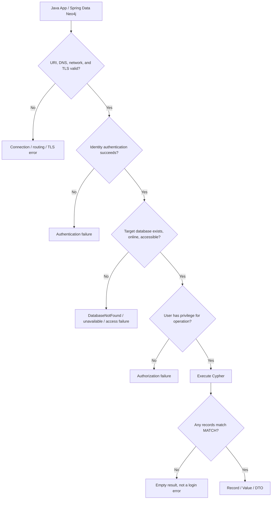
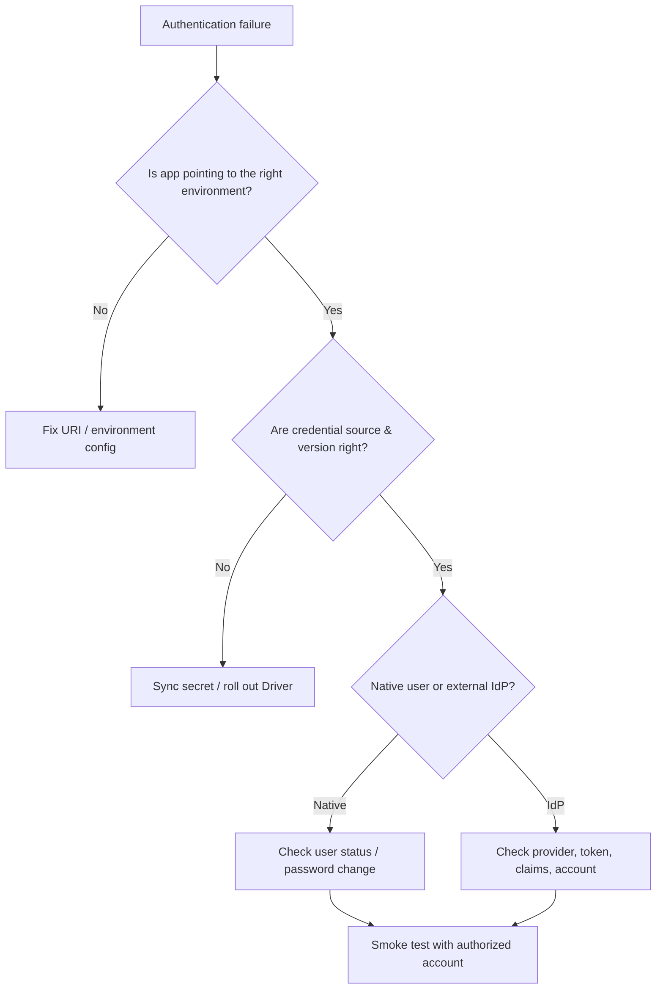
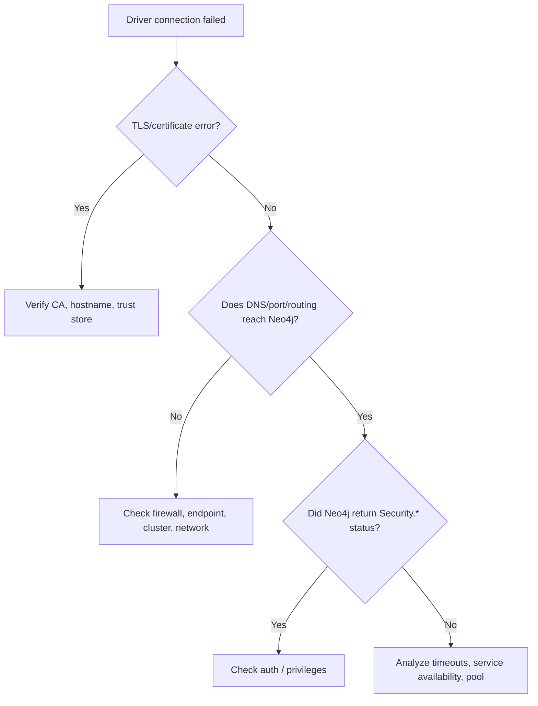
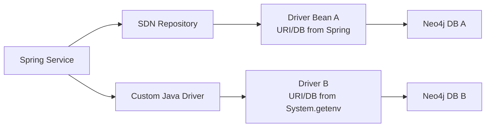

# Authentication, Authorization, and Database Not Found Errors in Neo4j

In an application using **Neo4j** to store connected data, three errors look very similar to end users: the API fails to return nodes or relationships. Yet their root causes can be completely different:

- **Authentication failure:** invalid login credentials or an incompatible authentication method.
- **Authorization failure:** the account logged in successfully, but lacks privileges to access the database, graph, procedure, or write operation.
- **Database does not exist / unavailable:** the Java Driver or Spring Data Neo4j is selecting the wrong database name, the database was dropped/renamed/not yet online, or routing goes to an unsuitable target.

If you handle all three cases by “changing the password”, “granting admin”, or “disabling authentication”, the application may keep failing while security risk increases. This lesson belongs to the **Troubleshooting** chapter of the **DATABASE_ENGINE_GRAPH_NEO4J** module, focusing on the **property graph** model, Cypher, indexes/constraints, the Java Driver, and Spring Data Neo4j.

The goal of this lesson is to build an **evidence-based diagnostic workflow** that distinguishes connection errors, identity errors, permission issues, and database availability without performing destructive actions or exposing credentials.

After this lesson, you will be able to:

1. Read messages and **error codes** from Neo4j/Java Driver without relying solely on descriptive text that may change.
2. Distinguish “wrong login”, “missing privilege”, “database not found”, and “Cypher returned 0 rows”.
3. Inspect the current user, target database, database status, and privileges using appropriate administrative commands.
4. Diagnose `SessionConfig.forDatabase(...)`, `spring.data.neo4j.database`, URI, TLS, and secret configurations.
5. Build a privilege-aware runbook that avoids accidentally granting admin or changing passwords on a live system.
6. Write smoke tests and regression tests so errors do not recur after deployments, credential rotations, or migrations.

> **Version scope:** Exception class names, Neo4j error codes, and `SHOW` command fields may vary across releases, drivers, Community/Enterprise editions, and self-managed/Aura deployments. The codes below are **common indicators**, not an exhaustive code table or a guarantee that every Neo4j version emits the exact same string.

## 1. Three Errors That Look Alike but Occur at Three Different Boundaries

Suppose a Java API reads an order graph:

```cypher
MATCH (c:Customer {customerId: $customerId})
      -[:PLACED]->(o:Order)
RETURN o.orderId AS orderId,
       o.total AS total
ORDER BY orderId
LIMIT 20;
```

The application sends the query via the Java Driver to database `commerce`. The flow must pass these steps:



This diagram is an **investigation model**, not a claim that Neo4j always checks database privileges after checking database state. In practice, the system may **avoid revealing whether a database exists** to an unprivileged user in order to protect metadata. Therefore, a “database not visible” symptom may require an admin to check both existence and permissions.

### Distinguishing by Symptom

| What is observed | Likely underlying nature | What NOT to jump to as a conclusion |
| --- | --- | --- |
| `Unauthorized` | Wrong user, password/token, auth provider, or rotated credential | “The database was deleted” |
| `Forbidden` / “permission denied” | Valid identity, insufficient privileges | “Wrong password” |
| `DatabaseNotFound` | Wrong database/alias name, does not exist, wrong context; sometimes visibility permissions | “The server crashed” |
| Database unavailable/offline | DB exists but is not ready or topology has an issue | “Create a new database immediately” |
| `ServiceUnavailable` | Cannot connect or route to the server | “User lacks permissions” |
| `MATCH` returns 0 records | No matching nodes/relationships; possibly reading wrong database/tenant | “Unable to log in” |

**Recommended order:** identify **error code → connection target → identity → database → privileges → query/data**. Do not change multiple layers at once, or you will not know the real cause.

## 2. Read Error Codes Instead of Only Message Strings

Neo4j uses status error codes, and the Java Driver typically throws exceptions carrying an error code. Common codes look like:

| Common code or error group | Diagnostic interpretation | Next check |
| --- | --- | --- |
| `Neo.ClientError.Security.Unauthorized` | Credentials rejected | Secret, user, auth provider, rotation |
| `Neo.ClientError.Security.Forbidden` | Lacks privilege for operation or resource | Database/graph/procedure privileges, roles |
| `Neo.ClientError.Security.CredentialsExpired` | Credential must be updated per policy | Password-change status, account type |
| `Neo.ClientError.Database.DatabaseNotFound` | Database not found by name or routing path | `SessionConfig`, alias, `SHOW DATABASES` |
| Database unavailable group | Database is not online or not ready | `SHOW DATABASES`, health, cluster, logs |
| Transient/service unavailable group | Connection or service temporarily unavailable | DNS, TLS, routing, server, retry policy |

**Important:** classify accurately using the **code returned by the actual failure** and the documentation for your running version. In newer releases, in addition to legacy `Neo.*` codes, there are GQL-style status fields. Never build your entire diagnostic flow around matching a snippet of English message text.

### 2.1. Java Driver Error Codes

A Java handling pattern:

```java
import org.neo4j.driver.exceptions.Neo4jException;

try {
    graphService.readOrders(customerId);
} catch (Neo4jException ex) {
    String code = ex.code(); // Neo4j status code when present.

    // Log the error code for investigation; never log passwords or tokens.
    log.warn("Neo4j request failed; code={}", code);

    if ("Neo.ClientError.Security.Unauthorized".equals(code)) {
        throw new GraphAuthenticationFailure();
    }
    if ("Neo.ClientError.Security.Forbidden".equals(code)) {
        throw new GraphPermissionFailure();
    }
    if ("Neo.ClientError.Database.DatabaseNotFound".equals(code)) {
        throw new GraphDatabaseSelectionFailure();
    }

    // Other codes: preserve the cause for internal system handling.
    throw ex;
}
```

`GraphAuthenticationFailure`, `GraphPermissionFailure`, and `GraphDatabaseSelectionFailure` are **hypothetical application domain exceptions**, not classes built into the Neo4j Driver. The snippet illustrates where **classification** belongs, not copy-paste code that compiles without defining those classes and logger.

Never return raw exception messages, internal URIs, or database user details in public HTTP responses. Clients should receive consistent application error codes; internal logs should capture technical error codes, correlation IDs, and timestamps.

### 2.2. Missing Status Code Does Not Mean “Not Neo4j”

When DNS, TLS handshake, or networking fails before Neo4j can return a status, the driver may throw a connectivity exception such as `ServiceUnavailableException` without a corresponding `Neo.ClientError.*` code. Therefore, distinguish:

- **Error response from Neo4j:** read the Neo4j error code.
- **No response from Neo4j:** inspect URI, routing, firewall, certificates, server availability, and the connection pool.

Never swallow all exceptions into `catch (Exception e) { return List.of(); }`: doing so turns a production outage into “no data”, hiding failures and blinding monitoring.

## 3. Initial Runbook: Preserve State Before Making Changes

During an incident, collect information **without reading/logging secrets** and without modifying data:

1. **Time and scope:** when did errors start, and do they affect every request or only one endpoint/tenant?
2. **Application and Neo4j versions:** did failures follow a deploy, driver upgrade, auth provider change, backup/restore, or migration?
3. **Logical target:** URI (store only non-sensitive parts), database name, dev/staging/prod environment.
4. **Identity:** expected service account/role, secret version (record only ID/version, never the value).
5. **Error code:** exception class, Neo4j/GQL error code if present, correlation ID.
6. **Basic connectivity check:** DNS/TLS/route via authorized operational tools.
7. **Privileged DBMS check:** database status, users/roles, relevant privileges.
8. **Minimal reproduction:** a harmless read query against the same database with the same identity if feasible.

**Do not do these first:** reset all passwords, create a new database with any matching name, grant `admin` to the service, disable authentication, edit `neo4j.conf`, or restart the cluster without evidence.

### 3.1. Minimal Evidence Table

| Field | Illustrative example |
| --- | --- |
| Incident ID | `INC-GRAPH-024` |
| Environment | `staging` |
| App version | `graph-api-2.x` |
| URI class | `neo4j+s://<host>` |
| Requested database | `commerce` |
| Expected DB identity | `graph_api_reader` |
| Error code | `Neo.ClientError.Database.DatabaseNotFound` |
| Auth secret version | `graph/staging/api@v7` |
| Check result | TLS connection OK; database name unverified |
| Owner/next action | DBA to verify database/alias and access |

This is an **incident logging template**, not a real environment log. Never paste passwords, tokens, session cookies, or full URIs containing secrets into tickets.

## 4. Branch A — Authentication Failure

Authentication verifies **who the client is** before executing queries under that user's privileges.

Common causes:

- Wrong username or password; case sensitivity mismatch.
- Secret was recently **rotated**, while the Driver or application instance still uses the old value.
- App points to the wrong environment: `dev` credentials sent to `prod` Neo4j.
- Native user was deleted or suspended from logging in.
- User is in a **password change required** state, unsuitable for a headless service.
- Wrong **auth provider**: using basic native auth for an account requiring SSO/OIDC/LDAP.
- Connecting to a **different instance** sharing a logical hostname but backed by a different identity store.
- Brute-force login rate limits; repeated failed logins may trigger throttling/lockout policies.

### 4.1. Credential Verification Flow



**Never verify by printing passwords** into tickets or logs. Instead, check the application's and vault's secret version/id, verify the effective config source, or run an approved test login without exposing the secret.

### 4.2. Checking Accounts When You Have a Valid Admin Session

In the `system` database administrative context and with appropriate privileges:

```cypher
SHOW CURRENT USER;
```

```cypher
SHOW USERS
YIELD user, roles, passwordChangeRequired, suspended
RETURN user, roles, passwordChangeRequired, suspended
ORDER BY user;
```

Some fields such as `roles` or `suspended` may be `null` or not applicable depending on edition and provider. If `SHOW USERS` fails due to insufficient privileges, do not escalate the application's privileges; hand the request to an authorized administrator.

**Community** and **Enterprise** accounts do not share the same role/status management capabilities; on **Aura**, user and IdP workflows depend on the service tier.

### 4.3. Changing Passwords Through an Approved Process

For an interactive native user currently logged in who knows the old password:

```cypher
ALTER CURRENT USER
SET PASSWORD FROM $oldPassword TO $newPassword;
```

This is a **self-service password change command**, not an automated error handler to run on every request. Parameters containing secrets must be supplied over a secure channel.

When an admin reset is needed, administrators use `ALTER USER` under an approved procedure. Do not use `neo4j-admin dbms set-initial-password` as a general remedy on an already running instance; that tool is for **initial setup**.

### 4.4. Secret Rotated, Yet the Application Still Reports Unauthorized

A **Neo4j Java Driver** is typically created once and manages a **connection pool**. Having a new password in the vault **does not cause an existing Driver to re-read the secret automatically**.

Check:

1. Which instances have received the new secret version?
2. Are credentials injected via environment variables or mounted files?
3. For environment variables, have the processes been rolled out/restarted properly?
4. Is the Driver using an AuthManager that supports rotation, or does a new Driver need to be created?
5. Are new connections actually authenticating with the new credentials?
6. Are there old jobs, connectors, batch workers, or pods still holding the old secret?

Do not instantiate a new Driver on **every request** to “automatically pick up the new password”; use a Driver/pool replacement mechanism or version-supported auth rotation instead.

## 5. Branch B — Valid Login, Denied Privileges (Authorization)

Authorization decides what an authenticated user may do with databases and graphs.

In Neo4j Enterprise, permissions can be modeled with **roles/privileges** over databases, graphs, labels, relationships, and procedures. Conceptually, different operations require corresponding privileges:

| Query or action | Privilege group to check |
| --- | --- |
| `RETURN 1 AS ok` | Basic connectivity and query execution ability |
| `MATCH (n:Customer) RETURN n` | **Database access**, traversal, and appropriate property/graph read privileges |
| `CREATE (n:Customer)` | Node creation / graph write privileges |
| `SET n.status = 'ACTIVE'` | Appropriate property modification privileges |
| `DELETE n` | Corresponding node/relationship delete privileges |
| `CREATE CONSTRAINT ...` | Schema/admin privileges per edition and role |
| `CALL gds.*` or `CALL apoc.*` | Procedure/function execution privileges, edition, and plugins |
| `SHOW USERS`, `ALTER USER` | DBMS user viewing/management privileges |

**A user able to run `RETURN 1` does not prove that user has permission to read `Customer` nodes.** Nor does it prove permissions on another database.

### 5.1. Checking Identity and Privileges

If the connected user has permission to run it:

```cypher
SHOW CURRENT USER;
```

In Enterprise, an administrator or account with view privileges can inspect a user's privileges:

```cypher
SHOW USER graph_api_reader PRIVILEGES;
```

Use this command to verify which roles/privileges the user **actually** holds; never infer permissions solely from a username like `graph_api_reader`. With custom roles, also inspect any **DENY** rules, graph/database scopes, and effective combined privileges.

### 5.2. Community, Enterprise, and Aura Differences

- **Community:** lacks fine-grained RBAC equivalent to Enterprise. Creating an extra user named `readonly` **does not automatically make it read-only**.
- **Enterprise:** provides granular roles and privileges, depending on version. Read accounts should be granted only the permissions they need.
- **Aura:** managed service; privileges and administrative features depend on tier. Do not assume you can edit host configuration or run every Cypher admin command as on self-managed deployments.

On Enterprise, an authorized administrator can assign built-in roles, for example:

```cypher
GRANT ROLE reader TO graph_api_reader;
```

**This is only a syntax example and its privilege scope must be checked.** The `reader` role may be broader than needed (such as accessing multiple labels/databases). Never grant it in production without verifying requirements, and never grant `admin` just to clear a Forbidden error.

### 5.3. Missing APOC/GDS Execution Privileges Is Not a Missing Password

Suppose the query is:

```cypher
CALL gds.pageRank.stream('customerGraph')
YIELD nodeId, score
RETURN nodeId, score
ORDER BY score DESC
LIMIT 10;
```

It can fail because:

- GDS is not installed or not included in the bundle.
- The procedure does not exist in that version.
- The user lacks privilege to execute the procedure.
- Graph `customerGraph` is not in the GDS catalog.
- The plugin version is incompatible with the Server.

If a procedure returns `Forbidden`, check privileges. If it reports **unknown procedure**, check plugins/syntax. If it reports **graph not found**, check the GDS catalog. None of the three **should be “fixed” by changing passwords**.

### 5.4. Running Verification Actions Without Corrupting Data

Prefer verifying with:

- `SHOW CURRENT USER` and `SHOW` administrative commands that the valid account is allowed to run.
- The application's own read queries, with valid parameters and database.
- A write test against a **dedicated test label/record** that can be rolled back in staging, if write permissions must be tested.
- DDL checks in staging/migration environments; never create or drop constraints arbitrarily in production.

Any proposed role change must document **the account, database, required operations, least-privilege scope, and approval**. Re-test after granting permissions and revoke temporary privileges once no longer needed.

## 6. Branch C — Database Not Found

One of the most common errors when an application moves from local to staging is selecting the wrong **database name**.

Suppose:

```text
Development:
  neo4j URI:       bolt://127.0.0.1:7687
  default db:      neo4j

Staging:
  neo4j URI:       neo4j+s://graph.staging.example
  expected db:     commerce_staging

Application:
  configured db:   commerce   <-- May be selecting the wrong database.
```

This is illustrative data. If the app sends requests to `commerce` while the DBMS only has `commerce_staging`, queries may fail right at database selection, **before matching any data**.

### 6.1. Checking Database Status with Appropriate Admin Privileges

In Neo4j supporting multi-database and with an account permitted to view it:

```cypher
SHOW DATABASES
YIELD name, currentStatus, requestedStatus
RETURN name, currentStatus, requestedStatus
ORDER BY name;
```

What to read:

| Field | How to use |
| --- | --- |
| `name` | Actual database in the DBMS |
| `currentStatus` | Current operational state, e.g., online/offline |
| `requestedStatus` | Target state the DBMS was asked to reach |

Also run the following commands when supported by version/edition:

```cypher
SHOW DEFAULT DATABASE;
```

```cypher
SHOW HOME DATABASE;
```

The **default database** and **home database** determine which database a session targets when none is explicitly specified. However, **do not rely on defaults in production configuration** when the application requires a specific database.

### 6.2. Database Name vs. Labels and Properties

Frequently confused concepts:

| Concept | Example | Where is it specified? |
| --- | --- | --- |
| **Database** | `commerce` | `SessionConfig.forDatabase("commerce")`, `spring.data.neo4j.database` |
| **Node label** | `:Customer` | `MATCH (n:Customer)` |
| **Relationship type** | `:PLACED` | `MATCH (c)-[:PLACED]->(o)` |
| **Property** | `customerId` | `WHERE n.customerId = $id` |
| **Database alias** | Name pointing to a database per DBMS config | Appropriate alias administration commands |
| **GDS graph projection** | `customerGraph` | In-memory catalog of GDS |

If `gds.pageRank.stream('customerGraph')` returns “graph not found”, **it does not mean the Neo4j database named `commerce` disappeared**. It may be a GDS graph projection dropped or lost after a restart. Diagnosing the right resource layer prevents creating unnecessary databases.

### 6.3. Does the Database Not Exist, or Does the User Lack Permission?

A user without permission to see or access a database may not observe complete database metadata. If an application account reports “database not found”:

1. Confirm the **exact database name the app actually sends**.
2. Have a DBA using a **valid administrative account** verify database existence, aliases, and status.
3. If the database exists, verify whether the user/role has access privileges to it.
4. If the database is offline/unavailable, address state/cluster health instead of creating a new database.
5. If the database was renamed during a migration, update client config or aliases through the proper process.
6. If this is **Aura**, use the provided console/features to inspect databases and tier privileges.

Do not grant `admin` to an app user just to list databases, and do not run `CREATE DATABASE` before proving a new database genuinely needs to be created.

### 6.4. Database Unavailable vs. DatabaseNotFound

**DatabaseNotFound** typically means the logical target cannot be found or routed to. **Unavailable/offline** may indicate the database exists but is not ready to serve:

- Neo4j is starting up, recovering, or restoring.
- The database has not reached `ONLINE`.
- A cluster/member has quorum, routing, or replication issues.
- Disk/memory resources or configuration prevent the database from becoming available.
- Network paths to the member hosting the database are disrupted.

**Never drop and recreate a database** just because it is not online yet. Inspect logs, health/metrics, cluster status, and the recovery runbook; only an authorized DBA should perform database state changes.

## 7. Explicit Database Selection in the Java Driver

When using the Neo4j Java Driver, specify the database on the session:

```java
import org.neo4j.driver.Driver;
import org.neo4j.driver.Session;
import org.neo4j.driver.SessionConfig;

try (Session session = driver.session(
        SessionConfig.forDatabase("commerce"))) {

    long ok = session.executeRead(tx ->
        tx.run("RETURN 1 AS ok")
          .single()
          .get("ok")
          .asLong()
    );

    System.out.println("Query completed: " + (ok == 1));
}
```

**Why explicit selection matters:**

- Without it, the application may hit a home/default database that differs from expectations.
- After a migration, a user's home database or database name may change.
- Passing `driver.verifyConnectivity()` is **not sufficient proof** that sessions will execute queries against a **specific database**.
- A multi-database deployment hosts multiple databases for different purposes; selecting the wrong one can return empty or wrong data with no login error.

### 7.1. Configuration and Fail-Fast

Example reading deployment configuration:

```java
import java.util.Objects;

String database = Objects.requireNonNull(
    System.getenv("NEO4J_DATABASE"),
    "NEO4J_DATABASE is missing"
);

if (database.isBlank()) {
    throw new IllegalArgumentException("NEO4J_DATABASE is blank");
}

try (Session session =
         driver.session(SessionConfig.forDatabase(database))) {
    session.executeRead(tx ->
        tx.run("RETURN 1 AS ok").consume()
    );
}
```

This illustrative snippet sits inside a class with a properly initialized and managed `driver`. Never let production silently fall back to `"neo4j"` or `localhost` when environment variables are missing.

**Never allow HTTP clients to pass an arbitrary database name directly** into `SessionConfig`. The database name is a server-side deployment/authorization setting, not an untrusted user parameter.

### 7.2. Connectivity Checks Are Not Privilege Checks

An application preflight sequence can include:

1. Create the Driver with the right URI/TLS.
2. Call `driver.verifyConnectivity()` to check connectivity.
3. Open a session targeting the intended database.
4. Execute a simple read query in the target database.
5. Execute **one safe business read query** using the application's actual labels/relationships/parameters.
6. When deploying a write service, verify write privileges in staging with rollback or managed test records.

`RETURN 1` verifies the query path to the database; it **does not prove** the user can read `:Customer`, view protected properties, or write to the graph.

## 8. Spring Data Neo4j: Database URI and Effective Identity

With **Spring Boot / Spring Data Neo4j** in a typical configuration:

```yaml
spring:
  neo4j:
    uri: ${NEO4J_URI}
    authentication:
      username: ${NEO4J_USERNAME}
      password: ${NEO4J_PASSWORD}
  data:
    neo4j:
      database: ${NEO4J_DATABASE}
```

This uses Spring property placeholder syntax populated from environment values. Never put real passwords into an `application.yml` committed to Git.

Investigation table:

| Property | Issue it can cause |
| --- | --- |
| `spring.neo4j.uri` | Points to wrong instance, wrong TLS scheme, wrong routing/network |
| `spring.neo4j.authentication.username` | User does not exist or belongs to wrong environment |
| `spring.neo4j.authentication.password` | Stale, wrong, or uninjected secret |
| `spring.data.neo4j.database` | Selects nonexistent database, or wrong tenant/application |
| `spring.profiles.active` | Wrong profile/override pulls config from another environment |
| Custom Driver/secret bean | Overrides auto-configuration or retains stale credentials after rotation |

**Do not look only at `application-prod.yml` and assume runtime uses it.** Environment variables, command-line options, ConfigMaps/Secrets, property sources, and custom beans can partially override it. Verify **non-sensitive effective values** and **secret versions** without printing plaintext passwords.

### 8.1. Distinguishing Repositories from Neo4jClient

In SDN:

- Repositories and `Neo4jClient` should share the appropriate configuration and transaction manager when handling the same business flow.
- `Forbidden` in a repository while `RETURN 1` succeeds via `Neo4jClient` may come from different **entity or relationship read/write privileges**, not necessarily two different drivers.
- A manually constructed `Driver` with a different URI/credential in the same app can cause “one path works, another path fails”.
- `@Transactional` manages transactions; it **does not grant privileges**, refresh secrets, or fix database names.

If an app uses multiple DBs or multiple Driver beans, document **which flow uses which bean/transaction manager**. Never assume every bean shares one session just because they run in the same Spring process.

## 9. Do Not Confuse Security Errors with TLS, DNS, or Routing Errors

A client may fail before ever reaching authentication because an earlier step failed:



Common scenarios:

| Symptom | Suspected layer | Direction to check |
| --- | --- | --- |
| `SSLHandshakeException` | TLS/certificate | Hostname, chain, trust store, certificate expiry |
| `ServiceUnavailableException` | Network/server/routing | URI, DNS, port, firewall, health |
| Timeout waiting on connection pool | Driver/app capacity | Pool size, request concurrency, long-running queries |
| `Unauthorized` | Authentication | Credentials/source/version/provider |
| `Forbidden` | Authorization | Database access, graph/read/write/procedure privileges |
| `DatabaseNotFound` | Selection/catalog/permission | Database name, alias, `SHOW DATABASES` |

For remote connections, use server-verified TLS per guidance, such as `neo4j+s://` in appropriate deployments. **Never switch to unencrypted connections or disable certificate checks just to “fix” TLS errors.**

The URI also governs routing: `neo4j://` enables routing; `bolt://` is direct connection where appropriate. Choose the URI type based on topology and deployment documentation, not ad-hoc workarounds during auth errors.

## 10. Database Aliases, Migrations, and Renames Can Break Post-Deploy

After a data migration, the new environment may use a different database name or alias than the old one. For example:

```text
Before migration:
  Application → database commerce

After migration:
  Actual DB → commerce_v2
  App config still → commerce
```

Depending on the platform, an organization may update a **database alias** or update application configuration in a controlled manner. Do not assume renaming a database is like renaming a node label or changing `spring.profiles.active`.

Verification checklist:

1. **Does the target database exist?**
2. **If the app uses an alias**, does the alias still point to a valid target?
3. Does the alias belong to the DBMS/cluster being connected to?
4. Does the app user have permissions on the real database and/or alias as enforced by the system?
5. Does the driver cache/routing table need time or a fresh session to pick up changes?
6. Has the migration finished schema, indexes/constraints, and data loading?
7. Is the app querying a valid database that is **empty** because import has not finished?

In environments with admin access and feature support, use version-appropriate alias commands such as `SHOW ALIASES`. Never run `DROP DATABASE`, `CREATE DATABASE`, or modify aliases without approval and data impact review.

### Two Very Different Outcomes

```cypher
// This query runs successfully, yet may return 0 rows.
MATCH (c:Customer {customerId: 'C-404'})
RETURN c.customerId;
```

A database that **exists and is accessible** may still contain no matching `Customer` node. If the query succeeds with 0 rows, check:

- Is the business key value right?
- Is the `:Customer` label exact, including casing?
- Is a relationship missing in the pattern?
- Is the app targeting the right database and tenant?
- Has data import or CDC synchronization completed?

**Never create a new database** just because a `MATCH` returned an empty list.

## 11. Verifying on the Property Graph and Business Data

After authentication, privileges, and database selection are all healthy, still verify **Cypher results**:

```cypher
MATCH (c:Customer {customerId: $customerId})
RETURN count(c) AS customersFound;
```

If `customersFound = 0`, there may simply be **no data**, not a DB error. Check relationships:

```cypher
MATCH (c:Customer {customerId: $customerId})
OPTIONAL MATCH (c)-[r:PLACED]->(o:Order)
RETURN c.customerId AS customerId,
       count(r) AS orderRelationships;
```

Distinguish:

- The query **returns no rows** because the root `MATCH` does not match.
- The root exists, but `orderRelationships = 0` because there is no `PLACED` edge.
- Edges exist, but the user lacks permission to view part of the graph/properties in a fine-grained RBAC setup.
- The app targets a valid new database whose **graph has not yet been imported**.

**An API should not return HTTP 200 with an empty list for every exception.** Clearly separate “business entity not found” from “cannot access database”.

### Indexes/Constraints Do Not Fix Unauthorized

If a query is valid but **slow**, that is a separate performance branch. Use `EXPLAIN`/`PROFILE` and inspect `NodeIndexSeek`, `Rows`, `DB Hits`, and the plan. Never add indexes to fix authentication errors, and never grant admin to fix a query plan.

```cypher
EXPLAIN
MATCH (c:Customer {customerId: $customerId})
      -[:PLACED]->(o:Order)
RETURN o.orderId AS orderId
LIMIT 20;
```

`EXPLAIN` does not execute the query; `PROFILE` actually runs the query and must be used carefully with writes. Here the goal is **diagnostic branching**, not tuning queries before resolving auth/database issues.

## 12. End-to-End Java Driver Pattern: Low-Side-Effect Diagnostics

The example below is a **diagnostic CLI** with mandatory configuration that tests `verifyConnectivity()` and queries the target database. It targets Java 17+ and requires the appropriate Neo4j Java Driver on the classpath. Never use it to brute-force passwords or test unauthorized credentials.

```java
import java.util.Objects;

import org.neo4j.driver.AuthTokens;
import org.neo4j.driver.Driver;
import org.neo4j.driver.GraphDatabase;
import org.neo4j.driver.Session;
import org.neo4j.driver.SessionConfig;
import org.neo4j.driver.exceptions.Neo4jException;
import org.neo4j.driver.exceptions.ServiceUnavailableException;

public final class Neo4jDiagnostic {

    private static String requiredEnv(String name) {
        String value = Objects.requireNonNull(
            System.getenv(name), "Missing " + name
        );
        if (value.isBlank()) {
            throw new IllegalArgumentException(name + " is blank");
        }
        return value;
    }

    public static void main(String[] args) {
        String uri = requiredEnv("NEO4J_URI");
        String db = requiredEnv("NEO4J_DATABASE");
        String user = requiredEnv("NEO4J_USERNAME");
        String password = requiredEnv("NEO4J_PASSWORD");

        try (Driver driver = GraphDatabase.driver(
                uri, AuthTokens.basic(user, password))) {

            // Connectivity check only; does not prove permission to query
            // business data in the target DB.
            driver.verifyConnectivity();

            try (Session session = driver.session(
                    SessionConfig.forDatabase(db))) {

                long ok = session.executeRead(tx ->
                    tx.run("RETURN 1 AS ok")
                      .single()
                      .get("ok")
                      .asLong()
                );

                System.out.println(
                    "Target database query succeeded: " + (ok == 1)
                );
            }

        } catch (ServiceUnavailableException e) {
            System.err.println(
                "Connection/routing unavailable; check URI, TLS, server.");
        } catch (Neo4jException e) {
            String code = e.code();

            if ("Neo.ClientError.Security.Unauthorized".equals(code)) {
                System.err.println(
                    "Authentication rejected; check identity/secret source.");
            } else if ("Neo.ClientError.Security.Forbidden".equals(code)) {
                System.err.println(
                    "Access denied; verify database/graph privileges.");
            } else if ("Neo.ClientError.Database.DatabaseNotFound"
                    .equals(code)) {
                System.err.println(
                    "Target DB not found; verify DB name/alias and access.");
            } else {
                // On newer Neo4j versions, inspect GQL status details
                // via the appropriate driver API if needed.
                System.err.println("Neo4j error code: " + code);
            }
            System.exit(2);
        }
    }
}
```

**Analysis:**

- `requiredEnv()` provides **fail-fast** behavior when variables are missing; never fall back to `neo4j` or an admin password in production.
- Never print passwords, auth tokens, or full environment variables.
- `verifyConnectivity()` and querying the **configured database** are two distinct checks.
- `SessionConfig.forDatabase(db)` reduces the risk of hitting the wrong home/default database.
- Error codes drive diagnostic branching; user-facing messages must be controlled and never leak secrets.
- If only `RETURN 1` works, test business read/write privileges separately.
- Some network/TLS failures will not match the Neo4j codes above; inspect internal causes/traces when needed.

**Scope limit of this example:** the program does not auto-reset passwords, auto-grant roles, or auto-create databases. That is intentional: **a diagnostic tool must never mutate privileges, identities, or data**.

## 13. Coordinating Spring Data Neo4j and the Java Driver Across Multiple Config Sources

A service may use an SDN repository for entity `Customer`, while another piece of code manually initializes `GraphDatabase.driver(...)` from different environment variables.



If the repository reports `DatabaseNotFound` while the custom Driver queries cleanly, **do not assume the repository has a code bug**. Compare effective values:

| Component | Configuration to compare |
| --- | --- |
| SDN repository | `spring.neo4j.uri`, `spring.data.neo4j.database`, Driver bean |
| `Neo4jClient` | Driver/transaction manager used by Spring |
| Custom Driver | URI, token/username, `SessionConfig.forDatabase(...)` |
| Spring profile | `SPRING_PROFILES_ACTIVE` and property override precedence |
| Kubernetes/Docker | ConfigMap, Secret, environment injection, runtime rollout |
| Vault/secret manager | Secret version, refresh timing, secret read permissions |

In an app using `@Transactional`, a manually created Java Driver session **does not automatically** participate in the Spring Data Neo4j transaction. Do not compare connectivity alone; if an operation spans multiple writes, understand the separate commit/rollback boundaries.

### A Very Common Post-Deploy Mistake

```text
application-prod.yml:
  database: commerce

Kubernetes env:
  NEO4J_DATABASE=commerce_old

Runtime:
  the application actually selects commerce_old
```

Check property source precedence for the Spring Boot version in use. **Never log all environment variables** to hunt for config bugs because that can expose secrets; display only controlled non-sensitive fields such as database name or secret reference/version.

## 14. Why Not Fix Errors by Disabling Authentication or Granting Admin?

The following “quick fixes” introduce severe risks:

| Hasty action | Risk |
| --- | --- |
| `dbms.security.auth_enabled=false` | Opens unauthenticated access if network isolation is incomplete |
| Granting `admin` role to the API account | Application bugs can drop graphs/schemas or manage users |
| Copying production passwords to staging | Exposes credentials and enables cross-environment access |
| Creating a duplicate-purpose database on `DatabaseNotFound` | Masks config bugs, fragments data, or writes into an empty DB |
| Disabling TLS certificate verification | Exposes clients to misrouting or man-in-the-middle attacks |
| Catching all exceptions and returning `List.of()` | Masks outages, making the API report empty data during real failures |
| Unbounded automatic login retries | Can trigger rate limiting/lockout and amplify load |
| Testing write permissions with `DELETE` on production | Can cause data loss if write permission actually succeeds |

**Grant only least-privilege access after proving missing permissions and getting proper approval.** For exposed secrets, prioritize rotation/revocation per runbook; for offline databases, prioritize availability diagnostics rather than creating databases ad hoc.

## 15. Pre-Production Failure Scenario Test Matrix

In an authorized staging environment, design a test suite using **test accounts and databases**:

| Case | Expectation | Issue category |
| --- | --- | --- |
| Wrong username/password | Authentication failure, no data returned | Identity |
| Old secret after rotation | Clear coded login failure and alert | Identity lifecycle |
| User allowed to read but not write | Read succeeds, write rejected | Authorization |
| User lacks GDS/APOC procedure privilege | Privilege error distinguished from procedure availability | Procedure/security |
| Nonexistent database name | Database selection error, no silent fallback | Database selection |
| Database exists but offline | Availability failure, no auto-creation | Runtime state |
| Home DB differs from app DB | Query still runs on the explicitly configured DB | Database selection |
| `MATCH` finds no nodes | Returns 0 rows without auth error | Application data |
| Wrong TLS hostname | Connection rejected, TLS not bypassed | Transport security |
| Secret manager fails to inject password | App fails fast, does not try default credentials | Configuration |
| Custom Driver differs from SDN bean | Detects mismatch in URI/database/identity | Architecture |
| Alias/database changed after migration | Preflight identifies target DB, avoids writing wrong DB | Deployment |

Tests must assert **error codes and API behavior**, not only message strings. Creating test users/roles/databases must be performed only by an authorized admin in an isolated environment.

### Recommended Monitoring Signals

- **Authentication** error counts by service and rotation timestamp (without logging secrets).
- **Authorization** error counts after role deploys/migrations.
- Rate of `DatabaseNotFound`, offline databases, or requests targeting the wrong DB.
- Connection/routing/TLS failures and driver pool wait times.
- API error rate, p95/p99 latency, retries, and timeouts.
- Correlation ID, application release, target database, secret version ID.

Never use raw Cypher containing sensitive data, passwords, or tokens as **metric labels**, as doing so leaks data and causes high cardinality.

## 16. Quick Triage Decision Table

| Observation | First check | Proper direction |
| --- | --- | --- |
| `Unauthorized` | URI/environment, secret version, auth provider | Fix identity config or perform approved rotation |
| `CredentialsExpired` | Password-change flag, native/SSO user | Complete approved credential change process |
| `Forbidden` | Current user, database access, graph/procedure privileges | Grant least privilege once proven and approved |
| `DatabaseNotFound` | Actual sent DB name, alias, database inventory | Fix selection or restore mapping; do not auto-create DB |
| Database offline/unavailable | `SHOW DATABASES`, logs, cluster health | Follow availability/recovery runbook |
| `ServiceUnavailable` | DNS, TLS, port, routing, server status | Investigate transport/endpoint |
| Valid query returns empty | Label, property key, relationship, import state, tenant | Fix business query/data |
| Valid query is slow | `EXPLAIN`/`PROFILE`, indexes, skew, concurrency | Investigate execution plan/performance |
| Only one SDN bean fails | Effective config/transaction manager/Driver used | Compare property sources and beans |

An incident can involve **chained causes**—for example, rotating a secret breaks login on some pods, and then a redeploy selects the wrong database. Always re-verify state **after every change** before declaring resolution.

## 17. Self-Check Exercises

**Question 1.** `driver.verifyConnectivity()` succeeds. Can you conclude the account has permission to run `MATCH (c:Customer)` on database `commerce`?

<details>
<summary>Suggested answer</summary>

No. Connectivity success only proves transport and authentication at the driver level. You must open a session explicitly targeting `commerce` and run a representative read query under the right privileges. A user may be able to connect yet lack database or graph access permissions.

</details>

**Question 2.** Error code `Neo.ClientError.Security.Forbidden` indicates you should change the password first or check permissions?

<details>
<summary>Suggested answer</summary>

Check permissions first. The identity likely authenticated already, but is not authorized to perform the operation. Compare the current user, target database, roles/privileges, and the exact query being rejected.

</details>

**Question 3.** After a deploy, the application reports `DatabaseNotFound`, while the admin sees database `commerce_v2` is `ONLINE`. What is the next step?

<details>
<summary>Suggested answer</summary>

Check the exact database name the app sends, `SessionConfig.forDatabase(...)` or `spring.data.neo4j.database`, aliases, and user permissions. The application may still be pointing at the old `commerce` name; do not create another database just to silence the error.

</details>

**Question 4.** `SHOW DATABASES` does not list the expected database when run as the application user. Does that prove the database was deleted?

<details>
<summary>Suggested answer</summary>

No. The user may lack permission to view or access that database's metadata. Have an authorized admin verify database existence, status, aliases, and privileges before determining the cause.

</details>

**Question 5.** After updating the password in the vault, several Java instances keep reporting Unauthorized. Why?

<details>
<summary>Suggested answer</summary>

Processes or Drivers may still hold the old auth token, or secret injection has not updated. Check the secret version, rollout status, AuthManager/Driver rotation, any un-restarted pods/jobs, and auth failure logs—without printing passwords.

</details>

**Question 6.** A `MATCH` query returns 0 rows without throwing an exception. Is this a database-not-found error?

<details>
<summary>Suggested answer</summary>

No. The query executed successfully against an accessible database. Check labels, properties, relationships, tenant, import/CDC state, and whether the target database matches the right environment.

</details>

**Question 7.** Query `CALL gds.pageRank.stream(...)` reports unknown procedure. Should you grant the `admin` role to fix it?

<details>
<summary>Suggested answer</summary>

No. First distinguish whether GDS is not installed/supported, the plugin version mismatches, the procedure was renamed, or privileges are missing. Grant only minimal execution privileges once the cause is verified and approved.

</details>

**Question 8.** In Spring Data Neo4j, `spring.neo4j.uri` is correct, but `spring.data.neo4j.database` is wrong. What can happen?

<details>
<summary>Suggested answer</summary>

The Driver can connect to Neo4j successfully, yet when the repository or `Neo4jClient` executes a query against the nonexistent or inaccessible database, it throws the corresponding error. Check the effective database config, profiles/overrides, and user privileges.

</details>

**Question 9.** A service fails TLS certificate validation. Should you switch to an unverified URI to test in production?

<details>
<summary>Suggested answer</summary>

No. Inspect the hostname, CA/trust store, chain, and certificate expiration while keeping connections protected. Disabling verification can cause clients to connect to the wrong endpoint or expose them to man-in-the-middle attacks.

</details>

**Question 10.** Why must a runbook keep `Unauthorized`, `Forbidden`, and `DatabaseNotFound` distinct instead of returning `[]`?

<details>
<summary>Suggested answer</summary>

Because the three errors require different remediations and are all technical failures, not “an empty list”. Collapsing them destroys observability, makes the API falsely report success, and encourages unnecessary privilege grants or database creation.

</details>

## Key Takeaways

- **Authentication** verifies identity; **authorization** governs privileges; **database selection/availability** determines the actual resource accessed.
- Read **error codes** and runtime context before making changes. `Unauthorized`, `Forbidden`, and `DatabaseNotFound` are not equivalent.
- `SHOW CURRENT USER`, `SHOW USERS`, `SHOW DATABASES`, and `SHOW ... PRIVILEGES` are diagnostic tools when you have the **right privileges and edition**.
- Select an **explicit database** in the Java Driver via `SessionConfig.forDatabase(...)` or in SDN via `spring.data.neo4j.database`.
- `verifyConnectivity()` and `RETURN 1` do not prove a user has privileges to read or write business graph data.
- **Secret rotation, TLS, URIs, and Spring profiles** can mimic auth/DB errors; inspect effective config without logging secrets.
- A Cypher query returning 0 rows is a **data result**, not proof that the database does not exist.
- Never disable authentication, grant admin, create databases, or delete data to “quick-fix” an unclassified incident.
- Every change requires **before-and-after evidence, an owner, re-testing, and monitoring**.

### References

- [Neo4j Operations Manual — Authentication and authorization](https://neo4j.com/docs/operations-manual/current/authentication-authorization/)
- [Neo4j Operations Manual — Manage users](https://neo4j.com/docs/operations-manual/current/authentication-authorization/manage-users/)
- [Neo4j Operations Manual — Manage databases](https://neo4j.com/docs/operations-manual/current/database-administration/standard-databases/)
- [Neo4j Cypher Manual — Database management](https://neo4j.com/docs/cypher-manual/current/administration/databases/)
- [Neo4j Cypher Manual — Privilege management](https://neo4j.com/docs/cypher-manual/current/administration/access-control/)
- [Neo4j Java Driver Manual — Connect](https://neo4j.com/docs/java-manual/current/connect/)
- [Neo4j Java Driver Manual — Transactions](https://neo4j.com/docs/java-manual/current/transactions/)
- [Neo4j Java Driver Manual — Errors](https://neo4j.com/docs/java-manual/current/errors/)
- [Spring Data Neo4j — Reference](https://docs.spring.io/spring-data/neo4j/reference/)
