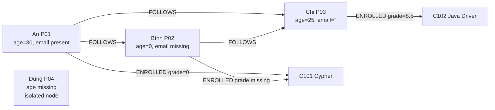

# Syntax, Variable Scope, and Data Type Errors in Cypher: How to Identify and Fix Them

Cypher queries can fail **before execution** due to missing parentheses, wrong clause ordering, or referencing variables that have gone out of scope. Other queries run without errors yet return **0 rows**, wrong counts, or `null` values because the data does not match the type assumed by the author. Still other errors only surface at runtime when reading a specific node, casting types, or storing properties.

This lesson belongs to the **Troubleshooting** chapter of the `DATABASE_ENGINE_GRAPH_NEO4J` module. The module uses Neo4j to model property graphs and query nodes, relationships, and paths using Cypher, indexes/constraints, the Java Driver, and Spring Data Neo4j. Here we practice **reading errors, isolating the failing step, and fixing queries semantically** rather than making random edits until a statement happens to run.

Three core error categories:

1. **Syntax:** the Cypher statement violates grammar rules, such as a `MATCH` missing `)` or a misplaced `WHERE`.
2. **Variable scope:** a variable is undefined, renamed via `AS`, dropped across a `WITH`, or not imported into a `CALL` subquery.
3. **Data types:** treating a string as a number, storing a map as a property, confusing `LIST` with `PATH`, misunderstanding `null`, or performing invalid type conversions.

**Goal:** after this lesson, you can follow a repeatable workflow: classify the error → build a minimal reproducer → inspect scope and types → fix → verify row counts and results → add tests to prevent regressions.

> **Version note:** many examples use syntax common to Neo4j 5 and newer releases. Some features such as `CALL (p) { ... }` (variable scope clause) exist in newer Neo4j 5 releases and Cypher 25; on older systems, check the documentation for your exact version rather than assuming every current syntax form is supported.

## 1. Symptom Classification Table to Start Diagnostics

| Observed symptom | First category to check | Appropriate action |
| --- | --- | --- |
| `Invalid input`, missing `)`/`]`/`}`, invalid clause | **Parser / syntax** | Inspect reported line/column, punctuation, and clause order |
| `Variable ... not defined` | **Scope / variable name** | Check `MATCH`, `WITH`, `AS`, and subquery imports |
| `Expression ... must be aliased` | **Scope / projection** | Add `AS newName` to expressions in `WITH` |
| `Type mismatch`, operator rejects input type | **Type / expression** | Print `valueType(...)`, check parameters and type conversions |
| Query runs but returns no rows | **Data/predicates or comparison types** | Test each `MATCH`, verify labels/types/direction and `WHERE` |
| Rows returned, but more than expected | **Cardinality / duplicate paths** | Compare `count(*)` vs. `count(DISTINCT ...)`, inspect joined patterns |
| Returned values are `null` / wrong counts | **Nulls and OPTIONAL MATCH** | Use `IS NULL`, `count(variable)`, and `coalesce` deliberately |
| Error when `SET`ting a property with a map/list | **Property type** | Store only valid property types; split nested maps or serialize intentionally |
| Java Driver `asLong()`/`asString()` fails | **Cypher → Java mapping** | Verify aliases, `Value`, `isNull()`, and data contracts |
| Query works in Browser but fails in app | **Version, parameters, privileges, database** | Compare actual query, runtime/Driver version, database, parameter types, role |

**Do not rely solely on message strings.** Error names, caret positions, `Neo.ClientError...` codes, and parser details can vary across Neo4j/Cypher versions. Preserve the **error category, line/column, and normalized query** (with secrets removed).

## 2. Small Fixture Used Throughout the Lesson

Use a Neo4j database **dedicated to testing**, never production. The example contains four people, two courses, and six relationships. Labels and types are prefixed with `TroubleDemo` to distinguish them from real data.



### 2.1. Creating the Data

Run **once** on an empty database or a reset test database. `CREATE` does not deduplicate automatically; running it twice doubles the data if no constraints exist.

```cypher
CREATE
  (an:TroubleDemoPerson {
    personId: 'P01', name: 'An',
    age: 30, email: 'an@example.test',
    active: true, joinedOn: date('2026-01-15')
  }),
  (binh:TroubleDemoPerson {
    personId: 'P02', name: 'Bình',
    age: 0, active: false
  }),
  (chi:TroubleDemoPerson {
    personId: 'P03', name: 'Chi',
    age: 25, email: '', active: true
  }),
  (dung:TroubleDemoPerson {
    personId: 'P04', name: 'Dũng',
    email: 'dung@example.test', active: true
  }),
  (c101:TroubleDemoCourse {
    courseCode: 'C101', title: 'Cypher Fundamentals', fee: 150000
  }),
  (c102:TroubleDemoCourse {
    courseCode: 'C102', title: 'Java Driver', fee: 200000
  }),

  (an)-[:TROUBLE_DEMO_FOLLOWS]->(binh),
  (an)-[:TROUBLE_DEMO_FOLLOWS]->(chi),
  (binh)-[:TROUBLE_DEMO_FOLLOWS]->(chi),

  (an)-[:TROUBLE_DEMO_ENROLLED {
    status: 'ACTIVE', grade: 0
  }]->(c101),
  (binh)-[:TROUBLE_DEMO_ENROLLED {
    status: 'ACTIVE'
  }]->(c101),
  (chi)-[:TROUBLE_DEMO_ENROLLED {
    status: 'CANCELLED', grade: 8.5
  }]->(c102);
```

Verify counts directly rather than relying on the diagram:

```cypher
MATCH (p:TroubleDemoPerson)
RETURN count(p) AS persons;
```

`persons = 4`.

```cypher
MATCH (c:TroubleDemoCourse)
RETURN count(c) AS courses;
```

`courses = 2`. There are **three** `TROUBLE_DEMO_FOLLOWS` relationships and **three** `TROUBLE_DEMO_ENROLLED` relationships.

Key reference values:

| Case | Expected value |
| --- | --- |
| `P01.age` | INTEGER `30` |
| `P02.age` | INTEGER `0`, not null |
| `P04.age` | Missing property → `null` when read |
| `P02.email` | Nonexistent property → `null` |
| `P03.email` | Empty string `''` |
| P01's enrollment | `grade = 0` |
| P02's enrollment | Missing `grade` → `null` |
| P03's enrollment | `grade = 8.5` |
| P04 | Node with no relationships |

**Why keep reference values?** A buggy query may still return rows; only when you know the expected answer beforehand can you distinguish “no error thrown” from “business-correct”.

## 3. Syntax Errors: Parser Cannot Understand Query Structure

### 3.1. Bad Brackets in Node and Relationship Patterns

**Wrong** example, missing closing `)`:

```cypher
// WRONG — intentionally demonstrates a parser error.
MATCH (p:TroubleDemoPerson
RETURN p.name;
```

Correct version:

```cypher
MATCH (p:TroubleDemoPerson)
RETURN p.name AS name;
```

In Cypher patterns:

- `(p:Label)`: node, variable `p`, label `Label`.
- `-[r:TYPE]->`: relationship with variable `r`, type `TYPE`, outgoing direction.
- `(p)-[:TYPE]->(q)`: single-edge pattern from `p` to `q`.
- `( )`, `[ ]`, and `{ }` must open and close properly; `:` in a pattern denotes labels/types, whereas in a map it separates key–value pairs.

Another **wrong** example due to missing `]` in a relationship pattern:

```cypher
// WRONG.
MATCH (p:TroubleDemoPerson)-[r:TROUBLE_DEMO_FOLLOWS->(q)
RETURN p, q;
```

Correct:

```cypher
MATCH (p:TroubleDemoPerson)
      -[r:TROUBLE_DEMO_FOLLOWS]->
      (q:TroubleDemoPerson)
RETURN p.personId AS source,
       q.personId AS target;
```

### 3.2. `WHERE` Is Not a Standalone Clause Everywhere

`WHERE` is a subclause that typically attaches to `MATCH`, `OPTIONAL MATCH`, or `WITH`. **Wrong** example:

```cypher
// WRONG — WHERE placed after RETURN.
MATCH (p:TroubleDemoPerson)
RETURN p.name
WHERE p.age >= 18;
```

Correct:

```cypher
MATCH (p:TroubleDemoPerson)
WHERE p.age >= 18
RETURN p.name AS name;
```

Answer on the fixture: **An, Chi**. Bình has `age = 0`; Dũng lacks `age`, so `null >= 18` does not evaluate to `true`.

Use `WITH` when filtering a value computed or aggregated in an earlier step:

```cypher
MATCH (p:TroubleDemoPerson)
WITH p, coalesce(p.age, -1) AS ageForFilter
WHERE ageForFilter >= 18
RETURN p.name AS name, ageForFilter
ORDER BY name;
```

### 3.3. Missing Commas, Bad Aliases, or Using Keywords as Variables

**Wrong** example:

```cypher
// WRONG — two projection items missing a comma.
MATCH (p:TroubleDemoPerson)
RETURN p.name AS name p.age AS age;
```

Correct:

```cypher
MATCH (p:TroubleDemoPerson)
RETURN p.name AS name,
       p.age AS age;
```

Variable names, aliases, and property keys must follow identifier rules. For names containing spaces or reserved keywords, **backtick identifiers** can be used. However, in codebases prefer clean names such as `personId` and `enrollmentCount` instead of hard-to-read identifiers.

### 3.4. Distinguish Whitespace Normalization from Semantic Changes

Cypher allows flexible line breaks and indentation between clauses. However, **missing brackets, missing commas, or misplaced clauses cannot be fixed by reformatting alone**.

In Neo4j Browser, statements are typically terminated with `;` when sending multiple statements. With the Java Driver, you usually pass **a single Cypher statement** per `run(...)` call; do not concatenate multiple SQL-style statements into one string expecting a single `run` call to execute all of them.

## 4. Variable Scope: Understanding Row Flow Across MATCH, WITH, and RETURN

Cypher operates like a pipeline:

```text
MATCH (p)  →  WHERE ...  →  WITH ...  →  MATCH ...  →  RETURN ...
  |              |              |             |             |
Bind p        Filter rows   Select vars   Add more      Emit results
                              to keep       variables
```

Variables name values **within a query part**, not global Java fields. When crossing `WITH`, variables not projected forward **leave scope**.

### 4.1. Classic Bug: WITH Drops a Variable

**Wrong:**

```cypher
// WRONG — p is no longer in scope after WITH.
MATCH (p:TroubleDemoPerson)
WITH p.name AS personName
RETURN p.age AS age, personName;
```

`WITH p.name AS personName` creates `personName` and **does not carry `p` forward**. Thus `RETURN p.age` has no `p` defined to read.

**Fix 1 — keep `p`:**

```cypher
MATCH (p:TroubleDemoPerson)
WITH p, p.name AS personName
RETURN p.age AS age, personName
ORDER BY personName;
```

**Fix 2 — pass only the needed properties:**

```cypher
MATCH (p:TroubleDemoPerson)
WITH p.name AS personName,
     p.age AS age
RETURN personName, age
ORDER BY personName;
```

Fix 2 is often clearer when later clauses **do not need the node object**, only a few properties.

### 4.2. Renaming via AS Invalidates the Old Name

**Wrong:**

```cypher
// WRONG — old name no longer exists after aliasing.
MATCH (p:TroubleDemoPerson)
WITH p AS person
RETURN p.personId;
```

**Correct:**

```cypher
MATCH (p:TroubleDemoPerson)
WITH p AS person
RETURN person.personId AS id;
```

`AS` does not create a secondary alias keeping both names alive: it names the projection output for the next stage.

### 4.3. Expressions in WITH Usually Require an Alias

**Wrong:**

```cypher
// WRONG — expression passed through WITH without an alias.
MATCH (p:TroubleDemoPerson)
WITH p.age + 1
RETURN p;
```

**Correct:**

```cypher
MATCH (p:TroubleDemoPerson)
WITH p, p.age + 1 AS nextAge
RETURN p.personId AS id, nextAge
ORDER BY id;
```

`P04` returns `nextAge = null` because `p.age` is missing; this illustrates **a fixed scope error where null semantics still must be understood**.

### 4.4. `WITH *` Preserves Variables but Has Trade-Offs

`WITH *` carries forward every variable currently in scope in the query part:

```cypher
MATCH (p:TroubleDemoPerson)
WITH *
RETURN p.personId AS id;
```

This shorthand is handy during exploration, but in long queries an **explicit variable list** clarifies scope and avoids retaining unnecessary intermediate values. Never use `WITH *` as a “cure-all” without checking cardinality and memory.

## 5. Scope Errors in Aggregations and DISTINCT

Aggregation produces **new grouped rows**. Variables not in the grouping key or not explicitly projected disappear after `WITH`/`RETURN`.

### 5.1. Cannot Filter by `count(r)` in WHERE Before Aggregation

**Wrong:**

```cypher
// WRONG — aggregate function used while filtering initial matched rows.
MATCH (p:TroubleDemoPerson)
      -[r:TROUBLE_DEMO_FOLLOWS]->()
WHERE count(r) > 1
RETURN p.name;
```

**Correct:**

```cypher
MATCH (p:TroubleDemoPerson)
      -[r:TROUBLE_DEMO_FOLLOWS]->()
WITH p, count(r) AS followsCount
WHERE followsCount > 1
RETURN p.personId AS id, followsCount;
```

Result: **P01, followsCount = 2**. `WITH p, count(r)` produces one row per matched `p`, and `WHERE` then filters the aggregated rows.

### 5.2. Wrong Grouping Key After WITH

**Logically wrong, even though it runs:**

```cypher
MATCH (p:TroubleDemoPerson)
      -[r:TROUBLE_DEMO_FOLLOWS]->(target:TroubleDemoPerson)
WITH p, target, count(r) AS n
RETURN p.personId AS id, n;
```

`WITH p, target, count(r)` groups by **both `p` and `target`**, yielding multiple rows for the same person. If the requirement is to count **total outgoing edges** per person, remove `target` from the grouping key:

```cypher
MATCH (p:TroubleDemoPerson)
      -[r:TROUBLE_DEMO_FOLLOWS]->()
WITH p, count(r) AS n
RETURN p.personId AS id, n
ORDER BY id;
```

Expected: P01 has 2, P02 has 1. P03/P04 **do not appear** because `MATCH` requires an edge. To include people with zero edges, use `OPTIONAL MATCH` (Section 9).

### 5.3. DISTINCT vs. COUNT DISTINCT

Two different questions:

```cypher
// Number of outgoing FOLLOWS edges from An.
MATCH (p:TroubleDemoPerson {personId: 'P01'})
      -[r:TROUBLE_DEMO_FOLLOWS]->()
RETURN count(r) AS edges;
```

`edges = 2` in the fixture.

```cypher
// Number of distinct target nodes from An.
MATCH (p:TroubleDemoPerson {personId: 'P01'})
      -[:TROUBLE_DEMO_FOLLOWS]->(target:TroubleDemoPerson)
RETURN count(DISTINCT target) AS people;
```

`people = 2` in the fixture, yet if **two parallel relationships ever point to the same target**, the two counts will differ. Tests should cover that edge case if the domain permits or forbids parallel edges.

`RETURN DISTINCT p.personId, r` likewise does **not** guarantee one row per `p`: `DISTINCT` applies to the **entire returned tuple**, not just the first column.

## 6. UNWIND, Lists, and Aliases: Where Do Variables Appear?

`UNWIND` expands a list into multiple rows and **aliases each element**:

```cypher
UNWIND [10, 20, 30] AS score
RETURN score, score + 1 AS nextScore
ORDER BY score;
```

Expect three rows: 10, 20, 30.

**Common input-type confusion — not a syntax error:**

```cypher
// Runs, but returns ONE row containing the whole string 'Cypher'.
UNWIND 'Cypher' AS letter
RETURN letter;
```

**Correct with a list of strings:**

```cypher
UNWIND ['C', 'y', 'p', 'h', 'e', 'r'] AS letter
RETURN letter;
```

`UNWIND` does not automatically split a string into characters. Per the Cypher Manual, any **non-LIST** value (except `null`) is treated as a single-element list: `UNWIND 5 AS x` behaves like `UNWIND [5] AS x`; `UNWIND null` returns **0 rows**. Convert inputs to lists per domain logic or use string functions if character splitting is needed.

**Wrong scope after WITH:**

```cypher
// WRONG — personId is no longer carried to RETURN.
UNWIND [{personId: 'P01', age: 30},
        {personId: 'P02', age: 0}] AS item
WITH item.age AS age
RETURN item.personId, age;
```

Correct:

```cypher
UNWIND [{personId: 'P01', age: 30},
        {personId: 'P02', age: 0}] AS item
WITH item.personId AS personId, item.age AS age
RETURN personId, age
ORDER BY personId;
```

**Cardinality note:** `UNWIND []` produces **0 rows**. An `UNWIND` over an empty list causes subsequent clauses in that query part not to run, even when all variables and types are valid.

## 7. Scope in CALL Subqueries

A `CALL` subquery has its own scope. In modern versions, the explicit way to **import** outer variables is the variable scope clause `CALL (p) { ... }`.

### 7.1. `p` Is Not Automatically Visible from Outside

**Wrong:**

```cypher
// WRONG — p is not imported into the CALL subquery.
MATCH (p:TroubleDemoPerson)
CALL () {
  RETURN p.name AS personName
}
RETURN personName;
```

`CALL ()` means **import no outer variables**. Therefore `p` is undefined inside.

**Correct:**

```cypher
MATCH (p:TroubleDemoPerson)
CALL (p) {
  RETURN p.name AS personName
}
RETURN p.personId AS id, personName
ORDER BY id;
```

Result: four rows for An, Bình, Chi, Dũng.

### 7.2. Importing a Variable and Aggregating Per-Node Relationships

```cypher
MATCH (p:TroubleDemoPerson)
CALL (p) {
  OPTIONAL MATCH (p)-[e:TROUBLE_DEMO_ENROLLED]->(:TroubleDemoCourse)
  RETURN count(e) AS enrollmentCount
}
RETURN p.personId AS id, enrollmentCount
ORDER BY id;
```

Expected:

| id | enrollmentCount |
| --- | ---: |
| P01 | 1 |
| P02 | 1 |
| P03 | 1 |
| P04 | 0 |

Because `count(e)` ignores nulls, the subquery still returns **one row with `count = 0`** for Dũng.

### 7.3. Imported Variables Follow Different Scope Rules from Regular WITH

With `CALL (p) { ... }`, `p` is an imported outer variable available throughout the inner scope. An inner `WITH` does not de-scope imported variables the way it does ordinary local variables.

```cypher
MATCH (p:TroubleDemoPerson)
CALL (p) {
  WITH p.name AS personName
  RETURN p.personId AS idInside, personName
}
RETURN idInside, personName
ORDER BY idInside;
```

**Do not arbitrarily shadow or redeclare imported variables** inside a subquery. Variables returned from a subquery must also **not collide** with variables already in the outer scope. If `p` exists outside, do not `RETURN ... AS p` from the inner scope; use names like `personName` and `idInside`.

> **Compatibility:** `CALL (p) { ... }` is the modern syntax. Older Neo4j 5 releases used `CALL { WITH p ... }` to import variables. That older `WITH`-import form is marked deprecated in current documentation; do not mix the two forms without verifying the server version.

## 8. Data Types in Cypher: Beyond Just STRING and INTEGER

Neo4j has **property types**, **structural types**, and **constructed types**. A value may be valid inside a query expression yet not directly storable as a node/relationship property.

| Category | Examples | Directly storable as a property? |
| --- | --- | --- |
| Primitive property | `STRING`, `INTEGER`, `FLOAT`, `BOOLEAN` | Yes |
| Temporal / spatial | `DATE`, `DATETIME`, `DURATION`, `POINT` | Yes when supported by version/format |
| List property | Homogeneous list of simple property values such as `['a','b']` | Yes, per Neo4j property list rules |
| Structural | `NODE`, `RELATIONSHIP`, `PATH` | **No**; only used in expressions/results |
| Constructed | `MAP`, list of maps, list of nodes, mixed list | Can be returned/parameterized, but **not stored directly** as a normal property |
| `null` | Missing/unknown value | Setting `SET ... = null` removes the property |

Newer Neo4j releases add extra types (e.g., UUID/vector) depending on version, edition, and store format. When debugging, **never use a static type table from an older version to deny features in a newer version**.

### 8.1. Inspecting Actual Types with `valueType()`

```cypher
RETURN valueType(30) AS integerType,
       valueType(8.5) AS floatType,
       valueType('30') AS stringType,
       valueType(true) AS booleanType,
       valueType(date('2026-01-15')) AS dateType;
```

`valueType()` returns a string describing the type under Neo4j's type system, possibly including `NOT NULL` or more specific type qualifiers. In tests, compare against version-appropriate expected types and **avoid hard-coding exact full type strings unnecessarily**.

Inspecting real property types:

```cypher
MATCH (p:TroubleDemoPerson)
RETURN p.personId AS id,
       p.age AS age,
       valueType(p.age) AS ageType,
       p.email AS email
ORDER BY id;
```

Observe that Bình has `age` of type INTEGER with value `0`; Dũng has `age = null` because the property is absent.

### 8.2. Numbers and Strings May Look Alike but Are Not Equal

`18` is an INTEGER, whereas `'18'` is a STRING. If the application passes `$minAge` as a string:

```cypher
MATCH (p:TroubleDemoPerson)
WHERE p.age >= $minAge
RETURN p.personId AS id;
```

then the query violates the contract “compare age against an integer”. Depending on the operation and Neo4j version, it may throw a type error or yield unexpected results. The best approach is to **validate and send INTEGER from the application**.

If source data is known to be a clean numeric string, you can convert it:

```cypher
WITH '18' AS rawAge
RETURN toInteger(rawAge) AS parsedAge;
```

Expect `parsedAge = 18`. For unparseable strings, conversion functions can return `null` instead of throwing; **do not** assume every conversion succeeds. Check `IS NULL` or reject invalid input in Java.

### 8.3. Type-Incompatible Operators

**Wrong:**

```cypher
// WRONG — subtraction does not treat STRING as a number.
RETURN 7 - '2' AS difference;
```

**Correct:**

```cypher
RETURN 7 - toInteger('2') AS difference;
```

`difference = 5`.

**Do not “fix” errors by turning everything into STRING.** If the data represents prices, quantities, scores, or dates, choose the right type and enforce validation explicitly.

### 8.4. Functions for LIST, PATH, and Relationships

`size()` measures list length; `length()` measures path length (number of relationships in a `PATH`):

```cypher
MATCH path =
  (p:TroubleDemoPerson {personId: 'P01'})
  -[:TROUBLE_DEMO_FOLLOWS]->
  (q:TroubleDemoPerson)
RETURN length(path) AS hopCount,
       size(nodes(path)) AS nodeCount,
       size(relationships(path)) AS edgeCount,
       q.personId AS targetId
ORDER BY targetId;
```

Expect on each row: `hopCount = 1`, `nodeCount = 2`, `edgeCount = 1`.

**Type error:**

```cypher
// WRONG — length() expects a PATH, not a number.
RETURN length(123) AS n;
```

Correct if you want the number of elements in a list:

```cypher
RETURN size([10, 20, 30]) AS n;
```

`n = 3`. When building Java DTOs, do not confuse “number of `nodes(path)`” with “`length(path)`”; a non-empty path has **number of nodes = number of relationships + 1**.

## 9. Null, OPTIONAL MATCH, and Counting

In Cypher, `null` means **missing or unknown**. Never compare with `= null` or `<> null`.

### 9.1. Comparing with `null` Does Not Yield Normal Boolean True/False

```cypher
RETURN null = null AS equality,
       null IS NULL AS isMissing;
```

`equality = null`, `isMissing = true`. In `WHERE`, only conditions evaluating to `true` keep the row; both `false` and `null` discard it.

**Wrong:**

```cypher
MATCH (p:TroubleDemoPerson)
WHERE p.email = null
RETURN p.personId AS id;
```

**Correct:**

```cypher
MATCH (p:TroubleDemoPerson)
WHERE p.email IS NULL
RETURN p.personId AS id;
```

Expected: **P02**. Chi has `email = ''`, so she is **not** in the missing-email set.

### 9.2. Empty String and Zero Are Not Null

```cypher
MATCH (p:TroubleDemoPerson)
WHERE p.email = ''
RETURN p.personId AS id;
```

Expected: **P03**.

```cypher
MATCH (p:TroubleDemoPerson)
WHERE p.age = 0
RETURN p.personId AS id;
```

Expected: **P02**.

When using `coalesce`:

```cypher
MATCH (p:TroubleDemoPerson)
RETURN p.personId AS id,
       coalesce(p.email, '(missing)') AS emailShown
ORDER BY id;
```

`coalesce` only replaces **null**, not empty strings. If business rules treat both null and empty strings as missing, write an explicit condition such as `CASE WHEN p.email IS NULL OR trim(p.email) = '' THEN '(missing)' ELSE p.email END`.

### 9.3. OPTIONAL MATCH Preserves Rows but Produces Nulls for Unmatched Parts

`MATCH` requires the pattern to exist; `OPTIONAL MATCH` preserves rows from the preceding part even when the relationship does not match.

```cypher
MATCH (p:TroubleDemoPerson)
OPTIONAL MATCH (p)-[e:TROUBLE_DEMO_ENROLLED]->(c:TroubleDemoCourse)
RETURN p.personId AS id,
       count(*) AS allRows,
       count(e) AS enrollmentCount
ORDER BY id;
```

Expected:

| id | allRows | enrollmentCount |
| --- | ---: | ---: |
| P01 | 1 | 1 |
| P02 | 1 | 1 |
| P03 | 1 | 1 |
| P04 | 1 | 0 |

`count(*)` counts every row, **including rows where `e = null`**. `count(e)` counts only non-null values. This is a common reason an “enrollment count” API returns **1** for someone with no enrollments.

### 9.4. Do Not Accidentally Turn OPTIONAL into Mandatory

Two queries can produce different results:

```cypher
// Predicate placed after OPTIONAL MATCH, before RETURN.
MATCH (p:TroubleDemoPerson)
OPTIONAL MATCH (p)-[e:TROUBLE_DEMO_ENROLLED]->(c:TroubleDemoCourse)
WHERE e.status = 'ACTIVE'
RETURN p.personId AS id, count(e) AS activeEnrollments
ORDER BY id;
```

With `WHERE` attached to `OPTIONAL MATCH`, if no ACTIVE enrollment exists, `e` becomes null while row `p` is preserved. Expected: P01=1, P02=1, P03=0, P04=0.

```cypher
// Different semantics: filtering all rows after OPTIONAL via WITH.
MATCH (p:TroubleDemoPerson)
OPTIONAL MATCH (p)-[e:TROUBLE_DEMO_ENROLLED]->(c:TroubleDemoCourse)
WITH p, e, c
WHERE e.status = 'ACTIVE'
RETURN p.personId AS id
ORDER BY id;
```

Now P03 and P04 **are dropped** because `e.status` is `'CANCELLED'` or null, so the condition is not true. This is not a syntax error—it is a **semantic bug** caused by predicate placement.

### 9.5. NULL and the `IN` Operator

`2 IN [1, null, 3]` can return `null`: no element equals 2, yet the list contains an unknown. When passing filter lists from an API, validate and strip nulls per the business contract or handle conditions explicitly; do not expect all comparisons involving null to return false.

## 10. Not Every Cypher Value Can Be `SET` as a Property

Cypher can **return** a map or path, which does not mean a node property can store them as a single value.

### 10.1. MAP Is a Constructed Type, Not a Direct Property Value

Example building a map **only for RETURN**:

```cypher
MATCH (p:TroubleDemoPerson {personId: 'P01'})
RETURN {
  id: p.personId,
  displayName: p.name,
  tags: ['cypher', 'graph']
} AS personDto;
```

This is a valid projection. However, **storing a map as a property is invalid**:

```cypher
// WRONG — never run in production.
MATCH (p:TroubleDemoPerson {personId: 'P01'})
SET p.profile = {nickname: 'An', theme: 'dark'};
```

Neo4j cannot store a nested map like `p.profile` directly. If those are two separate properties:

```cypher
// Write example: test only in a test DB.
MATCH (p:TroubleDemoPerson {personId: 'P01'})
SET p.nickname = 'An',
    p.theme = 'dark'
RETURN p.personId AS id, p.nickname AS nickname;
```

If nested metadata is needed, model dedicated nodes/relationships or serialize to a string per system contract; serialization sacrifices per-field filtering unless handled separately.

### 10.2. Lists Can Be Returned, but Property Lists Are Restricted

`RETURN [1, 'text', null] AS sample` can construct a mixed result list in a query, whereas **lists stored as properties** generally require homogeneous simple property-type elements, with no nulls and no nested nodes/maps.

```cypher
// Valid property value type; run in a test DB.
MATCH (p:TroubleDemoPerson {personId: 'P01'})
SET p.tags = ['neo4j', 'cypher', 'java']
RETURN p.tags AS tags;
```

**Invalid when storing:**

```cypher
// WRONG — a list of maps is not a supported property list.
MATCH (p:TroubleDemoPerson {personId: 'P01'})
SET p.tags = [{name: 'neo4j'}, {name: 'java'}];
```

When converting from JSON/Java, inspect the structure. A valid JSON array is not necessarily a **valid Neo4j property array**.

### 10.3. NODE, RELATIONSHIP, and PATH Are Structural Values Only

`RETURN p` and `RETURN path` are completely valid, whereas `SET n.otherNode = otherNode` attempts to store a `NODE` inside a property—which is invalid.

Links between two entities must be modeled as **relationships**, for example:

```cypher
// Write a relationship in a test DB; consider duplicate-edge prevention in real systems.
MATCH (a:TroubleDemoPerson {personId: 'P01'})
MATCH (b:TroubleDemoPerson {personId: 'P04'})
MERGE (a)-[:TROUBLE_DEMO_FOLLOWS]->(b);
```

This write **mutates the fixture**, so to preserve expected row counts in the lesson, **roll back or reset the fixture** before running subsequent tests.

## 11. Cypher Parameter Errors: Valid Syntax, Wrong Value Type

Parameters separate **values** from the query text, avoiding string concatenation of inputs.

```cypher
MATCH (p:TroubleDemoPerson)
WHERE p.personId = $personId
RETURN p.name AS name;
```

The application must pass the map `{personId: 'P01'}`. Passing a missing `personId`, wrong parameter name, or a list instead of a string produces unexpected results or errors.

### 11.1. Parameters Use `$` and Match Exact Names

**Wrong:**

```cypher
// WRONG — missing $, undefined variable personId.
MATCH (p:TroubleDemoPerson)
WHERE p.personId = personId
RETURN p.name;
```

**Correct:**

```cypher
MATCH (p:TroubleDemoPerson)
WHERE p.personId = $personId
RETURN p.name AS name;
```

With the Java Driver, the key in the parameter map is `personId` **without `$`**; the `$` prefix appears only in the Cypher string.

### 11.2. Do Not Use Parameter Values to Alter Query Structure Arbitrarily

Syntax like `MATCH (p:$label)` or `MATCH (a)-[:$type]->(b)` is not a general way to parameterize labels/types. Some newer Cypher versions support **dynamic labels/types** with specific syntax, subject to server version and privileges.

**Never concatenate arbitrary user-supplied label, type, property, or clause names** into Cypher strings. If dynamic queries are needed, use a trusted identifier allowlist or the documented dynamic label/type syntax for your version.

### 11.3. Passing the Right Data Types from Java

| Contract | Appropriate Java value | Common mistake |
| --- | --- | --- |
| `$personId` | Java `String` | Passing an Integer when the ID is STRING |
| `$minAge` | `int`/`long` or wrapper | Passing `"18"` (String) |
| `$personIds` | `List<String>` | Passing a comma-separated string |
| `$active` | `Boolean` | Passing string `"true"` |
| `$joinedOn` | `LocalDate` | Passing an unvalidated/unparsed date string |
| `$rows` with `UNWIND` | `List<Map<String,Object>>` | Passing a single Map instead of a list |

**When receiving JSON from an API**, do not assume the parser converts into the exact types Neo4j expects. Validate at the DTO/service layer before calling the Driver; missing properties or nulls need an explicit policy.

## 12. Java Driver: Separating Cypher Errors from Result-Mapping Errors

The Neo4j Java Driver does not silently “fix” an out-of-scope `p` or turn a STRING into an INTEGER on your behalf. The server parses and executes Cypher; the Driver then returns `Record`s containing `Value`s. On the Java side, you can also read the wrong alias or call the wrong type accessor.

### 12.1. A Query with Clear Parameters and Mapping

Example with Java 17+ and a shared `Driver`:

```java
import java.util.List;
import java.util.Map;
import org.neo4j.driver.Driver;
import org.neo4j.driver.Session;
import org.neo4j.driver.SessionConfig;
import org.neo4j.driver.Value;

record PersonRow(String id, String name, Long age) {}

public class PersonLookup {
    private final Driver driver;

    public PersonLookup(Driver driver) {
        this.driver = driver;
    }

    public List<PersonRow> listPersons() {
        try (Session session = driver.session(
                SessionConfig.forDatabase("neo4j"))) {

            return session.executeRead(tx ->
                tx.run("""
                    MATCH (p:TroubleDemoPerson)
                    RETURN p.personId AS id,
                           p.name AS name,
                           p.age AS age
                    ORDER BY id
                    """).list(record -> {
                    Value ageValue = record.get("age");

                    return new PersonRow(
                        record.get("id").asString(),
                        record.get("name").asString(),
                        ageValue.isNull() ? null : ageValue.asLong()
                    );
                })
            );
        }
    }
}
```

Results must preserve `P04.age = null`; if a DTO uses primitive `long`, the application must define a substitution or validation policy rather than silently treating “missing age” as `0`.

### 12.2. Two Common Java Mistakes

**Alias error:**

```java
// Cypher RETURN p.name AS name
// WRONG: record has no column aliased personName.
String s = record.get("personName").asString();
```

Fix by calling `record.get("name")` or updating the Cypher alias and DTO together.

**Type accessor error:**

```java
// age is INTEGER in Cypher; it is not a STRING.
String age = record.get("age").asString();
```

Fix with `asLong()`, or `asInt()` if the value range is safe, while checking `isNull()`. Do not paper over types by calling `toString()` on every value; clarify the output schema.

### 12.3. Catching ClientException Properly

Separate error groups:

- `ClientException`: usually indicates invalid queries, types, privileges, or constraints — inspect the actual code/message.
- Network/routing/service-unavailable errors: check URI, TLS, firewall, and server health.
- Java mapping errors: `Record.get` or `Value.as...` calls mismatching returned columns or types.

Do not simply log `e.getMessage()` and claim “the database is broken”. Messages may embed query fragments; logs should **redact sensitive parameters** and include context such as query name, database, driver/server versions, and error code.

`Map.of(...)` in Java **forbids null keys and values**. If a contract requires passing null parameters into Cypher, use an appropriate mutable map or Driver parameter mechanism that supports nulls, and ensure the query handles `IS NULL`/`coalesce` intentionally.

### 12.4. Spring Data Neo4j and Projection Results

In Spring Data Neo4j, a custom `@Query` returning `RETURN p.name AS name` will not hydrate a full entity if the method declares returning a `@Node` entity with relationships. Distinguish:

- **Repository entity mapping:** typically must return the node and the relationships needed to hydrate the structure SDN expects.
- **DTO/projection:** return only the needed fields, matching projection aliases accurately.
- **Neo4jClient:** can read `Map<String,Object>` or custom rows, yet still requires explicit type/null handling.
- **Repository writes (`save()`):** never pass a partially loaded entity back to `save()` to persist the whole object without understanding relationship update scope.

When a bug occurs only in Spring while the query succeeds in Browser, compare the exact Cypher, database, user, parameter types, and mapping setup to isolate whether the failure lies on the **server** or in **result mapping**.

## 13. Commands for Controlled Debugging

### 13.1. Returning Intermediate Steps

Start with a simple query:

```cypher
MATCH (p:TroubleDemoPerson)
RETURN p.personId AS id
ORDER BY id;
```

Then add the filter:

```cypher
MATCH (p:TroubleDemoPerson)
WHERE p.age IS NOT NULL AND p.age >= 18
RETURN p.personId AS id, p.age AS age
ORDER BY id;
```

Then add the relationship:

```cypher
MATCH (p:TroubleDemoPerson)
WHERE p.age IS NOT NULL AND p.age >= 18
OPTIONAL MATCH (p)-[e:TROUBLE_DEMO_ENROLLED]->(c:TroubleDemoCourse)
RETURN p.personId AS id,
       count(e) AS enrollmentCount
ORDER BY id;
```

Expected P01=1 and P03=1. Adding one step at a time reveals whether the bug is in the **age filter**, **edge pattern**, or **aggregation**, rather than blaming “Cypher in general”.

### 13.2. Using WITH to Inspect Actual Value Types

```cypher
MATCH (p:TroubleDemoPerson)
WITH p.personId AS id,
     p.age AS age,
     p.email AS email
RETURN id, age, email,
       valueType(age) AS ageType,
       valueType(email) AS emailType
ORDER BY id;
```

This surfaces null properties, empty strings, and unexpected types early.

### 13.3. EXPLAIN to Validate a Query Before Running It

```cypher
EXPLAIN
MATCH (p:TroubleDemoPerson)
WHERE p.age >= 18
RETURN p.personId AS id;
```

`EXPLAIN` builds the execution plan **without executing the query**. It catches parser/semantic/variable errors and displays the plan; it cannot guarantee catching every runtime data-dependent failure.

For **write** queries (`CREATE`, `MERGE`, `SET`, `DELETE`), `EXPLAIN` is especially valuable for pre-checking. Conversely, `PROFILE` **executes** the query, so `PROFILE DELETE` in production is not a dry run.

### 13.4. Do Not Use LIMIT to Mask Data Bugs

`LIMIT 1` shrinks output but does not prove remaining rows have clean types. A runtime error may trigger only on row 1,001—for example, a mistyped property or malformed conversion.

To verify data quality, **scan and check deliberate variants in a test environment** with proper pagination and time bounds instead of testing only the first row.

## 14. Standard Diagnostic Workflow When Errors Occur

### Step 1 — Gather Minimal Evidence

Record:

- **Normalized** Cypher without credentials or PII.
- Neo4j server/Cypher version, database, user role, and environment.
- Line, column, and token pointed to by the parser; error code if available.
- Parameter **names and types**, never logging secret values.
- Whether the query is read or write, and whether transactions/retries are involved.

### Step 2 — Classify the Error

- Parser: brackets, commas, order of `MATCH/WHERE/WITH/RETURN`.
- Scope: where is `p` bound, does it cross `WITH`, was it renamed with `AS`?
- Subquery: did `CALL (p)` import `p`? Do returned aliases collide?
- Type/null: what are the actual property/parameter types? Are there nested maps/lists or nulls?
- Logic/cardinality: does the query run with wrong row counts due to `MATCH`, `OPTIONAL MATCH`, `UNWIND`, or aggregation?

### Step 3 — Build the Minimal Reproducer

Shrink the statement to `MATCH ... RETURN` or `RETURN literalExpression`. Use the fixture in Section 2 so you do not depend on production data. Strip unrelated operators and relationships one by one while keeping the failure intact.

### Step 4 — Verify Scope and Types After Every WITH

Insert temporary `RETURN` clauses at key boundaries to inspect variables. For aggregations, check grouping keys and compare `count(*)` vs. `count(DISTINCT ...)` to verify cardinality. For nulls, check `IS NULL`/`coalesce`/`CASE`.

### Step 5 — Fix the Root Cause, Not Just Make the Query “Run”

Do not blindly swap `MATCH` for `OPTIONAL MATCH` or strip `DISTINCT` just to silence an error; preserve the **output contract**. If an input arrives as a string instead of a number, fix validation/parameter mapping rather than distorting filter logic.

### Step 6 — Test via Java Driver/SDN and Edge-Case Data

A query that passes in Browser yet fails in the app may stem from parameter types, aliases, account/privileges, database selection, Driver runtime, or entity mapping. Test at least one node with a missing property, one zero value, and one empty string.

### Step 7 — Add Regression Tests

Record **the original failing query, the fix, input data, and expected output**. Do not assert only that no exception was thrown; assert row counts, ID sets, and value types/nullable contracts.

## 15. Quick Error and Fix Reference Table

| Error pattern | Root cause | Fix |
| --- | --- | --- |
| `MATCH (p:Person RETURN p` | Missing closing `)` | `MATCH (p:Person) RETURN p` |
| `RETURN x WHERE ...` | Misplaced `WHERE` | Place `WHERE` after `MATCH` or `WITH` |
| `WITH p.name AS n RETURN p.age` | `p` out of scope | `WITH p, p.name AS n` or project `age` earlier |
| `WITH p AS person RETURN p` | Old alias no longer valid | Use `person` |
| `WHERE count(r) > 1` before aggregation | Aggregate in wrong stage | `WITH p, count(r) AS n WHERE n > 1` |
| `CALL () { RETURN p.name ... }` | `p` not imported | `CALL (p) { ... }` on supported versions |
| `UNWIND 'text' AS x` to split characters | STRING treated as one element; not auto-split | Pass a list of characters or split in app layer |
| `WHERE p.email = null` | Null comparison never returns true | `p.email IS NULL` |
| `count(*)` after OPTIONAL with no match | Counts null rows | `count(r)` |
| `SET p.profile = {a:1}` | MAP is not a direct property value | Split properties or model a related node |
| `length(123)` | `length` requires PATH | Use a type-appropriate function |
| `7 - '2'` | STRING in numeric arithmetic | Validate/convert, e.g., `toInteger('2')` |
| `p.age >= '18'` | Comparing age with STRING | INTEGER parameter, handle nulls |
| Java `record.get("age").asString()` | Numeric column read as STRING | `asLong()` and check `isNull()` |
| `RETURN DISTINCT p, r` to count unique `p` | Distinct over the pair | `RETURN DISTINCT p` or `count(DISTINCT p)` |
| `RETURN p` from partial custom query then `save` | Graph object missing relationships | Return a DTO or run a targeted Cypher update |
| Query returns 0 rows despite valid syntax | Wrong label/type/direction or WHERE | Test small sub-patterns, count step by step |
| Sending `$minAge` as `"18"` from JSON | Parameter contract mismatch | Parse, validate, and send numeric type from Java |

## 16. Practice Exercises with Solutions

### Exercise 1 — Lost Variable

Fix the query:

```cypher
MATCH (p:TroubleDemoPerson)
WITH p.name AS displayName
RETURN p.personId AS id, displayName;
```

**Hint:** `WITH` must keep `p` or project `personId` with an alias.

**Solution:**

```cypher
MATCH (p:TroubleDemoPerson)
WITH p.personId AS id, p.name AS displayName
RETURN id, displayName
ORDER BY id;
```

### Exercise 2 — Counting Enrollments Including Isolated Nodes

Write a query returning all four people and their enrollment counts, including Dũng = 0.

**Solution:**

```cypher
MATCH (p:TroubleDemoPerson)
OPTIONAL MATCH (p)-[e:TROUBLE_DEMO_ENROLLED]->(:TroubleDemoCourse)
RETURN p.personId AS id, count(e) AS enrollments
ORDER BY id;
```

Result: P01=1, P02=1, P03=1, P04=0.

### Exercise 3 — Null Email or Empty String?

Find people whose email is **missing or whitespace-only**.

**Solution:**

```cypher
MATCH (p:TroubleDemoPerson)
WHERE p.email IS NULL OR trim(p.email) = ''
RETURN p.personId AS id
ORDER BY id;
```

On the fixture: P02 and P03.

### Exercise 4 — Type Conversion

Explain why `RETURN 4 - '2'` is invalid and write the valid statement.

**Solution:**

```cypher
RETURN 4 - toInteger('2') AS answer;
```

`answer = 2`. If raw input cannot be converted, check for null and raise an input-contract error.

### Exercise 5 — Subquery with Outer Variable

Fix the missing `p` import:

```cypher
MATCH (p:TroubleDemoPerson)
CALL () {
  RETURN p.personId AS personId
}
RETURN personId;
```

**Solution:**

```cypher
MATCH (p:TroubleDemoPerson)
CALL (p) {
  RETURN p.personId AS personId
}
RETURN personId
ORDER BY personId;
```

### Exercise 6 — Wrong Aggregation Grouping

The following query returns multiple rows for a single `p`. Why?

```cypher
MATCH (p:TroubleDemoPerson)-[r:TROUBLE_DEMO_FOLLOWS]->
      (target:TroubleDemoPerson)
RETURN p.personId AS id, target.personId AS targetId, count(r) AS n;
```

**Solution:** the grouping key includes both `id` and `targetId`. To count total outgoing edges per `p`, remove `target` from the projection/grouping key.

```cypher
MATCH (p:TroubleDemoPerson)-[r:TROUBLE_DEMO_FOLLOWS]->()
RETURN p.personId AS id, count(r) AS n
ORDER BY id;
```

### Exercise 7 — Storing a MAP as a Property

Why is `SET p.profile = {nickname: 'A'}` invalid, whereas `RETURN {nickname: p.name}` is valid?

**Solution:** MAP is a constructed type that can be built and returned in Cypher, but cannot be stored directly as a property. Properties must belong to Neo4j-supported property types. Make `nickname` its own property or adjust the data model.

### Exercise 8 — Java Nullable Values

The query returns `p.age AS age` for Dũng. What is wrong with calling `record.get("age").asLong()`?

**Solution:** the property is missing, so the `Value` is null; you must check `isNull()` and map it to a nullable `Long` or fail per the validation contract, never default silently to 0.

### Exercise 9 — Distinguishing Syntax Errors from Logic Errors

The query below runs yet fails to find Bình, even though Bình has an `active` property:

```cypher
MATCH (p:TroubleDemoPerson)
WHERE p.active = 'false'
RETURN p.personId AS id;
```

**Solution:** `p.active` is BOOLEAN `false`, whereas `'false'` is a STRING. Fix:

```cypher
MATCH (p:TroubleDemoPerson)
WHERE p.active = false
RETURN p.personId AS id;
```

Result: P02. This is a **type/logic contract bug**, not a parser error.

### Exercise 10 — Designing Regression Tests

A Java endpoint accepts `minAge`. Write at least four test cases.

**Suggested solution:**

- `minAge = 18` as INTEGER → returns P01, P03.
- `minAge = '18'` as STRING → API rejects before running the query.
- `minAge = null` → explicit rejection or explicit default policy, never ambiguous propagation.
- Person missing `age` → not treated as `age = 0`, does not slip into results.
- `minAge = 0` → returns P01, P02, P03; P04 lacks `age` so the comparison does not match.

## 17. Pocket Checklist for Reading Cypher Errors

1. Confirm the exact **Neo4j/Cypher version**; do not copy modern syntax onto older servers.
2. Read the **line/column and token** flagged by the error; check brackets and commas first.
3. Place `WHERE`/`ORDER BY`/`LIMIT` in the right clause; distinguish reads from updates.
4. List every variable at each `WITH`, checking old and new aliases.
5. For `CALL` subqueries, import the right variables and avoid output name collisions.
6. Inspect `valueType()`, parameter types, nullability, and missing properties.
7. Distinguish lists used inside queries from lists that can be **stored as properties**.
8. Use `count(*)` vs. `count(variable)` accurately with `OPTIONAL MATCH`.
9. Verify `DISTINCT` and grouping keys before trusting counts.
10. Run `EXPLAIN` before write queries; never run write `PROFILE` in production just to “preview”.
11. When a query works in Browser but fails in the app, compare **aliases, Java mapping, database, user, and parameters**.
12. Add tests with **null, 0, empty string, empty list, and multiple paths**, and mark the bug fixed only when business results are accurate.

## 18. Official References

- [Neo4j Cypher Manual — Clauses](https://neo4j.com/docs/cypher-manual/current/clauses/): syntax and ordering of `MATCH`, `WHERE`, `WITH`, `RETURN`, `UNWIND`.
- [Neo4j Cypher Manual — WITH](https://neo4j.com/docs/cypher-manual/current/clauses/with/): keeping/dropping variables from scope and filtering aggregates.
- [Neo4j Cypher Manual — Variables](https://neo4j.com/docs/cypher-manual/current/syntax/variables/): rules for binding variables and passing them across query parts.
- [Neo4j Cypher Manual — CALL subqueries](https://neo4j.com/docs/cypher-manual/current/subqueries/call-subquery/): `CALL (p)` and variable imports.
- [Neo4j Cypher Manual — Values and types](https://neo4j.com/docs/cypher-manual/current/values-and-types/): property, constructed/structural values, and type inspection.
- [Neo4j Cypher Manual — Working with null](https://neo4j.com/docs/cypher-manual/current/values-and-types/working-with-null/): three-valued logic, `IS NULL`, and nulls in expressions.
- [Neo4j Cypher Manual — Aggregating functions](https://neo4j.com/docs/cypher-manual/current/functions/aggregating/): `count()`, `collect()`, `DISTINCT`, and nulls.
- [Neo4j Cypher Manual — UNWIND](https://neo4j.com/docs/cypher-manual/current/clauses/unwind/): lists, scalars treated as single-element lists, and null/empty list cases.
- [Neo4j Java Driver Manual — Data types](https://neo4j.com/docs/java-manual/current/data-types/): mapping Cypher `Value` to Java.
- [Neo4j Cypher Manual — Execution plans](https://neo4j.com/docs/cypher-manual/current/planning-and-tuning/execution-plans/): `EXPLAIN` and `PROFILE`.

**Remember:** classify Cypher errors as **syntax → scope → type/null → semantics/cardinality**. `WITH` decides which variables survive, `CALL` requires explicit variable imports, and parameter/property types must match operators. A query that throws no errors can still be wrong; consider the fix complete only when **tests verify exact row counts, exact data, and edge cases**.
