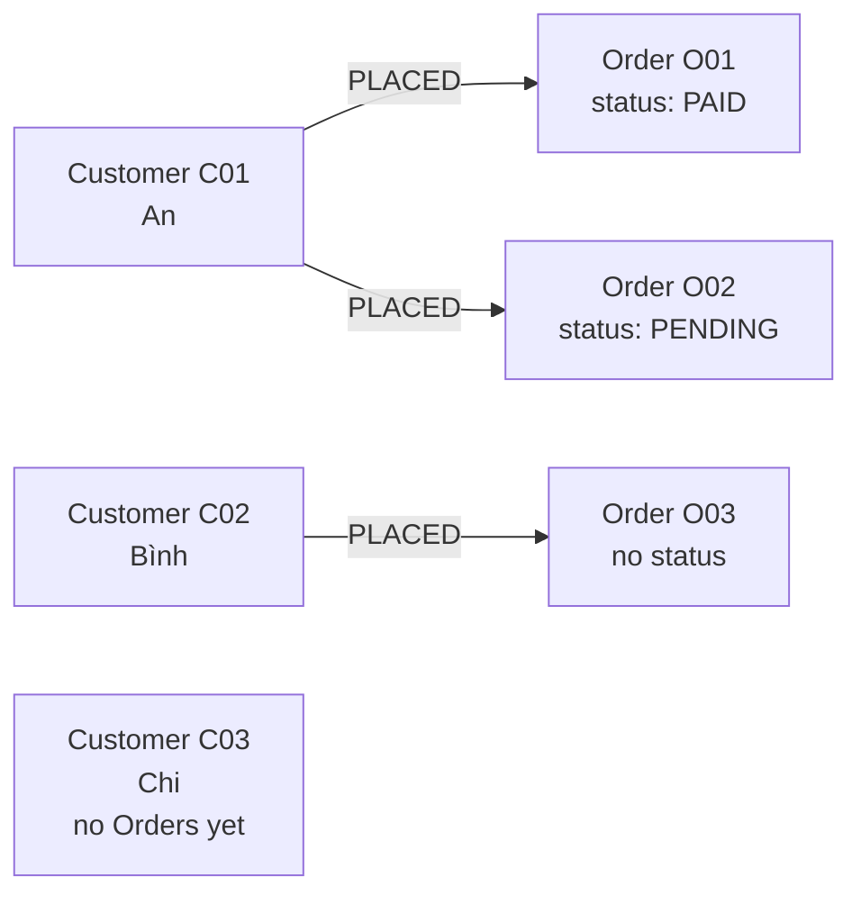

# Empty Query Results Due to Relationship Direction or Null Predicates

In **Neo4j**, a Cypher query returning **0 rows** does not necessarily mean the database lacks data. Nodes may exist and relationships may exist, yet the query **traverses in the wrong relationship direction**; or the graph pattern matches, yet a `WHERE` predicate evaluates to **`null`** and filters the row out. This becomes even harder to spot when using `OPTIONAL MATCH`, optional properties, or when a Java application simply receives an empty list with no clue why.

This lesson belongs to the **Troubleshooting** chapter of the `DATABASE_ENGINE_GRAPH_NEO4J` module. It focuses on **property graphs** (nodes, relationships, properties), debugging Cypher when **results are empty**, reading results properly in the **Neo4j Java Driver** and **Spring Data Neo4j**, while checking secondary factors such as target database, business keys, and indexes. Examples use common modern Neo4j Cypher syntax; use a dedicated database for practice, and never create or delete sample data on production.

> **Diagnostic principle:** Check **nodes → undirected relationship → directed relationship → properties → `WHERE` → `OPTIONAL MATCH` → application**. Change only one condition per step to pinpoint exactly where rows vanish.

## 1. Quick Symptom Classification

| Symptom | Possible cause | First thing to check |
| --- | --- | --- |
| `MATCH (c:Customer {customerId: $id})` returns nothing | Missing node, wrong label, wrong ID, wrong database, or `$id = null` | Query node by label, inspect property values and types |
| Both nodes exist, yet relationship pattern returns empty | Relationship not created, wrong **direction**, wrong type, or connects different nodes | Match edge **without direction** and inspect `startNode(r)` |
| Edge exists, yet adding `WHERE` returns empty | Missing property, `null` value, type mismatch, or overly strict filter | Return property values first, test `IS NULL` |
| `OPTIONAL MATCH` still loses the root node | `WHERE` after `WITH` dropped `null` rows; or an earlier `MATCH` dropped them | Check `WHERE` placement and per-clause row counts |
| `count(*)` differs from `count(o)` | `OPTIONAL MATCH` keeps rows where `o = null` | Count real entities with `count(o)` |
| Cypher in Browser returns data, Java returns empty | Java targets a different database, passes different parameters, or uncommitted tx | Record database, redacted parameters, and transaction timing |
| Repository returns an empty list | Relationship direction mismatches mapping or `@Query`, filter, or mapping issue | Run equivalent Cypher on a test database |

**Distinguish three business states:** customer **does not exist**; customer **exists with no orders**; customer **has orders, none matching the filter**. All three can yield an empty order list, yet the API should handle them differently by meaning.

## 2. Building a Reproducible Sample Graph

Suppose an order service stores:

- `(:Customer {customerId, name})`.
- `(:Order {orderId, createdAt, status?})`.
- `(:Customer)-[:PLACED]->(:Order)`: customer **placed** order.

`status` is an **optional** property: an Order may not have this field yet.



### 2.1. Create Constraints Before Loading Data

Run only on the **practice database**:

```cypher
CREATE CONSTRAINT customer_id_unique IF NOT EXISTS
FOR (c:Customer) REQUIRE c.customerId IS UNIQUE;

CREATE CONSTRAINT order_id_unique IF NOT EXISTS
FOR (o:Order) REQUIRE o.orderId IS UNIQUE;
```

Uniqueness constraints prevent multiple nodes for the same key and back index lookups. They **do not generate relationships automatically** and cannot fix a query written with the wrong direction.

### 2.2. Create Sample Data

```cypher
MERGE (c1:Customer {customerId: 'C01'})
SET c1.name = 'An'
MERGE (c2:Customer {customerId: 'C02'})
SET c2.name = 'Bình'
MERGE (c3:Customer {customerId: 'C03'})
SET c3.name = 'Chi'

MERGE (o1:Order {orderId: 'O01'})
SET o1.status = 'PAID',
    o1.createdAt = date('2026-11-01')
MERGE (o2:Order {orderId: 'O02'})
SET o2.status = 'PENDING',
    o2.createdAt = date('2026-11-02')
MERGE (o3:Order {orderId: 'O03'})
SET o3.status = null,
    o3.createdAt = date('2026-11-03')

MERGE (c1)-[:PLACED]->(o1)
MERGE (c1)-[:PLACED]->(o2)
MERGE (c2)-[:PLACED]->(o3);
```

`SET o3.status = null` in Neo4j **removes the `status` property** from the node (Neo4j does not store a property with value `null` as an existing standalone property). Reading `o3.status` returns `null` because that property does not exist.

`MERGE` lets you re-run the fixture with the same keys without recreating existing nodes and edge pairs across sequential runs. However, if the database already contains bad edges or concurrent writers, the fixture is not a cleanup tool: use a clean database and controlled tests.

### 2.3. Verify Expected Baseline Results

```cypher
MATCH (c:Customer)
RETURN c.customerId AS customerId, c.name AS name
ORDER BY customerId;
```

Expect **C01, C02, C03**. For relationships:

```cypher
MATCH (c:Customer)-[:PLACED]->(o:Order)
RETURN c.customerId AS customerId,
       o.orderId AS orderId,
       o.status AS status
ORDER BY customerId, orderId;
```

| customerId | orderId | status |
| --- | --- | --- |
| C01 | O01 | PAID |
| C01 | O02 | PENDING |
| C02 | O03 | `null` |

If results differ, inspect the practice database state before applying the expected tables in later sections.

## 3. Relationship Direction Is Part of the MATCH Pattern

In a property graph, a relationship has a **start node** and an **end node**. Cypher uses arrow notation to specify the direction to match.

| Pattern | Meaning |
| --- | --- |
| `(c:Customer)-[:PLACED]->(o:Order)` | Edge starts at `Customer` and ends at `Order` |
| `(c:Customer)<-[:PLACED]-(o:Order)` | Edge starts at `Order` and ends at `Customer` |
| `(c:Customer)-[:PLACED]-(o:Order)` | `PLACED` edge between the two nodes, **ignoring direction** |

In the fixture, only the first pattern matches the domain direction.

### 3.1. Example Query Written with Reversed Direction

```cypher
MATCH (c:Customer {customerId: 'C01'})
      <-[:PLACED]-(o:Order)
RETURN o.orderId AS orderId;
```

**Expected result: 0 rows.** This does not mean C01 has no orders. Edges in the data run from **C01 to O01/O02**, not from O01/O02 to C01.

Correct version:

```cypher
MATCH (c:Customer {customerId: 'C01'})
      -[:PLACED]->(o:Order)
RETURN o.orderId AS orderId
ORDER BY orderId;
```

Result: **O01, O02**.

### 3.2. Use an Undirected Pattern to Investigate

```cypher
MATCH (c:Customer {customerId: 'C01'})
      -[r:PLACED]-(o:Order)
RETURN c.customerId AS customerId,
       o.orderId AS orderId,
       type(r) AS relationshipType,
       startNode(r) = c AS startsAtCustomer,
       endNode(r) = o AS endsAtOrder
ORDER BY orderId;
```

If data matches the fixture, `startsAtCustomer = true` and `endsAtOrder = true` for both relationships. If the undirected query returns rows while the directed query returns none, inspect **actual edge direction**.

**Do not fix production by immediately removing the arrow.** Pattern `-[r:PLACED]-` may return reversed edges created by a bug. It is very useful for **diagnostics**, but in business queries, direction is often an invariant to preserve.

### 3.3. Diagnose Relationship Types Too

```cypher
MATCH (c:Customer {customerId: 'C01'})-[r]-(n)
RETURN type(r) AS relationshipType,
       labels(n) AS neighborLabels,
       startNode(r) = c AS startsAtCustomer
LIMIT 30;
```

This query inspects all neighboring edges regardless of type. Use carefully on test nodes, as high-degree nodes can have many edges. It helps uncover:

- Data uses `:PLACED_ORDER` while Cypher asks for `:PLACED`.
- A `PLACED` edge exists, yet connects to a node without label `Order`.
- Reversed relationships or unexpected duplicate edges.

**Labels, relationship types, and property keys are case-sensitive** in Cypher. `PLACED`, `Placed`, and `placed` are three distinct names.

## 4. MATCH Requires All Conditions Simultaneously

`MATCH` emits rows only when the **entire pattern** is satisfied. One unmatched link drops the row.

Consider:

```cypher
MATCH (c:Customer {customerId: 'C01'})
      -[:PLACED]->(o:Order {orderId: 'O99'})
RETURN c, o;
```

Node C01 exists and has two `PLACED` edges, but none leading to Order O99. The result is empty.

Similarly, if the first `MATCH` returns **0 rows**, a subsequent `OPTIONAL MATCH` **cannot resurrect the lost rows**:

```cypher
MATCH (c:Customer {customerId: 'C99'})
OPTIONAL MATCH (c)-[:PLACED]->(o:Order)
RETURN c.customerId, o.orderId;
```

**Result: 0 rows**, because `MATCH (c:Customer {customerId:'C99'})` found no C99. This differs from C03 existing with no Orders yet.

### 4.1. Break Long Queries into Small Checks

Run step by step:

```cypher
// Step 1: Does the Customer exist?
MATCH (c:Customer {customerId: 'C01'})
RETURN c.customerId AS customerId;
```

```cypher
// Step 2: Does the Order exist?
MATCH (o:Order {orderId: 'O01'})
RETURN o.orderId AS orderId;
```

```cypher
// Step 3: Is there any PLACED edge in either direction?
MATCH (c:Customer {customerId: 'C01'})
      -[r:PLACED]-(o:Order {orderId: 'O01'})
RETURN type(r), startNode(r) = c AS correctDirection;
```

```cypher
// Step 4: Does the expected direction match?
MATCH (c:Customer {customerId: 'C01'})
      -[:PLACED]->(o:Order {orderId: 'O01'})
RETURN o.orderId;
```

Only after all four checks pass should you add `WHERE` filters or extended patterns. This finds bugs much faster than attaching `PROFILE` to a long query returning nothing.

## 5. `null` in Cypher Does Not Behave Like Ordinary Values

`null` represents a **missing or unknown value**. It is not equivalent to empty string `''`, number `0`, `false`, or a domain string like `'UNKNOWN'`.

In a Neo4j property graph:

- Reading a nonexistent property, such as `o.status` on O03, returns `null`.
- `SET o.status = null` removes the `status` property.
- `o.status = null` is **not** how you find nodes missing `status`.
- When a comparison expression evaluates to `null`, `WHERE` does not treat it as `true`.

### 5.1. Null Comparisons: Three-Valued Logic

Distinguish three logical results: **true**, **false**, and **null/unknown**.

| Expression | Result |
| --- | --- |
| `null = null` | `null` |
| `null = 'PAID'` | `null` |
| `null <> 'PAID'` | `null` |
| `NOT (null = 'PAID')` | `null` |
| `null IS NULL` | `true` |
| `null IS NOT NULL` | `false` |
| `false AND null` | `false` |
| `true AND null` | `null` |
| `true OR null` | `true` |
| `false OR null` | `null` |

Test with a read query:

```cypher
RETURN null = null AS equalityCheck,
       null IS NULL AS isNullCheck,
       NOT (null = 'PAID') AS negatedComparison,
       coalesce(null, 'UNKNOWN') AS defaultValue;
```

**`WHERE` keeps only rows where the condition evaluates to `true`.** Rows evaluating to `false` or `null` are discarded.

### 5.2. Why Does `WHERE status = null` Return No Data?

Wrong:

```cypher
MATCH (o:Order)
WHERE o.status = null
RETURN o.orderId, o.status;
```

Does not return O03 because `o.status = null` evaluates to `null` even when `status` is absent.

Correct:

```cypher
MATCH (o:Order)
WHERE o.status IS NULL
RETURN o.orderId AS orderId
ORDER BY orderId;
```

Expected: **O03**. Checking nodes that have `status`:

```cypher
MATCH (o:Order)
WHERE o.status IS NOT NULL
RETURN o.orderId AS orderId, o.status AS status
ORDER BY orderId;
```

Expected: **O01, O02**.

### 5.3. Negated Predicates Can Also Drop Rows

```cypher
MATCH (o:Order)
WHERE o.status <> 'CANCELLED'
RETURN o.orderId AS orderId
ORDER BY orderId;
```

Only **O01, O02** return; **O03 is dropped** because `null <> 'CANCELLED'` is not `true`.

If **business rules require keeping orders without `status`**:

```cypher
MATCH (o:Order)
WHERE o.status IS NULL OR o.status <> 'CANCELLED'
RETURN o.orderId AS orderId
ORDER BY orderId;
```

Result: **O01, O02, O03**.

This is a **business rule change**, not just a syntax trick. If orders missing `status` ought to be excluded, the original predicate was right; never add `IS NULL` merely to get more rows without understanding the data contract.

### 5.4. Use `coalesce` Only When a Valid Default Exists

```cypher
MATCH (o:Order)
RETURN o.orderId AS orderId,
       coalesce(o.status, 'UNKNOWN') AS displayStatus
ORDER BY orderId;
```

O03 displays `UNKNOWN`. `coalesce(a, b, ...)` returns the **first non-`null` value**.

Useful for display or explicit fallback logic, yet never assume `UNKNOWN` equals `PENDING` or `PAID`. If you write:

```cypher
WHERE coalesce(o.status, 'PENDING') = 'PENDING'
```

then O03 is **treated as PENDING**, which can cause domain bugs. When missing data means something different from an explicit `PENDING` status, keep the two cases separate.

## 6. Null Parameters: Empty Because the Client Sent the Wrong Value

Suppose the Cypher is correct:

```cypher
MATCH (c:Customer {customerId: $customerId})
      -[:PLACED]->(o:Order)
RETURN o.orderId AS orderId;
```

If the Java Driver passes `$customerId = null`, `MATCH` will not match C01. Passing `$customerId = 'c01'` instead of `'C01'` also fails to match because string keys are case-sensitive.

Check:

1. Do parameter names match between code and Cypher (e.g., `customerId` vs. `customerID`)?
2. Was the parameter omitted, passed as `null`, empty string, or padded with whitespace?
3. Is the data type right: number `101` differs from string `'101'`, `Date` differs from a date string?
4. Were values normalized by the same rules on write and read?
5. Is Java connected to the exact database/tenant holding the fixture?

**Never fix this by concatenating inputs into Cypher strings.** Keep queries parameterized; locate and fix input creation/validation rules instead.

### 6.1. Optional Filters Must Be Designed Deliberately

Suppose an API accepts an optional `status` filter. If you write:

```cypher
MATCH (o:Order)
WHERE o.status = $status
RETURN o.orderId;
```

then when `$status = null`, **zero Orders return**.

If the API contract states “absent `status` means no filter”, you can use:

```cypher
MATCH (o:Order)
WHERE $status IS NULL OR o.status = $status
RETURN o.orderId AS orderId
ORDER BY orderId;
```

When `$status = null`, results are **O01, O02, O03** because filtering is skipped. When `$status = 'PAID'`, only **O01** returns. However, note:

- This is an **intentional** API rule, not Cypher's default.
- If `status` is **required**, reject `null` in Java rather than silently disabling the filter.
- If `status = null` must mean “find orders **missing** status”, design a separate mode; it cannot mean both “skip filter” and “missing status” ambiguously.
- `OR` predicates and optionality can affect index plans. For performance-critical queries, consider **separate static query templates** for filtered vs. unfiltered paths.

### 6.2. `IN` with Null and Empty Lists

```cypher
MATCH (o:Order)
WHERE o.status IN $statuses
RETURN o.orderId AS orderId;
```

- If `$statuses = ['PAID', 'PENDING']`, expect O01, O02.
- If `$statuses = []`, zero rows return.
- If the list contains `null`, that does **not** make missing-status nodes match. An `IN` expression can evaluate to `null` when no element matches and the list contains `null`; `WHERE` still drops the row.

To **also select missing status**:

```cypher
MATCH (o:Order)
WHERE o.status IN $statuses
   OR o.status IS NULL
RETURN o.orderId AS orderId
ORDER BY orderId;
```

Do this only when the filter contract explicitly permits missing status.

## 7. OPTIONAL MATCH: Keeping Root Rows When Relationships Do Not Match

`MATCH` acts like an inner join requiring the pattern. `OPTIONAL MATCH` acts like a **left outer join** in SQL: if the extension finds no matching edge/node, prior rows stay intact with `null` bound to the new variables.

For C03, who has no Orders:

```cypher
MATCH (c:Customer {customerId: 'C03'})
MATCH (c)-[:PLACED]->(o:Order)
RETURN c.customerId AS customerId, o.orderId AS orderId;
```

**0 rows**, because the second clause finds no match.

Using `OPTIONAL MATCH`:

```cypher
MATCH (c:Customer {customerId: 'C03'})
OPTIONAL MATCH (c)-[:PLACED]->(o:Order)
RETURN c.customerId AS customerId, o.orderId AS orderId;
```

Returns **one row** with `customerId = 'C03'` and `orderId = null`.

### 7.1. OPTIONAL MATCH Does Not Fix Reversed Direction Bugs

```cypher
MATCH (c:Customer {customerId: 'C01'})
OPTIONAL MATCH (c)<-[:PLACED]-(o:Order)
RETURN c.customerId AS customerId,
       o.orderId AS orderId;
```

This **returns one row for C01 with `orderId = null`** because the reversed pattern fails to match. Crucial distinction:

- `MATCH` with wrong direction: **0 rows**.
- `OPTIONAL MATCH` with wrong direction: **keeps C01 with `o = null`**.

If someone only checks that a Customer record came back, they might assume the relationship matched. Always verify **whether `o` is non-null** and inspect actual edge direction.

### 7.2. `WHERE` Placement Determines Whether Root Rows Are Kept or Dropped

Compare these two queries across C01/C02/C03.

**Approach A — Predicate belongs to OPTIONAL MATCH itself:**

```cypher
MATCH (c:Customer)
OPTIONAL MATCH (c)-[:PLACED]->(o:Order)
WHERE o.status = 'PAID'
RETURN c.customerId AS customerId,
       o.orderId AS paidOrderId
ORDER BY customerId, paidOrderId;
```

Expected:

| customerId | paidOrderId |
| --- | --- |
| C01 | O01 |
| C02 | `null` |
| C03 | `null` |

`WHERE` immediately following `OPTIONAL MATCH` is **part of the optional pattern match**. If no `PAID` order exists, the Customer row survives with `o = null`.

**Approach B — Filtering after OPTIONAL MATCH already emitted rows:**

```cypher
MATCH (c:Customer)
OPTIONAL MATCH (c)-[:PLACED]->(o:Order)
WITH c, o
WHERE o.status = 'PAID'
RETURN c.customerId AS customerId,
       o.orderId AS paidOrderId
ORDER BY customerId, paidOrderId;
```

Expect **only C01/O01**. After `WITH`, `WHERE` drops rows where `o.status = null` or status is not `PAID`, so C02 and C03 vanish.

> **Diagnostic tip:** If the goal is **“list every customer along with PAID orders if any”**, keep the `PAID` predicate **attached to `OPTIONAL MATCH`**. If the goal is **“only customers who have a PAID order”**, use a regular `MATCH` with `WHERE` or filter afterward.

### 7.3. A Null Guard After OPTIONAL MATCH Is Not Always Enough to Keep Customers

A common patch attempt:

```cypher
MATCH (c:Customer)
OPTIONAL MATCH (c)-[:PLACED]->(o:Order)
WITH c, o
WHERE o IS NULL OR o.status = 'PAID'
RETURN c.customerId AS customerId,
       o.orderId AS paidOrderId;
```

This keeps C03 (because `o = null`), **yet still drops C02**, because C02 has O03: `o` is non-null, and `o.status = 'PAID'` evaluates to `null`. After the first `OPTIONAL MATCH`, C02 **has no null row representing “no PAID order”** because it matched Order O03.

To keep **all Customers**, apply the filter directly inside the optional pattern:

```cypher
MATCH (c:Customer)
OPTIONAL MATCH (c)-[:PLACED]->(o:Order)
WHERE o.status = 'PAID'
RETURN c.customerId AS customerId,
       collect(o.orderId) AS paidOrders
ORDER BY customerId;
```

On the fixture, C01 gets `['O01']`, while C02 and C03 get `[]`.

## 8. `count(*)` vs. `count(variable)` When Nulls Are Present

`OPTIONAL MATCH` can emit a row where the optional variable is `null`. If you use `count(*)`, **that row is still counted**.

```cypher
MATCH (c:Customer)
OPTIONAL MATCH (c)-[:PLACED]->(o:Order)
RETURN c.customerId AS customerId,
       count(*) AS producedRows,
       count(o) AS actualOrders,
       count(o.status) AS ordersWithStatus,
       collect(o.orderId) AS orderIds
ORDER BY customerId;
```

On the sample data:

| customerId | producedRows | actualOrders | ordersWithStatus | orderIds |
| --- | ---: | ---: | ---: | --- |
| C01 | 2 | 2 | 2 | [O01, O02] |
| C02 | 1 | 1 | 0 | [O03] |
| C03 | 1 | 0 | 0 | [] |

Explanation:

- `count(*)` counts **result rows**, including C03's row where `o = null`.
- `count(o)` counts **non-null `o`** values.
- `count(o.status)` counts only Orders with a non-null `status` property.
- `collect(o.orderId)` excludes `null` from the list. An empty list alone does not distinguish “no Order” from “Order exists without `orderId`”, so inspect `count(o)` if keys are not guaranteed.
- Order inside `collect` is stable only when an explicit `ORDER BY` precedes collection; never rely on incidental storage order.

**Note:** `count(o.status) = 0` for C02 **does not mean C02 has no Orders**; C02 has O03, which simply lacks `status`.

### 8.1. Distinguishing Not Found from an Empty List

If an API needs to distinguish a nonexistent customer from a customer with no orders, create one driving input row and use `OPTIONAL MATCH` even for the root node:

```cypher
WITH $customerId AS requestedId
OPTIONAL MATCH (c:Customer {customerId: requestedId})
OPTIONAL MATCH (c)-[:PLACED]->(o:Order)
RETURN requestedId,
       c IS NOT NULL AS customerFound,
       count(o) AS orderCount,
       collect(o.orderId) AS orderIds;
```

For `$customerId = 'C99'`:

- `customerFound = false`.
- `orderCount = 0`.
- `orderIds = []`.

For C03:

- `customerFound = true`.
- `orderCount = 0`.
- `orderIds = []`.

From there, the API layer can map nonexistent customers to HTTP `404 Not Found` and existing customers with zero orders to HTTP `200 OK` with an empty list, per business contract.

## 9. `EXISTS` and `NOT EXISTS` When You Only Need Relationship Existence

If you do not need the Order nodes themselves, expanding every relationship and aggregating may be unnecessary. An **existential subquery** expresses “does at least one matching edge exist?”.

```cypher
MATCH (c:Customer)
RETURN c.customerId AS customerId,
       EXISTS {
         MATCH (c)-[:PLACED]->(:Order)
       } AS hasPlacedOrder
ORDER BY customerId;
```

Expect C01 and C02 to have `hasPlacedOrder = true`, and C03 `false`.

To find Customers with no Orders in the **valid business direction**:

```cypher
MATCH (c:Customer)
WHERE NOT EXISTS {
  MATCH (c)-[:PLACED]->(:Order)
}
RETURN c.customerId AS customerId;
```

Expect **C03**.

### 9.1. Checking Existence of a PAID Order

```cypher
MATCH (c:Customer)
RETURN c.customerId AS customerId,
       EXISTS {
         MATCH (c)-[:PLACED]->(o:Order)
         WHERE o.status = 'PAID'
       } AS hasPaidOrder
ORDER BY customerId;
```

Result: C01 `true`, C02 `false`, C03 `false`.

These are two different questions:

1. **Are there any Orders at all?**
2. **Is there at least one Order with status `PAID`?**

If you only ask the second question, C02 and C03 both return `false` for different reasons. For diagnostics, also return `hasPlacedOrder` or `count(o)`.

## 10. Step-by-Step Debugging Workflow on a Live Database

When a business query returns empty, do not immediately replace `MATCH` with `OPTIONAL MATCH` everywhere. Verify a chain of invariants first.

### Step 1 — Confirm Target Database and Inputs

Record:

- Target database and tenant.
- Exact query template / Cypher executed.
- Parameter names, value types, and **redacted** test values.
- Whether the write transaction committed before the read ran.
- Neo4j version and recent schema/mapping changes.

Do not assume `Driver.verifyConnectivity()` succeeding means you are reading the right database or that the node exists.

### Step 2 — Check Individual Nodes

```cypher
MATCH (c:Customer {customerId: $customerId})
RETURN c.customerId AS customerId, c.name AS name;
```

If empty, inspect **key, label, type, tenant, and database** first. A broader count on a test database:

```cypher
MATCH (c:Customer)
RETURN count(c) AS totalCustomers;
```

In real systems, a large total count does not prove C01 exists. Query with `$customerId` to confirm **the specific node**.

### Step 3 — Check Both Nodes, Then Edge Type and Direction

```cypher
MATCH (c:Customer {customerId: $customerId})
MATCH (o:Order {orderId: $orderId})
RETURN c.customerId AS customerId, o.orderId AS orderId;
```

If this returns rows while the relationship pattern fails, check edges **without direction**:

```cypher
MATCH (c:Customer {customerId: $customerId})
      -[r]-(o:Order {orderId: $orderId})
RETURN type(r) AS relType,
       startNode(r) = c AS startsAtCustomer;
```

- **No edge:** inspect the `MERGE` job creating relationships or check whether data was loaded yet.
- **Edge exists with wrong type:** verify the exact type name.
- **Right type, wrong direction:** fix the model/query per domain rules; never drop the arrow to hide bugs.
- **Multiple edges:** inspect duplicates and clarify expected cardinality.

### Step 4 — Inspect Properties Before Filtering

```cypher
MATCH (c:Customer {customerId: $customerId})
      -[:PLACED]->(o:Order)
RETURN o.orderId AS orderId,
       o.status AS status,
       o.status IS NULL AS missingStatus
ORDER BY orderId;
```

Only then test:

```cypher
MATCH (c:Customer {customerId: $customerId})
      -[:PLACED]->(o:Order)
WHERE o.status = $status
RETURN o.orderId AS orderId;
```

If `$status = null`, `=` can never match. If `$status = 'PAID'` while only `'PENDING'` orders exist, returning empty is business-correct.

### Step 5 — Remove One Predicate at a Time, Not All at Once

A query may combine multiple filters:

```cypher
MATCH (c:Customer {customerId: $customerId})
      -[:PLACED]->(o:Order)
WHERE o.status = $status
  AND o.createdAt >= $fromDate
RETURN o.orderId AS orderId;
```

Test incrementally:

1. `MATCH` only (is there data?).
2. Add `status` (how many remain?).
3. Add `createdAt` (how many remain?).
4. Check date type in the database: `date('2026-11-01')` differs from storing dates as arbitrary strings.
5. Ensure tenant/authorization predicates remain intact when testing on real data.

In production, never strip tenant or authorization filters just to “see more rows” with an overly privileged account. Diagnose against an **authorized, isolated sample**.

### Step 6 — Check Placement of WHERE / OPTIONAL MATCH / WITH

If the goal is keeping every Customer even without matching orders, compare the two approaches in Section 7. In long queries, `WITH` starts a new pipeline stage. A `WHERE` after `WITH` can discard null rows preserved by `OPTIONAL MATCH`.

### Step 7 — Compare Execution Plans and Application Errors

Once the query is verified semantically yet returns unexpected counts, use `EXPLAIN`/`PROFILE` appropriately to inspect `Rows` per operator. Remember:

- `EXPLAIN` builds a plan **without executing** the Cypher statement.
- `PROFILE` executes the statement, **including writes**; never treat it as harmless.
- For read queries, `PROFILE` reveals which operator drops `Rows` to 0, yet **does not replace checking data and logical predicates**.
- `NodeIndexSeek`/`NodeByLabelScan` is an execution choice; it **does not change the truth value of a null comparison**.
- Returning empty is still correct when tenant, key, or business filters legitimately exclude every row.

## 11. Two Secondary Issues Often Blamed on Relationship Direction

### 11.1. Property Type and Format Mismatches

Suppose stored data is:

```cypher
(:Order {orderId: 'O10', totalAmount: 500000,
         createdAt: date('2026-11-01')})
```

Values that fail to match:

- `o.totalAmount = 500000` (number) vs. `$amount = '500000'` (string).
- `o.createdAt` of type Date vs. `$fromDate` as an unconverted String.
- `o.orderId = 'O10'` vs. `'o10'` (case difference).
- `'C01'` vs. `' C01 '` (whitespace).
- `'PAID'` vs. `'Paid'` (casing difference).

Never silently wrap every query in `toLower(trim(...))`: that alters business key definitions and can prevent index usage. Normalize at **data ingestion and API boundaries** using consistent rules.

### 11.2. Nulls on MERGE Keys vs. Empty MATCH Results

Two distinct behaviors:

```cypher
// When $id = null, MATCH simply matches no node.
MATCH (o:Order {orderId: $id})
RETURN o;
```

```cypher
// MERGE with a null key property can throw an error,
// rather than silently returning an empty list.
MERGE (o:Order {orderId: $id})
RETURN o;
```

For mandatory identifier keys, Java should **validate inputs before calling Neo4j**. Business keys have uniqueness constraints, yet constraints do not replace `null` or blank checks at the API edge.

## 12. Java Driver: Returning Explicit Status Instead of Just an Empty List

A Java service can distinguish “no customer” from “no orders” using the optional query from Section 8.

### 12.1. Neo4j Java Driver 5.x Example

```java
import java.util.List;
import java.util.Map;

import org.neo4j.driver.Driver;
import org.neo4j.driver.Session;
import org.neo4j.driver.SessionConfig;
import org.neo4j.driver.Value;

public final class CustomerOrderQuery {

    public record LookupResult(
        boolean customerFound,
        long orderCount,
        List<String> orderIds
    ) {}

    private static final String QUERY = """
        WITH $customerId AS requestedId
        OPTIONAL MATCH (c:Customer {customerId: requestedId})
        OPTIONAL MATCH (c)-[:PLACED]->(o:Order)
        RETURN c IS NOT NULL AS customerFound,
               count(o) AS orderCount,
               collect(o.orderId) AS orderIds
        """;

    private final Driver driver;
    private final String databaseName;

    public CustomerOrderQuery(Driver driver, String databaseName) {
        this.driver = driver;
        this.databaseName = databaseName;
    }

    public LookupResult find(String customerId) {
        if (customerId == null || customerId.isBlank()) {
            throw new IllegalArgumentException(
                "customerId must not be empty");
        }

        try (Session session = driver.session(
                SessionConfig.forDatabase(databaseName))) {
            return session.executeRead(tx -> {
                var record = tx.run(
                    QUERY, Map.of("customerId", customerId)
                ).single();

                return new LookupResult(
                    record.get("customerFound").asBoolean(),
                    record.get("orderCount").asLong(),
                    record.get("orderIds").asList(Value::asString)
                );
            });
        }
    }
}
```

Explanation:

- `Driver` is managed at application lifecycle scope, **not recreated on every `find`**.
- `SessionConfig.forDatabase(databaseName)` ensures reading the right database.
- `executeRead` uses a managed read transaction, safer than piecing together queries or concatenating strings.
- `Map.of(...)` rejects `null` values, so validate `customerId` first.
- `single()` is valid here because the query injects one driving row and aggregates. On a plain `MATCH` with 0 rows, `single()` throws instead of returning `null`; distinguish those two result contracts.
- `orderCount` counts real Orders; `orderIds` may be empty.
- If an Order exists without `orderId`, `collect(o.orderId)` skips null; constraints/validation should ensure the key exists if the API relies on it.
- `customerFound = false` can map to HTTP `404`; `customerFound = true` with `orderCount = 0` can return HTTP `200` with an empty list, per domain contract.

### 12.2. When Java Sees Null After OPTIONAL MATCH

Given:

```cypher
MATCH (c:Customer {customerId: $customerId})
OPTIONAL MATCH (c)-[:PLACED]->(o:Order)
RETURN c.customerId AS customerId,
       o.orderId AS orderId;
```

In the Neo4j Driver, `Record.get("orderId")` returns a `Value`; when no Order matches, check `Value.isNull()` before calling `asString()`.

```java
var value = record.get("orderId");
String orderId = value.isNull() ? null : value.asString();
```

Do not treat the presence of a `Record` as proof an Order exists. A record may carry a real Customer alongside `orderId = null`.

### 12.3. Parameter Binding Prevents Query Distortion

Always write:

```java
tx.run("""
    MATCH (c:Customer {customerId: $id})
    RETURN c.customerId AS id
    """, Map.of("id", customerId));
```

Never build:

```java
// UNSAFE: external data concatenated into query syntax.
String cypher =
    "MATCH (c:Customer {customerId: '" +
    customerId + "'}) RETURN c";
```

Parameterization ensures quotes or special characters are treated as **data**, not Cypher syntax. However, it cannot fix a reversed relationship arrow.

## 13. Spring Data Neo4j: Direction in `@Relationship` and `@Query`

When using **Spring Data Neo4j (SDN)**, relationship direction is declared in entity mappings. A minimal model example:

```java
import java.util.List;

import org.springframework.data.annotation.Id;
import org.springframework.data.neo4j.core.schema.Node;
import org.springframework.data.neo4j.core.schema.Relationship;

@Node("Customer")
public class Customer {

    @Id
    private String customerId;

    private String name;

    @Relationship(
        type = "PLACED",
        direction = Relationship.Direction.OUTGOING
    )
    private List<Order> orders;

    protected Customer() {}
}
```

`orders` models edges **outgoing from Customer to Order**. If the mapping declares `INCOMING` while actual edges are outgoing, hydrating the aggregate will omit the expected Orders from the collection.

Finding Orders via a custom repository query:

```java
import java.util.List;

import org.springframework.data.neo4j.repository.Neo4jRepository;
import org.springframework.data.neo4j.repository.query.Query;
import org.springframework.data.repository.query.Param;

public interface OrderRepository
        extends Neo4jRepository<Order, String> {

    @Query("""
        MATCH (c:Customer {customerId: $customerId})
              -[:PLACED]->(o:Order)
        RETURN o
        ORDER BY o.orderId
        """)
    List<Order> findPlacedByCustomer(
        @Param("customerId") String customerId);
}
```

This snippet assumes `Order` is a `@Node` entity with an appropriate `@Id` and mapped scalar properties. For complex aggregates and relationships, verify how SDN hydrates entities from `RETURN o`.

**A repository returning an empty list does not distinguish**:

- Customer does not exist;
- Customer exists with no orders;
- Relationship direction or labels/types mismatch;
- Orders exist but are excluded by `WHERE`;
- Application points to a different database.

To distinguish them, use a separate Customer existence check or a projection query with `OPTIONAL MATCH` and a `customerFound` flag. Never blindly map an empty list to `404` across every endpoint.

### 13.1. Do Not Fix Entity Direction by Randomly Flipping Queries

If the database design is `(Customer)-[:PLACED]->(Order)`, keep everything consistent:

- Cypher creating relationships.
- Cypher reading relationships.
- `@Relationship(direction = OUTGOING)` on `Customer`.
- `@Query` patterns in the same direction.
- Integration tests asserting counts and endpoints.

If `Order` defines a reverse mapping back to `Customer`, from `Order`'s perspective it is mapped `INCOMING`. **One physical relationship still has one fixed direction**, even though entities on either end view it from opposite sides.

### 13.2. Be Careful with Null Results from Custom Queries

If a `@Query` uses `OPTIONAL MATCH` and returns a potentially null node, the repository return type (entity, collection, projection) must handle it. A query emitting `RETURN o` with `o = null` differs from a query returning `0 rows`. Mapping a `null` node into a non-null entity type can fail or misbehave.

For reporting queries, prefer **projections/DTOs with existence flags and counts**, or use `Neo4jClient`/Driver to handle scalar fields explicitly.

## 14. Regression Testing Against Real Neo4j

Mock repositories cannot catch relationship direction bugs or Cypher three-valued logic. Use **integration tests** against a test Neo4j instance—for instance via **Testcontainers** (when CI provides Docker/container runtime)—creating fixtures and running real queries.

### 14.1. Mandatory Test Cases

| Test | Data | What to verify |
| --- | --- | --- |
| Right direction | C01 → O01 | `MATCH (c)-[:PLACED]->(o)` includes O01 |
| Wrong direction | C01 → O01 | `MATCH (c)<-[:PLACED]-(o)` does not return O01 |
| Undirected debug check | C01 → O01 | Finds edge; `startNode(r) = c` is `true` |
| Customer exists, no Orders | C03 | `MATCH` empty; `OPTIONAL MATCH` keeps C03 with `o = null` |
| Nonexistent Customer | C99 | `customerFound = false` |
| Order missing status | C02 → O03 | `o.status IS NULL` matches; `o.status = null` does not |
| Negation on null | O03 missing status | `o.status <> 'CANCELLED'` does not automatically include O03 |
| Optional WHERE | C01/C02/C03 | Every Customer kept; only PAID matches an Order |
| WHERE after WITH | C01/C02/C03 | Only rows with `PAID` status survive |
| Row vs. entity count | C03 with no Orders | `count(*) = 1` while `count(o) = 0` |
| Wrong parameter type | `orderId` is String | Passing a numeric value does not match a string key |
| Different database | Test and dev hold different data | Query targets the database configured on the session |

### 14.2. Example Assertion Reading Relationships

Suppose a test initializes a `Driver` against a **Neo4j Testcontainers instance** containing C01/O01 and C03. A test can assert:

```java
import java.util.Map;

import static org.junit.jupiter.api.Assertions.assertEquals;

try (var session = driver.session()) {
    long correctDirection = session.executeRead(tx ->
        tx.run("""
            MATCH (c:Customer {customerId: $id})
                  -[:PLACED]->(o:Order)
            RETURN count(o) AS n
            """, Map.of("id", "C01"))
          .single().get("n").asLong()
    );

    long reverseDirection = session.executeRead(tx ->
        tx.run("""
            MATCH (c:Customer {customerId: $id})
                  <-[:PLACED]-(o:Order)
            RETURN count(o) AS n
            """, Map.of("id", "C01"))
          .single().get("n").asLong()
    );

    assertEquals(2L, correctDirection);
    assertEquals(0L, reverseDirection);
}
```

Here `2` is expected when using the **full fixture** (C01 has O01 and O02); if the test creates only one Order, adjust the expected count accordingly. Tests run only against test-owned databases, never real user data.

**Note:** Do not run write queries just to test a null predicate. Create fixtures in controlled setup, then use read queries for assertions. If using `PROFILE` in tests, remember it executes any write statements present.

## 15. Rules to Prevent Bugs When Writing Production Queries

### 15.1. For Relationships

- State the **business sentence** first: “Customer **PLACED** Order” → `(Customer)-[:PLACED]->(Order)`.
- Use labels/types with **exact casing** matching stored data.
- If a query returns empty, test **undirected solely for debugging**, then inspect `startNode(r)` and `endNode(r)`.
- Never treat `OPTIONAL MATCH` as a fix for missing edges in data.
- For multi-hop paths, verify **each edge and direction** before chaining long patterns.
- If a `MERGE` importing relationships drops edges, check that both endpoint nodes exist with matching keys, not just total node counts.

### 15.2. For Nulls and WHERE

- Use `IS NULL` / `IS NOT NULL` instead of `= null` or `<> null`.
- Remember `WHERE` drops both `false` and `null`.
- A negated predicate like `<> 'CANCELLED'` does not automatically keep missing values.
- Use `coalesce` **when a valid domain default exists**, without distorting business state.
- For `null` parameters, explicitly decide whether `null` means **skip filter**, **find missing values**, or **invalid input**.
- With `OPTIONAL MATCH`, clarify whether predicates live **inside the optional pattern** or **filter after `WITH`**.
- Use `count(o)` instead of `count(*)` when counting real Orders in results containing nulls.

### 15.3. For Applications

- Pass values via **Cypher parameters**, never string concatenation.
- Record **database name**, query template name, and parameter types in authorized diagnostic logs; never expose tokens, passwords, or PII.
- Distinguish **not found** from **found but empty** in DTOs/APIs.
- Align `@Relationship` mappings and custom `@Query` directions with the same graph model.
- Use real Neo4j in integration tests to guard against regressions in labels, direction, `null`, and transactions.
- Never remove tenant or authorization filters to “fix” an empty query result.

## 16. Five-Minute Root-Cause Checklist

1. **Right database/tenant?** Are the Java Driver and Browser inspecting the same environment?
2. **Does the root node exist?** Run `MATCH (c:Customer {customerId:$id}) RETURN c`.
3. **Does the target node exist?** Look up the Order by `orderId`.
4. **Is there any edge?** Test `-[r]-` between the two specific endpoints.
5. **Does the edge have the right type?** Check `type(r)`.
6. **Does the edge have the right direction?** Check `startNode(r)` and `endNode(r)`.
7. **Does the property exist?** Check `o.status` and `o.status IS NULL`.
8. **Is `WHERE` evaluating to `null`?** Avoid `= null`, test one predicate at a time.
9. **Did a `WHERE` after `WITH` drop `OPTIONAL MATCH` rows?** Move the predicate into the optional pattern if root rows must survive.
10. **Counting properly?** Compare `count(*)`, `count(o)`, and `count(o.status)`.
11. **Are parameter values and types right?** Strings, numbers, dates, casing, and nulls.
12. **Are regression tests in place?** Covering direction, missing edges, missing properties, and client mapping.

## 17. Practice Exercises

### Exercise 1 — Finding Direction Errors

On the fixture, `MATCH (c:Customer {customerId:'C01'})<-[:PLACED]-(o:Order) RETURN o` returns empty. Rewrite it with the right direction, then use `startNode(r)` to prove the true direction. Why is simply deleting the arrow in production a bad fix?

### Exercise 2 — Distinguishing Missing Edge from Wrong Edge

Both C01 and O01 exist, yet `(c)-[:PLACED]->(o)` returns empty. Write three sequential queries checking (a) both nodes, (b) any edge between them, and (c) edge type and direction. For each outcome, state the next investigative action.

### Exercise 3 — Null Predicates

O03 has no `status`. Compare the results of:

```cypher
MATCH (o:Order) WHERE o.status = null RETURN o.orderId;
```

```cypher
MATCH (o:Order) WHERE o.status IS NULL RETURN o.orderId;
```

Explain using three-valued logic.

### Exercise 4 — Negation Does Not Keep Nulls

From the fixture, which Orders does `WHERE o.status <> 'CANCELLED'` return? Why is O03 absent? Rewrite it if business rules require including orders without `status`, and analyze the consequences.

### Exercise 5 — OPTIONAL MATCH Keeping Customers

Write a query returning all Customers along with their list of `PAID` Orders, including C02/C03 who have no PAID orders. Compare placing `WHERE o.status = 'PAID'` immediately after `OPTIONAL MATCH` vs. after `WITH c, o`.

### Exercise 6 — Wrong Row Counts

Why does C03 yield `count(*) = 1` yet `count(o) = 0` with `OPTIONAL MATCH`? For C02, who has Order O03 without `status`, why is `count(o.status) = 0`? Use all three counts to explain.

### Exercise 7 — Null Parameters and APIs

An API accepts an optional `status`. When omitted, `WHERE o.status = $status` returns no orders. Write two designs: (a) omitted means **skip filter**, (b) omitted means **return validation error**. When must you never skip a filter automatically (e.g., a tenant filter)?

### Exercise 8 — Nonexistent vs. No Orders Yet

Build a query returning `customerFound` and `orderCount` for C03 and C99. Propose an HTTP status mapping for each case; why is a plain empty `List<Order>` insufficient to tell them apart?

### Exercise 9 — Java Driver Null Values

A query with `OPTIONAL MATCH` returns a Record with `orderId = null`. Why can calling `record.get("orderId").asString()` directly fail? Add `isNull()` handling and design a result allowing missing Orders.

### Exercise 10 — Spring Data Neo4j Mapping

In `Customer`, the mapping has `@Relationship(type="PLACED", direction=INCOMING)`, while the database stores `(Customer)-[:PLACED]->(Order)`. Fix the mapping and write an integration test verifying the repository query returns O01/O02 for C01.

### Exercise 11 — Combined Query Investigation

An API returns empty for C02 when filtering for `status <> 'CANCELLED'`. C02 still has O03. Prove the bug lies in the **null predicate** rather than **relationship direction** using a minimal query sequence and expected outputs. Propose a fix if business rules allow missing `status`.

## 18. Key Takeaways

**A Neo4j query returning empty may be caused by a mismatched graph pattern, not missing database data.** Relationships are directed; `(Customer)-[:PLACED]->(Order)` differs from `(Customer)<-[:PLACED]-(Order)`. Undirected patterns are helpful for diagnostics, but never use them to mask modeling bugs.

**`null` in Cypher cannot be compared with `= null`.** Use `IS NULL`/`IS NOT NULL`, remember `WHERE` keeps only `true` conditions, and negated conditions still drop missing values. `OPTIONAL MATCH` preserves root rows when optional parts do not match; **`WHERE` after `WITH` can drop those rows**. In aggregations, `count(o)` differs from `count(*)` and `count(o.status)`.

The most reliable troubleshooting method is **step-by-step verification on real data**, confirming **database, keys, direction, relationship type, properties, nulls, and predicate placement** before changing a query. In the Java Driver or Spring Data Neo4j, separate **node not found**, **node exists without relationships**, and **relationship exists but filtered out**, and protect those cases with **integration tests**.

## Further Reading

- [Neo4j Cypher Manual — Patterns](https://neo4j.com/docs/cypher-manual/current/patterns/): node and relationship patterns, relationship direction.
- [Neo4j Cypher Manual — Working with null](https://neo4j.com/docs/cypher-manual/current/values-and-types/working-with-null/): null expressions and three-valued logic.
- [Neo4j Cypher Manual — OPTIONAL MATCH](https://neo4j.com/docs/cypher-manual/current/clauses/optional-match/): preserving rows when optional patterns do not match.
- [Neo4j Java Driver Manual](https://neo4j.com/docs/java-manual/current/): query parameters, sessions, transactions, and result conversion.
- [Spring Data Neo4j Reference](https://docs.spring.io/spring-data/neo4j/reference/): `@Node` and `@Relationship` mappings.

**Note:** Links using `current` show the latest documentation; in practice, choose documentation matching your actual **Neo4j server, Java Driver, and Spring Data Neo4j** versions.
