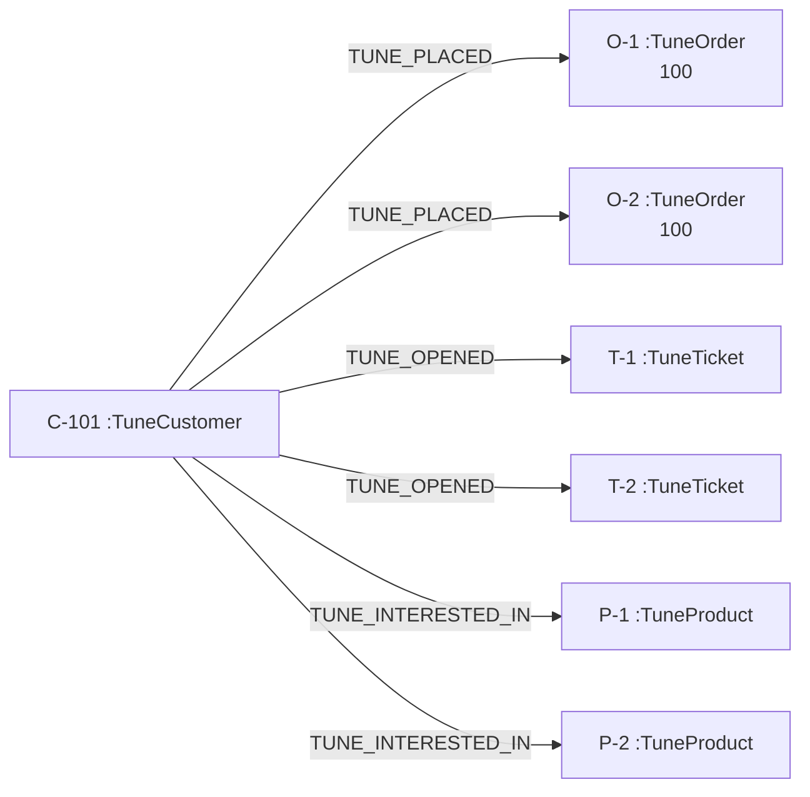
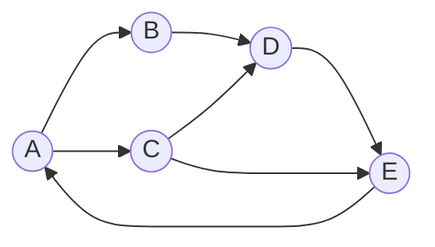

# Slow Queries Due to Missing Indexes, Cartesian Products, or Overly Broad Traversals in Neo4j

When a graph-reading API is slow, the root cause is not necessarily insufficient CPU or RAM on the Neo4j server. Many Cypher queries run slowly because they **choose an inefficient starting point**, **combine two unrelated datasets**, or **expand too many edges and paths** before filtering results.

Three particularly common problem categories:

1. **Missing indexes or inability to use an index:** Neo4j must inspect many nodes/relationships to locate an entity that actually has a specific key.
2. **Cartesian products or row multiplication:** two result sets are paired in every combination unintentionally; row counts grow multiplicatively instead of additively.
3. **Overly broad graph traversal (unbounded/high-fan-out traversal):** starting from a node and traversing too many edges, too deeply, or enumerating too many paths—driving up DB Hits, CPU, and memory.

This lesson belongs to the **Troubleshooting** chapter of the **DATABASE_ENGINE_GRAPH_NEO4J** module. The module spans the property graph model, nodes, relationships, Cypher, indexes, constraints, query tuning, data import, Java Driver / Spring Data Neo4j integration, and Neo4j operations. The goal is evidence-based diagnosis, **fixing queries without breaking business semantics**, and verifying improvements with execution plans and measurements.

After this lesson, you will be able to read `EXPLAIN`/`PROFILE`, spot `NodeByLabelScan`, `NodeIndexSeek`, `CartesianProduct`, `Expand`, `VarLengthExpand`, and intermediate row counts, choose appropriate indexes, fix multiplied aggregations, bound path traversals, and build a safe slow-query troubleshooting runbook.

> **Version scope:** Common Cypher examples apply to Neo4j 5 and modern Neo4j releases. Specific operator names, index features, quantified path pattern syntax, and profile metrics depend on version/runtime/edition. `PROFILE` **actually executes the query**: run it only on test data or evaluated read queries; never run `PROFILE` on write statements that could corrupt production data.

## 1. Do Not Tune by Intuition: Identify the Symptom First

“API takes 15 seconds” can have at least five distinct causes:

| Symptom | Observed signs | Where to investigate |
| --- | --- | --- |
| Slow at **locating start nodes** | Plan uses `NodeByLabelScan`/`Filter` on a large set; high DB Hits | Indexes, constraints, predicates, data types |
| Slow due to **row multiplication** | `Rows` spikes sharply; `CartesianProduct` or multi-branch expansion | Connecting relationships, cardinality, per-branch aggregation |
| Slow due to **broad traversal** | `Expand(All)`, `VarLengthExpand`, or shortest-path search processes many paths | Start node, edge type/direction, depth, filter placement |
| Slow due to **lock contention** | `SHOW TRANSACTIONS` shows large `waitTime`, waiting/blocked state | Lock-holding transactions, write batches, open transaction duration |
| Slow **outside Neo4j** | Query log shows fast Cypher, yet HTTP p99 is high | Driver pool, retries, network, JSON serialization, downstream services |

**A node lookup without an index is completely different from a query blocked by a lock.** Adding an index on a key property will not fix a client holding a transaction open across an HTTP call; raising transaction timeout will not reduce how many paths Cypher traverses.

### Required Diagnostic Artifacts

Before changing any index or query, record:

- Query template and the **exact database** accessed.
- Workload type: online reads, transactional writes, bulk import, or whole-graph analytics.
- Graph size: node/relationship counts by label/type, scale, and fan-out skew.
- Representative parameters (with sensitive data redacted) and cache state.
- `EXPLAIN`: estimated rows, operators, and intended indexes.
- `PROFILE` in a safe environment: actual `Rows`, `DB Hits`, memory, and elapsed time.
- Application p50/p95/p99 latency, query frequency, and concurrency level.

Never compare Query A on an empty database against Query B on production and claim B “got ten times faster”.

## 2. Practice Data Model

Use a **dedicated test database** and labels prefixed with `Tune` to avoid mixing with business data. The example includes:

- 3 `:TuneCustomer` nodes, keyed by `customerId`.
- 4 `:TuneProduct` nodes, keyed by `sku`.
- 2 `:TuneOrder` nodes both with `amountMinor = 100`, both placed by customer C-101.
- 2 `:TuneTicket` nodes opened by customer C-101.
- A `:TunePerson` network containing multiple paths from A to E.



### 2.1. Create Customer and Product Nodes

```cypher
UNWIND [
  {id: 'C-101', name: 'Mai', region: 'north'},
  {id: 'C-102', name: 'An',  region: 'south'},
  {id: 'C-103', name: 'Vy',  region: 'north'}
] AS item
MERGE (c:TuneCustomer {customerId: item.id})
SET c.name = item.name,
    c.region = item.region;
```

```cypher
UNWIND [
  {sku: 'P-1', category: 'BOOK'},
  {sku: 'P-2', category: 'BOOK'},
  {sku: 'P-3', category: 'GAME'},
  {sku: 'P-4', category: 'DEVICE'}
] AS item
MERGE (p:TuneProduct {sku: item.sku})
SET p.category = item.category;
```

### 2.2. Create Orders and Support Tickets

```cypher
UNWIND [
  {id: 'O-1', amountMinor: 100},
  {id: 'O-2', amountMinor: 100}
] AS item
MATCH (c:TuneCustomer {customerId: 'C-101'})
MERGE (o:TuneOrder {orderId: item.id})
SET o.amountMinor = item.amountMinor
MERGE (c)-[:TUNE_PLACED]->(o);
```

```cypher
UNWIND ['T-1', 'T-2'] AS ticketId
MATCH (c:TuneCustomer {customerId: 'C-101'})
MERGE (t:TuneTicket {ticketId: ticketId})
MERGE (c)-[:TUNE_OPENED]->(t);
```

```cypher
UNWIND ['P-1', 'P-2'] AS sku
MATCH (c:TuneCustomer {customerId: 'C-101'})
MATCH (p:TuneProduct {sku: sku})
MERGE (c)-[:TUNE_INTERESTED_IN]->(p);
```

On a clean test graph, `C-101` has exactly **2 Orders, 2 Tickets, and 2 interested Products**. If run on a database that already holds nodes with the same labels/keys, extra data can shift expected counts. Use an empty test database and never run broad `DETACH DELETE` on production.

### 2.3. Create a Multi-Path Traversal Network

```cypher
UNWIND [
  ['A', 'B'],
  ['A', 'C'],
  ['B', 'D'],
  ['C', 'D'],
  ['D', 'E'],
  ['C', 'E'],
  ['E', 'A']
] AS pair
MERGE (src:TunePerson {personId: pair[0]})
MERGE (dst:TunePerson {personId: pair[1]})
MERGE (src)-[:TUNE_KNOWS]->(dst);
```



A can reach E via `A → C → E`, `A → B → D → E`, and `A → C → D → E`. This graph is tiny; in a social network, path counts explode exponentially faster.

### 2.4. Verify Created Data

```cypher
MATCH (c:TuneCustomer)
RETURN count(c) AS customers;
```

```cypher
MATCH (p:TuneProduct)
RETURN count(p) AS products;
```

```cypher
MATCH (:TuneCustomer {customerId: 'C-101'})
      -[:TUNE_PLACED]->(o:TuneOrder)
RETURN count(o) AS orders, sum(o.amountMinor) AS totalMinor;
```

On a clean fixture: `customers = 3`, `products = 4`, `orders = 2`, `totalMinor = 200`. These numbers are **fixture expectations**, not performance benchmarks. An execution plan on 3–4 nodes does not prove the planner will pick the same operators on millions of nodes.

## 3. Core Tools: `EXPLAIN` and `PROFILE`

Neo4j Cypher provides two execution-plan inspection modes:

| Invocation | Executes query? | What it returns | When to use |
| --- | --- | --- | --- |
| `EXPLAIN` | **No** | Projected plan, operators, `Estimated Rows` | Pre-execution checks, including risky write queries |
| `PROFILE` | **Yes** | Plan plus actual metrics: `Rows`, `DB Hits`, memory if supported | Investigating read queries in safe environments |
| Normal run | Yes | Business results | Measuring latency/error rates on real workloads |

Example:

```cypher
EXPLAIN
MATCH (c:TuneCustomer {customerId: 'C-101'})
RETURN c.name;
```

And, in a test database:

```cypher
PROFILE
MATCH (c:TuneCustomer {customerId: 'C-101'})
RETURN c.name;
```

**Never run `PROFILE MATCH ... DELETE ...` on production.** `PROFILE` executes the statement and will modify or delete data.

### 3.1. What Metrics to Read in a Plan?

| Field/operator | Meaning and action |
| --- | --- |
| `Estimated Rows` | Planner row estimate; not actual count |
| `Rows` | Number of rows the operator **actually** emitted during `PROFILE` |
| `DB Hits` | Storage-layer access operations counted; not equal to result row count |
| `Memory (Bytes)` | Peak memory per operator where reported; do not sum all columns as total query memory |
| `Page Cache Hits/Misses` | Indicates cache/I/O behavior when provided by runtime/edition |
| `NodeByLabelScan` | Scans nodes by label; costly when label is large and predicate is selective |
| `AllNodesScan` | Scans every node in the store; check if query has a better starting point |
| `NodeIndexSeek` | Uses an index for the predicate; usually great for selective keys |
| `NodeUniqueIndexSeek` | Seeks via uniqueness-constraint backing index in some plans |
| `Filter` | Evaluates predicates; check whether filtering runs before or after row expansion |
| `Expand(All)` / `Expand(Into)` | Traverses relationships; watch fan-out and direction |
| `VarLengthExpand` | Variable-length relationship traversal; inspect upper bound and path counts |
| `CartesianProduct` | Pairs every row of two inputs |
| `Sort` / `Distinct` / `EagerAggregation` | Requires sorting/deduping/aggregating; can consume substantial RAM |
| `ProduceResults` | Streams final rows; small final output does not prove earlier operators did little work |

Operator names can vary across runtimes or newer Neo4j versions. Inspect **the entire data flow across the plan**, not just a single keyword.

### 3.2. Key Concept: Intermediate Row Counts

A query returning only 10 final records may still have processed millions of intermediate records beforehand. If `Rows` spikes in an earlier operator and `LIMIT 10` merely truncates the output, CPU and DB Hits **can still remain high**.

Diagnostic flow:

```text
How many nodes enter as input?
   |
   v
Which operator inflates row counts?
   |
   +--> Scanning too much? -> check start node, index
   |
   +--> CartesianProduct? -> check disconnected patterns
   |
   +--> Expand/path? -> check fan-out, depth, filters
   |
   v
Does filtering/aggregation happen before or after row inflation?
   |
   v
Are business semantics preserved after the fix?
```

## 4. Cause Group 1: Missing Index on the Starting Point

Suppose a large database holds millions of `:Customer` nodes and an API looks up one person by `customerId`. Without a suitable index, the planner may have to scan many nodes to evaluate the predicate.

Query:

```cypher
MATCH (c:TuneCustomer)
WHERE c.customerId = 'C-101'
RETURN c.customerId AS customerId, c.name AS name;
```

Before an index exists, on a sufficiently large graph, `EXPLAIN` may show `NodeByLabelScan` followed by `Filter`. That is a **signal to investigate**, not proof that every label scan is bad: for a label with only a few nodes or a query needing most nodes, a scan can beat a seek.

### 4.1. Inspect Existing Indexes

```cypher
SHOW INDEXES
YIELD name, type, entityType, labelsOrTypes,
      properties, state
RETURN name, type, entityType,
       labelsOrTypes, properties, state
ORDER BY name;
```

Check:

- Does the index cover the **exact label/relationship type**?
- Do `properties` match the property the query compares?
- Is `state` already `ONLINE`?
- What index type is it: `RANGE`, `TEXT`, `POINT`, `LOOKUP`, `FULLTEXT`, or a specialized index?
- Does data have consistent types (e.g., is `customerId` string or integer)?
- Does the query wrap the property in an expression that prevents index usage?

### 4.2. Create a Uniqueness Constraint for Truly Unique Keys

```cypher
CREATE CONSTRAINT tune_customer_id_unique IF NOT EXISTS
FOR (c:TuneCustomer)
REQUIRE c.customerId IS UNIQUE;
```

A uniqueness constraint creates a backing index and accelerates business-key lookups. Then:

```cypher
EXPLAIN
MATCH (c:TuneCustomer {customerId: 'C-101'})
RETURN c.name AS name;
```

On large datasets with high selectivity, an index seek is typically expected. **Never promise `NodeIndexSeek` always appears**: the planner uses statistics/cost, runtime, and graph size to decide. On our 3-node fixture, a label scan may be cheaper, and having an index does not force every plan to use it.

### 4.3. Need Only an Index, Not Uniqueness?

If `:Event` has many records sharing `eventType` and you just need fast lookups:

```cypher
CREATE RANGE INDEX tune_order_amount_idx IF NOT EXISTS
FOR (o:TuneOrder)
ON (o.amountMinor);
```

This index helps queries filtering by `amountMinor`, while value `100` appears in both orders. **Never place a uniqueness constraint** on `amountMinor`: that would violate business rules.

Rule of thumb:

- Data requires **no duplicate keys** → uniqueness constraint is appropriate.
- Duplicates are allowed, need faster `WHERE`/range/sort on supported predicates → regular index is appropriate.
- Need substring/word text search or geospatial lookups → evaluate `TEXT`, `FULLTEXT`, or `POINT` per exact semantics.
- Need label/relationship-type discovery → token lookup index, though it **does not accelerate property predicates**.

### 4.4. Choosing an Index by Query Operator

| Target predicate | Index to evaluate | What to verify |
| --- | --- | --- |
| `c.customerId = $id` | RANGE or uniqueness backing index | Selective equality, exact label, matching type |
| `o.createdAt >= $from` | RANGE on `createdAt` | Consistent temporal type, selectivity |
| `c.tenantId = $t AND c.customerId = $id` | Composite RANGE/constraint | Property order and usage in predicates |
| `p.name STARTS WITH 'Neo'` | RANGE can support prefix lookups | Collation/STRING type, actual plan |
| `p.name CONTAINS 'graph'` | TEXT or full-text depending on semantics | `CONTAINS` is not identical to full-text lexical search |
| `place.location` within radius | POINT | Point type, CRS, and spatial predicates |
| Bare `c:Customer` | Token lookup index | Filters labels only, not properties |

Indexes are not magic: if a query matches 70% of nodes under a label, the planner may choose a scan; indexes also incur disk, memory, and write-maintenance overhead. Creating hundreds of indexes “just in case” degrades write throughput and maintenance.

## 5. Composite Indexes for Multi-Tenant Queries

A multi-tenant system sharing a graph commonly identifies nodes by `(tenantId, customerId)`.

```cypher
CREATE CONSTRAINT tune_tenant_customer_key IF NOT EXISTS
FOR (c:TenantCustomer)
REQUIRE (c.tenantId, c.customerId) IS UNIQUE;
```

And the query:

```cypher
MATCH (c:TenantCustomer {
  tenantId: $tenantId,
  customerId: $customerId
})
RETURN c.name AS name;
```

The constraint's backing index supports pinpoint lookups by the composite key. Note:

- `tenantId` must come from an **authenticated, authorized principal**, never an untrusted client-supplied string.
- A uniqueness constraint does not guarantee both properties **always exist** if writes omit one; edition/schema may offer complementary constraints.
- Querying only by `customerId` **without `tenantId`** may not use the composite index as hoped; inspect actual plans and access patterns.
- An index locates the starting node; it **does not bound** how many relationships that node expands afterward.

If a tenant has a “supernode” connected to millions of nodes, the index seek stays fast while the subsequent `Expand` becomes expensive. That is the difference between **finding the start node** and **traversal cost**.

## 6. Why Would the Planner Still Ignore an Existing Index?

At least six common reasons:

1. **Dataset is tiny** or the predicate is unselective; scanning has lower estimated cost.
2. **Wrong label or property:** index created on `:Person(email)` while the query reads `:User(email)`.
3. **Index is not `ONLINE` yet** after creation; population is still running.
4. **Parameter type mismatch:** store holds String while code sends Integer, or mismatched temporal types.
5. **Predicate incompatible** with the index type, e.g., `CONTAINS` on a large dataset with only a RANGE index.
6. **Expression wrapping the property**, e.g., `toLower(c.email) = $email`; normalize on write or use an index/feature suited to the expression.

Example pattern needing review:

```cypher
MATCH (c:TuneCustomer)
WHERE toLower(c.name) = 'mai'
RETURN c.customerId;
```

If the system routinely performs case-insensitive name lookups, consider **storing a normalized property**:

```cypher
MATCH (c:TuneCustomer)
SET c.nameNormalized = toLower(c.name);
```

```cypher
CREATE RANGE INDEX tune_customer_name_normalized IF NOT EXISTS
FOR (c:TuneCustomer)
ON (c.nameNormalized);
```

```cypher
MATCH (c:TuneCustomer {nameNormalized: $nameNormalized})
RETURN c.customerId;
```

Input `$nameNormalized` must be normalized **consistently** by the application. This example shows simple case-folding; Vietnamese diacritics, Unicode normalization, whitespace, and fuzzy matching may require different rules or full-text search.

### Should You Use `USING INDEX`?

Cypher supports index hints in appropriate cases, yet they should never be your first move:

- A hint cannot make an index **exist** or improve its selectivity.
- A stale hint can block better plans as data distribution evolves.
- Before hinting, verify schema, statistics, predicates, and actual plans.
- When forcing a replan during diagnostics, check `CYPHER replan=force EXPLAIN ...` for your version; never flush production plan caches recklessly.

**Bottom line:** “Not seeing `IndexSeek`” is a prompt to ask *why*, not an automatic order to “create any random index”.

## 7. Cause Group 2: Cartesian Products from Disconnected Patterns

A Cartesian product happens when every row from set A is paired with **every row** from set B. If A has `m` rows and B has `n` rows, output reaches `m × n` rows before downstream filters.

Buggy example on the fixture:

```cypher
PROFILE
MATCH (c:TuneCustomer), (p:TuneProduct)
RETURN c.customerId AS customerId,
       p.sku AS sku;
```

With 3 Customers and 4 Products, this emits:

\[
3 \times 4 = 12 \text{ rows}
\]

Yet no relationship connects `c` and `p`. On a large graph, 100,000 customers × 50,000 products yields **5 billion pairs** before pagination or filtering.

Run `PROFILE` on this only against small fixtures; on production graphs with millions of nodes, prefer `EXPLAIN` to avoid generating massive intermediate results.

### 7.1. Spotting It in the Execution Plan

```cypher
EXPLAIN
MATCH (c:TuneCustomer), (p:TuneProduct)
RETURN c.customerId, p.sku;
```

The plan may display `CartesianProduct`. Even if that exact operator name does not appear while `Rows` still grows multiplicatively through another join mechanism, keep inspecting cardinality and patterns.

Do not search only for the text `CartesianProduct` and stop. Two expansions from one shared node—such as 2 orders and 2 tickets—can also produce 4 rows **without a separate `CartesianProduct` operator**.

### 7.2. Fix Using the Actual Business Relationship

If the requirement is “which products is each customer interested in”, write:

```cypher
MATCH (c:TuneCustomer)-[:TUNE_INTERESTED_IN]->(p:TuneProduct)
RETURN c.customerId AS customerId,
       p.sku AS sku
ORDER BY customerId, sku;
```

On the fixture, customer C-101 has 2 interest edges, giving 2 rows. The query expresses the **graph relationship** instead of all customer–product pairs.

If the requirement is “products in the same region as the customer”, joining on `region` is valid **when that is genuinely the business rule**; still, property-value joins can be expensive on large sets. For frequent joins, consider modeling a relationship or indexed lookup rather than pairing everything.

### 7.3. When a Cartesian Product Is Intentional

Not every Cartesian product is a bug. Analytical queries may intentionally generate pairs across **two tightly bounded small sets**. When doing so:

- Ensure both inputs are strictly bounded.
- Calculate the upper bound `m × n` and resource limits beforehand.
- Never generate all pairs just to test whether a single pair exists.
- Batch and persist outputs if pair counts are large.
- Check memory impact when combined with `collect`, `ORDER BY`, or writes.

**Never “fix” a Cartesian product by slapping `LIMIT 10` at the end and calling it done**: the planner may still perform huge work before emitting 10 rows, depending on operators and plan structure.

## 8. Row Multiplication Across Multiple Branches: Different Cause, Same Damage

A customer has:

- 2 Orders, each with `amountMinor = 100`.
- 2 Tickets.

Query:

```cypher
PROFILE
MATCH (c:TuneCustomer {customerId: 'C-101'})
MATCH (c)-[:TUNE_PLACED]->(o:TuneOrder)
MATCH (c)-[:TUNE_OPENED]->(t:TuneTicket)
RETURN c.customerId AS customerId,
       count(o) AS ordersCount,
       count(t) AS ticketsCount,
       sum(o.amountMinor) AS totalMinor;
```

Intermediate row combinations:

| Order | Ticket | Amount |
| --- | --- | ---: |
| O-1 | T-1 | 100 |
| O-1 | T-2 | 100 |
| O-2 | T-1 | 100 |
| O-2 | T-2 | 100 |

The query's result is **semantically wrong** if you want real order/ticket counts and total amount:

- `count(o) = 4`, yet there are actually 2 Orders.
- `count(t) = 4`, yet there are actually 2 Tickets.
- `sum(o.amountMinor) = 400`, yet the true total is 200.

This is **row multiplication** caused by expanding two independent branches from one Customer, without necessarily showing an explicit `CartesianProduct` operator.

### 8.1. Why `DISTINCT` Does Not Fix Every Aggregation

`count(DISTINCT o)` counts 2 Orders accurately, yet:

```cypher
sum(DISTINCT o.amountMinor)
```

only sums **distinct amount values**. Both Orders share `amountMinor = 100`, so that expression returns 100 — **still wrong**, just for a different reason.

**An Order's key is `orderId`, not its monetary amount.** Sums must preserve one row per Order entity before adding.

### 8.2. Fix Using Subqueries to Aggregate Each Branch

On Neo4j versions supporting the `CALL (c)` scope clause (since 5.23 in Cypher 5):

```cypher
MATCH (c:TuneCustomer {customerId: 'C-101'})
CALL (c) {
    OPTIONAL MATCH (c)-[:TUNE_PLACED]->(o:TuneOrder)
    RETURN count(DISTINCT o) AS ordersCount,
           sum(o.amountMinor) AS totalMinor
}
CALL (c) {
    OPTIONAL MATCH (c)-[:TUNE_OPENED]->(t:TuneTicket)
    RETURN count(DISTINCT t) AS ticketsCount
}
RETURN c.customerId AS customerId,
       ordersCount,
       coalesce(totalMinor, 0) AS totalMinor,
       ticketsCount;
```

On the fixture, expected output is `ordersCount = 2`, `totalMinor = 200`, and `ticketsCount = 2`. When a branch has no nodes, `OPTIONAL MATCH` plus `count`/`coalesce` handles empty branches cleanly for reporting logic.

**Key insight:** each subquery collapses to **one aggregated row per Customer** before the next branch runs. This prevents multiplying the two collections together.

Older Neo4j releases use `CALL { WITH c ... }`. Never mix version syntaxes randomly when pasting examples into a project.

### 8.3. You Do Not Always Need to Materialize Whole Collections

If only `count(o)` is needed, a scalar aggregate query typically uses far less memory:

```cypher
MATCH (c:TuneCustomer {customerId: 'C-101'})
OPTIONAL MATCH (c)-[:TUNE_PLACED]->(o:TuneOrder)
RETURN c.customerId AS customerId,
       count(o) AS ordersCount;
```

Never `collect(o)` millions of nodes only to compute `size(orders)` when the database can count directly. `collect` retains all elements in memory and can spike transaction memory.

## 9. Cartesian Products from Commas or `MATCH` Missing Shared Variables

Patterns that easily produce unrelated pairings:

```cypher
MATCH (u:User), (p:Product)
RETURN u, p;
```

```cypher
MATCH (a:Account)
MATCH (b:Account)
RETURN a, b;
```

If you want “account pairs with a transfer”, specify the edge:

```cypher
MATCH (a:Account)-[:TRANSFERRED_TO]->(b:Account)
RETURN a.accountId, b.accountId;
```

If you want “compare each account against a reference account set”, **narrow both sets with business filters** and bound the pair count beforehand.

**A bare `WITH` does not connect two independent patterns.** For instance, `MATCH (a) WITH a MATCH (b) RETURN ...` still forms all pairs if `MATCH (b)` has no predicate tying it to `a`.

**A trailing `DISTINCT` after a Cartesian product does not undo the work already spent**; it only deduplicates rows after they were generated.

## 10. Cause Group 3: Overly Broad Path Traversal

Unlike relational databases, Neo4j excels at following edges. However, starting from a well-connected node, every extra hop can multiply candidate paths dramatically.

Suppose average branching factor per hop is roughly `b` up to depth `d`. A rough upper-bound intuition for **explored branches** scales like:

\[
1 + b + b^2 + \cdots + b^d
\]

For example, `b = 20`, `d = 5` exceeds 3 million branches in an ideal tree. Real graphs have cycles, relationship uniqueness, filters, and community structure, so exact numbers differ widely. Yet the core intuition holds: **adding one more hop can multiply work enormously**.

### 10.1. Unbounded-Depth Query Example

```cypher
// Illustrative only; DO NOT run unbounded on large graphs.
MATCH p = (a:TunePerson {personId: 'A'})
          -[:TUNE_KNOWS*]->
          (b:TunePerson)
RETURN p;
```

In graphs with cycles and branching, this enumerates **paths**, not just reachable target nodes. Many paths can reach the same target, exploding result counts. Without explicit bounds, traversal depth can far exceed business requirements.

In modern Neo4j, Cypher also supports GQL-standard **quantified path patterns / quantified relationships**; legacy `*` syntax remains supported in several lines but is not GQL-conformant. Regardless of syntax, **depth bounds and predicates** govern traversal scope.

### 10.2. Business-Bounded Traversal

Suppose the requirement is “who does person A know within at most three `:TUNE_KNOWS` hops?”:

```cypher
MATCH (a:TunePerson {personId: 'A'})
MATCH (a)-[:TUNE_KNOWS*1..3]->(b:TunePerson)
RETURN DISTINCT b.personId AS reachablePerson
ORDER BY reachablePerson;
```

Benefits:

- Has a clear **starting point**.
- Restricts to one **relationship type**.
- Preserves stored edge **direction**.
- Caps maximum depth at 3.
- Returns **distinct target nodes** rather than materializing every full path.

However, a trailing `DISTINCT` **does not guarantee the database avoided traversing redundant paths to the same target beforehand**. Do not call it a silver bullet; inspect the plan and choose suitable algorithms if the task is pure reachability.

### 10.3. `LIMIT` Caps Output, Not Always Work

```cypher
MATCH p = (a:TunePerson {personId: 'A'})
          -[:TUNE_KNOWS*1..10]->
          (b:TunePerson)
RETURN DISTINCT b.personId
ORDER BY b.personId
LIMIT 10;
```

A query combining `ORDER BY` and `DISTINCT` may have to gather and sort vast numbers of candidates before knowing the **first 10 final rows**. Appending `LIMIT` does not automatically prevent traversal explosion.

Questions to ask:

1. Do we need **any** 10 nodes or 10 nodes **strictly sorted**?
2. Do we need all paths, or merely which nodes are reachable?
3. Can depth be capped at 2 or 3 per business SLAs?
4. Can predicates filter **at each hop** instead of after building full paths?
5. Are there many sources/targets or one known pair?
6. Can results be precomputed via batch jobs, GDS, or caching if the API repeats the lookup?

## 11. Direction, Edge Types, and Supernodes

An untyped, undirected pattern:

```cypher
MATCH (a:TunePerson {personId: 'A'})-[*1..3]-(b)
RETURN DISTINCT b;
```

expands across **every relationship type** in both directions; it explores vastly more than outgoing `:TUNE_KNOWS` edges.

Semantically tighter version:

```cypher
MATCH (a:TunePerson {personId: 'A'})
MATCH (a)-[:TUNE_KNOWS*1..3]->(b:TunePerson)
RETURN DISTINCT b.personId;
```

### 11.1. What Is a Supernode?

A node with massive degree—such as an ad account, celebrity, or flagship product—can connect to hundreds of thousands of nodes. Even a 1-hop traversal can emit huge row counts.

How to analyze:

- Check how many relationships of that type and direction the start node has.
- Question whether that node actually needs full expansion.
- Partition by time, status, type, or edge source.
- If only counts are needed, avoid loading full nodes and relationships.
- Consider specialized modeling for events, time-bounded edges, or global entities.
- Test against the **highest-degree node** in representative data, not just average nodes.

Never create an index on a supernode's ID and expect hundreds of thousands of downstream edges to vanish. An index speeds up **locating the source node**, not **expanding its incident edges**.

### 11.2. Measuring Degree on a Specific Node

```cypher
MATCH (a:TunePerson {personId: 'A'})
MATCH (a)-[r:TUNE_KNOWS]->()
RETURN count(r) AS outgoingKnows;
```

On the fixture, A has 2 outgoing edges. In production, apply this check to specific nodes located via keys/indexes; never scan the entire network just to compute degrees without evaluating cost.

## 12. Filter Early, and Distinguish Post-Traversal from In-Traversal Filtering

A query like:

```cypher
MATCH p = (a:Person {personId: $personId})
          -[:KNOWS*1..5]->
          (b:Person)
WHERE all(n IN nodes(p) WHERE n.active = true)
RETURN DISTINCT b.personId;
```

ensures returned paths contain only active nodes, **yet** whole-path predicates may run after candidate paths are partially or fully built, keeping costs high.

In Neo4j supporting **quantified path patterns** and **inline predicates**, node/relationship predicates can sit inside the pattern to **prune candidates early**. Verify exact syntax and Cypher version; never assume new syntax runs on every Neo4j 5.x release.

Illustrative modern Cypher example filtering relationships at every hop:

```cypher
// Neo4j supporting quantified relationships and inline predicates.
MATCH (a:Person {personId: $personId})
      -[r:KNOWS WHERE r.active = true]->{1,3}
      (b:Person)
RETURN DISTINCT b.personId;
```

This example requires edges along the path to have `active = true`; it **does not automatically check intermediate nodes for `active`**. If both nodes and edges must be valid, use a quantified path pattern with corresponding node predicates and test on data containing inactive intermediate nodes.

**Recommendation:** compare `PROFILE` before and after on equivalent datasets rather than judging solely by whether `WHERE` looks “earlier” in text.

## 13. Finding the Shortest Path vs. Enumerating Every Path

If the requirement is “find **one shortest path** from A to E”, enumerating all `*1..10` paths and sorting `ORDER BY length(p) LIMIT 1` is not the right default.

Traditional form:

```cypher
MATCH (a:TunePerson {personId: 'A'})
MATCH (b:TunePerson {personId: 'E'})
MATCH p = shortestPath((a)-[:TUNE_KNOWS*]->(b))
RETURN [n IN nodes(p) | n.personId] AS path,
       length(p) AS hops;
```

On the fixture, this finds a 2-hop shortest path such as A → C → E. This uses traditional `shortestPath`; newer Neo4j releases also support **`ANY SHORTEST`**, `SHORTEST`, and version-specific path-selection syntax.

Key points:

- **Shortest path** optimizes hop count using specialized Cypher path operators.
- If weights represent **real costs** (price, duration, distance), evaluate **Dijkstra/GDS** or weighted algorithms; fewest hops does not imply lowest cost.
- When **one concrete source–target pair** is bound, the planner has far better optimization opportunities than across thousands of unbound pairs.
- Some whole-path predicates can force shortest-path queries onto costlier fallback strategies; inspect the plan and version docs.

Never use `shortestPath()` when the business requirement is “all valid paths”, because it **changes result semantics**.

## 14. Returning Nodes, Paths, or Scalars: Result Payload Has Cost Too

A query can pick the optimal path yet still bottleneck on data transfer by returning thousands of fat nodes/relationships with all their properties:

```cypher
MATCH p = (a:TunePerson {personId: 'A'})
          -[:TUNE_KNOWS*1..3]->
          (b:TunePerson)
RETURN p;
```

If the UI only needs user IDs:

```cypher
MATCH (a:TunePerson {personId: 'A'})
MATCH (a)-[:TUNE_KNOWS*1..3]->(b:TunePerson)
RETURN DISTINCT b.personId AS personId
ORDER BY personId;
```

Returning **scalar projections** instead of whole paths shrinks payload size and serialization overhead, though it does not by itself alter every internal expansion step.

Separate three optimization dimensions:

- **Optimizing traversed rows:** improves DB Hits, CPU, and memory.
- **Optimizing result shape:** reduces Bolt network payload, Java mapping, and JSON serialization.
- **Optimizing round trips:** reduces network latency and connection pool pressure.

A well-tuned query balances all three rather than merely shortening `RETURN`.

## 15. Measure and Compare Before vs. After Under Identical Conditions

When tuning a query, record a measurement table:

| Signal | Before | After | Interpretation |
| --- | --- | --- | --- |
| `Estimated Rows` | High or low? | Changed? | Are planner cardinality estimates reasonable? |
| `Rows` at heavy operators | Millions? | Lower? | Did row multiplication/expansion drop? |
| `DB Hits` | High? | Lower? | Did storage accesses drop? |
| `Memory (Bytes)` | Spiking? | Reduced? | Are large Sorts/Distincts/collects gone? |
| Latency p95 | High? | Meets SLO? | Tested at comparable data and concurrency? |
| Result row count | Correct? | Still exact? | Did semantics remain intact? |
| CPU/I/O | Anomalous? | Steadier? | Did load merely shift elsewhere? |

**Never invent numbers and call it a benchmark.** Run on a representative dataset, repeat an appropriate number of iterations, note background system load, and avoid changing multiple variables simultaneously.

A disciplined tuning workflow:

1. Save the baseline query and redacted parameters.
2. Capture `EXPLAIN`/`PROFILE` and expected business outputs in a safe environment.
3. Change **one primary factor**: index, join pattern, depth, or return projection.
4. Wait for any new index to reach `ONLINE`.
5. Compare execution plans and cardinalities.
6. Run correctness tests covering nulls, duplicates, cycles, and tenant isolation.
7. Measure latency, DB Hits, CPU, and memory under comparable load.
8. Document conclusions and keep a rollback plan for risky schema/query changes.

### Planner Statistics and Plan Cache

Neo4j uses statistics to estimate cardinality and generate execution plans. Plans are cached, and replanning triggers according to version rules/settings. If you added an index yet the plan did not change as expected:

- Check that the index is `ONLINE`.
- Verify the query predicate is truly compatible with the index.
- Check stored labels, properties, and value types.
- Compare `EXPLAIN` on a representative-sized dataset.
- Check version docs for replanning behavior; avoid flushing global plan caches recklessly.
- Evaluate whether the index is genuinely more selective than a scan.

**An index seek is not the ultimate KPI**; semantic correctness and end-to-end latency/cost are the real goal.

## 16. Where Can You Inspect Slow Queries in a Live System?

During an incident, you need to know which queries are running or ran—your local suspect query may not be the one saturating the server.

### 16.1. Active Transactions

```cypher
SHOW TRANSACTIONS
YIELD database, transactionId, username,
      elapsedTime, currentQueryElapsedTime,
      status, currentQueryStatus,
      waitTime, activeLockCount,
      currentQuery
RETURN database, transactionId, username,
       elapsedTime, currentQueryElapsedTime,
       status, currentQueryStatus,
       waitTime, activeLockCount,
       currentQuery
ORDER BY elapsedTime DESC
LIMIT 20;
```

Distinguish:

- `elapsedTime` is transaction age.
- `currentQueryElapsedTime` is time spent in the active query.
- High `waitTime` often points to **lock contention**, not a node scan.
- `currentQuery` may contain sensitive literals; redact before sharing.
- Visibility into other users' transactions depends on roles/edition; the query also sees the observer's own transaction.

If `currentQueryElapsedTime` is small while `elapsedTime` is large and idle time grows, investigate **transaction lifecycle** first rather than blaming missing indexes.

### 16.2. Completed Queries

`SHOW TRANSACTIONS` only shows live state. For completed queries, inspect **query logs** configured per edition and version, query latency metrics, distributed traces, and application logs.

Never enable full parameter logging containing passwords, tokens, or sensitive PII just to debug one incident. On Neo4j Enterprise and supported setups, threshold logging captures slow queries exceeding a latency cutoff without logging every fast query.

### 16.3. Correlating Queries with Services/Endpoints

Neo4j Java Driver supports transaction metadata:

```java
import java.time.Duration;
import java.util.Map;

import org.neo4j.driver.TransactionConfig;

TransactionConfig config = TransactionConfig.builder()
    .withTimeout(Duration.ofSeconds(5))
    .withMetadata(Map.of(
        "service", "customer-api",
        "operation", "recommend-related",
        "traceId", "trace-042"
    ))
    .build();
```

Use only non-sensitive identifiers in metadata. Never attach passwords, bearer tokens, PII, or full HTTP payloads. During investigations, correlate application `traceId` metrics with Neo4j query logs and active transactions.

## 17. Java Driver: Precise Queries, Bounded Results, Avoiding Full-Graph Reads

Example service fetching only product SKUs a customer is interested in:

```java
import java.time.Duration;
import java.util.List;
import java.util.Map;

import org.neo4j.driver.Driver;
import org.neo4j.driver.Session;
import org.neo4j.driver.SessionConfig;
import org.neo4j.driver.TransactionConfig;

public final class ProductInterestService {
    private final Driver driver;

    public ProductInterestService(Driver driver) {
        this.driver = driver;
    }

    public List<String> findInterestedSkus(String customerId) {
        String cypher = """
            MATCH (c:TuneCustomer {customerId: $customerId})
                  -[:TUNE_INTERESTED_IN]->(p:TuneProduct)
            RETURN p.sku AS sku
            ORDER BY sku
            LIMIT 50
            """;

        TransactionConfig config = TransactionConfig.builder()
            .withTimeout(Duration.ofSeconds(5))
            .withMetadata(Map.of(
                "service", "customer-api",
                "operation", "list-interested-products"
            ))
            .build();

        try (Session session = driver.session(
                SessionConfig.builder().withDatabase("neo4j").build())) {
            return session.executeRead(tx ->
                tx.run(cypher, Map.of("customerId", customerId))
                  .list(row -> row.get("sku").asString()),
                config
            );
        }
    }
}
```

Key notes:

- `customerId` is a Cypher **parameter**, never concatenated into the query string.
- `Driver` should be reused across the service lifecycle; `Session` is short-lived.
- `withDatabase` selects the database explicitly; swap in your actual database name per registry/authorization.
- `withTimeout` bounds transaction duration; it **does not replace plan tuning**.
- `executeRead` may retry the callback on transient errors; keep callbacks read-only with no external side effects.
- `.list()` materializes the whole result collection in the JVM; fine here with `LIMIT 50`. Queries returning millions of nodes need streaming/cursor pagination or a redesigned query.
- `LIMIT` caps payload size, yet **verify the plan** to confirm whether traversal work itself shrank.

If a query returns full paths, object mappers/serializers also process every node, relationship, and property—driving up HTTP p95 even when Cypher execution itself is relatively fast.

## 18. Spring Data Neo4j: Object-Graph Mapping Affects Performance Too

In Spring Data Neo4j, a repository call looks simple:

```java
Optional<Customer> customer = repository.findById(customerId);
```

Yet if `Customer` maps multiple relationship collections and the generated query hydrates a huge subgraph, the bottleneck may be **fetching and hydrating the object graph** rather than locating the root node.

Questions to inspect:

1. Which **Cypher query** does the repository actually execute?
2. Are indexes/constraints present on the ID/filter properties?
3. How many nodes/relationships does the query return, and do collections multiply rows?
4. Does the UI DTO need only a few fields, or genuinely the full aggregate?
5. Are there **N+1 round trips** where the service loops over customers and queries orders one by one?
6. Is code calling `save()` on a partially loaded graph and triggering unintended relationship updates?

### 18.1. Use DTOs for Reporting

If only `customerId` and order count are needed, there is no reason to hydrate `Customer.orders`:

```cypher
MATCH (c:TuneCustomer {customerId: $customerId})
OPTIONAL MATCH (c)-[:TUNE_PLACED]->(o:TuneOrder)
RETURN c.customerId AS customerId,
       count(o) AS ordersCount;
```

Map the result into a DTO via `Neo4jClient` or a custom query; never load partial entities missing relationships and pass them back to `save()`.

### 18.2. N+1 Differs from Cartesian, Yet Both Hurt Latency

If an API loads 100 Customers and fires one query per Customer for Orders, that causes **101 round trips** even if every query hits an index. That is N+1.

Seeing a slow API does not always mean adding an index. You may need:

- Batched queries by ID list returning pre-grouped results.
- Pagination or lazy endpoints at the service layer.
- Projections/DTOs carrying only what the UI requires.
- Fewer Driver/Repository calls inside loops.
- Bounding nodes/relationships returned per request.

Never “fix” N+1 by loading the entire graph in one query if that exhausts JVM memory.

## 19. Common Bad Fixes When Tuning Slow Queries

| Bad fix | Why it fails | Proper approach |
| --- | --- | --- |
| Indexing **every property** | Raises write cost, disk usage, and maintenance | Index real predicates and check selectivity |
| Putting `USING INDEX` everywhere | Forces suboptimal plans | Diagnose planner stats; hint only with proof |
| Appending `LIMIT 10` at the end | Still expands, sorts, or aggregates huge sets | Bound scope early and inspect the plan |
| Using `DISTINCT` to patch Cartesian products | Processes all pairs before deduping | Fix join relationships or model |
| Using `sum(DISTINCT amount)` | Drops identical amounts from distinct Orders | Aggregate once per unique Order ID |
| Dropping relationship types/directions | Traverses far more edge types | Specify exact types and direction |
| Leaving `*` paths unbounded | Path explosion | Cap depth and prune inline |
| Raising JVM/DB heap for every error | Does not reduce cardinality or locks | Fix queries; size memory from measurements |
| Increasing timeout from 5s to 5m | Holds resources longer, delays failures | Align timeouts to SLOs and reduce work |
| Running `PROFILE DELETE` in production | `PROFILE` executes the write | Use `EXPLAIN` or a staging clone |
| Dropping “unused” indexes immediately | May serve other critical queries | Audit whole-workload index usage first |
| Using internal Neo4j IDs as business keys | Not durable across exports/restores | Use constraints and business keys |
| Removing `tenantId` filters for speed | Risks cross-tenant data leaks | Preserve policy; tune composite indexes |
| Increasing concurrency to finish faster | Amplifies CPU/I/O/lock contention | Bound load, schedule work, and measure |
| Benchmarking on a 3-node fixture | Planner on tiny sets prefers scans | Benchmark on representative datasets |

**Never accept optimizations that break application correctness.** A “faster” query that drops nodes, miscalculates totals, or leaks another tenant's data is a severe regression.

## 20. Step-by-Step Runbook for Slow-Query Alerts

### Step 1 — Confirm Scope and Impact

Record timestamp, database, service/endpoint, p95/p99 latency, failed request count, and recent deployments. Distinguish interactive queries from legitimate long-running import or GDS jobs.

### Step 2 — Capture Query and Safe Context

From logs, traces, or `SHOW TRANSACTIONS`, collect the query template and **non-sensitive** parameter descriptions. In clusters, verify which server/database ran it. Never paste raw PII or tokens into tickets.

### Step 3 — Rule Out Locks, Pool Exhaustion, and Network

If `waitTime` is high and transactions show `Blocked`, inspect lock holders and transaction lifecycles. If Cypher logs are fast while HTTP is slow, inspect Driver pooling, retries, serialization, and downstream dependencies.

### Step 4 — `EXPLAIN` Before Editing

Inspect source operators:

- `NodeByLabelScan` on a large label with a selective predicate → check indexes.
- `CartesianProduct` or sharp row inflation → check disconnected patterns.
- `VarLengthExpand`/`Expand` emitting huge rows → check fan-out and depth.
- `Sort`/`EagerAggregation` on huge inputs → check aggregation timing.

### Step 5 — Apply **One** Primary Change

For example:

- Add a uniqueness constraint or index on the real key.
- Connect two disconnected patterns using the domain relationship.
- Use subqueries to aggregate each branch independently.
- Constrain relationship type, direction, and max depth.
- Return node IDs or use shortest-path operators instead of returning all paths when appropriate.
- Split APIs into focused read models instead of hydrating giant graphs.

### Step 6 — Verify Semantics

Verify node counts, Order counts, sums, nulls/duplicates, cyclic paths, supernodes, and tenant authorization. Include a fixture with **two Orders sharing the same amount** to catch `sum(DISTINCT amount)` bugs.

### Step 7 — Measure Plans and Resource Usage

For safe read queries, run `PROFILE` on representative data. Compare `Rows`, `DB Hits`, memory, latency, and result correctness. If a new index was created, verify it is `ONLINE`.

### Step 8 — Roll Out and Observe

Deploy per change procedure with a query/schema rollback plan. Monitor p95/p99 latency, error rates, CPU, memory, locks, and behavior under concurrent load.

### Step 9 — Prevent Recurrence

- Write integration tests running Cypher against test Neo4j.
- Add performance regression tests on high-fan-out datasets.
- Flag `MATCH (a), (b)`, unbounded `*`, and huge `collect` calls in code review.
- Maintain index migrations and schema documentation.
- Alert on slow queries relative to workload SLOs.
- Enforce tenant authorization checks on every critical path.

## 21. Regression Testing on Truly Representative Data

### 21.1. Correctness Tests

Minimum test suite:

| Case | Expectation |
| --- | --- |
| Look up existing Customer by ID | Exactly one Customer per constraint |
| Nonexistent ID | Reads never create nodes |
| Two Orders with equal `amountMinor` | Sum equals 200 |
| Two Orders and two Tickets | Does not multiply into 4 Orders or 400 total |
| Multi-route A→E paths | Results match required **target nodes** or **paths** |
| Cyclic graph | Depth-bounded query terminates cleanly |
| Very high-degree node | Query stays within resource bounds and reasonable latency |
| Tenant Beta shares `customerId` with Acme | Zero cross-tenant read/write leakage |
| Missing property/`null` | Predicates and aggregations remain semantically valid |

### 21.2. Plan and Performance Tests

Avoid brittle assertions requiring `NodeIndexSeek` every time: planner, version, and statistics evolve. Instead:

- Assert required indexes/constraints **exist and are `ONLINE`**.
- Measure DB Hits, Rows, elapsed time, or resource budgets on a sufficiently large, stable dataset.
- Assert queries do not blow up intermediate row counts unexpectedly.
- Record Neo4j/Driver versions, dataset shape, and test statistics.
- Allow reasonable variance across CI runners; never hard-code brittle 5 ms cutoffs on noisy shared runners.
- Test rare paths and supernodes, not just easy happy paths.

**Neo4j Harness** is great for Cypher correctness on small graphs; **Testcontainers/staging with representative data** is far better for plan/performance regressions at scale. Never extrapolate production throughput from an in-JVM Harness benchmark.

## 22. Self-Check Exercises

**Exercise 1 — Scan vs. Seek.** A database holds 2 million `:Customer` nodes; a query looks up `customerId='C-101'`, yet the plan uses `NodeByLabelScan` and `Filter`. List what to check before creating an index and explain why on a 3-node graph the planner might skip seeking anyway.

**Exercise 2 — Choosing Indexes.** You need to (a) look up unique emails, (b) filter Orders by `createdAt` range, and (c) search `name CONTAINS 'graph'`. Choose which index/constraint type to evaluate for each, and distinguish text indexes from full-text search.

**Exercise 3 — Cartesian Products.** `MATCH (a:Customer), (p:Product) RETURN a, p` across 20,000 customers and 5,000 products emits at most how many rows before filtering? Write the replacement query if the requirement is products a customer purchased.

**Exercise 4 — Row Multiplication.** A Customer has 3 Orders and 4 Tickets. A query expanding both branches at once emits at most how many rows? How do `count(o)` and `sum(o.amountMinor)` go wrong? Rewrite using subqueries aggregating each branch.

**Exercise 5 — Bad `DISTINCT`.** Two Orders share the same amount `100`. Why does `sum(DISTINCT amountMinor)` return the wrong total? Show how to aggregate by Order ID rather than amount value.

**Exercise 6 — Traversal Explosion.** What goes wrong with `MATCH p=(a)-[:KNOWS*]->(b) RETURN p` on a graph with major hubs? Fix it for “people connected within at most 3 hops”, and explain why returning `DISTINCT b` does not prove the traversal was cheap.

**Exercise 7 — `LIMIT` and Sort.** A query uses `ORDER BY score DESC LIMIT 10`, yet `PROFILE` shows millions of `Rows` entering Sort. Why is a 10-row query still slow? Propose index/filter or materialized-ranking improvements.

**Exercise 8 — Shortest Path.** The domain requires one path with fewest hops, not all paths. Why avoid enumerating all paths and sorting? When edge weights represent real costs, which algorithm approach should you evaluate?

**Exercise 9 — Multi-Tenant.** Why is indexing `Customer.customerId` and dropping `tenantId` for speed dangerous? Design a composite key/index and query preserving tenant isolation.

**Exercise 10 — Driver.** Write Java Driver code using `SessionConfig.withDatabase`, parameter `$customerId`, a transaction timeout, and returning at most 50 SKUs. When should `.list()` be avoided?

**Exercise 11 — Before/After Measurement.** Describe a results table capturing `Rows`, `DB Hits`, memory, p95, and exact result counts before/after. If a query gets faster yet drops an Order, can you ship it?

**Exercise 12 — Misdiagnosis.** `SHOW TRANSACTIONS` shows `elapsedTime=90s` while `currentQueryElapsedTime=20ms` and `waitTime` grows. Should you immediately create an index? Explain how to check lock holders and other causes.

### Practical Query-Tuning Checklist

- [ ] Baseline latency and execution plans captured from a safe environment.
- [ ] Distinguished scan/index, Cartesian/row multiplication, traversal, and lock waits.
- [ ] Verified indexes target the exact label/property/type and are `ONLINE`.
- [ ] No uniqueness constraints placed on non-unique properties.
- [ ] No index hints masking broken predicates or joins.
- [ ] Every independent `MATCH` has an explicit domain reason.
- [ ] One-to-many branches aggregate independently without multiplying rows.
- [ ] `sum(DISTINCT value)` is never used to deduplicate entities.
- [ ] Traversals define start node, type/direction, depth bounds, and filters.
- [ ] Trailing `LIMIT`/`DISTINCT` is never assumed to guarantee low resource usage.
- [ ] Returning DTOs/scalars when full node/path hydration is unnecessary.
- [ ] Tenant authorization and business semantics remain preserved.
- [ ] `PROFILE` runs only under control, never executing dangerous writes in production.
- [ ] Verified correctness, worst-case fan-out, and representative benchmarks.
- [ ] Rollout plan, rollback plan, and slow-query recurrence alerts prepared.

## 23. Official References

Verify syntax and operator names against your system's Neo4j/Cypher version:

- [Neo4j Cypher Manual — Understanding query plans](https://neo4j.com/docs/cypher-manual/current/planning-and-tuning/execution-plans/): `EXPLAIN`, `PROFILE`, `Estimated Rows`, `Rows`, `DB Hits`, and memory.
- [Neo4j Cypher Manual — Operators in detail](https://neo4j.com/docs/cypher-manual/current/planning-and-tuning/operators/operators-detail/): `CartesianProduct`, scans, seeks, expansions, aggregations, and sorts.
- [Neo4j Cypher Manual — Query tuning](https://neo4j.com/docs/cypher-manual/current/planning-and-tuning/query-tuning/): filtering principles, bounding traversals, and planning/replanning.
- [Neo4j Cypher Manual — Performance indexes](https://neo4j.com/docs/cypher-manual/current/indexes/performance-indexes/): RANGE, TEXT, POINT, and token lookup indexes.
- [Neo4j Cypher Manual — Create indexes](https://neo4j.com/docs/cypher-manual/current/indexes/performance-indexes/create-indexes/): `CREATE INDEX` syntax, index types, and usage rules.
- [Neo4j Cypher Manual — Variable-length paths](https://neo4j.com/docs/cypher-manual/current/patterns/variable-length-paths/): quantified path patterns, inline predicates, and broad-traversal risks.
- [Neo4j Cypher Manual — Shortest paths](https://neo4j.com/docs/cypher-manual/current/patterns/shortest-paths/): shortest-path search vs. enumerating all paths.
- [Neo4j Operations Manual — Monitoring](https://neo4j.com/docs/operations-manual/current/monitoring/): logs, metrics, and performance observability.
- [Neo4j Java Driver Manual — Transactions](https://neo4j.com/docs/java-manual/current/transactions/): managed transactions, timeouts, and metadata.

**Remember:** Cypher performance depends on **how many entities are read and how many rows/paths are processed**. Missing indexes make starting lookups costly; Cartesian products and independent branches multiply intermediate rows; unbounded traversals explode path counts. Use `EXPLAIN`/`PROFILE` to locate the exact operator, fix queries according to **true graph semantics**, and re-measure **correctness, cardinality, DB Hits, and latency** before deploying.
