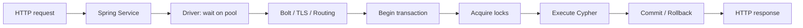
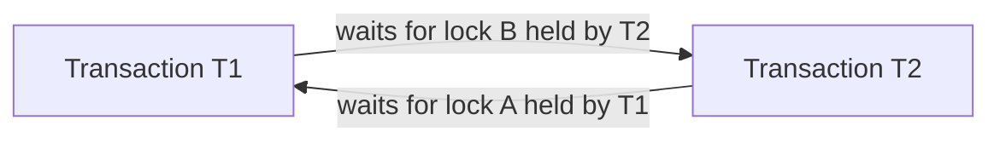
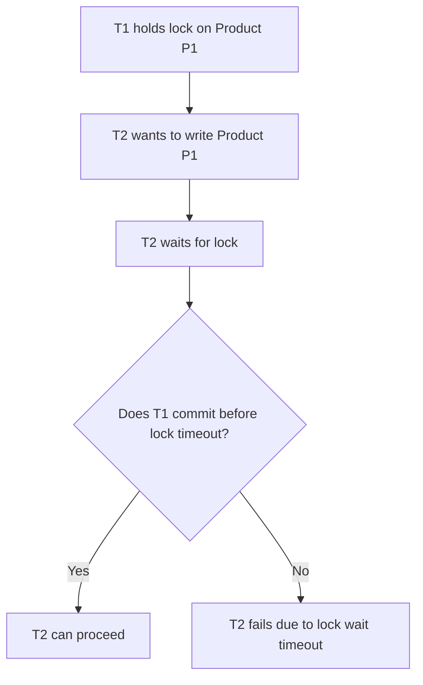
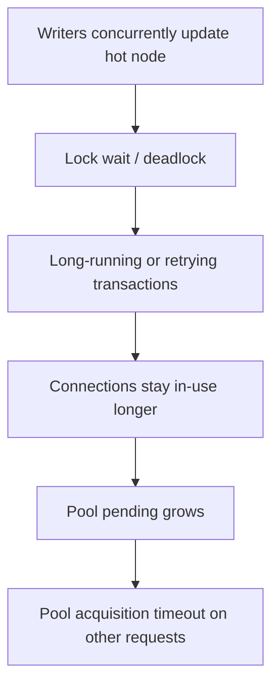

# Deadlocks, Transaction Timeouts, and Connection Pool Exhaustion in Neo4j

## 1. Goal: Identify the Exact Failing Layer Before Raising Limits

In **Neo4j**, applications store and query connected data using the **property graph** model of nodes, relationships, and properties. **Cypher** queries such as `MATCH`, `MERGE`, `SET`, and path traversals may execute concurrently from multiple Java services. When load increases or certain hot nodes are updated frequently, three incident types are often confused:

- **Deadlock:** two or more transactions hold locks needed by one another, forming a wait cycle where none can proceed unless one is aborted.
- **Transaction timeout:** a transaction lives longer than the enforced limit, due to heavy Cypher, lock waits, slow result consumption, or slow work inside the transaction.
- **Connection pool exhaustion:** the application cannot acquire a Bolt connection from the **Neo4j Java Driver** pool within the allowed wait time. This error can occur **before** any new transaction even starts.

This lesson belongs to the **Troubleshooting** chapter of the `DATABASE_ENGINE_GRAPH_NEO4J` module. Content spans **Neo4j server**, **Cypher**, the **Neo4j Java Driver**, **Spring Boot / Spring Data Neo4j**, transactions, indexes/constraints, and observability.

After this lesson, you will be able to:

1. Distinguish deadlocks, lock acquisition timeouts, transaction timeouts, and pool acquisition timeouts by **where they occur** and their accompanying signals.
2. Understand the *wait-for graph* and why Neo4j must abort one transaction to break a deadlock.
3. Use `SHOW TRANSACTIONS`, `SHOW SETTINGS`, `EXPLAIN`/`PROFILE`, and metrics to isolate the root cause.
4. Reduce deadlocks via short transactions, consistent locking order, and proper queries/indexes.
5. Implement bounded retries with the Java Driver, distinguishing retryable transient errors from data/privilege errors.
6. Diagnose pool exhaustion, long-held sessions, driver routing, TLS, fan-out queries, and per-replica load.
7. Design alerts, load tests, and a safe runbook when incidents recur.

> **Version scope:** Examples target Neo4j 5.x, Java Driver 5.x, Spring Boot 3.x, corresponding Spring Data Neo4j, and Java 17+. Error code names, property keys, admin columns, observability features, and retry strategies can vary by version/edition, especially on Neo4j Aura or clusters. Always check documentation and inspect your live environment before changing production.

## 2. Request Lifecycle Map and Where Failures Occur

A relationship write request may pass through:



Timeouts across these stages **do not share a single clock**.

| Scenario | Typical point of failure | First thing to investigate |
| --- | --- | --- |
| Deadlock | Neo4j detects a lock wait cycle between transactions | Write/lock ordering, queries, and hot data |
| Lock acquisition timeout | Transaction waits for a lock past the configured limit | Long lock-holding transactions, `waitTime`, concurrency |
| Transaction timeout | Transaction fails to finish within its time budget | Query plan, lock wait, transaction lifecycle, custom timeout |
| Pool acquisition timeout | Driver waits for a connection and receives none | Pool in-use/pending, long sessions/transactions, load |
| Connect/TLS/routing failure | Cannot establish or use a connection to the server | DNS, certs, advertised addresses, ports, cluster |
| HTTP gateway timeout | Client/proxy gives up before backend responds | HTTP deadline and actual work state in the database |

**Example:** An API returning `504 Gateway Timeout` does not prove Neo4j rolled back the transaction. The gateway may have stopped waiting while the backend was still running or about to commit. To know the outcome, verify transaction/driver responses and design **idempotency** for retries.

### 2.1. Three Budgets to Keep Separate

```text
Driver: max wait for a connection 3 seconds
Neo4j:  max wait for a lock       5 seconds
Neo4j:  default transaction       20 seconds
```

These numbers are **illustrative only**. Request A can fail at 3 seconds because it could not acquire a connection, without ever starting a transaction. Request B got a connection, waited over 5 seconds for a lock, and failed before the 20-second mark. Request C waited on no locks yet traversed too much graph and hit transaction timeout.

Never assume “raising everything to 120 seconds is safe”: doing so often holds resources longer, backs up queued requests, and triggers more deadlocks.

## 3. How Does a Deadlock Form?

### 3.1. The Lock Wait Cycle

Suppose two concurrent transactions update two `:StockItem` nodes with IDs `A` and `B`:

| Step | Transaction T1 | Transaction T2 |
| --- | --- | --- |
| 1 | Acquires write lock on node A | Acquires write lock on node B |
| 2 | Wants write lock on node B → must wait for T2 | Wants write lock on node A → must wait for T1 |
| 3 | Waits for T2 to release B | Waits for T1 to release A |



This is a **wait cycle**: even with huge timeouts, neither transaction can progress without intervention. Neo4j detects deadlocks and **chooses one transaction to terminate/roll back**, allowing the other to proceed once locks are released.

**Distinguish:**

- Two transactions contending for node A where T1 is actively running and T2 simply waits is **not a deadlock yet**; it is **lock contention**.
- A deadlock can happen very quickly, **long before** any transaction timeout.
- A deadlock causes **one or more transactions to fail**; the application must handle the error and never assume Neo4j automatically replays all business-layer logic.
- Deadlocks can involve **relationships**, indexes/constraints, or complex `MERGE` operations; they are not limited to two-node examples.

### 3.2. Practice Data Example

Run these write statements only on a **test database**. Use a dedicated label to avoid colliding with business data:

```cypher
CREATE CONSTRAINT troubleshooting_stock_id_unique IF NOT EXISTS
FOR (s:TsStockItem)
REQUIRE s.id IS UNIQUE;
```

```cypher
UNWIND ['A', 'B'] AS itemId
MERGE (s:TsStockItem {id: itemId})
ON CREATE SET s.revision = 0;
```

A write statement causing a transaction to require a write lock on a node:

```cypher
MATCH (s:TsStockItem {id: $itemId})
SET s.revision = coalesce(s.revision, 0) + 1
RETURN s.id AS itemId, s.revision AS revision;
```

**Simulated scenario** requiring two separate sessions/transactions:

```text
T1: BEGIN
T1: update A, hold transaction uncommitted

T2: BEGIN
T2: update B, hold transaction uncommitted

Next two operations must run CONCURRENTLY:
T1: update B  → blocks waiting for T2
T2: update A  → forms a wait cycle

Neo4j detects the cycle and aborts one transaction.
```

This is a **coordination scenario**, not a Cypher script to paste sequentially into one tab. If you run `T1 updates B` and wait for it to finish before sending `T2 updates A`, you will likely only see a **lock timeout**, not a deadlock. Reproduction requires two open transactions on two independent sessions with controlled timing. **Never practice on production** or real data nodes.

### 3.3. Why Do MERGE and Graph Edges Complicate Contention?

A statement like:

```cypher
MATCH (a:Service {id: $callerId})
MATCH (b:Service {id: $dependencyId})
MERGE (a)-[:DEPENDS_ON]->(b);
```

is not just “write one edge”. It may read/locate nodes, check relationship existence, and perform writes acquiring the locks required by the engine. Multiple concurrent threads creating/deleting relationships around the same node or endpoint pair can cause contention.

To reduce risk:

- Maintain appropriate **constraints/indexes** on identity keys so `MATCH` does not scan the whole graph.
- Use a **consistent write ordering** strategy when operations touch multiple entities.
- Avoid holding transactions open while calling external HTTP APIs, sending emails, or waiting on another job.
- Do not bundle a huge graph slice into one giant transaction merely to reduce driver calls.
- Throttle concurrent writers hitting **hot nodes**; consider redesigning counters or partitioning workloads.

**Warning:** Sorting input data with `ORDER BY` is not a formal guarantee that the engine always acquires **all internal lock types** in one fixed order. It is a practical contention-reduction strategy to validate against your queries and version, not a mathematical proof that deadlocks cannot occur.

## 4. Lock Acquisition Timeout vs. Deadlock

### 4.1. Waiting Too Long for a Lock

Suppose T1 updates a `:Product` node and then performs slow work before committing, while T2 tries to update the same node:



T2 waits on T1, while T1 does **not** wait on any resource held by T2. This is not a deadlock cycle. Neo4j terminates the waiting transaction per **`db.lock.acquisition.timeout`**.

**Neo4j 5** configuration example, for illustration only:

```properties
# neo4j.conf — apply only after checking version and change approval
db.lock.acquisition.timeout=5s
```

In Neo4j versions supporting this setting, `0s` typically means **disabling the lock acquisition timeout**, not “never wait for locks”. Check `SHOW SETTINGS` to verify exact setting names and effective values. Never disable timeouts simply because you are seeing contention.

### 4.2. Shrink Lock Hold Duration

Example **to avoid**:

```text
BEGIN transaction
  1. SET stock ...
  2. Call external payment API (waits 10–30 seconds)
  3. Write audit log to another system
  4. COMMIT Neo4j transaction
```

Graph locks remain held while waiting on external I/O. When coordinating payments or external events, consider **short transactions + outbox/events + idempotency** rather than holding a Neo4j transaction open across an unbounded network call.

## 5. Transaction Timeout: Transactions Living Too Long

### 5.1. Common Causes

A transaction can time out because:

1. A Cypher query has excessive **cardinality/fan-out**, e.g., expanding `*1..6` from a node with thousands of edges.
2. Missing indexes/constraints force scanning many nodes to locate a business key.
3. Many writes or streamed reads occur inside **one very long transaction**.
4. Lock waits or slow application callback logic happen while the transaction stays open.
5. The server is saturated on CPU, memory, page cache, or disk I/O.
6. The client set a **per-transaction timeout** shorter than expected.

Neo4j 5 server configuration example:

```properties
db.transaction.timeout=20s
```

In documented defaults for many Neo4j 5 versions, `0s` typically means **no default timeout**. This sets the **default** transaction limit; applications can specify per-transaction timeouts. Never confuse this with an overall HTTP request timeout.

### 5.2. Distinguish Commonly Confused Timeouts

| Limit | Typical config / location | Scope |
| --- | --- | --- |
| Default transaction | `db.transaction.timeout` (Neo4j 5) | Server-side transaction lifetime |
| Lock wait | `db.lock.acquisition.timeout` (Neo4j 5) | Time spent trying to acquire a lock |
| Per-transaction timeout | `TransactionConfig.withTimeout(...)` in Java Driver | Budget for that specific transaction |
| Driver retry budget | `spring.neo4j.max-transaction-retry-time` or Driver Config | Total transient-retry window managed by driver |
| Connection acquisition | `spring.neo4j.pool.connection-acquisition-timeout` | Waiting for a connection from the pool |
| HTTP timeout | Framework, ingress/load balancer, HTTP client | Waiting for a response outside the database |

**Important:** A per-transaction timeout specified by the driver can **override the default** `db.transaction.timeout` in modern Neo4j versions. Do not assume the server default always acts as a ceiling for every transaction. Enforcement also depends on periodic checks, network timing, and other factors; do not rely on millisecond-exact termination.

### 5.3. Rollback and Partial Commits

A write transaction:

```cypher
UNWIND $rows AS row
MERGE (p:TsImportItem {id: row.id})
SET p.payload = row.payload;
```

If it **has not committed** and is terminated/rolled back on timeout, writes in **that transaction** are not committed. However, if the application split a large file across multiple transactions, **previously committed transactions remain persisted**.

Example:

```text
Batch 1: 500 records → COMMIT
Batch 2: 500 records → COMMIT
Batch 3: 500 records → transaction timeout → ROLLBACK
```

You cannot say “all data rolled back” because **1,000 records from the first two batches already committed**. Design checkpoints, idempotency keys, and safe resume logic.

**Race between timeout and commit response:** a communication failure right after sending commit leaves the client **uncertain** whether the commit succeeded. Never blindly replay additive/financial operations; use unique business identifiers or event ledgers to reconcile.

## 6. Connection Pool Exhaustion: Failing Before Cypher Even Starts

### 6.1. How Does the Neo4j Java Driver Manage Connections?

The Neo4j Java Driver maintains reusable **Bolt connections** instead of opening fresh TCP/TLS handshakes per request. A **`Driver`** is typically long-lived at application scope; a **`Session`** is short-lived, not thread-safe, and closed when work completes.

In routing mode (`neo4j://`/`neo4j+s://`), the Driver can maintain pools **per server address**. Therefore never read `maxConnectionPoolSize=30` as “the entire deployment uses at most 30 connections everywhere”.

Mental model:

```text
Spring service requests
      │
      ▼
Neo4j Driver pool (per relevant endpoint)
  • in-use: connections actively working
  • idle: reusable connections available
  • pending: requests waiting for a connection
      │
      ▼
Bolt/TLS → Neo4j
```

If in-use connections are not returned to the pool, new requests wait until exceeding **connection acquisition timeout**. At that point, the request may have **executed zero Cypher statements**.

### 6.2. Three Reasons Pools Exhaust

1. **Concurrency exceeds pool capacity:** too many simultaneous requests open transactions.
2. **Connections held too long:** slow queries, lock waits, unconsumed streams, unclosed sessions/transactions, or external work inside callbacks.
3. **Cannot create new connections:** network/TLS/routing failures, server connection limits, or an unresponsive endpoint; surface symptoms can mimic pool saturation.

### 6.3. Do Not Confuse This with JDBC/HikariCP

Spring Boot may connect to PostgreSQL via **HikariCP** and to Neo4j via the Java Driver simultaneously. `hikaricp.connections.active` metrics **do not** measure the Bolt pool. To understand Neo4j, instrument the Driver's connection pool or measure acquisition wait via driver-supported metrics.

### 6.4. Pool Size and Replica Count

Suppose 8 Spring Boot pods each configure max 30 connections **per relevant server**:

```text
8 pods × 30 = 240 connections theoretical ceiling
```

This is **not** actual active connection count, and with multi-server routing, total connections differ. Raising 30 to 100 without fixing long-held transactions pushes more load into Neo4j and can **worsen deadlocks and lock waits**.

To size pools, measure:

- Requests/sec, peak concurrency, and connection hold time.
- Pool in-use/idle/pending counts and acquisition wait time.
- Query p50/p95/p99, transaction duration, and retry counts.
- Replica count, routed server count, server connection limits, and Neo4j resources.

**Rough estimate example:** at 50 requests/sec with average hold time 0.4s, average concurrency is roughly **20 connections** (`throughput × hold time`). That is only a steady-state average estimate, **not** enough headroom for bursts, p99 tails, and retries.

## 7. Quick Comparison Table of the Four Failure Modes

| Characteristic | Deadlock | Lock timeout | Transaction timeout | Pool acquisition timeout |
| --- | --- | --- | --- | --- |
| Wait cycle between transactions? | **Yes** | Not necessarily | Not necessarily | Not at graph lock layer |
| Transaction already open? | Yes | Yes | Yes | Possibly **not yet** |
| Can occur very quickly? | Yes | Per lock wait budget | Per transaction budget | Per pool wait budget |
| Signals to look for | Deadlock-detected, victim rollback | Blocked / high `waitTime` | Transaction terminated / time budget | Pool pending / acquisition wait |
| Root fix | Lock ordering, hot nodes, short txs | Reduce contention / lock hold | Query plan, batching, sane timeouts | Shorten connection hold, bound concurrency |
| Safe to retry? | Conditionally, if transient and callback is safe | Conditionally | Depends on error/timeout; never unbounded | Depends on availability/budget and idempotency |
| Does raising pool help? | Not directly; can make it worse | Not directly | Not directly | Only after confirming server has spare capacity |

Specific codes such as **`Neo.TransientError.Transaction.DeadlockDetected`** appear across many versions; newer Neo4j releases also expose GQL status classifications. Never depend solely on one hard-coded exception string: record **error code, status, stage, timestamp, and query operation**, and cross-check your running version's error catalog.

## 8. Observing Active Transactions: `SHOW TRANSACTIONS`

With an account granted appropriate administrative/monitoring privileges:

```cypher
SHOW TRANSACTIONS
YIELD database, transactionId, username, status,
      elapsedTime, waitTime, activeLockCount
RETURN database, transactionId, username, status,
       elapsedTime, waitTime, activeLockCount
ORDER BY elapsedTime DESC;
```

| Field | How to read during troubleshooting |
| --- | --- |
| `transactionId` | Identifier for log correlation or controlled termination |
| `status` | Running, blocked, or corresponding Neo4j version status |
| `elapsedTime` | How long the transaction has lived, including wait time |
| `waitTime` | Time spent waiting on locks; high values indicate contention |
| `activeLockCount` | Number of locks currently held as reported by Neo4j |
| `database` | Relevant database in multi-database setups |
| `username` | Service identity; restrict access to operational metadata |

This is an **instantaneous snapshot**: a deadlock victim may have already rolled back and disappeared before you run the command. Time-series metrics and logs are essential for post-hoc proof.

### 8.1. Attaching Transaction Metadata for Traceability

In the Java Driver, attach low-sensitivity metadata:

```json
{
  "application": "graph-catalog",
  "operation": "inventory.adjust",
  "workload": "interactive"
}
```

On Neo4j versions supporting that column:

```cypher
SHOW TRANSACTIONS
YIELD transactionId, elapsedTime, waitTime, status, metaData
RETURN transactionId, elapsedTime, waitTime, status, metaData
ORDER BY elapsedTime DESC;
```

Never put passwords, customer emails, tokens, per-request random IDs, or sensitive parameters into metadata. Operation names from a **stable allowlist** correlate logs/metrics/traces without blowing up cardinality.

### 8.2. Checking Effective Settings with `SHOW SETTINGS`

```cypher
SHOW SETTINGS
YIELD name, value, defaultValue, isDynamic
WHERE name IN [
  'db.transaction.timeout',
  'db.lock.acquisition.timeout',
  'db.transaction.concurrent.maximum',
  'db.memory.transaction.max'
]
RETURN name, value, defaultValue, isDynamic
ORDER BY name;
```

Notes:

- These are **Neo4j 5** setting names, not automatically valid in Neo4j 4.x or newer changed lines.
- `SHOW SETTINGS` requires appropriate privileges and **may be unavailable on Aura**.
- `isDynamic` indicates dynamic mutability, not permission to change it, nor persistence across restarts unless deployment config files are updated.
- Check on the **relevant server/instance**, as cluster settings should never be inferred from just one node.

Never change settings merely because of one slow trace; measure real thresholds, cross-workload impact, and maintain a rollback config.

## 9. `EXPLAIN`/`PROFILE`: Is Cypher Doing Too Much Work?

A transaction can time out without any lock wait if the query explores too many paths:

```cypher
MATCH (u:User {id: $userId})-[:FOLLOWS*1..5]->(other:User)
RETURN DISTINCT other.id AS relatedUserId
LIMIT 20;
```

A node with thousands of neighbors can explode path counts rapidly. `LIMIT 20` caps **final returned rows**, not the guarantee that the engine reads only 20 relationships.

Inspect the projected plan:

```cypher
EXPLAIN
MATCH (u:User {id: $userId})-[:FOLLOWS*1..5]->(other:User)
RETURN DISTINCT other.id AS relatedUserId
LIMIT 20;
```

Only in environments authorized to execute queries or on safe read queries:

```cypher
PROFILE
MATCH (u:User {id: $userId})-[:FOLLOWS*1..5]->(other:User)
RETURN DISTINCT other.id AS relatedUserId
LIMIT 20;
```

Inspect:

- **Index Seek/Scan:** is a proper index locating `User.id`, or is it scanning the whole label?
- **Rows:** at which step do intermediate rows spike?
- **DB Hits:** how many storage-engine accesses occurred per Neo4j's definition; **not** physical disk reads.
- **Expand/VarLength:** how many nodes/relationships/paths are visited at each hop?
- **Sort/Distinct/Aggregation:** are steps buffering large row sets or memory?

**`PROFILE` executes the query**; never run it with `MERGE`/`DELETE` on production just to inspect a plan. For write queries, use `EXPLAIN` or run `PROFILE` on a test dataset clone.

### 9.1. Indexes Do Not Automatically Fix Lock Contention

Example:

```cypher
CREATE CONSTRAINT stock_item_sku_unique IF NOT EXISTS
FOR (s:StockItem)
REQUIRE s.sku IS UNIQUE;
```

A uniqueness constraint on `sku` protects identity and creates a backing index for SKU lookups. It **reduces lookup time**, yet **does not eliminate** contention when hundreds of writers update the same `StockItem {sku: 'HOT'}` node concurrently. Combine concurrency control, short transactions, and an appropriate write model.

## 10. Retrying Properly: Avoid Doubling Business Side Effects

### 10.1. When Should You Retry?

Deadlock victims typically fall under **transient** errors: a new transaction can succeed once competing locks clear. However, a database-level retryable error **does not mean** the application's entire business operation is safe to re-run.

| Error | Should you auto-retry? |
| --- | --- |
| Deadlock / transient transaction conflict | Yes, **within a bounded budget**, if the callback is safe to re-run |
| Lock acquisition timeout | Can consider backoff, though root contention must be fixed |
| Pool acquisition timeout under overload | Only if request budget remains and throttled; avoid retry storms |
| Invalid DNS / TLS / certificate | **No** unbounded retries; fix config/certs |
| Unique constraint violation on real duplicates | **No** blind retries; inspect input/invariants |
| Cypher syntax error | **No** retries until the query is fixed |
| Authorization / invalid credentials | **No** switching to admin or unbounded retries |
| Timeout from inherent query fan-out | Retrying the same query repeats the failure and wastes resources |

### 10.2. Managed Transactions in the Java Driver

The Java Driver provides `session.executeRead` and `session.executeWrite`. For properly classified transient errors, the driver can **retry the callback** according to its configured strategy and retry budget. Java 17+, Neo4j Java Driver 5.x example:

```java
import java.time.Duration;
import java.util.Map;
import org.neo4j.driver.Driver;
import org.neo4j.driver.Session;
import org.neo4j.driver.SessionConfig;
import org.neo4j.driver.TransactionConfig;

public final class InventoryRevisionWriter {
    public static long incrementRevision(
        Driver driver, String database, String itemId
    ) {
        if (itemId == null || itemId.isBlank()) {
            throw new IllegalArgumentException("itemId is required");
        }

        TransactionConfig txConfig = TransactionConfig.builder()
            .withTimeout(Duration.ofSeconds(8))
            .withMetadata(Map.of(
                "application", "catalog-api",
                "operation", "inventory.revision"
            ))
            .build();

        try (Session session =
                 driver.session(SessionConfig.forDatabase(database))) {
            return session.executeWrite(tx ->
                tx.run("""
                    MATCH (s:TsStockItem {id: $itemId})
                    SET s.revision = coalesce(s.revision, 0) + 1
                    RETURN s.revision AS revision
                    """, Map.of("itemId", itemId))
                  .single()
                  .get("revision")
                  .asLong(),
                txConfig
            );
        }
    }
}
```

**This is a technical example of callback/retry mechanics**, not a complete inventory design:

- `executeWrite` manages commit/rollback for the callback and may **invoke the callback multiple times** on eligible transient errors.
- Incrementing `revision` happens **inside the Neo4j transaction**; if an attempt rolls back before commit, its write does not persist. However, if a business request **committed while the client lost the response**, a fresh HTTP retry can run again and increment a second time.
- Never send emails, call payment gateways, publish external events, or run non-idempotent side effects **inside the callback**.
- If the item is not found, `.single()` throws; real apps should distinguish **404/business exceptions** from transient errors and avoid retrying missing entities.
- `withTimeout(8s)` applies to each transaction attempt, **not as an absolute cap on the whole HTTP request**.

For quantity or financial updates, attach a dedicated **idempotency key** to the business command:

```text
commandId = "adj-2026-00042"
itemId    = "A"
delta     = +5

In the same transaction:
  1. Ensure commandId has not been applied yet.
  2. Write a marker/ledger with a uniqueness constraint on commandId.
  3. Only if the new marker succeeds, update the item.
  4. Commit together.
```

This is a **design pattern**, not a tiny `MERGE` guaranteed race-free automatically. You must implement constraints/indexes, write guards, and concurrency tests to verify a `commandId` takes effect strictly once.

### 10.3. Retry Budgets and Backoff

Never stack unbounded retries across every layer:

```text
HTTP client:     retry 3 times
Spring service:  retry 3 times
Neo4j driver:    retry 3 times

Worst case: total executions multiply dramatically.
```

A cleaner policy:

1. Define an explicit **request deadline** and **total retry budget**.
2. Designate **one primary layer** to retry Neo4j transient errors; keep other layers from compounding retries uncontrollably.
3. Use **exponential backoff with jitter**, bounding attempt counts and concurrency.
4. Stop retrying on non-transient errors, expired deadlines, or open circuit breakers.
5. Attach `commandId`/idempotency to repeatable mutations.
6. Monitor retry counts, retry delays, and eventual post-retry success rates.

For driver managed transactions, configure the retry budget per your Java Driver / Spring Boot version and verify it fits **comfortably inside the HTTP deadline**.

## 11. Spring Boot / Spring Data Neo4j: Pool and Timeout Configuration

Illustrative configuration for Spring Boot 3.x:

```yaml
spring:
  neo4j:
    uri: ${NEO4J_URI}
    authentication:
      username: ${NEO4J_USERNAME}
      password: ${NEO4J_PASSWORD}
    pool:
      max-connection-pool-size: 30
      connection-acquisition-timeout: 3s
      max-connection-lifetime: 1h
    max-transaction-retry-time: 10s

  data:
    neo4j:
      database: ${NEO4J_DATABASE}
```

Where:

| Property | Means | Does NOT mean |
| --- | --- | --- |
| `spring.neo4j.pool.max-connection-pool-size` | Max connections per driver pool mechanism | Max transactions across the whole server/cluster |
| `spring.neo4j.pool.connection-acquisition-timeout` | Time waiting for a connection | Server query timeout |
| `spring.neo4j.pool.max-connection-lifetime` | Max lifetime of a pooled connection | Transactions auto-killed after 1 hour |
| `spring.neo4j.max-transaction-retry-time` | Driver retry budget for transient failures | Not `db.transaction.timeout` and not infinite retries |
| `spring.data.neo4j.database` | Target database selected for SDN | Does not bypass Neo4j privilege checks |

Thresholds **30/3s/1h/10s are for learning only**, not defaults or production recommendations. Verify exact property names for your Boot version; if defining a custom `Driver` bean, check whether Boot's pool properties still apply.

### 11.1. Never Create a New Driver Per HTTP Request

Anti-pattern:

```java
// Resource management bug if repeated per request:
// Driver driver = GraphDatabase.driver(uri, authToken);
// ... run query ...
// Failing to close driver/session cleanly
```

Each `Driver` maintains its own pool and background resources. In Spring Boot, inject the **Boot-managed `Driver` bean**, keep sessions short-lived, and let the application context close the Driver on shutdown.

### 11.2. Transaction Boundaries in SDN

A Spring Data Neo4j `@Transactional` method can bundle many repository calls into **one transaction**. Do not assume a 10,000-element loop commits per chunk automatically; it holds one long transaction, tying up a connection and locks.

When batching is needed:

- Split transaction boundaries per batch in an appropriate service or `TransactionTemplate`.
- Use checkpoints and unique business keys so retrying a batch never duplicates writes.
- Never mix manually opened Java Driver transactions with SDN transactions expecting them to share one transaction automatically.
- Read-only paths can test `@Transactional(readOnly = true)`, though this annotation never substitutes for server-enforced read privileges.

### 11.3. Pool Timeouts Can Be a Downstream Symptom of Deadlocks

Impact chain:



If you see pool timeouts and blindly raise `max-connection-pool-size`, you push **even more writers** onto the same node, worsening lock contention. Read both server and driver metrics together.

## 12. Step-by-Step Runbook Investigation

### 12.1. Step 1 — Identify Symptom and Scope

Record:

- Start/end timestamps, environment, database, and operation.
- RPS, p95/p99, error rates, HTTP 5xx counts, affected Pods.
- Whether errors originate in the **driver**, **Cypher transaction**, **locks**, **network**, or **gateway**.
- Any recent release, config change, index change, migration, or import job.
- Whether only one tenant or hot node is affected, or the entire system.

Never paste raw connection URIs with passwords, queries containing PII, or credentials into tickets.

### 12.2. Step 2 — Correlate Client and Server Telemetry

Application layer:

- `graph.operation.duration` and `http.duration` broken down by operation and outcome.
- Pool active/idle/pending, **acquisition wait**, and connection errors.
- Retry counts, backoff delays, in-flight request counts.
- Connection failures and TLS/routing/DNS errors per endpoint.

Server layer:

- Active/blocked transactions, lock waits, deadlocks/rollbacks/timeouts.
- Query duration, DB Hits/rows, and plans.
- CPU, heap/GC, page cache, disk I/O, and Bolt connections.

Never **subtract server query p95 from HTTP p95** to infer pool wait p95: percentiles may come from **different requests** and overlapping spans.

### 12.3. Step 3 — Isolate Transactions and Queries

If authorized:

```cypher
SHOW TRANSACTIONS
YIELD database, transactionId, status, elapsedTime,
      waitTime, activeLockCount, metaData
RETURN database, transactionId, status, elapsedTime,
       waitTime, activeLockCount, metaData
ORDER BY elapsedTime DESC;
```

Then inspect query templates by `operation` via controlled logs/traces; run `EXPLAIN` or safe `PROFILE` in a test environment with representative data.

### 12.4. Step 4 — Form Falsifiable Hypotheses

| Hypothesis | Evidence to look for | Controlled test |
| --- | --- | --- |
| Deadlock from reversed update order | Deadlock exceptions, shared entities, inverted A/B update order | Order entity updates consistently in app and load test |
| Locks held too long | High `waitTime`, long transactions, callbacks calling external APIs | Shorten transactions, move external I/O outside |
| Pool too small for valid load | High pending, DB has spare capacity, queries/txs fast | Increase pool incrementally while watching server |
| Query fan-out | Plan shows high rows/DB Hits, scans, deep hops | Add index / bound hops / rewrite query |
| Retry storm | High retry counts, DB traffic exceeds incoming requests | Reduce retry layers, add jitter and concurrency caps |
| Routing/TLS error | Connection creation failures on an endpoint | Fix DNS/CA/advertised address, keep `+s` |
| Blocked by batch import | Lock waits/pool pending spike during import hours | Throttle batch concurrency, isolate job, re-measure |

Change **one primary factor** per test iteration whenever possible. Changing pool size, timeouts, and heap simultaneously makes it impossible to know which change helped.

### 12.5. Step 5 — Mitigate During an Incident

Temporary mitigations to consider proportionally:

1. **Throttle writer concurrency** or pause a contending batch import job.
2. Temporarily restrict deep graph-traversal endpoints or apply rate limits.
3. Adjust traffic/routing if one Neo4j member is unhealthy and a supported path exists.
4. Return clear error codes with sensible retry-after headers per policy.
5. For severely stuck transactions, authorized operators may **terminate in a controlled manner** after evaluating rollback impact.

Never use application accounts to arbitrarily kill other users' transactions; admin operations like `TERMINATE TRANSACTIONS` require proper privileges and can abort legitimate work.

## 13. Three Illustrative Diagnostic Scenarios

### Scenario A: Deadlock When Adjusting Two Accounts

**Data:** `Wallet A` and `Wallet B`. Concurrent transfers A→B and B→A each update the source node first.

**Signals:**

- One transaction receives a deadlock-detected/transient error.
- Failing requests touch the same pair of nodes.
- Lock acquisition order is reversed between the two flows.
- Other requests succeed once the victim rolls back.

**Remediation:**

1. Confirm no external side effects run inside the callback.
2. Enforce consistent node-update ordering by business ID.
3. Shorten transactions and index business keys.
4. Enable bounded retries with an idempotency key to prevent double-debits on client retries.
5. Load test multiple A/B pairs, confirming deadlocks drop and ledgers balance.

**Do not conclude:** “Raising `db.lock.acquisition.timeout` from 5s to 60s eliminates deadlocks.” A wait cycle never resolves just by waiting longer.

### Scenario B: Transaction Timeout from Overly Broad Path Expansion

**Data:** `User-[:FOLLOWS]->User` network, query traverses up to 6 hops followed by `DISTINCT` and `LIMIT 20`.

**Signals:**

- Transaction timeouts spike on certain high-fan-out users.
- `PROFILE` shows rows/DB Hits exploding during expand operators.
- Pool in-use rises because slow queries hold connections longer.
- Server CPU is high without necessarily showing lock waits.

**Remediation:**

1. Index the starting-node lookup key.
2. Reduce depth or switch to an explicitly bounded traversal strategy.
3. Narrow candidate sets prior to expansion where domain logic allows.
4. Measure cardinality and latency on a representative dataset.
5. Adjust timeouts only after the query and bounds are sane.

### Scenario C: Pool Exhaustion While Neo4j CPU Is Not Saturated

**Illustrative metrics:**

```text
App pods:           6 replicas
Pool max:           20 connections/endpoint
Pool in-use:        near maximum
Pool pending:       growing steadily
HTTP p95:           2.5 seconds
Neo4j CPU:          35%
Long transactions:  many transactions open 10–30 seconds
```

**Diagnosis:** 35% CPU does not prove the DB is “idle”; it may be waiting on locks, disk, or clients. Check `SHOW TRANSACTIONS`, query logs, and traces to see who holds connections. Verify sessions close properly, streamed results are consumed, and transactions do not wrap external HTTP calls.

**Remediation:** shorten transactions, close sessions/consume results cleanly, and cap request concurrency. Only if queries and DB still have spare headroom while pool wait remains high, increase pool size **incrementally** with benchmarks—never jump from 20 to 200 at once.

## 14. Batching Imports and Managing Hot Nodes

When importing millions of nodes/relationships via `MERGE`, one huge transaction consumes excessive memory and holds locks for a long time, risking timeouts and disrupting interactive traffic.

An option in modern Neo4j:

```cypher
UNWIND $rows AS row
CALL (row) {
  MERGE (p:TsImportItem {id: row.id})
  SET p.payload = row.payload
} IN TRANSACTIONS OF 500 ROWS;
```

**Version note:** `CALL (row) { ... }` uses the variable scope clause, available in Neo4j 5.23+ and supporting newer versions. On older 5.x releases, use the syntax and constraints documented for that specific release.

**Technical constraints:**

- `IN TRANSACTIONS` must execute as an **implicit transaction**; do not place it directly inside a Java Driver `executeWrite` managed transaction callback.
- Each batch **commits independently**, so a failure in a later batch does not roll back earlier batches.
- `OF 500 ROWS` bounds row count per batch, not byte size or lock-hold duration.
- If multiple workers `MERGE` the same hot ID concurrently, batching **does not eliminate contention**; throttle/shard inputs by key or redesign the write path.
- Require checkpoints, idempotency, and a uniqueness constraint on `TsImportItem.id` to make retries safe.

**Never run illustrative write snippets on production.** In live environments, tune batch size via load testing while measuring transaction duration, lock waits, pool pending, RAM/GC, and rollback rates.

### 14.1. Principles for Hot Nodes

A node holding a counter such as:

```cypher
MATCH (p:Product {sku: $sku})
SET p.viewCount = coalesce(p.viewCount, 0) + 1;
```

can suffer lock contention from thousands of concurrent requests. Alternatives depending on business needs:

- Buffer events in a queue and flush aggregated updates periodically.
- Write separate event/relationship records with unique keys instead of incrementing one shared property every time.
- Shard/partition counters and reconcile periodically when eventual consistency is acceptable.
- Use caching/rate limiting and restrict direct client writes to hot nodes.

Each trade-off balances **visibility lag, consistency, cost, and read complexity**. Never alter the data model merely to make deadlock metrics look prettier if the domain strictly requires synchronous exact updates.

## 15. Observability and Alerting

### 15.1. Cross-Layer Metrics

| Layer | Signal | Helps answer |
| --- | --- | --- |
| HTTP/API | p50/p95/p99, RPS, 5xx, request deadlines | Are users impacted? |
| Graph operation | Duration per operation, retry count/outcome | Which flow is failing and how long does it take? |
| Driver pool | In-use/idle/pending, acquisition latency | Are requests stuck waiting for connections? |
| Bolt/routing | Reconnects, TLS/DNS/routing failures | Is an endpoint unreachable? |
| Server transaction | Active, blocked, deadlocks/rollbacks, lock waits | Is there contention or long-lived transactions? |
| Cypher | Query duration, DB Hits, rows, index scans | Are queries reading too much data? |
| JVM/storage | CPU, heap/GC, page cache, disk latency | Is the system resource-constrained? |
| Batch import | Batches committed, checkpoints, retries, throughput | Are background jobs causing contention? |

Verify exact metric names per **Neo4j version/edition/Java Driver/exporter**. Never substitute **HikariCP** metrics for the Neo4j Driver pool, and do not assume all drivers expose identical gauge names. In Spring Boot, Micrometer/Actuator can measure **graph operation duration** at the service layer, clearly documenting whether timing includes pool wait, network, retries, and DTO mapping.

### 15.2. Designing Meaningful Alerts

Key principles:

- **Rising deadlock rate + failing requests:** inspect transaction design and hot-node traffic.
- **Sustained high pool pending + degraded API p95:** inspect query/transaction duration and active connections.
- **High lock waits + rising rollbacks:** inspect transactions touching shared nodes/relationships.
- **Rising transaction timeouts + high DB Hits/Rows:** suspect fan-out queries or missing indexes.
- **Rising routing/TLS errors with low CPU:** prioritize network, certificates, and advertised addresses.

Never alert simply on **CPU > some arbitrary number**. Combine user impact, saturation signals, and **sustained duration windows** to prevent alert fatigue.

### 15.3. Securing Diagnostic Data

Never place into metric labels:

```text
password
accessToken
raw Cypher containing PII
customerEmail
per-request changing requestId
```

Use operation names from an allowlist such as `inventory.adjust`, `product.details`, and `graph.import-batch`. A `requestId` belongs in access-controlled logs/traces with retention policies, never as an unbounded-cardinality time-series label.

## 16. Capabilities by Version and Environment

| Environment | What to verify |
| --- | --- |
| Neo4j 4.x | Setting names may carry `dbms.` prefix; older admin commands/columns and error codes |
| Neo4j 5.x | `db.transaction.timeout`, `db.lock.acquisition.timeout`, `SHOW SETTINGS`/`SHOW TRANSACTIONS` per edition and privileges |
| Newer Neo4j lines | GQL status/error classification, defaults, deprecations, Cypher syntax |
| Neo4j Aura | Cannot arbitrarily edit `neo4j.conf` or run every admin command; use managed service tools |
| Driver 5.x / other versions | Retry policies, transaction config, pool metrics, exception shapes |
| Spring Boot 3.x / SDN | `spring.neo4j.pool.*`, health checks, transaction manager, logging, and retry config |
| Docker/Kubernetes | Replica count, cgroup limits, termination grace, routing connectivity, readiness |

**An error with the same underlying cause can have different exception names** across driver/server versions. Rely on **failure stage**, classified error codes, and real telemetry rather than grepping for one fixed stack-trace string.

## 17. Dangerous “Quick Fixes”

| Hasty fix | Why it is dangerous | Better approach |
| --- | --- | --- |
| Raising every timeout to 5 minutes | Holds connections/locks longer, hides broken queries | Measure and fix the waiting layer |
| Raising pool to 200 immediately | Increases concurrency and lock contention | Benchmark, throttle writers, scale up gradually if capacity allows |
| Retrying all exceptions infinitely | Triggers retry storms and duplicate writes | Bounded retries on transient errors + idempotency |
| Using admin accounts to view/fix quickly | Expands privilege blast radius and security risk | Use scoped operational accounts |
| Disabling TLS on driver errors | Loses server authentication and transport security | Fix certs/CA/SAN/DNS properly |
| Killing every long transaction | Can break valid imports or migrations | Classify workloads and terminate selectively |
| Looking only at database CPU | Misses locks, disk I/O, pool wait, and app serialization | Cross-layer metrics + logs + traces |
| Relying on `LIMIT 20` for cheap queries | Fan-out/aggregation can still be huge | Bound node sets, hops, and inspect plans |
| Increasing JVM heap without container memory | Triggers OOMKill or heavy GC pauses | Budget total container memory |
| Logging query parameters/passwords | Leaks sensitive data | Mask inputs, log operation IDs, cap retention |
| Auto-retrying HTTP after ambiguous commit | Can double business side effects | Command ID + reconciliation ledger |

## 18. Guided Practice Exercises

### Exercise 1 — Deadlock or Mere Lock Contention?

T1 holds a lock on node A while doing independent work. T2 wants to modify A and waits on T1. T1 is **not waiting** on any resource held by T2.

**Question:** Is this a deadlock?

**Hint:** **No.** This is unidirectional lock contention. If the wait lasts long enough, T2 may hit `db.lock.acquisition.timeout`. A deadlock requires a cycle between transactions.

### Exercise 2 — Forming a Wait Cycle

T1 holds lock A and needs B. T2 holds lock B and needs A. Explain why increasing transaction timeout does not make the cycle resolve on its own.

**Hint:** Both transactions are circularly dependent; one must roll back or release locks for the other to advance. Neo4j uses deadlock detection to pick a victim transaction.

### Exercise 3 — Pool Timeout Before Query Execution

An application has 20 in-use connections and dozens of waiting requests. A new request fails after 3 seconds even though Neo4j's default transaction timeout is 20 seconds.

**Hint:** This is a driver-side **pool acquisition** failure; the request may never have opened a transaction. Investigate active/pending counts, long sessions/transactions, query durations, and routing; never raise `db.transaction.timeout` to fix pool exhaustion.

### Exercise 4 — Contradictory Benchmark Numbers?

API p95 is 900 ms, graph service p95 is 740 ms, server query p95 is 180 ms, and pool wait p95 is 490 ms. Can you compute `740 − 490 = 250 ms` as the p95 of query+mapping?

**Hint:** No. **Percentiles cannot be subtracted like durations of the same request.** Use per-request traces/spans or non-overlapping sequential measurements to decompose latency.

### Exercise 5 — Retries and Side Effects

Inside an `executeWrite` callback, a service runs `SET stock = stock - 1` and then **sends a confirmation email** before returning. After a transient error, the driver retries the callback.

**Hint:** The email can be sent multiple times even though one transaction attempt rolled back. Move external side effects to an outbox/event pattern with idempotent delivery post-commit; use a command ID to deduplicate HTTP retries.

### Exercise 6 — Batches and Rollbacks

An import job processes 2,200 rows in batches of 500. The first two batches commit; the third batch times out; batches four and five have unknown status.

**Answer:** 1,000 rows from the first two batches likely committed; the third rolled back. Never assume all 2,200 rows rolled back or that later batches ran cleanly. Require checkpoints/idempotency and verify actual outcomes.

### Exercise 7 — Checking the Real Cause Before Raising Pool Size

A pod has max pool 30, `in-use=30`, `pending=45`, Neo4j CPU around 35%, high lock wait, and many transactions open over 20 seconds.

**Hint:** Pool exhaustion is likely a **symptom** of transactions waiting on locks. Reduce contention and transaction duration first, then re-evaluate pool size under the same load. Low CPU alone never proves the database is healthy.

### Exercise 8 — Designing the First-15-Minutes Runbook

You receive a “5xx spike + high pool pending” alert right after an import job starts. Write a first-15-minutes checklist with criteria to pause the job and restore API health.

**Hint:** Assess impact, inspect pool/lock/transaction metrics, check batch concurrency and hot nodes, throttle/pause the job with proper authorization, monitor readiness/p95, avoid restart storms or unbounded retries; record timeline and evidence, then fix batching/checkpoints post-incident.

## 19. Pre-Production Checklist

- [ ] Distinguished deadlocks, lock waits, transaction timeouts, and pool acquisition timeouts.
- [ ] Configured workload-appropriate transaction and lock timeouts; verified effective values for your version.
- [ ] Built dashboards for p95/p99, errors, retries, pool in-use/pending, lock waits, and transaction duration.
- [ ] Reused Java `Driver`, closed sessions cleanly, and consumed results within proper scope.
- [ ] Kept transactions short; never called external services or waited on user input while holding locks.
- [ ] Enforced consistent lock ordering in multi-node update flows where applicable.
- [ ] Verified indexes/constraints on business keys; ensured query plans avoid excessive scans/fan-out.
- [ ] Bounded hops, result sizes, pagination, and batches by rows/time/resources.
- [ ] Kept managed transaction callbacks free of non-idempotent external side effects.
- [ ] Configured retries with backoff, jitter, and total deadline; avoided retrying non-transient errors.
- [ ] Protected critical writes with command IDs/ledgers or tested deduplication mechanisms.
- [ ] Sized pools based on real concurrency, replica counts, and routing endpoints.
- [ ] Tested deadlock, lock timeout, and pool saturation behavior in isolated environments.
- [ ] Implemented controls to throttle or pause batch imports if interactive APIs degrade.
- [ ] Restricted `SHOW TRANSACTIONS` and transaction termination to authorized operational accounts.
- [ ] Ensured passwords, tokens, and PII never enter logs, trace metadata, or metric labels.
- [ ] Tested ambiguous commit outcomes, transient failure recovery, and graceful shutdown.
- [ ] Documented runbooks, owners, intervention thresholds, and config rollback plans.

## Conclusion

**Deadlocks, transaction timeouts, and connection pool exhaustion often appear together, yet they are not the same failure.** A deadlock is a circular lock wait across transactions; a lock timeout is waiting too long for a lock; a transaction timeout is exceeding the transaction lifetime budget; and a pool acquisition timeout is waiting too long for a **connection**, sometimes before any Cypher executes. Therefore, the right approach is **identify the failing layer → correlate app/pool/server metrics → inspect transactions and query plans → fix contention/queries/concurrency → only then tune timeouts or pool sizes**. Retries help recover from certain transient errors, yet must be bounded and paired with **idempotency** to avoid duplicating business effects. With sound business keys, short transactions, checkpointed batches, secure telemetry, and load testing, a Neo4j system stays resilient even as graph size and traffic grow rapidly.

### References

- [Neo4j Operations Manual — Transaction management](https://neo4j.com/docs/operations-manual/current/database-internals/transaction-management/)
- [Neo4j Operations Manual — Show and terminate transactions](https://neo4j.com/docs/operations-manual/current/database-internals/show-and-terminate-transactions/)
- [Neo4j Operations Manual — Configuration settings](https://neo4j.com/docs/operations-manual/current/configuration/configuration-settings/)
- [Neo4j Cypher Manual — Execution plans](https://neo4j.com/docs/cypher-manual/current/planning-and-tuning/execution-plans/)
- [Neo4j Cypher Manual — Indexes and constraints](https://neo4j.com/docs/cypher-manual/current/constraints/)
- [Neo4j Java Driver Manual — Transactions](https://neo4j.com/docs/java-manual/current/transactions/)
- [Neo4j Java Driver Manual — Performance](https://neo4j.com/docs/java-manual/current/performance/)
- [Spring Data Neo4j Reference](https://docs.spring.io/spring-data/neo4j/reference/)
- [Spring Boot Reference — Neo4j configuration](https://docs.spring.io/spring-boot/reference/data/nosql.html#data.nosql.neo4j)
