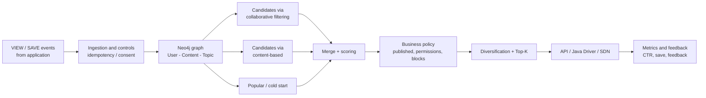
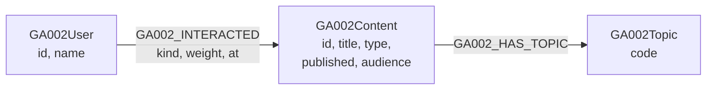
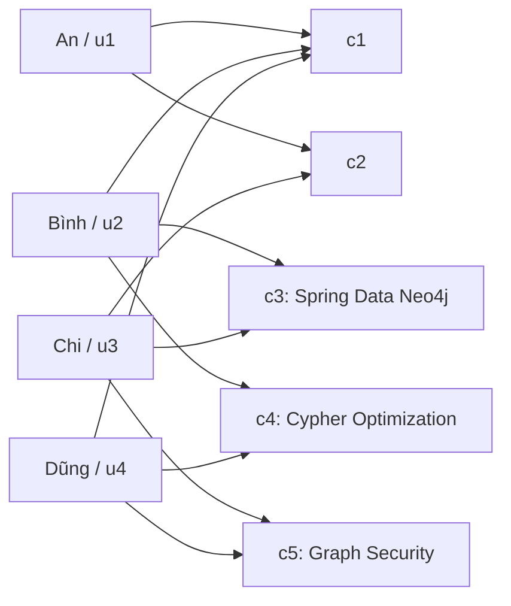

# Recommending Products or Content Based on Relationships and Behavior

## 1. The Problem: From Relationships to a Useful Recommendation List

A learning platform has thousands of articles, courses, and Neo4j guides. Users have viewed some content, saved some articles, and followed favorite topics. When opening the home page, the system needs to answer: **"What content is this user likely to be interested in next?"**

In Neo4j, this problem fits a **property graph** well: nodes represent users, content, and topics; relationships represent behavior and semantic links. Cypher lets us traverse relationship paths such as:

```text
(Current user)-[:INTERACTED]->(Viewed content)
              <-[:INTERACTED]-(Similar users)
              -[:INTERACTED]->(Unseen content)
```

or:

```text
(User)-[:INTERACTED]->(Liked content)
      -[:HAS_TOPIC]->(Topic)
      <-[:HAS_TOPIC]-(Related content)
```

These two traversal paths generate two different groups of **recommendation candidates**. Next, the system must filter invalid items, compute scores, rank, explain, and return results quickly to the application via the **Neo4j Java Driver** or **Spring Data Neo4j**.

This lesson belongs to the **Graph Applications** chapter of the `DATABASE_ENGINE_GRAPH_NEO4J` module: using Neo4j to model connected data as a property graph, querying nodes/relationships/paths with Cypher, and applying indexes, constraints, query tuning, and Java integration.

**Learning objectives:**

1. Design a `User–Content–Topic` graph and model weighted user behavior.
2. Generate **collaborative filtering** recommendations based on users with shared interactions.
3. Generate **content-based** recommendations from topics linked to content the user has engaged with.
4. Merge candidate sources, normalize scores, and filter out already-seen or unauthorized content.
5. Handle **cold start**, recency, popularity bias, diversification, and recommendation explanations.
6. Implement parameterized queries with the Java Driver; understand when to choose `Neo4jClient`.
7. Use `EXPLAIN`/`PROFILE`, indexes, traversal width bounds, and offline/A/B evaluation.

## 2. Recommended Architecture: Candidate Generation → Ranking → Policy Filtering



| Step | Input | Output | Risks to Control |
|---|---|---|---|
| **Record behavior** | User, content, event, timestamp | Relationship or source event | Duplicate events, data without consent |
| **Candidate generation** | Paths in the graph | Uninteracted content set | Fan-out, high-degree users/content |
| **Scoring** | Overlap, behavior weight, topics | Score per candidate | Different score scales, behavior bias |
| **Policy filtering** | Published, access rights, tenant, stock | Valid candidate set | Leaking internal/cross-tenant content |
| **Ranking and diversity** | Score + UX constraints | Final Top-K | Repetitive recommendations, one topic dominating |
| **Measurement** | Impression/click/save/conversion | Offline and online metrics | Feedback loops, leakage, optimizing clicks only |

Graph paths are only a **signal source**. Neo4j does not inherently possess an algorithm that "automatically understands users"; quality depends on data, behavior definitions, objectives, and testing.

## 3. Data Model: Nodes and Relationships

We build a small model that is easy to verify with Cypher. Label names carry the `GA002` prefix to avoid colliding with production business data.



### 3.1. Node Semantics

| Node | Properties | Role |
|---|---|---|
| `GA002User` | `id`, `name` | Identifies the subject; do not use name as the key |
| `GA002Content` | `id`, `title`, `type`, `published`, `audience` | An article, course, or recommendable product |
| `GA002Topic` | `code` | Shared topic, e.g., `neo4j`, `java` |

### 3.2. Relationship Semantics

| Type | Direction | Properties | Meaning |
|---|---|---|---|
| `GA002_INTERACTED` | `User → Content` | `kind`, `weight`, `at` | Signal that the user interacted |
| `GA002_HAS_TOPIC` | `Content → Topic` | Not needed in lab | Content is tagged with a topic |

In this lab, **each user–content pair has only one `GA002_INTERACTED` edge**, representing the most recent aggregated/prioritized behavior stored. This keeps calculations simple, but is **not** suitable for storing every historical view, click, or purchase event.

In production, you typically separate:

- **Immutable event log** in an event system/warehouse: each view/click/purchase has `eventId`, `occurredAt`, `userId`, and a data retention policy.
- **Aggregated interaction edge** in Neo4j: `weight`, `lastAt`, `count`, or features for fast reads.
- Deduplication mechanisms using `eventId`, batching/checkpointing, and rules for late-arriving events.

Do not create a duplicate relationship for every click if ranking queries assume only one edge per user–content pair; if multiple edges are desired, explicitly aggregate them before scoring.

### 3.3. Product vs. Content Recommendations

For e-commerce, replace `GA002Content` with `Product` and keep the `User–Product–Category/Brand` idea. However, **eligibility conditions** for products may include inventory, price, sales region, lock status, legal rules, and shipping availability. High similarity scores **never** justify skipping unsellable-product filtering. In this lesson, we illustrate with content having `published` and `audience`.

## 4. Creating an Idempotent Fixture

**Run write statements only on a practice database.** The sample dataset is small enough to verify results by hand; its size does not represent the scale or accuracy of a real recommender system.

### 4.1. Create Constraints on Business Keys

```cypher
CREATE CONSTRAINT ga002_user_id IF NOT EXISTS
FOR (u:GA002User)
REQUIRE u.id IS UNIQUE;
```

```cypher
CREATE CONSTRAINT ga002_content_id IF NOT EXISTS
FOR (c:GA002Content)
REQUIRE c.id IS UNIQUE;
```

```cypher
CREATE CONSTRAINT ga002_topic_code IF NOT EXISTS
FOR (t:GA002Topic)
REQUIRE t.code IS UNIQUE;
```

Constraints allow `MATCH (me:GA002User {id: $userId})` to anchor at a specific node and make `MERGE` by ID easier to control. Do not blindly create indexes for every property; choose based on workload and inspect query plans.

### 4.2. Create Six Users

```cypher
UNWIND [
  {id: 'u1', name: 'An'},
  {id: 'u2', name: 'Bình'},
  {id: 'u3', name: 'Chi'},
  {id: 'u4', name: 'Dũng'},
  {id: 'u5', name: 'Hà'},
  {id: 'u6', name: 'New user'}
] AS row
MERGE (u:GA002User {id: row.id})
SET u.name = row.name;
```

`u6` **has no interactions yet** to illustrate cold start.

### 4.3. Create Seven Content Items

```cypher
UNWIND [
  {id: 'c1', title: 'Neo4j Fundamentals',
   type: 'ARTICLE', published: true, audience: 'PUBLIC'},
  {id: 'c2', title: 'Java Driver',
   type: 'COURSE', published: true, audience: 'PUBLIC'},
  {id: 'c3', title: 'Spring Data Neo4j',
   type: 'ARTICLE', published: true, audience: 'PUBLIC'},
  {id: 'c4', title: 'Cypher Optimization',
   type: 'COURSE', published: true, audience: 'PUBLIC'},
  {id: 'c5', title: 'Graph Security',
   type: 'ARTICLE', published: true, audience: 'PUBLIC'},
  {id: 'c6', title: 'Data Foundations',
   type: 'ARTICLE', published: true, audience: 'PUBLIC'},
  {id: 'c7', title: 'Internal Draft',
   type: 'ARTICLE', published: false, audience: 'INTERNAL'}
] AS row
MERGE (c:GA002Content {id: row.id})
SET c.title = row.title,
    c.type = row.type,
    c.published = row.published,
    c.audience = row.audience;
```

`c7` is intentionally **unpublished**. Another user has interacted with `c7`, yet the algorithm must never recommend it to public users.

### 4.4. Topics and Tagging Relationships

```cypher
UNWIND [
  'neo4j', 'beginner', 'java', 'spring',
  'performance', 'security', 'data'
] AS code
MERGE (:GA002Topic {code: code});
```

```cypher
UNWIND [
  {content: 'c1', topic: 'neo4j'},
  {content: 'c1', topic: 'beginner'},
  {content: 'c2', topic: 'neo4j'},
  {content: 'c2', topic: 'java'},
  {content: 'c3', topic: 'java'},
  {content: 'c3', topic: 'spring'},
  {content: 'c4', topic: 'neo4j'},
  {content: 'c4', topic: 'performance'},
  {content: 'c5', topic: 'neo4j'},
  {content: 'c5', topic: 'security'},
  {content: 'c6', topic: 'beginner'},
  {content: 'c6', topic: 'data'},
  {content: 'c7', topic: 'neo4j'},
  {content: 'c7', topic: 'security'}
] AS row
MATCH (c:GA002Content {id: row.content})
MATCH (t:GA002Topic {code: row.topic})
MERGE (c)-[:GA002_HAS_TOPIC]->(t);
```

### 4.5. Behaviors and Simple Weights

To allow hand-calculation in exercises:

| kind | weight | Lab Interpretation |
|---|---:|---|
| `VIEW` | 1 | Viewed; weak signal |
| `SAVE` | 3 | Saved; stronger positive signal |

**Weights 1 and 3 are design assumptions**, not empirically tuned coefficients. In a real product, a 1-second glance view may not reflect interest; a SAVE may be stronger, but still depends on context, display position, and recency.

```cypher
UNWIND [
  {user: 'u1', content: 'c1', kind: 'VIEW', weight: 1},
  {user: 'u1', content: 'c2', kind: 'SAVE', weight: 3},
  {user: 'u2', content: 'c1', kind: 'VIEW', weight: 1},
  {user: 'u2', content: 'c3', kind: 'SAVE', weight: 3},
  {user: 'u2', content: 'c4', kind: 'VIEW', weight: 1},
  {user: 'u2', content: 'c7', kind: 'VIEW', weight: 1},
  {user: 'u3', content: 'c2', kind: 'SAVE', weight: 3},
  {user: 'u3', content: 'c3', kind: 'SAVE', weight: 3},
  {user: 'u3', content: 'c5', kind: 'VIEW', weight: 1},
  {user: 'u4', content: 'c1', kind: 'SAVE', weight: 3},
  {user: 'u4', content: 'c4', kind: 'SAVE', weight: 3},
  {user: 'u4', content: 'c5', kind: 'VIEW', weight: 1},
  {user: 'u5', content: 'c6', kind: 'SAVE', weight: 3}
] AS row
MATCH (u:GA002User {id: row.user})
MATCH (c:GA002Content {id: row.content})
MERGE (u)-[r:GA002_INTERACTED]->(c)
SET r.kind = row.kind,
    r.weight = row.weight,
    r.at = datetime('2026-11-10T10:00:00Z');
```

The fixture contains **13 interaction relationships**, with a fixed timestamp for repeatability. If you need exact timestamps per event, the application must pass `occurredAt` and enforce rules against late events; **do not** use the example's timestamp as "today's date" in real deployments.

### 4.6. Verifying Fixture Counts and Accuracy

```cypher
MATCH (u:GA002User)
WITH count(u) AS users
MATCH (c:GA002Content)
WITH users, count(c) AS contents
MATCH (t:GA002Topic)
WITH users, contents, count(t) AS topics
MATCH (:GA002User)-[r:GA002_INTERACTED]->
      (:GA002Content)
WITH users, contents, topics, count(r) AS interactions
MATCH (:GA002Content)-[h:GA002_HAS_TOPIC]->
      (:GA002Topic)
RETURN users, contents, topics,
       interactions, count(h) AS topicLinks;
```

Expected counts in a practice database containing only `GA002`-prefixed data:

| users | contents | topics | interactions | topicLinks |
|---:|---:|---:|---:|---:|
| 6 | 7 | 7 | 13 | 14 |

Inspect An's interactions specifically:

```cypher
MATCH (u:GA002User {id: 'u1'})
      -[r:GA002_INTERACTED]->(c:GA002Content)
RETURN c.id AS contentId, c.title AS title,
       r.kind AS action, r.weight AS weight
ORDER BY contentId;
```

Expect `c1 / VIEW / 1` and `c2 / SAVE / 3`. All subsequent personalized recommendations for `u1` must exclude these two items from the results.

## 5. Collaborative Filtering: What Else Do Users with Similar Behavior Like?

This is **user-based collaborative filtering** via graph paths: a user is considered "similar" when they interact with one or more content items that the current user also interacted with.



### 5.1. Building a Simple, Explainable Score

Let:

\[
\operatorname{overlap}(u,v)
= |\{i \mid u\text{ and }v\text{ both interacted with }i\}|
\]

\[
\operatorname{CF}(u,c)
= \sum_{\substack{v\ne u\\v\text{ interacted with }c}}
\operatorname{overlap}(u,v)\cdot w(v,c)
\]

Where `w(v,c)` is the interaction weight of similar user `v` on candidate `c`. This formula does not yet factor in recency, item rarity, or confidence levels. Its purpose is to understand and verify graph paths, not to serve as an optimal formula for every system.

### 5.2. Cypher for Generating Collaborative Candidates

```cypher
MATCH (me:GA002User {id: $userId})
      -[:GA002_INTERACTED]->(seed:GA002Content)
      <-[:GA002_INTERACTED]-(peer:GA002User)
WHERE peer <> me
  AND seed.published = true
  AND seed.audience = 'PUBLIC'
WITH me, peer, count(DISTINCT seed) AS overlap
ORDER BY overlap DESC, peer.id
LIMIT $maxPeers
MATCH (peer)-[r:GA002_INTERACTED]->
      (candidate:GA002Content)
WHERE candidate.published = true
  AND candidate.audience = 'PUBLIC'
  AND NOT EXISTS {
    MATCH (me)-[:GA002_INTERACTED]->(candidate)
  }
RETURN candidate.id AS id,
       candidate.title AS title,
       sum(overlap * coalesce(r.weight, 1))
           AS collaborativeScore,
       count(DISTINCT peer) AS supportingPeers
ORDER BY collaborativeScore DESC, id ASC
LIMIT $limit;
```

**Practice parameters:** `$userId = 'u1'`, `$maxPeers = 100`, `$limit = 20`. With the current fixture, three peers share at least one item with An: `u2`, `u3`, and `u4`. Each peer has `overlap = 1`.

Result:

| id | title | collaborativeScore | supportingPeers |
|---|---|---:|---:|
| `c3` | Spring Data Neo4j | 6 | 2 |
| `c4` | Cypher Optimization | 4 | 2 |
| `c5` | Graph Security | 2 | 2 |

Hand calculation:

- `c3`: `u2` SAVE (3) + `u3` SAVE (3) = **6**.
- `c4`: `u2` VIEW (1) + `u4` SAVE (3) = **4**.
- `c5`: `u3` VIEW (1) + `u4` VIEW (1) = **2**.

`c7` is not returned, even though `u2` viewed it, because `published=false` and `audience='INTERNAL'`. `c1` and `c2` are also excluded because An already interacted with them. `c6` has no supporting similar peer so it is not in the collaborative source.

### 5.3. What Does Each Part of the Cypher Do?

1. `MATCH (me {id: $userId})` anchors the query at a uniquely keyed user.
2. The path `me → seed ← peer` finds users with shared content.
3. `count(DISTINCT seed)` counts **distinct** content items so scores are not inflated if the graph contains duplicate relationships.
4. `ORDER BY ... LIMIT $maxPeers` bounds the number of peers expanded. On large datasets, this is a **business budget**, changing results when not all peers are included.
5. `MATCH peer → candidate` retrieves content interacted with by similar users.
6. `NOT EXISTS { ... }` excludes candidates already viewed/saved by the current user.
7. `sum(overlap * weight)` computes the score; `count(DISTINCT peer)` provides a support/explanation metric.
8. `ORDER BY score DESC, id` ensures deterministic ordering on ties.

**Cardinality note:** the path `user → item ← peer → candidate` can fan out massively if an item is very popular (millions of users) or a peer interacts with huge numbers of items. A trailing `LIMIT` **does not stop** the engine from generating many intermediate rows before `sum`. Under heavy load, bound or precompute candidates early, pick reliable seeds, cluster, or run offline batches.

### 5.4. Limitations of User-Based CF

- **Popularity bias:** popular items have many connections and easily crowd out lesser-known items.
- **Sparsity:** new users or users with only one view struggle to find similar peers.
- **Spam sensitivity:** bot accounts generate fake interactions to boost scores.
- **Unequal preference strength:** a brief view may not carry the same intent as a SAVE.
- **Privacy:** never expose other users' identities simply because their interests overlap.

For public explanations, replace `"Bình and Chi viewed..."` with an aggregated reason like `"Popular among people with similar interests"` when privacy policies permit. For very small peer groups, **hide the count too** to prevent reverse-engineering an individual's behavior.

## 6. Content-Based Filtering: Topics of Interest Lead to New Content

When a user has few similar peers, the topic graph can still produce candidates: from content the user interacted with, find its topics and then find other content sharing those topics.

### 6.1. Shared-Topic Scoring Formula

```text
ContentScore(u, c)
  = sum of interaction weights of u
    across (seed, topic) pairs where topic is also tagged on c.
```

In the fixture, each content item has only one relationship per topic. If source data has duplicate tags or events, normalize/deduplicate by the **exact business unit** before scoring.

### 6.2. Cypher to Retrieve Topic-Based Candidates

```cypher
MATCH (me:GA002User {id: $userId})
      -[action:GA002_INTERACTED]->
      (seed:GA002Content)-[:GA002_HAS_TOPIC]->
      (topic:GA002Topic)<-[:GA002_HAS_TOPIC]-
      (candidate:GA002Content)
WHERE seed.published = true
  AND seed.audience = 'PUBLIC'
  AND candidate.published = true
  AND candidate.audience = 'PUBLIC'
  AND NOT EXISTS {
    MATCH (me)-[:GA002_INTERACTED]->(candidate)
  }
RETURN candidate.id AS id,
       candidate.title AS title,
       sum(coalesce(action.weight, 1))
           AS contentScore,
       collect(DISTINCT topic.code) AS sharedTopics
ORDER BY contentScore DESC, id ASC
LIMIT $limit;
```

**Parameters:** `$userId = 'u1'`, `$limit = 20`.

| id | title | contentScore | Topics Leading to Recommendation |
|---|---|---:|---|
| `c4` | Cypher Optimization | 4 | `neo4j` |
| `c5` | Graph Security | 4 | `neo4j` |
| `c3` | Spring Data Neo4j | 3 | `java` |
| `c6` | Data Foundations | 1 | `beginner` |

Because `u1` VIEWed `c1` (weight 1) and SAVEd `c2` (weight 3):

- `c4` and `c5` share `neo4j` with **both `c1` and `c2`**, so their score is 1 + 3 = **4**.
- `c3` shares `java` with `c2`, so its score is **3**.
- `c6` shares `beginner` with `c1`, so its score is **1**.

The `sharedTopics` list is collected via `collect(DISTINCT ...)`; **element order inside the list is not guaranteed** unless explicitly sorted. `c7` is again excluded due to unpublished/internal status.

### 6.3. When Is Content-Based More Useful Than CF?

It works for a new user with **just a few initial signals**, such as a learner who only saved one Java article and has no significant overlapping peers yet. It can also recommend newly published content with zero views as long as topics are tagged.

However, if topic metadata is missing or overly generic, recommendations can become irrelevant. Content with too many tags can also accumulate points repeatedly compared to carefully tagged items. You can apply **topic weights**, TF–IDF for tags, or embeddings/vector search when data volume and evaluation quality justify it; do not default to more complex algorithms unnecessarily.

## 7. Hybrid Recommendations: Combining CF, Content, and Business Constraints

The two candidate sets above have **different score scales**. Do not simply add `collaborativeScore + contentScore` and assume you have a balanced model. A simple educational approach is **max-normalization within each candidate set**, followed by a weighted combination.

\[
\operatorname{CFNorm}(c) =
\begin{cases}
\operatorname{CF}(c)/\max_{x}\operatorname{CF}(x), & \max\operatorname{CF}>0\\
0, & \text{if no positive CF score exists}
\end{cases}
\]

\[
\operatorname{ContentNorm}(c) =
\begin{cases}
\operatorname{Content}(c)/\max_{x}\operatorname{Content}(x), & \max\operatorname{Content}>0\\
0, & \text{if no positive content score exists}
\end{cases}
\]

\[
\operatorname{Hybrid}(c)
= 0.7\,\operatorname{CFNorm}(c)
+ 0.3\,\operatorname{ContentNorm}(c).
\]

**0.7 / 0.3 are illustrative weights** that must be tuned using real evaluation data. Normalizing by the current set's maximum **does not guarantee scores are comparable across different users or timestamps**; in production, consider distribution-based calibration and offline/online evaluation.

### 7.1. Testing the Calculation on the Fixture

The maximum CF score is `6` and the maximum content score is `4`. For `u1`:

| Candidate | CF | Content | Approx. Hybrid |
|---|---:|---:|---:|
| `c3` | 6 | 3 | `0.925` |
| `c4` | 4 | 4 | `0.767` |
| `c5` | 2 | 4 | `0.533` |
| `c6` | 0 | 1 | `0.075` |

Expected final ranking: **c3 → c4 → c5 → c6**. If the API takes Top-3, the result is `c3`, `c4`, `c5`. Already-viewed `c1/c2` and unpublished `c7` never enter the merged table regardless of what score any algorithm assigns.

### 7.2. Java 17+ Code to Merge Both Candidate Sets

The two Cypher queries in Sections 5 and 6 should return candidate IDs and aggregated scores; in Java, you can perform a clean merge:

```java
import java.util.ArrayList;
import java.util.Comparator;
import java.util.HashMap;
import java.util.HashSet;
import java.util.List;
import java.util.Map;
import java.util.Set;

public final class HybridRanker {
    public record SourceScore(String id, double score) {}
    public record HybridScore(String id, double score) {}

    public static List<HybridScore> merge(
            List<SourceScore> collaborative,
            List<SourceScore> contentBased,
            int limit) {
        if (limit < 1) {
            throw new IllegalArgumentException("limit must be positive");
        }

        Map<String, Double> cf = new HashMap<>();
        Map<String, Double> content = new HashMap<>();
        collaborative.forEach(s ->
            cf.merge(s.id(), s.score(), Double::sum));
        contentBased.forEach(s ->
            content.merge(s.id(), s.score(), Double::sum));

        double cfMax = cf.values().stream()
            .mapToDouble(Double::doubleValue).max().orElse(0.0);
        double contentMax = content.values().stream()
            .mapToDouble(Double::doubleValue).max().orElse(0.0);

        Set<String> ids = new HashSet<>(cf.keySet());
        ids.addAll(content.keySet());

        List<HybridScore> output = new ArrayList<>();
        for (String id : ids) {
            double a = cfMax > 0
                ? cf.getOrDefault(id, 0.0) / cfMax : 0.0;
            double b = contentMax > 0
                ? content.getOrDefault(id, 0.0) / contentMax : 0.0;
            output.add(new HybridScore(id, 0.7 * a + 0.3 * b));
        }

        return output.stream()
            .sorted(Comparator
                .comparingDouble(HybridScore::score).reversed()
                .thenComparing(HybridScore::id))
            .limit(limit)
            .toList();
    }
}
```

This code receives lists already filtered for eligibility in Neo4j. In a real application, **do not rely solely on earlier query-level filtering**: after merging, re-check policy on the final list in case permissions, publish status, or inventory changed mid-flight. Using `merge` to sum duplicate IDs within each source is a basic safeguard; define explicit semantics if a source ever emits multiple score records for the same ID.

**Candidate budget matters:** if you take only `LIMIT 3` from each source before merging, `c6` could be dropped from the content source prior to ranking. For the fixture benchmark, use `$limit=20` per source and `Top-3` at the end; production systems should size intermediate candidate budgets based on accuracy and resource limits.

## 8. New Users and New Content: Handling Cold Start

### 8.1. No Behavior Yet: Controlled Popularity Fallback

`u6` has no `GA002_INTERACTED` edges. Both CF and content-based queries return **0 candidates**; that is not a Neo4j error. A fallback can use total interaction scores of published content:

```cypher
MATCH (viewer:GA002User {id: $userId})
MATCH (c:GA002Content)
WHERE c.published = true
  AND c.audience = 'PUBLIC'
  AND NOT EXISTS {
    MATCH (viewer)-[:GA002_INTERACTED]->(c)
  }
OPTIONAL MATCH (other:GA002User)
      -[r:GA002_INTERACTED]->(c)
RETURN c.id AS id,
       c.title AS title,
       coalesce(sum(r.weight), 0) AS popularity,
       count(DISTINCT other) AS uniqueUsers
ORDER BY popularity DESC, id ASC
LIMIT $limit;
```

**Parameters:** `$userId = 'u6'`, `$limit = 20`.

| id | popularity |
|---|---:|
| `c2` | 6 |
| `c3` | 6 |
| `c1` | 5 |
| `c4` | 4 |
| `c6` | 3 |
| `c5` | 2 |

`c7` is excluded. If a user has partial history that yields no candidates after filtering, **this query can still serve as a fallback**; the `NOT EXISTS` clause continues excluding items they already interacted with.

**What to change at scale:** computing popularity by scanning every candidate and event on the fly can be expensive. Instead, **precompute Top-N popular lists** by time window, language/tenant, and content type, store them in a table/cache with TTL, and verify access permissions before returning.

### 8.2. New Content Without Views Yet

A new item tagged `neo4j` will not appear in CF (nobody has interacted with it yet), though it still has a chance via content-based filtering. To prevent it from being buried beneath thousands of popular items:

- Reserve a small share of slots for bounded **exploration**.
- Combine freshness/quality signals with a time window rather than treating publication time alone as quality.
- Select content by language, followed topics, or editorial picks.
- Distinguish **approved new content** from drafts: `published=false` **must never** enter exploration.

### 8.3. Missing User Profile

If `userId` does not exist or the caller is unauthenticated, do not silently fall back to "new user recommendations" and treat them as a valid user. The service must explicitly define whether **unauthenticated guests** may view a public list, keep that list identity-independent, and never accept a client-supplied user ID to peek at someone else's behavior.

## 9. Choosing Behavior Signals: Avoid Treating Every Click as Interest

| Behavior | Potential Signal | Risk |
|---|---|---|
| `VIEW` | User opened the content | May be an accidental click or very short dwell time |
| `SAVE` / bookmark | Clearer interest | Might be saved for later and never read |
| `COMPLETE` | Finished article/course | Does not necessarily mean wanting the exact same content again |
| `PURCHASE` | Transaction completed | Could be a gift; avoid irrelevant repeat recommendations |
| `DISLIKE` / Hide | Explicit negative signal | Must be used as an exclusion condition |
| `FOLLOW_TOPIC` | Explicitly declared interest | Can become stale or change over time |
| `IMPRESSION` | Content was displayed | Not a positive interaction; needed to measure bias |

Real systems often apply multi-level weights and **time decay**. For example, with elapsed time measured in days:

\[
w_{\mathrm{effective}}(a,\Delta t)
= w_{\mathrm{base}}(a)\cdot
\exp(-\lambda\max(0,\Delta t))
\]

With `lambda = 0.05/day` and a SAVE from 20 days ago, the effective score is approximately `3 × e^{-1} ≈ 1.104`, lower than a fresh SAVE. This only illustrates the **decay rule**, not a pre-calibrated production parameter.

**Timestamps must be normalized** (UTC, event-time vs. ingest-time), handling late events, future timestamps, and non-consented data. Do not allow automated/bot traffic to skew top recommendations.

### 9.1. Event Nodes When Detailed History Is Needed

If you need to distinguish a user viewing the same item 10 times, a single aggregated edge may not suffice. You can use an external event log or a graph pattern:

```text
(User)-[:GA002_DID]->(InteractionEvent {eventId, kind, occurredAt})
          -[:GA002_TARGETS]->(Content)
```

In that case, recommendation queries should read **precomputed aggregate features** rather than expanding every raw event in real time. Enforce uniqueness on `eventId`, TTL/retention, and data-deletion compliance workflows.

## 10. Policy Filtering, Privacy, and Explainability

A recommendation score **can never override access permissions**. For instance, an internal course sharing topics with public courses must never be returned to external accounts.

### 10.1. Filtering Layers to Include

1. **Published/approval:** only content with `published = true`, moderated, and in a valid serving state.
2. **Audience/tenant:** only resources matching the user's tenant and `PUBLIC`/`TEAM`/`PRIVATE` scope.
3. **Block/hide:** exclude content the user hid or tagged with topics they blocked.
4. **Already consumed:** depending on product rules, hide purchased/completed items, while potentially retaining review material.
5. **Compliance:** regional sales restrictions, age gates, classifications, and legal requirements (especially for product recommendations).
6. **Availability:** in stock, open enrollment, valid non-deleted link, or eligible subscription tier.

A condition excluding blocked topics (assuming the system models that edge) can be written:

```cypher
MATCH (me:GA002User {id: $userId})
MATCH (candidate:GA002Content {id: $contentId})
WHERE candidate.published = true
  AND candidate.audience = 'PUBLIC'
  AND NOT EXISTS {
    MATCH (me)-[:GA002_BLOCKED_TOPIC]->
          (:GA002Topic)<-[:GA002_HAS_TOPIC]-(candidate)
  }
RETURN candidate.id AS allowedId;
```

This example uses the `GA002_BLOCKED_TOPIC` relationship type, which was **not created in the fixture**; it illustrates how to add policy filtering when an application supports that feature. If a candidate has both an allowed topic and a blocked topic, the pattern above **excludes the entire candidate**. That is a policy choice, not a universal product rule.

**Do not rely on `WHERE candidate.tenantId = $tenantId` as the sole barrier against unauthorized access** in systems needing strict isolation: you also need principal authentication, authorization, RBAC, or separate databases per threat model. User ID/tenant ID must come from a trusted auth context, not only from the request body.

### 10.2. Useful Explanations Without Leaking Personal Behavior

You can display reasons such as:

- `"Related to the Java topic you saved"` — grounded in the **user's own** interests.
- `"Matches your previous Neo4j lessons"` — topic-based reasoning.
- `"Popular with learners who have similar interests"` — only when privacy thresholds are met.

Do not expose peer names or their reading history without proper permissions and purpose. Having `supportingPeers=2` in the fixture aids **technical verification**, not a license to display the number 2 in production UI.

## 11. Diversifying Lists to Avoid Recommending the Same Thing

If sorted strictly by score, the Top-10 might all be `neo4j` articles even though the user also studies `java` and `data`. You can diversify **after policy filtering** with a simple algorithm.

Example UI rule for `Top-3`:

1. Pick the highest-scoring eligible candidate.
2. For remaining slots, cap at **two items sharing the same primary topic** when enough alternatives exist.
3. Keep deterministic tie-breaking by ID; log `reasonCodes` for verification.

A common technique is **Maximal Marginal Relevance (MMR)**:

\[
\operatorname{MMR}(c)
= \alpha\,\operatorname{relevance}(c)
- (1-\alpha)\max_{s\in S}\operatorname{similarity}(c,s)
\]

Where `S` is the set of already-selected items, and `similarity` can be based on topic-set Jaccard similarity or embeddings. `alpha` balances relevance against diversity. **MMR is not a built-in Cypher function**: compute it in Java over a small retrieved candidate pool, or use a dedicated scoring mechanism.

Do not over-diversify to the point of dropping highly relevant items just "for diversity"; monitor coverage, satisfaction, completion, and business goals.

## 12. Calling Recommendation Queries from the Java Driver

For a read API, pass `userId`, `maxPeers`, and `limit` as **Cypher parameters**, never string concatenation from requests. Java Driver 6.x example (blocking API):

```java
import java.util.List;
import java.util.Map;
import org.neo4j.driver.AccessMode;
import org.neo4j.driver.Driver;
import org.neo4j.driver.SessionConfig;
import org.neo4j.driver.Record;

public final class GraphRecommendationReader {
    public record Candidate(
        String id, String title,
        long score, long supportingPeers
    ) {}

    private static final String CYPHER = """
        MATCH (me:GA002User {id: $userId})
              -[:GA002_INTERACTED]->(seed:GA002Content)
              <-[:GA002_INTERACTED]-(peer:GA002User)
        WHERE peer <> me
          AND seed.published = true
          AND seed.audience = 'PUBLIC'
        WITH me, peer, count(DISTINCT seed) AS overlap
        ORDER BY overlap DESC, peer.id
        LIMIT $maxPeers
        MATCH (peer)-[r:GA002_INTERACTED]->
              (candidate:GA002Content)
        WHERE candidate.published = true
          AND candidate.audience = 'PUBLIC'
          AND NOT EXISTS {
            MATCH (me)-[:GA002_INTERACTED]->(candidate)
          }
        RETURN candidate.id AS id,
               candidate.title AS title,
               sum(overlap * coalesce(r.weight, 1)) AS score,
               count(DISTINCT peer) AS supportingPeers
        ORDER BY score DESC, id ASC
        LIMIT $limit
        """;

    private final Driver driver;

    public GraphRecommendationReader(Driver driver) {
        this.driver = driver;
    }

    public List<Candidate> recommend(
            String authenticatedUserId, int limit) {
        if (authenticatedUserId == null
                || authenticatedUserId.isBlank()
                || limit < 1 || limit > 50) {
            throw new IllegalArgumentException("Invalid request");
        }

        var config = SessionConfig.builder()
            .withDatabase("neo4j")
            .withDefaultAccessMode(AccessMode.READ)
            .build();

        try (var session = driver.session(config)) {
            return session.executeRead(tx ->
                tx.run(CYPHER, Map.of(
                    "userId", authenticatedUserId,
                    "maxPeers", 100,
                    "limit", limit
                )).list(row -> new Candidate(
                    row.get("id").asString(),
                    row.get("title").asString(),
                    row.get("score").asLong(),
                    row.get("supportingPeers").asLong()
                ))
            );
        }
    }
}
```

**Key points:**

- `authenticatedUserId` must come from an authenticated context, **not** an arbitrary parameter allowing someone to view another user's profile.
- `Driver` should be initialized **once** per application and reused; `Session` is opened/closed per operation.
- `executeRead(...)` manages the transaction and retries transient errors; keep no external side effects inside the callback.
- `list(mapper)` materializes results into `List<Candidate>`, appropriate here given `LIMIT 50`. Never return a `Result` outside a closed session.
- `AccessMode.READ` is a routing hint; **it does not replace** RBAC or authorization.
- This snippet illustrates the **CF source** only, without hybrid merging, fallback, or advanced business-policy checks.

If the API has a tight SLO, configure timeouts/tracing properly and measure connection acquisition, query execution, and mapping times. Never assume a query finishes under 100 ms merely because it has a `LIMIT`.

### 12.1. Spring Data Neo4j: Entity Graph or DTO?

With Spring Data Neo4j, `Neo4jRepository` fits entity CRUD; however, a recommendation query returning `id, title, score` **is not a complete entity graph**. Usually, you should use `Neo4jClient` or a verified custom `@Query` projection:

```java
import java.util.Collection;
import java.util.Map;
import org.springframework.data.neo4j.core.Neo4jClient;

record ContentCard(String id, String title) {}

Collection<ContentCard> cards = neo4jClient.query("""
        MATCH (c:GA002Content)
        WHERE c.published = true AND c.audience = 'PUBLIC'
        RETURN c.id AS id, c.title AS title
        ORDER BY id
        LIMIT $limit
        """)
    .bind(10).to("limit")
    .fetchAs(ContentCard.class)
    .mappedBy((typeSystem, row) ->
        new ContentCard(
            row.get("id").asString(),
            row.get("title").asString()
        ))
    .all();
```

`neo4jClient` is a Spring-injected `Neo4jClient` instance. This snippet illustrates DTO mapping for a read query; for user recommendations, substitute the Cypher from Section 5 or 6 and bind the additional parameters. **Avoid mapping a partial graph slice into an entity and calling `save()`**, because missing relationships can cause unintended deletions or mutations.

## 13. Optimizing Cypher and Architecture at Large Graph Scale

Recommendation traversals can become CPU/RAM bottlenecks if an item is viewed by millions of users or a user has tens of thousands of interactions. Control strategies:

### 13.1. Start from Selective Nodes and Use Indexes Appropriately

```cypher
EXPLAIN
MATCH (me:GA002User {id: 'u1'})
      -[:GA002_INTERACTED]->(seed:GA002Content)
RETURN seed.id AS id
ORDER BY id;
```

With the `ga002_user_id` constraint, the planner can usually begin with an **index seek by ID**. `EXPLAIN` only shows the planned execution; `PROFILE` **runs** the query and prints `Rows`, `DB Hits`, and version-specific metrics. Measure on representative data, never extrapolating performance from a 7-item fixture.

### 13.2. Controlling Relationship Explosion

| Signal | Risk | Technique |
|---|---|---|
| Very popular content | Seeds drag in too many peers | Exclude or down-weight ultra-popular seeds; cap/sample peers |
| Long user history | Many seeds create duplicate paths | Pick top recent seeds, drop weak views, precompute weights |
| Many duplicate candidates | Heavy aggregation, memory-hungry `DISTINCT` | Aggregate by ID at the right stage; materialize features offline |
| Multiple relationship types | Row multiplication when joining optional branches | Split into independent source queries and merge in the ranking layer |
| Late filtering | Query expands millions of rows before discarding | Push publish/authorization filters as early as possible |
| Sorting all results | Trailing `ORDER BY` and `LIMIT` do not curb upfront cost | Prune candidates before ranking, cache, precompute Top-N |

A purely online query may work fine at tens of thousands of nodes, but will not automatically scale to hundreds of millions of interactions. Compare:

1. **Online Cypher for instant candidates**: reflects live graph state and is easy to explain, but traversal can be expensive.
2. **Batch/near-real-time precomputation**: computes top user-neighbors, item-item pairs, or popularity into feature stores/caches; faster on the read path at the cost of staleness lag.
3. **Hybrid**: precomputed sources supply shortlists, while Neo4j fetches fresh relationships/properties and applies live policy before returning.

### 13.3. Item–Item Recommendations and Graph Data Science

Instead of finding peers on every request, you can precompute proximity between two items via **co-interacting users** or shared topics:

```cypher
MATCH (a:GA002Content {id: $contentId})
      <-[:GA002_INTERACTED]-(u:GA002User)
      -[:GA002_INTERACTED]->(b:GA002Content)
WHERE b <> a
  AND b.published = true
  AND b.audience = 'PUBLIC'
RETURN b.id AS id,
       count(DISTINCT u) AS coUsers
ORDER BY coUsers DESC, id
LIMIT $limit;
```

This powers `"Users who viewed A also viewed B"`; you still need to exclude already-viewed items, drafts, and huge fan-out. Neo4j **Graph Data Science (GDS)** offers algorithms such as Node Similarity, embeddings, and link prediction depending on edition/license/plugin, though it is **not** always preinstalled. GDS shines for bulk feature generation or graph projection evaluation, and is not required to understand the core Cypher patterns here.

### 13.4. Caching and Freshness

Candidates can be cached per user or interest cohort with `asOf` and TTL. However:

- After a user completes/saves an item, a stale cache might still recommend it.
- When content switches to `published=false`, **policy filtering must reflect the latest state** before returning.
- If users have tenant/group-specific permissions, the cache key must include authorization context, not just `userId`.
- In a Neo4j cluster, use causal bookmarks when reads depend on prior writes; **bookmarks do not make Redis/HTTP caches catch up automatically**.

## 14. Evaluating Algorithms: Offline First, A/B Testing Second

A recommender system cannot be evaluated by `EXPLAIN` alone. You must measure **recommendation quality** alongside latency and resource consumption.

### 14.1. Time-Based Data Splitting

Suppose you have historical events from September to November:

1. Use events before date `T` as the **training graph**.
2. Hold out user events occurring **after T** as the **holdout set**.
3. Generate Top-K candidates using **only information available before T**.
4. Compare candidates against items the user actually engaged with in the holdout set.

**Never randomly split a single user's events in a way that leaks future interactions into the past.** If an item was only published after T, it must not appear in the pre-T candidate pool.

### 14.2. Metrics to Distinguish

| Metric | What It Measures | When to Use |
|---|---|---|
| `HitRate@K` | Fraction of users with at least one holdout item in Top-K | Did the user discover something relevant? |
| `Precision@K` | Relevant items in Top-K divided by K | Accuracy of the recommended list |
| `Recall@K` | Relevant items in Top-K divided by total relevant holdout items | Coverage of relevant items |
| `NDCG@K` | Position-aware ranking quality, rewarding relevant items near the top | Ranking quality |
| `MRR` | Mean reciprocal rank of the first relevant item | Importance of the top result |
| `Coverage` | Fraction of catalog eligible/recommended | Avoid recommending only a few popular items |
| `Diversity / novelty` | Variety and non-obviousness in the list | Discovery and reducing repetition |
| `p95/p99, QPS, memory, DB Hits` | Serving cost | Ensuring scalability |

**Hypothetical example:** user `u1` will SAVE `c3` in a future window (absent from the training graph), and the system recommends Top-3 `[c3, c4, c5]`. When only `c3` is in the holdout:

- `HitRate@3 = 1` for this user.
- `Precision@3 = 1/3`.
- `Recall@3 = 1`.
- Reciprocal rank = `1` since `c3` is at position 1.

**This is not a real evaluation result from the fixture**: the future event is hypothetical to illustrate the math. Production evaluation requires a broad user sample, proper negative sampling, debiasing for exposure bias from older systems, and confidence intervals.

### 14.3. Online A/B Testing and Guardrails

After meeting minimum offline quality thresholds, compare two fairly randomized groups:

- **Control:** current popularity/content-based ranking.
- **Treatment:** hybrid graph CF + topic + policy filtering.

Online metrics may include **CTR**, save/enroll/purchase rate, completed items, and session satisfaction; pair them with guardrails for **p95 latency**, 5xx errors, database CPU/heap, invalid-content rate, complaint/hide rate, and privacy incidents.

**Higher CTR does not automatically mean a better experience.** Clickbait can lift clicks while hurting completions. If the business has long-term goals, evaluate retention, satisfaction, exposure fairness, and feedback-loop effects.

## 15. Verifying Correctness with Cypher

The following checks run against the initial fixture (before adding extra exercise events/nodes).

### 15.1. Do Not Recommend Already-Viewed Content

Suppose candidates `c3`, `c4`, `c5`, `c6` were retrieved from the two sources. Verify:

```cypher
MATCH (me:GA002User {id: 'u1'})
UNWIND ['c3', 'c4', 'c5', 'c6'] AS candidateId
MATCH (candidate:GA002Content {id: candidateId})
RETURN candidate.id AS id,
       EXISTS {
         MATCH (me)-[:GA002_INTERACTED]->(candidate)
       } AS alreadyInteracted
ORDER BY id;
```

Expect `alreadyInteracted = false` for all four rows.

### 15.2. Draft Content Must Be Blocked

```cypher
MATCH (c:GA002Content {id: 'c7'})
RETURN c.id AS id, c.published AS published,
       c.audience AS audience;
```

Result: `c7`, `false`, `INTERNAL`. Every public API must exclude it **regardless of how high its score is**.

### 15.3. Directly Verify the CF Score Table

Run the Section 5 query for `u1`; verify expected values `c3=6`, `c4=4`, `c5=2`. If scores are unexpectedly higher:

- Check for duplicate interaction relationships on the same user–content pair.
- Check whether one seed creates multiple paths to the same peer.
- Check newly added data and whether `$maxPeers` altered the peer set.
- Verify `published`/`audience` constraints on **both seed and candidate**.

### 15.4. Verify Empty Queries Are Valid States

For `u6`, both personalized queries must return **0 rows**; the popularity fallback returns public content. For a non-existent user ID, the service must distinguish not-found/unauthorized instead of silently treating it as cold start.

### 15.5. Verify Schema and Query Entry Points

```cypher
SHOW CONSTRAINTS
YIELD name, type, labelsOrTypes, properties
WHERE name STARTS WITH 'ga002_'
RETURN name, type, labelsOrTypes, properties
ORDER BY name;
```

Expect three ID/code constraints. On realistic data, run `PROFILE` in a safe environment to confirm the planner uses appropriate index seeks without unexpected expansions. Never infer performance from constraint counts alone.

## 16. Common Pitfalls and Fixes

### 16.1. Recommending Only the Most Popular Items

Results lack personalization and create a "rich get richer" loop. Combine topics, user–user relationships, interaction weights, diversity/exploration, and track coverage alongside CTR.

### 16.2. Failing to Filter Viewed or Purchased Items

Users repeatedly see old items. Apply `NOT EXISTS` or policies based on `COMPLETED/PURCHASED` state; note that some products allow repeat viewing, so "already interacted" is a **business rule**, not a universal default.

### 16.3. Creating One Edge Per Event While Querying as One Edge

`count(seed)`/`sum(weight)` inflates scores by interaction frequency rather than distinct interests. Use aggregated relationships, `DISTINCT` on the proper entity, or precomputed features from an immutable event log.

### 16.4. Using Unauthenticated `userId` Input

The API could leak someone else's interests or reading list. Bind the user from an authenticated principal, check tenant/permissions, and never return peer IDs as recommendation reasons.

### 16.5. Letting Unpublished Content Pass Ranking

Filtering only in the UI is too late: IDs, titles, or metadata may already reach API responses/logs. Enforce policy filters directly in source queries and **re-verify** before returning if status can change.

### 16.6. Summing CF and Content Scores Without Normalization

Scores across many peers can dwarf topic counts, letting one source dominate. Apply normalization/calibration and evaluate against meaningful objectives.

### 16.7. Relying on a Trailing `LIMIT` to Stop Fan-Out

The query can still expand millions of edges before sorting/top-K. Cap peers/seeds early, index properly, precompute candidates, and measure `Rows/DB Hits`.

### 16.8. Splitting Train/Test Data Without Time Boundaries

Future events leak into features, artificially inflating offline metrics. Use time-based splits, track event time, and filter by publication date.

### 16.9. Benchmarking Query Latency Only on Small Graphs

A few-node fixture is almost always fast; production involves high-degree nodes, concurrency, page cache, network, and multiple relationship types. Benchmark with realistic degree distributions and data volumes, not just averages.

### 16.10. Assuming GDS or Vector Search Is Mandatory

Cypher is sufficient for learning and deploying straightforward recommendation models. Add GDS, vector search, or ML only when concrete requirements, licensing/plugins, and measured gains justify them.

## 17. Practice Exercises

1. **Verify the fixture:** run the node/edge creation scripts and verify `6 users, 7 contents, 7 topics, 13 interactions, 14 topic links`.
2. **CF:** for `userId='u1'`, calculate by hand why `c3=6`, `c4=4`, `c5=2`; verify `supportingPeers=2` for all three.
3. **Content-based:** calculate by hand why `c4/c5=4`, `c3=3`, `c6=1`, and explain the roles of the two seeds `c1/c2`.
4. **Hybrid:** normalize both sources and recompute Top-3 with `0.7/0.3`. Then switch to `0.3/0.7`, observe the ranking, and explain why A/B testing is needed.
5. **Cold start:** run both personalized queries for `u6`. Write the popularity fallback; confirm `c2/c3` tie at score 6 and sort by ID.
6. **Policy check:** temporarily set `c7.published=true` in the **test database** while keeping `audience='INTERNAL'`. Prove `c7` is still excluded. Restore the original state afterward.
7. **Weak signals:** temporarily change the VIEW weight from 1 to 0.2 in a test model and compare rankings. Explain why you should not alter all production data without measuring impact.
8. **Time decay:** add distinct `lastAt`/`at` timestamps per event and implement time decay. Compute the score of a SAVE from 20 days ago with `lambda=0.05/day`.
9. **Negative signals:** add `GA002_BLOCKED_TOPIC` for `u1` blocking `security` and filter related content. Is `c5` still allowed?
10. **Item–item:** given `contentId='c1'`, find items also viewed by users who viewed `c1`, excluding `c1` and draft items.
11. **Java Driver:** invoke the CF query with `u1` and `limit=3`, mapping to a DTO. Why must `Result` never be returned out of a closed `Session`?
12. **SDN:** write a `Neo4jClient` method returning `id/title/score`; explain why `save()` should not be called on an entity loaded with partial relationships.
13. **Optimization:** create a user interacting with 10,000 items in a test database, measure intermediate row counts, analyze `PROFILE`, and propose seed/peer pruning.
14. **Offline evaluation:** suppose a user interacts with `c3` in the holdout set; compute `HitRate@3`, `Precision@3`, `Recall@3`, and MRR for Top-3 `[c3,c4,c5]`.
15. **A/B design:** describe KPIs and guardrails for launching hybrid ranking in production. If CTR rises while completions drop, how would you respond?
16. **Data ethics:** design policies for consent, retention, interaction data deletion, and preventing peer history leaks in explanations.

**Completion criteria:** fixture query outputs match expected tables, viewed/draft/internal candidates are excluded, cold-start fallback works, scores are explainable, and fan-out, bias, and privacy risks are identified.

## 18. Cleaning Up Practice Data

**Execute only in the learning database** containing `GA002`-prefixed data. Deleting nodes with `DETACH DELETE` also deletes attached relationships:

```cypher
MATCH (u:GA002User)
DETACH DELETE u;
```

```cypher
MATCH (c:GA002Content)
DETACH DELETE c;
```

```cypher
MATCH (t:GA002Topic)
DETACH DELETE t;
```

```cypher
DROP CONSTRAINT ga002_user_id IF EXISTS;
```

```cypher
DROP CONSTRAINT ga002_content_id IF EXISTS;
```

```cypher
DROP CONSTRAINT ga002_topic_code IF EXISTS;
```

Do not drop the database or Neo4j volume just to clean up the fixture. If you extended the example with event logs, caches, search indexes, or external data, clean them up according to **ownership boundaries** and retention/consent policies.

## 19. References

- [Neo4j Cypher Manual — MATCH](https://neo4j.com/docs/cypher-manual/current/clauses/match/): expressing user–item–user paths and filtering nodes/relationships.
- [Neo4j Cypher Manual — MERGE](https://neo4j.com/docs/cypher-manual/current/clauses/merge/): updating nodes/edges with business keys.
- [Neo4j Cypher Manual — Aggregating functions](https://neo4j.com/docs/cypher-manual/current/functions/aggregating/): `count(DISTINCT ...)`, `sum`, `collect`.
- [Neo4j Cypher Manual — EXISTS subqueries](https://neo4j.com/docs/cypher-manual/current/subqueries/existential/): excluding interacted candidates and applying graph predicates.
- [Neo4j Cypher Manual — Execution plans](https://neo4j.com/docs/cypher-manual/current/planning-and-tuning/execution-plans/): `EXPLAIN`/`PROFILE`, Rows/DB Hits, and traversal tuning.
- [Neo4j Java Driver Manual — Query the database](https://neo4j.com/docs/java-manual/current/query-simple/): Cypher parameters, `executeRead`, record mapping, and session management.
- [Spring Data Neo4j Reference — Neo4jClient](https://docs.spring.io/spring-data/neo4j/reference/neo4j-client.html): custom Cypher queries, DTOs, and the data access layer.
- [Neo4j Graph Data Science Manual](https://neo4j.com/docs/graph-data-science/current/): Node Similarity, graph algorithms/embeddings when the appropriate plugin is available.
