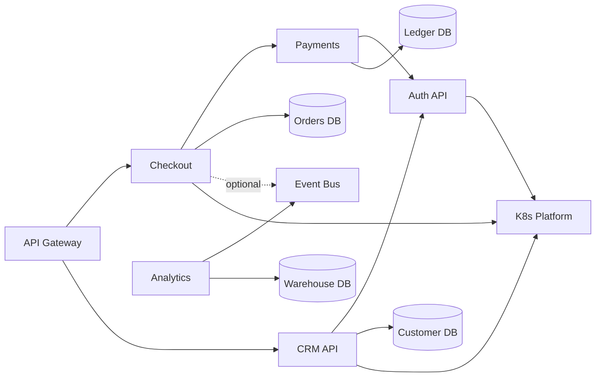
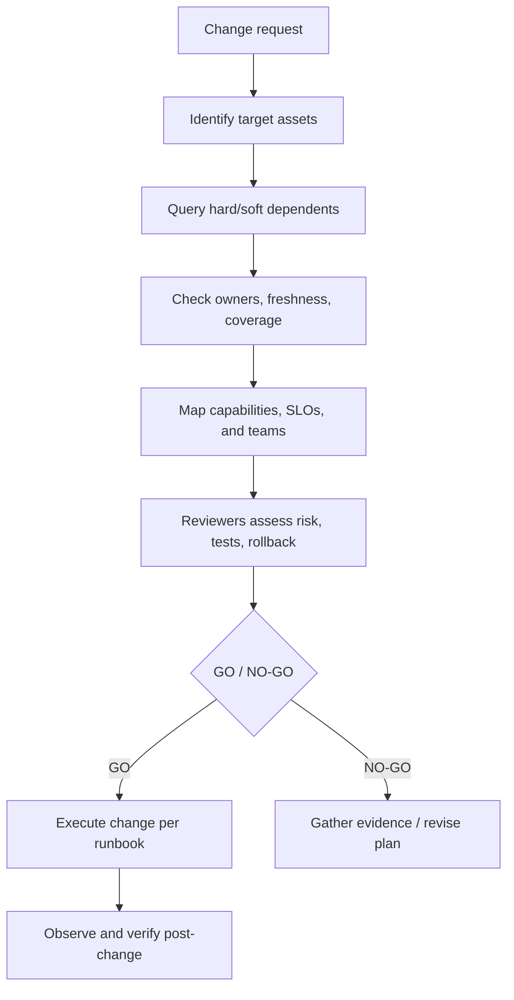

# Analyzing System Dependencies, Assets, and Change Impact with Neo4j

## 1. From an Asset Inventory to an Impact Map

An enterprise may run hundreds of services, thousands of virtual machines or containers, databases, message queues, third-party APIs, and multiple owning teams. When upgrading an authentication service, migrating a database, or modifying a cluster configuration, the critical questions are not just **which asset will be modified**, but also:

- Which systems **directly and indirectly depend** on that asset?
- Which business capabilities are at risk of disruption?
- Who is responsible and needs to be notified?
- Which dependencies are mandatory, and which can degrade without bringing down the entire service?
- Is there a **shared dependency** that makes the blast radius wider than expected?
- Which evidence is fresh enough to rely on when deciding to execute a change?

This is a classic **graph application** problem. In the `DATABASE_ENGINE_GRAPH_NEO4J` module, Neo4j uses a **property graph** consisting of nodes, relationships, and properties; **Cypher** queries dependency directions, paths, connection points, and sets of related systems. **Neo4j Java Driver** or **Spring Data Neo4j** brings those results into change management APIs and operational systems.

This lesson focuses on **analyzing system dependencies, assets, and change impact**, rather than merely drawing a static architecture diagram. We will build a configuration/asset graph, load test data, query the *blast radius*, link to owning teams and business capabilities, check information quality, and then use the results in a change management workflow.

### Learning Objectives

After this lesson, you will be able to:

1. Define the direction and semantics of `DEPENDS_ON`, `OWNED_BY`, `DELIVERED_BY`, and `TARGETS`.
2. Model services, databases, message brokers, infrastructure, teams, and business capabilities without conflating concepts.
3. Query **upstream impact** and **downstream dependencies** with depth limits in the correct environment.
4. Classify **required, optional, synchronous, and asynchronous** relationships and avoid falsely concluding that every edge causes an outage.
5. Detect missing links, missing ownership, dependency cycles, supernode risks, and stale data.
6. Build an impact assessment containing **explanatory paths**, confidence signals, notification recipient lists, and post-change verification.
7. Expose results through Java Driver/APIs with load limits, authorization, and query correctness testing.

> **Version:** Examples use common Neo4j 5.x Cypher syntax. Small-depth queries suffice for illustrating lab data; on large real-world graphs, you must bound fan-out, inspect `EXPLAIN`/`PROFILE`, and consider layered queries or appropriate algorithms. Neo4j does not inherently know whether a "depends on" edge means complete outage or graceful degradation: that is a business contract defined by system maintainers.

## 2. Edge Semantics Matter More Than Diagram Shape

In this lesson, we choose **one canonical direction**:

```text
(A:Component)-[:DEPENDS_ON]->(B:Component)

Interpretation: "A needs to use B to perform at least one function".
```

Given:

```text
Gateway  -> Checkout -> Payments -> Auth
                       -> OrdersDB
Analytics -> EventBus
Checkout  -> EventBus  (optional dependency)
```

then:

- To find **what Checkout needs**, traverse **along the `DEPENDS_ON` direction** from Checkout to Payments, OrdersDB, and EventBus.
- To find **who may be impacted by upgrading Auth**, traverse **against the dependency direction**, tracing back from Auth to Payments, Checkout, and Gateway.
- Checking only systems directly depending on Auth will miss Checkout and Gateway.
- A relationship from Checkout to EventBus declared as **optional** should not automatically be interpreted as "Checkout will definitely go down if EventBus fails."

### 2.1. Relationship Catalog in the Model

| Relationship | Direction | Meaning | Example |
| --- | --- | --- | --- |
| `DEPENDS_ON` | Consuming Component → Providing Component | Technical dependency relationship | `(Checkout)-[:DEPENDS_ON]->(Payments)` |
| `OWNED_BY` | Component → Team | Primary operational owning team | `(Payments)-[:OWNED_BY]->(FinanceTeam)` |
| `DELIVERED_BY` | Capability → Component | Component directly implementing the business capability | `(Purchase)-[:DELIVERED_BY]->(Checkout)` |
| `TARGETS` | Change → Component | Directly modified asset | `(CHG042)-[:TARGETS]->(Auth)` |

**Do not collapse all relationships into `DEPENDS_ON`.** For instance, `OWNED_BY` helps identify whom to notify, but a team owning a service does not mean the service "technically depends" on the team the same way it depends on a database.

### 2.2. Distinguishing Physical Dependencies from Logical Dependencies

Common dependency dimensions include:

- **Runtime:** a service calls another API while handling a request.
- **Data:** a service requires a database, cache, or object storage.
- **Messaging:** a service publishes/consumes events via a broker or topic.
- **Infrastructure:** a service requires a cluster, VM, network, or DNS.
- **Control plane:** requires IAM, a secret manager, service discovery, or certificate infrastructure.
- **Business:** a capability is provided by multiple coordinating services.

A relationship can exist in multiple forms. Instead of inferring everything from a single label, also store **`mode`, `required`, `source`, `lastVerifiedAt`**, and when needed **`dependencyKind`**. These properties aid analysis but still require clear definitions.

### 2.3. Analysis Results Are "Impact Candidates," Not Prophecies

An edge from A to B is **evidence that A may be affected** if B changes. Whether A actually goes down depends on:

- Are there circuit breakers, fallbacks, caches, or replicas?
- Does the change break an API/data contract, or is it a zero-downtime update?
- What traffic flows across that dependency path?
- Is the edge a mandatory requirement or a non-critical execution path?
- Is the dependency information still accurate at deployment time?

Therefore, graph analysis should return **the scope requiring verification, rationale, and confidence**, rather than asserting a deterministic outage probability without an incident model and historical metrics.

## 3. Running Scenario: An E-Commerce System

We have the following components in the `prod` environment:



Each arrow **points from consumer to dependency**. Names like `Orders DB` or `K8s Platform` represent assets queried as `:Component` nodes, not an indication that they behave identically to an API service.

### 3.1. List of Services and Assets

| Key | Kind | Role |
| --- | --- | --- |
| `gateway` | SERVICE | API gateway |
| `checkout` | SERVICE | Order/payment orchestration |
| `payments` | SERVICE | Payment processing |
| `crm` | SERVICE | Customer information |
| `auth` | SERVICE | Authentication |
| `analytics` | SERVICE | Dashboards/analytics |
| `orders-db` | DATABASE | Order data |
| `ledger-db` | DATABASE | Transaction ledger |
| `customer-db` | DATABASE | Customer profiles |
| `event-bus` | BROKER | Asynchronous event delivery |
| `warehouse-db` | DATABASE | Data warehouse |
| `k8s-prod` | PLATFORM | Cluster running core workloads |

### 3.2. Three Business Capabilities

- `purchase` — **Purchase**, delivered directly by Checkout.
- `customer-care` — **Customer Care**, delivered by CRM.
- `dashboard` — **Analytics Dashboard**, delivered by Analytics.

If Auth fails, graph queries will show that `purchase` and `customer-care` **are potentially impacted indirectly**. `dashboard` is not on any mandatory dependency chain to Auth in the sample graph.

### 3.3. Two Scenarios to Distinguish

1. **CHG-042 upgrading Auth API:** Gateway, Checkout, Payments, and CRM lie on mandatory dependency paths leading to Auth.
2. **Event Bus disruption:** Analytics requires Event Bus; Checkout publishes events to Event Bus but is marked `required = false`, so concluding "Checkout is definitely unavailable" would violate a strict-impact policy. However, Checkout's event-publishing capability can still degrade.

Both scenarios will be verified with Cypher in the following sections.

## 4. Property Graph Model and Identity Keys

### 4.1. Nodes

```text
(:Component {
  environment: 'prod',
  key: 'auth',
  name: 'Auth API',
  kind: 'SERVICE',
  tier: 1,
  active: true
})

(:Team {teamId: 'platform', name: 'Platform'})
(:Capability {
  environment: 'prod',
  capabilityId: 'purchase',
  name: 'Purchase'
})
(:Change {
  changeId: 'CHG-042',
  title: 'Upgrade Auth API',
  state: 'PLANNED'
})
```

The **business key `(environment, key)`** uniquely identifies a Component in this example, since the same `auth` service can exist in `dev`, `staging`, and `prod`. Do not use internal `id(node)` or `elementId(node)` as durable IDs when integrating CMDBs and APIs.

In a multi-tenant system, the key may also need to include `tenantId`. Do not blindly attach `tenantId` to the same graph before knowing management boundaries: some assets are **shared platforms** serving multiple tenants and require a separate access model.

### 4.2. Relationships and Provenance Metadata

```text
(:Component {key:'payments'})
  -[:DEPENDS_ON {
      required: true,
      mode: 'SYNC',
      source: 'service-catalog',
      lastVerifiedAt: datetime('2026-11-20T00:00:00Z')
    }]->
(:Component {key:'auth'})
```

| Property | Role | Rules to Standardize |
| --- | --- | --- |
| `required` | Treated as a mandatory dependency for delivering core functionality? | Boolean with a governed default value |
| `mode` | Communication style | For example `SYNC`, `ASYNC`, or `INFRA` |
| `source` | Discovery/confirmation source | Catalog, IaC, tracing, service owner |
| `lastVerifiedAt` | Timestamp when confirmed accurate | Use `datetime` type with an explicit timezone |
| `confidence` | Certainty of evidence, if present | Must define scale and update mechanism |
| `validFrom`/`validTo` | Validity interval of the relationship, if needed | Do not confuse with record ingestion time |

In this lab, each consumer–provider pair has **one** `DEPENDS_ON` relationship. If the domain has two distinct interfaces between the same two systems, you need a **dependency business key** per interface and explicit multiplicity modeling, rather than letting `MERGE` accidentally collapse them.

### 4.3. Constraints Before Loading Data

Run on a test database:

```cypher
CREATE CONSTRAINT graph_component_key IF NOT EXISTS
FOR (c:Component)
REQUIRE (c.environment, c.key) IS UNIQUE;

CREATE CONSTRAINT graph_team_key IF NOT EXISTS
FOR (t:Team)
REQUIRE t.teamId IS UNIQUE;

CREATE CONSTRAINT graph_capability_key IF NOT EXISTS
FOR (b:Capability)
REQUIRE (b.environment, b.capabilityId) IS UNIQUE;

CREATE CONSTRAINT graph_change_key IF NOT EXISTS
FOR (ch:Change)
REQUIRE ch.changeId IS UNIQUE;
```

Constraints protect the uniqueness of present keys, provide index-backed lookups, and reduce the risk of duplicates during re-ingestion. They **do not automatically guarantee** that every Component always has `environment/key`, that every service has an owner, or that every dependency edge stays within the same environment; those invariants require appropriate checks/constraints supported by your edition/version and application layer.

## 5. Loading Lab Data with Cypher

### 5.1. Creating Components

```cypher
UNWIND [
  {key:'gateway', name:'API Gateway', kind:'SERVICE', tier:1},
  {key:'checkout', name:'Checkout', kind:'SERVICE', tier:1},
  {key:'payments', name:'Payments', kind:'SERVICE', tier:1},
  {key:'crm', name:'CRM API', kind:'SERVICE', tier:2},
  {key:'auth', name:'Auth API', kind:'SERVICE', tier:1},
  {key:'analytics', name:'Analytics', kind:'SERVICE', tier:2},
  {key:'orders-db', name:'Orders DB', kind:'DATABASE', tier:1},
  {key:'ledger-db', name:'Ledger DB', kind:'DATABASE', tier:1},
  {key:'customer-db', name:'Customer DB', kind:'DATABASE', tier:2},
  {key:'event-bus', name:'Event Bus', kind:'BROKER', tier:2},
  {key:'warehouse-db', name:'Warehouse DB', kind:'DATABASE', tier:2},
  {key:'k8s-prod', name:'K8s Platform', kind:'PLATFORM', tier:1}
] AS row
MERGE (c:Component {environment:'prod', key:row.key})
SET c.name = row.name,
    c.kind = row.kind,
    c.tier = row.tier,
    c.active = true;
```

**Note:** `tier` here is an organization-defined priority tier (1 = business-critical), not a built-in Neo4j sequence number. If your organization already has another SLA classification field, use that exact data dictionary.

### 5.2. Creating Dependencies

```cypher
UNWIND [
  {consumer:'gateway', provider:'checkout', required:true, mode:'SYNC'},
  {consumer:'gateway', provider:'crm', required:true, mode:'SYNC'},
  {consumer:'checkout', provider:'payments', required:true, mode:'SYNC'},
  {consumer:'checkout', provider:'orders-db', required:true, mode:'DATA'},
  {consumer:'checkout', provider:'event-bus', required:false, mode:'ASYNC'},
  {consumer:'payments', provider:'auth', required:true, mode:'SYNC'},
  {consumer:'payments', provider:'ledger-db', required:true, mode:'DATA'},
  {consumer:'crm', provider:'auth', required:true, mode:'SYNC'},
  {consumer:'crm', provider:'customer-db', required:true, mode:'DATA'},
  {consumer:'analytics', provider:'event-bus', required:true, mode:'ASYNC'},
  {consumer:'analytics', provider:'warehouse-db', required:true, mode:'DATA'},
  {consumer:'auth', provider:'k8s-prod', required:true, mode:'INFRA'},
  {consumer:'checkout', provider:'k8s-prod', required:true, mode:'INFRA'},
  {consumer:'crm', provider:'k8s-prod', required:true, mode:'INFRA'}
] AS row
MATCH (consumer:Component {
  environment:'prod', key:row.consumer
})
MATCH (provider:Component {
  environment:'prod', key:row.provider
})
MERGE (consumer)-[d:DEPENDS_ON]->(provider)
SET d.required = row.required,
    d.mode = row.mode,
    d.source = 'lesson-catalog',
    d.lastVerifiedAt = datetime('2026-11-20T00:00:00Z');
```

`MERGE (consumer)-[d:DEPENDS_ON]->(provider)` expresses one dependency per endpoint pair in the sample lesson. In a multi-writer system, **`MERGE` alone is not an absolute guarantee of uniqueness across all concurrent edge creation patterns**. If dependency uniqueness is critical, use a stable business ID, a relationship uniqueness constraint supported by your version/edition, and an appropriate transaction strategy.

### 5.3. Owning Teams

```cypher
UNWIND [
  {id:'platform', name:'Platform Operations'},
  {id:'commerce', name:'Commerce'},
  {id:'finance', name:'Finance Engineering'},
  {id:'customer', name:'Customer Systems'},
  {id:'data', name:'Data Platform'}
] AS row
MERGE (t:Team {teamId:row.id})
SET t.name = row.name;
```

```cypher
UNWIND [
  {component:'gateway', team:'platform'},
  {component:'auth', team:'platform'},
  {component:'k8s-prod', team:'platform'},
  {component:'checkout', team:'commerce'},
  {component:'orders-db', team:'commerce'},
  {component:'payments', team:'finance'},
  {component:'ledger-db', team:'finance'},
  {component:'crm', team:'customer'},
  {component:'customer-db', team:'customer'},
  {component:'analytics', team:'data'},
  {component:'event-bus', team:'data'},
  {component:'warehouse-db', team:'data'}
] AS row
MATCH (c:Component {environment:'prod', key:row.component})
MATCH (t:Team {teamId:row.team})
MERGE (c)-[:OWNED_BY]->(t);
```

### 5.4. Business Capabilities

```cypher
UNWIND [
  {id:'purchase', name:'Purchase', service:'checkout'},
  {id:'customer-care', name:'Customer Care', service:'crm'},
  {id:'dashboard', name:'Analytics Dashboard', service:'analytics'}
] AS row
MERGE (b:Capability {
  environment:'prod', capabilityId:row.id
})
SET b.name = row.name
WITH b, row
MATCH (c:Component {environment:'prod', key:row.service})
MERGE (b)-[:DELIVERED_BY]->(c);
```

### 5.5. Change to Assess

```cypher
MERGE (ch:Change {changeId:'CHG-042'})
SET ch.title = 'Upgrade Auth API',
    ch.state = 'PLANNED';

MATCH (ch:Change {changeId:'CHG-042'})
MATCH (c:Component {environment:'prod', key:'auth'})
MERGE (ch)-[:TARGETS]->(c);
```

In practice, each Change also needs a **deployment window, owner, change type, priority, runbook, test results, and approval status**. The graph is only one source of evidence; never let a query automatically approve a release when the workflow requires human approvers.

## 6. Verifying the Sample Graph Before Analysis

```cypher
MATCH (c:Component {environment:'prod'})
RETURN count(c) AS componentCount;
```

```cypher
MATCH (:Component {environment:'prod'})
      -[r:DEPENDS_ON]->
      (:Component {environment:'prod'})
RETURN count(r) AS dependencyCount;
```

```cypher
MATCH (b:Capability {environment:'prod'})
RETURN count(b) AS capabilityCount;
```

Expected counts on a clean lab database without preexisting nodes sharing the same keys: **12 Components**, **14 `DEPENDS_ON` relationships**, **3 Capabilities**, **5 Teams**, and one `Change CHG-042`.

Do not use `count(*)` after multiple `OPTIONAL MATCH` clauses to infer component counts, because joining one-to-many relationship branches can multiply row counts. Count each population separately first, then use `DISTINCT`/subqueries when needed.

### 6.1. Quick Query to Inspect Dependencies

```cypher
MATCH (consumer:Component {environment:'prod', key:'checkout'})
      -[r:DEPENDS_ON]->
      (provider:Component)
RETURN provider.key AS dependency,
       provider.kind AS kind,
       r.required AS required,
       r.mode AS mode
ORDER BY dependency;
```

Expected: Checkout depends on `payments`, `orders-db`, `event-bus`, and `k8s-prod`. Among them, `event-bus` has `required = false`; the other three edges are mandatory in the example.

## 7. Forward Traversal: What Does a System Need?

For the question **"Which assets does Checkout depend on within at most 3 hops?"**, follow the edge direction from consumer to provider:

```cypher
MATCH (root:Component {environment:$environment, key:$componentKey})
MATCH p=(root)-[:DEPENDS_ON*1..3]->(dependency:Component)
WHERE all(n IN nodes(p) WHERE n.environment = $environment)
WITH dependency, min(length(p)) AS minHops
RETURN dependency.key AS dependency,
       dependency.kind AS kind,
       minHops
ORDER BY minHops, dependency;
```

The results include direct dependencies such as Payments and OrdersDB, followed by indirect dependencies such as Auth and LedgerDB. Hop count is the **path length** in the graph, **not incident propagation time**.

### 7.1. Why Must Depth Be Bounded?

The query:

```cypher
// Do not expose as an unrestricted open API on a production graph:
MATCH p=(c:Component)-[:DEPENDS_ON*]->(x:Component)
RETURN p;
```

can generate an enormous number of paths when the graph has high branching, multiple paths converging on the same asset, or dependency cycles. The application should:

- Start from **a node looked up via a key/index**, rather than scanning all components.
- Constrain direction, relationship type, depth, environment, and dependency kind.
- Return only the required properties/DTOs.
- Use `EXPLAIN`/`PROFILE` to inspect row counts, DB hits, memory, and execution time.
- On very large graphs, consider bounded reachability/BFS algorithms instead of enumerating all paths.

**`LIMIT 100` at the end of a query does not mean the engine expands at most 100 paths**. If you only need the shortest depth between two nodes, choose a dedicated query/algorithm instead of generating all paths and filtering.

## 8. Reverse Traversal: Who May Be Impacted When an Asset Changes?

Because `A-[:DEPENDS_ON]->B`, to find **consumers potentially impacted by B**, query:

```cypher
MATCH (target:Component {
  environment:$environment,
  key:$targetKey
})
MATCH p=(consumer:Component)-[:DEPENDS_ON*1..4]->(target)
WHERE all(n IN nodes(p) WHERE n.environment = $environment)
WITH consumer,
     min(length(p)) AS minHops,
     count(p) AS pathsObserved
RETURN consumer.key AS impactedComponent,
       consumer.kind AS kind,
       minHops,
       pathsObserved
ORDER BY minHops, impactedComponent;
```

Test parameters: `$environment = 'prod'`, `$targetKey = 'auth'`.

Expected on the lab dataset:

| Potentially Impacted Component | Shortest Distance to Auth | Reason |
| --- | ---: | --- |
| `payments` | 1 | Payments calls Auth directly |
| `crm` | 1 | CRM calls Auth directly |
| `checkout` | 2 | Checkout → Payments → Auth |
| `gateway` | 2 | Gateway → CRM → Auth; plus a longer path via Checkout |

The query returns **4 distinct components** if the sample data has not been modified. `pathsObserved` indicates how many paths the query found **within the 4-hop limit**, not transaction volume and not outage probability. When the query finds multiple paths for the same component, `min(length(p))` keeps only the shortest distance.

**Note on results:** Target `auth` is the **directly modified asset** and does not appear in the consumer list because `*1..4` is used. The final impact report must include **both the target and the set of impacted consumers**, without dropping the target during aggregation.

### 8.1. Direct Consumers Only

```cypher
MATCH (consumer:Component {environment:$environment})
      -[r:DEPENDS_ON]->
      (target:Component {
        environment:$environment,
        key:$targetKey
      })
RETURN consumer.key AS directConsumer,
       r.mode AS mode,
       r.required AS required
ORDER BY directConsumer;
```

For Auth, the direct results are **Payments** and **CRM**. This query is useful when you need to contact direct integrators to verify before an API contract change.

## 9. Mandatory, Optional, and Degraded Dependencies

An analysis of **potential loss of core functionality** usually traverses only `required = true` edges:

```cypher
MATCH (target:Component {
  environment:$environment,
  key:$targetKey
})
MATCH p=(consumer:Component)-[:DEPENDS_ON*1..4]->(target)
WHERE all(n IN nodes(p) WHERE n.environment = $environment)
  AND all(r IN relationships(p) WHERE r.required = true)
WITH consumer, min(length(p)) AS minHops
RETURN consumer.key AS hardDependent,
       consumer.kind AS kind,
       minHops
ORDER BY minHops, hardDependent;
```

### 9.1. Testing with Auth

With `$targetKey = 'auth'`, the strict impact still includes **Payments, CRM, Checkout, and Gateway**, because every segment along those paths is mandatory.

### 9.2. Testing with Event Bus

With `$targetKey = 'event-bus'`:

- **Strict impact:** Analytics, because `Analytics → EventBus` is mandatory.
- **All-dependencies impact:** Analytics **and Checkout**, and Gateway may also appear via Checkout.
- **Functional degradation:** Checkout may still accept orders while losing event publishing. Gateway may still serve API traffic, though any event-dependent use case requires separate evaluation.

Therefore, the report should have at least two columns/categories:

| Classification | Meaning | Usage |
| --- | --- | --- |
| **Hard dependency candidate** | Has a path consisting entirely of `required = true` edges | Prioritize investigating risk of core function outage |
| **Soft/degraded candidate** | Has a path containing optional edges or fallbacks | Inspect risk of degradation, backlog, retries, or event loss |

Do not treat `required = false` as "no check needed"; it simply **lacks sufficient evidence to conclude a total outage**. Dropped events or elevated asynchronous latency can still cause serious business consequences.

### 9.3. Do Not Infer Impact by Simple Probability Multiplication

Two dependency paths may share a cluster or share traffic. Assigning `confidence = 0.9` to each edge does not justify multiplying those numbers together to obtain a "final outage probability." Confidence in **evidence that an edge exists** and the probability of **failure propagation** are two different quantities.

## 10. Changes Targeting Multiple Assets

A change may simultaneously update Auth, the secret manager, and network policies. The report must compute the **union of impact sets**, rather than counting a single consumer twice as if it were two different systems.

```cypher
MATCH (ch:Change {changeId:$changeId})
      -[:TARGETS]->
      (target:Component {environment:$environment})
MATCH p=(consumer:Component)-[:DEPENDS_ON*1..4]->(target)
WHERE all(n IN nodes(p) WHERE n.environment = $environment)
  AND all(r IN relationships(p) WHERE r.required = true)
WITH consumer,
     collect(DISTINCT target.key) AS targetsReached,
     min(length(p)) AS minHops
RETURN consumer.key AS impactedComponent,
       consumer.kind AS kind,
       targetsReached,
       minHops
ORDER BY minHops, impactedComponent;
```

The query above only returns **indirect/direct consumers of each target**, not the nodes that the Change `TARGETS` directly. Separate query:

```cypher
MATCH (:Change {changeId:$changeId})
      -[:TARGETS]->
      (target:Component {environment:$environment})
RETURN target.key AS directlyChanged,
       target.kind AS kind
ORDER BY directlyChanged;
```

When aggregating in JSON/API responses, **union by `(environment, componentKey)`**, tagging `DIRECT` and `UPSTREAM`. Do not union by display name because names can collide.

### 10.1. Layering by Distance

| Tier | Example When Changing Auth | Action |
| --- | --- | --- |
| **Target (0 hops)** | Auth | Team executing the change and verifying rollback |
| **Direct (1 hop)** | Payments, CRM | API contract tests, monitor direct errors |
| **Indirect (2+ hops)** | Checkout, Gateway | Smoke test cross-service business flows |
| **Capability** | Purchase, Customer Care | Notify business owners, check end-to-end SLOs |

Graph distance is only a layering signal. A tier-1 component 3 hops away or on the payment path can still be more critical than a lightly used component 1 hop away.

## 11. Linking Technical Impact to Business Capabilities

A list of 40 microservices is of limited value to a product owner if they do not know **what customers will be unable to do**. That is why we attach `(:Capability)-[:DELIVERED_BY]->(:Component)`.

### 11.1. Querying Capabilities with Mandatory Dependency Paths to the Target

```cypher
MATCH (target:Component {
  environment:$environment,
  key:$targetKey
})
MATCH (cap:Capability {environment:$environment})
      -[:DELIVERED_BY]->
      (root:Component)
MATCH p=(root)-[:DEPENDS_ON*0..4]->(target)
WHERE all(n IN nodes(p) WHERE n.environment = $environment)
  AND all(r IN relationships(p) WHERE r.required = true)
WITH cap, min(length(p)) AS minHops
RETURN cap.capabilityId AS capability,
       cap.name AS capabilityName,
       minHops
ORDER BY minHops, capability;
```

With `auth`, expected results:

- `customer-care`: CRM → Auth, **1 hop**.
- `purchase`: Checkout → Payments → Auth, **2 hops**.

`dashboard` does not appear because Analytics does not depend on Auth in this dataset.

**Why `*0..4`?** When the target asset itself is the service directly linked by `DELIVERED_BY`, that capability must appear at distance **0**. `all(...)` over a path with zero relationships evaluates to true, so direct impact is still included.

### 11.2. Capabilities Are Not Outage Ratios

A capability may be supported by **multiple** services, active-active setups, fallbacks, or only have one branch affected. Finding a dependency path is a signal **"needs verification,"** not sufficient proof to declare the capability completely down. Advanced models can express `REQUIRES_ALL`, `REQUIRES_ANY`, fallbacks, and validity conditions, in which case **propagation logic** must accurately reflect AND/OR conditions.

### 11.3. Connecting to RTO/RPO and SLOs

Critical capabilities often have different SLOs or recovery requirements:

- Purchase: check order success rate, duplicate-transaction prevention, checkout latency.
- Customer Care: profile access latency and search error rate.
- Dashboard: data freshness, event backlog, and recovery time.

Do not merely report "Auth has 4 dependent services"; specify **which business flows must be smoke-tested** and **which metrics serve as GO/NO-GO gates**.

## 12. Finding Owning Teams and Building Notification Lists

### 12.1. Owners of Potentially Impacted Systems

```cypher
MATCH (target:Component {
  environment:$environment,
  key:$targetKey
})
MATCH p=(affected:Component)-[:DEPENDS_ON*0..4]->(target)
WHERE all(n IN nodes(p) WHERE n.environment = $environment)
  AND all(r IN relationships(p) WHERE r.required = true)
OPTIONAL MATCH (affected)-[:OWNED_BY]->(team:Team)
WITH team,
     collect(DISTINCT affected.key) AS components
RETURN team.teamId AS teamId,
       team.name AS teamName,
       components
ORDER BY teamId;
```

For Auth, the main teams in the lab graph:

- `platform`: Auth, plus any other platform components in the impacted set.
- `finance`: Payments.
- `customer`: CRM.
- `commerce`: Checkout.
- `platform`: Gateway.

In the query, `collect(DISTINCT affected.key)` ensures a component reachable via multiple paths is not duplicated within the same group. If no owner is assigned, `teamId` can be `null`: that is a **data gap to remediate**, not a reason to omit the component from alerts.

### 12.2. Technical Owners Differ from Business Owners

An Auth change may require:

- **Change owner**: the team responsible for performing the upgrade.
- **Component owners**: teams whose services consume Auth.
- **Business owners**: product groups accountable for Purchase / Customer Care SLOs.
- **Incident commander / on-call**: coordinator if the change fails.

Do not collapse all these roles into a single `OWNED_BY` relationship. As the system grows, add distinct governance relationship types such as `HAS_ON_CALL`, `BUSINESS_OWNED_BY`, and versioned metadata.

## 13. Separating Environments, Tenants, and Fault Domains

### 13.1. Filtering Only the Target Is Not Enough

A query starting at `auth` in `prod` without checking all `nodes(p)` can accidentally traverse through a `staging` node if an importer created an erroneous edge. That is why the queries above include:

```cypher
WHERE all(n IN nodes(p) WHERE n.environment = $environment)
```

This is **a query-level safeguard**, not a replacement for access controls and data constraints. Never treat an `auth` service in `dev` and `prod` as the same entity.

### 13.2. Legitimate Cross-Environment Dependencies

There are cases where a `staging` service genuinely calls a `prod` API—usually a security red flag worth reviewing, though occasionally an intentional policy. Never delete all cross-environment edges blindly; instead:

1. Confirm it is real and approved.
2. Attach explicit exception metadata.
3. Classify risk and access controls differently.
4. Ensure production impact queries have an approved include/exclude mode.

Pattern query to find cross-environment edges:

```cypher
MATCH (a:Component)-[d:DEPENDS_ON]->(b:Component)
WHERE a.environment <> b.environment
RETURN a.environment AS consumerEnvironment,
       a.key AS consumerKey,
       b.environment AS dependencyEnvironment,
       b.key AS dependencyKey,
       d.source AS evidenceSource
ORDER BY consumerEnvironment, consumerKey
LIMIT 100;
```

### 13.3. Multi-Tenancy and Shared Assets

When multiple tenants share Auth or a cluster:

- Do not place all tenant-specific data into a shared public graph.
- Define identity keys and visibility permissions per node/relationship type.
- Model a dedicated **shared Component** linked to multiple tenants via usage-permission relationships if needed.
- Impact APIs must filter by the **actor's permissions** and expose only authorized systems, rather than trusting a client-supplied `environment` parameter alone.

A tenant predicate in a query is necessary, but it does not replace **application-layer authorization**.

## 14. CMDB Data Quality: Bad Inputs Yield Wrong Blast Radius

### 14.1. Checking Components Missing an Owner

```cypher
MATCH (c:Component {environment:$environment})
WHERE NOT EXISTS {
  MATCH (c)-[:OWNED_BY]->(:Team)
}
RETURN c.key AS componentWithoutOwner,
       c.kind AS kind
ORDER BY componentWithoutOwner;
```

In the lab, **0 rows** are expected. In real systems, missing owners should enter a **data quality backlog**, rather than defaulting to "Platform" out of convenience.

### 14.2. Checking Multiple Primary Owners

If the model mandates exactly **one** primary accountable owner:

```cypher
MATCH (c:Component {environment:$environment})
OPTIONAL MATCH (c)-[:OWNED_BY]->(t:Team)
WITH c, count(t) AS ownerCount
WHERE ownerCount <> 1
RETURN c.key AS component,
       ownerCount
ORDER BY component;
```

If an organization intentionally allows multiple owners, distinguish `PRIMARY_OWNER` from `SUPPORTING_TEAM` rather than treating all multi-owner cases as errors.

### 14.3. Checking Self-Dependency Edges

```cypher
MATCH (c:Component)-[d:DEPENDS_ON]->(c)
RETURN c.environment AS environment,
       c.key AS component,
       d.mode AS mode;
```

Self-dependencies may stem from wrong keys in an importer, or occasionally an unsuitable abstraction producing a self-loop. Verify reality before fixing.

### 14.4. Checking Multi-Node Dependency Cycles

```cypher
MATCH p=(start:Component {environment:$environment})
        -[:DEPENDS_ON*2..6]->(start)
WHERE all(n IN nodes(p) WHERE n.environment = $environment)
RETURN [n IN nodes(p) | n.key] AS cycle
LIMIT 20;
```

**Load warning:** Enumerating cycles can be very expensive on large graphs, even with a trailing `LIMIT 20`. Run on a staging/test graph, partition by bounded edge types, or use strongly connected components algorithms in an appropriate analytics environment. A dependency cycle may reflect an actual API call loop or an overly abstract model mixing "deployment" and "runtime consumption" directions.

### 14.5. Relationships Cannot Exist with a Physically Missing Endpoint

Neo4j cannot store a valid relationship without both endpoint nodes. When a source record declares `checkout → unknown-service` and the target node is not found, the outcome is usually **no edge created** or **an edge attached to the wrong node**, never a physically "dangling" edge in the graph.

Therefore, the importer must maintain a **staging/quarantine** area for dependency records whose consumer or provider cannot be resolved, and report:

```text
TOTAL_DEPENDENCY_ROWS
RESOLVED_AND_WRITTEN
MISSING_CONSUMER
MISSING_PROVIDER
DUPLICATE_BUSINESS_KEY
CONFLICTING_DEFINITION
UNAPPROVED_CROSS_ENVIRONMENT
```

Never count relationships in Neo4j alone and assume all source records were ingested properly.

## 15. Provenance, Freshness, and Dependency Lifecycle

### 15.1. An Existing Edge Does Not Mean It Is Still True

A CMDB may be updated from:

- **IaC/Kubernetes manifests:** resource declarations, deployments, configs.
- **Service catalog:** owners, tiers, API contracts, confirmed dependencies.
- **Distributed tracing:** callers/callees actually observed in traces.
- **Network/flow telemetry:** network connectivity observed, though not necessarily a mandatory business dependency.
- **Cloud inventory:** VMs, volumes, load balancers, database instances.
- **Change/incident records:** evidence of which systems an incident affected.

No single source is completely sufficient:

- Sampled tracing can **miss rare code paths**.
- IaC describes intended resources but does not guarantee actual call paths.
- Network flows may observe health checks or monitoring traffic rather than hard dependencies.
- Manual declarations can go stale as architecture evolves.

### 15.2. Classifying Evidence

| Source | Strengths | Limitations | How to Use |
| --- | --- | --- | --- |
| Approved service catalog | Clear owners and business semantics | Dependencies updated manually | Source of truth for required/optional rules |
| IaC/config | Versioned with commits, per environment | Configured resources may be unused | Discover configs, verify deployments |
| Tracing | Shows actual runtime call paths | Sampling, observation window, async gaps | Supplement and corroborate dependencies |
| Cloud inventory | Finds real infrastructure assets | Lacks logical relationships | Expand infrastructure asset layer |
| Incident history | Evidence of actual realized impact | Biased toward historical incidents | Calibrate priority/risk levels |

### 15.3. Checking Freshness

Suppose the organization requires critical relationships to be verified within 30 days:

```cypher
MATCH (a:Component {environment:$environment})
      -[d:DEPENDS_ON]->
      (b:Component {environment:$environment})
WHERE d.lastVerifiedAt IS NULL
   OR d.lastVerifiedAt < datetime() - duration({days:30})
RETURN a.key AS consumer,
       b.key AS provider,
       d.source AS source,
       d.lastVerifiedAt AS lastVerifiedAt
ORDER BY consumer, provider
LIMIT 100;
```

This is an **example threshold**, not a Neo4j rule. Relationships to rarely changing systems may require a different verification cadence than ephemeral services. Conversely, a dependency verified yesterday may already be stale after today's deployment.

### 15.4. Point-in-Time Topology at Incident Occurrence

To investigate "which systems did last month's incident affect?", the current graph **does not necessarily reflect the graph at that time**. There are two approaches:

1. Store **validity history** for dependencies using versioned records with `validFrom`/`validTo`.
2. Store a **snapshot/topology export** alongside each change or incident ID.

Simply overwriting `lastVerifiedAt` and deleting old edges loses the ability to reconstruct historical topology. When designing a temporal model, distinguish **when the relationship was valid in reality** from **when the system learned about it**.

## 16. Ranking Change Risk Without Misleading Users

### 16.1. Usable Signals

| Signal | Meaning | Limitations |
| --- | --- | --- |
| Number of hard dependents | Scale of potentially impacted consumers | Not user count or financial loss |
| Number of related capabilities | Potential business impact | A capability may have a fallback |
| Tier/criticality | Organization-defined priority | Requires owner verification and upkeep |
| Hop distance | Degree of indirection | Farther does not automatically mean lower risk |
| Shared dependency | Multiple services share a node | May already have strong HA |
| `lastVerifiedAt`/confidence | Map freshness/certainty | Not outage probability |
| Change type | Reboot, API contract, schema migration, certificate rotation | Same target can carry vastly different impact |
| Backout/restore readiness | Incident containment capability | Does not replace data correctness |

Never compute `risk = number of paths × 10` and call it a probability. A node with multiple paths to the same consumer inflates the path count, yet there is still **one** consumer.

### 16.2. Example Change Triage Table

| Change | Graph Impact | Verification Needed |
| --- | --- | --- |
| Compatible rolling Auth upgrade, rehearsed | 4 hard dependents; 2 capabilities | Contract/login API tests, monitoring, rollback |
| Event Bus configuration change | 1 hard dependent, plus Checkout's soft branch | Test Analytics backlog and event publication |
| Incompatible LedgerDB schema migration | Payments → Checkout → Gateway | Verify transaction correctness, backups, maintenance window |
| K8s Platform change | Auth, Checkout, CRM and their downstream dependents | Verify rollout/quorum/PDB and recovery readiness |

For example, `K8s Platform` is not necessarily a "single point of failure" if the cluster spans multiple zones with sufficient redundancy. **Asset nodes** must match the required granularity: to analyze losing a single worker node, model workers/zones and pod placement edges rather than using a single coarse cluster node to guess which pods will die.

### 16.3. Missing Data Must Reduce Confidence, Not Imply Safety

If 30% of services lack owners or 40% of dependencies have not been verified for months, impact results can **underestimate** true exposure. The system should report clearly:

```text
Impact analysis: INCOMPLETE
Reasons:
  - 7 components missing ownership
  - 18 dependencies not verified within policy window
  - 3 unresolved source dependency rows
Action: manual review required before GO decision
```

In production, never issue a "no impact" conclusion simply because a query returned 0 rows when the catalog fails data quality standards.

## 17. Performance: Graph Analysis Does Not Mean Unbounded Queries

### 17.1. Index Lookup Before Traversal

Most impact queries should start with:

```cypher
MATCH (target:Component {
  environment:$environment,
  key:$targetKey
})
```

The composite unique constraint on `(environment, key)` provides a selective starting point. Avoid:

```cypher
// Do not select all nodes before traversing deeply when only one target is needed:
MATCH p=(c:Component)-[:DEPENDS_ON*1..10]->(x:Component)
WHERE x.key = $targetKey
RETURN p;
```

This query can expand extensively before filtering and also lacks an environment constraint.

### 17.2. Avoiding Exponential Path Growth

In graphs with many converging dependency chains, a single consumer may have thousands of paths to a target. `MATCH p=...` enumerates every path before `DISTINCT`/`min` reduces the result.

Ways to reduce cost:

- **Small depth and environment/type filters** when explanatory paths are needed.
- Two modes: **summary** returning distinct components, and **explain** returning a few paths for a selected component.
- Scope queries by system/capability/tenant; do not scan the entire catalog on every request.
- Cache impact results keyed by topology version with invalidation on edge changes.
- For very large graphs, consider **graph projections and BFS/weakly connected components/centrality algorithms** suited to the goal, after confirming edge direction and semantics.

**WCC does not directly answer "which components will be impacted if Auth goes down"**; it only finds connected components when ignoring direction in the algorithm. **PageRank is not blast radius.** To answer downstream/upstream impact, you still need directed reachability and appropriate policy filtering.

### 17.3. `EXPLAIN` and `PROFILE`

```cypher
EXPLAIN
MATCH (target:Component {
  environment:$environment,
  key:$targetKey
})
MATCH p=(consumer:Component)-[:DEPENDS_ON*1..3]->(target)
WHERE all(n IN nodes(p) WHERE n.environment = $environment)
RETURN DISTINCT consumer.key AS impacted;
```

```cypher
PROFILE
MATCH (target:Component {
  environment:$environment,
  key:$targetKey
})
MATCH p=(consumer:Component)-[:DEPENDS_ON*1..3]->(target)
WHERE all(n IN nodes(p) WHERE n.environment = $environment)
RETURN DISTINCT consumer.key AS impacted;
```

Inspect **operators, Rows, DB Hits, intermediate fan-out, memory, and latency** on representative data. `PROFILE` actually executes the query; for write queries, avoid accidentally creating or deleting data just to inspect a plan.

### 17.4. API Query Limits

A production API should enforce:

- `environment` and `targetKey` authorization checks.
- Fixed max hops or an allowlist (e.g., 1–4).
- Max results / explanatory paths per page.
- SLA-appropriate transaction timeouts.
- Rate limiting / concurrency caps so one heavy graph query does not starve other business queries.
- Well-defined pagination/cursors pinned to a topology version to avoid list shifts across pages.

Note: `RETURN ... LIMIT 100` **is not a CPU budget**; you need both selective anchors and traversal expansion limits.

## 18. Integrating Analysis into a Java Application

### 18.1. Repository Ports Should Not Leak Raw Neo4j Graph Objects

An API use case might need:

```text
analyzeImpact(environment, targetKey)
    -> ImpactSummary {
         directlyChanged,
         hardDependents,
         degradedCandidates,
         impactedCapabilities,
         ownerTeams,
         evidenceFreshness,
         warnings
       }
```

Domain/application services own classification policies and authorization; persistence adapters execute Cypher. Never return `org.neo4j.driver.Node`, `Relationship`, or raw path objects directly to clients, as that can leak metadata, inflate payloads, and couple the API to storage internals.

### 18.2. Java Driver Example Reading Hard Dependents

```java
import java.util.List;
import java.util.Map;
import org.neo4j.driver.Driver;
import org.neo4j.driver.SessionConfig;

public final class ImpactRepository {
    private final Driver driver;

    public ImpactRepository(Driver driver) {
        this.driver = driver;
    }

    public record Dependent(
        String componentKey,
        String kind,
        int minHops
    ) {}

    public List<Dependent> findHardDependents(
            String environment, String targetKey) {
        try (var session = driver.session(
                SessionConfig.forDatabase("neo4j"))) {
            return session.executeRead(tx -> tx.run(
                """
                MATCH (target:Component {
                  environment:$environment,
                  key:$targetKey
                })
                MATCH p=(consumer:Component)
                  -[:DEPENDS_ON*1..4]->(target)
                WHERE all(n IN nodes(p)
                          WHERE n.environment = $environment)
                  AND all(r IN relationships(p)
                          WHERE r.required = true)
                WITH consumer, min(length(p)) AS minHops
                RETURN consumer.key AS componentKey,
                       consumer.kind AS kind,
                       minHops
                ORDER BY minHops, componentKey
                LIMIT 100
                """,
                Map.of(
                    "environment", environment,
                    "targetKey", targetKey
                ))
                .list(record -> new Dependent(
                    record.get("componentKey").asString(),
                    record.get("kind").asString(),
                    record.get("minHops").asInt()
                )));
        }
    }
}
```

The example uses a **shared Driver** in the application, a **short-lived Session**, and a managed read transaction. For sensitive data, the application layer must **check actor permissions on the component and returned nodes**; filtering only by `environment` in the query is not authorization.

**Performance warning:** `LIMIT 100` bounds the returned DTO count, not the number of paths explored before limiting. On large graphs, the endpoint also needs transaction timeouts, strategies to avoid enumerating all paths, and P95/P99 monitoring.

### 18.3. Spring Data Neo4j and Cypher Projections

If the application uses Spring Data Neo4j:

- Use `Neo4jClient` or custom repository queries to return projections.
- Keep transaction boundaries and access checks clear in the use case layer.
- Avoid loading an aggregate's entire relationship collection just to return an impact summary.
- Avoid N+1 queries: fetching 100 components and issuing 100 separate queries for owners/capabilities when a single controlled query or subquery can aggregate them.

Example read-model query skeleton:

```cypher
MATCH (c:Component {
  environment:$environment,
  key:$componentKey
})
OPTIONAL MATCH (c)-[:OWNED_BY]->(t:Team)
RETURN c.key AS componentKey,
       c.kind AS kind,
       collect(DISTINCT t.teamId) AS ownerTeamIds;
```

There is no need to hydrate a full `Component` entity with every relationship when the API only displays a few fields.

## 19. Designing a Change Impact Report API

### 19.1. Example Contract

```http
GET /v1/changes/CHG-042/impact?environment=prod
Authorization: Bearer <access-token>
```

An **illustrative** response:

```json
{
  "changeId": "CHG-042",
  "environment": "prod",
  "directTargets": ["auth"],
  "hardDependents": [
    {"key": "payments", "minHops": 1},
    {"key": "crm", "minHops": 1},
    {"key": "checkout", "minHops": 2},
    {"key": "gateway", "minHops": 2}
  ],
  "businessCapabilities": [
    "customer-care",
    "purchase"
  ],
  "ownerTeams": [
    "platform",
    "finance",
    "customer",
    "commerce"
  ],
  "warnings": [],
  "assessment": "REQUIRES_REVIEW"
}
```

Never automatically return `"SAFE_TO_DEPLOY"` just because `warnings=[]`; a change request with impact must still factor in **change type, test progress, and approvals**. If the catalog is missing owners, has stale dependencies, or has unclear tenant boundaries, the report should include warnings.

### 19.2. Security and Auditing

- Authenticate the actor and authorize access to the Change, Component, and tenant/environment.
- Return filtered DTOs; do not expose hostnames, sensitive assets, or internal links to unauthorized callers.
- Record `changeId`, topology version, timestamp, policy version, and the requester of the assessment.
- Bound depth and result counts, and configure request/transaction timeouts and rate limits.
- Separate the **view impact** endpoint from the **approve/deploy** endpoint.
- Never allow clients to submit arbitrary Cypher or interpolate unchecked labels/relationship types from input.

### 19.3. Updating the Graph After Change Completion

Post-deployment, dependency edges may appear or disappear. The API should trace:

1. The topology version used by the assessment.
2. Which assets were directly modified.
3. Actual smoke tests and runtime metrics.
4. When inventory/tracing refreshed after the release.
5. If the impact graph changed significantly, whether **re-assessment is required before the next change**.

Never treat an impact snapshot captured during planning as valid indefinitely until deployment day if the system has evolved through multiple releases.

## 20. From Dependency Maps to Change Management Workflows

### 20.1. Pre-Change



A minimal change plan should cover:

| Item | Questions to Answer |
| --- | --- |
| Target and scope | Which Components are directly changed, in which env/tenant? |
| Hard/soft impact | Which consumers/capabilities have impact paths? |
| Evidence | Where do edges come from, when were they verified, are there unresolved edges? |
| Owners | Which teams are notified, and who makes the go/no-go decision? |
| Tests | Which contract, smoke, load, failover, or DR tests must run? |
| Metrics | Which SLO/P95/P99/error/queue backlog metrics must be watched? |
| Rollback | Can we revert the image/config, or is data restoration needed? |
| Recovery | RTO/RPO, backup details, recovery point, and authority? |

### 20.2. During Change

- Keep the impact map and topology version attached to the change.
- Monitor telemetry of **the target and direct/indirect consumers**, not only the service being deployed.
- Define **abort gates** when latency, auth errors, queue backlog, database connections, or invariants cross thresholds.
- If errors occur, use the graph to **prioritize investigation paths**, while confirming root cause via logs/traces/metrics.

### 20.3. Post-Change

- Compare actual outcomes against the impact prediction.
- Update added/removed `DEPENDS_ON` edges.
- Update verification timestamps and owners.
- Archive runbooks and incident/change outcomes as learning data for future changes.
- When discovering an uncataloged dependency, fix the upstream source data rather than patching only the display map manually.

## 21. Testing Graph Applications and Assessment Quality

### 21.1. Unit Tests for Semantics

Without needing Neo4j, verify rules such as:

- `required=true` indicates a hard impact candidate.
- `required=false` indicates a soft/degraded candidate, not an automatic outage.
- The same component reached by multiple paths appears only once in the impacted list.
- The target is always included in `directTargets` even when it has zero dependents.
- Actors cannot view assets outside their permissions.

### 21.2. Integration Tests Against Real Neo4j

Using a Neo4j test database or Testcontainers compatible with Driver/SDN:

1. Load exactly **12 Components**, **14 `DEPENDS_ON` edges**, and **3 Capabilities**.
2. Strict impact query for Auth must return **Payments, CRM, Checkout, Gateway**.
3. Strict impact for EventBus must return **Analytics**, while all-edge impact adds Checkout and Gateway.
4. Capabilities impacted by Auth are **Purchase** and **Customer Care**, not Dashboard.
5. Owner query must return the corresponding teams, and detect missing ownership when intentionally omitting an `OWNED_BY` edge.
6. Adding a staging node with `key='auth'` must not leak across environments into production results.
7. Create a dependency cycle in a dedicated fixture to verify queries stay bounded and do not hang.
8. Test a change with **two targets** to ensure components are not double-counted.

### 21.3. Testing Missing Data in Ingestion

Create a dependency source row with `consumer='checkout'`, `provider='missing-db'`. When the importer cannot find the provider:

- Do not speculatively create a "placeholder production service" unless governed by policy.
- Write the record to staging/quarantine with source row, reason, and timestamp.
- Maintain accounting `sourceRows = written + rejected + deferred` per the corresponding rules.
- Flag the assessment with a **coverage gap** if unresolved edges involve critical targets or consumers.

### 21.4. Performance and Stability

On datasets containing supernodes, high fan-out, and converging paths:

- Measure query latency P50/P95/P99 at depths 1, 2, and 4.
- Monitor Rows, DB Hits, heap, page cache, and CPU.
- Test concurrency levels matching real API load.
- Verify timeouts, backpressure, and rate limits on dense graphs.
- Ensure aborted queries fail gracefully without leaving hanging transactions.

Testing only on a 12-node graph suffices for **basic correctness**, not for concluding queries will perform well across millions of relationships.

## 22. Common Misconceptions and Pitfalls

| Pitfall | Consequence | How to Avoid |
| --- | --- | --- |
| Traversing `DEPENDS_ON` in the wrong direction during impact analysis | Misses consumers or confuses providers | Document `consumer → provider` convention explicitly |
| Treating every dependency as mandatory | False outage predictions for async/fallback paths | Store `required`, mode, and degradation policies |
| Traversing only one hop | Misses Gateway/Checkout when Auth changes | Bounded multi-hop reverse traversal |
| Returning all paths via API | Huge payloads, path explosion | Distinct summary plus selective explain paths |
| Treating path count as system count | Counts Gateway multiple times | Aggregate by business key, use `DISTINCT` |
| Not separating dev/staging/prod | Wrong blast radius and potential info leak | Composite keys, check all nodes along path |
| Treating network flows as hard dependencies | Mistakes health checks/monitoring for business dependencies | Combine catalog, tracing, and owner confirmation |
| Reporting "no impact" on a stale CMDB | Misses unrecorded recent dependencies | Freshness/coverage gates and warnings |
| Not linking to capabilities or teams | Unclear whom to notify and what breaks | Model `DELIVERED_BY` and `OWNED_BY` |
| Assuming failure automatically propagates | Poor decisions due to ignoring fallbacks | Label as candidates, verify with telemetry |
| Assuming `LIMIT 100` makes any query cheap | May explore millions of paths before limiting | Anchor lookups, bound depth/fan-out, benchmark |
| Using WCC/PageRank alone for impact | Ignores dependency direction and conditions | Use directed reachability and exact semantics |
| Ignoring source rows with missing endpoints | Graph looks complete while missing edges | Staging/quarantine and ingestion reconciliation |
| Completing a change without refreshing the graph | Subsequent analyses rely on outdated topology | Sync catalog + verify post-deploy |
| API returning internal IDs or raw graphs | Exposes infrastructure, brittle contract | DTOs, auth, pagination, and redaction |

## 23. Practice Exercises with Suggested Solutions

### Exercise 1. Distinguishing Dependency Direction from Impact Direction

Given `Checkout-[:DEPENDS_ON]->Payments-[:DEPENDS_ON]->Auth`. When Auth changes, which direction do you traverse to find Checkout? If you traverse from Checkout toward Auth, what question are you answering?

**Answer:** To analyze impact from Auth, query consumers with `DEPENDS_ON` paths **leading to Auth** (traversing against the edge direction starting at Auth). Traversing forward from Checkout answers **which dependencies Checkout requires**.

### Exercise 2. Predicting Lab Results

List the hard dependents of `auth` within 4 hops and how many capabilities are affected in the sample dataset.

**Answer:** `payments` and `crm` (1 hop), `checkout` and `gateway` (from 2 hops). Two capabilities: `purchase` and `customer-care`. Auth itself is the direct target, listed separately.

### Exercise 3. Event Bus Impact

Why can Event Bus disrupt Analytics without necessarily stopping Checkout from accepting orders?

**Answer:** `Analytics → EventBus` is declared `required=true`; `Checkout → EventBus` is declared `required=false`. Even so, Checkout may lose or delay event publishing, so soft impact must still be evaluated.

### Exercise 4. Finding Owners of Impacted Systems

Write a query to find the owning teams of consumers with a hard dependency path to `payments` within at most 3 hops.

**Hint:**

```cypher
MATCH (target:Component {environment:'prod', key:'payments'})
MATCH p=(c:Component)-[:DEPENDS_ON*1..3]->(target)
WHERE all(r IN relationships(p) WHERE r.required = true)
  AND all(n IN nodes(p) WHERE n.environment = 'prod')
OPTIONAL MATCH (c)-[:OWNED_BY]->(t:Team)
RETURN DISTINCT c.key AS component, t.teamId AS ownerTeam
ORDER BY component;
```

Expected components: Checkout and Gateway; owners: Commerce and Platform respectively.

### Exercise 5. Counting Paths vs. Counting Components

Gateway has two paths to Auth: via CRM and via Checkout → Payments. A report states "Auth impacts Gateway 2 times." Comment on this.

**Answer:** Semantically wrong. Gateway is **one** impacted component with **multiple explanatory paths**; you may report `pathsObserved=2`, but never count it as two affected services.

### Exercise 6. Missing Dependency Data

An import source has 100 dependency rows: 95 written, 3 missing provider, and 2 rejected for duplicate business keys. Should the impact assessment report "coverage complete"?

**Answer:** Not yet. Account for all 100 rows and classify the 5 that did not become valid edges, check whether they involve critical targets or consumers, and surface them in a coverage warning or GO gate per policy.

### Exercise 7. Avoiding Environment Mixing

A staging `checkout` service accidentally depends on production `auth`. Why can `WHERE target.environment='prod'` still include staging Checkout in the results?

**Answer:** Because only the target was filtered, not every consumer/node along the path. Enforce `all(n IN nodes(p) WHERE n.environment='prod')` or provide an explicitly approved cross-environment mode.

### Exercise 8. Conflicting Evidence Sources

Distributed tracing detects a Checkout → EventBus edge, while the catalog marks it optional. Should you automatically upgrade `required` to `true`?

**Answer:** No. Tracing only proves observed runtime traffic, not a hard business requirement. Confirm with the service owner, fallback/backlog policies, and business contract before changing it.

### Exercise 9. Modifying a Shared Cluster

A cluster hosts 200 workloads, yet the graph only has a `k8s-prod` node with three services pointing to it. Can you claim only three services are affected if a specific worker node fails?

**Answer:** No. The model lacks sufficient granularity. You need pod/deployment/worker/zone inventory and actual placement, combined with telemetry/failover data, to determine a **worker node's** blast radius. A coarse cluster node cannot tell you which workloads run on that host.

### Exercise 10. Release Decision

An Auth upgrade change has 4 hard dependents and 2 capabilities. Ownership data is complete, but 40% of critical dependencies have not been verified in over 90 days. All smoke tests pass. Should it be auto-approved?

**Answer:** Do not auto-approve. Tests are helpful, but the catalog fails freshness policy, creating a risk of missed dependencies. Gather verification evidence, deployment checks, and follow the formal approval workflow.

## 24. Checklist for Building an Impact Analysis Application

- [ ] Clear **consumer → provider** convention for `DEPENDS_ON`.
- [ ] Stable business keys per environment/tenant with appropriate constraints.
- [ ] Distinct node kinds for **service, database, broker, platform**, not assumed to share failure behavior.
- [ ] Dependencies include mode, required flag, source, and verification timestamp.
- [ ] Governance links modeled for **Component → Team** and **Capability → Service**.
- [ ] Downstream dependency and upstream impact queries traverse in the right directions.
- [ ] Separate **direct targets** output so directly modified assets are never omitted.
- [ ] Classification of **hard/soft candidates** with explanatory evidence.
- [ ] Hop depth, fan-out, and result size bounds tailored to each use case.
- [ ] Environment/tenant checks enforced **across the entire path**, not just on the target.
- [ ] Reporting on coverage, missing owners, stale dependencies, and unresolved source rows.
- [ ] Checks for dependency cycles, supernodes, and heavy-query safeguards.
- [ ] Do not substitute centrality/WCC for directed reachability.
- [ ] Output includes business capabilities, team notifications, and SLOs to monitor.
- [ ] Topology versions/snapshots or history retained for incident replay.
- [ ] API enforces authorization, DTO mapping, redaction, timeouts, and rate limits.
- [ ] Java Driver/SDN properly manages Session/transaction lifecycles and parameterizes queries.
- [ ] Integration tests against real Neo4j plus load tests on branching graphs.
- [ ] Change runbooks, canary/abort gates, post-deploy verification, and graph updates.
- [ ] Never auto-approve changes based solely on impacted component counts.

## 25. Summary

Neo4j is particularly well suited for **system and asset dependency analysis** because a change at one point can ripple through multiple intermediate relationships. With the convention `A-[:DEPENDS_ON]->B`, forward queries answer **what A needs**, while reverse queries find **who needs B** to assemble the set of potentially affected candidates. Combining `OWNED_BY`, `DELIVERED_BY`, and `TARGETS`, an application turns raw nodes and relationships into **an impact report meaningful to both operations and product teams**.

However, **counting paths is not outage probability**. Useful analysis requires distinguishing mandatory vs. optional dependencies, environments, owners, source quality, freshness, and fallback mechanisms. Technically, you need stable business keys, Cypher constraints, selective query anchors, bounded depth, concurrency testing, and performance governance. Operationally, you must track topology versions, verify before and after changes, monitor SLOs, and keep human accountability for GO/NO-GO decisions.

When combining **the right graph model, trustworthy inventory/tracing data, Java Driver/Spring Data Neo4j, and a sound change management process**, Neo4j serves not just as a static CMDB diagram, but as **an engine for querying blast radius, explaining risk, and supporting safe change delivery**.

### References

- [Neo4j Cypher Manual – Graph patterns](https://neo4j.com/docs/cypher-manual/current/patterns/)
- [Neo4j Cypher Manual – MATCH](https://neo4j.com/docs/cypher-manual/current/clauses/match/)
- [Neo4j Cypher Manual – Variable-length patterns and quantified path patterns](https://neo4j.com/docs/cypher-manual/current/patterns/variable-length-patterns/)
- [Neo4j Cypher Manual – Constraints](https://neo4j.com/docs/cypher-manual/current/constraints/)
- [Neo4j Cypher Manual – Query tuning](https://neo4j.com/docs/cypher-manual/current/planning-and-tuning/)
- [Neo4j Java Driver Manual – Query the database](https://neo4j.com/docs/java-manual/current/query-simple/)
- [Neo4j Java Driver Manual – Transactions](https://neo4j.com/docs/java-manual/current/transactions/)
- [Spring Data Neo4j Reference](https://docs.spring.io/spring-data/neo4j/reference/)
- [Neo4j Graph Data Science – Algorithms](https://neo4j.com/docs/graph-data-science/current/algorithms/)
