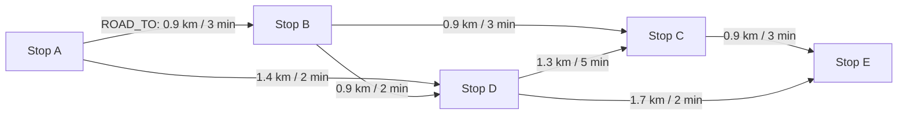
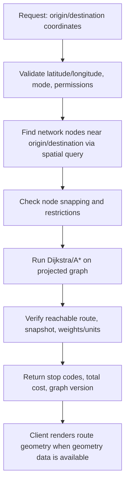

# Routing and Networks with Weighted or Spatial Data in Neo4j

## 1. How Does Routing Differ from Nearest-Point Queries?

A delivery application needs to answer questions such as: from warehouse **A** to drop-off point **E**, which road nodes should be traversed, what is the total distance, how long will it take, and if one segment is closed, what alternative routes remain? This is a **network routing** problem, where the most critical concern is not only the coordinates of points, but **the valid connections between them**.

Neo4j models this problem cleanly with a **property graph**:

- **Nodes** `:RouteStopDemo` represent intersections, stops, pickup/drop-off points, or network junctions.
- **Directed relationships** `:ROAD_TO` represent allowed travel from one point to another.
- **Relationship properties** hold costs such as `distanceKm`, `durationMin`, toll fees, risk scores, or open/closed status.
- **Spatial node properties** hold Neo4j `POINT` coordinates, alongside separate numeric `latitude` and `longitude` properties for Graph Data Science (GDS) algorithms.

Conceptual diagram:



**One problem, multiple valid answers depending on the objective:**

| Requirement | Optimization Criterion | Result on Illustrative Graph |
| --- | --- | --- |
| Fewest intermediate legs | Fewest relationships (*hop count*) | `A → D → E`: 2 hops |
| Shortest total road distance | Sum of `distanceKm` | `A → B → C → E`: **2.7 km** |
| Lowest total travel time | Sum of `durationMin` | `A → D → E`: **4 minutes** |
| Find stops near given coordinates | Geometric distance | List of stops with distance, **not yet a route** |
| Three lowest-distance alternatives | K weighted paths | Can use Yen's k-shortest paths |

The numbers shown are **synthetic data for learning algorithms**, not real-world travel times or road maps of any city. A straight line from A to E may be shorter than any path in the network, yet **does not guarantee a valid direct road connecting** those two points.

### 1.1. Three Concepts to Distinguish

1. **Shortest hop path:** optimizes the number of relationships traversed, ignoring `distanceKm` or `durationMin`.
2. **Weighted shortest path:** optimizes the **sum** of a weight property across the relationships along the route.
3. **Spatial proximity:** computes distances between coordinates or finds nodes within a geographic region; it does not traverse valid road network connections.

Cypher includes mechanisms for finding shortest paths by **hop count**; for **custom-weighted** routing and large networks, Neo4j **Graph Data Science (GDS)** provides algorithms such as Dijkstra, A*, and Yen's. GDS is a separate library/capability requiring compatible installation and licensing/permissions—**not** every Neo4j instance includes these procedures by default.

## 2. Modeling the Network and Choosing Weights

### 2.1. Choosing Nodes and Relationships with Exact Semantics

For a road network, nodes may represent:

- Intersections or junctions between road segments.
- Stops, stations, or transfer hubs.
- Warehouses, pickup points, or delivery stops.
- "State" nodes along a route when modeling turn rules or vehicle constraints.

A relationship represents an **allowed directed leg of travel**:

```text
(A:RouteStopDemo {code:'A'})
  -[:ROAD_TO {distanceKm:0.9, durationMin:3.0}]->
(B:RouteStopDemo {code:'B'})
```

For **one-way** streets, preserve `A → B` and **do not automatically infer `B → A`**. For two-way streets, create two directed relationships, as travel time, distance, or cost may differ by direction. Projecting as `UNDIRECTED` in GDS allows algorithms to traverse a one-way road in reverse—a domain bug unless explicitly intended.

### 2.2. Weights Must Have Clear Meaning and Units

| Example Property | Unit | Meaning | Used For |
| --- | --- | --- | --- |
| `distanceKm` | km | Traversable road segment length | Shortest-distance route |
| `durationMin` | minutes | Estimated travel time | Fastest route in current snapshot |
| `tollVnd` | VND | Toll paid when traversing segment | Lowest-toll route |
| `energyWh` | Wh | Estimated energy consumption | Energy-efficient route |
| `riskScore` | Normalized scale | Policy-defined risk | Lowest-risk route |
| `isOpen` | Boolean | Is the segment permitted for travel? | **Edge filtering**, not a substitute weight |

**Do not mix units blindly.** If the objective is distance, do not directly add `distanceKm` and `durationMin`. A multi-objective cost function must be defined deliberately, for example:

\[
\mathrm{cost}(e) = \alpha \cdot \mathrm{distanceKm}(e)
                  + \beta \cdot \mathrm{durationMin}(e)
                  + \gamma \cdot \mathrm{tollVnd}(e)
\]

Coefficients `α`, `β`, and `γ` must convert all quantities into a **common cost unit**, such as monetary equivalent or normalized priority points. The minimum total score is optimal with respect to **that cost function**, not automatically the shortest-km or fastest route.

For Dijkstra and A* in GDS, use **positive, finite numeric weights** per algorithm requirements. Never use negative weights to represent "discounts," missing data, or closed roads. Negative weights break algorithmic optimality guarantees; such cases require redesigning the cost model or choosing an algorithm that explicitly supports them. Missing or NaN weights must also be cleaned before projection.

### 2.3. Coordinates and Coordinate Reference Systems (CRS)

Neo4j supports `POINT` values across multiple coordinate systems:

- **Geographic WGS 84, SRID 4326:** longitude/latitude measured in **degrees**; `point.distance()` returns geodesic distance in **meters**.
- **Cartesian 2D:** x/y coordinates; `point.distance()` returns distance in whatever **coordinate unit** the application defines.

Example:

```cypher
RETURN point({longitude: 106.7000, latitude: 10.7700}) AS wgs84,
       point({x: 1000.0, y: 2000.0}) AS cartesian;
```

Neo4j interprets those two values under **different CRSs**. Never take latitude/longitude in degrees and treat them as x/y in meters; nor compare two `POINT` values from different CRSs in the same distance calculation.

A common bug is swapping `latitude` and `longitude`. For coordinates in Vietnam, latitude is typically around 10–23 degrees North and longitude around 102–110 degrees East. **Do not** treat this rule of thumb as complete geographic validation; always verify the CRS and actual source data.

### 2.4. Stable Stop Identifiers

Each stop should carry a business key such as `stopCode` or `code`:

```cypher
CREATE CONSTRAINT route_stop_demo_code_unique IF NOT EXISTS
FOR (s:RouteStopDemo)
REQUIRE s.code IS UNIQUE;
```

GDS returns an internal `nodeId` during computation, which is not a durable business ID to persist in APIs across imports, backups, or migrations. Always map results back to `code`, `stationId`, or the domain business key.

## 3. Creating a Practice Dataset of 5 Stops and 7 Segments

**Run all data-creation statements below only on a practice database you own.** Use the `RouteStopDemo` label and `ROAD_TO` relationship type isolated from production models.

### 3.1. Loading Nodes: `POINT` and Numeric Coordinates for GDS

```cypher
UNWIND [
  {code:'A', name:'Stop A', latitude:10.7700, longitude:106.7000},
  {code:'B', name:'Stop B', latitude:10.7700, longitude:106.7060},
  {code:'C', name:'Stop C', latitude:10.7700, longitude:106.7120},
  {code:'D', name:'Stop D', latitude:10.7770, longitude:106.7060},
  {code:'E', name:'Stop E', latitude:10.7700, longitude:106.7180}
] AS row
MERGE (s:RouteStopDemo {code:row.code})
SET s.name = row.name,
    s.latitude = toFloat(row.latitude),
    s.longitude = toFloat(row.longitude),
    s.location = point({
      latitude:toFloat(row.latitude),
      longitude:toFloat(row.longitude)
    });
```

Here:

- `location` is a Neo4j `POINT` property used for **spatial queries and indexes**.
- `latitude` and `longitude` are two `FLOAT` properties used by GDS A* as heuristic coordinates.
- Do not confuse `point({longitude,latitude})` with a plain map: Neo4j constructs a spatial value with a CRS.
- Mapping in Spring Data Neo4j or the Java Driver can use Neo4j Driver's `Point` or supported types; for map rendering, the API should return validated numeric lat/lon fields.

Check the node count:

```cypher
MATCH (s:RouteStopDemo)
RETURN count(s) AS numberOfStops;
```

On a clean demo database, expect **5 nodes**.

### 3.2. Loading Directed Relationships with Two Weight Properties

```cypher
UNWIND [
  {from:'A', to:'B', distanceKm:0.9, durationMin:3.0},
  {from:'B', to:'C', distanceKm:0.9, durationMin:3.0},
  {from:'C', to:'E', distanceKm:0.9, durationMin:3.0},
  {from:'A', to:'D', distanceKm:1.4, durationMin:2.0},
  {from:'D', to:'E', distanceKm:1.7, durationMin:2.0},
  {from:'B', to:'D', distanceKm:0.9, durationMin:2.0},
  {from:'D', to:'C', distanceKm:1.3, durationMin:5.0}
] AS segment
MATCH (a:RouteStopDemo {code:segment.from})
MATCH (b:RouteStopDemo {code:segment.to})
MERGE (a)-[r:ROAD_TO]->(b)
SET r.distanceKm = toFloat(segment.distanceKm),
    r.durationMin = toFloat(segment.durationMin),
    r.isOpen = true;
```

With fresh data, `MERGE` on the two-endpoint pattern lets you re-run the example without creating duplicate relationships of the same type between the same pair of nodes. This rule **only works because the fixture assumes at most one `ROAD_TO` per directed pair**; real road networks can have parallel lanes, routes, or modes, requiring a unique segment ID per edge.

Verify:

```cypher
MATCH (:RouteStopDemo)-[r:ROAD_TO]->(:RouteStopDemo)
RETURN count(r) AS numberOfRoads,
       min(r.distanceKm) AS minKm,
       min(r.durationMin) AS minMinutes;
```

Expected: **7 relationships**, `minKm = 0.9`, and `minMinutes = 2.0`.

### 3.3. Reading Segments in Deterministic Order

```cypher
MATCH (a:RouteStopDemo)-[r:ROAD_TO]->(b:RouteStopDemo)
RETURN a.code AS fromCode,
       b.code AS toCode,
       r.distanceKm AS distanceKm,
       r.durationMin AS durationMin
ORDER BY fromCode, toCode;
```

`ORDER BY` matters in tests: without it, Cypher row ordering is not guaranteed. Expected output:

| Segment | Km | Minutes |
| --- | ---: | ---: |
| A → B | 0.9 | 3 |
| A → D | 1.4 | 2 |
| B → C | 0.9 | 3 |
| B → D | 0.9 | 2 |
| C → E | 0.9 | 3 |
| D → C | 1.3 | 5 |
| D → E | 1.7 | 2 |

## 4. Spatial Queries: Coordinates, Radius, and Spatial Index

### 4.1. Geographic Distance Between Two Points

```cypher
MATCH (a:RouteStopDemo {code:'A'})
MATCH (e:RouteStopDemo {code:'E'})
RETURN point.distance(a.location, e.location) AS straightLineMeters;
```

With two WGS-84 `POINT`s, `point.distance` returns meters along the estimated geodesic surface of the Earth. The straight-line A–E distance is roughly **2 km**, **not** driving distance. In the fixture, the shortest-distance network route A–B–C–E is still **2.7 km**.

### 4.2. Creating a Point Index

```cypher
CREATE POINT INDEX route_stop_demo_location_idx IF NOT EXISTS
FOR (s:RouteStopDemo)
ON (s.location);
```

A `POINT INDEX` is a **performance index** helping Cypher filter by distance or bounding box on spatial properties. It **does not** create road edges or optimize weighted pathfinding.

Verify the index exists and check its population status:

```cypher
SHOW INDEXES
YIELD name, type, state, populationPercent
WHERE name = 'route_stop_demo_location_idx'
RETURN name, type, state, populationPercent;
```

Before benchmarking, wait until the index reaches `ONLINE` state. Whether the query planner uses the index depends on expressions, statistics, and cost estimates.

### 4.3. Finding Points Within a Radius

```cypher
WITH point({
  latitude:$latitude,
  longitude:$longitude
}) AS center, toFloat($radiusMeters) AS radiusMeters
MATCH (s:RouteStopDemo)
WHERE point.distance(s.location, center) <= radiusMeters
RETURN s.code AS code,
       s.name AS name,
       point.distance(s.location, center) AS meters
ORDER BY meters ASC, code ASC
LIMIT 20;
```

Sample parameters to test: `latitude = 10.7700`, `longitude = 106.7000`, `radiusMeters = 1500`. The query returns stops inside the region by **geometric distance**, without excluding points across a river, on closed streets, or at unreachable road nodes.

**Why include `code ASC`?** Two stops can have identical distances; adding a tie-breaker ID ensures deterministic ordering for APIs and tests.

### 4.4. Finding Points Within a Bounding Box

```cypher
MATCH (s:RouteStopDemo)
WHERE point.withinBBox(
  s.location,
  point({longitude:106.6990, latitude:10.7690}),
  point({longitude:106.7190, latitude:10.7790})
)
RETURN s.code AS code, s.location AS location
ORDER BY code;
```

A bounding box filters by a **coordinate rectangle**, neither "drivable reachability" nor a circular radius. In a real routing system, there are usually two steps:

1. Use spatial queries to identify network nodes/stops **near** the origin and destination coordinates.
2. Select valid nodes and run a **routing algorithm over network relationships**.

The two steps evaluate different criteria. A stop with the smallest straight-line distance is not necessarily the stop with the lowest network travel time.

### 4.5. Checking Whether the Point Index Is Used

```cypher
EXPLAIN
MATCH (s:RouteStopDemo)
WHERE point.distance(
  s.location,
  point({longitude:106.7000, latitude:10.7700})
) < 1000.0
RETURN s.code AS code;
```

Inspect the execution plan to see whether it aligns with the point index. `EXPLAIN` only builds the plan; `PROFILE` executes the query and records runtime statistics (subject to permissions). Never extrapolate from 5 demo nodes to assert an index will behave identically on a real network of millions of nodes.

## 5. Cypher Shortest Path Optimizes **Hop Count**, Not Total Weight

On the practice dataset:

```cypher
MATCH (source:RouteStopDemo {code:'A'})
MATCH (target:RouteStopDemo {code:'E'})
MATCH path = shortestPath((source)-[:ROAD_TO*]->(target))
RETURN [n IN nodes(path) | n.code] AS route,
       length(path) AS hops;
```

Expected: `route = ['A','D','E']` and `hops = 2`, because that is the route with the fewest relationships in the fixture. `shortestPath(...)` (classic Cypher syntax, still supported) **does not automatically sum** `distanceKm` or `durationMin`.

Newer Cypher versions also support **`SHORTEST 1`**, **`ALL SHORTEST`**, and quantified path patterns; these select shortest paths by **pattern length / hop count**, rather than automatically becoming weighted Dijkstra. When targeting Cypher 5/25, verify syntax and support on the target server.

### 5.1. Summing Weights for an Already-Chosen Path

```cypher
MATCH (source:RouteStopDemo {code:'A'})
MATCH (target:RouteStopDemo {code:'E'})
MATCH path = shortestPath((source)-[:ROAD_TO*]->(target))
RETURN [n IN nodes(path) | n.code] AS route,
       length(path) AS hops,
       reduce(km = 0.0, r IN relationships(path) |
         km + r.distanceKm) AS totalKm,
       reduce(minutes = 0.0, r IN relationships(path) |
         minutes + r.durationMin) AS totalMinutes;
```

Expected: route A–D–E has **3.1 km** and **4 minutes**. This computes the **cost of the already-selected path**, rather than changing `shortestPath`'s objective: it picks the 2-hop route first and sums weights afterward.

### 5.2. Enumerating and Sorting Paths Only Fits Tiny Demo Networks

```cypher
MATCH (source:RouteStopDemo {code:'A'})
MATCH (target:RouteStopDemo {code:'E'})
MATCH path = (source)-[:ROAD_TO*1..4]->(target)
WITH path,
     reduce(km = 0.0, r IN relationships(path) |
       km + r.distanceKm) AS totalKm,
     [n IN nodes(path) | n.code] AS route
RETURN route, totalKm
ORDER BY totalKm ASC, route ASC
LIMIT 1;
```

On the fixture, this query picks `A → B → C → E` at **2.7 km**. However, this merely **enumerates all paths up to four hops** and sorts them—it is not general Dijkstra's algorithm. On real branching networks, path counts grow explosively; capping length at `*1..4` can also miss optimal routes longer than four hops. Use GDS weighted pathfinding for large networks.

## 6. Loading the Network into Neo4j Graph Data Science

### 6.1. Checking GDS Availability

GDS is a **graph analytics library** installed and provisioned per Neo4j environment and account permissions. It uses an in-memory **projected graph** to run algorithms repeatedly without rescanning the entire database each time.

```cypher
RETURN gds.version() AS gdsVersion;
```

If this reports an unknown function, check GDS installation/enablement, Neo4j version, procedure execution privileges, and the Aura tier if applicable. Examples here use **current GDS** APIs. Do not assume a Community Edition database automatically includes all GDS algorithms or full enterprise licensing features.

### 6.2. Projecting Nodes, Numeric Coordinates, and Relationship Weights

```cypher
CALL gds.graph.project(
  'route_demo',
  'RouteStopDemo',
  {
    ROAD_TO: {
      orientation:'NATURAL',
      properties:['distanceKm', 'durationMin']
    }
  },
  {
    nodeProperties:['latitude', 'longitude']
  }
)
YIELD graphName, nodeCount, relationshipCount, projectMillis
RETURN graphName, nodeCount, relationshipCount, projectMillis;
```

Explanation:

- `route_demo`: graph name inside **GDS's in-memory catalog**, not a new Neo4j database name.
- `RouteStopDemo`: projects only nodes carrying that label.
- `ROAD_TO`: includes only demo network relationships whose endpoints are in the projected node set.
- `orientation:'NATURAL'`: preserves **one-way direction**, preventing accidental reverse edges.
- `distanceKm` and `durationMin`: projected onto the graph so algorithms can optimize either objective.
- `latitude` and `longitude`: **numeric** properties suitable for GDS A*. The Neo4j `POINT` property `location` is **not** automatically included in this projection.

On a clean fixture, expect `nodeCount = 5` and `relationshipCount = 7`. Verify:

```cypher
CALL gds.graph.list('route_demo')
YIELD graphName, nodeCount, relationshipCount, schema
RETURN graphName, nodeCount, relationshipCount, schema;
```

**Important:** GDS native projection loads only the selected nodes, relationships, and properties at projection time. It **does not auto-update** on subsequent Neo4j transactions. If you update `durationMin` after projecting, GDS continues using stale values until you re-project or refresh through a supported workflow.

Projecting another graph with an already-existing name raises an error. Use unique names per run/job, or check `gds.graph.exists` and only drop graphs **you own** when no job is still using them:

```cypher
CALL gds.graph.exists('route_demo')
YIELD graphName, exists
RETURN graphName, exists;
```

### 6.3. Estimating Memory for Large Graphs

In production, estimate memory for both **the projected graph and the algorithm**. Example once `route_demo` exists:

```cypher
MATCH (source:RouteStopDemo {code:'A'})
MATCH (target:RouteStopDemo {code:'E'})
CALL gds.shortestPath.dijkstra.stream.estimate(
  'route_demo',
  {
    sourceNode:source,
    targetNodes:target,
    relationshipWeightProperty:'distanceKm'
  }
)
YIELD nodeCount, relationshipCount, requiredMemory
RETURN nodeCount, relationshipCount, requiredMemory;
```

Estimates depend on graph size, properties, and configuration. Never extrapolate RAM requirements for a million-node network from a 5-stop graph; rely on actual metrics and `gds.graph.list` in your target environment.

## 7. Dijkstra: Optimizing Total Relationship Weight

### 7.1. Principle

**Dijkstra** finds the lowest-total-cost path when weights satisfy the algorithm's **non-negative/positive** requirements. It starts at the source node, expands candidate paths in order of known cumulative cost, and locks in the optimal cost upon reaching the target.

Along the three-leg route A–B–C–E:

\[
\mathrm{distanceKm}(A,B,C,E) = 0.9 + 0.9 + 0.9 = 2.7
\]

Along the two-leg route A–D–E:

\[
\mathrm{distanceKm}(A,D,E) = 1.4 + 1.7 = 3.1
\]

Thus, the route with fewer hops is **not necessarily** the route with fewer kilometers.

### 7.2. Dijkstra by Distance

```cypher
MATCH (source:RouteStopDemo {code:'A'})
MATCH (target:RouteStopDemo {code:'E'})
CALL gds.shortestPath.dijkstra.stream(
  'route_demo',
  {
    sourceNode:source,
    targetNodes:target,
    relationshipWeightProperty:'distanceKm'
  }
)
YIELD index, sourceNode, targetNode, totalCost, nodeIds, costs
RETURN index,
       [nodeId IN nodeIds | gds.util.asNode(nodeId).code] AS route,
       totalCost AS totalKm,
       costs AS cumulativeKm
ORDER BY index;
```

Expected on the demo dataset:

| route | totalKm | cumulativeKm |
| --- | ---: | --- |
| `['A','B','C','E']` | **2.7** | `[0.0, 0.9, 1.8, 2.7]` |

`totalCost` carries the **unit of the weight property**—here, kilometers. `costs` holds the **cumulative** cost at each node along the path, not individual edge weights. When comparing floating-point results in Java, use a small tolerance rather than exact bitwise equality.

**Syntax note:** in current GDS, `targetNodes` accepts a single node or a list of nodes; the singular `targetNode` parameter in Source-Target Dijkstra is **deprecated**. Examples in this lesson use `targetNodes` to avoid deprecated APIs.

### 7.3. Dijkstra by Travel Time

Simply switch the weight property name—**no need to re-project the graph** if both properties were already projected:

```cypher
MATCH (source:RouteStopDemo {code:'A'})
MATCH (target:RouteStopDemo {code:'E'})
CALL gds.shortestPath.dijkstra.stream(
  'route_demo',
  {
    sourceNode:source,
    targetNodes:target,
    relationshipWeightProperty:'durationMin'
  }
)
YIELD totalCost, nodeIds
RETURN [nodeId IN nodeIds | gds.util.asNode(nodeId).code] AS route,
       totalCost AS totalMinutes;
```

Expected: `route = ['A','D','E']`, `totalMinutes = 4.0`. The shortest-km route A–B–C–E takes **9 minutes**, so the two criteria lead to **two different choices**.

If a weight property is not projected, misspelled, or contains invalid values, the algorithm may fail or return unexpected results. Before running in production, inspect the projection schema and validate source data.

### 7.4. Multiple Targets from One Source

In logistics dispatch, you may want the **closest drop-off stop by travel time**, not merely by coordinate distance:

```cypher
MATCH (start:RouteStopDemo {code:'A'})
MATCH (destination:RouteStopDemo)
WHERE destination.code IN ['C','E']
WITH start, collect(destination) AS destinations
CALL gds.shortestPath.dijkstra.stream(
  'route_demo',
  {
    sourceNode:start,
    targetNodes:destinations,
    relationshipWeightProperty:'durationMin'
  }
)
YIELD targetNode, totalCost, nodeIds
RETURN gds.util.asNode(targetNode).code AS destination,
       totalCost AS totalMinutes,
       [id IN nodeIds | gds.util.asNode(id).code] AS route
ORDER BY totalMinutes ASC, destination ASC;
```

On the fixture, stop E has a **4-minute** fastest route, whereas reaching C via A–B–C takes **6 minutes**. Thus, if delivery stops C and E are both acceptable, E wins by *network travel time*, even though straight-line distance might rank them differently.

With many origins/destinations, repeated Dijkstra calls can be costly; use appropriate batching, snapshots, and result limits rather than pushing all pairs into an unrestricted online request.

### 7.5. When No Valid Route Exists

If there is no directed path from source to target, the algorithm typically returns zero path rows for that pair. In your API:

- **Source or target not found:** input/ID validation error.
- **Both nodes exist, but no path:** return `NO_ROUTE` (or equivalent domain status).
- **Path exists, but weights are missing/invalid:** data/model quality error; never silently coerce to 0.
- **Missing or stale projection:** infrastructure/job state, handle separately.

Never return `totalCost = 0` to signify "no route": 0 can be a valid cost in special models and causes ambiguity.

## 8. A*: Combining Edge Weights with Coordinate Heuristics

### 8.1. Mechanism and Heuristic Constraints

**A\*** also solves the weighted shortest-path problem, guided by an estimate of remaining cost to the target:

\[
f(n)=g(n)+h(n)
\]

- `g(n)` is the total cost already accumulated from source to node `n`.
- `h(n)` is a **lower-bound** estimate of the cost from `n` to the target.
- Only when the heuristic is **admissible** (never overestimates the true optimal remaining cost) does A* guarantee finding the optimal path under its assumptions.

GDS A* uses a **Haversine heuristic based on latitude/longitude**, documented by GDS as computed in **nautical miles**. Consequently, **edge weights should represent distance**, ideally aligned with the heuristic's unit. GDS docs note km/mile weights also work, though the heuristic behaves best when aligned with nautical miles. <https://neo4j.com/docs/graph-data-science/current/algorithms/astar/>

**Do not blindly apply this geographic A* to `durationMin`:** a distance heuristic (in nautical miles) does not share units or meaning with minutes and can **overestimate** real travel time without careful scaling and verification. Dijkstra with `durationMin` is the clearer choice here.

Do not conflate:

- Cypher WGS-84 `point.distance()`, which returns **meters**.
- GDS A*'s heuristic, which computes **nautical miles** per GDS docs.
- This lesson's `distanceKm`, which is in **kilometers**, the unit of returned `totalCost`.

**Do not add numbers in those three units directly** without normalization. In the demo dataset, edge distances exceed the direct geodesic distance between endpoints, so the nautical-mile heuristic remains a valid lower bound for `distanceKm`. In production data, verify this property; if a "distance" weight is ever smaller than straight-line geographic distance (due to measurement errors, ferries/flights, or synthetic shortcuts), optimality guarantees can break.

### 8.2. Running GDS A* on the Same Graph

```cypher
MATCH (source:RouteStopDemo {code:'A'})
MATCH (target:RouteStopDemo {code:'E'})
CALL gds.shortestPath.astar.stream(
  'route_demo',
  {
    sourceNode:source,
    targetNode:target,
    latitudeProperty:'latitude',
    longitudeProperty:'longitude',
    relationshipWeightProperty:'distanceKm'
  }
)
YIELD totalCost, nodeIds, costs
RETURN [id IN nodeIds | gds.util.asNode(id).code] AS route,
       totalCost AS totalKm,
       costs AS cumulativeKm;
```

Expect the same optimal route **A–B–C–E, 2.7 km** as Dijkstra. On a 5-node graph, A* is **not necessarily faster** than Dijkstra; heuristic computation overhead can outweigh the node expansions saved. Heuristic gains must be measured on networks of realistic size and topology.

**Do not omit the two coordinate properties from the projection.** GDS A* requires numeric `latitudeProperty` and `longitudeProperty` node properties in the graph catalog; having only a `POINT` property `location` on Neo4j nodes without projecting the two numeric properties will fail this example.

### 8.3. Choosing Between Dijkstra and A*

| Scenario | Typical Choice | Reason |
| --- | --- | --- |
| Optimizing positive `durationMin` | **Dijkstra** | No geographic heuristic needed; exact minute units |
| Optimizing distance with accurate coordinates | **A\*** or Dijkstra for comparison | Haversine heuristic can guide search |
| Topology only, no weights | Cypher shortest-hop / BFS | Objective is hop count |
| One source, multiple targets | Dijkstra source-targets or single-source | Pick variant by target count and needed output |
| Multiple backup routes needed | Yen's k-shortest | Returns more than one route |
| Time-of-day or vehicle constraints | State-expanded model + suitable algorithm | Costs depend on state or arrival time |

## 9. Yen's: Finding Multiple Lowest-Cost Routes

Delivery systems often need alternative routes when the top route is congested or when trading off tolls against travel time.

**Yen's k-shortest paths** in GDS returns up to `k` routes ranked by total weight, not `k` nearest nodes.

```cypher
MATCH (source:RouteStopDemo {code:'A'})
MATCH (target:RouteStopDemo {code:'E'})
CALL gds.shortestPath.yens.stream(
  'route_demo',
  {
    sourceNode:source,
    targetNode:target,
    k:3,
    relationshipWeightProperty:'distanceKm'
  }
)
YIELD index, totalCost, nodeIds
RETURN index,
       [id IN nodeIds | gds.util.asNode(id).code] AS route,
       totalCost AS totalKm
ORDER BY totalKm, index;
```

On the fixture, three routes are expected:

| Rank | Route | Total km |
| ---: | --- | ---: |
| 1 | A → B → C → E | **2.7** |
| 2 | A → D → E | **3.1** |
| 3 | A → B → D → E | **3.5** |

In GDS, Yen's with `k:1` is equivalent to finding a single shortest path like Dijkstra on the same graph. When multiple routes have **tied total costs**, ordering among tied routes may vary; APIs requiring strict determinism need a tie-breaker over the node sequence.

Do not mistake the top three routes for three **disjoint** routes: Yen's may return paths sharing nodes or road segments. If business rules require **low-overlap** backup routes, add edge-disjoint constraints, penalties, and domain filtering; default k-shortest paths do not guarantee route diversity.

## 10. BFS, Reachability, and Other Network Algorithms

**Breadth-First Search (BFS)** visits nodes layer by layer from a source, useful when you need to:

- Identify stops reachable within at most `N` hops.
- Find service zones by transfer count.
- Detect isolated or disconnected parts of the network after an outage.

```cypher
MATCH (source:RouteStopDemo {code:'A'})
CALL gds.bfs.stream('route_demo', {
  sourceNode:source,
  maxDepth:2
})
YIELD nodeIds
RETURN [id IN nodeIds | gds.util.asNode(id).code] AS visitedCodes;
```

This list is the **visited nodes**, **not** an optimal route for every pair of nodes. Never treat BFS `nodeIds` ordering as a guaranteed API order; normalize into a set or sort explicitly when asserting reachability in tests.

Additional algorithms for network problems:

| Problem | Algorithm / Approach |
| --- | --- |
| Partitioning mutually reachable network regions | Weakly/Strongly Connected Components per direction semantics |
| Measuring junction criticality | Betweenness/Centrality, with domain interpretation |
| One source to all reachable nodes | Single-Source Dijkstra when weights apply |
| Routing across many pairs | Batched runs, or all-pairs at evaluated scale |
| Multiple delivery stops with capacity limits | Vehicle Routing Problem / TSP variants with a dedicated solver |
| Complex turn restrictions and opening hours | State/time-expanded graph or specialized domain solver |

**Point-to-point Dijkstra does not solve the Vehicle Routing Problem (VRP).** VRP also decides **stop visitation order**, fleet size, vehicle capacities, time windows, and driver constraints. Neo4j can supply the network graph and distance/time matrix between stops, while schedule optimization typically belongs in a dedicated solver.

## 11. Road Closures, Turn Restrictions, Vehicle Limits, and Time-Dependent Data

### 11.1. Closing an Edge Alters Graph Validity

Suppose segment D → E is blocked:

```cypher
MATCH (:RouteStopDemo {code:'D'})
      -[road:ROAD_TO]->
      (:RouteStopDemo {code:'E'})
SET road.isOpen = false;
```

**Never** set `durationMin = -1` to mean closed: Dijkstra and A* rely on positive weights, and `-1` can corrupt routing results. **Avoid** relying solely on huge sentinel weights instead of filtering edges: if alternative routes have high costs or a road is strictly forbidden, a forbidden edge might still appear in results.

If the GDS graph `route_demo` was already projected, updating `road.isOpen` in Neo4j **does not remove that edge** from the existing projection. Moreover, the original projection only loaded `distanceKm`/`durationMin`, **not `isOpen`**, and did not filter on it.

### 11.2. Projecting Only Currently Open Roads

You can use GDS **Cypher projection** to filter valid edges at projection time:

```cypher
MATCH (source:RouteStopDemo)-[r:ROAD_TO]->(target:RouteStopDemo)
WHERE coalesce(r.isOpen, true) = true
RETURN gds.graph.project(
  'route_open_demo',
  source,
  target,
  {
    sourceNodeProperties:source { .latitude, .longitude },
    targetNodeProperties:target { .latitude, .longitude },
    relationshipProperties:r { .distanceKm, .durationMin }
  }
) AS projection;
```

This creates **a new graph** containing only relationships that were open in the query snapshot. Nodes **not included in any matched segment** will be absent from the projection; if isolated nodes must appear, design the projection to include them explicitly.

Run fastest-route search on the newly projected graph:

```cypher
MATCH (source:RouteStopDemo {code:'A'})
MATCH (target:RouteStopDemo {code:'E'})
CALL gds.shortestPath.dijkstra.stream(
  'route_open_demo',
  {
    sourceNode:source,
    targetNodes:target,
    relationshipWeightProperty:'durationMin'
  }
)
YIELD totalCost, nodeIds
RETURN [id IN nodeIds | gds.util.asNode(id).code] AS route,
       totalCost AS totalMinutes;
```

With D → E closed, the fastest route switches to **A–B–C–E, 9 minutes**. Route A–D–C–E takes 10 minutes; routing via B then D takes even longer.

**Do not drop `route_demo` if another job still uses it.** After the exercise, drop `route_open_demo` only once no caller needs it:

```cypher
CALL gds.graph.drop('route_open_demo', false)
YIELD graphName
RETURN graphName;
```

To reset the fixture, reopen the edge:

```cypher
MATCH (:RouteStopDemo {code:'D'})-[r:ROAD_TO]->
      (:RouteStopDemo {code:'E'})
SET r.isOpen = true;
```

### 11.3. Vehicle Restrictions and Turn Prohibitions

Real road networks involve more than single-edge properties:

- Trucks are prohibited over weight-limited bridges.
- Motorcycles are barred from certain highways.
- An intersection forbids a **left turn** from segment X onto segment Y, even though both segments are open individually.
- Roads are only open during certain hours of the day.
- Traversal cost on a segment depends on **arrival time**, not just departure time.

For vehicle bans, add properties like `allowedVehicleTypes` and **filter** when projecting per vehicle class, or design separate relationship types. Never assume `gds.shortestPath.dijkstra.stream` knows domain rules not encoded in the projected graph's topology or weights.

A **turn prohibition** is a constraint across **two consecutive segments**, not a standalone node property. Modeling nodes as intersections and relationships as road segments can be **insufficient** to express "you may enter this intersection from X, but not turn onto Y." Instead, you can model **incoming/outgoing segment states** as nodes or state transitions, then route on a **state-expanded graph**. That enlarges the graph but captures turn constraints accurately.

### 11.4. Time-Dependent Weights Cannot Always Be Summed Statically

Suppose `durationMin` comes from traffic feeds:

```text
08:00 — A→D: 2 min, D→E: 2 min
08:30 — A→D: 8 min, D→E: 12 min
```

Dijkstra on a projected graph where each edge carries **one static value** optimizes only for **the chosen weight snapshot**. It does not automatically handle:

- Congestion shifting **while the vehicle is en route**.
- Transit/ferry departure timetables and waiting times.
- Rest breaks, curfews, or time-of-day access bans.
- "Must arrive before 17:00" deadlines or arrival-time-dependent costs.

True time-dependent routing requires time-dependent cost models, specialized algorithms, or time/state-expanded graphs; never run Dijkstra on an 08:00 `durationMin` snapshot and claim it remains optimal at all departure times.

### 11.5. Refresh and Versioning Strategy for Projected Graphs

A continuously running routing service should maintain:

1. **Source data version** and timestamp/update batch processed.
2. **Versioned graph names per load**, e.g. `route_20261125_0800`, avoiding dropping a shared graph while requests are in flight.
3. **Quality checks** on node/edge counts, missing weights, directionality, and connectivity before promoting a new graph to serve traffic.
4. **Controlled traffic cutover** to the new version once ready.
5. **Dropping old graphs** only after no active query references them.

GDS graphs live in memory and vanish if the database/DBMS restarts. Application startup and routing handlers must check **whether the projected graph exists**, rather than assuming a configured graph name guarantees loaded data.

## 12. Application Flow: Combining Spatial Queries and Pathfinding

A request such as "deliver from user's location to recipient address" typically flows as:



### 12.1. "Snapping" Coordinates to the Network Requires Business Rules

A GPS point may sit:

- On the opposite side of a divided one-way street.
- Over an expressway when the vehicle is a bicycle.
- Geometrically close to an overpass with no on-ramp access.
- Inside a restricted zone, port, or private road.

Thus, nearest-node lookup via `point.distance` only produces **snapping candidates**. You must verify travel mode, heading, connectivity, GPS accuracy, and local road rules before locking in origin/destination nodes.

In our demo, stops are fixed road nodes; snapping partway along a road segment (edge snapping) is not modeled. Real map routing requires segment geometry, turn connectivity, and access nodes to avoid generating illegal routes.

### 12.2. GDS Returns a Sequence of Nodes, Not Detailed Polylines

GDS `nodeIds`/`path` represents a walk across **nodes and relationships**. Along curved roads, a single edge between two intersections needs **polyline geometry** with intermediate vertices to render accurately on a map.

Do not simply connect intersection coordinates with straight lines and call it a real road route. Typically:

- Store road segment shapes/geometries in a suitable map data store.
- Attach stable segment IDs onto relationships.
- Use the returned path to look up segments and stitch each segment's geometry **in the direction of travel**.
- Return GeoJSON or a suitable frontend format with consistent CRS and precision.

Node sequences, total cost, and polyline geometry are **three distinct API data layers**. This lab returns only **stop codes**, not real-world road-level route geometry.

### 12.3. Response Structure

Illustrative API response design:

```json
{
  "fromCode": "A",
  "toCode": "E",
  "optimization": "distanceKm",
  "routeCodes": ["A", "B", "C", "E"],
  "totalCost": 2.7,
  "unit": "km",
  "graphVersion": "route_demo",
  "status": "FOUND"
}
```

This is an **illustrative JSON shape**, not a built-in GDS output. In production, when using versioned graph names, return the actual data snapshot version rather than a hardcoded name, and avoid exposing sensitive internal topology details to unauthorized clients.

When no route exists, return an explicit status such as `status = 'NO_ROUTE'` without fabricating node sequences or costs. For invalid origin/destination IDs, return a distinct input error.

## 13. Integrating via Neo4j Java Driver

In a Java backend, `Driver` should be reused as a singleton/bean, while `Session` and transactions are short-lived. The example below invokes **GDS Dijkstra stream** and maps results to a DTO, assuming `route_demo` was already projected by a job with appropriate catalog permissions.

```java
import java.util.List;
import java.util.Map;
import java.util.Optional;

import org.neo4j.driver.Driver;
import org.neo4j.driver.Record;
import org.neo4j.driver.Session;
import org.neo4j.driver.SessionConfig;
import org.neo4j.driver.Value;

public final class RouteQueryService {
    private final Driver driver;

    public record RouteResult(List<String> codes, double totalKm) {}

    public RouteQueryService(Driver driver) {
        this.driver = driver;
    }

    public Optional<RouteResult> shortestByDistance(
            String fromCode, String toCode) {
        if (fromCode == null || fromCode.isBlank()
                || toCode == null || toCode.isBlank()) {
            throw new IllegalArgumentException(
                "Invalid source/target stop code");
        }

        try (Session session = driver.session(
                SessionConfig.forDatabase("neo4j"))) {
            return session.executeRead(tx -> {
                List<Record> rows = tx.run("""
                    MATCH (source:RouteStopDemo {code:$fromCode})
                    MATCH (target:RouteStopDemo {code:$toCode})
                    CALL gds.shortestPath.dijkstra.stream(
                      'route_demo', {
                        sourceNode:source,
                        targetNodes:target,
                        relationshipWeightProperty:'distanceKm'
                      }
                    )
                    YIELD totalCost, nodeIds
                    RETURN
                      [id IN nodeIds |
                        gds.util.asNode(id).code] AS codes,
                      totalCost AS totalKm
                    """, Map.of(
                        "fromCode", fromCode,
                        "toCode", toCode
                    )).list();

                if (rows.isEmpty()) {
                    return Optional.empty();
                }
                Record row = rows.get(0);
                return Optional.of(new RouteResult(
                    row.get("codes").asList(Value::asString),
                    row.get("totalKm").asDouble()
                ));
            });
        }
    }
}
```

Notes:

- `SessionConfig.forDatabase("neo4j")` is an **example database name**; in production, target the database holding `RouteStopDemo` and the corresponding projected graph.
- Parameters `$fromCode`/`$toCode` prevent interpolating user input into Cypher; never build `MATCH` clauses by string concatenation.
- `Optional.empty()` here conflates **non-existent ID** and **no path found**; production APIs should check node existence separately to return distinct error codes.
- Errors like missing GDS graph, missing procedure privileges, or timeouts must be handled **separately** from `Optional.empty()`, never masked as "NO_ROUTE".
- `executeRead` denotes a read transaction. Dijkstra `stream` does not mutate properties or relationships in the underlying Neo4j database.
- If the app uses versioned GDS graph names, pass only server-validated/allowlisted graph names rather than letting callers pick arbitrary internal graph names.

The Java Driver can be configured with `neo4j+s://...` URIs, credentials from a secret manager, and cluster routing. Because a single routing request may execute multiple queries (snap, route, enrich), agree on **consistent snapshot/freshness expectations**; reading updated coordinates in a new transaction will not update an older GDS projection.

### 13.1. "Many Requests, One Graph" vs. "Re-Project per Request"

Projecting a large graph on **every HTTP request** is expensive in CPU and RAM and causes catalog contention. Typically:

- A background job loads/refreshes the graph on an approved cadence.
- Backend queries run repeatedly against the projected graph.
- When the graph changes, the system publishes a new version.
- Clients receive the version in responses for debugging/reconciliation.
- The GDS catalog is cleaned up systematically so old graph versions do not accumulate indefinitely.

If your application requires sub-second routing over constantly mutating live traffic, evaluate whether GDS refresh intervals meet SLAs or whether a continuously updated specialized routing engine is required.

## 14. Spring Data Neo4j: Modeling Data and Running Algorithms

Spring Data Neo4j (SDN) fits managing domain **entities** and relationships. Partial node mapping:

```java
import org.springframework.data.neo4j.core.schema.Id;
import org.springframework.data.neo4j.core.schema.Node;
import org.springframework.data.annotation.Version;

@Node("RouteStopDemo")
public class RouteStop {
    @Id
    private String code;

    @Version
    private Long version;

    private String name;
    private Double latitude;
    private Double longitude;

    public String getCode() { return code; }
    public String getName() { return name; }
    public Double getLatitude() { return latitude; }
    public Double getLongitude() { return longitude; }
}
```

This example maps only scalar properties; to map Neo4j `POINT` `location`, use a supported SDN spatial type or custom converter rather than assuming `java.awt.Point` works automatically.

**SDN repositories do not compute Dijkstra** inside `findById` or `save`. To invoke GDS, use **custom Cypher** via `Neo4jClient` or the Java Driver.

Example reading a route with `Neo4jClient`:

```java
import java.util.List;
import java.util.Map;
import java.util.Optional;
import org.neo4j.driver.Value;
import org.springframework.data.neo4j.core.Neo4jClient;

public final class GraphRouteReader {
    private final Neo4jClient client;

    public record Route(List<String> codes, double km) {}

    public GraphRouteReader(Neo4jClient client) {
        this.client = client;
    }

    public Optional<Route> findRoute(String from, String to) {
        return client.query("""
            MATCH (start:RouteStopDemo {code:$from})
            MATCH (finish:RouteStopDemo {code:$to})
            CALL gds.shortestPath.dijkstra.stream(
              'route_demo', {
                sourceNode:start,
                targetNodes:finish,
                relationshipWeightProperty:'distanceKm'
              }
            )
            YIELD totalCost, nodeIds
            RETURN
              [id IN nodeIds | gds.util.asNode(id).code] AS codes,
              totalCost AS km
            """)
            .bindAll(Map.of("from", from, "to", to))
            .fetchAs(Route.class)
            .mappedBy((typeSystem, record) ->
                new Route(
                    record.get("codes").asList(Value::asString),
                    record.get("km").asDouble()
                )
            )
            .one();
    }
}
```

Production applications should apply appropriate read transaction boundaries, timeouts, missing-GDS/graph error handling, account authorization, and clean DTO/HTTP error mapping. When updating `durationMin` weights on relationships, use a consistent write transaction / `Neo4jClient` / repository flow, **then proactively refresh the projection**.

## 15. Testing Routes Against Expected Data

### 15.1. Expected Results on the Fixture

| Case | Expected |
| --- | --- |
| `numberOfStops` | 5 |
| `numberOfRoads` | 7 |
| A to E, fewest hops | `A,D,E` — 2 hops |
| Dijkstra by `distanceKm` | `A,B,C,E` — 2.7 km |
| Dijkstra by `durationMin` | `A,D,E` — 4 minutes |
| A* by `distanceKm` | `A,B,C,E` — 2.7 km |
| Yen `k=3` by km | `A,B,C,E` / `A,D,E` / `A,B,D,E` |
| Close D → E and re-project | Fastest route `A,B,C,E` — 9 minutes |
| A → A | Algorithm/model-dependent; define explicit "stay in place" semantics |
| E → A | No directed path on the fixture |

Tests should assert **exact codes and sequence** when a unique route is expected. For floating-point costs, use a tolerance:

```java
import static org.junit.jupiter.api.Assertions.*;

var route = routeService.shortestByDistance("A", "E")
    .orElseThrow();

assertEquals(List.of("A", "B", "C", "E"), route.codes());
assertEquals(2.7, route.totalKm(), 1e-9);
```

This snippet is the body of a test method assuming `routeService`, `List`, and JUnit 5 are set up. Do not treat it as a standalone test class without fixture setup, graph projection, and a Neo4j connection.

### 15.2. Never Leave Cypher Test Ordering Nondeterministic

```cypher
MATCH (s:RouteStopDemo)
RETURN s.code AS code
ORDER BY code ASC;
```

Expect `['A','B','C','D','E']`. When multiple paths tie on total cost, if a test requires **a single deterministic route**, enforce a tie-breaking rule or accept any equally optimal route. Never rely on relationship insertion order or internal node IDs.

### 15.3. Failure-Mode Routing Tests

At minimum, also test:

- Missing origin or destination node: return input/data error.
- Both nodes exist, but **unreachable** under allowed directions.
- Edges with `null`, negative, NaN, or mismatched-unit weights; ingestion/job must fail validation or filter per policy.
- **Asymmetric two-way** edges: avoid assuming B→A has the same cost as A→B.
- Multiple parallel edges between the same two stops: model with distinct segment IDs so `MERGE` does not collapse them.
- Mutate `isOpen` **after projection** to verify GDS does not automatically pick up live Neo4j edits.
- Missing GDS plugin/permissions, dropped graph catalog, or database restart.
- Swapped lat/lon coordinates or mismatched CRS.
- A* returning higher cost than Dijkstra when heuristic preconditions hold: investigate data, units, or projection.

### 15.4. JUnit and Testcontainers

For integration tests, run **real Neo4j** via Testcontainers/JUnit to verify Cypher syntax, graph projections, and results. If the container includes Neo4j **without GDS**, `gds.shortestPath...` tests will fail due to missing procedures; use a test image/server with a compatible GDS version or tag those tests into a dedicated integration suite.

Never mock `Neo4jClient` and conclude that Dijkstra/GDS logic works; mocks only exercise Java glue code, not Cypher, edge direction, or graph projections. Isolate fixtures, clean up named graphs after each test, and avoid running parallel tests against the same graph catalog name.

## 16. Performance, Consistency, and Operating Road Networks

### 16.1. Pathfinding Cost and Graph Memory

- A spatial point index reduces nodes scanned when locating **origin/destination candidates**, but does not shrink Dijkstra's search space if you still project the entire network.
- GDS projections consume memory proportional to node count, relationship count, properties, and orientation. An `UNDIRECTED` graph stores both directions per source relationship.
- A single-pair shortest-path call may not speed up by increasing `concurrency`: GDS Dijkstra/A* implementations run single-threaded per pair, so benchmark rather than raising concurrency arbitrarily.
- Caching computed routes reduces repeated queries, provided cache keys include weight/data versions. **Keying only by `from`/`to` is insufficient** when time of day, travel mode, vehicle class, or road closures apply.
- Multi-target queries should bound candidate counts, timeouts, connection pools, and GDS job resources.

### 16.2. Conditions for Fair Comparisons

When comparing Dijkstra vs. A*:

1. Use **the exact same graph version**, edge direction, origin/destination, and `distanceKm` property.
2. Verify heuristic admissibility, especially coordinate/weight unit alignment.
3. Benchmark across representative origin/destination pairs, not just one tiny route.
4. Measure p50/p95 latency, memory, and projection rebuild cost if workloads refresh frequently.
5. Verify route correctness: never compare runtime on wrong results or stale data.

To compare traffic-based fastest routes, evaluate algorithms against **the same time snapshot** rather than comparing `distanceKm` against `durationMin` as if they shared an objective.

### 16.3. Data Protection and Access Control

Delivery addresses and user coordinates can be sensitive personal data. Do not log full GPS coordinates or sensitive routes on every request. APIs must authenticate callers, authorize route/order access per user, manage retention or coordinate precision as needed, use TLS over Bolt, and restrict GDS and Cypher privileges.

Only controlled organizational jobs should create/drop GDS graphs and ingest network weights. Never allow public callers to supply arbitrary graph names, Cypher procedures, or labels executed under an admin role.

### 16.4. When Is Neo4j Not Enough as a Full Navigation Engine?

Neo4j excels when applications combine **networks with business domain data**: warehouses, customers, supply lanes, drop-off stops, road permissions, centrality analysis, and connectivity. However, nationwide turn-by-turn real-time navigation often demands:

- Advanced map matching over noisy GPS traces.
- Detailed turn restrictions, lane guidance, and spoken navigation instructions.
- Real-time / time-dependent traffic feeds.
- Multimodal routing (walk, bus, metro) over transit timetables.
- Specialized map-update and contraction-hierarchy precomputation pipelines.

In those cases, pair Neo4j with a **specialized routing engine/solver** rather than treating a single GDS Dijkstra call as a complete navigation backend.

## 17. Common Pitfalls and Fixes

| Symptom | Typical Cause | Fix |
| --- | --- | --- |
| "Shortest path" has fewer hops but more km | Used Cypher hop-shortest instead of weighted search | Use Dijkstra/A* on `distanceKm` |
| Shortest-km route takes too long | Wrong cost objective selected | Use `durationMin` or a defined cost function |
| Spatial query picks a nearby node with a huge road detour | Spatial proximity ≠ network routing | Snap valid nodes, then run graph pathfinding |
| `point.distance` is absurdly large or small | Swapped lat/lon, wrong CRS, or mixing km with meters | Check CRS, units, and GPS input order |
| Route goes backward down a one-way street | Projected `UNDIRECTED` or flipped edge direction | Use `NATURAL` orientation and directed model |
| GDS reports missing weight/property | Projection omitted property or source data is null | Inspect `gds.graph.list` and validate source |
| A* differs from Dijkstra for the same objective | Non-admissible heuristic or unit mismatch | Check coordinates and cost-to-distance bounds |
| Neo4j weights changed, but GDS route stayed the same | Stale projection in catalog | Refresh/re-project by version |
| Closed road still appears in routes | Edge still in GDS or negative weight used | Filter edges before projecting; never use negative weights |
| `gds.graph.project` fails with duplicate name | Named graph already exists | Version names per job and drop cleanly |
| Graph disappears after DBMS restart | In-memory graph catalog was cleared | Recreate projection on startup/job schedule |
| API conflates `NO_ROUTE` with GDS failures | Collapsed all exceptions into `Optional.empty` | Separate error codes and monitoring |
| Route JSON draws straight lines across buildings | Returned only node coordinates without edge geometry | Stitch polyline geometry per segment |
| Adding CPUs doesn't speed up a single route call | Single-pair algorithm doesn't parallelize across threads | Profile and optimize graph, model, or query |
| Two parallel roads collapsed into one | `MERGE` on endpoints merged parallel edges | Assign distinct segment keys per edge |

## 18. Ordered Practice Exercises

1. **Modeling:** Explain nodes, relationships, direction, `distanceKm`, `durationMin`, and `location` in the 5-stop network.
2. **Data:** Load the fixture, verify 5 nodes / 7 relationships, and check segment order with `ORDER BY`.
3. **Spatial:** Create the point index, compute `point.distance` between A and E, and find stops within 1500 meters of A. Why doesn't geometric proximity guarantee the fastest route?
4. **Cypher hops:** Run `shortestPath` with `reduce` to verify route A–D–E, 2 hops, 3.1 km, 4 minutes.
5. **GDS:** Project `route_demo` with `NATURAL` orientation, two relationship properties, and numeric latitude/longitude node properties. Verify node/relationship counts.
6. **Dijkstra:** Compute both the shortest-km and fastest-minute routes from A to E; explain why the two answers differ.
7. **A\*:** Use geographic coordinates and km weights, compare route/cost against Dijkstra, and explain admissibility and meter/km/nautical-mile differences.
8. **Yen's:** Retrieve `k:3` shortest-km routes; analyze shared segments among them and the risk if the business requires independent backup routes.
9. **Closed road:** Set `isOpen=false` on D→E, check the old `route_demo`, project `route_open_demo`, compare the new fastest route, and drop the temporary graph afterward.
10. **Java:** Implement `RouteQueryService` returning `Optional<RouteResult>`, testing route A→E and unreachable E→A.
11. **Operations:** Outline how to refresh a projected graph when traffic updates every 5 minutes without dropping the graph currently serving live requests.
12. **Advanced:** Propose a model for intersection turn prohibitions and distinguish single-route pathfinding from multi-stop VRP.

**Completion criteria:** learners distinguish spatial proximity from graph routing, select the right hop/distance/time objective, model valid weights and directions, use Cypher `POINT`/point indexes, project into GDS, run Dijkstra/A*/Yen's on the same fixture, verify results in Java, and understand that projections do not auto-sync with underlying database updates.

## Official References

- [Neo4j Cypher Manual — Spatial functions](https://neo4j.com/docs/cypher-manual/current/functions/spatial/): `point()`, `point.distance()`, WGS-84, and CRS.
- [Neo4j Cypher Manual — Point indexes](https://neo4j.com/docs/cypher-manual/current/indexes/performance-indexes/using-indexes/): spatial filters, `point.withinBBox`, and index planning.
- [Neo4j Cypher Manual — Shortest paths](https://neo4j.com/docs/cypher-manual/current/patterns/shortest-paths/): `shortestPath`, `SHORTEST`, and hop-count semantics.
- [Neo4j GDS — Native graph projection](https://neo4j.com/docs/graph-data-science/current/management-ops/graph-creation/graph-project/): graph catalog, orientation, and weight loading.
- [Neo4j GDS — Cypher projection](https://neo4j.com/docs/graph-data-science/current/management-ops/graph-creation/graph-project-cypher-projection/): creating graphs from conditional patterns.
- [Neo4j GDS — Dijkstra Source-Target](https://neo4j.com/docs/graph-data-science/current/algorithms/dijkstra-source-target/): `targetNodes`, `relationshipWeightProperty`, and optimal weighted paths.
- [Neo4j GDS — A*](https://neo4j.com/docs/graph-data-science/current/algorithms/astar/): Haversine heuristic, latitude/longitude, and optimality conditions.
- [Neo4j GDS — Yen's shortest paths](https://neo4j.com/docs/graph-data-science/current/algorithms/yens/): top-`k` lowest-cost routes.
- [Neo4j GDS — Breadth First Search](https://neo4j.com/docs/graph-data-science/current/algorithms/bfs/): depth-bounded traversal and reachability.
- [Neo4j GDS — Graph management](https://neo4j.com/docs/graph-data-science/current/management-ops/): list/exists/drop and projected graph lifecycle.
- [Neo4j Java Driver Manual — Transactions](https://neo4j.com/docs/java-manual/current/transactions/): `executeRead`, `executeWrite`, transactions, and retries.
- [Spring Data Neo4j — Neo4jClient](https://docs.spring.io/spring-data/neo4j/reference/appendix/neo4j-client.html): custom Cypher, `fetchAs`, `mappedBy`, and DTO mapping.
