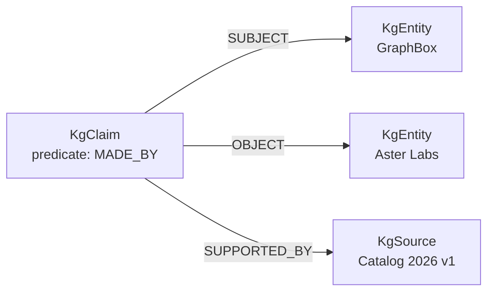
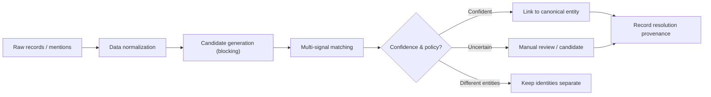
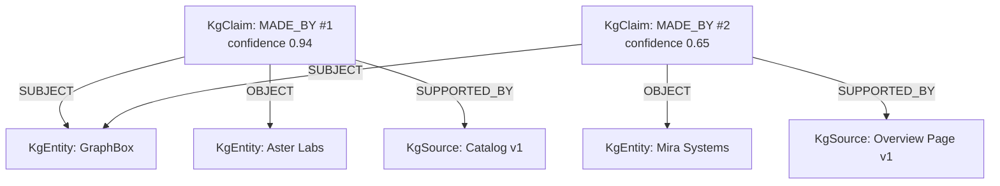
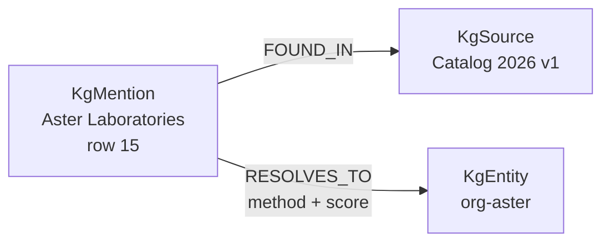
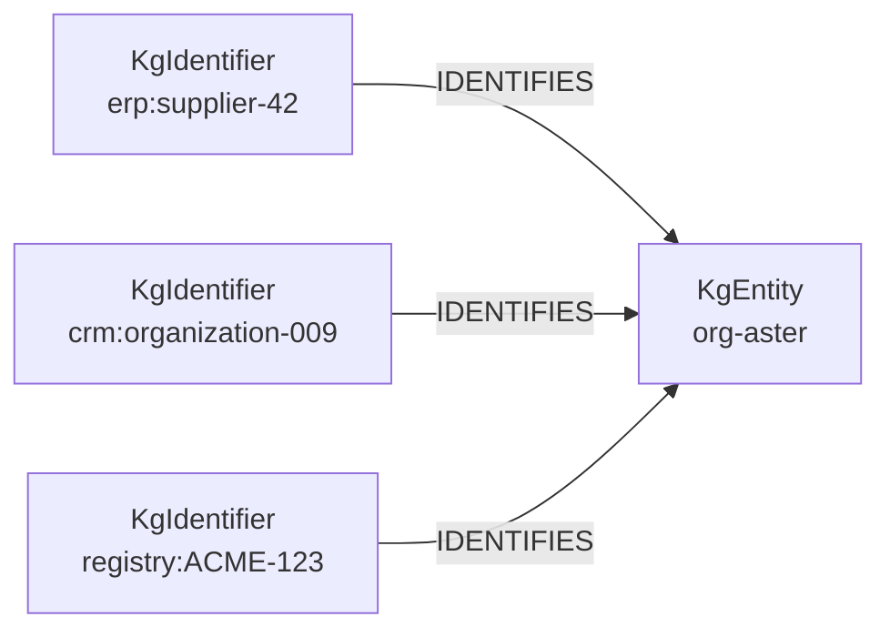
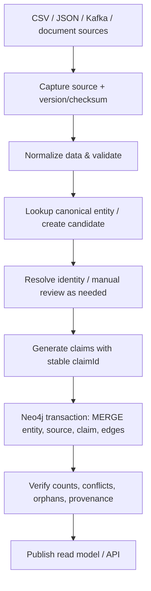
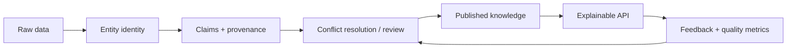

# Knowledge Graphs: Entities, Relationships, Provenance, and Identity in Neo4j

A database can store millions of nodes and relationships and still fall short of forming a useful **knowledge graph**. For an application to answer "Which organization manufactures this product, where did that information come from, and when was it valid?", the graph must explicitly represent **entities**, **relationship semantics**, **stable identity**, and **supporting evidence** for every assertion.

This lesson belongs to the **Graph Applications** chapter of the `DATABASE_ENGINE_GRAPH_NEO4J` module. Neo4j uses a **property graph** model with nodes, relationships, and properties, queried via **Cypher**, protected with indexes/constraints, populated from multiple sources, and integrated through **Neo4j Java Driver** or **Spring Data Neo4j**. Those capabilities provide the technical foundation; building a trustworthy knowledge graph also requires deliberate decisions about modeling knowledge and governing data provenance.

The lesson uses illustrative examples involving a fictional product **GraphBox**, two organizations **Aster Labs** and **Mira Systems**, and two documents making conflicting claims about the manufacturer. All names and documents are purely illustrative, not real corporate data.

After this lesson, you will be able to:

- Distinguish a **linked data graph** from a knowledge graph equipped with identity, semantics, and explainability.
- Design entity nodes, directed relationships, entity types, and properties under a clear schema.
- Choose **canonical IDs**, external IDs, and **entity resolution** workflows without falsely merging homonymous entities.
- Store **provenance** down to the statement/claim level, including validity intervals, source revisions, and confidence scores.
- Detect conflicting claims without arbitrarily overwriting evidence.
- Write Cypher to define schema constraints, ingest data idempotently, query provenance evidence, and run quality checks.
- Integrate knowledge graph queries via Java Driver or Spring Data Neo4j with access control and performance governance.

## 1. What Is a Knowledge Graph?

A **knowledge graph** represents meaningful objects in a domain and how they relate to one another. A simple mental model views it as a collection of triples:

```text
(subject) --predicate--> (object)

(GraphBox) --MADE_BY--> (Aster Labs)
(Aster Labs) --LOCATED_IN--> (Hanoi)
```

In a **Neo4j property graph**:

- A **Node** represents an entity, event, concept, or assertion.
- A **Label** classifies a node by role, such as `:Product` or `:Organization`.
- A **Relationship type** expresses a directed link, such as `:MADE_BY`.
- A **Property** stores typed attributes like `name`, `entityId`, or `observedAt`.
- **Cypher** performs pattern matching, path traversal, and cross-source queries.

However, a bare edge `(GraphBox)-[:MADE_BY]->(Aster Labs)` **cannot immediately answer**: who made the assertion, which document provides evidence, whether the statement applies to the current month, or what happens if another document reaches the opposite conclusion.

### 1.1. Four Core Dimensions

| Dimension | Question Addressed | Example |
| --- | --- | --- |
| **Entity** | Which object are we talking about? | Product `prod-graphbox` |
| **Relation** | What does the link between two objects mean? | `MADE_BY`, `PART_OF`, `LOCATED_IN` |
| **Identity** | Do two different names refer to the same object? | "Aster Labs", "Aster Laboratories" |
| **Provenance** | Who/which document asserted the relation, and when? | Catalog v1, Overview Page v1 |

A knowledge graph also requires a **schema/vocabulary**, data quality checks, access controls, update workflows, and evidence explainability. Without identity and provenance, a graph easily degrades into a web of unverifiable links.

### 1.2. Does a Knowledge Graph Require RDF/OWL?

**No.** RDF typically expresses knowledge as triples with IRIs, literals, and blank nodes, while standards such as RDFS/OWL/SPARQL provide specialized semantic and reasoning capabilities. **Neo4j** is a property graph using Cypher; you can build a knowledge graph in Neo4j using labels, relationships, and properties.

| Aspect | RDF/OWL | Neo4j property graph |
| --- | --- | --- |
| Common identity | IRI/URI | Business key / canonical ID, node |
| Relationship | Predicate in a triple | Relationship type or claim node |
| Relationship attributes | Typically requires corresponding reification patterns | Relationship properties or claim nodes |
| Query language | SPARQL | Cypher |
| Full OWL reasoning | Depends on reasoner and profile | **Not built-in** merely from labels/relationships |
| Vocabulary semantics | Standardized ontology rules | Enforced by domain/app design and validation conventions |

When importing data from RDF into Neo4j, you must **explicitly define mappings** for IRIs, literal datatypes, language tags, blank nodes, and provenance. Never assume importing RDF causes Neo4j to execute full OWL reasoning automatically.

## 2. Start from Business Questions, Not Label Names

Suppose an internal system ingests product data from a catalog, vendor websites, and procurement records. Questions it must answer:

1. Which products and organizations exist in verified data?
2. Do two records with similar names represent **the same organization**?
3. Which source asserts "GraphBox is made by Aster Labs"?
4. If another website states **Mira Systems**, does the graph preserve both claims?
5. Which statement is valid at the time a customer asks?
6. Has a claim been approved, rejected, or flagged for investigation?
7. When correcting an organization's identity, do historical claims remain traceable?

If you only need a product list, a node with a `manufacturerName` property might suffice. Once you need multiple sources, explainability, validity intervals, and conflict handling, **that flat model loses critical information**.

### 2.1. Classifying Entity Kinds

A minimal vocabulary:

| Entity Kind | Meaning | Typical Properties |
| --- | --- | --- |
| `Product` | Product referenced in domain | Product ID, name, version |
| `Organization` | Manufacturer, supplier, customer | Organization ID, canonical name, country |
| `Person` | Individual, author, representative | Trusted ID, display name |
| `Location` | Site, facility, region | Geographic ID, location type |
| `Document/Source` | Document or data source providing facts | Source ID, URI, version, timestamp |
| `Claim` | A specific assertion backed by evidence | Claim ID, predicate, status, validity dates |

**Classification** does not require a distinct label for every type. Our practice examples use a shared `:KgEntity` label with a `kind` property to enforce canonical ID uniqueness across one set; production models may add `:KgProduct`, `:KgOrganization`, or specialized labels when queries benefit. Multi-label conventions must align with indexes, constraints, and domain rules.

## 3. Designing Relationships with Clear Semantics

Avoid generic relationship types like `:CONNECTED_TO` when the domain knows the exact meaning of the link.

| Relationship | Meaningful Direction | Question |
| --- | --- | --- |
| `MADE_BY` | Product → Organization | Who manufactures the product? |
| `SUPPLIED_BY` | Product → Organization | Who supplies the product? |
| `LOCATED_IN` | Organization → Location | Where is the unit located? |
| `PART_OF` | Organization → Organization | Which parent organization owns/contains the subsidiary? |
| `AUTHORED_BY` | Document → Person | Who authored the document? |
| `SUPERSEDES` | New Claim → Old Claim | Which statement replaces an earlier one? |

**Do not conflate `MADE_BY` with `SUPPLIED_BY`.** A distributor may sell a product without manufacturing it. Likewise, `PART_OF` does not automatically imply `OWNS`; define meaning, context, and direction explicitly.

### 3.1. Direct Relationship or Claim Node?

There are two common ways to model "GraphBox is made by Aster Labs."

**Direct relationship model:**

```cypher
(:KgEntity {entityId:'prod-graphbox'})
  -[:MADE_BY {sourceId:'catalog-2026-v1'}]->
(:KgEntity {entityId:'org-aster'})
```

This snippet **illustrates a pattern**, not a standalone executable Cypher statement.

Pros: short path queries, easy to read, fewer nodes. Cons: when two sources assert the same fact, a source is revised, a link is refuted, or conflicts arise, properties on a single relationship struggle to express **independent evidence history and per-assertion review status**.

**Assertion / claim-node model:**



Each `KgClaim` is an assertion with its own identity:

- `SUBJECT`: the entity the assertion is about.
- `OBJECT`: the target entity of the relation.
- `predicate`: the relation type, e.g., `MADE_BY`.
- `SUPPORTED_BY`: the supporting source or document revision.
- Additional properties: `confidence`, `validFrom`, `validTo`, `reviewStatus`.

**Note:** claim nodes are an **application-level modeling choice**, not mandatory reification syntax or an automatic Neo4j inference mechanism.

### 3.2. Choosing Which Model to Use

| Requirement | Direct relationship | Claim node |
| --- | --- | --- |
| Simple relation with one stable source | Well suited | May be overkill |
| Multiple independent documents corroborating a fact | Requires complex source conventions | Well suited |
| Conflicting assertions needing both sides preserved | Easily overwritten | Well suited |
| Ultra-fast graph traversal over vetted relations | Usually favorable | Needs query/materialization design |
| Per-claim evidence, review state, validity intervals | Limited for multi-source data | Well suited |
| Statement history and source versioning | Harder to model | Easier to audit |

Many systems use **two layers**: provenance-backed claims serve as the **system of record for recorded knowledge**, while direct relationships act as a **read model / materialized projection** for fast traversal. If you adopt that pattern, ensure derived relationships are updated or removed whenever underlying claims are retracted or changed. Never treat unvetted derived edges as verified facts.

## 4. Entity Identity: Names Are Not Keys

Display names change, contain typos, collide, and vary across languages. For example:

```text
Source A: "Aster Labs", vendor ID = supplier-42
Source B: "Aster Laboratories", external ID = co-009
Source C: "Aster Labs", but a completely different legal entity
```

Using `name` as a unique key or running `MERGE (o:Organization {name: ...})` everywhere can cause the system to:

- **Falsely merge** two distinct organizations sharing a name.
- **Create duplicates** for one organization spelled two ways.
- Lose historical names when a company rebrands.
- Create erroneous links from products to the wrong organization.

### 4.1. Canonical Identity

Every recognized entity should have a stable **canonical ID** within the knowledge graph, such as:

```text
prod-graphbox
org-aster
org-mira
```

Example entity structure:

```text
entityId:       "org-aster"         (stable internal key)
kind:           "Organization"      (type)
displayName:    "Aster Labs"        (mutable display name)
normalizedName: "aster labs"        (for candidate lookup)
```

Rules:

1. **Never use `id(node)` or `elementId(node)` as a durable business key** across exports, imports, restores, or database lifecycles.
2. Names, addresses, emails, and vendor codes are **identification signals**, not automatically global primary keys.
3. External IDs must include a **namespace/source system**, e.g., `erp:supplier-42` and `portal:co-009`.
4. Without sufficient evidence that two records represent the same entity, keep **two separate canonical entities** or a candidate link—never force a merge.
5. In multi-tenant systems, consider **composite keys `tenantId + entityId`**, cross-tenant rules, and data isolation policies.

### 4.2. Entity Resolution Is Not String Comparison

**Entity resolution** is the process of deciding whether two mentions or records refer to the same real-world entity. A typical pipeline includes:



Signals can include trusted system IDs, legal registration codes, normalized addresses, names, timestamps, email domains, or contextual relationships. **Never rely on matching names alone**, especially for common personal or company names.

### 4.3. `SAME_AS` Requires Strict Standards

A `:SAME_AS` edge implies strong identity equivalence. If an application performs transitive closure across `SAME_AS` chains, a single bad match can contaminate the entire graph. For unverified candidates, consider `POSSIBLY_SAME_AS` or a `ResolutionCandidate` node carrying a score and evidence for review.

**Never treat a model score of 0.91 as "91% guaranteed true"** unless the model has been calibrated and evaluated on a matching data distribution. Scores assist ranking and triage; merge policies must remain governed.

## 5. Provenance: Tracking the Origin of Every Statement

"Having provenance" means more than storing `updatedAt` on a node. One entity can draw attributes from multiple systems; one fact can be asserted by two sources at different times. Decide the **granularity of evidence attachment**.

| Provenance Granularity | What It Captures | Limitations |
| --- | --- | --- |
| **Entire import batch** | Which file/batch generated data | Cannot trace a claim to its exact line |
| **Entity** | Which source discovered the entity | Entity claims may originate from other sources |
| **Relationship** | Which source asserted an edge | Hard to store competing claims or versions |
| **Claim/statement** | Subject, predicate, object, source, dates, review status | More nodes/queries, much easier to audit |
| **Excerpt/span** | Which paragraph/table row backs the claim | Needs span IDs, doc versions, access protection |

In this lesson, we choose **claim-level provenance** and **versioned** source IDs:

```text
KgSource:
  sourceId = catalog-2026-v1
  title = Product Catalog, Edition 1
  publishedAt = 2026-02-01
  uri = urn:example:catalog:2026:v1

KgClaim:
  claimId = claim-catalog-graphbox-aster-v1
  predicate = MADE_BY
  confidence = 0.94
  validFrom = 2026-02-01
  reviewStatus = PENDING
```

**`sourceId` must identify the exact source revision**, not merely a mutable URL whose contents can be overwritten. For critical documents, also record a checksum, `documentVersion`, line/page/span locator, and ingestion run ID.

### 5.1. Evidence Source Differs from "Truth"

A document merely **asserts** `MADE_BY`; source data may be:

- Mistyped by a human or outdated.
- Misextracted (wrong subject or object) by a parser, OCR, or LLM.
- Valid only during a limited time period.
- Applicable to one subsidiary or product revision rather than all products.
- Contradicted by a more authoritative source.

Accordingly, naming the edge `SUPPORTED_BY` here means "this claim was recorded from this source," **not that the source has been independently verified**. To separate extraction from verification, use distinct relations such as `EXTRACTED_FROM`/`VERIFIED_BY` alongside an explicit workflow.

### 5.2. Three Distinct Timestamps

| Property | Question | Example |
| --- | --- | --- |
| `publishedAt` | When was the document published? | Catalog released 2026-02-01 |
| `ingestedAt` / `recordedAt` | When did the graph receive the data? | Import job ran 2026-11-01 |
| `validFrom` / `validTo` | During what period is the statement believed true? | Manufacturing relationship valid from February |

**Never substitute `ingestedAt` for `validFrom`.** A document ingested in 2026 may describe an event from 2023. Temporal knowledge graphs must distinguish **valid time** (when the fact holds in the world) from **transaction/knowledge time** (when the system learned or recorded it).

For validity intervals, a standard convention is `[validFrom, validTo)`—inclusive of start, exclusive of end. An absent `validTo` means the end date is unknown, **not automatically that the claim holds forever**.

## 6. Example Graph: Two Sources, Two Claims

Suppose Catalog v1 states "GraphBox is made by Aster Labs," while an overview page states "GraphBox is made by Mira Systems." Our model avoids prematurely forcing a winner:



Because the two claims point to different objects, they are **conflict candidates** if they refer to the same product version, same relation, and overlapping validity intervals. Do not assume an actual contradiction if Aster manufactured the product before April and Mira took over after April.

### 6.1. Creating Uniqueness Constraints

Run on a **practice database**, not on an unapproved production instance:

```cypher
CREATE CONSTRAINT kg_entity_id IF NOT EXISTS
FOR (e:KgEntity)
REQUIRE e.entityId IS UNIQUE;
```

```cypher
CREATE CONSTRAINT kg_source_id IF NOT EXISTS
FOR (s:KgSource)
REQUIRE s.sourceId IS UNIQUE;
```

```cypher
CREATE CONSTRAINT kg_claim_id IF NOT EXISTS
FOR (c:KgClaim)
REQUIRE c.claimId IS UNIQUE;
```

```cypher
CREATE CONSTRAINT kg_mention_id IF NOT EXISTS
FOR (m:KgMention)
REQUIRE m.mentionId IS UNIQUE;
```

Constraints protect canonical keys and support index-backed lookups. **They do not deduce synonymous names** or guarantee that claims from two sources are accurate. Missing IDs or invalid business rules still require dedicated validation.

Add an index for candidate lookup by normalized name without making names unique:

```cypher
CREATE INDEX kg_entity_normalized_name IF NOT EXISTS
FOR (e:KgEntity)
ON (e.normalizedName);
```

### 6.2. Loading Three Entities

```cypher
UNWIND [
  {
    entityId: 'prod-graphbox',
    kind: 'Product',
    displayName: 'GraphBox',
    normalizedName: 'graphbox'
  },
  {
    entityId: 'org-aster',
    kind: 'Organization',
    displayName: 'Aster Labs',
    normalizedName: 'aster labs'
  },
  {
    entityId: 'org-mira',
    kind: 'Organization',
    displayName: 'Mira Systems',
    normalizedName: 'mira systems'
  }
] AS row
MERGE (e:KgEntity {entityId: row.entityId})
ON CREATE SET
  e.kind = row.kind,
  e.displayName = row.displayName,
  e.normalizedName = row.normalizedName;
```

`MERGE` on `entityId` makes reruns with the same ID idempotent. Using `ON CREATE SET` avoids silently overwriting properties of an existing entity; production systems need a **versioned/audited update workflow** when display names or entity kinds change.

### 6.3. Loading Two Evidence Sources

```cypher
UNWIND [
  {
    sourceId: 'catalog-2026-v1',
    title: 'Product Catalog, Edition 1',
    uri: 'urn:example:catalog:2026:v1',
    publishedAt: '2026-02-01'
  },
  {
    sourceId: 'page-2026-v1',
    title: 'Overview Page, Edition 1',
    uri: 'urn:example:page:2026:v1',
    publishedAt: '2026-04-01'
  }
] AS row
MERGE (s:KgSource {sourceId: row.sourceId})
ON CREATE SET
  s.title = row.title,
  s.uri = row.uri,
  s.publishedAt = date(row.publishedAt),
  s.ingestedAt = datetime('2026-11-01T10:00:00Z');
```

`urn:example:...` is an **illustrative** URI identifying sample documents, not a live web page. In production, store immutable document/revision IDs and link to an access-controlled document store rather than duplicating entire sensitive documents inside the graph.

### 6.4. Loading Claims and Linking Provenance

```cypher
UNWIND [
  {
    claimId: 'claim-catalog-graphbox-aster-v1',
    subjectId: 'prod-graphbox',
    objectId: 'org-aster',
    predicate: 'MADE_BY',
    sourceId: 'catalog-2026-v1',
    confidence: 0.94,
    validFrom: '2026-02-01'
  },
  {
    claimId: 'claim-page-graphbox-mira-v1',
    subjectId: 'prod-graphbox',
    objectId: 'org-mira',
    predicate: 'MADE_BY',
    sourceId: 'page-2026-v1',
    confidence: 0.65,
    validFrom: '2026-04-01'
  }
] AS row
MATCH (subject:KgEntity {entityId: row.subjectId})
MATCH (object:KgEntity {entityId: row.objectId})
MATCH (source:KgSource {sourceId: row.sourceId})
MERGE (claim:KgClaim {claimId: row.claimId})
ON CREATE SET
  claim.predicate = row.predicate,
  claim.confidence = row.confidence,
  claim.validFrom = date(row.validFrom),
  claim.recordedAt = datetime('2026-11-01T10:00:00Z'),
  claim.reviewStatus = 'PENDING'
MERGE (claim)-[:SUBJECT]->(subject)
MERGE (claim)-[:OBJECT]->(object)
MERGE (claim)-[:SUPPORTED_BY]->(source);
```

**Explanation:**

1. `MATCH` looks up previously created entities and sources rather than creating them from display names.
2. `MERGE` on a **stable `claimId`** prevents duplicate claims on job retries.
3. `ON CREATE SET` avoids silently mutating existing claim metadata. When a source revision changes or a statement's meaning changes, create a new claim/version per policy.
4. The three edges `SUBJECT`, `OBJECT`, and `SUPPORTED_BY` enable full traceability back to entities and evidence.
5. `confidence` represents an **illustrative extraction/matching score**, not a certified probability that the manufacturer is correct.
6. `reviewStatus = 'PENDING'` indicates **no reviewer has adjudicated the claim yet**.

**Risk to control:** If `MATCH` fails to find an entity or source, that input row is **silently skipped** without creating a claim. Production pipelines must reconcile input vs. output counts and send unresolved rows to a dead-letter queue or fail the batch rather than losing data silently.

### 6.5. Verifying the Loaded Data

```cypher
MATCH (e:KgEntity)
RETURN e.kind AS kind, count(*) AS entities
ORDER BY kind;
```

Example result: **1 Product**, **2 Organizations**.

```cypher
MATCH (c:KgClaim)-[:SUPPORTED_BY]->(s:KgSource)
RETURN c.claimId AS claimId,
       c.predicate AS predicate,
       s.sourceId AS sourceId,
       c.reviewStatus AS status
ORDER BY claimId;
```

Example result: two claims in `PENDING` status, each linked to exactly one source.

## 7. Querying Answers Together with Evidence

If an API returns only:

```json
{"manufacturer": "Aster Labs"}
```

the user has no idea why GraphBox was attributed to Aster Labs, and may never realize **Mira Systems** was also cited by another source.

### 7.1. Returning All Relevant Claims

```cypher
MATCH (claim:KgClaim {predicate: 'MADE_BY'})
      -[:SUBJECT]->(p:KgEntity {entityId: $productId})
MATCH (claim)-[:OBJECT]->(maker:KgEntity)
MATCH (claim)-[:SUPPORTED_BY]->(source:KgSource)
RETURN p.displayName AS product,
       maker.displayName AS claimedManufacturer,
       maker.entityId AS manufacturerId,
       claim.claimId AS claimId,
       claim.confidence AS extractionConfidence,
       claim.reviewStatus AS reviewStatus,
       claim.validFrom AS validFrom,
       source.sourceId AS sourceId,
       source.title AS sourceTitle,
       source.uri AS sourceUri
ORDER BY source.publishedAt DESC, claim.claimId;
```

With `$productId = 'prod-graphbox'`, the query returns **two rows** corresponding to the two assertions. That is the right behavior when the API contract is **"show all evidence."**

### 7.2. Querying by Validity Time

```cypher
MATCH (claim:KgClaim {predicate: 'MADE_BY'})
      -[:SUBJECT]->(p:KgEntity {entityId: $productId})
MATCH (claim)-[:OBJECT]->(maker:KgEntity)
MATCH (claim)-[:SUPPORTED_BY]->(source:KgSource)
WHERE claim.validFrom <= date($asOf)
  AND (claim.validTo IS NULL OR date($asOf) < claim.validTo)
RETURN maker.displayName AS manufacturer,
       claim.claimId AS claimId,
       source.sourceId AS sourceId,
       claim.validFrom AS fromDate,
       claim.validTo AS toDate
ORDER BY claim.validFrom DESC;
```

The application passes `$asOf` as an ISO date string, e.g., `'2026-11-25'`; `date($asOf)` converts it for comparison. This pattern enforces a **`[validFrom, validTo)`** interval.

If `validTo` is unset, the query still returns claims from `validFrom` onward. That **does not prove the claim is still valid**—only that **no end date has been recorded**.

### 7.3. "Explaining an Answer" Is a Contracted Query

An application UI might display:

```text
GraphBox — cited manufacturers

Aster Labs
  Claim: claim-catalog-graphbox-aster-v1
  Source: Product Catalog, Edition 1
  Extraction confidence: 0.94
  Status: PENDING

Mira Systems
  Claim: claim-page-graphbox-mira-v1
  Source: Overview Page, Edition 1
  Extraction confidence: 0.65
  Status: PENDING

Conclusion: inconsistent information, unverified.
```

**Do not pick Aster Labs solely because `0.94 > 0.65`.** Confidence scores from different models or sources are not necessarily comparable. Publishing an "official manufacturer" requires **business rules, source precedence, human verification, validity dates, and review status**.

## 8. Detecting Conflicts Without Losing Evidence

A query can detect **conflict-candidate claim pairs** sharing a product and predicate while pointing to different objects:

```cypher
MATCH (leftClaim:KgClaim {predicate: 'MADE_BY'})
      -[:SUBJECT]->(p:KgEntity)
MATCH (rightClaim:KgClaim {predicate: 'MADE_BY'})
      -[:SUBJECT]->(p)
WHERE leftClaim.claimId < rightClaim.claimId
MATCH (leftClaim)-[:OBJECT]->(leftMaker:KgEntity)
MATCH (rightClaim)-[:OBJECT]->(rightMaker:KgEntity)
WHERE leftMaker.entityId <> rightMaker.entityId
RETURN p.entityId AS productId,
       leftClaim.claimId AS firstClaim,
       leftMaker.displayName AS firstMaker,
       rightClaim.claimId AS secondClaim,
       rightMaker.displayName AS secondMaker
ORDER BY productId, firstClaim, secondClaim;
```

**This is a candidate-screening query**, not a complete contradiction detector. Two claims might not truly conflict if:

- The product legitimately has **multiple manufacturers**.
- One claim applies to a **different product revision**.
- Their `validFrom/validTo` intervals **do not overlap**.
- Sources define `MADE_BY` differently (manufacturer vs. brand owner vs. distributor).
- Entity resolution mistakenly merged two distinct organizations or products.

### 8.1. Classifying Review States

An illustrative workflow:

| `reviewStatus` | Business Meaning | Guarantees Required |
| --- | --- | --- |
| `PENDING` | Not yet reviewed | Never treat automatically as "verified" |
| `APPROVED` | Vetted by an authorized review workflow | Record reviewer, timestamp, and decision rationale |
| `REJECTED` | Rejected through review | Do not delete claim history |
| `SUPERSEDED` | Replaced by a newer claim/version | Trace to superseding claim and reason |

These are **application-defined statuses**, not built-in Neo4j constants. A claim may accumulate multiple supporting sources or review rounds; when strict auditability is required, model dedicated `KgReview` or `KgDecision` nodes instead of overwriting a single status property.

### 8.2. Never Delete a Claim Just Because It Was Rejected

If a claim from a web page turns out to be wrong, deleting the `KgClaim` node erases the explanation of **why the system previously gave a wrong answer**. In auditable environments:

1. Preserve the claim's ID and source/version link.
2. Record the review decision, reviewer/job, and rationale.
3. Mark the claim as rejected or superseded.
4. Update the **read model** if direct `MADE_BY` edges were materialized.
5. Ensure business queries filter by approved status while audit queries can inspect history.

For statutory personal-data erasure requests, retention rules may require deleting or redacting specific records; **never apply unconditional "keep everything forever" rules** where they violate privacy law.

## 9. Mentions, Aliases, and Provenance-Backed Entity Resolution

A source record may mention **"Aster Laboratories"** while the verified canonical entity is named **Aster Labs**. Keep both the **mention** (how it appeared in the source) and the **resolution** (the mapping decision).



### 9.1. Storing Mentions and Linking to Canonical Entities

Example on the sample database:

```cypher
MATCH (source:KgSource {sourceId: 'catalog-2026-v1'})
MATCH (entity:KgEntity {entityId: 'org-aster'})
MERGE (mention:KgMention {
  mentionId: 'catalog-2026-v1:row-15:maker'
})
ON CREATE SET
  mention.surface = 'Aster Laboratories',
  mention.normalized = 'aster laboratories',
  mention.externalKey = 'supplier:42',
  mention.recordedAt = datetime('2026-11-01T10:00:00Z')
MERGE (mention)-[:FOUND_IN]->(source)
MERGE (mention)-[resolution:RESOLVES_TO]->(entity)
ON CREATE SET
  resolution.method = 'VERIFIED_EXTERNAL_ID',
  resolution.score = 1.0,
  resolution.reviewStatus = 'APPROVED';
```

Here, `supplier:42` is an **illustrative source key**. The rule `VERIFIED_EXTERNAL_ID` is only valid if the system has verified that the source's ID genuinely maps to `org-aster`. Simply having an external ID does not automatically equate two records.

**Warning when fixing mappings:** If a mention is later determined to belong to a different entity, do not simply `MERGE` a second `RESOLVES_TO` edge and leave both `APPROVED`. Run a workflow that **revokes/updates the old resolution, records the new decision, and updates dependent claims**, or creates versioned resolution records.

### 9.2. Tracing Mentions and Sources

```cypher
MATCH (mention:KgMention)-[r:RESOLVES_TO]->
      (entity:KgEntity {entityId: $entityId})
MATCH (mention)-[:FOUND_IN]->(source:KgSource)
RETURN mention.mentionId AS mentionId,
       mention.surface AS surface,
       mention.externalKey AS externalKey,
       r.method AS resolutionMethod,
       r.reviewStatus AS reviewStatus,
       source.sourceId AS sourceId
ORDER BY sourceId, mentionId;
```

This query explains **why a mention was linked to a canonical entity**. It does not prove identity equivalence if the review process was weak; consumers must inspect evidence from `externalKey` and the source.

### 9.3. Finding Same-Name Candidates Does Not Mean Auto-Merging

With a `normalizedName` index:

```cypher
MATCH (e:KgEntity {normalizedName: $normalizedName})
RETURN e.entityId AS entityId,
       e.displayName AS displayName,
       e.kind AS kind
ORDER BY entityId
LIMIT 20;
```

A name match produces a **candidate set** for verification. Never use `LIMIT 1` and blindly attach the mention to the first entity returned. On large graphs, generating candidates via combinations of namespace/external key, normalized name, kind, and context is far cheaper than pairwise node comparisons.

## 10. Choosing Canonical IDs and Managing External Identifiers

One entity can carry many external IDs:

```text
canonical entityId: org-aster

ERP vendor ID:     erp:supplier-42
CRM account ID:    crm:organization-009
Registry code:     registry:ACME-123
Website handle:    portal:aster-labs
```

**Never store `supplier-42` bare** when multiple systems issue numeric ID 42. You can model dedicated identifier nodes:



When mappings need auditability, `KgIdentifier` nodes can store `namespace`, `value`, `verifiedAt`, `sourceId`, and `status`; `IDENTIFIES` edges also benefit from provenance and status when mis-mappings are possible.

### 10.1. Key Design Rules

| ID Type | Used For | Safe as a Long-Term External Key? |
| --- | --- | --- |
| Self-managed `entityId` | Canonical entity identity | **Yes**, if stably governed and versioned |
| Namespaced external ID | Cross-referencing source records | Possible, though not absolute; subject to source policy |
| Display name | Search, UI, aliases | **No** |
| `id(node)` | Internal store identifier | **No** |
| `elementId(node)` | Technical Neo4j reference | Do not treat as a durable business key across migrations |
| Mention ID | Occurrence/locator within a source | Yes, for mention provenance; not an entity ID |

When an entity must be **split or deleted** after discovering a bad merge, define which entity retains the original canonical ID, how claims and identifiers migrate, and how aliases/redirects preserve traceability. Never silently rewrite all node IDs if external clients persist `entityId` as a foreign reference.

## 11. Repeatable Multi-Source Ingestion Pipeline

A knowledge pipeline does more than parse CSVs and run `CREATE` in bulk. It must safeguard uniqueness, idempotency, provenance, and resolution integrity.



### 11.1. Idempotency via Business Keys

Broken on source reprocessing:

```cypher
// Prone to duplicate nodes on reruns when no uniqueness key controls creation.
CREATE (:KgEntity {displayName: 'Aster Labs'});
```

Better once a canonical ID exists:

```cypher
MERGE (e:KgEntity {entityId: $entityId})
ON CREATE SET
  e.displayName = $displayName,
  e.kind = $kind;
```

For `MERGE` to remain safe under concurrent writes, back the key with a **uniqueness constraint**. `MERGE` alone is not a complete concurrency synchronization mechanism for all fields.

### 11.2. Batching via `UNWIND` from Java Driver

For normalized records with assigned IDs, pass a **list parameter**:

```cypher
UNWIND $rows AS row
MERGE (e:KgEntity {entityId: row.entityId})
ON CREATE SET
  e.kind = row.kind,
  e.displayName = row.displayName,
  e.normalizedName = row.normalizedName
RETURN count(*) AS processed;
```

`count(*)` here counts **rows processed by the pipeline**, **not newly created nodes**. In production, validate data quality before submission and reconcile actually persisted counts—especially when preceding `MATCH` clauses can drop unmatched rows.

### 11.3. Stable `claimId` and Source Revisions

A `claimId` can be deterministically derived from well-defined components:

```text
namespace/sourceRevision
+ statement locator within source
+ canonical subject ID
+ predicate
+ canonical object ID
+ extraction rule/version
```

Avoid naive delimiter concatenation when source strings may contain that delimiter; use consistent encoding or hashing. When a source updates to a new revision with altered statement content, assign a **new `sourceId` and `claimId`** rather than overwriting the old claim and losing history.

**`MERGE` claim with `ON CREATE SET`** works well for idempotent replays of identical data; if the same `claimId` arrives with a modified payload, raise an **ID collision or version mismatch**, rather than silently ignoring the new payload.

### 11.4. Transactions and Retries

A batch typically writes entities, sources, claims, and links inside **one transaction** to prevent orphaned claims lacking provenance. Use **Neo4j Java Driver managed transactions** or `@Transactional` in Spring Data Neo4j when components share the same transaction manager.

Retries help on transient errors **only if operations are idempotent**. A batch lacking stable IDs that issues `CREATE` repeatedly will duplicate data upon retries or network timeouts during commit.

## 12. Querying Knowledge Paths and Explaining Reasoning

Knowledge graphs answer multi-hop questions across chained relationships:

```text
Product → manufacturer → country
Author → publication → topic
Employee → department → project
```

In a provenance-aware graph, each "semantic edge" can traverse through a **claim node**. Example:

```cypher
MATCH (makerClaim:KgClaim {predicate: 'MADE_BY'})
      -[:SUBJECT]->(product:KgEntity {entityId: $productId})
MATCH (makerClaim)-[:OBJECT]->(maker:KgEntity)
MATCH (makerClaim)-[:SUPPORTED_BY]->(makerSource:KgSource)
RETURN product.displayName AS product,
       maker.displayName AS maker,
       makerSource.title AS evidence
ORDER BY maker;
```

When adding an organization's `LOCATED_IN` claim, a multi-hop query can join the two claims, provided **evidence for each assertion is traced independently**. A source confirming the manufacturer does not automatically certify its headquarters location.

### 12.1. Do Not Automatically Assume Transitivity or Symmetry

Different relations follow different semantic rules:

- `PART_OF` may be treated as transitive by an application within a specific org model, subject to exception checks.
- `MADE_BY` is **not** transitive: "GraphBox is made by Aster Labs" and "Aster Labs is part of a conglomerate" do not imply the conglomerate directly manufactures GraphBox.
- `SAME_AS` demands strict equivalence criteria.
- `MENTIONS` does not mean `SUPPORTS`; a document mentioning a company does not establish it as the manufacturer.

Neo4j **does not automatically enforce these axioms**. If an application performs inference, define explicit rules, test them, and attach provenance to **derived claims**, keeping them distinct from directly extracted claims.

### 12.2. Path Queries and Row Explosion

In graphs rich with sources and claims, long unbounded paths can explode intermediate row counts. API design should:

- Allow only **approved traversal depths and relationship types**.
- Cap returned rows, recognizing `LIMIT` alone does not cap intermediate expansion.
- Enforce transaction timeouts and concurrency limits.
- Anchor lookups on constraint/index-backed `entityId` values.
- Inspect cardinality and DB Hits with `EXPLAIN`/`PROFILE`.
- Never let clients interpolate arbitrary labels, relationship types, or Cypher fragments.

## 13. Java Driver Integration and Provenance-Bearing DTOs

An API should return **both the conclusion and its evidence** when auditability is needed. The Java Driver maps `Record` rows directly into compact DTOs instead of leaking raw nodes/relationships.

Java 17+ example (assuming `Driver` is configured with valid credentials, TLS, and database):

```java
import java.time.LocalDate;
import java.util.List;
import java.util.Map;
import java.util.Objects;

import org.neo4j.driver.Driver;
import org.neo4j.driver.Session;
import org.neo4j.driver.SessionConfig;

public final class KnowledgeGraphLookup {

    public record ManufacturerEvidence(
        String manufacturerId,
        String manufacturerName,
        String claimId,
        String sourceId,
        double extractionConfidence
    ) {}

    public static List<ManufacturerEvidence> findManufacturerClaims(
            Driver driver,
            String database,
            String productId,
            LocalDate asOf) {

        Objects.requireNonNull(driver, "driver");
        Objects.requireNonNull(database, "database");
        Objects.requireNonNull(productId, "productId");
        Objects.requireNonNull(asOf, "asOf");

        String cypher = """
            MATCH (c:KgClaim {predicate: 'MADE_BY'})
                  -[:SUBJECT]->(p:KgEntity {entityId: $productId})
            MATCH (c)-[:OBJECT]->(org:KgEntity)
            MATCH (c)-[:SUPPORTED_BY]->(s:KgSource)
            WHERE c.validFrom <= date($asOf)
              AND (c.validTo IS NULL OR date($asOf) < c.validTo)
            RETURN org.entityId AS manufacturerId,
                   org.displayName AS manufacturerName,
                   c.claimId AS claimId,
                   s.sourceId AS sourceId,
                   c.confidence AS confidence
            ORDER BY sourceId, claimId
            """;

        Map<String, Object> params = Map.of(
            "productId", productId,
            "asOf", asOf.toString()
        );

        try (Session session = driver.session(
                SessionConfig.forDatabase(database))) {

            return session.executeRead(tx ->
                tx.run(cypher, params)
                  .list(record -> new ManufacturerEvidence(
                      record.get("manufacturerId").asString(),
                      record.get("manufacturerName").asString(),
                      record.get("claimId").asString(),
                      record.get("sourceId").asString(),
                      record.get("confidence").asDouble()
                  ))
            );
        }
    }
}
```

**Key points to remember:**

- `SessionConfig.forDatabase(database)` targets the specific knowledge graph database.
- `productId` and `asOf` are **parameters**, never concatenated into Cypher strings.
- `list(mapper)` materializes DTOs **inside the transaction callback**, avoiding reading `Result` after the session closes.
- Returning `claimId`/`sourceId` in the DTO lets callers inspect underlying evidence.
- Because the model retains multiple claims, the `List` can contain conflicting entries: **never treat `get(0)` as the single ground truth**.
- `Driver` should be long-lived across services, with pool sizes and timeouts tuned to real load.

## 14. Spring Data Neo4j: Entity Mapping and `Neo4jClient`

In **Spring Data Neo4j (SDN)**, verified entities can be mapped using `@Node`, `@Id`, and repositories. However, claim graphs with diverse provenance edges are often awkward to map as a single entity aggregate.

Simple entity mapping example:

```java
import org.springframework.data.annotation.Id;
import org.springframework.data.neo4j.core.schema.Node;

@Node("KgEntity")
public class KnowledgeEntity {
    @Id
    private String entityId;
    private String kind;
    private String displayName;

    public KnowledgeEntity() {}

    public KnowledgeEntity(String entityId, String kind, String displayName) {
        this.entityId = entityId;
        this.kind = kind;
        this.displayName = displayName;
    }

    public String getEntityId() { return entityId; }
    public String getKind() { return kind; }
    public String getDisplayName() { return displayName; }

    public void setEntityId(String entityId) { this.entityId = entityId; }
    public void setKind(String kind) { this.kind = kind; }
    public void setDisplayName(String displayName) { this.displayName = displayName; }
}
```

For multi-step provenance queries, `Neo4jClient` is often cleaner than mapping the entire claim–source–mention subgraph as an aggregate:

```java
import java.util.Collection;

import org.springframework.data.neo4j.core.Neo4jClient;

public record ClaimView(
    String claimId,
    String organizationName,
    String sourceId
) {}

public class ClaimQueryService {
    private final Neo4jClient neo4jClient;

    public ClaimQueryService(Neo4jClient neo4jClient) {
        this.neo4jClient = neo4jClient;
    }

    public Collection<ClaimView> findClaims(String productId) {
        return neo4jClient.query("""
                MATCH (c:KgClaim {predicate: 'MADE_BY'})
                      -[:SUBJECT]->(:KgEntity {entityId: $id})
                MATCH (c)-[:OBJECT]->(org:KgEntity)
                MATCH (c)-[:SUPPORTED_BY]->(s:KgSource)
                RETURN c.claimId AS claimId,
                       org.displayName AS organizationName,
                       s.sourceId AS sourceId
                ORDER BY claimId
                """)
            .bind(productId).to("id")
            .fetchAs(ClaimView.class)
            .mappedBy((typeSystem, record) -> new ClaimView(
                record.get("claimId").asString(),
                record.get("organizationName").asString(),
                record.get("sourceId").asString()
            ))
            .all();
    }
}
```

For a write flow updating **entity + claim + source**, place **`@Transactional` on the service**, ensuring repositories and `Neo4jClient` share the same Spring Neo4j transaction manager and target database. A manually opened `Driver` `Session` does **not automatically** enlist in SDN transactions.

**Mapping note:** `repository.save(entity)` manages relationships mapped on that entity. If your application also mutates the graph with custom Cypher, clearly delineate **which parts of the graph belong to SDN aggregates** so `save` does not unexpectedly synchronize or delete unrelated relationships.

## 15. Optimizing Knowledge Graph Queries

Knowledge graphs grow rapidly: one entity appears in thousands of documents, one source produces millions of claims, or one name yields dozens of identity candidates. Provenance-rich models need query budgeting and measurement.

### 15.1. Starting from Constraint-Backed Keys

```cypher
EXPLAIN
MATCH (p:KgEntity {entityId: $productId})
MATCH (c:KgClaim {predicate: 'MADE_BY'})-[:SUBJECT]->(p)
MATCH (c)-[:OBJECT]->(org:KgEntity)
RETURN org.entityId AS organizationId
LIMIT 20;
```

On a representative staging graph with appropriate permissions, run `PROFILE` to check:

- `NodeIndexSeek`/`NodeUniqueIndexSeek` on `entityId`.
- `Expand` / relationship traversal across `SUBJECT`, `OBJECT`, and `SUPPORTED_BY`.
- `Estimated Rows` vs. actual `Rows` when a product accumulates many claims.
- `DB Hits`, `Sort`/`Distinct` operators, and memory usage.
- Latency on "hub" entities and high-volume sources.

`PROFILE` **executes the query**; run write queries with `PROFILE` carefully in staging. `LIMIT 20` caps rows at the point applied, **not guaranteeing** the engine reads only 20 claims.

### 15.2. Indexing for Query Patterns

Constraints on `KgEntity.entityId`, `KgClaim.claimId`, and `KgSource.sourceId` already support business-key lookups. If queries frequently filter claims by `predicate + reviewStatus`, consider a composite index:

```cypher
CREATE INDEX kg_claim_predicate_status IF NOT EXISTS
FOR (c:KgClaim)
ON (c.predicate, c.reviewStatus);
```

**Never create indexes purely from a theoretical checklist.** Evaluate query plans, selectivity, write volume, and update overhead—indexes consume storage and slow batch imports.

### 15.3. Controlling Fan-Out and Pagination

If an entity accumulates millions of mentions:

- Never return every `(:KgMention)` in a single API response.
- Filter precisely by `entityId`, claim predicate, and review status.
- Paginate with a deterministic `ORDER BY`, or use keyset cursors on large datasets.
- Separate **detailed evidence queries** from summary product lookups.
- Configure timeouts, memory limits, connection pools, and concurrency caps.
- Consider an approved read model for low-latency reads while preserving raw provenance for explainability.

## 16. Data Quality and Knowledge Governance

A useful knowledge graph continuously monitors **completeness**, **accuracy**, **consistency**, **freshness**, and **traceability**.

### 16.1. Minimum Data Quality Checks

| Check | Detects | Action |
| --- | --- | --- |
| Duplicate canonical ID | Two nodes sharing a business key | Uniqueness constraint + pre-import cleanup |
| Claim missing source | Cannot explain provenance | Quarantine claim or require source link |
| Claim missing subject/object | Missing referenced entity | Fail ingestion, do not publish |
| Potentially conflicting claims | Multiple objects for a single-valued predicate | Review by validity time and context |
| Mention resolving to multiple approved entities | Inconsistent entity resolution | Close old mapping, record corrective decision |
| Outdated source version | Answers may be stale | Check newer sources and valid time |
| Entity missing owner/tenant | Hard to enforce access/governance rules | Attach governance metadata |
| Rejected claim still shown as fact | Read model ignores status | Fix publish filter / invalidate cache |

### 16.2. Querying Claims Missing Provenance

```cypher
MATCH (c:KgClaim)
WHERE NOT EXISTS {
  MATCH (c)-[:SUPPORTED_BY]->(:KgSource)
}
RETURN c.claimId AS claimWithoutSource
ORDER BY claimWithoutSource
LIMIT 50;
```

### 16.3. Querying Claims Missing Subject or Object

```cypher
MATCH (c:KgClaim)
WHERE NOT EXISTS {
  MATCH (c)-[:SUBJECT]->(:KgEntity)
}
OR NOT EXISTS {
  MATCH (c)-[:OBJECT]->(:KgEntity)
}
RETURN c.claimId AS incompleteClaim
ORDER BY incompleteClaim
LIMIT 50;
```

These are **logical** integrity checks not enforced by a uniqueness constraint on `claimId`. Production pipelines can add validation jobs or staging/quarantine gates before publishing.

### 16.4. Security and Source Access Control

Provenance can expose internal document URLs, contributor names, sensitive excerpts, or personal data. Therefore:

1. **Do not expose raw source URIs or excerpts to all users** when sources carry access classifications.
2. Separate permission to read published facts from permission to inspect **underlying raw evidence**.
3. In multi-tenant setups, never let a shared canonical entity leak another tenant's mentions or claims without authorization.
4. Secure Java Driver/SDN connections with TLS, secret-managed credentials, and least privilege.
5. Enforce retention/auditing policies; do not retain personal content indefinitely simply because graphs link easily.
6. If using LLMs for claim extraction, validate outputs and guard against untrusted source text steering workflows or tools.

**Neo4j Enterprise offers finer-grained RBAC than Community.** Still, database RBAC does not replace business-layer authorization—especially when APIs serve diverse claim types and provenance across user roles.

## 17. Common Design Mistakes

| Mistake | Consequence | Fix |
| --- | --- | --- |
| Using names as canonical IDs | False merges or duplicate entities | Stable `entityId` + namespaced external IDs |
| `MERGE` across all properties | Name changes spawn new nodes | `MERGE` on business key, update via policy |
| Storing a single `manufacturer` property | Loses source evidence and conflicts | Claim nodes or structured provenance model |
| Picking the highest-confidence claim as truth | Wrong facts when scores are uncalibrated | Source precedence, valid time, human review |
| Persisting `id(node)` as an integration key | Unstable across migrations/store lifecycles | Business keys and uniqueness constraints |
| Mixing `MADE_BY` and `SUPPLIED_BY` | Distorted relation semantics | Clear vocabulary and validation |
| Deleting rejected claims without an audit trail | Impossible to audit past wrong answers | Retain review history per retention policy |
| Failing to version source documents | Unknown which edition produced a claim | Source IDs tied to revision/checksum |
| Using `CREATE` on every retry | Duplicate graph entries | Stable IDs + `MERGE`/transactions |
| Using `LIMIT 1` during conflicts | Hides disagreement | Return candidates + status/evidence |
| Returning all paths/mentions to clients | Fan-out, latency, and data leaks | Bounded queries, DTOs, pagination |
| Ingesting claims before sources/entities exist | Rows dropped or links missing | Validation and ordered ingestion |

## 18. Designing a Knowledge Graph from Real Requirements

A phased implementation workflow:

1. **Write competency questions:** what questions must the system answer, and with what evidence?
2. **Define the vocabulary:** entity kinds, relation predicates, direction, cardinality, temporality, and semantic rules.
3. **Choose canonical IDs:** business keys, external namespaces, multi-tenancy, and rename history.
4. **Design provenance:** versioned sources, extraction locators, batch/algorithm metadata, claimed vs. verified states, valid time.
5. **Define schema:** uniqueness constraints, lookup indexes, and orphan checks.
6. **Build the ingestion pipeline:** normalization, candidate matching, entity resolution, review, deterministic `claimId` generation, and transactions.
7. **Handle conflicts:** never auto-merge or pick a winner without sufficient evidence.
8. **Design the API:** return both conclusions and evidence when required, governed by publishing policies and ACLs.
9. **Measure performance:** `EXPLAIN`/`PROFILE`, baselines, hub handling, and depth/row/timeout bounds.
10. **Operate continuously:** monitor source freshness, import failures, review backlogs, policy updates, and post-migration regressions.

### Separating Development Stages



Do not wait until the graph holds millions of nodes to add canonical IDs and provenance. Retrofitting identity later typically ripples across nearly every claim, API, cache, and downstream integration.

## 19. Self-Check Questions

**Question 1.** Two organizations are both named "Aster Labs." Should we `MERGE` them into one entity based solely on `displayName`?

<details>
<summary>Suggested Answer</summary>

No. A name is a display attribute, not a global identifier. You need a business key or namespaced external ID along with corroborating evidence. When uncertain, keep them separate or flag as a review candidate.

</details>

**Question 2.** Why is `(GraphBox)-[:MADE_BY]->(Aster Labs)` alone insufficient for a system that must explain its answers?

<details>
<summary>Suggested Answer</summary>

A bare relationship only captures subject–predicate–object. It omits source, revision, validity interval, review status, and conflicting claims. Attach source metadata to the relationship or use claim nodes to store statement-level provenance.

</details>

**Question 3.** Two sources attribute GraphBox to two different organizations. Is the data guaranteed to be contradictory?

<details>
<summary>Suggested Answer</summary>

Not necessarily. Check product scope/revision, whether the predicate is single-valued, whether valid times overlap, how "manufacturer" is defined, and entity resolution accuracy. Only when they share the same context and cannot simultaneously hold is there a true contradiction.

</details>

**Question 4.** One claim has `confidence = 0.94` and another has `confidence = 0.65`. Can we delete the second claim and publish the first as fact?

<details>
<summary>Suggested Answer</summary>

No. Confidence may just be an extractor score, neither calibrated nor comparable across sources. Evaluate source authority, valid time, evidence, and human review; keep competing claims for traceability.

</details>

**Question 5.** Why use a revision-specific `sourceId` instead of just a URL?

<details>
<summary>Suggested Answer</summary>

Content at a URL can change over time. A `sourceId` tied to a revision, checksum, or immutable identifier pinpoints which exact version produced the statement, preserving evidence traceability and distinguishing stale claims from updated sources.

</details>

**Question 6.** Are `ingestedAt` and `validFrom` the same thing?

<details>
<summary>Suggested Answer</summary>

No. `ingestedAt` records when the system loaded the data; `validFrom` records when the statement is believed to hold in reality. A document ingested today may describe a past relationship.

</details>

**Question 7.** Why is persisting `id(node)` in an external ERP risky?

<details>
<summary>Suggested Answer</summary>

It is an internal Neo4j technical identifier with no durability contract across exports, imports, restores, or store migrations. Use a stable `entityId` protected by a uniqueness constraint and mapped from namespaced external IDs.

</details>

**Question 8.** A job reruns `UNWIND $rows ... MERGE` and `MATCH` fails to find a source. Can it still report "ingestion succeeded"?

<details>
<summary>Suggested Answer</summary>

It should not. Rows missing a matching source are silently dropped, potentially creating zero claims. Reconcile input/output counts, log errors or quarantine failed rows, and confirm provenance links before publishing.

</details>

**Question 9.** A claim is marked `REJECTED`. Should all data about it be deleted immediately?

<details>
<summary>Suggested Answer</summary>

Not by default. For auditability, retain the claim history, source link, and review decision while hiding it from the approved knowledge set. Retention must still comply with privacy laws and deletion mandates where applicable.

</details>

**Question 10.** A knowledge graph API returns 20 claims using `LIMIT 20`. Does that mean the engine only scanned 20 claims?

<details>
<summary>Suggested Answer</summary>

No. The engine may traverse, filter, or sort many relationships before returning 20 rows. Use indexes, traversal bounds, timeouts, hub testing, and `EXPLAIN`/`PROFILE`, and never expose unbounded path queries.

</details>

## Key Takeaways

- A **knowledge graph** is more than many nodes and relationships: it requires **semantics, stable identity, provenance, and validation rules**.
- **Canonical IDs** identify entities; display names, external IDs, and mentions are distinct layers.
- **Entity resolution** relies on multiple signals and review workflows; identical names do not prove identical entities.
- **Claim-level provenance** preserves subject, predicate, object, source, revision, review state, and validity time across multiple assertions.
- **Confidence scores do not replace verification**, and differing claims are not always contradictions once context and time are checked.
- **Neo4j Cypher** with uniqueness constraints, `MERGE`, and `UNWIND` supports keyed, idempotent ingestion; validation is still required to catch missing links.
- **Java Driver** and **Spring Data Neo4j/`Neo4jClient`** can return evidence-bearing DTOs when transactions, authorization, timeouts, and lifecycles are properly managed.
- For speed, approved relations can be materialized into a read model, provided **provenance is never lost** and read models stay synchronized when claims change.

### References

- [Neo4j Cypher Manual — Patterns](https://neo4j.com/docs/cypher-manual/current/patterns/)
- [Neo4j Cypher Manual — MERGE](https://neo4j.com/docs/cypher-manual/current/clauses/merge/)
- [Neo4j Cypher Manual — Constraints](https://neo4j.com/docs/cypher-manual/current/constraints/)
- [Neo4j Cypher Manual — Indexes](https://neo4j.com/docs/cypher-manual/current/indexes/)
- [Neo4j Cypher Manual — Query tuning](https://neo4j.com/docs/cypher-manual/current/planning-and-tuning/query-tuning/)
- [Neo4j Java Driver Manual — Transactions](https://neo4j.com/docs/java-manual/current/transactions/)
- [Spring Data Neo4j — Reference](https://docs.spring.io/spring-data/neo4j/reference/)
- [W3C PROV-O: The PROV Ontology](https://www.w3.org/TR/prov-o/)
- [W3C RDF 1.1 Concepts](https://www.w3.org/TR/rdf11-concepts/)
