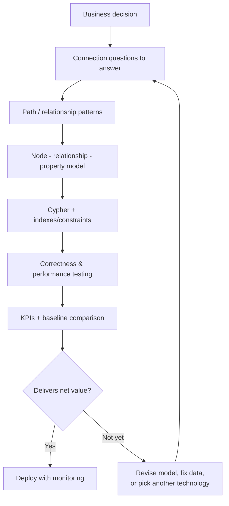
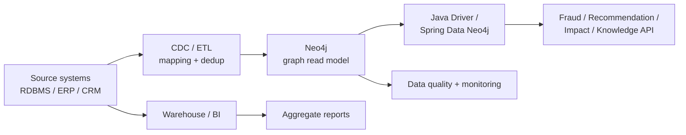
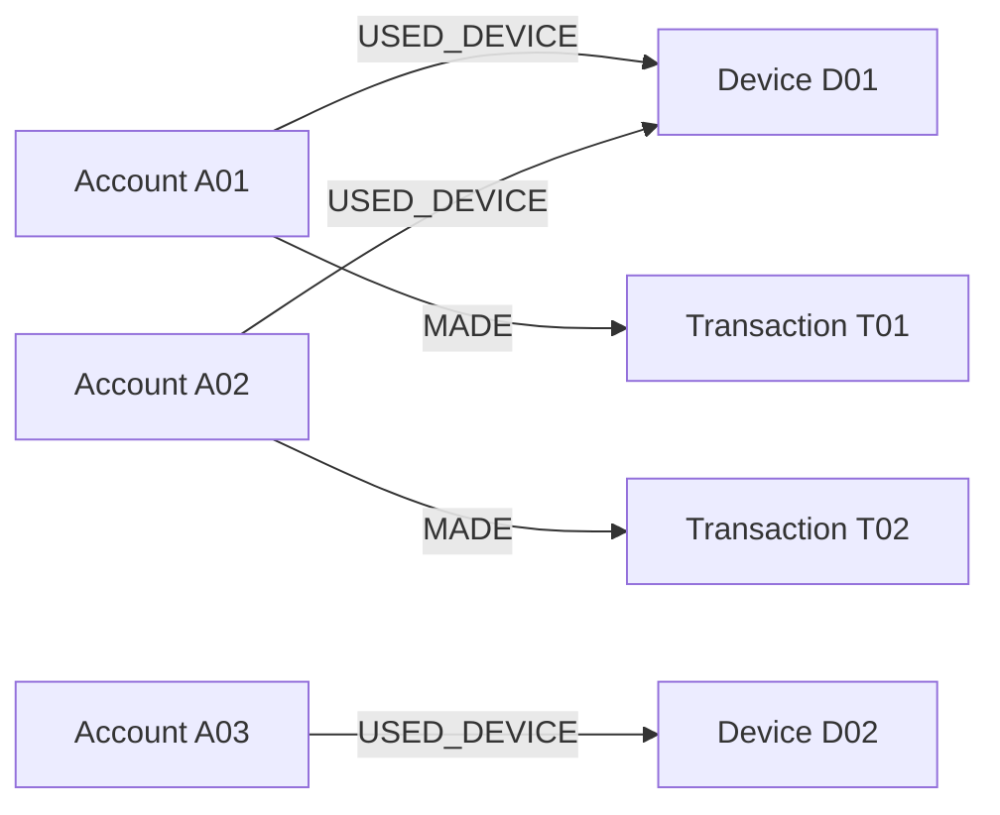
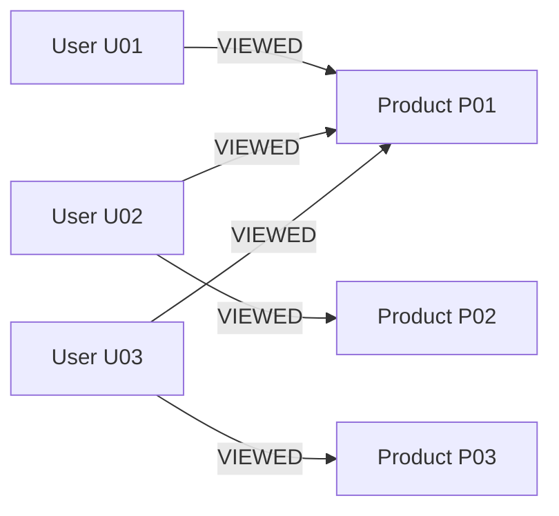
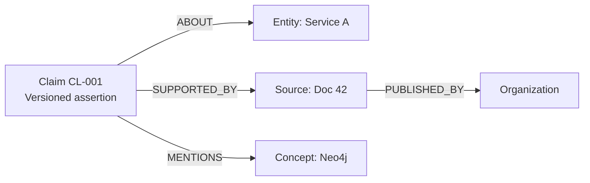
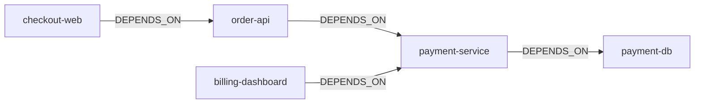
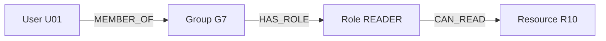
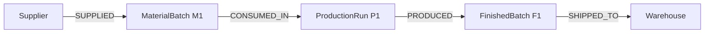

# Model Selection and Success Metrics for Each Use Case

**Neo4j** excels when business questions depend on **connections between entities**: "Which accounts share a device?", "Which products fit a user's interaction history?", "Which services are affected if a component goes down?", or "Which source supports a given claim?". Data is stored as a **property graph** consisting of **nodes**, directed **relationships**, labels, relationship types, and properties; **Cypher** queries traverse these paths on demand.

However, **"having relationships between tables" is not enough to justify a graph database**. A workload needing only key lookups, simple numeric aggregations, or ledger-style transaction storage is often better served by a relational database. Text search may call for a search engine; semantic document retrieval may call for vector search. Choosing Neo4j should stem from the **business decision**, **actual query shapes**, **relationship data quality**, and **verifiable metrics**, rather than a diagram full of arrows.

This lesson belongs to the **Graph Applications** chapter of the `DATABASE_ENGINE_GRAPH_NEO4J` module. We will build an evaluation workflow per use case, design node–relationship–property patterns, write Cypher to test models, and construct a multi-tiered metrics suite flowing from **business value → graph accuracy → runtime feasibility → operational cost**. Examples also connect to **indexes**, **constraints**, query optimization, **data ingestion**, **Neo4j Java Driver**, and **Spring Data Neo4j**.

> **Key message:** A good graph model serves **a concrete set of questions and decisions**. Success is not "having many nodes/relationships" or "getting a query to run"; success is **making better decisions than a baseline alternative**, at agreed thresholds of accuracy, latency, freshness, and cost.

## 1. Start from the Decision, Not from Node Labels

A project proposal often sounds like:

- "We want to build a knowledge graph."
- "Our data has customers, orders, devices, and lots of relationships."
- "We want to use a graph for product recommendations."
- "We want to detect fraud using links."

These statements describe **technology or data domains**, not **required outcomes**. Before designing a schema, answer:

1. **Who is the decision maker?** Fraud investigators, SREs, shoppers, automated systems, or knowledge workers?
2. **Which decision needs improvement?** Prioritizing accounts to investigate, ranking recommended products, scoping blast radius, authorizing access, or finding cited documents?
3. **Which connection patterns must be queried?** One-hop, multi-hop, shortest paths, common neighbors, provenance chains, or connected clusters?
4. **Why does the current approach fall short?** Complex multi-table JOINs, missing relationship context, hard-to-join multi-source data, or unacceptable latency?
5. **What is the proof of winning or losing?** Precision/recall, incremental revenue, investigation time, dependency coverage, p95 latency, or cost per decision?
6. **What guardrails must never be breached?** Access control, false positives, sensitive data exposure, freshness, budget, and reliability.

### 1.1. Framework from Question to KPI



Turning vague asks into verifiable contracts:

| Initial Statement | Concrete Question | Downstream Action | Metrics |
| --- | --- | --- | --- |
| "Use a graph for anti-fraud" | Does a new account share a device/IP with confirmed risky cases? | Prioritize investigation queue | Precision@K, detection rate, loss per transaction |
| "Use a graph for recommendations" | What have similar users viewed/bought that the current user hasn't touched? | Rank products | Recall@K, NDCG@K, incremental CTR/orders |
| "Build a knowledge graph" | Which entities relate to a concept, confirmed by which source? | Answer with citations | Entity/relation accuracy, retrieval recall, citation rate |
| "Graph for system dependencies" | Which services directly/indirectly depend on a failed service? | Scope blast radius | Impacted-service recall, triage time, freshness |
| "Graph for authorization" | Through which groups/roles does a user inherit access to a resource? | Allow/deny and explain | Zero unauthorized grants, rule accuracy, p95 auth latency |

Metrics in this table are **candidates to select and define**, not mandatory across every project.

## 2. When to Choose Neo4j and When Not To

A graph database is usually worth evaluating when:

- Connections are **first-class data** carrying properties, provenance, timestamps, or state.
- Questions require **variable-shape multi-hop traversals**: 2-hop, 3-hop, paths, connected components, or reverse impact queries.
- Value depends on **network structure**: node degree, shared neighbors, paths, communities, or lineage chains.
- Data originates from multiple sources requiring **entity linking** via verified keys/identities.
- Query requirements will evolve across relationships rather than staying fixed to a handful of static JOINs.

A graph may **not be the primary choice** when:

- Most workloads are ID-based CRUD with a few fixed relationships and simple relational JOINs.
- Queries are wide columnar aggregations, OLAP reports, or bulk tabular arithmetic scans.
- The core need is full-text search or nearest-vector lookup, and graph links add no measurable value.
- Relationship quality is poor: false identity merges outweigh useful discoveries.
- Queries frequently cross "super-hub" nodes, traverse unbounded paths, or demand massive write rates without an ingestion/indexing strategy.
- Strict transactional consistency with the system of record outweighs traversal benefits, and an asynchronously synced graph replica is unacceptable.

### 2.1. A Graph Can Serve as a Complementary Read Model

You do not have to replace existing databases wholesale. A common architecture:



In this setup:

- Source OLTP systems remain the **system of record** for payments, orders, or ownership if architecture dictates.
- Neo4j optimizes **relationship queries and link exploration**; replication lag must be explicitly tracked.
- Data can be enriched alongside search/vector/feature stores.
- Applications must handle out-of-order events, duplicate writes, soft deletes, and identifier changes.

**Before investing**, establish a credible baseline: SQL JOINs/recursive CTEs, a search engine, vector retrieval, batch jobs, or an existing rule engine. The question is not "can the graph run?" but **"how much does the graph improve quality and total cost over the best viable alternative?"**.

## 3. From Use Case to Model: Six Design Decisions

### 3.1. Choose Entities That Need Stable Identities

A node typically represents a business entity with its own identity or lifecycle: `Account`, `Device`, `Order`, `Product`, `Service`, `Document`.

Ask:

- Does this node have a **stable key** across data sources?
- Do two records denote the same real-world entity, or only a **suspected match**?
- Does the entity have its own lifecycle, state, or permissions to update?
- Must multiple parts of the graph link to this entity?

For example, account `A-01` may change its display name, yet `accountId` remains far more stable than `displayName`. Using names as keys easily duplicates nodes on renames or falsely merges distinct people sharing a name.

### 3.2. Choose Meaningful Relationship Types and Clear Directions

Avoid dumping every link into a generic `RELATED_TO` type when business semantics differ:

- `(Account)-[:USED_DEVICE]->(Device)`.
- `(Customer)-[:PLACED]->(Order)`.
- `(Service)-[:DEPENDS_ON]->(Service)`.
- `(Claim)-[:SUPPORTED_BY]->(Source)`.
- `(User)-[:VIEWED]->(Product)`.

Relationship types and **directions** are part of the query contract. When `A DEPENDS_ON B`, finding services impacted by B's failure requires traversing **against the arrow** from B to A, or matching `A -> B` anchored at target B.

### 3.3. Decide Whether Properties Belong on Nodes or Relationships

A fact belongs on:

- A **Node** when describing an entity: `Order.status`, `Service.team`, `Device.deviceId`.
- A **Relationship** when describing a connection: `VIEWED.at`, `USED_DEVICE.firstSeenAt`, `DEPENDS_ON.criticality`.
- A **separate Event node** when an action has its own identity, multiple participants, multiple states, audit requirements, or repeats often: `(:ViewEvent {eventId, occurredAt})` linked to User/Product.

No single representation fits every workload. For instance, repeated `VIEWED` events between a User and Product can be modeled as **multiple event nodes**, a single relationship with aggregated properties, or an external event store paired with a graph projection. Choose based on query needs and update cost.

### 3.4. Separate "Evidence" from "Verified Fact"

Two Accounts sharing a Device **do not prove fraud**; a Claim appearing in a document **does not prove the Claim is true**; two products co-viewed **do not guarantee the user will buy**.

Your model should preserve:

- `sourceId` or source record reference.
- `observedAt`, `validFrom`, and `validTo` when time matters.
- `confidence` or `verificationStatus` with explicit semantics.
- Version of the identity-matching rule or extraction model.
- Mechanisms for resolving conflicts, retracting bad edges, and updating sources.

**Never promote inferred results into "verified" edges without retaining an audit trail.**

### 3.5. Design for Selectivity and Node Degree

Before building the graph, estimate:

- Total nodes/relationships by label and type.
- Average and **maximum node degree**; a shared internet-cafe Device may connect to thousands of accounts.
- Update churn and edge lifetimes.
- Required traversal depth and `LIMIT`/depth bounds.
- Whether starting keys have index/constraint support.
- Whether multi-tenancy and access filters apply right at the starting node.

Even a small graph can produce an expensive query if it starts from a super-hub and expands `*1..N` unbounded. Conversely, a massive graph can stay fast for queries anchored on **high-selectivity keys** with bounded traversal depth.

### 3.6. Define Consistency and Deletion Boundaries

Clarify:

- Which services are allowed to write nodes and relationships?
- Are edges written in the same transaction as nodes or via async pipelines?
- When a source deletes an entity, should the graph delete the node, delete edges, mark `inactive`, or retain history?
- Are late-arriving events recorded with `occurredAt` or ingestion time?
- Are there backup/restore, audit, or personal-data deletion mandates?
- Do Java Driver, Spring Data Neo4j, APOC, and batch jobs enforce **the exact same identity rules**?

If write paths disagree on keys and semantics, a "clean model on paper" will not prevent the live graph from drifting into inconsistency.

## 4. Use Case A — Detecting Clusters of Risk-Linked Accounts

### 4.1. Question and Decision

Question:

> Does an active transacting account connect to other accounts via shared devices, and which links warrant investigator review?

Decision: **prioritize investigation queues**, never automatically brand a user fraudulent solely for sharing a device.

Minimal model:



| Node/Edge | Keys/Properties | Explanation |
| --- | --- | --- |
| `Account` | `accountId`, `status` | Account identity |
| `Device` | `deviceId`, `deviceType` | Normalized device identifier/group |
| `Transaction` | `transactionId`, `occurredAt`, `amountMinor` | Transaction event with its own key |
| `USED_DEVICE` | `firstSeenAt`, `lastSeenAt`, `source` | Time-bounded link evidence |
| `MADE` | May carry `sourceEventId` | Account executing transaction |

**Never naively treat IPs or device fingerprints as "one person = one device."** IPs are shared or dynamic; device IDs can be missing, noisy, or spoofed. The model must reflect evidence reliability.

### 4.2. Constraints and Sample Data

Run only on a **practice database**:

```cypher
CREATE CONSTRAINT account_id_unique IF NOT EXISTS
FOR (a:Account)
REQUIRE a.accountId IS UNIQUE;

CREATE CONSTRAINT device_id_unique IF NOT EXISTS
FOR (d:Device)
REQUIRE d.deviceId IS UNIQUE;
```

```cypher
MERGE (a1:Account {accountId: 'A01'})
SET a1.status = 'ACTIVE'
MERGE (a2:Account {accountId: 'A02'})
SET a2.status = 'ACTIVE'
MERGE (a3:Account {accountId: 'A03'})
SET a3.status = 'ACTIVE'

MERGE (d1:Device {deviceId: 'D01'})
MERGE (d2:Device {deviceId: 'D02'})

MERGE (a1)-[:USED_DEVICE]->(d1)
MERGE (a2)-[:USED_DEVICE]->(d1)
MERGE (a3)-[:USED_DEVICE]->(d2);
```

Query starting from one Account to find Accounts **sharing Devices**:

```cypher
MATCH (a:Account {accountId: $accountId})
      -[:USED_DEVICE]->(d:Device)
      <-[:USED_DEVICE]-(other:Account)
WHERE other <> a
RETURN other.accountId AS linkedAccountId,
       count(DISTINCT d) AS sharedDeviceCount
ORDER BY sharedDeviceCount DESC, linkedAccountId
LIMIT $limit;
```

With `accountId = 'A01'` and `limit = 10`, results return **A02** with `sharedDeviceCount = 1`. `A03` does not appear.

This is a **relational signal**, not a fraud verdict. Production setups should incorporate observation windows, device type, link confidence, hub-degree caps, tenant/authorization checks, and historical investigation outcomes.

### 4.3. When Does the Graph Add Real Value?

A graph helps when you need:

- Multi-hop shared neighbors: account → device → account → transaction.
- Detecting linked clusters spanning multiple entity types.
- Returning **explainable paths**: "A01 shares D01 with A02."
- Investigating accounts linked indirectly across bounded hops.

If your only rule is **"flag identical `deviceId`,"** an indexed JOIN/lookup in an RDBMS may suffice. Measure the incremental lift of **multi-hop connections** rather than merely translating a single JOIN into Cypher.

### 4.4. Success Metrics for Fraud Detection

| Layer | Metric | Notes |
| --- | --- | --- |
| Business | **Realized fraud loss** per transaction count/volume | Track over time, controlling for seasonality |
| Decision | **Precision@K** in the prioritized review queue | K depends on investigator capacity |
| Detection coverage | **Recall** on sufficiently matured labeled fraud cases | Labels can arrive late, incomplete, or noisy |
| Cost | False investigations, analyst cost per case | False positives harm legitimate users |
| Graph model | Share of Devices with reliable IDs, edges with time/source, suspicious hub rate | Avoid acting on noisy links |
| Operations | Queue generation latency, `p95` query time, ingest lag | Does the decision arrive before settlement? |
| Safeguards | False decline rate or disparate impact on user groups | Evaluate fairness and privacy appropriately |

Definitions:

\[
\mathrm{Precision} = \frac{TP}{TP+FP},\qquad
\mathrm{Recall} = \frac{TP}{TP+FN}
\]

where `TP` is true positives caught, `FP` is false alarms on non-fraud cases, and `FN` is missed fraud **on an appropriately labeled dataset**.

Never maximize Recall blindly by flagging almost every account. Track **precision, customer friction, and review cost** simultaneously.

### 4.5. Preventing Data Leakage During Evaluation

If the "fraud confirmed" label arrives **after** the decision timestamp, never include post-decision links or labels in features at prediction time and report inflated Recall. Split datasets by **event timestamp**, retain only connections known at each snapshot, and account for **label maturation delay**.

## 5. Use Case B — Product Recommendations from Interaction Graphs

### 5.1. Question and Model

Question:

> Which products have similar users viewed that the current user has not seen, and are those products worth recommending?

Bipartite graph model:



| Element | Meaning |
| --- | --- |
| `User` | User with stable `userId` and appropriate consent |
| `Product` | Product with `productId`, category, and availability |
| `VIEWED` | View interaction; may store timestamp, source, session |
| `PURCHASED` | Purchase interaction, usually a stronger signal than views |
| `ViewEvent` (optional) | Needed when tracking individual views and sessions |

On small graphs, a single `VIEWED` edge between User and Product represents "viewed at least once." To count repeat views, decay weights over time, or audit events, **model events explicitly** instead of assuming a single `MERGE` edge preserves full view history.

### 5.2. Fixture and Candidate Query

```cypher
CREATE CONSTRAINT user_id_unique IF NOT EXISTS
FOR (u:User)
REQUIRE u.userId IS UNIQUE;

CREATE CONSTRAINT product_id_unique IF NOT EXISTS
FOR (p:Product)
REQUIRE p.productId IS UNIQUE;
```

```cypher
MERGE (u1:User {userId: 'U01'})
MERGE (u2:User {userId: 'U02'})
MERGE (u3:User {userId: 'U03'})
MERGE (p1:Product {productId: 'P01'})
MERGE (p2:Product {productId: 'P02'})
MERGE (p3:Product {productId: 'P03'})
MERGE (u1)-[:VIEWED]->(p1)
MERGE (u2)-[:VIEWED]->(p1)
MERGE (u2)-[:VIEWED]->(p2)
MERGE (u3)-[:VIEWED]->(p1)
MERGE (u3)-[:VIEWED]->(p3);
```

Query finding products viewed by **users who share a product** with U01, excluding products U01 has already viewed:

```cypher
MATCH (u:User {userId: $userId})
      -[:VIEWED]->(:Product)
      <-[:VIEWED]-(peer:User)
      -[:VIEWED]->(candidate:Product)
WHERE peer <> u
  AND NOT EXISTS {
    MATCH (u)-[:VIEWED]->(candidate)
  }
RETURN candidate.productId AS productId,
       count(DISTINCT peer) AS peerCount
ORDER BY peerCount DESC, productId
LIMIT $k;
```

With `userId = 'U01'`, the two candidates are **P02** and **P03**, both with `peerCount = 1`. This Cypher serves as a graph query baseline, **not a complete production recommender**.

### 5.3. Choosing the Right Model Granularity

- **Aggregated `VIEWED` edge:** simple, compact, fast for "has viewed?" checks.
- **`VIEWED` with `lastSeenAt`/weight:** fits User–Product summary signals; define update rules carefully.
- **Event nodes:** fits when each view has its own session, campaign, device, source, timestamp, consent, and lifecycle.
- **Graph + vector/content:** blends behavioral links with item content; verify the graph adds lift over vector/keyword/popularity baselines.

Graphs suffer from **popular-product hubs**: if almost everyone views one bestseller, traversing peers through it explodes path counts at high cost and low signal. Filter by time window, cap candidates, control popularity bias, and inspect execution plans on representative data.

### 5.4. Success Metrics for Recommendations

| Layer | Metric | Interpretation |
| --- | --- | --- |
| Offline ranking | `Recall@K` | Fraction of relevant targets surfaced in top K |
| Offline ranking | `NDCG@K` | Ranking quality favoring hits near the top |
| Catalog quality | Coverage, diversity, novelty | Is it just recommending a few mega-popular items? |
| Online business | **Incremental** CTR, add-to-cart, conversion | Measured via A/B test vs. control, not before-vs-after |
| User experience | Dismissals, session abandonment, irrelevant feedback | Experience guardrails |
| Data | Share of users/products with valid behavior, freshness | Cold start and delayed events |
| System | `p95` latency, timeouts, cost per 1,000 recommendations | Fast enough for product pages? |

**Never treat a single click as proof of incremental revenue.** A/B tests or proper experiments must isolate algorithmic lift from slot placement, marketing campaigns, and seasonal shifts.

## 6. Use Case C — Knowledge Graphs and Provenance-Backed Retrieval

### 6.1. From Documents to Entities, Claims, and Evidence

A knowledge system should not link every document with bare `RELATED_TO` edges. Real questions look like:

> "Which component uses protocol X, which document states that, when was it last updated, and do any sources disagree?"

Candidate model:



Many domains need to separate **claims** (`Claim`) from **entities** (`Entity`) because:

- A source only **asserts** a relation; it may be unverified.
- Two sources may conflict.
- Assertions carry their own validity dates, confidence, and evidence spans.
- Users need to see **why** the system answered as it did, not just a bare edge.

| Element | Suggested Properties |
| --- | --- |
| `Entity` | `entityId`, `canonicalName`, `entityType` |
| `Concept` | `conceptId`, `name`, `taxonomyVersion` |
| `Source` | `sourceId`, `uri`, `publishedAt`, `accessLevel` |
| `Claim` | `claimId`, `predicate`, `confidence`, `observedAt`, `validFrom` |
| `SUPPORTED_BY` | `spanStart`, `spanEnd`, `extractorVersion` as needed |
| `SAME_AS` / mapping | Store only under an explicit entity-resolution policy |

**Be cautious with `SAME_AS`:** similar names do not prove identical entities. False merges propagate errors down every path and generate false "connected" answers.

### 6.2. Illustrative Query: Returning Answers with Sources

```cypher
MATCH (e:Entity {entityId: $entityId})
      <-[:ABOUT]-(claim:Claim)
      -[:SUPPORTED_BY]->(source:Source)
WHERE source.accessLevel = 'PUBLIC'
RETURN claim.claimId AS claimId,
       claim.predicate AS predicate,
       claim.confidence AS confidence,
       source.sourceId AS sourceId,
       source.uri AS sourceUri
ORDER BY confidence DESC, sourceId
LIMIT $limit;
```

This is purely a **provenance-reading query**. `confidence` must have a clear definition: extractor confidence, SME score, or calibrated probability? Never declare truth from an uncalibrated number.

When multiple organizations, tenants, or internal classifications exist, `source.accessLevel = 'PUBLIC'` is insufficient for authorization: enforce DB and application policies tied to verified tenant/owner identity.

### 6.3. Baselines: Search and Vectors

Knowledge graphs usually **complement**, rather than replace:

- Full-text search to match exact keywords.
- Vector search to find semantically related passages/concepts.
- Graph traversal to follow **identity, relation types, sources, and provenance**.
- A synthesis layer enforcing source checks and uncertainty handling.

For example, "Which documents mention Service A?" may only need search. By contrast, "Which systems does Service A depend on according to verified, currently valid sources?" benefits from graph structure, temporality, and provenance.

### 6.4. Success Metrics for Knowledge Systems

| Layer | Metric | What to Verify |
| --- | --- | --- |
| Entity resolution | Precision/recall of entity linking | False merges of homonyms or missed aliases? |
| Relation extraction | Precision/recall per relation type | Is `DEPENDS_ON` misextracted from vague prose? |
| Retrieval | MRR@K, Recall@K, correct-source rate | Evaluated on expert-curated Q&A sets |
| Answer quality | Faithfulness/groundedness, citation precision | "Has a citation" ≠ source actually supports claim |
| Knowledge ops | Freshness, time to fix a wrong fact, missing sources | Update and feedback workflows |
| Security | Unauthorized disclosure rate | Must test per user/tenant permissions |
| Value | Research time saved, resolution accuracy | Compared against existing search, including curation cost |

A **reference benchmark set** should span factual, multi-hop, unanswerable, conflicting-source, and stale-document questions—never just "found any document."

## 7. Use Case D — Dependency Analysis and Blast Radius

### 7.1. Operational Question

> If `payment-db` becomes unavailable, which services **directly or indirectly depend** on it within at most four hops?

Simple model:



Given `(dependent)-[:DEPENDS_ON]->(dependency)`, finding services **impacted** by a failing dependency requires traversing **inbound** from nodes that depend on it.

### 7.2. Sample Data and Cypher Query

```cypher
CREATE CONSTRAINT service_id_unique IF NOT EXISTS
FOR (s:Service)
REQUIRE s.serviceId IS UNIQUE;
```

```cypher
MERGE (web:Service {serviceId: 'checkout-web'})
MERGE (api:Service {serviceId: 'order-api'})
MERGE (pay:Service {serviceId: 'payment-service'})
MERGE (db:Service {serviceId: 'payment-db'})
MERGE (dash:Service {serviceId: 'billing-dashboard'})
MERGE (web)-[:DEPENDS_ON]->(api)
MERGE (api)-[:DEPENDS_ON]->(pay)
MERGE (pay)-[:DEPENDS_ON]->(db)
MERGE (dash)-[:DEPENDS_ON]->(pay);
```

```cypher
MATCH p = (dependent:Service)
          -[:DEPENDS_ON*1..4]->
          (failed:Service {serviceId: $failedServiceId})
WITH dependent, min(length(p)) AS minHops
RETURN dependent.serviceId AS impactedServiceId,
       minHops
ORDER BY minHops, impactedServiceId
LIMIT $limit;
```

With `failedServiceId = 'payment-db'`, impacted services are:

| impactedServiceId | minHops |
| --- | ---: |
| payment-service | 1 |
| billing-dashboard | 2 |
| order-api | 2 |
| checkout-web | 3 |

`min(length(p))` avoids duplicating a service reachable via multiple paths. This is a **directed dependency query**, not an exact outage forecast: a service with an optional dependency or fallback may remain healthy.

### 7.3. When a Richer Model Is Needed

`DEPENDS_ON` edges often need:

- `environment`: production/staging.
- `criticality`: hard/soft dependency.
- `validFrom`, `validTo`: dependencies changing across releases.
- `source`: service catalog, tracing, CMDB, IaC.
- `confidence`: auto-discovered vs. owner-confirmed.

If a Service spans multiple versions, tenants, or regional deployments, collapsing everything onto one `Service` node **overstates blast radius**. Separate `Service` from `Deployment`, `Environment`, and `Region`, or filter relationships by environment.

### 7.4. Success Metrics

| Layer | Metric | Purpose |
| --- | --- | --- |
| Graph accuracy | Precision/recall of expert-verified dependency edges | Avoid missed or phantom dependencies |
| Coverage | Share of production services with sufficient dependency data | Expose blind spots |
| Freshness | Lag from deployment/topology change to graph update | Avoid stale dependency maps |
| Incident triage | Time to scope impacted systems | Compare against current runbooks/catalog |
| Impact quality | Precision/recall of actually impacted services | Reconcile with postmortems, not just node counts |
| Operations | `p95` query latency, paths traversed, timeouts | Ensure queries stay responsive during incidents |
| Value | MTTR and missed stakeholder notifications | Avoid claiming causality from correlation alone |

**Watch out for duplicate counting:** one service can have multiple paths to the same dependency. Counting `count(p)` counts **paths**, not **distinct services**. Use `count(DISTINCT dependent)` when the KPI counts impacted services.

## 8. Use Case E — Path-Based Authorization Explainability

### 8.1. When Graphs Help Explain Permissions

In IAM systems, users belong to groups, groups hold roles, and roles grant permissions on resources. Questions:

> "Why can user U01 read document R10?" or "If group G7 is revoked, which resources could be affected?"

Example model:



Query inspecting grant paths:

```cypher
MATCH (u:User {userId: $userId})
      -[:MEMBER_OF]->(g:Group)
      -[:HAS_ROLE]->(role:Role)
      -[:CAN_READ]->(r:Resource {resourceId: $resourceId})
RETURN DISTINCT g.groupId AS viaGroup,
       role.roleId AS viaRole;
```

**Finding an allow path is not sufficient to authorize access.** Real policies include `DENY` overrides, tenant boundaries, validity windows, least-privilege rules, parent–child inheritance, and attribute conditions. Here the graph serves as a **grant-lineage explainer**, not a replacement for a full policy engine or vetted access checker.

### 8.2. Metrics You Must Not Mis-Optimize

| Metric | Right Perspective |
| --- | --- |
| Unauthorized grants | **Strict guardrail**, never traded away for lower latency |
| False deny / false allow | Tested against a formal policy suite and edge cases |
| Time to revoke | After revocation, how quickly do all access paths update? |
| Explainability | Share of decisions traceable to exact allow/deny paths |
| Latency p95/p99 | Fast enough for synchronous authorization checks |
| Audit completeness | Logs principal, rule version, timestamp, and policy outcome? |
| Data freshness | How closely does graph state match IAM source of truth? |

**Never boast "our authorization query runs in 10 ms"** while permitting even one unauthorized grant. For authorization, **correctness and security are deployment prerequisites**, and latency comes second.

## 9. Use Case F — Supply Chain Provenance and Traceability

A finished product depends on raw materials, production runs, and suppliers. When a raw material lot is recalled, the question is:

> "Which finished batches may contain material from the affected lot, and through which processing steps?"

Simple model:



Here **events/batches** matter more than linking `Supplier` directly to `Product`. Omitting `ProductionRun` loses consumed quantities, machine shifts, recipes, timestamps, and many-to-many input/output lot lineage.

Metrics:

- Recall of impacted finished batches against verified production logs.
- Recall-list false positives; avoid overly broad recalls.
- Time to complete trace from a flagged lot.
- Share of production events with complete source, quantity, and timestamp.
- Rate of quantity mismatches or broken lineage detected.
- Ingest lag, mock-recall drill readiness, and auditability.

**Never treat path existence as proof "product contains substance X"** if the model omits quantities, loss rates, mixing ratios, or lot splits. Traceability models must match physical manufacturing semantics.

## 10. Model Selection Table by Use Case

| Use Case | Core Nodes | Core Relationships | Typical Queries | Key Modeling Risks to Address |
| --- | --- | --- | --- | --- |
| Fraud | Account, Device, Transaction | `USED_DEVICE`, `MADE` | Shared neighbors, bounded multi-hop | False links, shared devices, sensitive PII |
| Recommendations | User, Product, Event | `VIEWED`, `PURCHASED` | 2-hop peer traversal, top-K | Popularity bias, cold start, event history |
| Knowledge graph | Entity, Claim, Source | `ABOUT`, `SUPPORTED_BY` | Multi-hop with citations | Entity resolution, provenance, conflicting sources |
| System dependencies | Service, Deployment, Region | `DEPENDS_ON` | Reverse traversal, 1..N paths | Stale edges, hard/soft deps, cycles |
| Authorization | User, Group, Role, Resource | `MEMBER_OF`, `HAS_ROLE`, `CAN_READ` | Grant paths and explanations | Deny precedence, tenants, privilege leaks |
| Supply chain | MaterialBatch, ProductionRun, FinishedBatch | `CONSUMED_IN`, `PRODUCED` | Forward/backward lot trace | Missing quantities, wrong source/timestamps |

You do not need every label in a single database. Each use case needs its own **aggregates, database boundaries, source of truth, ACLs, and freshness targets**.

## 11. Multi-Tiered Metrics: Beyond Query Execution Time

A graph project can fail even with blazing-fast Cypher: bad source data, stagnant conversion, overwhelmed analysts, or day-old edges. Define four metric tiers.

### Tier A — Business Outcomes

Question: **Does using the graph improve real decisions?**

Examples:

- Lower fraud losses per 1,000 transactions (normalized for volume changes).
- Higher **incremental** order conversion driven by recommendations, not total organic revenue.
- Faster identification of impacted services during incidents.
- Higher rate of evidence-backed answers accepted by domain experts.
- Faster scoping of lot recalls.

Measure both **upside** and **cost of wrong decisions**: locked legitimate accounts, annoying recommendations, unauthorized grants, or false outage alarms.

### Tier B — Graph and Pipeline Quality

Question: **Is the relationship data trustworthy and timely?**

| Metric | How It Is Measured | Watch Out For |
| --- | --- | --- |
| Node coverage | Source entities with matching nodes / total in-scope source entities | Denominator must match actual scope |
| Edge coverage | Reconciled edges / expected edges from source or ground truth | More edges does not mean better edges |
| Link precision | Correct links / total linked edges | Critical for entity resolution |
| Freshness lag | Graph availability timestamp − source event timestamp | Track percentiles, not just averages |
| Duplicate rate | Share of entities/edges erroneously duplicated | Define "duplicate" per domain rules |
| Orphan/broken references | Entities missing mandatory links | May be valid mid-workflow |
| Provenance coverage | Share of claims/edges carrying valid source and timestamp | Missing provenance blocks auditing |
| Validity | Share of relationships with valid type, direction, time, tenant | Syntax checks alone are not enough |
| Change-data loss | Share of source events dropped or misreplayed | Critical for CDC/ETL |

**Never equate `count(r)` with "graph quality"** without verifying edge correctness. Ten million wrong edges are worse than one hundred thousand verified ones.

### Tier C — Algorithm and Query Output Quality

Question: **Does the graph answer decision questions accurately?**

- Classification/alerts: precision, recall, F1, PR-AUC, false positive rate.
- Ranking/recommendations: Recall@K, Precision@K, MRR@K, NDCG@K.
- Knowledge retrieval: path accuracy, relation completeness, expert-verified citation rate.
- Dependency analysis: recall of truly impacted services, false positives, detection speed.
- Authorization: allow/deny accuracy on policy test suites, with **zero unauthorized grants** enforced strictly.

All metrics require an **independent ground-truth set** curated separately from graph outputs. Never evaluate rules against labels generated by those same rules.

### Tier D — Performance, Cost, and Operations

Question: **Does it run reliably at real scale and SLOs?**

- `p50`/`p95`/`p99` query latency and **end-to-end HTTP** latency.
- Transactions/sec, concurrency, timeout/retry rates.
- `Rows` and `DB Hits` from `PROFILE` on authorized test workloads.
- Page cache, heap/GC, CPU, disk I/O, connection pools.
- ETL throughput, ingest lag, and dead-letter/error rates.
- Infrastructure + ops + storage cost per 1,000 decisions or per million edges.
- Release lead time, schema migration effort, disaster recovery, and access management.

**`DB Hits` are not physical disk reads**, and `PROFILE` reflects a single execution under specific conditions. On write Cypher queries, `PROFILE` **actually executes the writes**; run only in controlled test environments, never as a dry-run.

## 12. Defining Metrics Without Ambiguity

### 12.1. Precision, Recall, and False Positive Rate

For classification:

\[
\mathrm{Precision}=\frac{TP}{TP+FP}
\]

\[
\mathrm{Recall}=\frac{TP}{TP+FN}
\]

\[
\mathrm{FPR}=\frac{FP}{FP+TN}
\]

where:

- `TP`: predicted positive and ground truth is positive.
- `FP`: predicted positive while ground truth is negative.
- `FN`: missed true positive.
- `TN`: correctly identified negative.

Fraud systems with low base rates should focus on **precision and PR-AUC**; headline accuracy can look great while missing most fraud. When labels arrive late, explicitly specify the denominator and cutoff window.

### 12.2. Recall@K, MRR@K, NDCG@K

- **Recall@K:** fraction of relevant targets captured in the top K results.
- **MRR@K:** mean reciprocal rank of the first relevant result within top K.
- **NDCG@K:** position-discounted relevance score normalized against the ideal ranking.

Suppose system A puts the right document at rank 8 while system B puts it at rank 1: both score the same Recall@10 for a single relevant doc, yet **MRR@10** and **NDCG@10** expose the ranking difference.

For recommenders, clearly define "relevant" items, evaluation windows, and out-of-stock/ineligible exclusions; otherwise offline ranking metrics cannot be compared across systems.

### 12.3. Freshness and Completeness

For dependency data requiring freshness:

\[
\mathrm{lagSeconds} =
\mathrm{graphAvailableAt} - \mathrm{sourceEventAt}
\]

Use **consistent clocks/timezones and event-time semantics**. For late-arriving data, `sourceEventAt` can trail ingestion significantly; separate *source publication delay*, *queue delay*, *processing delay*, and *graph availability delay* when diagnosing lag.

Never measure completeness by `count(node)`. Instead:

\[
\mathrm{edgeCoverage}=
\frac{\text{valid edges within reconciliation scope}}
{\text{expected edges within reconciliation scope}}
\]

Expected edges may come from an authoritative inventory or expert-labeled sample; if the true denominator is unknown, report **coverage over the audited sample** rather than calling ingested counts "100% complete."

### 12.4. Percentile Latency

`p95 = 250 ms` means roughly **95% of observations in the measured sample completed within 250 ms** under a defined metric, window, and methodology. It does not mean every single request stays under 250 ms.

For graphs:

- Group latency by **query template**, input cardinality, and hub degree.
- Benchmark requests touching dense neighborhoods, not just 2-node toy fixtures.
- Separate server-side Cypher time from Java connection-pool wait, network round-trip, and DTO mapping.
- Always report p95/p99 alongside **sample size, time window, and concurrency level**.

## 13. Selecting Baselines and Designing Controlled Evaluations

To prove Neo4j's value, compare against a **genuinely viable alternative**, not a strawman baseline.

| Use Case | Appropriate Baseline |
| --- | --- |
| Fraud | Account rules, 1-hop SQL device sharing, existing risk scores |
| Recommendations | Category bestsellers, popularity, content/vector recommender |
| Knowledge | Keyword/full-text search, vector retrieval, search + rerank |
| Dependencies | Existing CMDB/service catalog, SQL recursive CTEs, or manual runbooks |
| Authorization | Existing policy engine or IAM evaluator |
| Supply chain | Lot queries on ERP/RDBMS and existing traceability reports |

Evaluation steps:

1. **Define the decision and metrics** before writing queries.
2. **Choose representative datasets and time windows**, including hard edge cases.
3. **Run the baseline** on the exact same data scope, permissions, and SLA targets.
4. **Implement the graph candidate**, recording schema, query versions, and pipeline.
5. **Measure offline** accuracy and performance under comparable conditions.
6. **Deploy shadow/canary** runs to monitor safety, freshness, and load.
7. **Run A/B tests** where applicable to measure real business lift.
8. **Evaluate net benefit and guardrails** before making a go/no-go decision.

### 13.1. Avoiding Future-Data Leakage

In fraud, recommendations, and knowledge tasks, offline scores get inflated if the model uses edges that **only appeared after the decision timestamp**. Instead:

- Pick prediction cutoff `T`.
- Construct the graph strictly from events **known at or before `T`** per business rules.
- Evaluate outcomes occurring after `T` once labels have matured.
- Repeat across multiple time windows and entity cohorts.

Random splits over tightly coupled relationships can still leak identities or outcomes. Consider splitting by **time, entity/group, or tenant** depending on the problem.

### 13.2. Strong Offline Metrics Do Not Guarantee Online Gains

A recommender with higher NDCG@10 that slows page loads or pushes expensive/out-of-stock items can **hurt conversion**. A fraud filter raising recall at the expense of many false positives can overwhelm analysts.

Therefore:

- **Primary metrics** must align directly with the business decision.
- **Guardrails** block unacceptable regressions: auth, privacy, false positives, latency, fairness, availability.
- **Data/ops metrics** explain why business KPIs moved.
- Maintain **canary/rollback mechanisms** whenever guardrails trip.

## 14. Illustrative Scorecard for a Go-Live Decision

Suppose a team trials a graph **impact analysis** model. An illustrative scorecard with **hypothetical targets** agreed before testing:

| Criterion | Pilot Target | How Measured | Role |
| --- | --- | --- | --- |
| Impacted-service recall | ≥ 90% on labeled incident set | Verified postmortem comparison | **Primary** |
| Result precision | ≥ 80% on same set | True impacted / total reported | **Guardrail** |
| Dependency freshness | p95 ingestion lag ≤ 5 min | Event time → graph available time | **Guardrail** |
| Query latency | p95 ≤ 300 ms on simulated load | API timing in prod-like staging | **SLO** |
| Coverage | ≥ 95% of in-scope prod services | Compared against service inventory | **Data quality** |
| Operating cost | Within approved budget | Compute, storage, ETL, on-call | **Cost** |
| Cross-tenant leaks | 0 cases in defined security suite | Integration/security tests | **Hard stop** |

**These thresholds are neither Neo4j benchmarks nor industry standards.** They illustrate how to set testable targets. Another project might require tighter p95 latency, higher coverage, or second-level ingest lag.

### 14.1. GO, ITERATE, and NO-GO

- **GO:** primary metric passes, zero guardrail violations, total cost acceptable, and ops/backup/monitoring ready.
- **ITERATE:** graph looks promising, yet lacks edge data, mishandles time, needs query tuning, or lacked a fair baseline.
- **NO-GO:** fails to beat baseline meaningfully, unacceptable false-positive or security risk, unreliable source data, or misses RPO/RTO/SLO within budget.

Never move target thresholds **after seeing results** just to declare victory. If new insights justify revising targets, document why and re-evaluate on held-out data.

## 15. Designing Indexes, Constraints, and Data Contracts

A production graph needs an **identity contract** and **governed schema**, not just a whiteboard diagram.

### 15.1. Unique Constraints on Business Keys

Examples:

```cypher
CREATE CONSTRAINT service_id_unique IF NOT EXISTS
FOR (s:Service)
REQUIRE s.serviceId IS UNIQUE;

CREATE CONSTRAINT document_id_unique IF NOT EXISTS
FOR (d:Document)
REQUIRE d.documentId IS UNIQUE;
```

For multi-tenant data:

```cypher
CREATE CONSTRAINT account_tenant_id_unique IF NOT EXISTS
FOR (a:Account)
REQUIRE (a.tenantId, a.accountId) IS UNIQUE;
```

**Constraints do not automatically create valid relationships.** They prevent duplicate nodes for chosen identities and back Cypher start-node index lookups. Clean and deduplicate preexisting duplicate keys before enabling constraints.

### 15.2. Safe Data-Quality Audit Queries

Accounts missing keys:

```cypher
MATCH (a:Account)
WHERE a.accountId IS NULL
RETURN count(a) AS accountWithoutId;
```

Account–Device edges missing provenance:

```cypher
MATCH (:Account)-[r:USED_DEVICE]->(:Device)
WHERE r.source IS NULL
RETURN count(r) AS linksWithoutSource;
```

Orders unlinked from Customers (only an error if required by domain rules):

```cypher
MATCH (o:Order)
WHERE NOT EXISTS {
  MATCH (:Customer)-[:PLACED]->(o)
}
RETURN count(o) AS ordersWithoutCustomer;
```

Self-referential `DEPENDS_ON` edges:

```cypher
MATCH (s:Service)-[r:DEPENDS_ON]->(s)
RETURN s.serviceId AS serviceId, count(r) AS selfDependencies;
```

These queries feed **quality monitoring**; non-zero counts are not automatically bugs. For example, a draft Order might lack a Customer mid-workflow, or a system might intentionally model a self-dependency.

### 15.3. Checking Relationship Direction and Type

You can spot reversed edges by checking start and end nodes:

```cypher
MATCH (a:Account)-[r:USED_DEVICE]-(d:Device)
RETURN a.accountId AS accountId,
       d.deviceId AS deviceId,
       startNode(r) = a AS correctlyDirected
LIMIT 50;
```

The `-[r]-` pattern intentionally **leaves direction unconstrained** for auditing. Production domain queries should keep `(a)-[:USED_DEVICE]->(d)` when the model mandates direction. Never mask bad data by loosening every query.

## 16. Benchmarking Cypher Before Committing to a Graph

A benchmark must reflect realistic **traversal patterns and data skew**:

1. Load test data with representative node counts, edge counts, and **degree distributions**.
2. Create the exact constraints and indexes planned for production.
3. Cover multiple query templates: selective anchors, extreme hubs, 1-hop, multi-hop, top-K, and empty results.
4. Run `EXPLAIN` to verify index selection and expansion plans.
5. Run `PROFILE` on read queries under controlled conditions to inspect `Rows` and `DB Hits`.
6. Repeat at target concurrency; distinguish cold vs. warm cache, p95/p99, and Java client latency.
7. Measure concurrent ETL/CDC updates and write transactions.
8. Report operational cost alongside latency: CPU, RAM, storage, backups, and complexity.

Examples:

```cypher
EXPLAIN
MATCH p = (dependent:Service)
          -[:DEPENDS_ON*1..4]->
          (target:Service {serviceId: $id})
RETURN dependent.serviceId AS dependentId
LIMIT $limit;
```

```cypher
PROFILE
MATCH (a:Account {accountId: $id})
      -[:USED_DEVICE]->(d:Device)
      <-[:USED_DEVICE]-(other:Account)
WHERE a <> other
RETURN other.accountId AS linkedId
LIMIT $limit;
```

**Never claim `LIMIT 10` limits Neo4j to traversing only 10 edges.** Depending on `Aggregation`, `DISTINCT`, `Sort`, and query shape, the engine may explore many paths before limiting output. Inspect execution plans and bound depth/degree in design.

## 17. Java Driver: Connecting Scorecards to Graph Queries

In Java applications, keep fixed Cypher templates, bind parameters, and measure latency. Example service returning accounts sharing devices:

```java
import java.util.List;
import java.util.Map;

import org.neo4j.driver.Driver;
import org.neo4j.driver.Session;
import org.neo4j.driver.SessionConfig;

public final class LinkedAccountService {

    public record LinkedAccount(String accountId, long sharedDevices) {}

    private static final String QUERY = """
        MATCH (a:Account {accountId: $accountId})
              -[:USED_DEVICE]->(d:Device)
              <-[:USED_DEVICE]-(other:Account)
        WHERE other <> a
        RETURN other.accountId AS accountId,
               count(DISTINCT d) AS sharedDevices
        ORDER BY sharedDevices DESC, accountId
        LIMIT $limit
        """;

    private final Driver driver;
    private final String database;

    public LinkedAccountService(Driver driver, String database) {
        this.driver = driver;
        this.database = database;
    }

    public List<LinkedAccount> findLinked(
            String accountId, int requestedLimit) {
        if (accountId == null || accountId.isBlank()) {
            throw new IllegalArgumentException("accountId is required");
        }
        if (requestedLimit < 1 || requestedLimit > 100) {
            throw new IllegalArgumentException("limit must be 1..100");
        }

        try (Session session = driver.session(
                SessionConfig.forDatabase(database))) {
            return session.executeRead(tx ->
                tx.run(QUERY, Map.of(
                    "accountId", accountId,
                    "limit", requestedLimit
                )).list(record -> new LinkedAccount(
                    record.get("accountId").asString(),
                    record.get("sharedDevices").asLong()
                ))
            );
        }
    }
}
```

Notes:

- **Share one `Driver` across the application lifecycle**; keep `Session`s short-lived and auto-closed.
- `$accountId` and `$limit` are parameters—never concatenate user input into Cypher syntax.
- `SessionConfig.forDatabase` selects the target database; never assume the database is always `neo4j`.
- `executeRead` runs a managed read transaction, without replacing application-layer account/tenant authorization.
- Returning linked accounts **does not classify them as fraudulent**.
- Instrument latency at the appropriate service/gateway boundary without logging sensitive inputs.

### 17.1. Where Does Spring Data Neo4j Fit?

**Spring Data Neo4j** fits well when applications need:

- Saving/loading node entities mapped with `@Node`, `@Id`, and `@Relationship`.
- Repositories for well-defined domain queries.
- Declarative transactions and `@Version` optimistic locking as supported.

For multi-hop traversals or ranking queries with custom projections, use **`@Query`**, `Neo4jClient`, or the **Java Driver** directly to control Cypher and DTO mapping.

Example directional mapping:

```java
@Node("Service")
public class ServiceNode {

    @Id
    private String serviceId;

    @Relationship(
        type = "DEPENDS_ON",
        direction = Relationship.Direction.OUTGOING
    )
    private List<ServiceNode> dependencies;

    protected ServiceNode() {}
}
```

This is an illustrative mapping, not a complete production aggregate. **Be careful calling `repository.save` on large graphs or partially loaded entities**, as aggregate synchronization can overwrite unintended relationships. Multi-hop impact analysis usually belongs in bounded read queries rather than hydrating an entire subgraph into Java objects.

## 18. Ensuring Metrics Aren't Distorted by Implementation Details

### 18.1. Small Datasets and Warm Caches

A query on 100 nodes always looks fast, whereas production faces:

- Millions of User–Product edges.
- Shared Devices linking many Accounts.
- Dependency chains containing cycles and diamonds.
- Long historical windows requiring filtering.
- Batch updates shifting degree distributions and planner statistics.

Benchmarks are valid only when reporting **scale, duration, concurrency, hardware, and cache state**. Never extrapolate production p95 from a single `PROFILE` on a tiny fixture.

### 18.2. Optimizing a Metric While Hurting the Business Goal

Practical examples of Goodhart's law:

| Misguided Optimization | Likely Consequence |
| --- | --- |
| Maximizing edge count | Noisy linking and many false positives |
| Maximizing fraud recall regardless of precision | Investigator overload and wrong account locks |
| Maximizing CTR via clickbait recommendations | Lower real conversion or user trust |
| Lowering p95 by skipping auth checks | Security breaches |
| Lowering ingest lag by skipping validation | Fast but corrupted graph |
| Boosting answer coverage via ungrounded guessing | Untrustworthy knowledge graph |

Always balance **primary metrics + guardrails + data quality metrics** together.

### 18.3. Sliced Comparisons

Never report only a global average. Slice metrics by:

- New vs. returning users; cold vs. active products.
- High-degree Devices vs. typical devices.
- Single-hop vs. multi-hop service dependencies.
- Single-source vs. conflicting-source knowledge questions.
- Tenant, region, or language per applicable policy.
- Peak vs. off-peak traffic windows.

A system meeting overall `p95` SLOs while failing specifically on **high-link accounts** may still fail fraud detection, because the hardest cohort is the very one needing scrutiny.

## 19. Operating the Model Across the Data Lifecycle

### 19.1. Data Contracts and Update Events

Every upstream source needs a contract:

| Contract Field | Example Questions to Define |
| --- | --- |
| Identity | Which system issues `accountId`? Can keys change? |
| Event time | Does `occurredAt` carry a timezone? |
| Ingest time | When does the edge become visible in the graph? |
| Schema version | Do property additions/changes break queries? |
| Delete/revoke | How are withdrawn consents or deleted accounts handled? |
| Deduplication | Does `eventId`/`requestId` prevent duplicate imports? |
| Provenance | Which fields record source and extractor/mapping version? |
| SLA | What max lag and missing-data rate does the source guarantee? |

With `MERGE`, keys must be semantically stable and backed by constraints. **`MERGE` alone does not prevent every race condition** on edges, nor replace transaction design or uniqueness constraints.

### 19.2. Post-Launch Monitoring

An operational dashboard should track:

- Primary outcomes: matured precision/recall, conversion lift, MTTR, or answer quality.
- Graph quality: node/edge coverage, duplicates, orphans, link precision, freshness.
- Queries: `p95`/`p99`, timeouts, connection pools, `DB Hits` (in sampled profiling).
- Ingestion: event lag, failed records, backlogs, replays/dedup.
- Security: denied requests, cross-tenant checks in tests and alerts.
- Cost: storage, CPU, RAM, sync overhead, operational toil.
- Recovery: backup/restore drills for critical graph stores.

When the graph is derived from upstream sources, maintain a tested **rebuild plan for data corruption** aligned with RPO/RTO. Never assume "we can rebuild in theory" if source event history isn't retained.

## 20. Decision Brief Template for a New Use Case

Before approving a PoC, complete a testable **use-case contract**:

| Field | Question to Answer |
| --- | --- |
| Use case name | What is the specific business task? |
| Actor/decision | Who decides, and before which event? |
| Inputs | Which nodes/edges/properties come from which sources? |
| Graph question | Which path pattern is queried, at what max depth? |
| Baseline | What is the current method, accuracy, and cost? |
| Candidate model | Labels, relationships, identity/constraints, semantics? |
| Output | Top-K list, explanatory paths, or boolean decision? |
| Ground truth | Who labels outcomes, maturation lag, label version? |
| Primary KPI | Which metric directly measures value? |
| Guardrails | False positives, auth, fairness, latency, budget? |
| SLOs | `p95`/`p99`, availability, freshness, ingest lag? |
| Evaluation | Temporal split, shadow/canary, A/B, sample coverage? |
| Owners | Who owns business outcome, graph quality, and ops? |
| Fallback | What happens if the graph is unavailable or stale? |
| Go/no-go | Are decision thresholds agreed before the trial? |

### 20.1. Short Example: Model Selection for Impact Analysis

```yaml
useCase: service-impact-analysis
decision: "List services potentially impacted when a dependency fails"
candidateModel:
  nodeLabels: [Service]
  relationshipTypes: [DEPENDS_ON]
  relationDirection: "dependent -> dependency"
  maxTraversalDepth: 4
baseline: "service catalog + manual inspection"
evaluation:
  primaryMetric: "Recall of impacted services on labeled incidents"
  guardrails:
    - "Cross-tenant leakage = 0 on security test suite"
    - "Precision no lower than threshold approved by operations team"
  operationalMetrics:
    - "p95 query latency"
    - "p95 dependency freshness lag"
    - "Cost per incident investigation"
status: PROPOSED
```

**This is an illustrative lesson artifact**, not module YAML metadata. In real projects, add concrete numeric thresholds, owners, data scope, and ground-truth collection plans.

## 21. Common Model-Selection Mistakes

| Mistake | Consequence | Fix |
| --- | --- | --- |
| Converting every table into a node | Bloated model that doesn't improve answers | Start from query patterns and decisions |
| Using one `RELATED_TO` edge for everything | Loses semantics, ACLs, and explainability | Define domain-specific relationship types |
| Merging entities with uncertain IDs | Corrupts paths across the graph | Provenance- and confidence-backed resolution |
| Measuring only node/edge counts | No idea whether the graph is accurate | Coverage, precision, and data-quality audits |
| Omitting timestamps on edges | Relies on expired relationships | Event/valid times and update rules |
| Treating shared Device = fraud | High false positives, user harm | Ground truth, review queues, guardrails |
| Treating similarity = causation | Bad recommendations or knowledge | Baselines and business constraints |
| Skipping constraints | Duplicate nodes multiply traversal results | Unique constraints and deduped ingestion |
| Running unbounded `*1..N` traversals | Graph expansion explodes | Bound depth, anchor lookups, profile plans |
| Benchmarking only tiny fixtures | Ignores hubs and concurrent load | Realistic degree distributions and load |
| Lacking a baseline | Cannot prove ROI | Run SQL/search/existing rules on same scope |
| High offline score without online checks | Zero or negative business lift | Shadow/canary/A/B tests and guardrails |
| Ignoring tenant and access boundaries | Cross-tenant leaks via paths | Enforce auth in source/DB/app + security tests |
| Ignoring freshness | Decisions based on stale links | Monitor event lag and define fallbacks |
| No graph ownership | Bad edges never get fixed | Contracts, stewards, audits, incident process |

## 22. Practice Exercises

### Exercise 1 — Graph or RDBMS?

One application looks up Orders by `orderId` and aggregates daily revenue. Another traces Accounts linked across 2–4 hops of Devices, Accounts, and Transactions. For each application, pick an appropriate database/baseline query and state when Neo4j adds real value.

### Exercise 2 — Device-Sharing Model

Using `Account A01/A02/A03` and `Device D01/D02`, write Cypher to find accounts sharing a Device with A01 along with `count(DISTINCT d)`. Explain why this result is an **investigation signal** rather than proof of fraud, and propose at least three provenance/temporal properties for the edge.

### Exercise 3 — Event Node vs. Relationship Property?

An e-commerce site logs millions of `VIEWED` interactions daily. Compare a single summary `VIEWED` relationship between User and Product against creating a `ViewEvent` node per view. Discuss queries, storage cost, deduplication, temporality, and audit requirements.

### Exercise 4 — Recommender Baseline

Design an experiment comparing top-K recommendations from a User–Product graph against a popularity baseline. Specify time-based holdout splitting, `Recall@K`/`NDCG@K` definitions, out-of-stock handling, and two user-experience guardrails.

### Exercise 5 — Provenance-Backed Knowledge Graph

Design `Entity`, `Claim`, and `Source` nodes, relationships, and properties to answer a question where at least two sources conflict. How will you measure **entity-resolution precision**, **relationship accuracy**, and **grounded citation rate**?

### Exercise 6 — Reverse Blast Radius

Given `checkout-web -> order-api -> payment-service -> payment-db`, write Cypher to find every Service depending on `payment-db` within at most 4 hops. Why does `count(p)` fail to count distinct impacted services when multiple paths exist? Use `min(length(p))` to get the closest distance.

### Exercise 7 — Resource Read Authorization

A User–Group–Role–Resource model uses `CAN_READ`. What is still missing before using path existence as an authorization decision? Cover deny precedence, tenant isolation, validity windows, and cross-tenant access tests.

### Exercise 8 — Building a Multi-Tier Scorecard

For fraud detection, choose **one primary KPI**, **two guardrails**, **two data-quality metrics**, and **two operational metrics**. Explain why raising recall while inflating false positives can sink the project.

### Exercise 9 — Writing Constraints and Quality Checks

Create a unique constraint on `Service.serviceId`. Write Cypher to detect self-referential `DEPENDS_ON` edges, Accounts missing `accountId`, and Account–Device edges missing `source`. Which results are definite bugs versus items requiring data-contract review?

### Exercise 10 — Java Driver and Resource Bounds

Extend `LinkedAccountService` to accept a target database, validate `limit`, and instrument API p95 latency. Explain why `LIMIT` does not guarantee the database expands only as many edges as rows returned.

### Exercise 11 — Designing a Leak-Free Experiment

A team reports that a graph model improved NDCG@10 on six months of interaction logs, yet the graph included edges created after the prediction timestamp. Identify the leakage and redesign the split/ingest/evaluation pipeline without future information.

### Exercise 12 — GO/NO-GO Decision

An impact-analysis PoC achieves high Recall and meets `p95` latency targets, yet average edge freshness lag is 24 hours and security tests detect cross-tenant reads. Would you ship it? Define hard-stop criteria and a remediation plan before re-evaluating.

## 23. Key Takeaways

To **select a graph model per use case**, start from the **decision to improve** and the **connection patterns to query**. Then design nodes with **stable identities**, relationships with **clear types and directions**, properties carrying **time and provenance**, constraints/indexes on lookup keys, and consistent update/delete rules.

**Never measure success solely by graph size or Cypher speed.** Every use case needs a **baseline**, a **primary business KPI**, **data-quality and output-quality metrics**, and **guardrails** for authorization, false positives, latency, freshness, and cost. Fraud tracks losses and detection; recommendations track ranking and online lift; knowledge graphs require accurate entities, relations, and citations; dependency analysis scopes blast radius; authorization puts correctness and security first.

Neo4j delivers value when **the data model fits the question, relationship data is trustworthy, and results beat realistic baselines under real operational conditions**. A great graph system does more than answer "does a path exist?"—it enables decisions that are **explainable, verifiable, and continuously improvable**.
