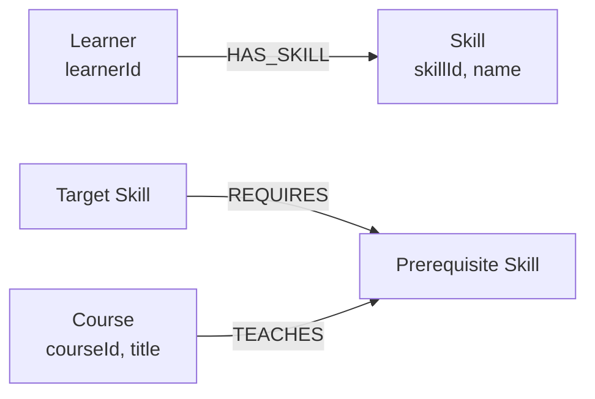
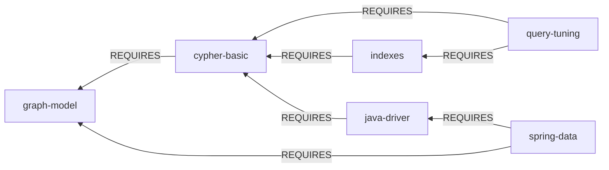

# Defining the Problem, Scope Boundaries, and Business Questions to Answer

A Neo4j capstone project rarely fails because developers do not know `MATCH` or `MERGE`, but because the team **starts creating nodes and relationships before agreeing on the problem to solve**. After several days, the graph may contain thousands of nodes and many edge types, yet there is no business question users actually want to ask, no pass/fail criteria for the results, and no boundary for when the project is considered complete.

In the **Capstone Project** chapter of the **DATABASE_ENGINE_GRAPH_NEO4J** module, the first step is turning vague needs into an **actionable, measurable, and testable problem definition**. The module's scope is using Neo4j to model connected data as a property graph, query nodes, relationships, and paths with Cypher, manage indexes/constraints, tune queries, ingest data, integrate Java Driver/Spring Data Neo4j, and operate the graph system. This lesson does not try to complete every implementation component right away; it creates the **business and technical contract** so that subsequent design, ingestion, API authoring, testing, and demonstration steps share the same objective.

The end-to-end project is **SkillPath — an assistant for discovering prerequisite skills and suitable courses**. A learner selects a target skill they want to achieve; the system finds the missing prerequisite skills and the courses that can help bridge the gap. This example is close enough to connected data to highlight the strengths of a graph, yet small enough to complete and verify in an academic capstone project.

**The expected outcome of this step** is not a repository packed with code. You need to produce:

1. A **problem statement** that clearly identifies the target user, pain point, and expected value.
2. A **project charter** defining goals, stakeholders, data, assumptions, and constraints.
3. A catalog of **business questions** with IDs, inputs, outputs, rules, and examples of expected correct results.
4. An **MVP / out-of-MVP** boundary tight enough to prevent scope creep.
5. A preliminary graph model and data contract **just sufficient to answer the selected questions**.
6. A set of **acceptance criteria and test cases** that make project evaluation objective.
7. A list of risks, stopping conditions, and decisions that must be verified before writing code.

> **Note:** All names, identifiers, data volumes, timings, and performance criteria in this lesson are **simulated scenarios for learning purposes**, not requirements of a specific enterprise. You must replace assumptions with evidence from stakeholders when building a real product.

## 1. Why Define the Problem Before Choosing a Graph Model?

Compare two ways of starting a project.

**Approach A — starting from technology:**

> “We will install Neo4j, create User, Course, and Skill nodes, connect them with relationships, and then build a search feature.”

This approach lacks the information needed to know how many labels, relationships, and properties are enough; the queries have no clear target. Later, the team easily drifts into adding ML-based recommendations, community detection, path optimization, real-time synchronization… simply because the graph “can do it.”

**Approach B — starting from business questions:**

> “When a learner already knows several skills and selects a target skill, the system must accurately list the missing prerequisite skills within the curriculum scope and surface the courses that directly teach those missing skills.”

Approach B makes it possible to determine:

- Inputs require a **learner**, **target skill**, **skill catalog**, and **prerequisite relationships**.
- Outputs consist of the set of missing skills, dependency rationale, and courses that can fill the gap.
- Core relationships are `REQUIRES`, `HAS_SKILL`, and `TEACHES`.
- Results can be verified with a small fixture, including prerequisite cycles and skills without courses.
- Scope excludes chatbots, machine learning, automated competency scoring, or time-optimal learning schedule planning.

The best starting point is a question that **makes business sense even without Neo4j**. Only then should you decide whether Neo4j provides enough value over alternative solutions.

## 2. Identifying Users, Stakeholders, and Supported Decisions

A “stakeholder” is not always someone clicking directly inside the application. They may be responsible for data, result quality, access control, or operational cost.

| Role | Their pain point | Decision or action supported |
| --- | --- | --- |
| **Learner** | Does not know what to learn first to reach a target skill | View missing skills and relevant courses |
| **Content curator** | Prerequisite catalog may have missing/wrong edges, cycles, or outdated courses | Review and fix the skill graph |
| **Learning advisor** | Manual advising is inconsistent across learners | Inspect the explanation behind a recommendation |
| **Product owner** | Wants to improve the course discovery journey | Approve MVP scope, KPIs, and acceptance criteria |
| **Data engineer** | Skill data comes from multiple sources with inconsistent IDs | Build mapping, validation, and repeatable ingestion |
| **Backend engineer** | Needs an API that returns accurate, fast, authorized results | Design queries, transactions, and error handling |
| **Operations / Security** | Learner data and Neo4j credentials must be protected | Restrict permissions, logging, backups, and error observability |

### Stakeholder Interview Questions

Before designing nodes, ask at least:

1. **Who** has the problem and how are they solving it today?
2. **Which decision** must be made from the query result?
3. Does “knowing a skill” mean completing a course, passing an assessment, or self-reporting?
4. Does “A requires B” mean A **must have B beforehand**, or is B an optional suggestion?
5. Can a skill require **multiple** other skills? Is the logic all of them or just one of them?
6. Are dependency cycles between skills allowed?
7. Does a course “teaching a skill” guarantee the learner acquires the skill after taking it?
8. Does a course have its own prerequisites, duration, price, or enrollment conditions?
9. Does the system need to suggest the **missing skill set**, **courses**, or an **ordered study plan**?
10. Does the data scope belong to one curriculum/academy or multiple organizations?
11. When data is incomplete, should the UI report “insufficient data” or assume “no prerequisites”?
12. Who approves the results and what defines “correct” in each case?

**Do not answer questions that affect semantics on behalf of stakeholders.** For example, when two courses both teach `indexes`, the data is not sufficient to claim which course is “best” without criteria for price, duration, quality, or fit.

## 3. Problem Statement: Writing One Verifiable Paragraph

Suggested structure:

> For **[users]**, when **[context]**, currently **[observable pain point]**. We are building **[smallest viable capability]** to enable **[specific decision]**, measured by **[business criteria]**. The MVP is limited to **[in scope]** and does not yet address **[out of scope]**.

Applied to SkillPath:

> For learners choosing advanced skills, manually tracing prerequisite knowledge across an interconnected curriculum is time-consuming and error-prone. SkillPath lets learners select a target skill, view the **set of missing prerequisite skills** based on an approved catalog, and view **courses that directly teach those skills**. The MVP serves a single skill catalog and test learner dataset; it does not infer true proficiency, schedule classes, or optimize learning paths by duration.

### Why Is This Better Than “AI Recommendation System”?

- It specifies a concrete user and moment of use.
- It defines demonstrable inputs and actions.
- It produces an **explainable** result: “missing `indexes` because `query-tuning` depends on `indexes`.”
- It does not promise quality scores that cannot be measured from available data.
- It establishes boundaries to push back on scope creep during the project.

A good problem statement should take about one minute to read and still lead to clear **pass/fail** tests.

## 4. Sample Project Charter for SkillPath

| Item | Illustrative filled-in value |
| --- | --- |
| **Project name** | SkillPath — prerequisite skill discovery |
| **Business owner** | Training platform Product Owner |
| **MVP users** | Authenticated learners and catalog administrators |
| **Core problem** | Identify unmet prerequisite skills for a learning goal |
| **Expected value** | Reduce manual advising effort, clearly explain prerequisite conditions |
| **Data scope** | One training curriculum; skills/courses assigned stable IDs |
| **Data sources** | Approved skill and course catalogs; verified learner outcomes |
| **Functional inputs** | Authenticated learner, `targetSkillId` |
| **MVP outputs** | Prerequisite list, missing set, courses teaching missing skills |
| **Graph entities** | `Learner`, `Skill`, `Course` |
| **Core relationships** | `HAS_SKILL`, `REQUIRES`, `TEACHES` |
| **Model invariants** | `REQUIRES` relationships are mandatory and acyclic |
| **Demo traversal limit** | Maximum 5 hops, only when data satisfies assumptions |
| **Integration** | Java Driver or Spring Data Neo4j for read API |
| **Acceptance criteria** | Business questions BQ-01 through BQ-04 have concrete expected outputs/tests |
| **Security** | Do not accept arbitrary `learnerId` from callers; use authorized identity |
| **Out of MVP** | ML recommendation, schedules, tuition, course quality ranking |
| **Key risks** | Missing or cyclic data, ambiguity around “skill acquired”, wide path queries |
| **Handover conditions** | End-to-end demo, automated tests, model and limitation documentation |

**A project charter is a scope management commitment**, not a wish list of every feature Neo4j could support. If time is tight, lock in BQ-01/BQ-02 before expanding to leaderboards or dashboards.

## 5. Do You Actually Need a Graph Database?

Choose Neo4j because the problem involves **meaningful relationships and dependency chains**, not merely for novel technology.

### 5.1. Questions That Require Traversals

- “Which skills does `query-tuning` need, both directly **and indirectly**?”
- “Learner L-001 already knows part of the prerequisites; where are the gaps in the graph?”
- “Which courses are connected to the missing skills?”
- “Does the skill catalog contain dependency cycles or nodes unreachable from a goal?”
- “When an administrator edits a `REQUIRES` edge, which goals are affected?”

This problem has **multi-hop paths**, relationships updated as business data evolves, and queries driven by graph structure. Neo4j and Cypher express these directly.

### 5.2. When a Relational Table or Simpler Tool May Suffice

If the MVP is actually just a course catalog with tuition filters and needs no multi-hop paths or traversal, an appropriately indexed relational database may be simpler.

A decision matrix:

| Criterion | Signal that a graph fits | Signal to consider another solution |
| --- | --- | --- |
| Importance of relationships | Relationships are central to the domain | Relationships are just a few foreign keys |
| Query depth | Needs multi-hop dependencies, graph traversal | Single-table lookup or one-hop joins only |
| Rate of link changes | Links change frequently, multiple link types | Stable schema, reports use simple aggregates |
| Result explainability | Can point to nodes/edges leading to the conclusion | Only simple summary tables are needed |
| Source data | Reliable IDs, entities, and relationships exist | No authoritative source defines relationships |
| Operations | Team accepts managing Neo4j, Cypher, and backups | Technology adds operational cost with little value |

The project should record a **technology hypothesis**: “Cypher makes multi-hop prerequisite queries concise and performant enough for the target dataset.” After running a proof of concept, if the hypothesis fails, you have the basis to narrow scope or change architecture.

## 6. Defining Scope Boundaries: MVP, Stretch, and Out of Scope

A small project needs clear requirement tiers. You can use the **MoSCoW** method:

| Priority | SkillPath feature | Decision |
| --- | --- | --- |
| **Must have** | `Skill` catalog with unique IDs and `REQUIRES` edges | Required to answer the core question |
| **Must have** | Store `Learner -[:HAS_SKILL]-> Skill` from verified data | Required to know what the learner has |
| **Must have** | BQ-01: list prerequisites of a target skill | Minimum graph objective |
| **Must have** | BQ-02: list prerequisites missing for a learner | Core business value |
| **Must have** | BQ-03: courses teaching missing skills | Gives users a concrete next action |
| **Must have** | Verify the graph is acyclic within demo data scope | Prevents undefined results |
| **Must have** | Correctness/error tests and learner authorization | Quality and security |
| **Should have** | BQ-04: report missing skills with no course | Helps curators complete the catalog |
| **Should have** | API DTOs, non-sensitive logging, constraints, and latency metrics | Demonstrates integration/operability |
| **Could have** | Display explanation paths as a graph diagram | Improves understandability |
| **Could have** | Admin UI to edit `REQUIRES` relationships | Can wait if time remains |
| **Won't have in MVP** | GDS recommendations, machine learning, inferred competency scores | Lacks evaluation data to commit |
| **Won't have in MVP** | Course enrollment, payments, certificates, personal calendars | Belongs to separate business systems |
| **Won't have in MVP** | Constrained cost/duration course sequence optimization | Separate algorithmic problem |
| **Won't have in MVP** | Multi-tenant database-per-tenant or HA cluster | Unnecessary for initial demo |

### Setting Quantitative Bounds

Example **demo bounds**:

- One curriculum, one skill ID namespace.
- Three required node labels and three required relationship types.
- Maximum five `REQUIRES` hops **after verifying the catalog has no longer chains**; if longer chains exist, update the requirement/query rather than silently truncating results.
- One learner and one target skill per API request.
- Course suggestions are based strictly on `TEACHES`, **not AI ranking**.
- Simulated test data only; do not load real user profiles into the demo environment.
- Correctness verification takes priority over visual UI or multi-service integrations.

**Scope limits never permit returning wrong answers.** If “maximum five hops” drops an existing sixth-level prerequisite, the system must **reject data violating the assumption** or raise the limit per an approved specification; it must not return incomplete results and report success.

## 7. Turning Needs into Coded Business Questions

A good business question specifies **the requester, inputs, outputs, semantic rules, and a reference example**. Avoid vague statements like “The system finds all related relationships” or “Find the best course.”

### 7.1. Business Question Catalog for SkillPath

| ID | Question to answer | Input | Output | Priority |
| --- | --- | --- | --- | --- |
| **BQ-01** | Which direct or indirect prerequisites does the target skill require? | `targetSkillId` | Deduplicated list of `Skill` items with IDs | Must |
| **BQ-02** | Which prerequisites of the target skill is the learner still missing? | Learner identity, `targetSkillId` | Deduplicated set of missing skills | Must |
| **BQ-03** | Which courses directly teach at least one missing skill? | Same as BQ-02 | List of courses and covered skills | Must |
| **BQ-04** | Which missing skills **do not yet have** a course teaching them? | Same as BQ-02 | List of content gaps | Should |
| **DQ-01** | Does the catalog contain `REQUIRES` cycles or non-existent IDs? | Catalog snapshot | Data error report | Must (validation) |
| **OPS-01** | Do queries meet the performance budget on the target dataset? | Test workload, graph size | p95, DB Hits, query execution plan | Must before acceptance |

BQ are questions for **users to make decisions**. DQ are data quality questions. OPS are operational targets. Do not lump everything together as an “intelligent recommendation feature.”

### 7.2. Writing Exact Semantics

For BQ-01:

- `REQUIRES` is directed from the **advanced** skill to the **prerequisite** skill.
- Results include **transitive** prerequisites, not just direct relationships.
- A prerequisite reachable via multiple paths **appears only once** in the list.
- The target skill **must never appear as its own prerequisite** due to a cycle; cyclic data must be blocked/flagged as invalid.
- By default, do not include the target skill itself in the prerequisite set.

For BQ-02:

- “Known” counts only `HAS_SKILL` relationships confirmed by a trusted source.
- Missing `HAS_SKILL` means **there is no verified evidence of attainment**, not necessarily that the learner truly lacks the skill.
- If the target skill or learner does not exist, return an error/not-found per the API contract; **do not return an empty list** as if all prerequisites were met.
- If the learner already has the target skill, the API may return an “already achieved” status instead of suggesting remediation.

For BQ-03:

- A course is included if it has a `TEACHES` relationship to **at least one** missing skill.
- There is no guarantee the course fits the learner's schedule, has open seats, meets its own prerequisites, or covers every prerequisite.
- “Covers more missing skills” can serve as an **explainable** ordering rule, not a guarantee of “best.”
- BQ-03 returns **relevant candidates**, not an automatically ordered study schedule.

## 8. Business Questions vs. Specific Cypher Queries

One question can be implemented with multiple Cypher variants, and users do not need to know how to invoke `MATCH` to verify the result.

Example:

- **Business question:** “What is L-001 still missing before taking `query-tuning`?”
- **Rule:** Collect all prerequisites of `query-tuning`, excluding skills for which L-001 has a verified `HAS_SKILL`.
- **Graph query:** `(goal)-[:REQUIRES*1..5]->(needed)` and check that `(learner)-[:HAS_SKILL]->(needed)` does not exist.
- **Expected result:** Only `indexes`.
- **Acceptance:** No duplicates, no missing items, no leaking of other learners' skills or profiles.

If you later switch from Cypher variable-length relationships to quantified path patterns, **the business question and acceptance criteria remain unchanged**. That is the benefit of decoupling requirements from implementation.

## 9. Minimum Viable Data Model Derived from Questions

Do not start with 15 labels just because a learning platform “might” manage classes, exams, certificates, promotions, instructors, and billing. The MVP can use three node types:



**Mandatory relationship direction conventions:**

- `(Learner)-[:HAS_SKILL]->(Skill)`: the learner has verified attainment of the skill.
- `(Skill advanced)-[:REQUIRES]->(Skill prerequisite)`: achieving skill A requires knowing skill B first.
- `(Course)-[:TEACHES]->(Skill)`: the course content is designed to teach that skill.

Reversing `REQUIRES` in even one place breaks prerequisite queries. Therefore, direction must be documented and tested.

### 9.1. Node-Level Data Dictionary

| Node | Required key | Minimum properties | Properties out of MVP scope |
| --- | --- | --- | --- |
| `:Learner` | `learnerId` | Anonymized code or internal ID from source system | Email, phone number, sensitive scores |
| `:Skill` | `skillId` | `name`, optional `status` | Vector embeddings, predicted difficulty |
| `:Course` | `courseId` | `title`, optional `status` | Tuition, schedule, ratings, commercial metadata |

**IDs are stable business keys**; never use Neo4j's internal `id()` or `elementId()` as an interchange key across systems, imports, or restores.

### 9.2. Relationship-Level Data Dictionary

| Relationship | Source → Target | Cardinality | Rules |
| --- | --- | --- | --- |
| `HAS_SKILL` | Learner → Skill | N–N | Created only from valid evidence/source |
| `REQUIRES` | Skill → Skill | N–N | No self-loops; prerequisite graph is acyclic |
| `TEACHES` | Course → Skill | N–N | Verified by content mapping, not inferred from course title |

A skill can have multiple prerequisites; one prerequisite can be required by many advanced skills. A course can teach multiple skills; a skill can be taught by multiple courses.

### 9.3. Graph Rules Matter More Than Pretty Diagrams

The model must document:

- Uniqueness of IDs.
- Who owns and updates each node/relationship type.
- Can relationships be created to non-existent nodes? **MVP: no**.
- Can a learner's known skill be revoked? Who has authority to revoke it?
- When a skill is deactivated, are related edges retained for audit or deleted?
- How the `REQUIRES` graph is checked for cycles.
- Database and tenant selection rules if the project later expands to multiple organizations.

Until these decisions are made, a graph model is not complete just because three rectangles were drawn.

## 10. Source Data and Quality Contracts

A graph can be technically well-designed and still return wrong answers if the underlying data is unmanaged.

### 10.1. Assumed Data Sources

| Data | Expected source of truth | Reliability and update cadence |
| --- | --- | --- |
| `Skill` catalog | Curator-approved dataset | Changes per content release cycle |
| `REQUIRES` | Domain curators | Must be checked for cycles before ingestion |
| `Course` catalog | Curriculum management system | Active/closed status may change |
| `TEACHES` | Course content mapping | Never infer via keyword matching on titles |
| `HAS_SKILL` | Learning outcome system or test fixture | Written only with rule-compliant evidence |

### 10.2. Ingestion Contract

Each skill record should contain at least:

```json
{
  "skillId": "indexes",
  "name": "Neo4j Indexes",
  "status": "ACTIVE"
}
```

A prerequisite edge can be represented in the source as:

```json
{
  "skillId": "query-tuning",
  "requiresSkillId": "indexes"
}
```

Before ingesting, validate:

1. `skillId` is non-null, non-empty, and normalized.
2. No two records share the same ID with conflicting names/semantics.
3. Both endpoints of every relationship exist and belong to the same curriculum.
4. No self-referencing `REQUIRES` edges and no cycles are introduced.
5. Closed courses are not suggested if business rules require active courses only.
6. `HAS_SKILL` records belong to the right learner and come from an authorized source.
7. A version/snapshot ID is recorded alongside counts of imported, skipped, and failed records.
8. Re-running the same batch does not duplicate nodes or relationships.

**Missing data is not proof of no prerequisites.** If a skill has not yet been reviewed by curators, the API should expose an unverified data status instead of inferring that the skill has zero prerequisites.

### 10.3. Handling Invalid Data

| Anomaly | Recommended MVP behavior |
| --- | --- |
| Target skill does not exist | Return `404` or a clear “not found” error |
| Learner does not exist | Do not return “nothing missing”; report not found |
| Edge points to unimported skill | Route to error queue; do not invent placeholder nodes |
| Duplicate skill ID | Reject or merge according to an explicit source policy |
| Prerequisite cycle | Block snapshot publication; report the cycle path |
| Closed course | Exclude from suggestions if “active only” rule applies |
| Skill without a course | Surface in BQ-04 for curators to address |
| Unverified `HAS_SKILL` | Do not treat as attained; store separate status if needed |

**Do not auto-correct every anomaly flagged by an algorithm.** In domain catalogs, many cases require human curators to resolve semantics.

## 11. Minimal Fixture to Agree on Correct Answers

A project needs a **small dataset with known expected outputs** before scaling up data. This fixture uses exactly one learner, six skills, and four courses.

### 11.1. Skill Dependency Network



**Arrows point from the skill to achieve toward its prerequisite skill.**

For example:

- `query-tuning` directly requires `indexes` and `cypher-basic`.
- `indexes` requires `cypher-basic`.
- `cypher-basic` requires `graph-model`.
- Therefore, the transitive prerequisites of `query-tuning` are **`indexes`, `cypher-basic`, `graph-model`**.
- Learner L-001 already has `graph-model` and `cypher-basic`, so only **`indexes`** is missing.

### 11.2. Expected Business Outputs

| Question | Input | Expected output |
| --- | --- | --- |
| BQ-01 | `targetSkillId=query-tuning` | `graph-model`, `cypher-basic`, `indexes` (each ID once) |
| BQ-02 | `learnerId=L-001`, `targetSkillId=query-tuning` | Only `indexes` |
| BQ-03 | Same input | Course `course-indexes` via `TEACHES→indexes` |
| BQ-04 | Same input | Empty set because `indexes` has a teaching course |
| DQ-01 | Graph fixture | No `REQUIRES` cycles, no orphan IDs |

Expected outputs are locked **before writing Cypher**; if a query returns `indexes` twice because of multiple paths, that is a result bug, not a “feature” of graphs.

## 12. Creating the Fixture with Idempotent Cypher

The following statements are for a **dedicated test database only**. Never run cleanup commands against a production graph. On an empty database, execute each block in order.

### 12.1. ID Constraints

```cypher
CREATE CONSTRAINT skill_id_unique IF NOT EXISTS
FOR (s:Skill)
REQUIRE s.skillId IS UNIQUE;
```

```cypher
CREATE CONSTRAINT course_id_unique IF NOT EXISTS
FOR (c:Course)
REQUIRE c.courseId IS UNIQUE;
```

```cypher
CREATE CONSTRAINT learner_id_unique IF NOT EXISTS
FOR (l:Learner)
REQUIRE l.learnerId IS UNIQUE;
```

`@Id` in Spring Data Neo4j or passing `skillId` in Java **does not replace** database-level uniqueness constraints. Note that a uniqueness constraint does not require every node with that label to have the property; ingestion must still validate ID presence.

### 12.2. Creating Skills

```cypher
UNWIND [
  {id: 'graph-model',  name: 'Property Graph Modeling'},
  {id: 'cypher-basic', name: 'Cypher Basics'},
  {id: 'indexes',      name: 'Indexes and Constraints'},
  {id: 'query-tuning', name: 'Query Tuning'},
  {id: 'java-driver',  name: 'Neo4j Java Driver'},
  {id: 'spring-data',  name: 'Spring Data Neo4j'}
] AS item
MERGE (s:Skill {skillId: item.id})
SET s.name = item.name;
```

### 12.3. Creating Prerequisite Relationships

```cypher
UNWIND [
  ['cypher-basic', 'graph-model'],
  ['indexes',      'cypher-basic'],
  ['query-tuning', 'indexes'],
  ['query-tuning', 'cypher-basic'],
  ['java-driver',  'cypher-basic'],
  ['spring-data',  'java-driver'],
  ['spring-data',  'graph-model']
] AS pair
MATCH (dependent:Skill {skillId: pair[0]})
MATCH (prerequisite:Skill {skillId: pair[1]})
MERGE (dependent)-[:REQUIRES]->(prerequisite);
```

The `REQUIRES` rule here is **“A requires B.”** Never flip the direction in subsequent read queries.

### 12.4. Learner and Attained Skills

```cypher
MERGE (l:Learner {learnerId: 'L-001'})
WITH l
UNWIND ['graph-model', 'cypher-basic'] AS knownId
MATCH (s:Skill {skillId: knownId})
MERGE (l)-[:HAS_SKILL]->(s);
```

In a real system, `HAS_SKILL` must come from a verified source; the fixture merely simulates that state.

### 12.5. Courses and Taught Skills

```cypher
UNWIND [
  {id: 'course-graph',   title: 'Introduction to Graphs'},
  {id: 'course-cypher',  title: 'Cypher Fundamentals'},
  {id: 'course-indexes', title: 'Indexes for Neo4j'},
  {id: 'course-tuning',  title: 'Practical Cypher Tuning'}
] AS item
MERGE (c:Course {courseId: item.id})
SET c.title = item.title;
```

```cypher
UNWIND [
  ['course-graph',   'graph-model'],
  ['course-cypher',  'cypher-basic'],
  ['course-indexes', 'indexes'],
  ['course-tuning',  'query-tuning']
] AS pair
MATCH (c:Course {courseId: pair[0]})
MATCH (s:Skill {skillId: pair[1]})
MERGE (c)-[:TEACHES]->(s);
```

Using `MERGE` on stable IDs and specific relationships makes the fixture convenient to re-run sequentially. However, **do not assume `MERGE` automatically solves all race conditions during concurrent ingestion**; real implementations still need concurrency controls and idempotency rules.

### 12.6. Checking Counts

```cypher
MATCH (s:Skill)
RETURN count(s) AS skillCount;
```

```cypher
MATCH (c:Course)
RETURN count(c) AS courseCount;
```

```cypher
MATCH ()-[r:REQUIRES]->()
RETURN count(r) AS requiresCount;
```

Expected on a fresh fixture graph: `skillCount=6`, `courseCount=4`, and `requiresCount=7`. These counts are for the **test fixture**, not target quotas for a real project.

## 13. BQ-01: What Does the Target Skill Require?

**Question:** Given `targetSkillId=query-tuning`, list all prerequisite skills within up to five hops, without duplicate IDs.

```cypher
MATCH (goal:Skill {skillId: $targetSkillId})
MATCH (goal)-[:REQUIRES*1..5]->(prereq:Skill)
RETURN DISTINCT prereq.skillId AS skillId,
       prereq.name AS name
ORDER BY skillId;
```

Test parameter:

```json
{
  "targetSkillId": "query-tuning"
}
```

Expected output ordered by `skillId`:

| skillId | name |
| --- | --- |
| `cypher-basic` | Cypher Basics |
| `graph-model` | Property Graph Modeling |
| `indexes` | Indexes and Constraints |

### Interpreting the Result

- `*1..5` means **relationship path length from 1 to 5**, not “return 5 records.”
- `DISTINCT` ensures a prerequisite reachable via multiple paths appears only once.
- `ORDER BY` produces deterministic display order for testing, not a study sequence.
- If a skill has no prerequisites, the query returns **0 rows**. The service layer must distinguish between an existing skill with no prerequisites and a non-existent skill; do not treat both identically.
- If a prerequisite chain exceeds five hops, the query can **omit data**; the bound is valid only when the data contract guarantees the depth.

**Do not assume `DISTINCT` makes traversal cheap.** Neo4j may still expand many paths before deduplicating target nodes. On larger datasets, inspect `EXPLAIN`/`PROFILE` and consider an appropriate model or algorithm.

## 14. BQ-02: Which Skills Is the Learner Missing?

**Question:** For an authenticated learner and target `query-tuning`, return prerequisites lacking a `HAS_SKILL` relationship.

```cypher
MATCH (l:Learner {learnerId: $learnerId})
MATCH (goal:Skill {skillId: $targetSkillId})
MATCH (goal)-[:REQUIRES*1..5]->(needed:Skill)
WHERE NOT EXISTS {
  MATCH (l)-[:HAS_SKILL]->(needed)
}
RETURN DISTINCT needed.skillId AS skillId,
       needed.name AS name
ORDER BY skillId;
```

Fixture parameters:

```json
{
  "learnerId": "L-001",
  "targetSkillId": "query-tuning"
}
```

Expected result:

| skillId | name |
| --- | --- |
| `indexes` | Indexes and Constraints |

The `NOT EXISTS { MATCH ... }` clause checks that **there is no recorded evidence of attainment** between the learner and that prerequisite. The query does not evaluate actual mastery; it reflects only existing `HAS_SKILL` data.

### Empty Result Cases

An empty result can happen because:

1. The learner already has **all prerequisites**.
2. The target skill **has no prerequisites**.
3. The skill or learner **does not exist**.
4. `REQUIRES` data is missing or exceeds the depth limit.
5. The application queried the wrong database/tenant.

Therefore, a production-grade API must **validate entity existence and data status** before concluding “nothing missing.” This is an independent acceptance criterion and cannot be inferred from an empty query result.

## 15. BQ-03: Which Courses Directly Cover Missing Skills?

From the BQ-02 skill set, traverse `(Course)-[:TEACHES]->(Skill)` edges to find candidate courses:

```cypher
MATCH (l:Learner {learnerId: $learnerId})
MATCH (goal:Skill {skillId: $targetSkillId})
MATCH (goal)-[:REQUIRES*1..5]->(needed:Skill)
WHERE NOT EXISTS {
  MATCH (l)-[:HAS_SKILL]->(needed)
}
MATCH (course:Course)-[:TEACHES]->(needed)
WITH course, collect(DISTINCT needed.skillId) AS coveredSkillIds
RETURN course.courseId AS courseId,
       course.title AS title,
       coveredSkillIds,
       size(coveredSkillIds) AS coveredCount
ORDER BY coveredCount DESC, courseId;
```

On the fixture, this returns one row:

| courseId | coveredSkillIds | coveredCount |
| --- | --- | ---: |
| `course-indexes` | `['indexes']` | 1 |

**Do not interpret this as “the best course.”** It is simply a course that **directly teaches a missing skill** according to data mappings. It lacks information on open enrollment, schedules, tuition, quality, language, or course prerequisites.

If two courses both cover a skill, BQ-03 can return **both**, sorted by coverage and then ID for deterministic ordering. Ranking by duration or fit is a new requirement that must be approved by the product owner rather than inventing ad-hoc criteria.

### What If There Are No Missing Skills?

BQ-03 returns an **empty list**. That means no **prerequisite-remediation courses** are needed, not that the learner has already mastered the target skill. The product may add a status like “prerequisites met; consider courses teaching the target skill,” but that must be specified as a **separate question** if included in the MVP.

## 16. BQ-04: Detecting Catalog Content Gaps

A prerequisite may exist yet **have no course teaching it**. Learners must be informed clearly instead of receiving a misleading empty recommendation.

```cypher
MATCH (l:Learner {learnerId: $learnerId})
MATCH (goal:Skill {skillId: $targetSkillId})
MATCH (goal)-[:REQUIRES*1..5]->(needed:Skill)
WHERE NOT EXISTS {
  MATCH (l)-[:HAS_SKILL]->(needed)
}
AND NOT EXISTS {
  MATCH (:Course)-[:TEACHES]->(needed)
}
RETURN DISTINCT needed.skillId AS missingCourseForSkillId
ORDER BY missingCourseForSkillId;
```

On the fixture, BQ-04 returns **0 rows** because `indexes` already has `course-indexes`. When testing the missing-course case, use a **separate fixture** or controlled test transaction rather than deleting relationships on a shared demo database and forgetting to restore them.

**Reading the result accurately:** BQ-04 returns skills that **the learner is missing and that have no course mapping**; it is not a list of every skill across the entire system lacking a course.

## 17. Validating Whether the Prerequisite Graph Is Valid

The queries above rely on a strong assumption: the `REQUIRES` graph is a **directed acyclic graph (DAG)** with no dependency cycles.

### 17.1. Why Cycles Break Business Logic

If the data states:

```text
A REQUIRES B
B REQUIRES C
C REQUIRES A
```

then no consistent “learn before” ordering exists under mandatory rules. A bounded query might stop after five steps, but **a depth limit does not fix corrupt data**.

### 17.2. A Simple Cycle Check on a Small Dataset

```cypher
MATCH p = (s:Skill)-[:REQUIRES*1..5]->(s)
RETURN s.skillId AS skillId,
       [n IN nodes(p) | n.skillId] AS cycle
LIMIT 20;
```

On the fixture above, expect **0 rows**. This query only detects cycles of **up to five hops**; it **does not prove the entire graph is free of longer cycles**. With real data, implement validation on edge creation, a full-graph verification strategy, or appropriate graph algorithms for large graphs.

### 17.3. Checking the Depth Bound

If BQ-01/BQ-02 traverse at most five steps, the data contract must verify whether prerequisite chains of **six steps** or more exist. Local test example:

```cypher
MATCH p = (s:Skill)-[:REQUIRES*6..6]->(p:Skill)
RETURN s.skillId AS skillId,
       p.skillId AS deepPrerequisite
LIMIT 10;
```

If rows are returned, the MVP bound is **no longer semantically safe**. On large datasets, scanning for deep paths itself carries cost; move validation into the curation pipeline rather than running it unconditionally on every API request.

### 17.4. Other Data Quality Errors

| Condition | Example | Expected reaction |
| --- | --- | --- |
| Self-loop | `A REQUIRES A` | Reject on write |
| Cycle | `A → B → C → A` | Block snapshot release |
| Target skill missing | Edge points to non-existent ID | Report import error, do not create placeholder |
| Duplicate skill ID | Two `skillId=indexes` nodes | Uniqueness constraint and source audit |
| Same skill name, different IDs | “Cypher Basics” / “Cypher cơ bản” | Curator decides whether to merge or keep distinct |
| Reversed relationship | `graph-model REQUIRES cypher-basic` | Data tests assert direction rules |
| Course teaches deprecated skill | Outdated mapping | Filter by specified status rules |
| Learner assigned unverified skill | `HAS_SKILL` from untrusted source | Separate unverified state |

**Do not automatically repair every anomaly flagged by an algorithm.** In domain catalogs, many cases require curators to resolve semantics.

## 18. From Business Questions to an API Contract

The capstone does not require a complex frontend; an **API returning JSON with a clear contract** is enough to prove end-to-end behavior.

### 18.1. A Combined Response API

```http
GET /api/v1/me/learning-gaps?targetSkillId=query-tuning
Authorization: Bearer <token>
```

`/me/` emphasizes that the backend derives the learner from the authenticated identity and **never trusts an arbitrary `learnerId` sent by the caller**.

Illustrative response:

```json
{
  "learnerId": "L-001",
  "targetSkillId": "query-tuning",
  "prerequisiteSkillIds": [
    "cypher-basic",
    "graph-model",
    "indexes"
  ],
  "missingSkillIds": ["indexes"],
  "suggestedCourses": [
    {
      "courseId": "course-indexes",
      "coveredSkillIds": ["indexes"]
    }
  ],
  "skillsWithoutCourse": [],
  "dataStatus": "VERIFIED"
}
```

This structure lets the UI know the exact meaning of every list. Never return passwords, internal database details, or unnecessary learner properties.

### 18.2. Error Contract

| Condition | Illustrative behavior | Reason |
| --- | --- | --- |
| Unauthenticated | `401 Unauthorized` | Learner identity unknown |
| Not permitted to view profile | `403 Forbidden` | Prevent reading someone else's data |
| `targetSkillId` not found | `404 Not Found` | Distinguish from “no missing skills” |
| Invalid ID format | `400 Bad Request` | Input validation |
| Catalog has cycles or is unverified | Return error/data status per design; do not claim prerequisites met | Avoid misleading recommendations |
| Neo4j temporarily unavailable | Appropriate service error with correlation ID | Never fabricate fallback results |
| Learner meets all prerequisites | `200` with `missingSkillIds=[]` and explicit status | Valid business outcome |

These HTTP statuses are a **suggested contract** for the sample project; a production system must follow the organization's API standards.

### 18.3. Return Data Types

Return DTOs with scalar IDs and required descriptions instead of serializing the entire `Learner → Skill → Course` entity graph. Graph objects can introduce Java reference cycles, over-fetch relationships, and make payloads hard to control.

With Java Driver, you can map `Record` objects to DTOs. With Spring Data Neo4j, repositories and `Neo4jClient` each fit different scenarios, but **there is no need to load or save an entire aggregate** just to return skill ID lists.

## 19. Testable Acceptance Criteria

Use **Given – When – Then** phrasing instead of vague claims like “the system works correctly.”

### AC-01 — Prerequisite List

- **Given** the fixture graph with `query-tuning`.
- **When** querying BQ-01.
- **Then** receive exactly the three skills `graph-model`, `cypher-basic`, `indexes`, each ID once.
- **And** exclude `query-tuning` from the prerequisite set.

### AC-02 — Learner's Missing Skills

- **Given** L-001 has `graph-model` and `cypher-basic`.
- **When** querying BQ-02 for `query-tuning`.
- **Then** receive only `indexes`.
- **And** never treat other skills as acquired without `HAS_SKILL` evidence.

### AC-03 — Relevant Courses

- **Given** `course-indexes TEACHES indexes`.
- **When** querying BQ-03.
- **Then** observe `course-indexes` with rationale `coveredSkillIds=['indexes']`.
- **And** never label the result as “optimal” without comparison criteria.

### AC-04 — Missing and Invalid Data

- **Given** a non-existent target skill.
- **When** calling the API.
- **Then** return an explicit error, not `200` with an empty missing list.
- **Given** a graph containing a `REQUIRES` cycle.
- **When** running import validation.
- **Then** the dataset is blocked or marked invalid; never published as approved data.

### AC-05 — Authorization

- **Given** authenticated user A.
- **When** attempting to read user B's private `HAS_SKILL` data.
- **Then** deny per policy.
- **And** a spoofed learner ID in query parameters cannot switch backend identity.

### AC-06 — Idempotent Re-ingestion

- **Given** an already imported fixture.
- **When** re-running the full idempotent import process.
- **Then** counts of Skills, Courses, and keyed relationships do not grow unexpectedly.

These are **product acceptance criteria**. Unit tests that only check a Java method or mock a repository **cannot replace** Neo4j integration tests for actual Cypher queries and relationships.

## 20. Traceability Matrix: From Requirements to Data and Tests

This matrix helps spot requirements lacking data or test coverage.

| ID | Required data | Primary query/path | Verifying test | Output |
| --- | --- | --- | --- | --- |
| BQ-01 | `Skill`, `REQUIRES` | `goal -[:REQUIRES*1..5]-> prereq` | AC-01 + depth/cycle | Prerequisite IDs |
| BQ-02 | Plus `Learner`, `HAS_SKILL` | BQ-01 + `NOT EXISTS HAS_SKILL` | AC-02, non-existent entity | Missing IDs |
| BQ-03 | Plus `Course`, `TEACHES` | `Course -[:TEACHES]-> missing` | AC-03, overlapping coverage | Course candidates |
| BQ-04 | Plus course mapping data | No `TEACHES` edge to missing skill | Missing-course case | Content gaps |
| DQ-01 | Entire `REQUIRES` graph | Cycles and orphans | AC-04 | Data validation report |
| OPS-01 | Representative graph and real queries | `EXPLAIN`/`PROFILE` | Performance budget | Plan logs and metrics |

If an API field **does not trace back to any question, data source, or test**, ask whether it belongs in the MVP. Conversely, if a question lacks a query path or data source, it is not ready for an implementation sprint.

## 21. Non-Functional Requirements: Avoid Performance Promises Without Data

Beyond returning correct answers, a Neo4j capstone needs reasonable operational standards.

| Category | Requirement or assumption to finalize | Verification method |
| --- | --- | --- |
| **Correctness** | Prerequisite, missing, and course sets match definitions | Fixtures, integration tests, negative cases |
| **Performance** | Latency budget per stakeholder-approved SLO | Tests on documented dataset/connections/hardware |
| **Cardinality** | No unbounded full-graph scans; depth verified | `EXPLAIN`/`PROFILE`, graphs with supernodes |
| **Availability** | Graceful error response when Neo4j is unavailable | Controlled disconnect test |
| **Security** | No access to other learners' profiles | Authorization negative tests |
| **Data quality** | Unique IDs, acyclic `REQUIRES`, no orphans | Constraints, validation pipeline |
| **Import** | Re-runnable without creating duplicates | Run-twice test, compare counts |
| **Observability** | Correlation ID, query duration, and error category | Logs/metrics in test environment |
| **Recovery** | Source data/backups and rebuild guide available | Test restore or fixture reload |
| **Maintainability** | Model structure, queries, and rules documented | Review and demo |

### Sample Performance Budget Requiring **Approval**

To illustrate how to set targets, a team might propose:

- Benchmark dataset: **1,000 skills**, **3,000 prerequisite edges**, **500 courses**, **100 learners**, including several high-degree skills.
- Workload: 10 concurrent requests calling BQ-02/BQ-03 on a fixed test machine with recorded specifications.
- Initial target: **p95 under 800 ms** for the endpoint, measured from service receipt to response; error rate within an agreed threshold.
- Every query must have a proven traversal bound; never run unbounded `MATCH ...-[:REQUIRES*]->...` on the online request path.

**This is an example of writing an SLO, not a Neo4j benchmark or universal SLA.** Without knowing hardware, network, data generation shape, and cache hit rates, you cannot claim 800 ms will hold. Measure a baseline, tune the budget, and record experimental conditions.

### Correct First, Fast Second

A “fast” query that misses a sixth-level prerequisite or leaks another learner's data is a **failure**. When tuning:

1. Lock expected outputs on fixture data.
2. Verify appropriate indexes/constraints exist.
3. Measure execution plans and intermediate row counts.
4. Reduce fan-out/query payload without changing semantics.
5. Compare latency under identical environment and load.
6. Re-run correctness, error, and authorization tests.

## 22. First Architecture Decision: Single Database and Ownership Scope

The MVP has only one curriculum and one simulated learner set, so **a single Neo4j standard database** suffices. This keeps scope manageable and aligns with single-database deployment patterns.

Do not add on your own:

- A three-node cluster just to run a demo.
- A separate database per learner.
- GDS community detection or link prediction not required by any business question.
- Kafka CDC and external search engines if static fixtures suffice.
- Multi-org SSO, a custom OAuth server, billing, and separate analytics pipelines.

Still, **document the decision and its revisit triggers**:

| MVP decision | Rationale | Revisit trigger |
| --- | --- | --- |
| Single database | Reduces operational overhead | Multiple curricula/tenants requiring isolation |
| Neo4j for prerequisite links | Questions involve multi-hop graph paths | Workflow degrades to simple key lookups |
| Java Driver or Spring Data Neo4j | Satisfies module's Java API requirements | Specialized query/result/transaction control needed |
| No GDS in phase 1 | No GDS algorithm is a must-have | Clear whole-graph analytics or optimization need |
| No ML recommendations | Lacks ground-truth labels and quality metrics | Sufficient labeled data and evaluation suite exist |
| No raw PII stored | Minimal fixture and learner attributes | Privacy review required before real product launch |
| Versioned fixtures + imports | Easy to rebuild demo/tests | Live mutable data requires backup/recovery strategy |

**One database** does not mean skipping security. Still enforce dedicated Neo4j credentials, least privilege, TLS over untrusted networks, and user authorization at the API layer.

## 23. Edge-Case Test Suite to Plan from Requirements Phase

### 23.1. Business Cases

| Case | Input data | Valid outcome |
| --- | --- | --- |
| **Multi-hop dependency chain** | `query-tuning→indexes→cypher-basic→graph-model` | Returns all three prerequisites |
| **Multiple paths to one skill** | `query-tuning` needs `cypher-basic` directly and via `indexes` | `cypher-basic` appears only once |
| **Learner meets all prerequisites** | `HAS_SKILL` on every prerequisite | `missingSkillIds=[]` |
| **Target has no prerequisites** | Standalone skill | Empty list **while confirming skill exists** |
| **Target skill does not exist** | `targetSkillId=unknown` | Not-found error, never empty-as-valid |
| **Learner does not exist** | `learnerId=unknown` | Error / no profile found |
| **Two courses teach same skill** | Two Courses → `indexes` | Returns both candidates without picking one arbitrarily |
| **One course covers two missing skills** | Same course has two `TEACHES` edges | One course entry with `coveredCount=2` |
| **Missing course mapping** | No Course → missing skill | BQ-04 reports the gap |
| **Dependency cycle** | `A→B→C→A` | Dataset blocked/flagged invalid |
| **Depth > 5** | Six-hop prerequisite chain | Assumption violation reported / scope updated, not silently truncated |
| **Reversed edge** | `prerequisite→advanced` | Validation/tests detect wrong expected output |
| **Duplicate data** | Same item imported twice | Counts do not grow unexpectedly |
| **Unauthorized access** | User A requests User B's profile | Denied per policy |
| **High-fan-out graph** | One skill requires hundreds of skills | No hang/timeout; performance guardrails hold |

### 23.2. Which Test Types to Use?

- **Unit tests:** validate parameters, DTO mapping, and authorization policies without database dependencies.
- **Neo4j Harness or Testcontainers:** test Cypher queries, unique constraints, relationship directions, and real data.
- **API integration tests:** verify `/me` extracts identity from authentication, never the request body.
- **Performance tests:** representative dataset including high-fan-out cases; measure p95 and DB Hits.
- **Manual demo:** stakeholder selects a target and sees missing skills alongside clear explanations.

A unit test mocking `Neo4jRepository` to always return `indexes` can still pass even when real Cypher traverses edges backward; thus **integration tests against a real Neo4j instance are essential** for the capstone.

## 24. From Scope to Execution Plan

A plan can be broken into small milestones, each with verifiable deliverables.

| Milestone | Objective | Artifacts to review |
| --- | --- | --- |
| **0. Lock problem** | Confirm problem statement, questions, and out-of-scope | Charter, BQ catalog, acceptance criteria |
| **1. Model & data** | Nodes/relationships, IDs, constraints, fixture data | Graph diagram, data dictionary, seed Cypher |
| **2. Prove Cypher** | Run BQ-01/BQ-02 with accurate outputs | Queries and integration tests |
| **3. API & auth** | Query scoped to authenticated learner | Endpoint/DTOs, error handling, negative tests |
| **4. Courses & quality** | BQ-03/BQ-04, invalid-data checks | Course candidates, validation report |
| **5. Perf & ops** | Benchmark representative dataset, logging, backup/rebuild | Execution plans, metrics, runbook |
| **6. Demo & sign-off** | Demonstrate one end-to-end journey | Pass/fail checklist, limitation docs |

Avoid rigid day counts; duration depends on resources and data readiness. **Priority rule:** until milestone 2 proves BQ-02 works accurately, do not spend most of your time on fancy charts or “smart” recommendations.

### Definition of Done

A BQ is considered done only when:

- It has an approved business definition.
- It has a corresponding data contract.
- It has runnable parameterized Cypher/API code.
- It has positive, negative, and boundary tests.
- It produces user-explainable output.
- Its limitations and error handling are documented.
- It enforces data access authorization.
- It has performance evidence matching agreed thresholds.

## 25. Risk Matrix and Mitigation

| Risk | Illustrative likelihood/impact | Detection signal | Mitigation |
| --- | --- | --- | --- |
| Inconsistent `REQUIRES` semantics | High / High | Different curators invert edge directions | Data dictionary, examples, input review |
| Cyclic catalog | Medium / High | Validation detects a cycle | Pre-publish checks, reject invalid edges |
| Untrusted `HAS_SKILL` source | High / High | Under- or over-recommended gaps | Verification rules, provenance, unverified status |
| Duplicate or missing keys | Medium / High | Nodes fail to merge, import errors | Stable IDs, uniqueness constraints, validation |
| Overly wide path expansion | Medium / High | DB Hits/p95 spike | Evidence-backed depth bounds, indexes, fan-out tests |
| Course suggestions mistaken as optimal | High / Medium | Users expect a complete schedule | Name field `suggestedCourses`, explain rule |
| Scope creep | High / High | Sprint fills with ML, billing, dashboards | Charter, MoSCoW, change requests |
| Learner data leak | Low–Medium / Very High | API reads user-supplied `learnerId` | Auth context, negative tests, audit logs |
| Demo cannot be reproduced | Medium / Medium | Fixture fails on another machine | Idempotent import scripts, pinned dependencies |
| No success metrics | High / High | Subjective demo, no acceptance criteria | Lock BQ/AC/metrics and baseline before coding |

Likelihood/impact values in this table are **illustrative only**. Real projects should track individual owners, risk levels, review dates, and mitigation decisions.

## 26. Measuring Business Value Without Overclaiming

A project can function correctly yet fail to deliver business impact. Separate **technical correctness** from **usage outcomes**.

| Metric | Purpose | Initial measurement approach |
| --- | --- | --- |
| Pass rate on approved test suite | Logic quality | Passed cases / total acceptance cases |
| Share of skills with curator-approved prerequisites | Catalog quality | Verified skills / total in-scope skills |
| Share of missing skills covered by courses | Content coverage | Missing skills with `TEACHES` / total missing skills |
| Time for users to find prerequisites | Experience value | Compare against manual workflow on test group |
| Share of recommendations advisors judge reasonable | Domain value | Sample results reviewed by curators |
| API p95 and error rate | Operational readiness | Load tests under documented conditions |
| Authorization test pass rate | Security posture | Negative security tests |

**Never claim “reduces advising time by 50%” without measuring a baseline and running a real trial.** Frame that as a post-MVP hypothesis to test.

A tracking sheet should distinguish:

- **Baseline:** measurements before SkillPath.
- **Target:** stakeholder-approved goal.
- **Observed:** measurements after trial.
- **Method:** collection mechanism and test conditions.
- **Limitation:** sample size, data quality, bias, and unsupported conclusions.

That is how an engineering project credibly answers “why did we build this?”

## 27. One-Page Template for Other Projects

You can reuse this template for product catalogs, logistics, device networks, or anomaly detection—it is not tied to education.

```text
PROJECT NAME:
OWNER / STAKEHOLDERS:
PRIMARY USERS:
PROBLEM STATEMENT (max 5 sentences):
DECISIONS SUPPORTED:
SOURCE DATA AND TRUST LEVEL:

BUSINESS QUESTIONS:
  BQ-01: Input / Output / Rules / Expected example
  BQ-02: Input / Output / Rules / Expected example
  BQ-03: Input / Output / Rules / Expected example

MINIMUM GRAPH MODEL:
  Node labels:
  Business IDs:
  Relationship types + directions:
  Constraints / invariants:

IN MVP:
OUT OF MVP:
ASSUMPTIONS TO VERIFY:
DATA / SECURITY / PERFORMANCE RISKS:

ACCEPTANCE:
  AC-01:
  AC-02:
  AC-03:

METRICS + MEASUREMENT METHOD:
TEST PLAN:
DELIVERABLES:
STOP / SCOPE-CHANGE CONDITIONS:
```

### A Tight Business Question Template

```text
ID:
Requester / decision purpose:
Question in business language:
Required inputs:
Data sources:
Relationships traversed:
Inclusion rules:
Exclusion rules:
Ordering / deduplication:
When no results match:
When data is missing or invalid:
When unauthorized:
Expected output on fixture:
Performance criteria:
Verifying tests:
```

If you cannot fill in “Expected output on fixture” for a business question, the question is likely still too vague to hand to a developer.

## 28. Common Problem-Definition Mistakes

| Mistake | Consequence | Fix |
| --- | --- | --- |
| “Build a social network with Neo4j” | Unclear which queries must be supported | Pick 2–3 real user decisions |
| “Create as many node types as possible” | Bloated model lacking data and tests | Model only what answers BQs |
| “Find the best course” | Undefined “best” criteria | Define coverage/price/time/quality separately |
| “We have GDS so we must run algorithms” | Unnecessary cost and unexplainable results | Use algorithms only when a BQ requires them |
| “Returning paths is enough” | Paths proliferate, duplicate targets, confuse UI | Choose nodes, paths, or scalars intentionally |
| “All relationships are undirected” | Breaks prerequisite semantics | Document type + direction explicitly |
| “No IDs needed because Neo4j has `elementId()`” | Breaks imports, merges, and restores | Enforce stable business keys and constraints |
| “Missing skill = learner knows nothing” | Misinterprets incomplete records | Distinguish unverified evidence from non-attainment |
| “`REQUIRES*1..5` will never miss anything” | Fails silently if chains exceed 5 hops | Validate depth or expand scope |
| “Empty query result means qualified” | Masks missing learner or goal errors | Validate existence and data status |
| “API lets callers pass any learnerId” | Profile data exposure | Derive learner from authorized principal |
| “With indexes, every query is fast” | Path fan-out can still explode | Inspect plans/cardinality, test high-degree nodes |
| “MVP needs login, billing, ML, dashboard” | Scope creep, core BQs unfinished | Apply MoSCoW and change control |
| “Demo only on a hand-crafted graph” | Non-reproducible and unproven correctness | Use fixtures, idempotent imports, integration tests |
| “Measure success by lines of code” | Fails to prove value or quality | Track acceptance, correctness, latency, and KPIs |
| “One happy-path example proves everything” | Fails on cycles, duplicates, missing courses | Build edge-case matrix and negative tests |

## 29. Practice Exercises for Learners

**Exercise 1 — Write a problem statement.** Pick a domain with real relationships (supply chain, education, system topology, retail). Write one paragraph stating users, pain point, supported decision, expected value, and out-of-scope boundaries. Avoid “smart AI” without measurable definitions.

**Exercise 2 — Graph-fit analysis.** For your project, write three questions requiring multi-hop traversals and one question needing only lookup/aggregation. Explain why Neo4j fits or why SQL should be considered.

**Exercise 3 — Lock MVP scope.** List Must/Should/Could/Won't items for SkillPath. Suppose time allows only two business questions; which do you keep first and why?

**Exercise 4 — Author a data dictionary.** Design `Skill`, `Course`, `Learner`, and the three relationships. Specify the direction of `REQUIRES` with an unambiguous sentence. Choose stable IDs for every node.

**Exercise 5 — Verify the fixture.** Run the seed Cypher blocks in a test database. Compute BQ-01 and BQ-02 by hand before running the queries. Why must `cypher-basic` never appear twice?

**Exercise 6 — Empty-result cases.** Write two tests distinguishing “target skill exists with no prerequisites” from “target skill ID does not exist.” Why cannot both return the same business response?

**Exercise 7 — Cycles and depth.** In a **separate** fixture, add `A→B→C→A`. Confirm validation flags an error. Then create a six-hop chain to demonstrate why `*1..5` can return incomplete results.

**Exercise 8 — Candidate courses.** Add another course teaching `indexes` and a course simultaneously teaching two missing skills for another learner. Prove BQ-03 does not duplicate courses and `coveredCount` behaves meaningfully.

**Exercise 9 — Authorization.** Design a test where learner A tries to view learner B's `HAS_SKILL` edges. Identify the trusted source of `learnerId` and when `403` must be returned.

**Exercise 10 — Traceability.** Build a table for three BQs in your project showing inputs, nodes/relationships, query shape, outputs, positive/negative tests, and data owners.

**Exercise 11 — Performance budget.** Choose a benchmark dataset and a **proposed** SLO (including machine specs and concurrent requests). Describe how to measure before/after indexing and verify outputs remain identical.

**Exercise 12 — Stakeholder pushback.** The product owner asks to add “personalized AI learning-style recommendations” before an evaluation dataset exists. Write a change request detailing expected value, required data, MVP impact, measurement plan, and your recommendation to keep or defer.

### Checklist Before Moving to Detailed Design

- [ ] Problem statement identifies users, pain points, and supported decisions.
- [ ] Business owner and data sources are identified.
- [ ] Evaluated whether graph traversal adds value over simpler alternatives.
- [ ] At least three business questions have concrete inputs/outputs and semantics.
- [ ] Questions have IDs, priorities, and acceptance criteria.
- [ ] MVP / out-of-MVP boundaries are documented and agreed upon by stakeholders.
- [ ] Data dictionary specifies business IDs, relationship types, and directions.
- [ ] Checks exist for uniqueness, missing IDs, and cycles.
- [ ] Path queries state explicit depth assumptions, not arbitrary limits.
- [ ] A fixture small enough to calculate expected outputs by hand exists.
- [ ] Negative tests cover missing data and unauthorized access.
- [ ] Data provenance and the policy for “skill acquired” are clear.
- [ ] Traceability maps BQ → data → query → test → outcome.
- [ ] A **proposed** performance budget and measurement method exist without premature benchmark claims.
- [ ] Risks, owners, and scope-change triggers are documented.
- [ ] Every team member can answer in one minute: **“Which questions does our project answer?”**

## 30. Evaluation Rubric for the Problem-Definition Phase

For this initial capstone phase, you may use a 100-point reference rubric:

| Criterion | Max points | Evidence |
| --- | ---: | --- |
| Meaningful problem statement and goals | 15 | Users, pain point, action, and value |
| Graph-fit and rationale for Neo4j | 10 | Traversal questions, comparison with alternatives |
| Clear, measurable BQ catalog | 20 | BQ IDs, inputs/outputs, rules, examples |
| MVP and out-of-MVP scope | 15 | Must/Should/Won't, approved bounds |
| Preliminary data dictionary and invariants | 15 | Labels, IDs, directions, uniqueness, cycles |
| Acceptance & negative tests | 15 | Fixtures, expected outputs, errors, and security |
| Risks, reproducibility, and measurement plan | 10 | Data provenance, performance assumptions, plan |
| **Total** | **100** | **Full backend code is not required at this step** |

This rubric is a **learning guideline only**; instructors may adjust it. Scores do not substitute for clarifying legal, security, and operational requirements in a real production project.

## 31. References

- [Neo4j Cypher Manual — MATCH](https://neo4j.com/docs/cypher-manual/current/clauses/match/): matching node and relationship patterns.
- [Neo4j Cypher Manual — Variable-length paths](https://neo4j.com/docs/cypher-manual/current/patterns/variable-length-paths/): querying multi-hop relationships, result cardinality, and bounds.
- [Neo4j Cypher Manual — EXISTS subqueries](https://neo4j.com/docs/cypher-manual/current/subqueries/existential/): checking presence or absence of graph patterns.
- [Neo4j Cypher Manual — MERGE](https://neo4j.com/docs/cypher-manual/current/clauses/merge/): key-based ingestion and upsert caveats.
- [Neo4j Cypher Manual — Create constraints](https://neo4j.com/docs/cypher-manual/current/schema/constraints/create-constraints/): uniqueness constraints and behavior when properties are missing.
- [Neo4j Cypher Manual — Query tuning](https://neo4j.com/docs/cypher-manual/current/planning-and-tuning/query-tuning/): `EXPLAIN`/`PROFILE` and traversal evaluation.
- [Neo4j Java Driver Manual](https://neo4j.com/docs/java-manual/current/): connections, transactions, and handling Cypher results in Java.
- [Spring Data Neo4j Reference](https://docs.spring.io/spring-data/neo4j/reference/): node/relationship mapping, repositories, and `Neo4jClient`.

**Conclusion:** A strong Neo4j capstone starts from **business questions verifiable by concrete outputs**, not from label counts, plugins, or algorithms. For SkillPath, the MVP boundary is finding **prerequisite skills, missing gaps, and directly relevant courses** in a validated graph; anything beyond those semantics must be logged as a new requirement. Once the problem statement, scope, data sources, graph invariants, and acceptance criteria are locked, subsequent steps—Cypher design, index/constraint creation, data ingestion, Java API development, testing, and deployment—share one objective standard for correctness.
