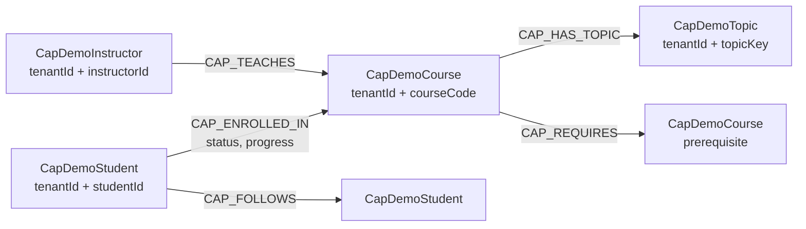
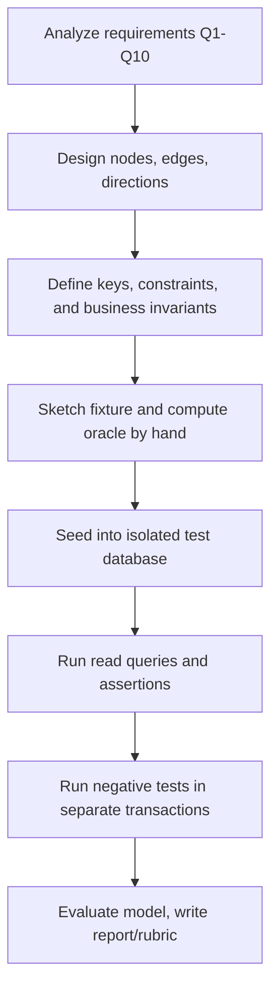

# Designing a Graph Model and Edge-Case Dataset — Neo4j Capstone Project

A system with just a few simple nodes and relationships is rarely enough to test the quality of a graph design. Queries may pass on “clean” data yet return wrong answers when two tenants share an ID, a person has no relationships, a property is missing, a course has two prerequisite chains, or a relationship carries a status where `0` must be distinguished from `null`.

This capstone asks you to build a **property graph model and a small, intentional test dataset** for an online learning platform. You will answer four questions: **Which nodes must exist? What business meaning do relationships represent? Which invariants must be protected? Which dataset is strong enough to prove queries behave correctly on edge cases?**

This lesson belongs to the **Capstone Project** chapter of the `DATABASE_ENGINE_GRAPH_NEO4J` module. It synthesizes core Neo4j concepts: nodes, relationships, labels, properties, Cypher, indexes/constraints, query tuning, and preparing data for later integration via Neo4j Java Driver or Spring Data Neo4j.

> **Primary deliverables:** model diagram, data dictionary, constraints and business rules, Cypher fixture seed script, query suite with expected answers, negative tests, and a report explaining how the model handles edge cases. A complete web application is not required to finish this lesson.

## 1. Context: Multi-Tenant Training Platform

Suppose an education product offers courses on Cypher, Java Driver, and Spring Data Neo4j to multiple organizations. Each organization is a **tenant**, identified by `tenantId`.

Requirements:

1. **Students** can enroll in multiple **courses**, with each enrollment tracking `status` and `progress`.
2. An **instructor** can teach multiple courses; a course may not yet have an assigned instructor.
3. A course can belong to multiple **topics**; a topic can be attached to multiple courses.
4. An advanced course can **require** one or more prerequisite courses.
5. Students can **follow** one another; follow cycles are permitted.
6. Two tenants can both use `studentId = 'S01'` or `courseCode = 'C101'` without referring to the same entity.
7. Data modification operations must avoid accidentally linking students/courses across tenants.
8. It must be possible to query learners who have no relationships at all and courses without an assigned instructor.
9. The model must distinguish **missing** properties, **empty strings**, and **numeric zero**.
10. Course prerequisite chains **must not contain cycles**, even though the student follow graph may contain cycles.

### 1.1. Questions the System Must Answer

| ID | Business question | Query direction |
| --- | --- | --- |
| Q1 | Which courses has a student enrolled in, and in what status? | `Student → ENROLLED_IN → Course` |
| Q2 | Which direct and indirect prerequisites does course C104 require? | `Course → REQUIRES → Course` |
| Q3 | How many distinct prerequisite paths lead to the same foundational course? | Path and `count(path)` |
| Q4 | Which courses have no assigned instructor? | `NOT EXISTS`/`OPTIONAL MATCH` |
| Q5 | Which students are completely isolated? | No relationships of any type |
| Q6 | Can Tenant T1 ever be linked to T2 data? | Compare tenant on both endpoints |
| Q7 | Has a user completed all direct prerequisites to take a new course? | Nested `EXISTS`/`NOT EXISTS` |
| Q8 | Are there duplicate enrollments between the same student and course? | Group by endpoint nodes, `count(r)` |
| Q9 | How does a missing progress property differ from progress = 0? | `IS NULL` and numeric comparison |
| Q10 | Do aggregations preserve learners with zero enrollments? | `OPTIONAL MATCH` and `count(r)` |

These questions drive the graph design. **Never design nodes/relationships by intuition first and invent questions afterward.**

## 2. Domain Boundaries and Modeling Decisions

### 2.1. Four Core Node Types

| Label in Neo4j | Business key | Properties | Role |
| --- | --- | --- | --- |
| `CapDemoStudent` | `(tenantId, studentId)` | `displayName`, `email?`, `experienceMonths?`, `active` | Learner |
| `CapDemoCourse` | `(tenantId, courseCode)` | `title`, `fee?`, `published` | Course |
| `CapDemoInstructor` | `(tenantId, instructorId)` | `name`, `specialty?` | Instructor |
| `CapDemoTopic` | `(tenantId, topicKey)` | `title` | Topic |

A `?` marks a property that **may be absent**. Never silently treat an absent property as an empty string or zero.

A student can carry an additional `CapDemoPeerMentor` label while still remaining **one `CapDemoStudent` node**. This demonstrates the **multi-label** nature of property graphs. Instructor is a separate entity type in this project; in practice, a unified `Person` model with role labels is also an option, provided you document the rationale and key implications.

### 2.2. Five Relationship Types

| Type, defined direction | Properties | Semantics |
| --- | --- | --- |
| `(:CapDemoStudent)-[:CAP_ENROLLED_IN]->(:CapDemoCourse)` | `enrollmentId`, `status`, `progress?`, `joinedAt?` | A student enrolls in a course |
| `(:CapDemoCourse)-[:CAP_REQUIRES]->(:CapDemoCourse)` | Optional | Left course requires completing right course |
| `(:CapDemoInstructor)-[:CAP_TEACHES]->(:CapDemoCourse)` | Optional | Instructor teaches the course |
| `(:CapDemoCourse)-[:CAP_HAS_TOPIC]->(:CapDemoTopic)` | Optional | Course belongs to a topic |
| `(:CapDemoStudent)-[:CAP_FOLLOWS]->(:CapDemoStudent)` | Optional | Left student follows right student |

**Direction matters.** `(C104)-[:CAP_REQUIRES]->(C102)` means **C104 requires C102**, not that C102 requires C104. Keeping direction consistent makes direct prerequisite queries and cycle checks clear.

### 2.3. Why Is Enrollment a Relationship with Properties?

An enrollment connects a student and a course and can hold `status` and `progress`:

```text
(Student S01)
     │
     └──[:CAP_ENROLLED_IN {
          enrollmentId: 'E01',
          status: 'COMPLETED',
          progress: 100
        }]──► (Course C101)
```

Modeling this as relationship properties fits when an enrollment is a **direct link** between two nodes with a modest set of attributes.

However, if you need **multiple historical enrollments** for the same student–course pair, payments, certificates, event logs, and complex lifecycles, a dedicated `Enrollment` node with its own key may be better:

```text
(Student) ─[:HAS_ENROLLMENT]→ (Enrollment {enrollmentId})
(Enrollment) ─[:FOR_COURSE]→ (Course)
```

This capstone **chooses relationship properties** with the business rule: **each Student–Course pair has at most one managed enrollment**. Status changes update the existing relationship; full enrollment history is left as an extension.

### 2.4. Do Not Store Graph Relationships as String Lists When Traversing

A property like `prerequisiteIds: ['C102','C103']` can be stored, but it makes existence checks, path finding, cycle detection, and tenant isolation hard. The `CAP_REQUIRES` relationship lets Cypher traverse graph structure natively.

Similarly, a course covering multiple topics should use `CAP_HAS_TOPIC` rather than stuffing Topic objects into nested map properties. Neo4j does not store arbitrary nested maps as node properties.

## 3. Conceptual Graph Diagram

### 3.1. Entity Relationship Diagram



The diagram describes **relationship types**, not specific instances. Every fixture node carries `tenantId`; no edge may cross tenants.

### 3.2. Two Prerequisite Branches Leading to One Foundational Course

Within T1, construct the structure:

```text
C104 Spring Data Neo4j
  ├── REQUIRES ──► C102 Cypher
  │                   └── REQUIRES ──► C101 Neo4j Basics
  └── REQUIRES ──► C103 Java Driver
                      └── REQUIRES ──► C101 Neo4j Basics

C105 Independent Java Practice
  └── No prerequisites, no instructor
```

C104 has **two two-hop paths** to C101, yet C101 remains **a single node**. Therefore:

- `count(path)` to C101 is **2**.
- `count(DISTINCT prerequisiteCourse)` for indirect prerequisites must deduplicate courses rather than counting C101 twice.
- If a learner asks for the unique prerequisite list of C104, the set is **{C101, C102, C103}**, not four nodes along paths.

### 3.3. A Valid Cycle vs. a Forbidden Cycle

Follow relationships:

```text
S01 An ──FOLLOWS──► S02 Bình
   │                    │
   └──FOLLOWS──► S03 Chi◄─┘
       ▲             │
       └──FOLLOWS────┘
```

The follow cycle `S01 → S02 → S03 → S01` is valid per requirements; a cycle in a graph **is not automatically an error**. Conversely, a cycle in `CAP_REQUIRES` makes prerequisites impossible to satisfy sequentially. Cycle prohibition is **per relationship type**, not a blanket ban on all graph cycles.

## 4. Mandatory Invariants

An invariant is a condition that must hold before and after every write operation.

| ID | Invariant | Enforcement mechanism |
| --- | --- | --- |
| INV-01 | Student is unique by `tenantId + studentId` | Composite uniqueness constraint |
| INV-02 | Course is unique by `tenantId + courseCode` | Composite uniqueness constraint |
| INV-03 | Instructor and Topic share similar composite keys | Uniqueness constraints |
| INV-04 | Every business edge connects two nodes with the same `tenantId` | Service validation + integration tests |
| INV-05 | `CAP_REQUIRES` has no self-loops or cycles | Pre-write path check, concurrency control |
| INV-06 | One Student–Course pair has at most one active enrollment in this model | Business key rule and concurrent-write protection |
| INV-07 | `progress`, when present, lies in `0..100` | Service validation / Cypher guard |
| INV-08 | `status` belongs to the defined enum | Ingestion/write validation |
| INV-09 | Isolated Students and Instructor-less Courses are allowed | Queries use `OPTIONAL MATCH`/`NOT EXISTS` |
| INV-10 | Deleting an enrollment does not delete Student or Course nodes | Scope edits/deletes strictly to the relationship |

**Distinguish constraints from validation:** node uniqueness constraints **do not automatically enforce** same-tenant edges, acyclicity, status enums, or preventing parallel relationships between two nodes. The project must write tests for those rules rather than creating indexes and assuming all business rules are protected.

### 4.1. Composite Keys for Tenant Isolation

Both of these nodes **are valid**:

```text
(:CapDemoStudent {tenantId: 'T1', studentId: 'S01', displayName: 'An'})
(:CapDemoStudent {tenantId: 'T2', studentId: 'S01', displayName: 'Eva'})
```

Consequently, `MATCH (s:CapDemoStudent {studentId: 'S01'})` returns **two nodes**. If an API receives `tenantId` from authentication context yet runs `MERGE` using only `studentId`, it can accidentally link records across organizations.

Never accept `tenantId` from client input without authorization checks; the service should extract the verified tenant from the security context. Separate databases per tenant is another architecture option, but this capstone uses **one multi-tenant database** specifically to test filtering risks.

## 5. Creating Constraints for Business Keys

Run on a **dedicated Neo4j database for the capstone**, prepared separately. Never run the DDL statements below in production without a schema migration plan.

```cypher
CREATE CONSTRAINT cap_demo_student_key IF NOT EXISTS
FOR (s:CapDemoStudent)
REQUIRE (s.tenantId, s.studentId) IS UNIQUE;
```

```cypher
CREATE CONSTRAINT cap_demo_course_key IF NOT EXISTS
FOR (c:CapDemoCourse)
REQUIRE (c.tenantId, c.courseCode) IS UNIQUE;
```

```cypher
CREATE CONSTRAINT cap_demo_instructor_key IF NOT EXISTS
FOR (i:CapDemoInstructor)
REQUIRE (i.tenantId, i.instructorId) IS UNIQUE;
```

```cypher
CREATE CONSTRAINT cap_demo_topic_key IF NOT EXISTS
FOR (t:CapDemoTopic)
REQUIRE (t.tenantId, t.topicKey) IS UNIQUE;
```

Composite uniqueness in Neo4j prevents duplicate pairs among nodes that possess all key properties. It **does not force every node to have both properties**; enforce presence in request/import validation or use property existence constraints supported by your edition/version.

### 5.1. Which Queries Do Indexes and Constraints Serve?

A typical query looks up a node by its composite key:

```cypher
MATCH (s:CapDemoStudent {
  tenantId: $tenantId,
  studentId: $studentId
})
RETURN s.displayName AS name;
```

Uniqueness constraints create backing indexes so Neo4j can locate key pairs efficiently. Having an index does not guarantee the planner picks it in every situation; inspect `EXPLAIN` and `PROFILE` on real workloads.

Parameter example including both values:

```json
{
  "tenantId": "T1",
  "studentId": "S01"
}
```

Never interpolate untrusted input directly into Cypher strings.

## 6. Sample Dataset: Intentionally Small and Controlled

The fixture contains **18 nodes and 28 relationships**:

| Node type | T1 | T2 | Total |
| --- | ---: | ---: | ---: |
| CapDemoStudent | 5 | 1 | **6** |
| CapDemoCourse | 5 | 1 | **6** |
| CapDemoInstructor | 2 | 1 | **3** |
| CapDemoTopic | 2 | 1 | **3** |
| **Total nodes** | **14** | **4** | **18** |

| Relationship | T1 | T2 | Total |
| --- | ---: | ---: | ---: |
| `CAP_ENROLLED_IN` | 7 | 1 | **8** |
| `CAP_REQUIRES` | 4 | 0 | **4** |
| `CAP_TEACHES` | 4 | 1 | **5** |
| `CAP_HAS_TOPIC` | 6 | 1 | **7** |
| `CAP_FOLLOWS` | 4 | 0 | **4** |
| **Total relationships** | **25** | **3** | **28** |

Bình's node carries **two labels**, `CapDemoStudent` and `CapDemoPeerMentor`, yet counts **once** in the node total.

### 6.1. Node Catalog

| Tenant | Label | ID | Name/Title | Edge case |
| --- | --- | --- | --- | --- |
| T1 | Student | S01 | An | Valid email; enrolled in three courses |
| T1 | Student + PeerMentor | S02 | Bình | `experienceMonths = 0`; multi-label |
| T1 | Student | S03 | Chi | Missing `email` property |
| T1 | Student | S04 | Dũng | `email = ''` |
| T1 | Student | S05 | Hạnh | **Completely isolated node** |
| T2 | Student | S01 | Eva | Shares `studentId` with An in another tenant |
| T1 | Course | C101 | Neo4j Basics | `fee = 0`, no prerequisites |
| T1 | Course | C102 | Cypher | Requires C101 |
| T1 | Course | C103 | Java Driver | Requires C101 |
| T1 | Course | C104 | Spring Data Neo4j | Requires C102 and C103 |
| T1 | Course | C105 | Independent Java Practice | No instructor; missing `fee` |
| T2 | Course | C101 | Graph Basics T2 | Shares `courseCode` with T1/C101 |
| T1 | Instructor | I01 | Lan | Teaches C101 and C102 |
| T1 | Instructor | I02 | Minh | Teaches C103 and C104 |
| T2 | Instructor | I01 | Alex | Shares `instructorId` with Lan |
| T1 | Topic | T01 | Graph | Attached to C101, C102, C104 |
| T1 | Topic | T02 | Java | Attached to C103, C104, C105 |
| T2 | Topic | T01 | Graph | Shares `topicKey` with T1/T01 |

### 6.2. Prerequisite Edge List

| Course | CAP_REQUIRES | Explanation |
| --- | --- | --- |
| T1/C102 | T1/C101 | Cypher requires Neo4j Basics |
| T1/C103 | T1/C101 | Java Driver requires Neo4j Basics |
| T1/C104 | T1/C102 | Spring Data Neo4j requires Cypher |
| T1/C104 | T1/C103 | Spring Data Neo4j requires Java Driver |

Do not add an edge from C101 back to C104; doing so introduces a cycle.

### 6.3. Enrollments

| enrollmentId | Student | Course | status | progress |
| --- | --- | --- | --- | ---: |
| E01 | T1/S01 | T1/C101 | COMPLETED | 100 |
| E02 | T1/S01 | T1/C102 | ACTIVE | 0 |
| E03 | T1/S01 | T1/C104 | WAITLISTED | *property absent* |
| E04 | T1/S02 | T1/C101 | ACTIVE | 0 |
| E05 | T1/S02 | T1/C103 | WITHDRAWN | 20 |
| E06 | T1/S03 | T1/C103 | ACTIVE | 65 |
| E07 | T1/S04 | T1/C105 | ACTIVE | 80 |
| E08 | T2/S01 | T2/C101 | ACTIVE | 15 |

Cases that must remain distinct:

- `E02.progress = 0` and `E04.progress = 0`: **property exists with value 0**.
- `E03.progress`: **absent**, returning `null` when read in Cypher.
- `E05.status = 'WITHDRAWN'`: still an existing historical/status relationship, not deleted.
- `E01.status = 'COMPLETED'`: demonstrates fulfilled prerequisite data for C102/C103.

Per the fixture: **COMPLETED = 1**, **ACTIVE = 5**, **WAITLISTED = 1**, **WITHDRAWN = 1**.

## 7. Cypher Seed: Creating All 18 Nodes and 28 Relationships

### 7.1. Pre-Seed Conditions

1. Use a **fresh test database/container**, never production.
2. Create the four constraints from section 5.
3. Run the `CREATE` statement below **exactly once**. `CREATE` is chosen intentionally to expose accidental double-seeding; do not run it repeatedly on an old DB.
4. Run the inventory queries in section 8 to verify against the expected table.
5. To re-run, **spin up a fresh fixture database/container** or reset the test database via an isolated procedure; never run wipe commands on a shared DB.

### 7.2. Single CREATE Statement

```cypher
CREATE
  // Students in T1
  (an:CapDemoStudent {
    tenantId: 'T1', studentId: 'S01',
    displayName: 'An',
    email: 'an@example.test',
    experienceMonths: 12,
    active: true
  }),
  (binh:CapDemoStudent:CapDemoPeerMentor {
    tenantId: 'T1', studentId: 'S02',
    displayName: 'Bình',
    email: 'binh@example.test',
    experienceMonths: 0,
    active: true
  }),
  (chi:CapDemoStudent {
    tenantId: 'T1', studentId: 'S03',
    displayName: 'Chi',
    active: true
  }),
  (dung:CapDemoStudent {
    tenantId: 'T1', studentId: 'S04',
    displayName: 'Dũng',
    email: '',
    active: true
  }),
  (hanh:CapDemoStudent {
    tenantId: 'T1', studentId: 'S05',
    displayName: 'Hạnh',
    email: 'hanh@example.test',
    active: false
  }),

  // T2 shares studentId = S01
  (eva:CapDemoStudent {
    tenantId: 'T2', studentId: 'S01',
    displayName: 'Eva',
    email: 'eva@example.test',
    active: true
  }),

  // Courses in T1
  (c101:CapDemoCourse {
    tenantId: 'T1', courseCode: 'C101',
    title: 'Neo4j Basics', fee: 0, published: true
  }),
  (c102:CapDemoCourse {
    tenantId: 'T1', courseCode: 'C102',
    title: 'Cypher', fee: 299000, published: true
  }),
  (c103:CapDemoCourse {
    tenantId: 'T1', courseCode: 'C103',
    title: 'Java Driver', fee: 399000, published: true
  }),
  (c104:CapDemoCourse {
    tenantId: 'T1', courseCode: 'C104',
    title: 'Spring Data Neo4j', fee: 499000,
    published: false
  }),
  (c105:CapDemoCourse {
    tenantId: 'T1', courseCode: 'C105',
    title: 'Independent Java Practice',
    published: true
    // Intentionally omit fee property.
  }),

  // T2 shares courseCode = C101
  (c101t2:CapDemoCourse {
    tenantId: 'T2', courseCode: 'C101',
    title: 'Graph Basics T2',
    fee: 100000, published: true
  }),

  // Instructors
  (lan:CapDemoInstructor {
    tenantId: 'T1', instructorId: 'I01',
    name: 'Lan', specialty: 'Graph'
  }),
  (minh:CapDemoInstructor {
    tenantId: 'T1', instructorId: 'I02',
    name: 'Minh', specialty: 'Java'
  }),
  (alex:CapDemoInstructor {
    tenantId: 'T2', instructorId: 'I01',
    name: 'Alex', specialty: 'Graph'
  }),

  // Topics
  (graph:CapDemoTopic {
    tenantId: 'T1', topicKey: 'T01', title: 'Graph'
  }),
  (java:CapDemoTopic {
    tenantId: 'T1', topicKey: 'T02', title: 'Java'
  }),
  (graphT2:CapDemoTopic {
    tenantId: 'T2', topicKey: 'T01', title: 'Graph'
  }),

  // 8 ENROLLED_IN
  (an)-[:CAP_ENROLLED_IN {
    enrollmentId: 'E01', status: 'COMPLETED',
    progress: 100, joinedAt: date('2026-09-01')
  }]->(c101),
  (an)-[:CAP_ENROLLED_IN {
    enrollmentId: 'E02', status: 'ACTIVE', progress: 0
  }]->(c102),
  (an)-[:CAP_ENROLLED_IN {
    enrollmentId: 'E03', status: 'WAITLISTED'
  }]->(c104),
  (binh)-[:CAP_ENROLLED_IN {
    enrollmentId: 'E04', status: 'ACTIVE', progress: 0
  }]->(c101),
  (binh)-[:CAP_ENROLLED_IN {
    enrollmentId: 'E05', status: 'WITHDRAWN', progress: 20
  }]->(c103),
  (chi)-[:CAP_ENROLLED_IN {
    enrollmentId: 'E06', status: 'ACTIVE', progress: 65
  }]->(c103),
  (dung)-[:CAP_ENROLLED_IN {
    enrollmentId: 'E07', status: 'ACTIVE', progress: 80
  }]->(c105),
  (eva)-[:CAP_ENROLLED_IN {
    enrollmentId: 'E08', status: 'ACTIVE', progress: 15
  }]->(c101t2),

  // 4 REQUIRES: directed from advanced course to prerequisite course
  (c102)-[:CAP_REQUIRES]->(c101),
  (c103)-[:CAP_REQUIRES]->(c101),
  (c104)-[:CAP_REQUIRES]->(c102),
  (c104)-[:CAP_REQUIRES]->(c103),

  // 5 TEACHES
  (lan)-[:CAP_TEACHES]->(c101),
  (lan)-[:CAP_TEACHES]->(c102),
  (minh)-[:CAP_TEACHES]->(c103),
  (minh)-[:CAP_TEACHES]->(c104),
  (alex)-[:CAP_TEACHES]->(c101t2),

  // 7 HAS_TOPIC
  (c101)-[:CAP_HAS_TOPIC]->(graph),
  (c102)-[:CAP_HAS_TOPIC]->(graph),
  (c103)-[:CAP_HAS_TOPIC]->(java),
  (c104)-[:CAP_HAS_TOPIC]->(graph),
  (c104)-[:CAP_HAS_TOPIC]->(java),
  (c105)-[:CAP_HAS_TOPIC]->(java),
  (c101t2)-[:CAP_HAS_TOPIC]->(graphT2),

  // 4 FOLLOWS, contains a cycle but no self-loops
  (an)-[:CAP_FOLLOWS]->(binh),
  (an)-[:CAP_FOLLOWS]->(chi),
  (binh)-[:CAP_FOLLOWS]->(chi),
  (chi)-[:CAP_FOLLOWS]->(an);
```

**Syntax note:** the `//` comment inside the map sits on its own line; if a client complains about comments inside a long `CREATE`, move the comment **outside the literal map** without altering data. The entire sample uses standard Cypher and built-in date functions, with no APOC dependency.

**Do not add extra edges to the fixture before verifying counts.** Write/delete examples in the negative-test section require separate transactions or a cloned test DB because they mutate expected oracle answers.

## 8. Oracle: Counting and Verifying Immediately After Seeding

An **Oracle** is the expected result set computed from the node/edge list **before** running any query. Tests are valid only when actual outputs are compared against an independent oracle, never by taking query output as the expected answer.

### 8.1. Counting Each Node Type

```cypher
MATCH (s:CapDemoStudent)
RETURN count(s) AS students,
       count(s) = 6 AS passed;
```

```cypher
MATCH (c:CapDemoCourse)
RETURN count(c) AS courses,
       count(c) = 6 AS passed;
```

```cypher
MATCH (i:CapDemoInstructor)
RETURN count(i) AS instructors,
       count(i) = 3 AS passed;
```

```cypher
MATCH (t:CapDemoTopic)
RETURN count(t) AS topics,
       count(t) = 3 AS passed;
```

All `passed` flags must be `true`. You can verify total fixture nodes across labels:

```cypher
MATCH (n)
WHERE n:CapDemoStudent
   OR n:CapDemoCourse
   OR n:CapDemoInstructor
   OR n:CapDemoTopic
RETURN count(n) AS allFixtureNodes;
```

Expect **18**, not 19. Bình carries the extra label `CapDemoPeerMentor` yet remains **one node**.

### 8.2. Counting Each Relationship Type

```cypher
MATCH ()-[r]->()
WHERE type(r) IN [
  'CAP_ENROLLED_IN',
  'CAP_REQUIRES',
  'CAP_TEACHES',
  'CAP_HAS_TOPIC',
  'CAP_FOLLOWS'
]
RETURN type(r) AS relationshipType,
       count(r) AS n
ORDER BY relationshipType;
```

Result:

| relationshipType | n |
| --- | ---: |
| CAP_ENROLLED_IN | 8 |
| CAP_FOLLOWS | 4 |
| CAP_HAS_TOPIC | 7 |
| CAP_REQUIRES | 4 |
| CAP_TEACHES | 5 |

Total **28**. When running the fixture inside an isolated database, `MATCH ()-[r]->() RETURN count(r)` can verify the total, but on a shared database containing other data you must filter explicitly by type, label, or namespace.

### 8.3. Checking Multi-Label Nodes

```cypher
MATCH (s:CapDemoStudent:CapDemoPeerMentor)
RETURN s.tenantId AS tenantId,
       s.studentId AS studentId;
```

Expect exactly one row: **T1/S02**. Never create a separate PeerMentor node for Bình; doing so breaks the “multiple roles, one entity” model.

## 9. Edge Case 1: Same Key Across Two Tenants

Missing tenant filter:

```cypher
MATCH (s:CapDemoStudent {studentId: 'S01'})
RETURN s.tenantId AS tenantId,
       s.displayName AS name
ORDER BY tenantId;
```

Result:

| tenantId | name |
| --- | --- |
| T1 | An |
| T2 | Eva |

Proper tenant-scoped lookup:

```cypher
MATCH (s:CapDemoStudent {
  tenantId: $tenantId,
  studentId: $studentId
})
RETURN s.displayName AS name;
```

With `$tenantId='T1'` and `$studentId='S01'`, only **An** is returned.

### 9.1. Auditing All Edge Types

Check for cross-tenant edges:

```cypher
MATCH (a)-[r]->(b)
WHERE type(r) IN [
  'CAP_ENROLLED_IN',
  'CAP_REQUIRES',
  'CAP_TEACHES',
  'CAP_HAS_TOPIC',
  'CAP_FOLLOWS'
]
AND a.tenantId <> b.tenantId
RETURN count(r) AS crossTenantEdges;
```

Expect **0**.

**Limitation:** if either endpoint lacks `tenantId`, comparing against `null` never evaluates to `true`, so such edges would slip past this check. A thorough test must also assert **the presence of `tenantId`** on every fixture node and forbid ingesting keyless nodes.

### 9.2. Why MERGE Can Also Link Across Tenants

Bad example to avoid:

```cypher
// WRONG business scope: missing tenantId filter.
MATCH (s:CapDemoStudent {studentId: $studentId})
MATCH (c:CapDemoCourse {courseCode: $courseCode})
MERGE (s)-[:CAP_ENROLLED_IN]->(c);
```

With `S01/C101` present in both T1 and T2, the two `MATCH` clauses produce a Cartesian product of **four endpoint pairs**, including two cross-tenant pairs, and `MERGE` writes unintended edges. **Do not run this buggy example on the clean fixture.**

Pass tenant from the authenticated context and bind both endpoints:

```cypher
MATCH (s:CapDemoStudent {
  tenantId: $tenantId,
  studentId: $studentId
})
MATCH (c:CapDemoCourse {
  tenantId: $tenantId,
  courseCode: $courseCode
})
MERGE (s)-[e:CAP_ENROLLED_IN]->(c)
ON CREATE SET e.status = 'ACTIVE',
              e.progress = 0;
```

This is an **illustrative command pattern**, not a full production implementation: you still need authorization checks, status enum validation, enrollment/concurrency locking, and defined behavior when a relationship already exists.

## 10. Edge Case 2: Isolated Nodes and Optional Relationships

Hạnh is a learner with no course enrollments, following nobody and followed by nobody.

### 10.1. Finding Students with Zero Relationships

```cypher
MATCH (s:CapDemoStudent {tenantId: 'T1'})
WHERE NOT EXISTS {
  MATCH (s)--()
}
RETURN s.studentId AS id, s.displayName AS name;
```

Expect **T1/S05 – Hạnh**.

Checking only `NOT EXISTS { MATCH (s)-[:CAP_ENROLLED_IN]->() }` finds Hạnh (S05) here, yet in general could return students who have no enrollments while still participating in follow edges. **“No enrollments” is not synonymous with “isolated in the graph.”**

### 10.2. Counting Enrollments Without Dropping Students

```cypher
MATCH (s:CapDemoStudent)
OPTIONAL MATCH (s)-[e:CAP_ENROLLED_IN]->(:CapDemoCourse)
RETURN s.tenantId AS tenantId,
       s.studentId AS studentId,
       count(e) AS enrollments,
       count(*) AS rowsIncludingOptional
ORDER BY tenantId, studentId;
```

Expected:

| tenantId | studentId | enrollments |
| --- | --- | ---: |
| T1 | S01 | **3** |
| T1 | S02 | **2** |
| T1 | S03 | **1** |
| T1 | S04 | **1** |
| T1 | S05 | **0** |
| T2 | S01 | **1** |

For S05, `count(*)` returns **1** because `OPTIONAL MATCH` preserves a row with `e = null`; `count(e)` accurately returns **0**.

### 10.3. Finding Courses Without an Assigned Instructor

```cypher
MATCH (c:CapDemoCourse {tenantId: 'T1'})
WHERE NOT EXISTS {
  MATCH (:CapDemoInstructor)-[:CAP_TEACHES]->(c)
}
RETURN c.courseCode AS courseCode,
       c.title AS title;
```

Expect solely **C105**. Lacking an instructor must not make a course disappear from the graph or reports.

## 11. Edge Case 3: Missing Properties, Empty Strings, and Zero

### 11.1. Missing Email vs. Empty Email

```cypher
MATCH (s:CapDemoStudent {tenantId: 'T1'})
WHERE s.email IS NULL
RETURN s.studentId AS id;
```

Expect **S03**.

```cypher
MATCH (s:CapDemoStudent {tenantId: 'T1'})
WHERE s.email = ''
RETURN s.studentId AS id;
```

Expect **S04**.

**Never write `s.email = null`**: in Cypher, equality with `null` does not evaluate to `true`. When business rules forbid blank emails, validation must reject absent properties, empty strings, and whitespace-only strings.

### 11.2. Preserving Zero Values

```cypher
MATCH (s:CapDemoStudent {tenantId: 'T1'})
WHERE s.experienceMonths = 0
RETURN s.studentId AS id;
```

Expect **S02**. S05 lacks `experienceMonths` and must not silently default to 0.

Course with `fee = 0`:

```cypher
MATCH (c:CapDemoCourse {
  tenantId: 'T1', courseCode: 'C101'
})
RETURN c.fee AS fee;
```

Returns **0**. C105 lacks `fee` and returns `null`, distinct from a free course whose fee is explicitly 0.

### 11.3. Missing Progress vs. Zero Progress

```cypher
MATCH (:CapDemoStudent)-[e:CAP_ENROLLED_IN]->(:CapDemoCourse)
RETURN e.enrollmentId AS enrollmentId,
       e.status AS status,
       e.progress AS progress
ORDER BY enrollmentId;
```

Expect `E03.progress = null`, `E02.progress = 0`, and `E04.progress = 0`.

Verification checks:

```cypher
MATCH ()-[e:CAP_ENROLLED_IN]->()
RETURN count(e) AS enrollments,
       count(e.progress) AS withProgress,
       count(CASE WHEN e.progress = 0 THEN 1 END) AS zeroProgress,
       count(CASE WHEN e.progress IS NULL THEN 1 END) AS missingProgress;
```

Expected:

| enrollments | withProgress | zeroProgress | missingProgress |
| ---: | ---: | ---: | ---: |
| **8** | **7** | **2** | **1** |

If a Java DTO uses primitive `int` and coerces missing values to 0, tests will **lose the semantic distinction**. Use nullable `Integer` or an explicit status enum representing “not started / undefined” per business rules.

## 12. Edge Case 4: Multiple Paths to the Same Prerequisite

### 12.1. Direct Prerequisites of C104

```cypher
MATCH (c:CapDemoCourse {
  tenantId: 'T1', courseCode: 'C104'
})-[:CAP_REQUIRES]->(prereq:CapDemoCourse)
RETURN prereq.courseCode AS prerequisite
ORDER BY prerequisite;
```

Result:

| prerequisite |
| --- |
| C102 |
| C103 |

### 12.2. Two Distinct Paths to C101

```cypher
MATCH path =
  (c104:CapDemoCourse {tenantId: 'T1', courseCode: 'C104'})
  -[:CAP_REQUIRES]->
  (:CapDemoCourse)
  -[:CAP_REQUIRES]->
  (c101:CapDemoCourse {tenantId: 'T1', courseCode: 'C101'})
RETURN count(path) AS ways;
```

Expect **ways = 2**, corresponding to:

- `C104 → C102 → C101`.
- `C104 → C103 → C101`.

Counting **distinct target nodes** via `count(DISTINCT c101)` returns **1**, not 2. A prerequisite course can appear along multiple paths while remaining one entity.

### 12.3. Querying All Prerequisites, Deduplicated

Using standard **Cypher 5** variable-length relationship syntax:

```cypher
MATCH (c:CapDemoCourse {
  tenantId: 'T1', courseCode: 'C104'
})-[:CAP_REQUIRES*1..4]->(p:CapDemoCourse)
RETURN DISTINCT p.courseCode AS prerequisite
ORDER BY prerequisite;
```

Expect **C101, C102, C103** (3 distinct courses). `*1..4` fits the small fixture, yet **a four-hop bound proves nothing for arbitrary production graphs**. On Cypher 25, verify supported quantified path pattern syntax rather than copying legacy variable-length syntax blindly.

### 12.4. When to Count Paths vs. Entities?

| Question | Expected answer for C104 |
| --- | --- |
| How many direct prerequisites? | 2 |
| How many **distinct** prerequisite courses (direct + indirect)? | 3 |
| How many exact 2-hop paths from C104 to C101? | 2 |
| How many distinct C101 nodes at the end of those paths? | 1 |

Clarify the question before picking `count(*)`, `count(path)`, `count(DISTINCT node)`, or `collect(DISTINCT node)`.

## 13. Edge Case 5: Allowed Cycles vs. Forbidden Cycles

### 13.1. Cycles in FOLLOWS Are Valid Data

```cypher
MATCH path =
  (an:CapDemoStudent {tenantId: 'T1', studentId: 'S01'})
  -[:CAP_FOLLOWS]->
  (:CapDemoStudent)
  -[:CAP_FOLLOWS]->
  (:CapDemoStudent)
  -[:CAP_FOLLOWS]->
  (an)
RETURN [n IN nodes(path) | n.studentId] AS route;
```

Expect at least the route **S01 → S02 → S03 → S01**. If the application forbids self-following, test self-loops `(s)-[:CAP_FOLLOWS]->(s)` separately; do not conflate self-loops with longer cycles.

### 13.2. REQUIRES Must Be an Acyclic Graph

Adding `C101-[:CAP_REQUIRES]->C104` would introduce a cycle because C104 already reaches C101.

Pre-write check on the fixture:

```cypher
MATCH (course:CapDemoCourse {
        tenantId: 'T1', courseCode: 'C101'
      }),
      (newPrereq:CapDemoCourse {
        tenantId: 'T1', courseCode: 'C104'
      })
RETURN EXISTS {
  MATCH (newPrereq)
        -[:CAP_REQUIRES]->
        (:CapDemoCourse)
        -[:CAP_REQUIRES]->
        (course)
} AS wouldCreateCycle;
```

Expect **wouldCreateCycle = true**. Abort edge creation when this flag is true.

In a real system, check **full reachability** rather than hardcoding two hops like the fixture, and also reject **self-prerequisites**. Under concurrent prerequisite writes, a naive “check then write” across separate transactions **does not preserve the invariant**: both requests can read the old state and create a cycle together. Use appropriate transaction/locking strategies or serialize edits on the affected subgraph.

### 13.3. Post-Seed Acyclicity Check for Prerequisites

Example strictly for the **fixture**, bounded to five hops:

```cypher
MATCH path =
  (c:CapDemoCourse)-[:CAP_REQUIRES*1..5]->(c)
RETURN count(path) AS prerequisiteCycles;
```

Expect **0**. Never rely on a bound of 5 to claim “the entire production graph has no longer cycles.” In Cypher 25, consult corresponding path syntax and consider an appropriate DAG-verification algorithm.

## 14. Edge Case 6: Relationship Status and Prerequisite Readiness

### 14.1. An Existing Relationship Does Not Mean Course Completion

```cypher
MATCH (s:CapDemoStudent {tenantId: 'T1', studentId: 'S01'})
      -[e:CAP_ENROLLED_IN]->
      (c:CapDemoCourse)
RETURN c.courseCode AS courseCode,
       e.status AS status,
       e.progress AS progress
ORDER BY courseCode;
```

Expected:

| courseCode | status | progress |
| --- | --- | ---: |
| C101 | COMPLETED | 100 |
| C102 | ACTIVE | 0 |
| C104 | WAITLISTED | `null` |

If a query checks only whether `CAP_ENROLLED_IN` exists, it **mistakes ACTIVE and WAITLISTED for completed**. Eligibility rules must check `status = 'COMPLETED'` or the product-approved policy.

### 14.2. Checking Whether All Direct Prerequisites Are Completed

Checking whether student T1/S01 meets **direct** prerequisites for T1/C102:

```cypher
MATCH (s:CapDemoStudent {
  tenantId: 'T1', studentId: 'S01'
})
MATCH (target:CapDemoCourse {
  tenantId: 'T1', courseCode: 'C102'
})
RETURN NOT EXISTS {
  MATCH (target)-[:CAP_REQUIRES]->(required:CapDemoCourse)
  WHERE NOT EXISTS {
    MATCH (s)-[:CAP_ENROLLED_IN {status: 'COMPLETED'}]->(required)
  }
} AS directPrerequisitesMet;
```

Expect **true**: C102 requires C101, and An completed C101.

Changing `target` to C104 returns **false**, because An has completed neither C102 nor C103. This query demonstrates **direct prerequisite checks** only; it does not implicitly enforce publication, tuition, history, or transitive prerequisite completion rules.

### 14.3. Can Someone Enroll in an Unpublished Course?

The fixture intentionally sets `C104.published = false` with a `WAITLISTED` enrollment. This is a product policy question:

- If unpublished courses only permit waitlist signups, `WAITLISTED` is valid.
- If an API promotes `WAITLISTED` to `ACTIVE`, it must verify both `published` and prerequisites.
- Do not delete enrollment edges merely because `published` changes if history must be preserved.

Document the rule explicitly; **never** let `published` be interpreted inconsistently across queries.

## 15. Negative Testing: Invalid Data Must Be Rejected or Detected

The canonical fixture contains valid data with rich edge cases. **Never inject invariant-violating edges into the primary seed.** Run negative tests inside **rolled-back** transactions or a separate database/container to preserve oracles.

| Negative test ID | Intentionally invalid operation | Expected outcome |
| --- | --- | --- |
| NEG-01 | Create duplicate Student `(T1,S01)` | Uniqueness constraint rejects |
| NEG-02 | Write enrollment from T1/S01 to T2/C101 | Service/Cypher guard rejects |
| NEG-03 | Add `C101 REQUIRES C104` | Cycle detected, not committed |
| NEG-04 | Add `C101 REQUIRES C101` | Self-prerequisite rejected |
| NEG-05 | Add a second enrollment for the same Student–Course pair | Enrollment uniqueness rule rejects |
| NEG-06 | Write `progress = -1` or `101` | Validation rejects |
| NEG-07 | Write `status = 'UNKNOWN'` | Enum validation rejects |
| NEG-08 | API read/write across unauthorized tenant | Rejected without leaking T2 data |
| NEG-09 | Omit `tenantId` when creating a node | Rejected per input contract |
| NEG-10 | Query paths/aggregations without `DISTINCT` when unique entities are needed | Row count assertion fails |

### 15.1. Example Constraint Rejecting Duplicate Keys

The following statement is **intentionally invalid** and will fail when the constraints in section 5 are active:

```cypher
// NEGATIVE TEST: Run ONLY inside an isolated error-testing database/transaction.
CREATE (:CapDemoStudent {
  tenantId: 'T1',
  studentId: 'S01',
  displayName: 'Duplicate Key'
});
```

Expect a uniqueness violation error; no new node is committed.

Note: **T2/S01 sharing code S01 with T1/S01** remains valid because the composite key differs on `tenantId`.

### 15.2. Verifying No Duplicate Enrollments Exist on the Same Node Pair

```cypher
MATCH (s:CapDemoStudent)
      -[e:CAP_ENROLLED_IN]->
      (c:CapDemoCourse)
WITH s, c, count(e) AS n
WHERE n > 1
RETURN s.tenantId AS tenantId,
       s.studentId AS studentId,
       c.courseCode AS courseCode,
       n;
```

Expect **0 rows**. Under concurrent write transactions, `MERGE` on a relationship alone may not prevent parallel edges across every race schedule. If business rules demand strict Enrollment uniqueness, consider an `Enrollment` node with a unique key, relationship key constraints if supported by your edition, or an appropriate concurrency strategy.

### 15.3. Self-Checking tenantId Presence Across Fixture Nodes

```cypher
MATCH (n)
WHERE n:CapDemoStudent
   OR n:CapDemoCourse
   OR n:CapDemoInstructor
   OR n:CapDemoTopic
WITH n
WHERE n.tenantId IS NULL
RETURN count(n) AS missingTenant;
```

Expect **0**. This complements the `crossTenantEdges = 0` audit in section 9.

## 16. Building Automated Tests and Avoiding Flaky Tests

### 16.1. Suggested Test Suite Structure

A minimal integration test suite:

```text
CapstoneFixtureTest
  - shouldCreateExactlyEighteenNodes()
  - shouldCreateTwentyEightRelationships()
  - shouldKeepTenantBoundaries()
  - shouldCountEnrollmentsIncludingIsolatedStudent()
  - shouldDistinguishMissingEmptyAndZero()
  - shouldFindTwoPathsToC101()
  - shouldKeepPrerequisitesAcyclic()
  - shouldRejectDuplicateBusinessKey()
  - shouldRejectCrossTenantEnrollment()
  - shouldRejectPrerequisiteCycle()
```

Method names are **illustrative suggestions**, not pre-implemented tests. Real tests need proper queries, assertions, and cleanup/rollback. Run against an ephemeral Neo4j instance via **Testcontainers** or a strictly isolated test database so counts remain deterministic.

### 16.2. Assertion Example Using Neo4j Java Driver

Given a configured `Driver` connected to a **seeded test database**, you can verify two counts:

```java
import static org.junit.jupiter.api.Assertions.assertEquals;

import org.neo4j.driver.Driver;
import org.neo4j.driver.Session;
import org.neo4j.driver.SessionConfig;

public class CapstoneChecks {

    private final Driver driver;

    public CapstoneChecks(Driver driver) {
        this.driver = driver;
    }

    public void assertFixtureCounts() {
        try (Session session = driver.session(
                SessionConfig.forDatabase("neo4j"))) {

            long students = session.executeRead(tx ->
                tx.run("""
                    MATCH (s:CapDemoStudent)
                    RETURN count(s) AS n
                    """).single().get("n").asLong()
            );

            long enrollments = session.executeRead(tx ->
                tx.run("""
                    MATCH ()-[e:CAP_ENROLLED_IN]->()
                    RETURN count(e) AS n
                    """).single().get("n").asLong()
            );

            assertEquals(6L, students);
            assertEquals(8L, enrollments);
        }
    }
}
```

This is an **illustrative assertion helper**, not a complete JUnit test lifecycle. In a real project, manage `Driver` initialization/closing properly, seed prior to tests, isolate databases/schemas, integrate JUnit 5, and ensure Docker/Neo4j version compatibility when using Testcontainers.

**Never poll counts with `Thread.sleep` waiting an arbitrary duration.** Seeding, commits, and reads should use consistent transactions/bookmarks to avoid flaky tests in clustered deployments.

### 16.3. Testing Spring Data Neo4j

When mapping nodes/edges to Java:

- `@Node` for `CapDemoStudent`, `CapDemoCourse`, `CapDemoInstructor`, `CapDemoTopic`.
- `@Id` must reflect the business key; `tenantId + studentId` is not a simple single-field annotation. Consider a composite key property or explicit SDN-version-compatible mapping/constraints.
- `@Relationship` for `CAP_ENROLLED_IN`, `CAP_REQUIRES`, `CAP_TEACHES`, `CAP_HAS_TOPIC`, `CAP_FOLLOWS`.
- `@RelationshipProperties` and `@TargetNode` for enrollments carrying properties.
- Never call `save()` on a partially loaded graph entity unless you understand relationship-synchronization side effects; prefer **tightly scoped Cypher writes** for targeted updates.
- Test **mapping + persistence** separately: a passing raw Cypher query does not prove SDN entity mapping preserves all relationships on save.

This capstone focuses on model/fixture design; completing repositories and REST APIs can follow as an extension while preserving all invariants from section 4.

### 16.4. Common Causes of Flaky Tests

- Running `CREATE` twice while still asserting original counts.
- Ignoring tenant distinction when looking up business IDs.
- Depending on internal `elementId()` values across graph rebuilds.
- Relying on natural `MATCH` order without `ORDER BY`.
- Using dynamic `date()`/`datetime()` calls in fixtures checked against fixed assertions.
- Running tests in parallel against one shared database without namespace isolation.
- Creating bad edges in negative tests without rolling back.
- Querying multi-path patterns and asserting target node counts without `DISTINCT`.

## 17. Correctness and Performance Are Two Separate Concerns

An 18-node / 28-edge fixture is **great** for verifying correctness. It is **insufficient** to prove speed when a graph grows to millions of nodes or when one student connects to hundreds of thousands of courses.

| Evaluation type | Dataset | What it must prove |
| --- | --- | --- |
| Model and correctness | Small fixture in this lesson | Accurate labels/types, directions, row counts, ID sets, invariants |
| Write rules | Fixture + negative cases | No cross-tenant edges, no cycles, no duplicates |
| Java Driver/SDN | Test Neo4j + fixture | Accurate types/`null` mapping, proper transactions |
| Read performance | Large graph with realistic degree distribution | `EXPLAIN`/`PROFILE`, DB Hits, Rows, p95/p99 |
| Write load/concurrency | Representative dataset and concurrency | Lock waits, throughput, retries, consistency |
| Recovery | Backup/recovery in sandbox | Data, schema, and application recover cleanly |

The planner may pick a label scan on an 18-node graph because its cost is tiny. **Do not write a test asserting `NodeIndexSeek` must appear** on the small fixture and treat that as a general tuning check.

### 17.1. EXPLAIN Example

```cypher
EXPLAIN
MATCH (s:CapDemoStudent {
  tenantId: 'T1', studentId: 'S01'
})-[:CAP_ENROLLED_IN]->(c:CapDemoCourse)
RETURN c.courseCode AS courseCode;
```

`EXPLAIN` does not execute the query. Running `PROFILE` on a **read query** reports `Rows` and `DB Hits` to pinpoint relationship expansion costs. **`PROFILE` on a write query still executes the write**, so never test `PROFILE CREATE/DELETE` against production.

## 18. Required Deliverables Package

A complete submission includes six artifacts:

| Deliverable | Required contents | Review criteria |
| --- | --- | --- |
| **01. Problem specification** | Personas, business questions, assumptions, scope limits | Problem is concrete and non-contradictory |
| **02. Graph schema and data dictionary** | Labels, types, directions, properties, business keys, optional fields | Clear enough for someone else to build the graph |
| **03. Constraints/invariants set** | Cypher constraints and service-enforced rules | Distinguishes DB-enforced vs. app-enforced rules |
| **04. Seed script** | 18 nodes and 28 edges including data edge cases | Produces exact counts on an empty DB |
| **05. Query/test suite** | Q1–Q10, expected outputs, and negative tests | Assertions verify row counts/value sets, not just screenshots |
| **06. Decision report** | Trade-offs, discovered issues, improvements, limitations | Every major decision has a stated rationale |

Alongside documentation, real projects can include standalone `.cypher` files and a test runner script. This guide already provides everything needed to copy into a Neo4j editor on a **test** database.

### 18.1. Recommended Execution Sequence



**Do not invert this order**: if you seed arbitrary data before locking expected answers, it is too easy to write tests that merely mirror the query under test without catching logic flaws.

### 18.2. Grading Rubric

| Category | Weight | Signs of strong work |
| --- | ---: | --- |
| Graph model and relationship direction | **25%** | Sound node/relationship roles, clear rationale for Enrollment and REQUIRES |
| Fixture and edge-case coverage | **25%** | Includes 18 nodes/28 edges or equivalent; internally consistent data |
| Cypher and oracle | **25%** | Accurate sets/row counts, distinguishes paths/entities/nulls, real assertions |
| Data safety and negative testing | **15%** | Composite keys, tenant isolation, acyclic REQUIRES, fixture left intact |
| Report, trade-offs, and reproducibility | **10%** | Clear seed/reset steps, version assumptions, limitations, improvements |
| **Total** | **100%** | Every component backed by verifiable evidence |

This rubric is a **learning guideline**, not a rigid auto-grader spec. If you pick a different dataset, provide an **equivalent oracle**, full edge-case coverage, and a consistent business contract.

## 19. Extension Exercises and Critical Questions

### 19.1. Exercise A — Adding Course C106

Add C106 “Cypher Tuning” requiring both C102 and C103. Answer:

- How many direct prerequisites does C106 have?
- How many two-hop paths lead to C101?
- If a learner has only completed C102, are they eligible?
- How must node/relationship count oracles be updated?

**Guidance:** two direct prerequisites, two two-hop paths via C102/C103 to C101. Since C103 is incomplete, they are ineligible if rules require **all** prerequisites.

### 19.2. Exercise B — Repeated Historical Enrollments

If a student can withdraw and later re-enroll in the same course, is one relationship per pair still sufficient?

**Guidance:** compare updating current state on one edge, multiple edges with distinct `enrollmentId` values, and an `Enrollment` node model. State clear policies for history, uniqueness, and summary queries.

### 19.3. Exercise C — A Student Becomes an Instructor

If Bình also teaches a course, should you create a separate Student node and Instructor node?

**Guidance:** weigh a shared `Person` identity with multiple labels/roles, tenant boundaries, keys, and Java mapping. No single answer fits all products; prevent unintended **duplicate identities** and explain lookup behavior.

### 19.4. Exercise D — One-Way Relationship Direction

Suppose a report asks for “courses taught by instructor Lan” and writes:

```cypher
MATCH (c:CapDemoCourse)
      -[:CAP_TEACHES]->
      (i:CapDemoInstructor {name: 'Lan'})
RETURN c.courseCode;
```

The query returns nothing because the direction is reversed. Correct version:

```cypher
MATCH (i:CapDemoInstructor {
  tenantId: 'T1', instructorId: 'I01'
})-[:CAP_TEACHES]->(c:CapDemoCourse)
RETURN c.courseCode AS courseCode
ORDER BY courseCode;
```

Expect **C101, C102**.

### 19.5. Exercise E — Row Count After OPTIONAL MATCH

Explain why a query using `count(*)` after `OPTIONAL MATCH` might report Hạnh as having one “enrollment” despite zero edges.

**Answer:** `OPTIONAL MATCH` retains a row with `e = null`. `count(*)` still counts that row; use `count(e)` to count actual relationships.

### 19.6. Exercise F — Building a Dirty-Data Checklist

Design at least five additional negative cases:

- Create a Student missing `tenantId`.
- Create a Course duplicating key T1/C101.
- Write `progress = 150`.
- Create a `REQUIRES` self-loop C101→C101.
- Link `CAP_TEACHES` from a T1 instructor to a T2 Course.

**Requirement:** for each case state **what rejects it** (constraint, Cypher guard, service, authorization), expect rollback, and explain how to prove the fixture **remains unchanged**.

## 20. References

- [Neo4j Cypher Manual — Patterns](https://neo4j.com/docs/cypher-manual/current/patterns/): node/relationship patterns, direction, and path matching.
- [Neo4j Cypher Manual — CREATE](https://neo4j.com/docs/cypher-manual/current/clauses/create/): creating nodes and relationships in a graph.
- [Neo4j Cypher Manual — MERGE](https://neo4j.com/docs/cypher-manual/current/clauses/merge/): pattern matching/creation and uniqueness caveats.
- [Neo4j Cypher Manual — Constraints](https://neo4j.com/docs/cypher-manual/current/constraints/): uniqueness and constraint design.
- [Neo4j Cypher Manual — OPTIONAL MATCH](https://neo4j.com/docs/cypher-manual/current/clauses/optional-match/): preserving nodes without matching relationships.
- [Neo4j Cypher Manual — Aggregating functions](https://neo4j.com/docs/cypher-manual/current/functions/aggregating/): `count()`, `DISTINCT`, aggregating across multiple paths.
- [Neo4j Cypher Manual — Working with null](https://neo4j.com/docs/cypher-manual/current/values-and-types/working-with-null/): absent properties, `IS NULL`, and three-valued logic.
- [Neo4j Java Driver Manual](https://neo4j.com/docs/java-manual/current/): parameterized Cypher, read transactions, and reading result types.
- [Spring Data Neo4j Reference](https://docs.spring.io/spring-data/neo4j/reference/): node/relationship mapping and graph persistence.
- [Testcontainers Neo4j Module](https://java.testcontainers.org/modules/databases/neo4j/): database isolation in Java integration tests.

**Takeaway:** The value of a Neo4j capstone lies not in drawing lots of nodes, but in **accurately modeling business semantics** and building a **dataset tough enough to test**. With 18 nodes, 28 relationships, multiple tenants, absent/empty/zero values, an isolated node, two prerequisite paths, and type-scoped cycle rules, you can prove your design with Cypher and clear oracles before building APIs or scaling to large datasets.
