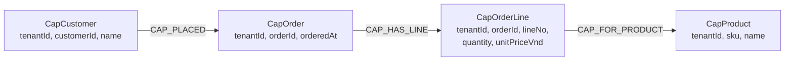
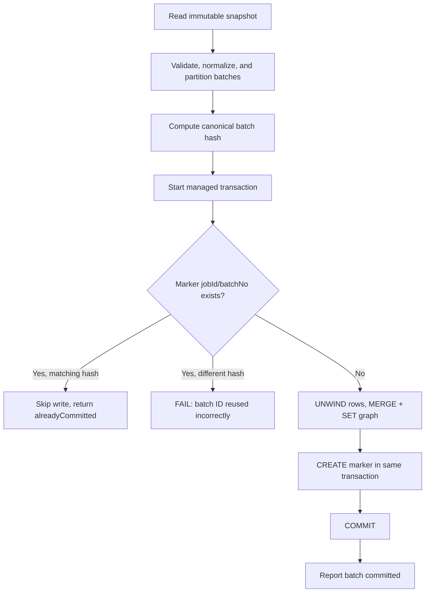

# Capstone Project: Creating Constraints, Indexes, and an Idempotent Ingestion Pipeline in Neo4j

## 1. Problem Statement and Expected Deliverables

This is a **capstone project** for the `DATABASE_ENGINE_GRAPH_NEO4J` module: using Neo4j to store a **property graph**, model nodes and relationships, query with **Cypher**, enforce business keys via constraints/indexes, ingest data, and connect applications through **Neo4j Java Driver** or **Spring Data Neo4j**.

Problem: build a **multi-tenant order graph** from a CSV source that may be re-delivered multiple times. The system must:

1. Create the exact nodes, relationships, and properties from source data.
2. Enforce **uniqueness constraints** protecting business keys without confusing tenant A and tenant B when IDs match.
3. Add an **index** tailored to a clearly stated read query; verify with appropriate `EXPLAIN`/`PROFILE` evidence.
4. Support **re-ingesting the same snapshot** without creating extra nodes/relationships or adding amounts/quantities twice.
5. Recover when a transaction or batch fails, without assuming already-committed batches rolled back.
6. Provide **reconciliation between source data and the graph** covering counts, keys, links, and monetary totals.
7. Include test evidence and an operations runbook: data errors, connection drops, retries, latency, and authorization.

The project demands more than “running `MERGE` without errors.” You must deliver **data contracts, invariants, a replay policy, expected result tables, negative tests, and an explanation of solution limitations**.

> **Technology scope:** Constraint/index syntax and Java Driver examples follow Neo4j 5.x, Java 17+, and Neo4j Java Driver 5.x. `CALL (row) { ... } IN TRANSACTIONS` using the variable scope clause is supported from **Neo4j 5.23**; older or newer versions should be checked against their documentation. Never run project create/delete operations on a production database.

## 2. Deliverables and Passing Criteria

| Artifact | Minimum contents | Evidence |
| --- | --- | --- |
| **Graph model** | Nodes, relationships, directions, tenant-scoped keys | Mermaid or diagram + invariant descriptions |
| **Cypher schema** | 5 unique constraints, at least 1 justified index | Output of `SHOW CONSTRAINTS`/`SHOW INDEXES` |
| **Test source** | 4-row CSV, field formats, validation rules | Snapshot ID/hash and input manifest |
| **Ingestion pipeline** | Idempotent `MERGE`, explicit transaction boundaries | Initial run and replay run |
| **Recovery** | Transaction/batch markers or safe full-source replay flow | Mid-batch failure and re-ingestion scenario |
| **Reconciliation** | Node/edge counts, business keys, tenants, total revenue | Queries + pre/post-replay figures |
| **Operations** | Timeouts, metrics, logging, error handling, and rollback | Runbook and checklist |

A passing submission must state **under what scope idempotency holds**. Below, the baseline contract assumes **an immutable source snapshot, a single writer per job, and consistent data normalization rules**. Supporting concurrent multi-source updates or changing the customer/product on an existing line requires conflict policies or versioning; plain `MERGE` alone does not guarantee those.

## 3. Business Scenario: Multi-Tenant Orders

Suppose a commerce platform serves multiple stores. Each tenant can have its own customer `C001`, product `P001`, and order `O100`; therefore **a single ID alone is insufficient** to identify an entity.

Proposed graph:



Using `Cap...` labels and `CAP_...` relationships isolates the capstone from real application data. This is a **demo naming convention**, not a mandatory Neo4j standard.

| Node | Business key | Key properties |
| --- | --- | --- |
| `CapCustomer` | `(tenantId, customerId)` | `name` |
| `CapProduct` | `(tenantId, sku)` | `name` |
| `CapOrder` | `(tenantId, orderId)` | `orderedAt` of type `DATE` |
| `CapOrderLine` | `(tenantId, orderId, lineNo)` | `quantity`, `unitPriceVnd` |
| `CapImportBatch` | `(jobId, batchNo)` | `payloadHash`, `rowCount`, `committedAt` |

**Business invariants:**

1. Each `CapOrder` belongs to **exactly one** `CapCustomer` within the same tenant.
2. Each `CapOrderLine` belongs to **exactly one** `CapOrder` and references **exactly one** `CapProduct` within the same tenant.
3. `lineNo` is unique only **within a single order**, not globally across the database.
4. `quantity` is a positive integer (**greater than 0**); `unitPriceVnd` is a **non-negative** integer. Never use `double` for monetary values.
5. An order's total amount is `SUM(quantity * unitPriceVnd)` using the **price captured at order time**, not the current price on `CapProduct`.
6. In a real API, `tenantId` comes from the backend-authenticated context, never trusting an arbitrary tenant parameter supplied by the caller.

Unique constraints do not automatically enforce “exactly one edge” or “no cross-tenant edges.” Relationship invariants must be verified and protected via write logic, tests, or complementary modeling.

## 4. Input CSV and Verifiable Expected Results

### 4.1. Source File

Filename: `capstone_order_lines.csv`. UTF-8 contents with header:

```csv
tenantId,customerId,customerName,orderId,orderedAt,sku,productName,lineNo,quantity,unitPriceVnd
T1,C001,An,O100,2026-11-20,P001,Pen,1,2,15000
T1,C001,An,O100,2026-11-20,P002,Notebook,2,1,30000
T1,C002,Bình,O101,2026-11-21,P002,Notebook,1,3,30000
T2,C001,An Branch Two,O900,2026-11-22,P001,Pen Type B,1,4,20000
```

This is an **illustrative file provided for the capstone**, not real customer data. When an application generates this file from an API/ETL job, enforce standard CSV escaping and persist a stable snapshot version.

### 4.2. Field Mapping Contract

| CSV | Input format | Neo4j property | Rule |
| --- | --- | --- | --- |
| `tenantId` | Non-empty string | Key on all nodes | Trim and validate allowed tenant |
| `customerId` | Non-empty string | `CapCustomer.customerId` | Unique within tenant |
| `customerName` | String | `CapCustomer.name` | Immutable within snapshot policy |
| `orderId` | Non-empty string | `CapOrder.orderId` | Unique within tenant |
| `orderedAt` | ISO `YYYY-MM-DD` | `CapOrder.orderedAt` as date | Valid date, immutable in snapshot |
| `sku` | Non-empty string | `CapProduct.sku` | Unique within tenant |
| `productName` | String | `CapProduct.name` | No conflicts within snapshot |
| `lineNo` | Positive integer | `CapOrderLine.lineNo` | Unique within `(tenantId,orderId)` |
| `quantity` | Positive integer | `CapOrderLine.quantity` | **Assign value**, never increment on replay |
| `unitPriceVnd` | Non-negative integer | `CapOrderLine.unitPriceVnd` | Snapshot unit price at order time, not product catalog price |

All keys must follow **consistent normalization rules**: trimming, Unicode normalization if needed, case sensitivity, and tenant prefixing per business requirements. For instance, whether `P001` and `p001` are the same SKU must be decided **before** ingestion rather than relying on Cypher's accidental default behavior.

### 4.3. Expectations on a Clean Practice Database

Given the exact 4 CSV rows above and **no pre-existing `Cap...` labeled data**, the result must be:

| Component | Count | Breakdown |
| --- | ---: | --- |
| `CapCustomer` | **3** | T1:C001, T1:C002, T2:C001 |
| `CapProduct` | **3** | T1:P001, T1:P002, T2:P001 |
| `CapOrder` | **3** | T1:O100, T1:O101, T2:O900 |
| `CapOrderLine` | **4** | One line node per row |
| **Total business nodes** | **13** | 3 + 3 + 3 + 4 |
| `CAP_PLACED` | **3** | One customer per order |
| `CAP_HAS_LINE` | **4** | One order per line |
| `CAP_FOR_PRODUCT` | **4** | One product per line |
| **Total business relationships** | **11** | 3 + 4 + 4 |

Order totals:

| Tenant | Order | Formula | Total VND |
| --- | --- | --- | ---: |
| T1 | O100 | `2×15,000 + 1×30,000` | **60,000** |
| T1 | O101 | `3×30,000` | **90,000** |
| T2 | O900 | `4×20,000` | **80,000** |
| **All** | | | **230,000** |

When using the Java Driver approach with `CapImportBatch`, extra marker nodes are created; **do not count markers toward the 13 business nodes**. If prior data was already loaded or the CSV was modified, do not expect these exact numbers to hold.

## 5. Idempotency Design and the Boundary of “Exactly Once”

### 5.1. What Does Idempotency Mean Here?

For the same source snapshot `S` and import function `F`, an import pipeline idempotent in **business state** aims for:

\[
F(F(G,S),S)=F(G,S)
\]

Here `G` is the initial graph state. The equation states that re-running **the exact same source** causes no further change to business state.

That is **different** from claiming:

- The job can run only once in history.
- Re-running queries consumes zero CPU or connections.
- Client or driver retries never happen.
- Side effects outside Neo4j automatically become idempotent.
- Cypher execution or Bolt packets are transmitted strictly once.

### 5.2. MERGE by Business Key, SET by Assignment

**Safe for replaying the same snapshot:**

```cypher
MERGE (p:CapProduct {tenantId: $tenantId, sku: $sku})
SET p.name = $productName;
```

**Unsafe if you need safe replay:**

```cypher
CREATE (p:CapProduct {tenantId: $tenantId, sku: $sku});
```

Running `CREATE` again creates duplicate nodes or triggers constraint violations.

**Wrong if applying deltas on every re-ingestion:**

```cypher
MATCH (l:CapOrderLine {
  tenantId: $tenantId,
  orderId: $orderId,
  lineNo: $lineNo
})
SET l.quantity = l.quantity + $quantity;
```

Therefore, the capstone uses `SET l.quantity = $quantity`, never addition. If a domain genuinely processes **increment/decrement events**, use a ledger/event ID and once-per-event recording instead of casually treating deltas as snapshots.

### 5.3. MERGE Does Not Automatically Resolve Conflicting Relationships

If `O100` was initially linked to `C001`, and a stale or conflicting source later claims `O100` belongs to `C002`:

```cypher
MERGE (customer)-[:CAP_PLACED]->(order);
```

will create an extra relationship from the new customer without **deleting** the old one, violating the “one customer per order” invariant.

Thus, the capstone enforces the policy:

- Within the **same snapshot**, `(tenantId,orderId)` must always map to the same `customerId` and `orderedAt`.
- `(tenantId,orderId,lineNo)` must always point to the same `sku`.
- Conflicting source records **fail/quarantine** rather than “fixing by adding another edge.”
- **Reassigning an order's customer** or **changing a line's product** is an explicit update operation that must replace the old edge and create the new edge **inside one transaction** with permission/version checks.

Never rely on `MERGE` to claim Neo4j automatically enforces every “exactly one relationship per node” invariant.

## 6. Step 1 — Create Constraints on Business Keys

Neo4j **unique constraints** prevent creating two nodes with the same key under the same label. Use **tenant-composite keys** so store datasets never collide.

Run the following statements **once on the practice database** using an account with schema management privileges:

```cypher
CREATE CONSTRAINT cap_customer_business_key IF NOT EXISTS
FOR (c:CapCustomer)
REQUIRE (c.tenantId, c.customerId) IS UNIQUE;
```

```cypher
CREATE CONSTRAINT cap_product_business_key IF NOT EXISTS
FOR (p:CapProduct)
REQUIRE (p.tenantId, p.sku) IS UNIQUE;
```

```cypher
CREATE CONSTRAINT cap_order_business_key IF NOT EXISTS
FOR (o:CapOrder)
REQUIRE (o.tenantId, o.orderId) IS UNIQUE;
```

```cypher
CREATE CONSTRAINT cap_order_line_business_key IF NOT EXISTS
FOR (l:CapOrderLine)
REQUIRE (l.tenantId, l.orderId, l.lineNo) IS UNIQUE;
```

```cypher
CREATE CONSTRAINT cap_import_batch_business_key IF NOT EXISTS
FOR (b:CapImportBatch)
REQUIRE (b.jobId, b.batchNo) IS UNIQUE;
```

### 6.1. Limitations of Unique Constraints

- A unique constraint guarantees **no two records share the same complete tuple of present key values**, but **does not automatically enforce property existence** the way node-key or existence constraints do. If a key property is missing, `MERGE` may fail or invalid records may slip through.
- Hence, **validate nulls, empty strings, and data types** in preflight before importing.
- Creating a constraint over data that already contains duplicates **fails**; do not rely on `IF NOT EXISTS` to hide that.
- `IF NOT EXISTS` avoids recreating an existing schema item by name/shape in many cases, yet **does not prove** the existing constraint matches your contract's exact **definition, name, and type**. Verify the schema catalog after DDL.
- In production, the application's ingestion role **should not** hold privileges to create indexes/constraints. DDL belongs in audited deployment/migration jobs.

Verify:

```cypher
SHOW CONSTRAINTS
YIELD name, type, labelsOrTypes, properties
WHERE name STARTS WITH 'cap_'
RETURN name, type, labelsOrTypes, properties
ORDER BY name;
```

On Neo4j 5 with appropriate permissions, the output must list the five unique constraints above. Column names can vary across versions; consult version-specific DDL catalog docs if your server differs.

## 7. Step 2 — Add Indexes Driven by Real Queries

The unique constraint on `(tenantId,orderId)` already provides lookup access for finding an order by key. **Never create a duplicate index on the exact same fields just to “check a box.”** Start from a concrete read query: listing a tenant's orders within a date range.

### 7.1. Target Query

```cypher
MATCH (o:CapOrder {tenantId: $tenantId})
WHERE o.orderedAt >= date($fromDate)
  AND o.orderedAt < date($toDateExclusive)
RETURN o.orderId AS orderId, o.orderedAt AS orderedAt
ORDER BY orderedAt ASC, orderId ASC
LIMIT $pageSize;
```

Parameter example:

```json
{
  "tenantId": "T1",
  "fromDate": "2026-11-20",
  "toDateExclusive": "2026-11-22",
  "pageSize": 20
}
```

The query filters by tenant and a date range, so consider a composite **range index**:

```cypher
CREATE RANGE INDEX cap_order_tenant_date IF NOT EXISTS
FOR (o:CapOrder)
ON (o.tenantId, o.orderedAt);
```

**Explanation:** this index supports an access path by tenant and `orderedAt`. The planner may choose to use it or not depending on cardinality, statistics, and version. You cannot promise an index eliminates every `Sort` operator across all plans; the query includes `orderId` as a tie-breaker and only indexes two properties.

### 7.2. Prove Instead of Guessing

```cypher
EXPLAIN
MATCH (o:CapOrder {tenantId: $tenantId})
WHERE o.orderedAt >= date($fromDate)
  AND o.orderedAt < date($toDateExclusive)
RETURN o.orderId AS orderId, o.orderedAt AS orderedAt
ORDER BY orderedAt ASC, orderId ASC
LIMIT $pageSize;
```

After loading data:

```cypher
SHOW INDEXES
YIELD name, type, state, labelsOrTypes, properties
WHERE name = 'cap_order_tenant_date'
RETURN name, type, state, labelsOrTypes, properties;
```

In testing, when execution is safe:

```cypher
PROFILE
MATCH (o:CapOrder {tenantId: $tenantId})
WHERE o.orderedAt >= date($fromDate)
  AND o.orderedAt < date($toDateExclusive)
RETURN o.orderId AS orderId, o.orderedAt AS orderedAt
ORDER BY orderedAt ASC, orderId ASC
LIMIT $pageSize;
```

Inspect index seek/scan operators, rows, DB Hits, and sort stages. **A 3-order dataset is far too small to benchmark performance**; use a representative large dataset for before/after comparisons. Because `PROFILE` **executes** the query, run it only on safe read queries like this example.

**Reporting requirement:** document why the index was chosen, query shape, whether the plan used the index, test limitations, and write-amplification impact.

## 8. Step 3 — Validate Source Data Before Importing

### 8.1. Mandatory Preflight Checks

A real pipeline **must never silently drop bad rows** just to let Cypher finish. Before calling the database, the preflight validator must verify:

1. File has exactly **10 columns**, matching header names and types from section 4.
2. File is read completely from an **immutable snapshot**, with a SHA-256 checksum and timestamp/version manifest.
3. No empty `tenantId` or required ID after normalization, and no `null` values for `MERGE` keys.
4. `orderedAt` is a valid ISO date; `lineNo`, `quantity`, and `unitPriceVnd` are integers within defined bounds.
5. No duplicate `(tenantId,orderId,lineNo)` keys **within the same snapshot**; if the source can emit exact duplicates, document deduplication rules before hashing and ingesting.
6. Rows sharing `(tenantId,orderId)` share the **same `customerId` and `orderedAt`**.
7. Rows sharing `(tenantId,sku)` have consistent product names per source policy.
8. Every line references order, customer, and product from the **same tenant**.
9. Quantities/prices do not overflow JVM or Neo4j integer bounds; enforce `long`/integer types and range checks.
10. Verify source access permissions and mask sensitive fields in logs/quarantine storage.

**Do not use `WHERE valid...` to skip malformed rows and report job success.** Either reject the **entire snapshot** or route invalid rows to a quarantine queue with exact row-count reconciliation. This capstone uses **fail-fast preflight** so expected counts remain exact.

### 8.2. Source Manifest and Job Key

Example manifest (placeholder hash value, not the real SHA of the sample CSV):

```yaml
jobId: "cap-demo-snapshot-v1"
sourceFile: "capstone_order_lines.csv"
sourceSha256: "<actual-file-sha256>"
mappingVersion: "1"
expectedRows: 4
batchSize: 2
sourceImmutable: true
```

In a real job:

- `sourceSha256` must be **computed from the actual file bytes** and stored in job metadata; never copy an example string.
- `jobId` must uniquely identify **one snapshot and one mapping version**. Never reuse the same `jobId` for different contents.
- Batch partitioning must be **deterministic**: stable row order, batch size, batch index, and canonical row hashing.
- If the file is fetched from a mutable URL, **freeze/copy** the source before running. A fixed URL does not prove contents did not change.
- When a new source version arrives, **never replay an old snapshot over newer state** without versioning and conflict guards.

### 8.3. Essential Identifiers for Error Governance

Three distinct IDs:

| ID | Example | Responsibility |
| --- | --- | --- |
| **Business key** | `T1/O100/line2` | Uniquely identifies one `CapOrderLine` node |
| **Job ID** | `cap-demo-snapshot-v1` | Identifies one snapshot + one mapping version |
| **Batch key** | `(jobId, batchNo)` | Identifies a committed transaction/batch |

Never use technical IDs `id(node)` or `elementId(node)` as durable business keys. Use properties defined by the source contract and enforced by unique constraints.

### 8.4. Preflight Against a Non-Empty Database

When the graph is no longer empty, **checking internal CSV consistency is not enough**. An existing order might already link to another customer, or an existing line might point to a different SKU. Node unique constraints **do not prevent** conflicting edges. Before applying a snapshot, run read-only checks against the parsed/validated `$rows`:

```cypher
UNWIND $rows AS row
MATCH (o:CapOrder {
  tenantId: row.tenantId,
  orderId: row.orderId
})
MATCH (oldCustomer:CapCustomer)-[:CAP_PLACED]->(o)
WHERE oldCustomer.tenantId <> row.tenantId
   OR oldCustomer.customerId <> row.customerId
RETURN DISTINCT row.tenantId AS tenantId,
       row.orderId AS orderId,
       oldCustomer.customerId AS previousCustomerId,
       row.customerId AS incomingCustomerId;
```

```cypher
UNWIND $rows AS row
MATCH (l:CapOrderLine {
  tenantId: row.tenantId,
  orderId: row.orderId,
  lineNo: row.lineNo
})
MATCH (l)-[:CAP_FOR_PRODUCT]->(oldProduct:CapProduct)
WHERE oldProduct.tenantId <> row.tenantId
   OR oldProduct.sku <> row.sku
RETURN DISTINCT row.tenantId AS tenantId,
       row.orderId AS orderId,
       row.lineNo AS lineNo,
       oldProduct.sku AS previousSku,
       row.sku AS incomingSku;
```

Both must return **0 rows** for a valid replay under the project contract. Likewise, compare `CapOrder.orderedAt` and other immutable attributes against the snapshot. **If conflicts appear, halt and investigate** rather than adding extra edges and continuing.

This is a **preflight check against current state**, not a lock preventing concurrent changes afterward. Thus the **single-writer / no competing actor** assumption remains active; multi-writer setups require concurrency control and in-transaction revalidation.

## 9. Step 4 — Ingest Data with LOAD CSV and MERGE

This is **Option A**: ingesting CSV inside Neo4j, applying the same pattern to every row. Use it to study and verify idempotency. **Option B** in section 11 shows Java Driver orchestration with transaction markers.

### 9.1. Placing the File Where Neo4j Can Read It

On **self-managed** Neo4j with local file import enabled, `file:///capstone_order_lines.csv` typically resolves relative to the import directory of the **Neo4j server/container**, not the working directory of the laptop running Browser. URI/file import restrictions depend on version configuration and security policy.

On **Neo4j Aura/managed**, remote containers, or environments disallowing local files, use a provider-supported ingestion path (such as an allowed HTTPS URL or **Java Driver** sending parsed rows). Never assume `file:///...` can read the client's local filesystem.

### 9.2. Batched CSV Ingestion Cypher

After preflight and with a **single writer** for the snapshot:

```cypher
LOAD CSV WITH HEADERS
FROM 'file:///capstone_order_lines.csv' AS row
CALL (row) {
  MERGE (c:CapCustomer {
    tenantId: row.tenantId,
    customerId: row.customerId
  })
  SET c.name = row.customerName

  MERGE (o:CapOrder {
    tenantId: row.tenantId,
    orderId: row.orderId
  })
  SET o.orderedAt = date(row.orderedAt)

  MERGE (p:CapProduct {
    tenantId: row.tenantId,
    sku: row.sku
  })
  SET p.name = row.productName

  MERGE (l:CapOrderLine {
    tenantId: row.tenantId,
    orderId: row.orderId,
    lineNo: toInteger(row.lineNo)
  })
  SET l.quantity = toInteger(row.quantity),
      l.unitPriceVnd = toInteger(row.unitPriceVnd)

  MERGE (c)-[:CAP_PLACED]->(o)
  MERGE (o)-[:CAP_HAS_LINE]->(l)
  MERGE (l)-[:CAP_FOR_PRODUCT]->(p)
} IN TRANSACTIONS OF 2 ROWS;
```

**Important transaction notes:**

- `CALL (row) { ... }` with the variable scope clause requires **Neo4j 5.23+** in the 5.x series. Older versions use `CALL { WITH row ... }` per that version's docs.
- `CALL ... IN TRANSACTIONS` must run in an **implicit/autocommit transaction** supported by the client; **never** run it inside an explicit transaction or Java Driver's `executeWrite` managed transaction.
- `OF 2 ROWS` creates tiny batches for demo purposes; production batch sizes must be tuned for duration, memory, locks, and throughput.
- If batch 1 commits and batch 2 fails, **batch 1 remains committed**. That is partial commit across batches, not Neo4j breaking single-transaction atomicity.
- If preflight does not block malformed rows, `toInteger` can yield `null` for non-numeric strings, corrupting or failing the import. **Preflight is mandatory**; do not rely on type-conversion functions as complete validators.
- `MERGE` on relationships between **already-bound nodes** enables sequential re-ingestion. It **does not** enforce global relationship-type uniqueness if multiple writers create edges concurrently.

### 9.3. Reconcile Immediately After Ingestion

Run the **exact same import statement** a second time against the **same immutable file**, then verify against section 12. When all source invariants hold, node/relationship counts and monetary totals **do not increase**.

**Avoid testing with additive updates:**

```cypher
// DO NOT use for snapshot replay:
// SET l.quantity = l.quantity + toInteger(row.quantity)
```

Here `SET` uses **direct assignment**, so replays preserve snapshot quantities.

## 10. Why LOAD CSV Alone Is Not a Complete Checkpoint System

`CALL ... IN TRANSACTIONS` batches writes on the Neo4j server, yet it **does not automatically provide** an application-managed immutable marker answering:

- Did batch 3 commit, or did the client disconnect after sending the request?
- Did the source file change after batch 1 ran?
- Does this retry contain the **exact same contents** as the prior batch?
- When the job restarts, which batches can be skipped and which must resume?
- If a row failed, how many rows were accepted vs. quarantined?

For small snapshots and idempotent writes, the simple option is **re-running the full CSV from the start** and reconciling. It uses extra work yet preserves state when the source is immutable and no concurrent writer interferes. For large jobs, explicit **transactional markers/checkpoints** are needed.

| Mechanism | Principle | Trade-off |
| --- | --- | --- |
| Full-file replay | Re-run idempotent `MERGE`/`SET` statements | Simple, can take longer on large files |
| External checkpoint file | Write batch, then update progress outside Neo4j | Creates a failure window between **DB commit** and **checkpoint write** |
| Same-transaction marker | Write data and `CapImportBatch` in **one commit** | Resolves ambiguous commit outcomes on replay with matching key/hash |

This capstone recommends implementing and explaining **at least** full-file replay; advanced submissions also implement same-transaction markers with Java Driver.

## 11. Step 5 — Java Driver: Data and Marker in One Transaction

### 11.1. Design Flow



**Marker invariant:** each `(jobId,batchNo)` has at most one `CapImportBatch` node enforced by constraint, recording `payloadHash` and `rowCount`. The batch hash must be computed from **the exact same normalized rows in deterministic order**, never from a mutable input representation.

**Concurrency scope:** the code below assumes **a single writer per job**. If two processes concurrently observe no marker, both may try to write; the unique constraint prevents **two markers with the same key**, yet one process may receive a conflict error and must retry/re-read the marker safely. Do not label this *exactly-once execution* under arbitrary races.

### 11.2. Batch Parameter Shape

In Java, after parsing and **validating** CSV rows into Maps, each row has keys:

```json
{
  "tenantId": "T1",
  "customerId": "C001",
  "customerName": "An",
  "orderId": "O100",
  "orderedAt": "2026-11-20",
  "sku": "P001",
  "productName": "Pen",
  "lineNo": 1,
  "quantity": 2,
  "unitPriceVnd": 15000
}
```

`lineNo`, `quantity`, and `unitPriceVnd` are **Java integer types** (e.g., `Long`) post-validation; `orderedAt` is a valid ISO date string. Never pass currency through `Double`. The example expects a type-checked `List<Map<String,Object>>`; CSV parsing/validation is a **separate preceding step**.

### 11.3. Cypher UPSERT Accepting Rows Parameter

```cypher
UNWIND $rows AS row
MERGE (c:CapCustomer {
  tenantId: row.tenantId,
  customerId: row.customerId
})
SET c.name = row.customerName

MERGE (o:CapOrder {
  tenantId: row.tenantId,
  orderId: row.orderId
})
SET o.orderedAt = date(row.orderedAt)

MERGE (p:CapProduct {
  tenantId: row.tenantId,
  sku: row.sku
})
SET p.name = row.productName

MERGE (l:CapOrderLine {
  tenantId: row.tenantId,
  orderId: row.orderId,
  lineNo: row.lineNo
})
SET l.quantity = row.quantity,
    l.unitPriceVnd = row.unitPriceVnd

MERGE (c)-[:CAP_PLACED]->(o)
MERGE (o)-[:CAP_HAS_LINE]->(l)
MERGE (l)-[:CAP_FOR_PRODUCT]->(p);
```

**Difference from `LOAD CSV`:** parameters arrive pre-typed and normalized, eliminating `toInteger` inside Cypher. Java Driver runs **the entire `UNWIND` and marker write** inside a single managed transaction; do not nest `CALL ... IN TRANSACTIONS`.

### 11.4. Java Driver 5.x Example

The code below demonstrates the core mechanism: **hashing batch contents**, detecting an existing marker, writing graph data, and creating the marker in the same transaction. Each `.java` file should contain one public top-level class; here the `Outcome` record is nested **inside the class**.

```java
import java.nio.ByteBuffer;
import java.nio.charset.StandardCharsets;
import java.security.MessageDigest;
import java.security.NoSuchAlgorithmException;
import java.util.HexFormat;
import java.util.List;
import java.util.Map;
import org.neo4j.driver.Driver;
import org.neo4j.driver.Record;
import org.neo4j.driver.Session;
import org.neo4j.driver.SessionConfig;

public final class CapstoneBatchWriter {
    public record Outcome(
        boolean alreadyCommitted,
        long rowCount,
        String payloadHash
    ) {}

    private static final List<String> FIELDS = List.of(
        "tenantId", "customerId", "customerName",
        "orderId", "orderedAt", "sku", "productName",
        "lineNo", "quantity", "unitPriceVnd"
    );

    private static final String UPSERT = """
        UNWIND $rows AS row
        MERGE (c:CapCustomer {
          tenantId: row.tenantId,
          customerId: row.customerId
        })
        SET c.name = row.customerName
        MERGE (o:CapOrder {
          tenantId: row.tenantId,
          orderId: row.orderId
        })
        SET o.orderedAt = date(row.orderedAt)
        MERGE (p:CapProduct {
          tenantId: row.tenantId,
          sku: row.sku
        })
        SET p.name = row.productName
        MERGE (l:CapOrderLine {
          tenantId: row.tenantId,
          orderId: row.orderId,
          lineNo: row.lineNo
        })
        SET l.quantity = row.quantity,
            l.unitPriceVnd = row.unitPriceVnd
        MERGE (c)-[:CAP_PLACED]->(o)
        MERGE (o)-[:CAP_HAS_LINE]->(l)
        MERGE (l)-[:CAP_FOR_PRODUCT]->(p)
        """;

    private final Driver driver;
    private final String database;

    public CapstoneBatchWriter(Driver driver, String database) {
        this.driver = driver;
        this.database = database;
    }

    public Outcome writeBatch(
        String jobId,
        long batchNo,
        List<Map<String, Object>> validatedRows
    ) {
        if (jobId == null || jobId.isBlank()
            || batchNo < 0
            || validatedRows == null || validatedRows.isEmpty()) {
            throw new IllegalArgumentException("Invalid batch identity");
        }

        // Inputs are pre-validated: exact keys, types, values, and order.
        // Only immutable String/Long values are permitted inside each Map.
        List<Map<String, Object>> rows = validatedRows.stream()
            .map(Map::copyOf)
            .toList();
        String hash = hashRows(rows);
        Map<String, Object> key = Map.of(
            "jobId", jobId,
            "batchNo", batchNo
        );

        try (Session session =
                 driver.session(SessionConfig.forDatabase(database))) {
            return session.executeWrite(tx -> {
                List<Record> found = tx.run("""
                    MATCH (b:CapImportBatch {
                      jobId: $jobId, batchNo: $batchNo
                    })
                    RETURN b.payloadHash AS hash,
                           b.rowCount AS rowCount
                    """, key).list();

                if (!found.isEmpty()) {
                    Record marker = found.get(0);
                    String committedHash = marker.get("hash").asString();
                    long committedRows = marker.get("rowCount").asLong();
                    if (!hash.equals(committedHash)
                        || committedRows != rows.size()) {
                        throw new IllegalStateException(
                            "Batch ID reused with different payload"
                        );
                    }
                    return new Outcome(true, committedRows, hash);
                }

                tx.run(UPSERT, Map.of("rows", rows)).consume();
                tx.run("""
                    CREATE (b:CapImportBatch {
                      jobId: $jobId,
                      batchNo: $batchNo,
                      payloadHash: $hash,
                      rowCount: $count,
                      committedAt: datetime()
                    })
                    """, Map.of(
                        "jobId", jobId,
                        "batchNo", batchNo,
                        "hash", hash,
                        "count", (long) rows.size()
                    )).consume();

                return new Outcome(false, rows.size(), hash);
            });
        }
    }

    private static String hashRows(
        List<Map<String, Object>> rows
    ) {
        final MessageDigest sha;
        try {
            sha = MessageDigest.getInstance("SHA-256");
        } catch (NoSuchAlgorithmException e) {
            throw new IllegalStateException("SHA-256 unavailable", e);
        }

        for (Map<String, Object> row : rows) {
            for (String field : FIELDS) {
                Object value = row.get(field);
                if (value == null) {
                    throw new IllegalArgumentException(
                        "Missing batch field: " + field
                    );
                }
                byte[] bytes = String.valueOf(value)
                    .getBytes(StandardCharsets.UTF_8);
                sha.update(ByteBuffer.allocate(4)
                    .putInt(bytes.length).array());
                sha.update(bytes);
            }
        }
        return HexFormat.of().formatHex(sha.digest());
    }
}
```

**Explicit limitations of this snippet:**

- `validatedRows` **must genuinely be validated** beforehand: types, dates, positive integers, keys, duplicates/conflicts, and tenant policy. `hashRows` does not replace validation. Data types must be normalized uniformly before hashing; string `"1"` and number `1` serialize identically if type validation is skipped.
- Hashing covers **exact row order and a fixed field list**, rather than iterating over an arbitrary Map's key order. This field list must be **versioned alongside the mapping contract**.
- `Map.copyOf` copies the map shallowly, not nested mutable objects; the contract permits only **immutable String/Long** values.
- This snippet does not download CSVs, manage the **job manifest**, partition batches, or enforce HTTP deadlines; it is strictly the writer component.
- `session.executeWrite` may invoke the callback multiple times on transient errors; the callback **must contain no emails, file writes, or external side effects**. If a transaction commits and the driver loses the response, the retry re-runs against the DB and **reads the committed marker**.
- If two writers for the same job race, the **marker unique constraint** can fail one transaction. The capstone assumes a single writer; scaling out requires queue partitioning, leasing, or conflict retry/marker re-read tested under concurrency.
- A marker proves **that specific import transaction committed**, not that no external actor modified the graph afterward. Reconcile results in the next step.

### 11.5. Why Must the Marker Share the Same Transaction?

**Wrong approach:** write the graph and commit, then write a marker to an external file. If the app crashes between the two steps, the checkpoint says incomplete even though the graph already committed. Non-idempotent replay would corrupt state.

**Pattern in this example:** `UPSERT` and `CREATE CapImportBatch` execute inside **one Neo4j transaction**:

| Scenario | Graph batch | Marker | On replay |
| --- | --- | --- | --- |
| Transaction rolls back before commit | Not committed | Absent | Writes batch |
| Transaction commits and client gets ACK | Committed | Present | Skips if hash matches |
| Commit succeeds but response is lost | Committed | Present | Finds marker and skips |
| Connection drops before commit | Not committed | Absent | Writes batch |
| Marker exists with different hash | Data not rewritten | Old marker | Fails/quarantines, investigates |

**Never create the marker in a separate transaction** from the data, as that breaks atomicity between the two.

## 12. Step 6 — Reconcile the Graph After Ingestion

### 12.1. Count Nodes by Label

```cypher
MATCH (c:CapCustomer)
RETURN count(c) AS customers;
```

```cypher
MATCH (p:CapProduct)
RETURN count(p) AS products;
```

```cypher
MATCH (o:CapOrder)
RETURN count(o) AS orders;
```

```cypher
MATCH (l:CapOrderLine)
RETURN count(l) AS orderLines;
```

On a clean test database: counts are **3, 3, 3, 4**. Count `CapImportBatch` markers separately; never add them into business node counts.

### 12.2. Count Relationships by Direction

```cypher
MATCH (:CapCustomer)-[r:CAP_PLACED]->(:CapOrder)
RETURN count(r) AS placed;
```

```cypher
MATCH (:CapOrder)-[r:CAP_HAS_LINE]->(:CapOrderLine)
RETURN count(r) AS hasLine;
```

```cypher
MATCH (:CapOrderLine)-[r:CAP_FOR_PRODUCT]->(:CapProduct)
RETURN count(r) AS forProduct;
```

Expected: **3, 4, 4**. Re-running **the same snapshot** must not increase these counts. Exact counts alone do not prove every edge connects the right endpoints: run invariant queries next.

### 12.3. Total Amount per Order

```cypher
MATCH (o:CapOrder)-[:CAP_HAS_LINE]->(l:CapOrderLine)
RETURN o.tenantId AS tenantId,
       o.orderId AS orderId,
       sum(l.quantity * l.unitPriceVnd) AS totalVnd
ORDER BY tenantId, orderId;
```

On the sample dataset:

```text
T1 | O100 | 60000
T1 | O101 | 90000
T2 | O900 | 80000
```

**Grand total = 230000 VND**. If a second run yields 460000 VND, you likely used addition or created duplicate relationships/lines. Protecting real financial records also requires overflow checks and reconciliation against an independent source of truth.

### 12.4. Verify Every Line Belongs to Exactly One Order

```cypher
MATCH (l:CapOrderLine)
OPTIONAL MATCH (o:CapOrder)-[:CAP_HAS_LINE]->(l)
WITH l, count(o) AS orderCount
WHERE orderCount <> 1
RETURN l.tenantId AS tenantId,
       l.orderId AS orderId,
       l.lineNo AS lineNo,
       orderCount;
```

On a valid sample graph, this returns **0 rows**. Note that `count(o)` counts matched rows; if **two parallel relationships** connect the same order, `count(o)` equals 2 and catches the violation.

### 12.5. Verify Every Order Belongs to Exactly One Customer

```cypher
MATCH (o:CapOrder)
OPTIONAL MATCH (c:CapCustomer)-[:CAP_PLACED]->(o)
WITH o, count(c) AS customerCount
WHERE customerCount <> 1
RETURN o.tenantId AS tenantId,
       o.orderId AS orderId,
       customerCount;
```

Expect **0 rows**. This catches missing links and multi-customer links on an order; it does not verify that `customerId` matches the snapshot, so pair it with source reconciliation.

### 12.6. Verify Every Line Points to Exactly One Product

```cypher
MATCH (l:CapOrderLine)
OPTIONAL MATCH (l)-[:CAP_FOR_PRODUCT]->(p:CapProduct)
WITH l, count(p) AS productCount
WHERE productCount <> 1
RETURN l.tenantId AS tenantId,
       l.orderId AS orderId,
       l.lineNo AS lineNo,
       productCount;
```

Expect **0 rows**.

### 12.7. Detect Cross-Tenant Edges

```cypher
MATCH (c:CapCustomer)-[:CAP_PLACED]->(o:CapOrder)
WHERE c.tenantId <> o.tenantId
RETURN c.tenantId AS customerTenant,
       o.tenantId AS orderTenant,
       o.orderId AS orderId;
```

```cypher
MATCH (o:CapOrder)-[:CAP_HAS_LINE]->(l:CapOrderLine)
WHERE o.tenantId <> l.tenantId
   OR o.orderId <> l.orderId
RETURN o.tenantId AS orderTenant,
       l.tenantId AS lineTenant,
       o.orderId AS orderId,
       l.lineNo AS lineNo;
```

```cypher
MATCH (l:CapOrderLine)-[:CAP_FOR_PRODUCT]->(p:CapProduct)
WHERE l.tenantId <> p.tenantId
RETURN l.tenantId AS lineTenant,
       p.tenantId AS productTenant,
       l.orderId AS orderId,
       l.lineNo AS lineNo;
```

Each query must return **0 rows**. Because these checks inspect only the named edge types, combine them with **counts, cardinality-1 checks, key checks, and source comparison** to catch accidentally deleted or reversed edges.

### 12.8. Verify No Duplicate Edges Between the Same Endpoint Pair

```cypher
MATCH (c:CapCustomer)-[r:CAP_PLACED]->(o:CapOrder)
WITH c, o, count(r) AS edgeCount
WHERE edgeCount > 1
RETURN c.tenantId AS tenantId,
       c.customerId AS customerId,
       o.orderId AS orderId,
       edgeCount;
```

Apply the same pattern to `CAP_HAS_LINE` and `CAP_FOR_PRODUCT`. In domains **allowing multiple parallel relationships**, endpoints alone cannot key an edge; use a relationship ID or an intermediate node with a business key. Here, one line maps to one product, so parallel edges indicate corrupt data.

### 12.9. Reconcile Business Keys Against the Source

Aggregate totals can still look right if one line had the wrong `sku` and another offset it. Export an ordered list for row-level verification:

```cypher
MATCH (c:CapCustomer)-[:CAP_PLACED]->
      (o:CapOrder)-[:CAP_HAS_LINE]->
      (l:CapOrderLine)-[:CAP_FOR_PRODUCT]->
      (p:CapProduct)
RETURN o.tenantId AS tenantId,
       c.customerId AS customerId,
       o.orderId AS orderId,
       toString(o.orderedAt) AS orderedAt,
       l.lineNo AS lineNo,
       p.sku AS sku,
       l.quantity AS quantity,
       l.unitPriceVnd AS unitPriceVnd
ORDER BY tenantId, orderId, lineNo;
```

On the sample dataset, expect **exactly four rows** whose `tenant/order/line/customer/sku/quantity/price` tuples match the canonicalized CSV. On large CSVs, reconcile by batch hash or deterministic sorted digests; **never hash an unsorted Cypher result**.

## 13. Step 7 — Replay and Recovery Testing

### 13.1. Mandatory Test Scenarios

| Test | Action | Expected outcome |
| --- | --- | --- |
| T1 — Initial import | Load 4 rows into clean test DB | 13 business nodes, 11 edges, 230000 VND total |
| T2 — Exact replay | Re-run **same file** or same batch/hash | Node/edge/total counts **unchanged** |
| T3 — Disconnect after a batch | Drop connection after prior batch may have committed | Safe replay; no duplicated state |
| T4 — Invalid quantity row | `quantity = abc` or `0` | Preflight fails/quarantines; never silently ingested |
| T5 — Blank key | Empty `tenantId` or `orderId` | No keyless nodes created |
| T6 — Duplicate business key in snapshot | Same `(tenant,order,lineNo)` appears twice | Fails or deduplicates per explicit policy |
| T7 — Conflicting order customer | Same `orderId` with different `customerId` | Fails before import; no extra `CAP_PLACED` edge |
| T8 — Two tenants share ID | T1:C001 and T2:C001 | Two **distinct** nodes, zero cross-tenant edges |
| T9 — Replay hash differs from existing batch key | Resend same `jobId/batchNo` with modified payload | Writer rejects; no overwrite |
| T10 — Two writers race on same batch | Race on marker creation | Never creates two markers; conflict handled safely without false success |
| T11 — Index/query plan | Tenant + date query | Accurate results, index online, plan documented |
| T12 — Scale/latency | Load large representative dataset | Track throughput, transaction timeouts, pool wait, and memory |

### 13.2. Retrying After an Ambiguous Commit Outcome

Simulation:

```text
Batch 0: COMMITTED, client received ACK
Batch 1: COMMIT sent, then connection dropped (outcome unknown)
Batch 2: Not started
```

Never assume Batch 1 “did not commit” merely because the client caught an exception. On restart:

1. Preserve **the exact same `jobId`, `batchNo`, and canonical rows/hash**.
2. Query the `CapImportBatch` marker by `(jobId,batchNo)`.
3. If the marker exists and its hash matches, **skip**; if absent, re-run the transaction.
4. If the hash mismatches, **halt** and require conflict resolution.
5. Afterward, reconcile node/edge/property counts and marker counts.

The client “having sent commit” differs from a confirmed commit. **A marker written in the same transaction as the data** establishes commit truth in the database; it does not guard against a separate writer mutating the graph later.

### 13.3. Triggering a Mid-Run Failure to Observe Partial Commit

In `LOAD CSV ... IN TRANSACTIONS OF 2 ROWS`:

- Batch 0 contains the first two rows and may commit cleanly.
- Batch 1 contains the next two rows; if a controlled error is injected in a **test environment**, Batch 0 does not automatically roll back.
- Modifying source contents must create a **new snapshot/version**; never mix old and new rows under the same manifest uncontrollably.
- Replaying the old snapshot requires ensuring the original source remains immutable and the transient root cause (e.g., config or network) is fixed.

To demonstrate a failure after Batch 0 commits, create a separate test CSV whose final row has a non-numeric `lineNo`; **keep dirty data out of the canonical example**, and reset the test database before checking the 13/11 oracle.

## 14. Distinguishing Replay, Updates, and Deletions

A snapshot import pipeline can carry three distinct semantics:

| Operation | Meaning | Handling |
| --- | --- | --- |
| **Replay snapshot S** | Re-apply known state | `MERGE`/`SET` plus batch marker/hash |
| **Import new snapshot S2** | Source updated attributes or added rows | Versioning policy, conflict checks, change contract |
| **Delete / absence** | A record disappeared from the new snapshot | Requires explicit tombstone/diff; never delete merely due to absence from a batch |

`MERGE` **never automatically deletes** existing nodes or edges omitted from a newer snapshot. In production systems:

- For **full snapshots**, define the exact diff scope before deleting; never delete another tenant's records.
- For **incremental feeds**, use version/event IDs and apply upserts/deletes deliberately.
- When an order changes customer or a line changes product, swap old and new edges inside a single consistent transaction.
- Never replay an older snapshot after newer data has committed without stale-write protection.

This capstone **does not require deleting** absent rows; that is an extension requiring separate approval.

## 15. Integrating with Spring Boot and Spring Data Neo4j

In a modern Java application, you can combine:

- **Spring Data Neo4j** to map business-keyed entities and build repositories/`Neo4jClient` read APIs.
- **Neo4j Java Driver** to execute the batched transaction pipeline from section 11 with `UNWIND` parameters.
- **Migration/schema jobs** holding dedicated DDL credentials to create constraints and indexes.

Example connection config **without hardcoded passwords**:

```yaml
spring:
  neo4j:
    uri: ${NEO4J_URI}
    authentication:
      username: ${NEO4J_USERNAME}
      password: ${NEO4J_PASSWORD}
    pool:
      max-connection-pool-size: 20
      connection-acquisition-timeout: 5s

  data:
    neo4j:
      database: ${NEO4J_DATABASE}
```

Pool numbers are illustrative; never share one database admin account across all API requests. In production, prefer `neo4j+s://` or `bolt+s://` per topology and TLS policy, verifying certificates and hostnames. Never disable certificate verification to work around configuration errors.

### 15.1. Do Not Confuse Java Driver Transactions with SDN @Transactional

Section 11 uses `session.executeWrite(...)` with driver-managed transactions. If invoked inside an SDN `@Transactional` method, **do not assume** the driver transaction joins the active Spring transaction. To stay consistent:

1. Either isolate the pipeline in a **Driver-backed component** with its own explicit transaction boundaries.
2. Or use `Neo4jClient`/SDN under Spring's transaction manager and **implement marker logic** inside that boundary.

Never split marker creation and data writes into two transactions and still call it “exactly once.”

### 15.2. Batch Sizing and Concurrency

For large files, benchmark batch sizes:

| Metric | When batch size grows too large |
| --- | --- |
| Transaction duration | Rises toward transaction timeout |
| Transaction memory/heap | More records/relationships held simultaneously |
| Lock wait | Locks held longer across contended nodes |
| Pool in-use | Connections stay occupied longer |
| Retry cost | One rollback discards a larger chunk of work |
| Throughput | Plateaus or degrades past an optimal point |

An application with 8 replicas and 20 connections per pool can spawn heavy concurrent writes if unthrottled. **Unique constraints protect node keys but do not replace concurrency control** for relationships and batch markers. The capstone enforces a single writer per job to establish clean initial boundaries.

## 16. Observability and Error-Handling Runbook

### 16.1. Minimum Telemetry

| Layer | Measurements | Purpose |
| --- | --- | --- |
| Source/manifest | `jobId`, snapshot hash, expectedRows, mappingVersion | Verify immutable source |
| Pipeline | Rows validated/rejected, batches pending/committed, last checkpoint | Progress and quarantine tracking |
| Java Driver | Retries, pool wait, connection failure, transaction duration | Separate client vs. DB faults |
| Neo4j server | Active/blocked transactions, lock waits, rollbacks, memory, page cache | Pinpoint DB bottlenecks |
| Cypher | DB Hits/Rows, index usage, duration | Tune queries and `MERGE` |
| Business reconcile | Node/edge/property mismatches, total discrepancies | Prevent “green job, corrupt data” |

Never place `customerId`, order IDs, or personal data into high-cardinality metric labels. Logs should capture **jobId/batchNo/operation/errorCode** per retention rules while excluding passwords, tokens, private keys, or raw PII CSV rows.

### 16.2. Basic Runbook

1. **Preflight failure:** reject snapshot, record reason in quarantine; never write partial bad data.
2. **Constraint violation:** inspect duplicate business keys, writer races, or dirty existing state; never drop constraints to push through.
3. **Timeout / lock contention:** reduce batch size or writer concurrency, check `SHOW TRANSACTIONS`/query plans, inspect hot nodes.
4. **Pool acquisition timeout:** inspect active/pending sessions, verify sessions close properly, check transaction duration; do not blindly enlarge the pool first.
5. **Ambiguous commit outcome:** read marker and reconcile for the same `jobId/batchNo`, replay safely.
6. **Marker hash mismatch:** halt, audit source/mapping; never overwrite an existing job's marker.
7. **Post-job data discrepancy:** block downstream jobs, diff source vs. graph; fix or restore via planned transactions.
8. **TLS/routing failure:** check CA/SAN/DNS/advertised addresses; never disable server identity verification.

### 16.3. SHOW TRANSACTIONS and SHOW SETTINGS

With appropriate operational privileges:

```cypher
SHOW TRANSACTIONS
YIELD database, transactionId, status,
      elapsedTime, waitTime
RETURN database, transactionId, status,
       elapsedTime, waitTime
ORDER BY elapsedTime DESC;
```

```cypher
SHOW SETTINGS
YIELD name, value, isDynamic
WHERE name IN [
  'db.transaction.timeout',
  'db.lock.acquisition.timeout',
  'db.transaction.concurrent.maximum'
]
RETURN name, value, isDynamic
ORDER BY name;
```

In certain editions or **Neo4j Aura**, some commands/settings may be unavailable or restricted. Never grant app accounts admin roles merely to collect metrics; use infrastructure-provided dashboards/metrics where appropriate.

## 17. Session-by-Session Project Schedule

### Session 1 — Design and Schema

- Draw the graph model from section 3.
- Explain why tenant-composite keys are used instead of technical IDs.
- Create the 5 constraints and the tenant+date index.
- Capture `SHOW CONSTRAINTS`/`SHOW INDEXES` evidence.

**Checkpoint:** schema matches spec, and you can explain which invariants unique constraints **cannot** enforce alone.

### Session 2 — First Import and Reconciliation

- Read the 4-row CSV, validate, and freeze the snapshot.
- Ingest via `LOAD CSV ... MERGE` or Java Driver.
- Run node/edge counts, order totals, and tenant-isolation checks.
- Replay the **exact same snapshot** and compare before/after.

**Checkpoint:** 13 business nodes, 11 relationships, 230000 VND; replay produces zero drift.

### Session 3 — Batching and Recovery

- Partition into **2-row** batches in deterministic order.
- Simulate a mid-run stop; reconcile committed batches.
- For advanced credit, implement atomic `CapImportBatch` markers + hashing.
- Test marker hash mismatch and ambiguous commit outcomes.

**Checkpoint:** zero duplication of nodes/edges/quantities/totals and clear per-batch status reporting.

### Session 4 — Performance, Security, and Reporting

- Run the tenant+date query and inspect `EXPLAIN`/`PROFILE`.
- On a larger dataset, compare import throughput across batch sizes.
- Test blank keys, invalid quantities, order/customer conflicts, and cross-tenant edges.
- Document limitations: single-writer, immutable source, no deletions, eventual changes.

**Checkpoint:** complete runbook, measurement tables, and technical trade-off discussion—not just screenshots saying “Query completed.”

## 18. Evaluation Report Template

Teams should submit **a table with observed measurements**:

| Check | Run 1 | Run 2 / Recovery | Pass? |
| --- | --- | --- | --- |
| Count `CapCustomer` | 3 | 3 | ... |
| Count `CapProduct` | 3 | 3 | ... |
| Count `CapOrder` | 3 | 3 | ... |
| Count `CapOrderLine` | 4 | 4 | ... |
| Count `CAP_PLACED` | 3 | 3 | ... |
| Count `CAP_HAS_LINE` | 4 | 4 | ... |
| Count `CAP_FOR_PRODUCT` | 4 | 4 | ... |
| Total VND | 230000 | 230000 | ... |
| Cross-tenant edges | 0 | 0 | ... |
| Nodes with invalid edge counts | 0 | 0 | ... |
| Batch marker/hash | ... | ... | ... |
| Import or query duration/p95 | ... | ... | ... |

Values in the first two columns are **expected results for the demo file**, aside from implementation-dependent metrics and markers. When testing another dataset, state its **corresponding oracle** instead of forcing 13/11 counts.

### 18.1. Mistakes That Make a Demo Look “Clean” While Wrong

- Re-running imports where quantities/prices are not set; counts match while totals fail.
- `MERGE`ing on **all properties** instead of business keys, causing a name edit to spawn a new node or fail to match.
- Mixing T1 and T2 because keys only include `customerId`/`sku`.
- Forgetting parallel-edge checks: node counts pass while edge counts and totals inflate.
- `CREATE`ing markers in a **separate** transaction after data writes, breaking checkpoint atomicity.
- Running `PROFILE` on 4 rows and claiming production p99 improvements.
- Skipping preflight so bad rows silently drop or `toInteger` turns into `null`.
- Hashing Maps with unstable key iteration or unvalidated string/number types.
- Claiming “exactly once” while multiple concurrent workers race on markers and edges.

## 19. Suggested Grading Rubric (100 Points)

| Category | Points | Requirements |
| --- | ---: | --- |
| Graph model and invariants | **15** | Sound nodes/edges, tenant boundaries, line keys |
| Constraints/indexes and catalog audit | **20** | 5 unique constraints, query-driven index, Cypher plan |
| CSV contract + preflight | **15** | Data types, immutable source, validation, conflict checks |
| Idempotent ingestion | **20** | Key-only `MERGE`, assignment `SET`, replay invariance |
| Recovery / batch checkpoints | **10** | Explains partial commits; atomic markers or clear replay |
| Reconciliation and negative tests | **15** | Counts, totals, edge/tenant invariants, failure/unknown-commit tests |
| Operations / report | **5** | Metrics, log hygiene, runbook, evidence presentation |
| **Total** | **100** | |

Advanced credit does not require building an entire microservice suite. A focused Cypher pipeline, compact Java Driver wrapper, strong test suite, and thorough report **beat** a sprawling UI project that cannot prove safe replay.

## 20. Extension Exercises

### Extension A — New Snapshot Updates Without Stale Overwrites

Snapshot v2 updates `productName` and adds orders. Design `sourceVersion`/`updatedAt` with an **approved last-write-wins** or optimistic version rule. Prove replaying v1 after v2 **never clobbers newer edits**.

### Extension B — Controlled Deletions

Design an `OrderLineDeleted` event with a unique `eventId`, tenant authorization, transactional line/edge removal, and audit trail. Prove replaying the delete event is idempotent and an omitted row in a snapshot **is never misread as a delete command**.

### Extension C — Multiple Workers Without Parallel Edges

Add queue partitioning by tenant/order or a lease protocol for `jobId`. Test two-worker races, marker uniqueness conflicts, marker re-reads, and integrity of `CAP_PLACED`/`CAP_HAS_LINE`/`CAP_FOR_PRODUCT`. Never increase concurrency while assuming `MERGE` guarantees relationship uniqueness.

### Extension D — Neo4jClient/SDN API and DTOs

Build `GET /tenants/{tenantId}/orders/{orderId}` returning order DTOs, lines, and order total. Never directly serialize cyclic entity graphs. Enforce tenant/role checks from authenticated identity and paginate list endpoints.

### Extension E — Large-Scale Ingestion

Generate a realistic large dataset and benchmark batch sizes 100/500/1000 across `p95 transaction duration`, memory, pool wait, lock waits, and throughput. Choose batch sizes from measurements rather than assuming bigger batches are always faster.

## 21. Submission and Operations Checklist

- [ ] Graph and source CSV match the 4-node-type, 3-relationship-type contract.
- [ ] Node and line keys include tenant so matching IDs across tenants never collide.
- [ ] 5 unique constraints created with schema/migration credentials; catalog verified.
- [ ] Index designed from the tenant+date query; `EXPLAIN`/`PROFILE` interpreted with caveats.
- [ ] Input CSV adheres to schema/types, is frozen, and hashed with mapping version.
- [ ] Preflight blocks null keys, invalid numbers, duplicate keys, and conflicting customer/product links.
- [ ] `MERGE` uses business keys only; `SET` uses assignment for snapshot fields.
- [ ] Relationships `MERGE` only between pre-bound nodes with verified direction and tenant.
- [ ] Single-writer-per-job policy or explicit concurrency control documented.
- [ ] Initial result matches: 13 business nodes, 11 relationships, 230000 VND.
- [ ] Second replay leaves node, edge, quantity, and total counts unchanged.
- [ ] When batching, transaction boundaries and partially committed batches are documented.
- [ ] Markers/hashes, if implemented, share the exact same transaction as data writes.
- [ ] Hashes are computed over canonical rows in deterministic order with verified schema/version.
- [ ] Reconciliation checks totals, IDs, endpoints, parallel edges, and cross-tenant edges.
- [ ] Runbook covers timeouts, lock contention, pool exhaustion, and ambiguous commit outcomes.
- [ ] Logs exclude passwords, tokens, PII, and unmasked CSV rows.
- [ ] Credentials come from secret managers/environment variables; production enforces verified TLS.
- [ ] Demo data is never used to extrapolate large-graph benchmark claims.
- [ ] Report explicitly lists **unsupported** cases: multi-writer, deletes, versioned snapshots, complex errors.
- [ ] Negative test outputs and before/after replay reconciliation tables are attached.

## Conclusion

The **“Creating Constraints, Indexes, and an Idempotent Ingestion Pipeline”** capstone brings together core Neo4j skills into a small, **verifiable** system. Unique constraints guard tenant-scoped business keys; range indexes accelerate date-filtered lookups; `MERGE` with assignment `SET` enables replaying immutable snapshots under controlled write concurrency; and same-transaction batch markers resolve ambiguous commit outcomes. Yet **idempotency is never just picking `MERGE`**: it depends equally on source validation, deterministic batch ordering and hashing, relationship conflict detection, concurrency control, transaction boundaries, and post-load reconciliation. A completed capstone must prove that **replays never duplicate**, **failures recover cleanly**, and **imported graph data honors the business contract**.

### References

- [Neo4j Cypher Manual — Constraints](https://neo4j.com/docs/cypher-manual/current/constraints/)
- [Neo4j Cypher Manual — Indexes](https://neo4j.com/docs/cypher-manual/current/indexes/)
- [Neo4j Cypher Manual — MERGE](https://neo4j.com/docs/cypher-manual/current/clauses/merge/)
- [Neo4j Cypher Manual — LOAD CSV](https://neo4j.com/docs/cypher-manual/current/clauses/load-csv/)
- [Neo4j Cypher Manual — CALL subqueries in transactions](https://neo4j.com/docs/cypher-manual/current/subqueries/subqueries-in-transactions/)
- [Neo4j Cypher Manual — Execution plans](https://neo4j.com/docs/cypher-manual/current/planning-and-tuning/execution-plans/)
- [Neo4j Java Driver Manual — Transactions](https://neo4j.com/docs/java-manual/current/transactions/)
- [Neo4j Java Driver Manual — Query the database](https://neo4j.com/docs/java-manual/current/query-simple/)
- [Neo4j Operations Manual — Security](https://neo4j.com/docs/operations-manual/current/security/)
- [Spring Data Neo4j Reference](https://docs.spring.io/spring-data/neo4j/reference/)
