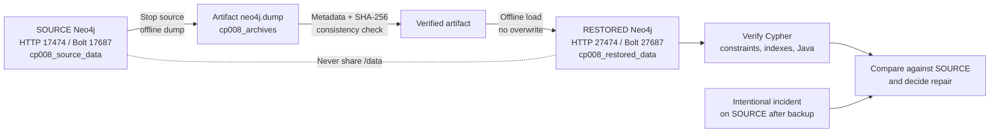
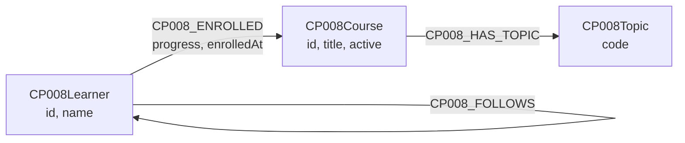

# Practicing Backup, Recovery, and an Incident Scenario

## 1. Capstone Problem Statement and Deliverables

This is the final capstone in the **Capstone Project** chapter, combining the Neo4j skills covered across the module: **property graph** modeling, nodes, relationships, indexes, constraints, Cypher queries, Java Driver, database operations, backups, and incident response. It applies the `DATABASE_ENGINE_GRAPH_NEO4J` module—using Neo4j to model connected data, query relationships/paths, tune queries, and integrate with Java / Spring Data Neo4j applications.

**Business context:** A learning platform stores learners, courses, topics, and **course enrollment** relationships in Neo4j. After a maintenance window, operations discovers that one learner's enrollment relationship was accidentally deleted. Prior to maintenance, the system had a valid backup. Between the **backup** and the **incident**, the system also recorded a valid new enrollment.

**Mission:** Seed sample data, take an offline Neo4j backup, simulate the incident **strictly in the lab environment**, restore the backup into an **independent volume/database**, reconcile data by exact keys and relationships, choose a remediation path on the source that **preserves the valid post-backup enrollment**, and write a recovery report.

Do not treat a zero exit code from `neo4j-admin database load` as finishing the capstone. **Success must be proven with verification queries and an application smoke test.**

### 1.1. What You Must Prove

1. Source and restored instances use **two separate `/data` volumes**, separate endpoints, and separate credentials.
2. Produce a `neo4j.dump` from a **stopped** database and verify its metadata and checksum.
3. Restore the artifact into a **fresh target with no existing database**, without using overwrite flags.
4. Verify node counts, relationship counts, **business keys**, relationship properties, indexes, and constraints.
5. Prove the post-incident source differs from the backup even when **total relationship counts match**.
6. Demonstrate restoring **one deleted relationship** in the lab while preserving valid post-backup writes.
7. Record the recovery point, observed RPO/RTO of the drill, and follow-up rollback/recovery steps.
8. Report clear **PASS / FAIL / NOT TESTED** verdicts—never claim tests were run against production.

### 1.2. Scope and Assumptions

- Environment: **Docker Engine + Docker Compose V2**, running one standalone Neo4j source and one standalone Neo4j restored instance.
- Example images: `neo4j:2026.10.2` and `neo4j/neo4j-admin:2026.10.2`. This pair follows current Neo4j Docker documentation examples. In real projects, pin tested tags—never upgrade databases using `latest`.
- Backup mechanism: **offline** `neo4j-admin database dump` and `neo4j-admin database load`, usable with both Neo4j Community and Enterprise. **Online backup** is an Enterprise capability discussed separately.
- Accounts, volume names, data, and ports are strictly for the **lab**. Production admin privileges are unnecessary.
- No Docker, Cypher, or Java commands have been pre-executed in this document; commands are instructions for you to run and record real measurements.

> **Safety warning:** This lesson contains a `DELETE` statement **intentionally simulating an accidental deletion**. Run it only while connected to the right lab database after capturing the baseline and taking a valid dump. Never copy it into production. Never use `--overwrite-destination`, `docker compose down -v`, `docker volume prune`, or wipe `/data` to “resolve” an incident.

## 2. Drill Architecture: Verifiable Backups and Isolated Restore Targets



| Component | Lab data / path | Role |
|---|---|---|
| Source | `cp008_source_data` mounted at `/data` | Database before and after the incident |
| Archive | `cp008_archives` mounted at `/backups` in admin helper | Stores `neo4j.dump`; **never** used as active store |
| Restored | `cp008_restored_data` mounted at `/data` | Independent restored copy for comparison |
| Source endpoint | `bolt://127.0.0.1:17687` | App/test reads from source |
| Restored endpoint | `bolt://127.0.0.1:27687` | App/test reads from restored |
| Source Browser | `http://127.0.0.1:17474` | Seed fixtures, simulate incident |
| Restored Browser | `http://127.0.0.1:27474` | Verify restored dump |

Two containers on one Docker host **do not provide true disaster isolation**: losing the host or compromising Docker admin privileges impacts both. The lab uses separate volumes and networks to prevent **writing to the wrong database**; enterprise deployments require separate hosts/VPCs/clusters, isolated backup repositories, and separated access control.

### 2.1. Expected Timeline

```text
T0: SOURCE holds 4 learners, 4 courses, 4 topics;
    6 enrollments, 2 follows, 4 topic links.
T1: Stop SOURCE, create neo4j.dump.
T2: Restart SOURCE.
T3: Valid new transaction: u04 enrolls in c02.
T4: Incident: u01 -> c02 enrollment accidentally deleted.
T5: Detect discrepancy using business verification queries.
T6: LOAD the T1 dump into an isolated RESTORED instance.
T7: Inspect and propose selective repair.
T8: Strictly in the lab with approval, restore the missing edge
    while preserving the new T3 enrollment.
```

**Critical verification point:** at T1 there are **6** enrollment relationships; after T3 (+1) and T4 (-1), source also has **6** enrollment relationships. Hence **`count(r) = 6` cannot detect the bug**. You must verify exact **learner–course pairs** and relationship properties.

## 3. Preparing Environment, Permissions, and Stop Conditions

### 3.1. Safety Preflight

Before creating containers:

- Confirm Docker/Compose work and the machine has enough RAM, CPU, and disk for **two databases plus at least one dump**.
- Use a dedicated lab folder, e.g., `cp008-lab/`. All relative paths below live inside this directory.
- Verify `cp008_source_data`, `cp008_restored_data`, and `cp008_archives` **do not belong to real data or another lab**. If any volume already exists with unknown ownership: **stop and rename**.
- Prepare two distinct secrets for source and restored; never commit passwords to Git, expose them in public screenshots, or print them to logs.
- Never share `/data` between source and restored, and never connect lab test apps to production queues, webhooks, email, or external services.
- Ensure the operator runs Docker **on a lab host**, without requiring production infrastructure privileges.

Commands below use Linux/macOS shell syntax. On Windows, run inside WSL2 or adapt syntax for PowerShell. Multi-line commands with `\` line continuations **cannot** be pasted verbatim into PowerShell 5.1.

### 3.2. Creating Independent Volumes

Only after confirming these volume names contain no existing data:

```bash
docker volume ls
docker ps --format "table {{.Names}}\t{{.Status}}\t{{.Ports}}"

# Only if these names do not exist yet and you own the whole lab:
docker volume create cp008_source_data
docker volume create cp008_restored_data
docker volume create cp008_archives
```

**Note:** `docker volume create` succeeds even when a volume name already exists. Therefore **never treat exit code 0 as proof a volume was freshly created and is empty**; inspect `docker volume inspect` and host inventory.

### 3.3. Two-Service Docker Compose with Separate Secrets

Prepare the local layout:

```text
cp008-lab/
├── compose.yaml
└── secrets/
    ├── source-auth.txt
    └── restored-auth.txt
```

Each secret file holds one line formatted as `neo4j/<strong-dedicated-password>`, created via an appropriate secrets process. Never put real passwords into examples or source code. Exclude `secrets/` from version control.

Contents of `compose.yaml`:

```yaml
services:
  source:
    image: neo4j:2026.10.2
    profiles: ["source"]
    restart: "no"
    stop_grace_period: 90s
    ports:
      - "127.0.0.1:17474:7474"
      - "127.0.0.1:17687:7687"
    environment:
      NEO4J_AUTH_FILE: /run/secrets/cp008_source_auth
      NEO4J_server_memory_heap_initial__size: "512M"
      NEO4J_server_memory_heap_max__size: "512M"
      NEO4J_server_memory_pagecache_size: "512M"
    secrets:
      - cp008_source_auth
    volumes:
      - source_data:/data
    networks:
      - source_net

  restored:
    image: neo4j:2026.10.2
    profiles: ["restored"]
    restart: "no"
    stop_grace_period: 90s
    ports:
      - "127.0.0.1:27474:7474"
      - "127.0.0.1:27687:7687"
    environment:
      NEO4J_AUTH_FILE: /run/secrets/cp008_restored_auth
      NEO4J_server_memory_heap_initial__size: "512M"
      NEO4J_server_memory_heap_max__size: "512M"
      NEO4J_server_memory_pagecache_size: "512M"
    secrets:
      - cp008_restored_auth
    volumes:
      - restored_data:/data
    networks:
      - restored_net

secrets:
  cp008_source_auth:
    file: ./secrets/source-auth.txt
  cp008_restored_auth:
    file: ./secrets/restored-auth.txt

volumes:
  source_data:
    external: true
    name: cp008_source_data
  restored_data:
    external: true
    name: cp008_restored_data

networks:
  source_net:
  restored_net:
```

Two networks isolate service-to-service traffic inside Compose while the host can still manage both containers. Published ports bind strictly to `127.0.0.1`, suitable for a lab—**not** a production public configuration.

Heap and page cache sizes are intentionally small for tiny sample data; never use them as production sizing. `NEO4J_AUTH_FILE` initializes the account **only when the system database does not yet exist**. Editing the secret file and restarting **does not rotate an existing password** inside the system database.

### 3.4. Start Only SOURCE Initially

```bash
docker compose config --quiet
docker compose --profile source up -d source
docker compose --profile source ps
docker compose --profile source logs --tail 100 source
```

Wait until source is ready and sign in at `http://127.0.0.1:17474`; the Bolt URI is `bolt://127.0.0.1:17687`. **Do not start `restored` yet**, because the dump must load into an unmounted target database.

## 4. Graph Model and Fixture Data

A learning platform needs to answer:

- Which courses is learner An enrolled in, and what is her progress?
- Who follows whom?
- Which topic does each course belong to?
- Did a write operation drop a critical enrollment relationship?



Labels and relationships carry the `CP008` prefix to avoid colliding with external data.

### 4.1. Uniqueness Constraints and Range Index

Run on **source**, database `neo4j`:

```cypher
CREATE CONSTRAINT cp008_learner_id IF NOT EXISTS
FOR (u:CP008Learner)
REQUIRE u.id IS UNIQUE;
```

```cypher
CREATE CONSTRAINT cp008_course_id IF NOT EXISTS
FOR (c:CP008Course)
REQUIRE c.id IS UNIQUE;
```

```cypher
CREATE CONSTRAINT cp008_topic_code IF NOT EXISTS
FOR (t:CP008Topic)
REQUIRE t.code IS UNIQUE;
```

```cypher
CREATE RANGE INDEX cp008_course_title IF NOT EXISTS
FOR (c:CP008Course)
ON (c.title);
```

Three constraints support key-based lookups; the `title` index lets us verify schema survival after restore. On tiny fixtures, having an index **does not guarantee faster queries**; real evaluation requires `EXPLAIN`/`PROFILE`.

### 4.2. Four Learners

```cypher
UNWIND [
  {id: 'u01', name: 'An'},
  {id: 'u02', name: 'Bình'},
  {id: 'u03', name: 'Chi'},
  {id: 'u04', name: 'Dũng'}
] AS row
MERGE (u:CP008Learner {id: row.id})
SET u.name = row.name;
```

### 4.3. Four Courses and Four Topics

```cypher
UNWIND [
  {id: 'c01', title: 'Cypher Fundamentals'},
  {id: 'c02', title: 'Java Driver'},
  {id: 'c03', title: 'Spring Data Neo4j'},
  {id: 'c04', title: 'Query Tuning'}
] AS row
MERGE (c:CP008Course {id: row.id})
SET c.title = row.title,
    c.active = true;
```

```cypher
UNWIND ['cypher', 'java', 'spring', 'performance'] AS code
MERGE (:CP008Topic {code: code});
```

```cypher
UNWIND [
  {course: 'c01', topic: 'cypher'},
  {course: 'c02', topic: 'java'},
  {course: 'c03', topic: 'spring'},
  {course: 'c04', topic: 'performance'}
] AS row
MATCH (c:CP008Course {id: row.course})
MATCH (t:CP008Topic {code: row.topic})
MERGE (c)-[:CP008_HAS_TOPIC]->(t);
```

### 4.4. Six Enrollment Relationships with Properties

Each learner–course pair has at most one `CP008_ENROLLED` edge in the fixture. `progress` is a completion percentage, not click counts; `enrolledAt` uses a fixed timestamp for post-restore comparison.

```cypher
UNWIND [
  {u: 'u01', c: 'c01', progress: 80},
  {u: 'u01', c: 'c02', progress: 30},
  {u: 'u02', c: 'c01', progress: 100},
  {u: 'u02', c: 'c03', progress: 20},
  {u: 'u03', c: 'c03', progress: 50},
  {u: 'u04', c: 'c04', progress: 10}
] AS row
MATCH (u:CP008Learner {id: row.u})
MATCH (c:CP008Course {id: row.c})
MERGE (u)-[e:CP008_ENROLLED]->(c)
SET e.progress = row.progress,
    e.enrolledAt = datetime('2026-11-10T09:00:00Z');
```

### 4.5. Two Follow Relationships

```cypher
UNWIND [
  {source: 'u01', target: 'u02'},
  {source: 'u02', target: 'u03'}
] AS row
MATCH (a:CP008Learner {id: row.source})
MATCH (b:CP008Learner {id: row.target})
MERGE (a)-[:CP008_FOLLOWS]->(b);
```

Baseline totals: **12 nodes** (`4 learners + 4 courses + 4 topics`), **12 relationships** (`6 enrolled + 2 follows + 4 has-topic`), **3 uniqueness constraints**, and **1 extra range index**. In a database with other content, count only `CP008`-prefixed labels and types.

## 5. Baseline: Recording Evidence Before Backup

A dump file proves nothing about data accuracy without **reference values**. Before stopping source, run the queries below and save their outputs in your drill report.

### 5.1. Counting Elements by Group

```cypher
MATCH (u:CP008Learner)
WITH count(u) AS learners
MATCH (c:CP008Course)
WITH learners, count(c) AS courses
MATCH (t:CP008Topic)
WITH learners, courses, count(t) AS topics
MATCH (:CP008Learner)-[e:CP008_ENROLLED]->(:CP008Course)
WITH learners, courses, topics, count(e) AS enrollments
MATCH (:CP008Learner)-[f:CP008_FOLLOWS]->(:CP008Learner)
WITH learners, courses, topics, enrollments, count(f) AS follows
MATCH (:CP008Course)-[h:CP008_HAS_TOPIC]->(:CP008Topic)
RETURN learners, courses, topics,
       enrollments, follows, count(h) AS topicLinks;
```

| learners | courses | topics | enrollments | follows | topicLinks |
|---:|---:|---:|---:|---:|---:|
| 4 | 4 | 4 | 6 | 2 | 4 |

If the query does not return this exact row, **stop before taking the dump**, inspect the fixture, and purge leftover `CP008` data from prior runs. Never alter baseline expectations to match dirty data.

### 5.2. Capturing Specific Business Relationship Evidence

```cypher
MATCH (u:CP008Learner {id: 'u01'})
      -[e:CP008_ENROLLED]->(c:CP008Course)
RETURN u.id AS learner, c.id AS course,
       e.progress AS progress, e.enrolledAt AS enrolledAt
ORDER BY course;
```

Expected:

| learner | course | progress |
|---|---|---:|
| `u01` | `c01` | 80 |
| `u01` | `c02` | 30 |

For both relationships, `enrolledAt` must equal `2026-11-10T09:00:00Z`. This is your **golden result** for post-restore verification.

Verify `u04` is not yet enrolled in `c02`:

```cypher
MATCH (:CP008Learner {id: 'u04'})
      -[e:CP008_ENROLLED]->
      (:CP008Course {id: 'c02'})
RETURN count(e) AS enrollmentCount;
```

Expected `0`.

### 5.3. Checking Schema

```cypher
SHOW CONSTRAINTS
YIELD name, type, labelsOrTypes, properties
WHERE name STARTS WITH 'cp008_'
RETURN name, type, labelsOrTypes, properties
ORDER BY name;
```

```cypher
SHOW INDEXES
YIELD name, type, state, labelsOrTypes, properties
WHERE name STARTS WITH 'cp008_'
RETURN name, type, state, labelsOrTypes, properties
ORDER BY name;
```

Expect the three constraints `cp008_learner_id`, `cp008_course_id`, `cp008_topic_code` and index `cp008_course_title`. Neo4j also creates backing indexes for uniqueness constraints, which can share the constraint names. Wait until they are `ONLINE` before benchmarking or signing off on schema readiness.

## 6. Creating an Offline Backup with neo4j-admin

On **Neo4j Community Edition**, `neo4j-admin database dump` and `database load` require the DBMS to be offline; Enterprise has online alternatives depending on deployment, yet this capstone **stops source completely** to avoid touching a live mounted store.

### 6.1. Quiesce Writes and Stop SOURCE

Confirm all fixture transactions finished, stop apps/jobs touching source, then run:

```bash
docker compose --profile source stop source
docker compose --profile source ps
```

Verify source has stopped. **Never** run the dump helper while another Neo4j process mounts `cp008_source_data`. Never stop a non-lab database by matching similar container names.

### 6.2. Dump into the Separate Archive Volume

```bash
docker run --rm \
  --mount type=volume,src=cp008_source_data,dst=/data \
  --mount type=volume,src=cp008_archives,dst=/backups \
  neo4j/neo4j-admin:2026.10.2 \
  neo4j-admin database dump neo4j --to-path=/backups
```

Expect `neo4j.dump` inside `cp008_archives`. Use a helper image matching the source **exact version**, and record exit code plus start/end timestamps. If permission errors, full volumes, or mounted-DB errors occur, **stop and diagnose**—never `chmod 777` everything or add overwrite flags blindly.

### 6.3. Inspecting Dump Metadata Before Use

```bash
docker run --rm \
  --mount type=volume,src=cp008_archives,dst=/backups,readonly \
  neo4j/neo4j-admin:2026.10.2 \
  neo4j-admin database load neo4j --from-path=/backups --info
```

`--info` prints archive metadata only—**it does not load the database**. If the format is invalid, the file is missing, or the version mismatches, halt the drill.

### 6.4. Verifying SHA-256 Checksum

Example using the admin image shell if `sha256sum` is available:

```bash
docker run --rm \
  --entrypoint /bin/sh \
  --mount type=volume,src=cp008_archives,dst=/backups,readonly \
  neo4j/neo4j-admin:2026.10.2 \
  -c 'sha256sum /backups/neo4j.dump'
```

Record the **actual observed hash** in a backup catalog stored outside this volume. Recomputing a checksum on a file **after it was altered** does not prove authenticity; store hashes in trusted signed metadata. Hashes detect byte corruption, **not** business-logic correctness of the graph.

You can also run Neo4j admin's consistency check on the artifact (can be resource/time intensive):

```bash
docker run --rm \
  --mount type=volume,src=cp008_archives,dst=/backups,readonly \
  neo4j/neo4j-admin:2026.10.2 \
  neo4j-admin database check neo4j \
    --from-path=/backups/neo4j.dump \
    --temp-path=/tmp
```

Check the exit code and report output; never treat `database check` as a substitute for post-restore business queries. On large graphs, provision adequate temp disk, CPU/RAM, and report paths. Never run consistency checks against an active mounted database store.

### 6.5. Artifact Manifest (Learner to Fill In)

| Field | Value to record |
|---|---|
| Source database | `neo4j` in `cp008_source_data` |
| Image / version | `neo4j:2026.10.2` and matching admin image |
| Artifact | `neo4j.dump` in `cp008_archives` |
| File size | Actual measured bytes, never fabricated |
| SHA-256 | Actual output from hash command |
| Dump completion time | UTC timestamp recorded by operator |
| Database state during dump | Source stopped |
| Baseline data | 12 nodes, 12 relationships; keys/properties in section 5 |
| Operator and evidence location | Filled per lab session |

**Dump scope:** `neo4j.dump` for database `neo4j` does not carry `system` users/roles, connection secrets, TLS config, plugins, or app infrastructure. A complete recovery therefore also verifies target configuration and application permissions.

## 7. Simulating a Post-Backup Incident — Strictly on Lab SOURCE

After dumping, start source **with the same volume**:

```bash
docker compose --profile source start source
docker compose --profile source logs --tail 80 source
```

Wait until online, then connect specifically to **`http://127.0.0.1:17474`** or Bolt `17687`. Before running writes, confirm one last time that you are targeting the lab `neo4j` database. If the connection string differs or non-`CP008` data appears, **stop**.

### 7.1. Valid Post-Backup Transaction

Learner `u04` enrolls in course `c02`. This is valid business data **that must be preserved** during incident remediation:

```cypher
MATCH (u:CP008Learner {id: 'u04'})
MATCH (c:CP008Course {id: 'c02'})
MERGE (u)-[e:CP008_ENROLLED]->(c)
ON CREATE SET e.progress = 5,
              e.enrolledAt = datetime('2026-11-20T09:00:00Z')
RETURN u.id AS learner, c.id AS course,
       e.progress AS progress;
```

Expect one row `u04, c02, 5`; source now has **7** enrollment relationships. If that pair already existed from an earlier lab, `MERGE` creates nothing; verify and reset the **lab fixture** beforehand so the timeline stays meaningful.

### 7.2. Incident: Accidentally Deleting An's Enrollment

**This is an intentional data-loss step strictly on LAB SOURCE. Never run in production.**

Before executing, a read query must show **exactly one** matching relationship:

```cypher
MATCH (u:CP008Learner {id: 'u01'})
      -[e:CP008_ENROLLED]->
      (c:CP008Course {id: 'c02'})
RETURN count(e) AS targetEdges;
```

Expect `targetEdges = 1`. If not 1, stop. Once certain you are on lab source and targeting the exact edge, simulate an operator mistake:

```cypher
// RUN ONLY ON LAB DATABASE: simulate accidental delete of 1 relationship
MATCH (u:CP008Learner {id: 'u01'})
      -[e:CP008_ENROLLED]->
      (c:CP008Course {id: 'c02'})
DELETE e;
```

Because the query pins `u01`, `c02`, and relationship type, blast radius is limited to one edge. This is **not** a fix; it creates the incident for the recovery exercise.

### 7.3. Reproducing the Symptom and Detecting via Invariants

On post-incident source:

```cypher
MATCH (u:CP008Learner {id: 'u01'})
OPTIONAL MATCH (u)-[e:CP008_ENROLLED]->
               (c:CP008Course)
RETURN u.id AS learner,
       collect(c.id) AS enrolledCourseIds
ORDER BY learner;
```

Expect only `['c01']`. Learner An **lost course `c02`** even though before the backup she held that enrollment with progress `30` and a recorded timestamp.

Verify the valid new enrollment still exists:

```cypher
MATCH (:CP008Learner {id: 'u04'})
      -[e:CP008_ENROLLED]->
      (:CP008Course {id: 'c02'})
RETURN count(e) AS newEnrollmentCount,
       max(e.progress) AS latestProgress;
```

Expect `newEnrollmentCount=1`, `latestProgress=5`.

Re-check total enrollment count:

```cypher
MATCH (:CP008Learner)-[e:CP008_ENROLLED]->
      (:CP008Course)
RETURN count(e) AS enrollmentCount;
```

**Expect `6` — matching the baseline count even though the graph is broken!** One old edge was deleted and one new edge was added. That is why recovery checks based solely on `count(*)` fail to guarantee business integrity.

### 7.4. Triaging the Incident Before Acting

| Question | Expected lab finding | Action |
|---|---|---|
| Is Neo4j still online? | Yes | Do not treat this as a full server outage |
| Do Cypher and indexes work? | Yes | No need to rebuild the whole DB just to run queries |
| What data is missing? | `u01 -[:CP008_ENROLLED]-> c02` | Pinpoint exact identity and properties |
| Were valid post-backup writes made? | Yes: `u04 → c02` | Never roll back the whole store without reconciling |
| Is there a clean pre-incident artifact? | Yes: `neo4j.dump` | Restore separately to investigate |
| Is a scoped repair feasible? | Yes in the lab | Only after verifying evidence and getting approval |

In production, first steps also include **stopping the faulty actor, preserving forensic evidence, restricting privileges, bounding the impact window**, reviewing change logs, and selecting an approved recovery playbook. Never mutate source before gathering complete evidence.

## 8. Restoring the Dump into an Isolated RESTORED Environment

### 8.1. Pre-Load Conditions

1. Volume `cp008_restored_data` is **fresh/empty** and never mounted for writes by any DBMS.
2. Service `restored` is **not running**.
3. Volume `cp008_archives` holds `neo4j.dump` already verified with `--info` and checksum.
4. Helper image matches source version.
5. Never pass `--overwrite-destination`; if target is non-empty, **stop** and inspect ownership rather than overwriting.

### 8.2. Loading the Dump with neo4j-admin

```bash
docker run --rm \
  --mount type=volume,src=cp008_restored_data,dst=/data \
  --mount type=volume,src=cp008_archives,dst=/backups,readonly \
  neo4j/neo4j-admin:2026.10.2 \
  neo4j-admin database load neo4j --from-path=/backups
```

This is an **offline** operation on the target volume. Never mount `cp008_source_data` at `/data` in this command. Never add `--overwrite-destination` to bypass an unexplained error.

If load aborts mid-way, the target volume may contain partial store files. Never retry blindly; provision **a fresh approved target volume** or clean the verified lab volume deliberately, then re-run with logging.

### 8.3. Starting RESTORED

```bash
docker compose --profile restored up -d restored
docker compose --profile restored ps
docker compose --profile restored logs --tail 100 restored
```

Connect to **`http://127.0.0.1:27474`** or Bolt **`bolt://127.0.0.1:27687`** using the **restored secret**. Because the dump holds only the `neo4j` database without `system` users/roles, target authentication is configured separately.

Verify database online:

```cypher
SHOW DATABASES
YIELD name, currentStatus
WHERE name = 'neo4j'
RETURN name, currentStatus;
```

Expect the database to be online. For **non-default** databases on Neo4j Enterprise, you may need to register them with `CREATE DATABASE` on `system` after loading; this lab uses the default `neo4j` database to stay simple.

## 9. Acceptance Tests: Proving Recovery per Relationship

Run **all queries below against RESTORED**, not source. Seeing container `running` or `RETURN 1` succeed is only a liveness check—it does not verify data or schema.

### 9.1. Verify Node and Relationship Counts

Re-run the query from section 5.1. Expected:

| Element | Value on RESTORED |
|---|---:|
| `CP008Learner` | 4 |
| `CP008Course` | 4 |
| `CP008Topic` | 4 |
| `CP008_ENROLLED` | 6 |
| `CP008_FOLLOWS` | 2 |
| `CP008_HAS_TOPIC` | 4 |

If any number differs, halt acceptance and inspect dump, load, database name, or volume mounts. If counts match, **continue** verifying by keys: matching counts do not guarantee right entities.

### 9.2. Confirm the Deleted Source Edge Exists in Restored

```cypher
MATCH (:CP008Learner {id: 'u01'})
      -[e:CP008_ENROLLED]->
      (:CP008Course {id: 'c02'})
RETURN count(e) AS links,
       max(e.progress) AS progress,
       max(e.enrolledAt) AS enrolledAt;
```

Expect `links=1`, `progress=30`, `enrolledAt=2026-11-10T09:00:00Z`. If `links=0`, the restored copy lacks the target edge; you may have loaded the wrong artifact or an invalid baseline.

### 9.3. Confirm Post-Dump Enrollment Is Absent from Restored

```cypher
MATCH (:CP008Learner {id: 'u04'})
      -[e:CP008_ENROLLED]->
      (:CP008Course {id: 'c02'})
RETURN count(e) AS afterBackupEnrollments;
```

Expect `0` because `u04`'s enrollment occurred **after the backup**. If `1` appears, check for wrong endpoint/volume or a dump taken later than intended.

### 9.4. Verify Multi-Hop Graph Traversal

```cypher
MATCH (:CP008Learner {id: 'u01'})
      -[:CP008_FOLLOWS]->
      (peer:CP008Learner)
      -[:CP008_ENROLLED]->
      (course:CP008Course)
      -[:CP008_HAS_TOPIC]->
      (topic:CP008Topic)
RETURN peer.id AS peer, course.id AS course,
       topic.code AS topic
ORDER BY peer, course;
```

Expect two rows: `u02/c01/cypher` and `u02/c03/spring`. This proves **relationship directions**, linked nodes, and multi-hop path patterns survived intact, not merely isolated nodes.

### 9.5. Verify Constraints and Indexes

Re-run `SHOW CONSTRAINTS` and `SHOW INDEXES` from section 5.3. Expect all of:

- `cp008_learner_id`.
- `cp008_course_id`.
- `cp008_topic_code`.
- `cp008_course_title` in `ONLINE` state, along with constraint-backing indexes.

If any index is still populating, wait for completion before running benchmarks. Never ignore a `FAILED` index just because nodes appear; missing indexes severely degrade production APIs.

### 9.6. Combined Invariant Verification Query

```cypher
MATCH (an:CP008Learner {id: 'u01'})
MATCH (dung:CP008Learner {id: 'u04'})
MATCH (java:CP008Course {id: 'c02'})
OPTIONAL MATCH (an)-[restoredEdge:CP008_ENROLLED]->(java)
WITH dung, java,
     count(restoredEdge) AS anEdges,
     max(restoredEdge.progress) AS anProgress
OPTIONAL MATCH (dung)-[postBackupEdge:CP008_ENROLLED]->(java)
WITH anEdges, anProgress,
     count(postBackupEdge) AS postBackupEdges
RETURN anEdges = 1
       AND anProgress = 30
       AND postBackupEdges = 0 AS restorePassed;
```

Expect `restorePassed=true`. Both checks assert **exact key pairs** and **property values** rather than aggregate counts. Running this on post-incident source returns `false`, confirming the test detects the fault.

## 10. Smoke Test with Neo4j Java Driver

Verify an application can read RESTORED using dedicated config. Synchronous Java 17+ / Neo4j Java Driver example:

```java
import java.util.Map;
import org.neo4j.driver.AuthTokens;
import org.neo4j.driver.Driver;
import org.neo4j.driver.GraphDatabase;
import org.neo4j.driver.SessionConfig;

public final class CapstoneRestoreSmoke {
    public record Evidence(long links, long progress) {}

    public static void main(String[] args) {
        String password = System.getenv("CP008_RESTORE_PASSWORD");
        if (password == null || password.isBlank()) {
            throw new IllegalStateException("Missing restore credential");
        }

        // Target restored DB ONLY; NEVER point at source/production.
        try (Driver driver = GraphDatabase.driver(
                "bolt://127.0.0.1:27687",
                AuthTokens.basic("neo4j", password))) {
            driver.verifyConnectivity();

            try (var session = driver.session(
                    SessionConfig.forDatabase("neo4j"))) {
                Evidence result = session.executeRead(tx -> {
                    var row = tx.run("""
                        MATCH (:CP008Learner {id: $learner})
                              -[e:CP008_ENROLLED]->
                              (:CP008Course {id: $course})
                        RETURN count(e) AS links,
                               max(e.progress) AS progress
                        """, Map.of("learner", "u01", "course", "c02"))
                        .single();
                    long links = row.get("links").asLong();
                    long progress = row.get("progress").isNull()
                        ? -1L : row.get("progress").asLong();
                    return new Evidence(links, progress);
                });

                if (result.links() != 1L || result.progress() != 30L) {
                    throw new IllegalStateException(
                        "Restore invariant failed: " + result
                    );
                }
                System.out.println("RESTORE SMOKE PASS");
            }
        }
    }
}
```

The app reads **inside a transaction** and maps results to a compact DTO before closing the session. Never return an unconsumed `Result` outside `executeRead` or the session. In real apps, reuse `Driver` across the app lifecycle; this CLI demo opens and closes it cleanly to avoid lingering connections after the drill.

With **Spring Data Neo4j**, create a `restore-test` profile pointing `spring.neo4j.uri=bolt://127.0.0.1:27687` with RESTORED credentials and run **read-only** repositories/queries. Disable schedulers, ingestion jobs, event consumers, webhooks, and automatic migrations in the lab. Where RBAC exists, use a read-only account rather than admin; `@Transactional(readOnly=true)` does not strip write privileges from a DB user.

A **Smoke test PASS** proves this specific Java read path works; it does not automatically prove every other query, plugin/APOC procedure, user/role, large index, or external integration recovered.

## 11. Decision: Full Restore or Repair One Relationship?

We now observe four states:

| State | `u01 → c02` | `u04 → c02` | ENROLLED count |
|---|---|---|---:|
| SOURCE at backup T1 | Present, progress 30 | Absent | 6 |
| SOURCE post-incident T4 | **Missing** | **Present**, progress 5 | 6 |
| RESTORED from dump T1 | **Present**, progress 30 | Absent | 6 |
| SOURCE after selective repair (sec. 11.2) | **Present**, progress 30 | **Present**, progress 5 | 7 |

**Do not blindly replace source with the entire RESTORED database here:** doing so restores `u01 → c02` while **destroying the valid post-backup transaction `u04 → c02`**. This is an RPO trade-off, not merely a technical `load` step.

### 11.1. Decision Workflow in a Real Incident

1. **Stop the root cause** (faulty job, script, or compromised credential) and preserve audit evidence.
2. Bound the impacted scope via business keys, timestamps, transaction/event logs, and source authority.
3. Restore an **isolated** copy from an appropriate recovery point; never overwrite the live system blindly.
4. Diff **changes between backup and incident** against valid post-backup transactions.
5. If corruption is widespread and item-level repair is untrustworthy, execute full recovery under an approved RPO with a valid replay/reconciliation plan.
6. If only a known discrete record is missing, evaluate **selective repair** under change approval with transactions, logging, validation, and rollback.
7. Re-open traffic / restore SLA only after acceptance tests pass; never assume restored data reflects the latest state.

Neo4j has no built-in `merge-from-restored-database` command to “fix only broken business items.” Restored records must be **reconciled and applied deliberately** rather than copying whole graphs and risking duplicates or lost recent writes.

### 11.2. Selective Repair — Run on LAB SOURCE Only After Evidence Verification

**Mandatory precondition:** verified via RESTORED that `u01 → c02` existed with `progress=30` and the fixed `enrolledAt`, while source lacks solely that edge. The query below **modifies source**, never run on RESTORED:

```cypher
// RUN ONLY ON SOURCE LAB AFTER RECONCILIATION
MATCH (u:CP008Learner {id: 'u01'})
MATCH (c:CP008Course {id: 'c02'})
MERGE (u)-[e:CP008_ENROLLED]->(c)
ON CREATE SET e.progress = 30,
              e.enrolledAt = datetime('2026-11-10T09:00:00Z')
RETURN u.id AS learner, c.id AS course,
       e.progress AS progress, e.enrolledAt AS enrolledAt;
```

`MERGE` keeps the lab repair idempotent when re-run on a graph free of parallel edges. Under concurrent writes, **`MERGE` alone does not guarantee zero parallel edges** across all race schedules; production repairs require transactions/locks, design-appropriate constraints, and concurrency testing.

Then verify on SOURCE:

```cypher
MATCH (u:CP008Learner)
WHERE u.id IN ['u01', 'u04']
MATCH (c:CP008Course {id: 'c02'})
OPTIONAL MATCH (u)-[e:CP008_ENROLLED]->(c)
RETURN u.id AS learner,
       count(e) AS links,
       max(e.progress) AS progress
ORDER BY learner;
```

Expected:

| learner | links | progress |
|---|---:|---:|
| `u01` | 1 | 30 |
| `u04` | 1 | 5 |

Total `CP008_ENROLLED` on source is now **7**; RESTORED stays at **6** and **must not** be updated to mirror source. This intentional difference proves **the lost edge was recovered while preserving valid post-backup transactions**.

In real incidents, also verify concurrent business events, optimistic locking/versions, write authorization, replay/backfill, and audit trails—never guess lost progress or timestamps without a trusted copy.

## 12. RPO, RTO, and Acceptance Evidence

### 12.1. Two Distinct Metrics

| Concept | What does it measure? | Notes |
|---|---|---|
| **Recovery Point Objective (RPO)** | Maximum tolerable time/data loss window | Dump at T1 lacks new transaction T3 |
| **Recovery Time Objective (RTO)** | Maximum tolerable downtime until service meets SLA | Covers locating artifact, prep, load, startup, verification, traffic cutover |
| **Achieved recovery point** | Actual data point contained in the restored copy | Must be identified by metadata/timestamps/transaction evidence |
| **Restore duration** | Time to load store and start DB | Only **part** of end-to-end service RTO |
| **Data correctness** | Graph matches business rules and invariants | Never measured merely by restore duration or node counts |

If a backup ran at 09:00 and an incident hit at 09:17, a **theoretical example** has a 17-minute gap; that is not a measured project result. **RPO is not file download time**, and meeting a target RPO time still fails if one irreplaceable critical transaction was lost.

### 12.2. Timeline to Record During Drills

```text
T_detect     Missing edge detected, incident ticket opened
T_identify   Impact scope and valid recovery point identified
T_artifact   Dump file / checksum / metadata verified
T_load_start Started loading into restore volume
T_load_end   Load finished, preparing startup
T_db_ready   Restored database online
T_verify     Cypher + Java smoke tests PASS
T_decide     Selective repair / full recovery proposed
T_resolved   Source repair complete, business sign-off
```

Depending on goal, measure `restore-only duration = T_db_ready - T_load_start`, while **incident recovery time** spans `T_detect` to `T_resolved`. Use a consistent clock/timezone; never write “took a few minutes” without evidence.

### 12.3. Acceptance Report Template

| Item | Expectation | Learner-filled status |
|---|---|---|
| Isolated source and restored volumes | `cp008_source_data ≠ cp008_restored_data` | PASS / FAIL / NOT TESTED |
| Post-incident source shows fault | `u01→c02` missing, `u04→c02` present | PASS / FAIL / NOT TESTED |
| Backup artifact | `neo4j.dump` readable, hash archived | PASS / FAIL / NOT TESTED |
| Consistency check | No inconsistencies reported (if run) | PASS / FAIL / NOT TESTED |
| Restore endpoint | Bolt `27687`, `neo4j` database online | PASS / FAIL / NOT TESTED |
| Nodes/edges | 4/4/4 nodes, 6/2/4 relationships | PASS / FAIL / NOT TESTED |
| Lost edge present in restore | `u01→c02`, progress 30 | PASS / FAIL / NOT TESTED |
| Post-dump transaction absent in restore | `u04→c02` absent | PASS / FAIL / NOT TESTED |
| Constraints/indexes | 3 constraints + title index ONLINE | PASS / FAIL / NOT TESTED |
| Traversal and Java Driver | Multi-hop query and smoke test pass | PASS / FAIL / NOT TESTED |
| Selective repair on lab source | Preserves both `u01→c02` and `u04→c02` | PASS / FAIL / NOT TESTED |
| RPO/RTO | Real timestamps recorded with variances explained | PASS / FAIL / NOT TESTED |
| Permissions and security | Zero production secrets or connectors used | PASS / FAIL / NOT TESTED |

If any **mandatory** check fails, report `PARTIAL` or `FAILED` with reasons—never claim “backup verified” merely from `neo4j-admin` exit code 0. Evidence includes sanitized logs, hashes, versions, queries/results, timelines, and tester names.

## 13. Extension: Online Backup and Incidents in Neo4j Enterprise / Clusters

This capstone uses **offline dump/load**, whereas high-uptime systems often cannot stop source for every backup to meet RPO/RTO. Neo4j Enterprise provides **online backup**:

| Aspect | Offline dump/load | Enterprise online backup/restore |
|---|---|---|
| Must source stop? | Lab stops DBMS offline | Backs up while database serves traffic per config |
| Artifact | `<database>.dump` | Full/differential `.backup` per version |
| Chain management needed? | Single standalone dump | Differential backups require a valid chain |
| Restore command | `database load` | `database restore` across backup chain |
| Metadata / roles | User DB dump excludes `system` roles | Depends on options, scope, and version |
| Best fit | Labs, migrations, offline snapshots | Scheduled backups for critical live systems |

Conceptual **Enterprise syntax examples**—never run against a live database:

```bash
# Consult the manual for your exact release and backup connector settings.
neo4j-admin database backup neo4j \
  --to-path=/approved/backups \
  --type=FULL

# Restore strictly on an offline, independently prepared target server.
neo4j-admin database restore \
  --from-path=/approved/backups \
  restoredlab
```

These Enterprise commands merely contrast **command patterns**; real setups also configure backup server/ports, permissions, serving sources, metadata, and artifact naming. A differential backup **is not a standalone loadable dump**; restoring requires the full chain and point-in-time log replay capability. Never pass a differential backup arbitrarily to `database load`.

**For clusters:** restoring a database involves cluster topology state and `system` registration. Never copy store files or run `--overwrite-destination` on a member still joined to a cluster and treat it as safe recovery. Follow dedicated cluster seed/restore procedures for your topology and edition.

Beyond graph data, a real recovery plan must preserve or recreate `system` users/roles, database privileges, TLS certificates, plugins/APOC, configs, secrets, external indexes/caches, event offsets, and connection metadata used by Java Driver / Spring Data Neo4j.

## 14. Troubleshooting Issues During the Drill

| Symptom | Hypothesis | Safe resolution |
|---|---|---|
| `database dump` says store is in use | Source still running or another process mounts volume | Stop the lab service cleanly, verify mounts, never force |
| Admin helper cannot write `/backups` | UID/GID, permissions, or readonly mount | Fix ownership/ACL on **lab volume only**; never `chmod 777` |
| Missing `neo4j.dump` | Wrong DB name, mount, path, or failed dump | Inspect logs and `--info`; never fabricate artifacts |
| Checksum changed | Wrong/corrupted file or stale manifest | Quarantine artifact; restore from another trusted copy |
| Database check failed | Corrupted store/artifact or insufficient temp space | Read report; never pass acceptance blindly |
| `database load` says destination exists | Non-empty restored volume or running DBMS | Stop, check owner; **never add overwrite** |
| Load succeeded yet zero nodes | Wrong DB/volume or image mismatch | Check `SHOW DATABASES`, endpoints, dump, and logs |
| Java connects to `17687` and sees wrong state | Reading source instead of restored | Switch to `27687`, test both states separately |
| `u01→c02` missing from restore | Dump taken after incident or bad baseline | Check recovery point; never invent progress |
| `u04→c02` present in restore | Wrong artifact/timestamp or queried source by mistake | Halt acceptance; verify source of query output |
| Relationship totals match yet keys differ | New write masked deleted edge | Audit exact keys/properties and change logs |
| Auth works yet `MATCH` denied | Different `system` users/roles or RBAC | Check target roles; never leave permanent admin on apps |
| Dump/restore too slow | Insufficient disk/I/O/temp/heap | Measure disk/CPU/RAM and plan capacity |
| Data restored yet app misbehaves | Config, plugins, external caches/events, migrations | Run smoke/integration tests and integration checks |

### 14.1. Never “Fix” by Erasing Evidence

During a real source incident, wiping the database, purging transaction logs, overwriting volumes, or blindly re-running migrations destroys forensic evidence. In the lab, label all mutations **simulated**; in production, preserve snapshots/logs and follow change-approval, least-privilege, and audit workflows.

## 15. Observability, Security, and Limitations of This Approach

### 15.1. Metrics to Collect

- Dump/load duration, storage read/write throughput, artifact size, and temp space usage.
- Database startup state, transaction log recovery, and index population progress.
- Node/relationship counts by type, business invariant pass rate, and smoke test results.
- Post-restore business query `p95`/`p99`, pool wait, and Java Driver errors.
- Time to detect, time to select backup, time to restore, and time to sign off.
- Count of post-backup transactions needing preservation, replay, or reconciliation.

These are **recommended monitoring metrics**, not guaranteed built-in metric names across all Neo4j versions. Combine Neo4j logs, infrastructure dashboards, app tracing, and verification reports.

### 15.2. Backup Data Sensitivity

Graph backups expose both **properties and relationship structure**. Even an anonymized social graph with names stripped can often be re-identified from topology. Therefore:

- Use **synthetic data** only, like the `CP008` fixture in this lesson.
- Use **separate** accounts, networks, and secrets for RESTORED; disable outbound connectors, jobs, webhooks, CDC, and SMTP by default in labs.
- Restrict `.dump` read access; enforce encryption at rest/in transit, retention limits, and access auditing on real backups.
- Never share dumps or logs containing passwords, tokens, or PII over unapproved channels.
- Verify DBMS/schema/RBAC permissions—never assume loading `neo4j.dump` restores all users and roles.

### 15.3. What This Capstone Does Not Automatically Prove

- A single-host lab does not prove RTO/RPO for multi-terabyte production databases.
- Offline dumps do not prove Enterprise online backups or differential chains work.
- One passing Cypher query does not prove full workload, routing, or cluster health.
- Restoring one edge via `MERGE` does not prove concurrent large-scale data repair is race-free.
- Restoring from T1 cannot resurrect transaction T3 on its own; reconciliation or replay is mandatory.

## 16. Extension Tasks and Capstone Defense Questions

1. **Incident analysis:** Why do post-incident source T4 and restored T1 both have 6 `CP008_ENROLLED` edges yet hold different data? Name the two differing key pairs.
2. **Acceptance design:** Write a single Cypher query verifying `u01→c02`, `progress=30`, and `u04→c02` absence on restored without relying solely on total counts.
3. **Recovery point:** Distinguish target RPO, actual backup timestamp, and the moment the incident was detected.
4. **Selective repair:** If 1,000 edges were deleted on source instead of one, would you pick full restore, batch repair, or event-log replay? List the evidence needed before deciding.
5. **Preserving post-backup writes:** Why would replacing source wholesale with the T1 dump drop `u04`'s newly enrolled course?
6. **Indexes and constraints:** Post-restore, why verify `ONLINE` indexes and uniqueness constraints instead of running `MATCH` alone?
7. **Wrong endpoint:** Propose a way for the smoke test to catch an app accidentally pointing at source `17687` instead of restored `27687`.
8. **Backup artifacts:** How do checksums, `--info`, `database check`, and business queries mitigate **different** risks?
9. **Clusters:** In a multi-member Neo4j Enterprise cluster, why can you not simply copy a store volume onto a running member?
10. **RTO:** Chart `T_detect → T_resolved` using real measured durations, separating artifact transfer, load, startup, verification, and repair.
11. **Security:** If restored contained real customer data, what changes for isolation, masking, RBAC, retention, and outbound connectors?
12. **Java / SDN:** Add a read-only integration test comparing `u01`'s course list via Java Driver or `Neo4jClient` against the golden result.
13. **Fault testing:** Using a **secondary copy** of the dump in the lab, simulate a corrupted artifact—never alter the original dump. Describe what `--info`, hashing, or `database check` detects.
14. **Correctness:** After selective repair, why does source have 7 enrollments while restored has 6, and why are **both** accurate for their respective recovery points?

### 16.1. Suggested Grading Rubric (100 Points)

| Category | Max points | Evidence |
|---|---:|---|
| Isolation design and operational safety | 15 | Separate volumes, ports, secrets, no-overwrite discipline |
| Fixture and golden baseline | 15 | Counts, ID/relationship/property snapshots, schema |
| Backup artifact and integrity | 15 | Dump, `--info`, hash, consistency check |
| Independent restore and acceptance | 20 | Cypher checks, indexes/constraints, Java smoke test |
| Incident analysis and preserving new writes | 20 | Accurate fault detection, controlled selective repair |
| RPO/RTO report, security, post-mortem | 15 | Timeline, decisions, preventive actions |

A high-scoring submission explains **why the chosen path is safe**, not merely which commands ran. Reports lacking restored-DB evidence or losing `u04→c02` fail core criteria.

## 17. Cleaning Up the Lab While Preserving Evidence

After the drill, **stop only the two lab services**, keeping volumes available for review:

```bash
docker compose --profile source --profile restored down
```

Because Compose declares `external: true`, standard `down` preserves `cp008_source_data` and `cp008_restored_data`. Inspect before deciding to delete data:

```bash
docker volume inspect cp008_source_data
docker volume inspect cp008_restored_data
docker volume inspect cp008_archives
```

To **remove only the fixture on RESTORED** to practice Cypher cleanup, start RESTORED, connect strictly to the test DB, and verify privileges—**never run this on SOURCE** if preserving incident evidence. Example:

```cypher
MATCH (u:CP008Learner)
DETACH DELETE u;
```

```cypher
MATCH (c:CP008Course)
DETACH DELETE c;
```

```cypher
MATCH (t:CP008Topic)
DETACH DELETE t;
```

```cypher
DROP INDEX cp008_course_title IF EXISTS;
```

```cypher
DROP CONSTRAINT cp008_learner_id IF EXISTS;
```

```cypher
DROP CONSTRAINT cp008_course_id IF EXISTS;
```

```cypher
DROP CONSTRAINT cp008_topic_code IF EXISTS;
```

**Safer practice:** retain source, restored, and artifacts after the session for instructor review. Delete **only those exact three lab volumes** under an approved cleanup step after confirming no service uses them and any required backup is archived safely. **Never use** `docker volume prune`, `docker system prune --volumes`, or `down -v` as casual cleanup.

## 18. References

- [Neo4j Operations Manual — Dump and load in Docker](https://neo4j.com/docs/operations-manual/current/docker/dump-load/): `neo4j/neo4j-admin` sidecar, offline volume operations.
- [Neo4j Operations Manual — Back up an offline database](https://neo4j.com/docs/operations-manual/current/backup-restore/offline-backup/): `neo4j-admin database dump`, `--to-path`, and metadata scope.
- [Neo4j Operations Manual — Restore a database dump](https://neo4j.com/docs/operations-manual/current/backup-restore/restore-dump/): `neo4j-admin database load`, `--info`, offline rules, and `--overwrite-destination`.
- [Neo4j Operations Manual — Check database consistency](https://neo4j.com/docs/operations-manual/current/backup-restore/consistency-checker/): `neo4j-admin database check` and `--from-path` with dumps.
- [Neo4j Operations Manual — Online backup](https://neo4j.com/docs/operations-manual/current/backup-restore/online-backup/): Enterprise full/differential backups.
- [Neo4j Operations Manual — Restore a database backup](https://neo4j.com/docs/operations-manual/current/backup-restore/restore-backup/): restoring backup chains, transaction logs, and cluster caveats.
- [Neo4j Operations Manual — Docker Compose and secrets](https://neo4j.com/docs/operations-manual/current/docker/docker-compose-standalone/): separating auth via `NEO4J_AUTH_FILE`.
- [Neo4j Cypher Manual — MATCH](https://neo4j.com/docs/cypher-manual/current/clauses/match/): traversing relationship patterns and key filters.
- [Neo4j Cypher Manual — MERGE](https://neo4j.com/docs/cypher-manual/current/clauses/merge/): keyed node/edge upserts and conditional idempotency.
- [Neo4j Java Driver Manual](https://neo4j.com/docs/java-manual/current/): `verifyConnectivity`, `executeRead`, session lifecycle, and Cypher parameters.
