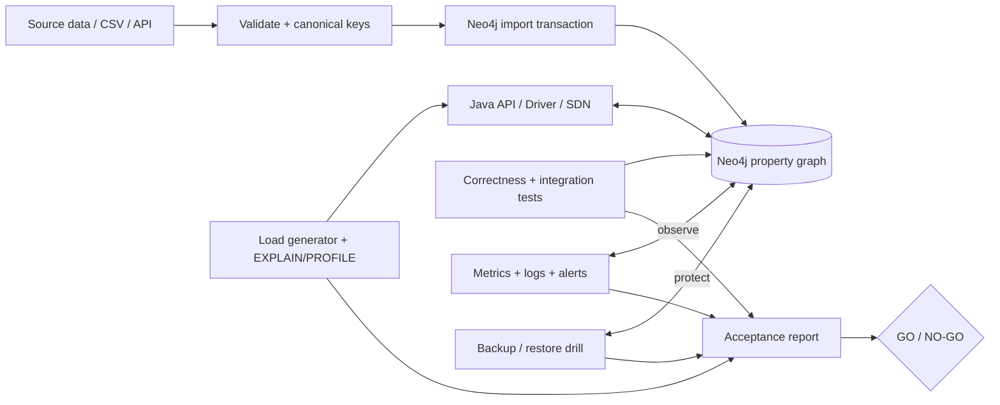
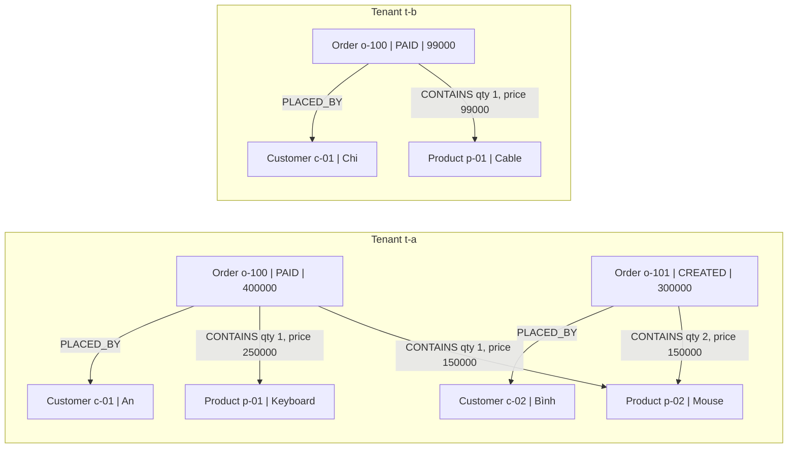
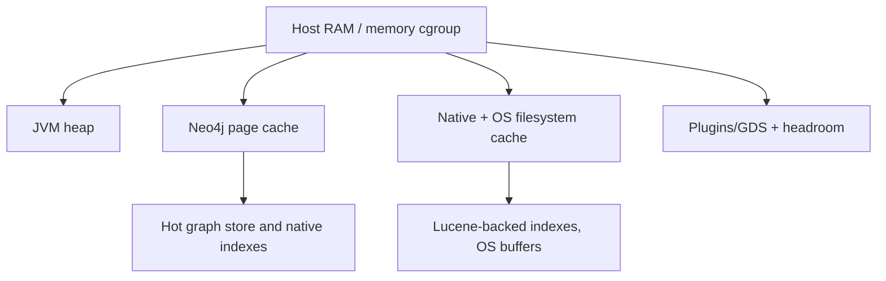
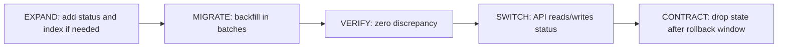

# Evaluating a Neo4j Model Across Correctness, Latency, Capacity, and Operability

## 1. A Capstone Is Not Done Just Because Cypher Runs

In a Neo4j project, modeling nodes and relationships and writing a few `MATCH` queries is only the **starting point**, not the bar for shipping a graph to production. A graph can return fast answers yet link orders to the wrong tenant's customer; it can hold accurate data yet exhaust heap under query load; or it can be well-tuned yet lack backups, observability, and recovery when an incident strikes.

This lesson belongs to the **Capstone Project** chapter of the `DATABASE_ENGINE_GRAPH_NEO4J` module. Building on property graphs, Cypher, indexes, constraints, data ingestion, Java Driver, Spring Data Neo4j, and operations, you will assemble an **evaluation framework for a graph data model** along four axes:

1. **Correctness:** entities, properties, relationships, constraints, and business outcomes are accurate.
2. **Latency:** critical queries meet P95/P99 latency and target throughput under a reproducible workload.
3. **Capacity:** storage, index, transaction log, RAM, and growth budgets are grounded in empirical sizing.
4. **Operability:** metrics, alerts, security, backup/restore, deployment playbooks, and fault handling are in place.

The core principle of this capstone: **never average out a fatal flaw with high scores elsewhere**. For example, a query returning the wrong order owner must be blocked even if its P99 is 3 ms. Conversely, a project with accurate data still must prove operators can observe, control, and recover the service.

### Learning Objectives

After this lesson, you will be able to:

- Build a sample graph with consistent business keys, properties, and relationships.
- Design an **oracle** and repeatable verification checks runnable after ingestion or migrations.
- Plan a benchmark with clear baselines, workloads, execution plans, percentiles, and test conditions.
- Derive storage and memory budgets from **measured samples** instead of arbitrary bytes-per-node rules of thumb.
- Design baseline operations for self-managed Neo4j or Aura-backed applications.
- Score results with an **evidence-backed rubric**, GO/NO-GO gates, and a residual-risk report.

> **Version scope:** Examples use standard Neo4j 5.x syntax, Java Driver 5.x/6.x, and concepts compatible with modern Spring Data Neo4j. Admin commands, editions, store formats, GDS, CDC, and backup mechanisms vary by release and deployment type. All P99 figures, footprints, and operational thresholds here are **illustrative learning assumptions**, not Neo4j guarantees or benchmarks.

## 2. What Is the Final Deliverable?

Assume your capstone designs a graph supporting three capabilities:

- Look up an **order** and the customer who placed it.
- View **purchase history** along with products and line items.
- Calculate **total amount and order counts per tenant**, reconcilable against source data.

The system includes a **Java/Spring application** connecting to Neo4j over Bolt and exposing an API. A graphical UI is optional; the focus is the **model and evaluation evidence**.



### 2.1. Acceptance Artifacts Checklist

| Group | Minimum artifact | Purpose |
| --- | --- | --- |
| Model | Node/relationship diagram, property dictionary, keys | Lets others understand and verify exact semantics |
| Data | Fixture seed script and expected output tables | Reproduces exact state on a test DB |
| Correctness | Cypher checks for keys, edges, tenants, totals | Proves zero data corruption |
| Schema | Constraint/index inventory and online state | Prevents duplicates, accelerates lookups |
| Performance | Query corpus, baselines, multi-run test results | Proves P95/P99 and throughput |
| Capacity | Node/edge/property counts, store/index sizes, growth forecast | Provisions sufficient disk, RAM, and headroom |
| Operations | Dashboards, alerts, backup/restore, runbooks | Controls incidents and changes |
| Decision | Scorecard, hard gates, approvers, residual risks | Auditable release decision |

**Never treat a pretty screenshot or a long `.cypher` script as acceptance proof.** Reviewers need to re-run measurements, reproduce numbers, and understand why the model passed or failed each gate.

## 3. Capstone Business Domain: Multi-Tenant Order Graph

To keep all examples consistent, we use three entity types:

```text
(:EvalCustomer {
  tenantId, customerId, name, active
})

(:EvalOrder {
  tenantId, orderId, state, totalCents
})

(:EvalProduct {
  tenantId, sku, title, priceCents
})

(EvalOrder)-[:PLACED_BY]->(EvalCustomer)
(EvalOrder)-[:CONTAINS {
  quantity, unitPriceCents
}]->(EvalProduct)
```

Intentional **conventions**:

- `PLACED_BY` points from the order to the customer who placed it.
- `CONTAINS` points from the order to the product and represents **one line item per order–product pair** in this example.
- `unitPriceCents` is the **locked price at order time**, distinct from `EvalProduct.priceCents` which can change in the catalog.
- `totalCents` is stored on the order for fast reads, yet must match the line-item sum under defined pricing rules.
- `tenantId` is part of the business key and must never be omitted when matching entities.

If a real-world order allows the same SKU on **multiple distinct lines** (promotions, batches, configurations), introduce an `OrderLine` node or a uniquely keyed `lineId` relationship with matching constraints. **`MERGE (order)-[:CONTAINS]->(product)` is not a universal model for every invoice domain.**

### 3.1. Graph Diagram



**Keys `o-100` and `p-01` are reused across tenants.** This intentionally tests whether importers, repositories, and queries handle composite keys properly.

### 3.2. Oracle — Ground Truth Known Ahead of Time

| Scope | Customer | Order | Product | `PLACED_BY` | `CONTAINS` | Total order amount |
| --- | ---: | ---: | ---: | ---: | ---: | ---: |
| Tenant `t-a` | 2 | 2 | 2 | 2 | 3 | 700000 cents |
| Tenant `t-b` | 1 | 1 | 1 | 1 | 1 | 99000 cents |
| **Total** | **3** | **3** | **3** | **3** | **4** | **799000 cents** |

The fixture totals **9 nodes and 7 relationships** in this model on a clean lab database. Small counts verify correctness; **never extrapolate production performance from a 9-node graph**.

## 4. Setting Up the Test Environment and Initial Schema

### 4.1. Data Isolation

Practice strictly on a dedicated lab Neo4j database or Testcontainers. Never run destructive or recovery demo queries against production.

- Pin Neo4j and Driver versions for an evaluation cycle.
- Record edition, config, deployment topology, and database name.
- Separate app read/write credentials from administrative accounts.
- Maintain a **repeatable clean fixture seed**.
- In clusters, record database allocations, routing behavior, and index states.

### 4.2. Constraints for the Three Composite Keys

```cypher
CREATE CONSTRAINT eval_customer_unique IF NOT EXISTS
FOR (c:EvalCustomer)
REQUIRE (c.tenantId, c.customerId) IS UNIQUE;

CREATE CONSTRAINT eval_order_unique IF NOT EXISTS
FOR (o:EvalOrder)
REQUIRE (o.tenantId, o.orderId) IS UNIQUE;

CREATE CONSTRAINT eval_product_unique IF NOT EXISTS
FOR (p:EvalProduct)
REQUIRE (p.tenantId, p.sku) IS UNIQUE;
```

These constraints enforce uniqueness across present key values and create corresponding backing indexes. **A uniqueness constraint does not automatically require every node to have all key properties.** Enforce existence/types using edition-supported constraints or ingestion validation and tests.

Verify schema state:

```cypher
SHOW CONSTRAINTS
YIELD name, type, labelsOrTypes, properties
RETURN name, type, labelsOrTypes, properties
ORDER BY name;
```

```cypher
SHOW INDEXES
YIELD name, type, state, labelsOrTypes, properties
RETURN name, type, state, labelsOrTypes, properties
ORDER BY name;
```

Do not add a redundant range index on the exact properties already backed by a unique constraint just to “speed up” the same lookup. Every index must justify its write and storage cost against real queries.

## 5. Seeding the Fixture with Repeatable Cypher

### 5.1. Customers

```cypher
UNWIND [
  {tenant:'t-a', id:'c-01', name:'An'},
  {tenant:'t-a', id:'c-02', name:'Bình'},
  {tenant:'t-b', id:'c-01', name:'Chi'}
] AS row
MERGE (c:EvalCustomer {
  tenantId:row.tenant,
  customerId:row.id
})
SET c.name = row.name,
    c.active = true;
```

### 5.2. Products

```cypher
UNWIND [
  {tenant:'t-a', sku:'p-01', title:'Keyboard', price:250000},
  {tenant:'t-a', sku:'p-02', title:'Mouse', price:150000},
  {tenant:'t-b', sku:'p-01', title:'Cable', price:99000}
] AS row
MERGE (p:EvalProduct {
  tenantId:row.tenant,
  sku:row.sku
})
SET p.title = row.title,
    p.priceCents = row.price;
```

### 5.3. Orders

```cypher
UNWIND [
  {tenant:'t-a', id:'o-100', state:'PAID', total:400000},
  {tenant:'t-a', id:'o-101', state:'CREATED', total:300000},
  {tenant:'t-b', id:'o-100', state:'PAID', total:99000}
] AS row
MERGE (o:EvalOrder {
  tenantId:row.tenant,
  orderId:row.id
})
SET o.state = row.state,
    o.totalCents = row.total;
```

### 5.4. Who Placed Each Order?

```cypher
UNWIND [
  {tenant:'t-a', order:'o-100', customer:'c-01'},
  {tenant:'t-a', order:'o-101', customer:'c-02'},
  {tenant:'t-b', order:'o-100', customer:'c-01'}
] AS row
MATCH (o:EvalOrder {
  tenantId:row.tenant,
  orderId:row.order
})
MATCH (c:EvalCustomer {
  tenantId:row.tenant,
  customerId:row.customer
})
MERGE (o)-[:PLACED_BY]->(c);
```

### 5.5. Order Line Items

```cypher
UNWIND [
  {tenant:'t-a', order:'o-100', sku:'p-01', qty:1, price:250000},
  {tenant:'t-a', order:'o-100', sku:'p-02', qty:1, price:150000},
  {tenant:'t-a', order:'o-101', sku:'p-02', qty:2, price:150000},
  {tenant:'t-b', order:'o-100', sku:'p-01', qty:1, price:99000}
] AS row
MATCH (o:EvalOrder {
  tenantId:row.tenant,
  orderId:row.order
})
MATCH (p:EvalProduct {
  tenantId:row.tenant,
  sku:row.sku
})
MERGE (o)-[line:CONTAINS]->(p)
SET line.quantity = row.qty,
    line.unitPriceCents = row.price;
```

**Repeatability:** re-running these five blocks sequentially creates no duplicate nodes or relationships for matching keys and endpoint pairs. Never assume `MERGE` alone guarantees global relationship uniqueness under concurrent multi-writer workloads; real systems need locking/constraint protocols and versioned business keys.

## 6. Axis 1 — Evaluating Entity-Level Correctness

### 6.1. Count by Tenant, Not Just Global Totals

```cypher
MATCH (c:EvalCustomer)
RETURN c.tenantId AS tenantId, count(c) AS customers
ORDER BY tenantId;
```

```cypher
MATCH (o:EvalOrder)
RETURN o.tenantId AS tenantId,
       count(o) AS orders,
       sum(o.totalCents) AS totalCents
ORDER BY tenantId;
```

```cypher
MATCH (p:EvalProduct)
RETURN p.tenantId AS tenantId, count(p) AS products
ORDER BY tenantId;
```

Compare against the **oracle table in section 3**. If the total of three orders matches while one order landed in the wrong tenant, a database-wide total misses the bug. Always include **`tenantId` in grouping keys**, alongside date/status buckets on larger datasets.

### 6.2. Finding Missing Keys or Invalid Values

```cypher
MATCH (o:EvalOrder)
WHERE o.tenantId IS NULL
   OR o.orderId IS NULL
   OR o.totalCents IS NULL
   OR o.totalCents < 0
RETURN o.tenantId AS tenantId,
       o.orderId AS orderId,
       o.totalCents AS totalCents;
```

**Expected:** 0 rows. When source data has mixed types, `o.totalCents < 0` alone might miss string-typed numbers. Add **property type checks** supported by your version (or Java/staging validation) prior to arithmetic checks.

### 6.3. Checking for Duplicate Business Keys

```cypher
MATCH (o:EvalOrder)
WITH o.tenantId AS tenantId,
     o.orderId AS orderId,
     count(*) AS occurrences
WHERE occurrences > 1
RETURN tenantId, orderId, occurrences;
```

With active constraints on the lab, this must return 0 rows. Still check for **missing** `tenantId`/`orderId` properties, since uniqueness and existence are distinct policies.

### 6.4. Reconciling Source and Target by Business Key

When migrating or syncing data from a source system into Neo4j:

1. Normalize source keys `(tenantId, orderId)` per the approved contract.
2. Find **missing keys**: present in source, absent in target.
3. Find **unexpected keys**: extra in target, absent in source.
4. For matched keys, compare business-significant properties and data types.
5. Reconcile **relationship endpoints** by business key—never rely on `id(n)` or `elementId(n)` as durable keys across migrations.

If source and target receive concurrent writes, enforce a **writer freeze, consistent snapshot, or reliable CDC watermark**. Comparing across unaligned timestamps creates false diffs. Neo4j defaults to read-committed isolation; multiple `MATCH` queries in one Session do not automatically read a single frozen snapshot.

## 7. Axis 1 — Auditing Graph Topology and Relationship Integrity

### 7.1. Each Order Must Link to Exactly One Same-Tenant Customer

```cypher
MATCH (o:EvalOrder)
OPTIONAL MATCH (o)-[r:PLACED_BY]->(destination)
WITH o,
     count(r) AS outgoingEdges,
     sum(CASE
           WHEN destination:EvalCustomer
            AND destination.tenantId = o.tenantId
           THEN 1 ELSE 0 END) AS validEdges
WHERE outgoingEdges <> 1 OR validEdges <> 1
RETURN o.tenantId AS tenantId,
       o.orderId AS orderId,
       outgoingEdges,
       validEdges
ORDER BY tenantId, orderId;
```

**Expected:** 0 rows. `OPTIONAL MATCH` ensures unlinked orders are caught. Checking **every outgoing `PLACED_BY`** also catches parallel edges from one order.

### 7.2. Detecting Reversed Edges

```cypher
MATCH (c:EvalCustomer)-[r:PLACED_BY]->(o:EvalOrder)
RETURN c.tenantId AS customerTenant,
       c.customerId AS customerId,
       o.orderId AS orderId
LIMIT 100;
```

**Expected:** 0 rows. Every Neo4j relationship physically links two existing nodes; a “dangling edge” during ingestion usually means the importer **skipped creating the edge** or **linked the wrong node**, not that the database stored a one-ended relationship.

### 7.3. Confirm `CONTAINS` Never Links Across Tenants

```cypher
MATCH (o:EvalOrder)-[line:CONTAINS]->(destination)
WHERE NOT destination:EvalProduct
   OR destination.tenantId IS NULL
   OR destination.tenantId <> o.tenantId
RETURN o.tenantId AS orderTenant,
       o.orderId AS orderId,
       labels(destination) AS destinationLabels,
       destination.tenantId AS destinationTenant;
```

**Expected:** 0 rows. If an importer linked `t-a/o-100` to `t-b/p-01` by matching only on `sku`, that is a **critical data integrity failure** even though the edge is structurally valid in Neo4j.

### 7.4. Prevent Duplicate Lines on the Same Order–Product Pair

In this simplified model, each order–product pair may have at most **one** `CONTAINS` edge. Verify:

```cypher
MATCH (o:EvalOrder)-[line:CONTAINS]->(p:EvalProduct)
WITH o, p, count(line) AS multiplicity
WHERE multiplicity > 1
RETURN o.tenantId AS tenantId,
       o.orderId AS orderId,
       p.sku AS sku,
       multiplicity;
```

**Expected:** 0 rows. When real business rules allow multiple lines per SKU, use `lineId` and a proper line-item model rather than flagging all parallel edges as errors.

### 7.5. Reconciling Order Totals from Line Items

```cypher
MATCH (o:EvalOrder)
OPTIONAL MATCH (o)-[line:CONTAINS]->(product)
WITH o,
     count(line) AS lineCount,
     coalesce(sum(CASE
       WHEN line IS NULL THEN 0
       ELSE line.quantity * line.unitPriceCents END), 0)
       AS calculatedCents
WHERE lineCount = 0 OR calculatedCents <> o.totalCents
RETURN o.tenantId AS tenantId,
       o.orderId AS orderId,
       o.totalCents AS storedCents,
       calculatedCents,
       lineCount;
```

**Expected:** 0 rows. This query assumes `quantity` and `unitPriceCents` are valid integers. Validate **their presence and bounds separately** so `sum()` does not silently skip nulls and mask bugs:

```cypher
MATCH (o:EvalOrder)-[line:CONTAINS]->(p)
WHERE NOT p:EvalProduct
   OR line.quantity IS NULL
   OR line.unitPriceCents IS NULL
   OR line.quantity <= 0
   OR line.unitPriceCents < 0
RETURN o.tenantId AS tenantId,
       o.orderId AS orderId,
       line.quantity AS quantity,
       line.unitPriceCents AS unitPriceCents;
```

Representing money as **integer cents** avoids floating-point rounding drift. If real domains include taxes, discounts, shipping, currencies, or FX rates, encode those terms explicitly in the invariant instead of assuming `sum(quantity × unitPrice)` always equals total.

## 8. Axis 1 — Verifying Business Query Outputs

Validate these queries using **assertions on exact expected values**, not merely “did not throw.”

### 8.1. Order Lookup by Composite Key

```cypher
MATCH (o:EvalOrder {
  tenantId:$tenantId,
  orderId:$orderId
})
      -[:PLACED_BY]->
      (c:EvalCustomer)
RETURN o.orderId AS orderId,
       o.state AS state,
       o.totalCents AS totalCents,
       c.customerId AS customerId,
       c.name AS customerName;
```

Parameters `$tenantId = 't-a'` and `$orderId = 'o-100'` must return customer `c-01/An` and `400000`. Same `orderId` with `$tenantId = 't-b'` must return `c-01/Chi` and `99000`.

### 8.2. Customer Order History

```cypher
MATCH (c:EvalCustomer {
  tenantId:$tenantId,
  customerId:$customerId
})
      <-[:PLACED_BY]-
      (o:EvalOrder)
RETURN o.orderId AS orderId,
       o.state AS state,
       o.totalCents AS totalCents
ORDER BY orderId
LIMIT $limit;
```

**Expected:** on the fixture, `t-a/c-01` has one order `o-100`. `LIMIT` caps returned rows yet does not guarantee expensive sorts/filters upstream are optimized just because a trailing limit exists.

### 8.3. Order Line Details

```cypher
MATCH (o:EvalOrder {
  tenantId:$tenantId,
  orderId:$orderId
})
      -[line:CONTAINS]->
      (p:EvalProduct)
RETURN p.sku AS sku,
       p.title AS title,
       line.quantity AS quantity,
       line.unitPriceCents AS unitPriceCents
ORDER BY sku;
```

For `t-a/o-100`, expect two rows: `p-01` qty 1 at 250000, and `p-02` qty 1 at 150000. This tests **relationships and relationship properties**, not just nodes.

### 8.4. Additional Invariants for Production Systems

- Order `state` belongs to an allowed enum with valid state transitions.
- An order cannot belong to two customers unless the domain permits it.
- Tenant isolation is enforced in both **API authorization** and Cypher.
- Deletion policies for customers/products with existing orders are explicit; `DETACH DELETE` is rarely a safe default.
- Order-creation transactions spanning lines and edges are **atomic**.
- Java Driver retries never duplicate orders or charges; enforce idempotency keys and constraints.

## 9. Correctness Under Transactions and Concurrent Writes

A project can pass single-threaded imports yet fail under two concurrent requests.

### 9.1. Atomicity

Creating an order must create the order, `PLACED_BY`, and all `CONTAINS` edges inside **one transaction**. If validation fails on the third line item, zero uncommitted nodes or edges from that transaction may persist.

Test steps:

1. Write a new order and one line inside an explicit/managed transaction.
2. Intentionally throw an exception prior to commit.
3. Open a **new Session** after failure and verify the order/edges do not exist.
4. Repeat the valid flow and confirm everything commits together.

### 9.2. Preventing Lost Updates

If tracking an order counter on a customer, two concurrent requests must never do:

```text
READ oldCount = 10
CALCULATE newCount = 11 in Java
SET customer.orderCount = 11
```

because both read 10 and overwrite 11. Even an in-place property update:

```cypher
MATCH (c:EvalCustomer {
  tenantId:$tenantId,
  customerId:$customerId
})
SET c.orderCount = coalesce(c.orderCount, 0) + 1;
```

must be tested for your server version, query shape, and contention behavior. Complex read–compute–write logic or multi-node invariants may require explicit locking/concurrency protocols; **read committed is not serializable**.

### 9.3. Retries and Idempotency

Managed transactions via `session.executeWrite(...)` may retry callbacks on eligible transient errors. Callbacks **must never** send emails or invoke non-idempotent payment APIs, because external side effects do not roll back with Neo4j transactions.

A tenant-scoped stable `orderId`, uniqueness constraints, and payload comparison on replays underpin an idempotent API. Expected test behavior: retrying the **exact same business request** creates no duplicate order; reusing an ID with different data raises a conflict.

## 10. Axis 2 — Defining a Workload Before Measuring Latency

Latency is not an inherent constant of “Neo4j” alone: it depends on **queries, data shape, hardware, indexes, concurrency, page cache, and network**.

### 10.1. An Illustrative Workload

| Operation | Request share | Load pattern | Correctness check |
| --- | ---: | --- | --- |
| Look up order by `tenantId/orderId` | 45% | Point lookup | Returns right customer and total |
| Order history by customer | 30% | Relationship traversal | Tenant-isolated, paginated |
| Line details per order | 15% | Traversal + edge properties | Accurate products, quantities, prices |
| Create new order / lines | 10% | Write transaction | Atomic, idempotent, zero duplicates |

Shares are **illustrative exercise assumptions**, not a universal e-commerce benchmark. In real projects, analyze **production logs/traffic** to model query mixes, selectivity, parameter skew, and peak bursts.

### 10.2. Variables That Must Remain Comparable

- Identical node counts, relationship counts, degree/supernode skew, and property sizes.
- Identical relevant schema/constraints/indexes, with indexes `ONLINE`.
- Identical query text, parameter distributions, and result payload sizes.
- Equivalent CPU, RAM, page cache, storage IOPS, and network conditions.
- Identical client counts, concurrency, arrival rates, warm-up, and test duration.
- No unaligned background backups, imports, or index builds running on one side only.

**Comparing P99 across mismatched workloads yields false conclusions.** When target hardware intentionally differs, document it and frame results as an **end-to-end system comparison** rather than attributing the entire delta to Neo4j version differences.

## 11. `EXPLAIN` and `PROFILE` to Verify Index Design

### 11.1. Inspecting the Plan Without Executing

```cypher
EXPLAIN
MATCH (o:EvalOrder {
  tenantId:$tenantId,
  orderId:$orderId
})
RETURN o.state AS state,
       o.totalCents AS totalCents;
```

Backed by the composite uniqueness constraint, point lookups start selectively. Look for operators like **NodeIndexSeek/UniqueIndexSeek** (depending on runtime/version), estimated rows, and filters.

### 11.2. Profiling Execution Safely

```cypher
PROFILE
MATCH (o:EvalOrder {
  tenantId:$tenantId,
  orderId:$orderId
})
RETURN o.state AS state,
       o.totalCents AS totalCents;
```

Signals to inspect:

| Signal | What to look for |
| --- | --- |
| `Rows` | Does intermediate cardinality explode unexpectedly? |
| `DB Hits` | Store/index access count per operator |
| Index seek vs. scan | Is the right index actually used? |
| Expand / traversal | Are traversals generating excessive intermediate rows? |
| Memory / timing | Are large sorts, aggregations, or materializations occurring? |
| Result size | Is the client pulling too many records? |

`PROFILE` **executes the query**. Never run `PROFILE DELETE` or write migrations in production just to “inspect the plan.” Use `EXPLAIN` for non-executing plans, or test in rolled-back lab transactions.

### 11.3. Order Details Query

```cypher
PROFILE
MATCH (o:EvalOrder {
  tenantId:$tenantId,
  orderId:$orderId
})
      -[line:CONTAINS]->
      (p:EvalProduct)
RETURN p.sku AS sku,
       line.quantity AS quantity
ORDER BY sku;
```

Anchoring on the order by business key before expanding one hop works well here. Orders with millions of lines or massive supernodes still require load bounds, cardinality checks, and possibly alternative models or pagination.

## 12. Percentiles, Throughput, and Pass/Fail Criteria

### 12.1. Never Rely Solely on Average Latency

Suppose 950 of 1,000 requests take under 40 ms while 50 take nearly 2 seconds. Averages hide serious tail slowness caused by GC pauses, lock contention, or page cache misses.

- **P50:** median; typical experience.
- **P95:** 95% of observations fall at or below this threshold per calculation method.
- **P99:** highlights tail latency critical to SLO compliance.
- **Throughput:** successful requests/transactions completed per unit time.
- **Error rate:** fraction of failures, including timeouts, exhausted retries, and data errors.

Every percentile must be tied to **sample size, measurement window, query class, load level, and cache state**. Never report `P99 = 20 ms` from ten calls.

### 12.2. Illustrative Results Table

| Endpoint | Assumed target | Post-tuning run (assumed) | Verdict |
| --- | ---: | ---: | --- |
| Order lookup P95 | ≤ 50 ms | 42 ms | Pass |
| Customer history P99 | ≤ 180 ms | 160 ms | Pass |
| Order lines P99 | ≤ 220 ms | 275 ms | **Fail** |
| Write success rate | ≥ 99.9% | 99.95% | Meets metric |
| Data correctness | 0 critical defects | 0 | Passes executed suite |

All numbers are **synthetic examples** illustrating evaluation logic. When `Order lines` misses its P99 gate, the overall verdict cannot be GO merely because three other rows passed.

### 12.3. Benchmarking Method

1. Seed a dataset scaled and skewed like production.
2. Wait for all required indexes to reach `ONLINE`; record Neo4j, Driver, and config versions.
3. Warm up JIT and page cache; capture cold-start runs separately when needed.
4. Run steady-state load at fixed concurrency/rate over an adequate window.
5. Run burst tests to observe pool acquisition, CPU throttling, locks, and I/O.
6. Repeat runs and report median plus variance—never cherry-pick the fastest single run.
7. For write workloads, use **isolated datasets/IDs**, controlled resets, and post-run reconciliation.
8. Keep **error reports intact**—never strip timeouts from samples to publish prettier success-only percentiles.

If slowness stems from cold caches, fix **warm-up and working-set sizing**, not just query plans. If slowness comes from exploding paths, enlarging the connection pool usually increases database pressure.

## 13. Java Driver: Measuring the Actual Application Use Cases

An API spends time across multiple layers:

```text
Client → HTTP gateway → Java service
       → Driver pool acquisition
       → Bolt network → Cypher execution
       → Result fetch/serialization → HTTP response
```

**Never rely on `PROFILE` alone to declare an end-to-end API meets its SLO.** It excludes pool waits, network RTT, JSON mapping, and retries.

### 13.1. Repository Projection Example

```java
import java.util.Map;
import java.util.Optional;
import org.neo4j.driver.Driver;
import org.neo4j.driver.SessionConfig;

public final class OrderQueryRepository {
    private final Driver driver;

    public OrderQueryRepository(Driver driver) {
        this.driver = driver;
    }

    public record OrderSummary(
        String orderId,
        String state,
        long totalCents,
        String customerId
    ) {}

    public Optional<OrderSummary> findByBusinessKey(
            String tenantId, String orderId) {
        try (var session = driver.session(
                SessionConfig.forDatabase("neo4j"))) {
            return session.executeRead(tx -> {
                var result = tx.run("""
                    MATCH (o:EvalOrder {
                      tenantId:$tenantId,
                      orderId:$orderId
                    })
                          -[:PLACED_BY]->
                          (c:EvalCustomer)
                    RETURN o.orderId AS orderId,
                           o.state AS state,
                           o.totalCents AS totalCents,
                           c.customerId AS customerId
                    """, Map.of(
                        "tenantId", tenantId,
                        "orderId", orderId
                    ));

                if (!result.hasNext()) {
                    return Optional.empty();
                }
                var row = result.next();
                return Optional.of(new OrderSummary(
                    row.get("orderId").asString(),
                    row.get("state").asString(),
                    row.get("totalCents").asLong(),
                    row.get("customerId").asString()
                ));
            });
        }
    }
}
```

Notes:

- Manage `Driver` as a long-lived shared resource, never instantiated per request.
- Keep `Session` short-lived and **never share across threads**.
- `executeRead` manages read transactions per Driver semantics, retrying eligible transient faults.
- Pass all inputs via **parameters**, never string concatenation.
- Return **DTOs/records**, never internal Driver entities over HTTP.
- In production, handle **invariant violations**: if a query returns multiple rows when business rules mandate one customer, fail loudly rather than silently picking the first row.
- Enforce **actor tenant authorization** prior to lookups; a client-supplied `tenantId` predicate never substitutes for authorization.

### 13.2. Essential Integration Tests

With JUnit 5 + Neo4j Testcontainers:

1. Reading `t-a/o-100` returns `An` and `400000`.
2. Reading `t-b/o-100` returns `Chi` and `99000`.
3. Non-existent IDs return `Optional.empty()`.
4. Fixtures injected with cross-tenant edges are caught by **data quality tests**.
5. Mid-transaction failures roll back both nodes and edges.
6. Retrying order creation with the same idempotency key creates zero duplicates.
7. Concurrent threads neither violate invariants nor leak/hang Sessions.

When using **Spring Data Neo4j**, run equivalent tests covering entity mapping and `@Transactional` boundaries. Never treat mocked repository unit tests as proof of Neo4j Cypher, constraint, or transaction correctness.

## 14. Axis 3 — Measurement-Based Capacity Evaluation

No single fixed bytes-per-node or bytes-per-relationship number holds across all Neo4j deployments. Footprint depends on:

- Version, edition, and **store format**.
- Node counts, relationship counts, and degree/supernode distributions.
- Property counts, types, and sizes on **both nodes and relationships**.
- Schema indexes and index payloads: range, lookup, text, full-text, vector, etc.
- Transaction logs, checkpoints, retention, and write rates.
- Store reuse from deletes/updates, backups, and upgrade operations.

### 14.1. Inventorying Logical Graph Size

```cypher
MATCH (n:EvalOrder)
RETURN count(n) AS orders,
       avg(size(keys(n))) AS avgProperties,
       max(size(keys(n))) AS maxProperties;
```

```cypher
MATCH ()-[r:CONTAINS]->()
RETURN count(r) AS orderLines,
       avg(size(keys(r))) AS avgPropertiesOnLine;
```

```cypher
MATCH (o:EvalOrder)
OPTIONAL MATCH (o)-[r:CONTAINS]->()
RETURN o.tenantId AS tenantId,
       count(r) AS lineCount
ORDER BY lineCount DESC
LIMIT 20;
```

Full-graph inventory queries can be expensive at scale; run them on staging copies or controlled samples. A top-20-by-degree query may still scan and sort many nodes before applying `LIMIT`, so it is not automatically cheap.

### 14.2. Property-Value Count Is Not Byte Count

Given:

\[
N=1,000,000,\quad R=4,000,000,\quad
p_N=5,\quad p_R=2
\]

the estimated property-value count is:

\[
P \approx Np_N+Rp_R
 = 1,000,000\times5+4,000,000\times2
 = 13,000,000
\]

**13 million** property values does not mean 13 MB. Booleans, integers, long UTF-8 strings, arrays, and vector embeddings vary drastically in storage size, layout, and index overhead.

### 14.3. Measure a Sample, Then Extrapolate

Suppose a **representative test sample** with all indexes online reports separate data and index sizes:

| Metric | Hypothetical sample | Target |
| --- | ---: | ---: |
| Nodes | 100,000 | 1,000,000 |
| Relationships | 400,000 | 4,000,000 |
| Data store files | 0.60 GiB | Extrapolate |
| Index files | 0.18 GiB | Extrapolate |
| Store format / property / index schema | Identical to target | Assumed constant |

Scale factor `k = 10`. Rough extrapolation:

\[
D_{\mathrm{data+index}}
\approx (0.60+0.18)\times10
=7.8\ \mathrm{GiB}
\]

Adding a 30% headroom buffer for data/indexes:

\[
D_{\mathrm{planned}}
=7.8\times1.30
=10.14\ \mathrm{GiB}
\]

Adding **3 GiB for transaction logs** and **6 GiB for operational scratch space**, the minimum budget **for those listed items** is:

\[
10.14+3+6=19.14\ \mathrm{GiB}
\]

**All sizes in this example are synthetic exercise numbers**, excluding OS/DBMS binaries, extra databases, backups/dumps, cluster replicas, and schema drift. Never provision a real production volume at `19.14 GiB` from this example.

### 14.4. Why Linear Scaling Often Fails

- `R/N` shifts if orders accumulate more line items.
- Product catalogs gain long descriptions or embeddings.
- New queries require additional indexes.
- Certain customers grow into supernodes with huge order counts.
- Higher write rates bloat transaction logs even when node count grows slowly.
- Newer releases change store formats or index providers.
- Heavily updated/deleted stores fragment differently than single-pass bulk loads.

Therefore, model **at least three scenarios (low / base / high)**, measure at two sample scales, and state error margins.

## 15. Axis 3 — Sizing RAM, CPU, and I/O from the Working Set

### 15.1. Do Not Equate RAM with On-Disk Database Size

Neo4j allocates **JVM heap**, **Neo4j page cache**, off-heap/OS filesystem cache, and auxiliary regions. GDS or vector/full-text search increases memory demands well beyond simple node-count math.



Illustrative memory split inside a **32 GiB memory limit**:

| Component | Illustrative budget |
| --- | ---: |
| Heap max | 8 GiB |
| Page cache | 12 GiB |
| Native / OS / file cache and other overhead | 8 GiB |
| Uncommitted headroom | 4 GiB |
| **Total** | **32 GiB** |

Example config:

```properties
server.memory.heap.initial_size=8g
server.memory.heap.max_size=8g
server.memory.pagecache.size=12g
```

This is **not** a universal recommendation. In containers, total cgroup memory must stay within `limits.memory`; never crank heap up to cure `OOMKilled` while starving page cache and native/OS memory. Self-managed Neo4j offers a starting-point estimator:

```bash
neo4j-admin server memory-recommendation --memory=32g
```

Its output is a **heuristic** only—tune after real load tests. On Aura, many settings are service-managed, so evaluate against tier limits and provided metrics.

### 15.2. CPU and I/O

Two systems holding the same 1 TiB of storage can perform vastly differently due to:

- Random reads when traversals hit page cache misses.
- Checkpoints and transaction logs competing for I/O with online queries.
- Index rebuilds or bulk imports saturating writes.
- Container CPU throttling lengthening lock/connection hold times.
- GC pauses or lock contention stretching P99 tail latency.

A capacity review must capture **CPU saturation, disk latency, IOPS/throughput, free space, page cache faults/hit ratios, and checkpoint durations**. Total GiB of disk never proves infrastructure adequacy on its own.

### 15.3. Capacity for Clusters and Backups

If one database runs across three cluster members and each needs ~20 GiB of active store data, infrastructure needs nearly **60 GiB just for those three copies**, before backups, OS, and other databases. Different servers can host different database/role allocations; build a **database × server × role** matrix instead of naively multiplying node counts by server counts.

Backups and restore staging require **separate storage budgets**. HA replicas provide availability, not a historical restore point after an accidental delete commits.

## 16. Axis 4 — Operability: Spotting Failures Before Users Report Them

A project with only `docker run neo4j` and a working endpoint will struggle in ongoing operations. Prove:

1. **Observability:** on-call engineers see database health, queries, transactions, resources, and connections.
2. **Alerting:** teams know when to act before disks fill, writes stall, or P99 breaches SLOs.
3. **Recovery:** consistent backups, tested restores, and plans to restore app permissions and connectivity.
4. **Change safety:** release, migration, rollback, and forward-fix playbooks exist.
5. **Security:** only authorized actors read tenant data; credentials never leak.

### 16.1. Minimum Dashboard

| Metric group | What to watch | Signals requiring investigation |
| --- | --- | --- |
| Database availability | DB online status, roles/routing, restarts | Lost write capability or repeated restarts |
| Latency | API/transaction P95/P99 per use case | Post-release regressions, peak-hour spikes |
| Errors | Timeouts, transient retries, query/schema errors | Retry storms, app bugs, deadlocks |
| Driver | Pool acquisition, active/waiting if instrumented | Growing connection queues, request backlogs |
| JVM | Heap occupancy, GC pauses, OOMs | Oversized queries/txs, memory pressure |
| Page cache | Hit ratio, faults, warm-up | Working set exceeds RAM or wide scans |
| Storage | Free space, I/O latency, log growth | Volume filling up, slow checkpoints |
| Schema | Index states, constraint presence | Index stuck POPULATING, queries falling back to scans |
| Backups | Timestamp of last usable backup, job failures | RPO breached, no valid recovery point |
| Security | Auth failures, privilege anomalies, audit changes | Misconfiguration or unauthorized access |

**Never pick arbitrary alert thresholds from a textbook number.** Base thresholds on SLOs and empirical trends. Even a high page cache hit ratio does not guarantee fast queries if a query generates excessive intermediate rows.

### 16.2. Traceable Logging

Log:

- Request ID, correlation ID, and operation name.
- Tenant/business keys only at policy-approved safety levels.
- Neo4j server/Driver versions, database name, and release version.
- Error category, timestamp, and transaction/retry status.
- Backup/restore timestamps, migrations, and schema changes.

**Never log passwords, access tokens, card numbers, PII properties, or raw Cypher containing sensitive literals** just for easier debugging.

## 17. Backups, Restores, and RPO/RTO Targets

### 17.1. A Backup Is Not a Replica

On self-managed Neo4j Enterprise, use version-supported **online database backups**. In offline environments, `neo4j-admin database dump/load` archives and restores stores, yet cannot replace online backups when zero downtime is required. Storage snapshots require consistency guarantees and restore tests. On Aura, follow the backup/restore features provided by your tier.

**Cluster replicas do not replace historical backups:** an accidental committed delete replicates across every replica. In a serious capstone, never check “has 3 replicas” and claim disaster recovery is solved.

### 17.2. Restore Rehearsal

Recovery drill procedure in an **isolated environment**:

1. Pick the backup/dump and record metadata: version, database, timestamp, chain.
2. Provision adequate storage, RAM, and credentials—never test over production.
3. Restore/load using the edition- and version-appropriate tool.
4. Verify store consistency and confirm the database comes online.
5. Re-run the **9-node / 7-relationship** checks on fixtures, or full reconciliation against source watermarks in production.
6. Verify indexes/constraints, users/roles/grants, TLS, and Java Driver/SDN connectivity.
7. Run controlled read/write smoke tests.
8. Record end time; compare elapsed time against **RTO** and restored data point against **RPO**.

Never treat a zero backup exit code as proof a restore will succeed. If backups exclude configs, secrets, plugins, or RBAC metadata, document separate recovery steps for them.

### 17.3. Illustrative Targets Table

| Target | Example business requirement | Required evidence |
| --- | --- | --- |
| RPO | At most 15 minutes of data loss | Usable backup point and restore verified to that point |
| RTO | Service restored within 60 minutes | End-to-end drill timing at comparable scale |
| Backup retention | Retained for required policy days | Artifact catalog and access controls |
| DR failure domain | Copy stored in independent region | Verified location and immutability policy |
| Schema & security | App connects with exact permissions | Restore smoke test under real service account |

Figures like 15/60 minutes are assumptions, not automatic Neo4j guarantees. Restoring a multi-terabyte database—log replay, index rebuilds, and cutover—can take longer; only **real drills** verify RTO.

## 18. Security and Tenant Isolation Are Hard Gates

A multi-tenant graph sharing one database requires:

- **Authentication** and **authorization** in the application.
- Explicit `tenantId` constraints in every query and traversed edge.
- Neo4j user/role privileges matching edition capabilities and design.
- Protections against unbounded result sets or leaked internal IDs.
- Secrets management, TLS, and network boundaries.
- Retention, audit, and safe edit/delete policies for sensitive records.

### 18.1. Catching Queries Missing Tenant Scope

Dangerous query:

```cypher
MATCH (o:EvalOrder {orderId:$orderId})
RETURN o;
```

Because `o-100` exists in both tenants, this can return orders across tenants. Correct variant here:

```cypher
MATCH (o:EvalOrder {
  tenantId:$authorizedTenantId,
  orderId:$orderId
})
RETURN o.orderId AS orderId,
       o.state AS state,
       o.totalCents AS totalCents;
```

`$authorizedTenantId` must come from a **verified authentication context**, never trusting an arbitrary client-supplied tenant string. Query filtering is one defense layer and **never replaces application-layer authorization**.

### 18.2. Do Not Expect One Constraint to Solve All Security

Uniqueness constraints stop duplicate keys, yet they do not:

- Block an unauthorized actor from reading another tenant.
- Protect queries against oversized input payloads.
- Replace TLS or secrets management.
- Govern who may delete relationships or alter amounts.
- Prevent an unbounded traversal from causing denial of service.

Therefore, **security gates** carry the same hard-stop weight as correctness in production sign-off.

## 19. Failure Testing and Deployment Safety

### 19.1. Scenarios to Rehearse

| Scenario | Operational expectation |
| --- | --- |
| Neo4j temporarily unreachable | API returns bounded errors rather than hanging requests indefinitely |
| Connection pool exhausted | Enforces timeouts/backpressure without retry storms |
| Batch import fails mid-way | Transaction rolls back; checkpoints allow safe resume |
| Two requests create same order | No duplicate business keys; idempotent handling |
| Index missing or not ONLINE | Release/query gate blocks dependent traffic |
| Cold page cache after restart | Monitors warm-up and tail latency |
| Disk approaching full | Alerts before threshold; never delete logs manually |
| Cluster member failure (if HA) | Verifies DB availability/quorum, routing, and recovery |
| Backup job fails | Alerts on backup freshness / RPO risk |
| New app writes incompatible data | Halts rollout; evaluates forward-fix vs. restore |

Destructive drills (stopping DBs, losing volumes, injecting deadlocks, overwrite restores) run **strictly in authorized staging/labs** with recovery plans, never in production.

### 19.2. Expand → Migrate → Switch → Contract

When renaming `EvalOrder.state` to `status`:



During transition, older binaries may still expect `state`. Rolling back an app image **does not restore** deleted properties, and a store-format upgrade may block running older binaries. Rollback plans must separate **app/config rollback** from **data forward-fix or restore**.

### 19.3. Deployment Gate

Before opening full production traffic:

1. Correctness tests pass with zero hard errors.
2. Indexes, constraints, and schema match spec and are online.
3. Critical queries/endpoints meet P95/P99, throughput, and error budgets.
4. Memory, disk, connections, and logs hold approved headroom.
5. Backup/restore is verified and rollback playbooks are clear.
6. Monitoring, alerts, and on-call owners are active during observation.

## 20. Capstone Grading Rubric

This rubric is a **suggested scoring guide** for instructors or internal review boards, not an official Neo4j standard.

| Axis | Max points | Mandatory evidence |
| --- | ---: | --- |
| **Correctness** | **40** | Schema, fixtures, oracle, tenant/key checks, edges, invariants, transactions |
| **Latency** | **25** | Execution plans, workloads, P95/P99, throughput, errors, multi-run benchmarks |
| **Capacity** | **15** | N/R/property inventory, store/index sizing, growth/headroom, RAM/disk budget |
| **Operability** | **20** | Alerts, backup/restore drills, security, runbooks, failure tests |
| **Total** | **100** | **Evidence-backed scorecard** |

### 20.1. Sub-Score Breakdown

**Correctness — 40 points**

- 10: keys/labels/types, edge directions, and multiplicities clearly specified.
- 10: constraints and validation verified.
- 10: business queries and invariants produce accurate results.
- 10: atomicity, idempotency, tenant isolation, and concurrency tests pass.

**Latency — 25 points**

- 5: reproducible workload, dataset, and parameter distributions.
- 5: `EXPLAIN`/`PROFILE` and indexes analyzed.
- 10: P95/P99, throughput, and errors measured across multiple sufficient runs.
- 5: bottlenecks, regressions, and tuning trade-offs explained.

**Capacity — 15 points**

- 5: N/R/property/index inventory and growth drivers documented.
- 5: sample measurements and extrapolation include error margins/headroom.
- 5: RAM/page cache, disk/logs, and backup/cluster storage balanced.

**Operability — 20 points**

- 5: dashboards and alerts have clear owners.
- 5: backups and restore drills tied to RPO/RTO.
- 5: security, config/secrets, deployment and rollback runbooks.
- 5: failure modes, recovery, and post-release monitoring tested.

### 20.2. Hard Disqualifying Gates

Even with a high total score, a project is **NO-GO for production** if:

- Cross-tenant data or unauthorized reads exist.
- Critical nodes, edges, or transactions are lost, totals miscalculate, or atomicity fails.
- Key constraints or business keys are violated.
- A critical endpoint breaches mandatory SLO thresholds unresolved.
- No credible recovery path exists for hard-to-reverse changes.
- Connectivity, operations, or recovery cannot be demonstrated under key failure modes.

Lock all gates **before scoring**, with clear owners and severities. Never lower thresholds after viewing results just to “force a pass.”

## 21. Reusable Scorecard Template

```yaml
evaluation:
  projectId: neo4j-order-graph-capstone
  runId: evaluation-001
  environment: staging
  neo4jVersion: "record-actual-version"
  dataset:
    modelVersion: v1
    sourceCutoff: "record-verified-watermark"
    customerCount: 3
    orderCount: 3
    productCount: 3
    placedByCount: 3
    containsCount: 4
  correctness:
    missingBusinessKeys: 0
    duplicateBusinessKeys: 0
    crossTenantEdges: 0
    invalidOrderTotals: 0
    atomicityTest: PASS
  latency:
    workloadId: mixed-order-workload-v1
    sampleCount: "record-actual-count"
    orderLookupP95Ms: "record-observed-value"
    orderLinesP99Ms: "record-observed-value"
    throughputOpsPerSec: "record-observed-value"
    errors: "record-observed-value"
  capacity:
    storeGiB: "record-measurement"
    indexesGiB: "record-measurement"
    logPeakGiB: "record-measurement"
    projectedGrowthScenario: "record-scenario"
  operability:
    alertsConfigured: true
    restoreDrill: PASS
    rollbackPlan: APPROVED
    securityReview: PASS
  gate:
    correctnessHardStop: false
    performanceHardStop: false
    recoveryHardStop: false
    decision: REVIEW_REQUIRED
```

This is a **non-executable template**, not a Neo4j config file. `record-*` strings are placeholders to replace with **actual observed measurements**, never evidence of completed runs.

### 21.1. Scoring Example

Suppose the review board scores:

| Axis | Score |
| --- | ---: |
| Correctness | 38/40 |
| Latency | 18/25 |
| Capacity | 12/15 |
| Operability | 17/20 |
| **Total** | **85/100** |

If `Order lines P99` still exceeds the **mandatory SLO**, the verdict could read:

**“85/100, fails production deployment gate; optimize and re-measure Order lines endpoint before GO.”**

Scores provide design feedback; **they never override hard gates**. If the project is strictly academic rather than shipping to production, state **“passes academic module, not production-ready”** instead of conflating the two.

## 22. Reading Metrics and Choosing Improvements

### 22.1. Finding → Action Matrix

| Finding | Root cause to investigate | Priority action |
| --- | --- | --- |
| Wrong Customer/Order counts | Missing/duplicate imports, wrong tenant, filters | Reconcile by business key, fix pipeline |
| Order total mismatch | Wrong quantity/price, missing lines, rounding | Run invariant tests, fix business rules |
| Slow lookup | Missing index, label scan, cold cache | `EXPLAIN`/`PROFILE`, add targeted index |
| Slow traversal | Wide fan-out, many paths, N+1 | Tighten anchor, bound hops/results |
| High P99 with stable P50 | Locks, GC, I/O spikes, pool queues | Correlate time-aligned metrics |
| Fast disk growth | High edge/index count, logs, retention | Measure store/index/log separately, re-forecast |
| OOMKilled | Heap + page cache + native exceeds cgroup | Rebalance memory budget and workload |
| Index not ONLINE | Still populating or failed build | Wait or investigate index state before release |
| API fails post-restore | RBAC, TLS, plugins, routing | Run complete restore smoke tests |
| Cluster replicas exist yet deleted data lost | Accidental delete replicated | Historical backups and restore runbook |

Avoid knee-jerk **CPU/RAM scaling**: on exponential path traversals, adding hardware while keeping the bad query merely delays failure.

### 22.2. Sound Optimization Order

1. Fix **correctness** and access control first.
2. Use execution plans to locate operators/edges driving high Rows and DB Hits.
3. Evaluate indexes against real queries; avoid unchecked index sprawl.
4. Bound result sizes, pagination, batch sizes, and long transactions.
5. Tune Java Driver pools, timeouts, and retries once server capacity is understood.
6. Adjust heap, page cache, storage, and topology from telemetry.
7. Re-run all correctness, performance, and operability gates.

Adding a cached read model can speed up lookups while increasing storage and sync cost. Your report must document **trade-offs across all four axes**, not just milliseconds saved.

## 23. Practice Exercises with Suggested Answers

### Exercise 1 — Computing the Exact Oracle

From the section 5 fixture, state node counts, relationship counts, total amounts for both tenants, and `CONTAINS` count for `t-a/o-100`.

**Answer:** 9 nodes, 7 relationships; `t-a` totals 700000 cents, `t-b` totals 99000 cents; `t-a/o-100` has 2 `CONTAINS` edges.

### Exercise 2 — Fixing a Tenant-Blind Query

A repository runs `MATCH (o:EvalOrder {orderId:$id}) RETURN o`. What predicate must be added and where should permissions be checked?

**Answer:** Include both `tenantId` and `orderId` in the lookup; `tenantId` must come from an authenticated actor context alongside authorization checks in the application/service layer.

### Exercise 3 — Why Current Catalog Price Cannot Recompute Old Orders?

Product `p-01` rises from 250000 to 280000 cents. Should you use the new `p.priceCents` to validate `totalCents` on order `o-100`?

**Answer:** No. Use `line.unitPriceCents` captured at order time. Using current catalog prices breaks historical order totals whenever catalog prices change.

### Exercise 4 — Matching Node Totals with Wrong Edges

Source and target both have three orders, three customers, and three `PLACED_BY` edges. Yet `t-a/o-101` points to `t-a/c-01` by mistake. Why is this still NO-GO?

**Answer:** Counts do not verify endpoints. Reconcile exact `(tenantId, orderId, customerId)` tuples and invariants. Wrong ownership is a correctness failure.

### Exercise 5 — Latency Gates vs. Averages

Order lookup P95 target is ≤ 50 ms and measures 42 ms. Order lines P99 target is ≤ 220 ms and measures 275 ms. Can you declare GO because the average across endpoints looks fine?

**Answer:** No. The Order lines endpoint missed its gate. Analyze its execution plan, fan-out, cache, and storage, then re-measure—never average away a missed critical endpoint gate.

### Exercise 6 — Capacity Extrapolation

A 100,000-node / 400,000-edge sample uses 0.60 GiB store and 0.18 GiB indexes. Target is 10× larger with identical shape, 30% headroom, plus 3 GiB logs and 6 GiB scratch. Result?

**Answer:** `(0.60+0.18)×10×1.30+3+6 = 19.14 GiB`, **excluding backups, OS, and replicas** and valid only under extrapolation assumptions.

### Exercise 7 — Why Not Allocate All 32 GiB to Page Cache?

A pod has a 32 GiB memory limit. Ops sets page cache to 32 GiB and heap to 8 GiB. What is wrong?

**Answer:** Allocated regions already exceed the limit on paper before native/OS/file cache overhead. Split RAM sensibly, measure working set, and leave headroom.

### Exercise 8 — Retrying Order Creation

Inside `executeWrite`, the callback creates an order and calls a non-idempotent billing API, then hits a transient error and retries. What is the risk?

**Answer:** The external API can execute multiple times even when Neo4j rolled back failed attempts. Use idempotency/outbox and keep external side effects out of retryable callbacks.

### Exercise 9 — Backups vs. HA

A cluster maintains three data replicas and zero independent backups. After an admin accidentally deletes an order and commits, can operations recover it from a replica?

**Answer:** Not guaranteed. Committed deletes replicate across replicas; you need historical recovery points, audit/event sources, or a pre-designed rebuild path.

### Exercise 10 — Score vs. Hard Gate

A capstone scores 92/100, yet tests show the API returns a `t-b` order to an actor authorized only for `t-a`. Verdict?

**Answer:** Fails deployment gate. That is a severe tenant-isolation defect that must be fixed and re-tested regardless of total score.

### Exercise 11 — Valid Performance Evidence

Two teams run identical Cypher: one on 9 nodes, the other on 10 million nodes. P99 differs. Can you conclude the second machine is misconfigured?

**Answer:** No. Compare datasets, degree/property/index distributions, parameters, concurrency, warm-up, cache state, and hardware before attributing cause.

### Exercise 12 — Rollback Decisions

A migration dropped `EvalOrder.state`, and the new app has written `status` for 30 minutes. Ops wants to redeploy the old app and treat everything as reverted. Comment.

**Answer:** Unsafe if the old app requires `state`. Redeploying a binary does not recreate dropped properties or reverse newly written data; choose a forward-fix or restore with RPO/new-transaction reconciliation per an approved runbook.

## 24. Final Acceptance Checklist

### Model and Correctness

- [ ] Node labels, relationship types, directions, and business keys are fully documented.
- [ ] Tenant boundaries and access rules are explained and tested.
- [ ] Constraints and indexes verified via `SHOW CONSTRAINTS`/`SHOW INDEXES`.
- [ ] Node and relationship counts match the oracle and source data.
- [ ] Zero duplicate keys, missing keys, or mis-typed critical properties.
- [ ] Every order links to exactly one customer in the same tenant.
- [ ] Line items hold valid quantities/prices and match order totals.
- [ ] Transaction atomicity, concurrency, and retry/idempotency are tested.

### Latency

- [ ] Query corpus and workload distribution are documented.
- [ ] Baselines and comparable measurement environments exist.
- [ ] Required indexes are ONLINE; `EXPLAIN`/`PROFILE` plans archived.
- [ ] P50/P95/P99, throughput, error rates, and sample counts are reported.
- [ ] Warm-up, steady-state, and burst runs executed across multiple trials.
- [ ] End-to-end API latency measured, not just server-side Cypher.

### Capacity

- [ ] Representative N/R/property/index counts and skew documented.
- [ ] Store/index footprints measured for the exact version and store format.
- [ ] Extrapolations include scenarios, headroom, assumptions, and error bounds.
- [ ] Transaction logs, import temp space, and backups budgeted separately.
- [ ] Heap/page cache/native/OS, CPU, and I/O balanced against the working set.
- [ ] Cluster capacity planned per database allocation.

### Operability and Sign-Off

- [ ] Dashboards, alerts, logs/audits, and alert owners configured.
- [ ] Usable backups, restore drills, and RPO/RTO measurements completed.
- [ ] Network/TLS, secrets, least privilege, and tenant authorization enforced.
- [ ] Deployment/migration and rollback or forward-fix runbooks exist.
- [ ] Overload, timeout, and DB restart/failure drills tested for your environment.
- [ ] Four-axis scorecard, hard gates, and approvers documented.
- [ ] Real evidence linked: test outputs, metrics, and artifact/version IDs.
- [ ] Unresolved risks stated explicitly; never declare GO when data is missing.

## 25. Summary

Evaluating a Neo4j capstone requires viewing the model through **four lenses simultaneously**. **Correctness** proves nodes, relationships, properties, constraints, and multi-tenant records preserve business semantics. **Latency** proves Cypher queries and Java APIs satisfy P95/P99, throughput, and error budgets under representative workloads. **Capacity** grounds store/index footprints, transaction logs, heap/page cache, and growth in measurements rather than arbitrary rules of thumb. **Operability** ensures metrics, security, backup/restore, and reliable change runbooks exist.

A graph with a neat diagram is not enough, and a fast graph returning wrong data is even more dangerous. By combining **oracle-backed fixtures, invariant checks, reproducible benchmarks, capacity scenarios, and a hard-gated scorecard**, you evaluate Neo4j models on evidence instead of guesswork—bridging the gap from a Cypher exercise to a property-graph system ready for real deployment review.

### References

- [Neo4j Cypher Manual – Graph patterns](https://neo4j.com/docs/cypher-manual/current/patterns/)
- [Neo4j Cypher Manual – Constraints](https://neo4j.com/docs/cypher-manual/current/constraints/)
- [Neo4j Cypher Manual – Indexes](https://neo4j.com/docs/cypher-manual/current/indexes/)
- [Neo4j Cypher Manual – Query tuning](https://neo4j.com/docs/cypher-manual/current/planning-and-tuning/)
- [Neo4j Java Driver Manual – Query the database](https://neo4j.com/docs/java-manual/current/query-simple/)
- [Neo4j Java Driver Manual – Transactions](https://neo4j.com/docs/java-manual/current/transactions/)
- [Neo4j Operations Manual – Memory configuration](https://neo4j.com/docs/operations-manual/current/performance/memory-configuration/)
- [Neo4j Operations Manual – Backup and restore](https://neo4j.com/docs/operations-manual/current/backup-restore/)
- [Neo4j Operations Manual – Essential metrics](https://neo4j.com/docs/operations-manual/current/monitoring/metrics/essential/)
- [Spring Data Neo4j Reference](https://docs.spring.io/spring-data/neo4j/reference/)
