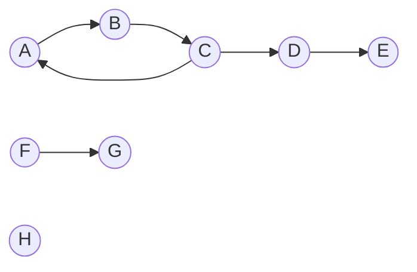

# Identifying Paths, Cycles, Connected Components, and High-Degree Nodes in Neo4j

In Neo4j's **property graph**, nodes represent entities, relationships represent directed links between entities, and properties store their attributes. Once nodes and relationships are defined, four questions commonly arise:

- **Path:** Which links lead from entity A to E, and how many steps does it take?
- **Cycle:** Is there a chain of links that returns to its starting point, such as a circular money transfer or mutual dependency?
- **Connected component:** Which nodes belong to the same group that can reach one another?
- **High-degree node:** Which node has many direct connections and may act as a hub?

These concepts support social network analysis, supply chains, transport routing, dependency systems, and anomaly detection. In Neo4j, **Cypher** is well suited for probing specific path patterns; for connected-component grouping on large graphs, you can also use the **Neo4j Graph Data Science (GDS)** library.

## 1. Running Sample Graph

Consider eight nodes `A` through `H` and seven directed `:LINK` relationships:



Here, `A → B → C → A` forms a cycle; `C` connects the cycle region to `D` and `E`; `F → G` is a separate group; `H` has no links.

You can create this graph to practice in a test database. Use a dedicated label `:GraphElementsDemo` so queries only affect the demo data:

```cypher
MERGE (a:GraphElementsDemo {id: 'A'})
MERGE (b:GraphElementsDemo {id: 'B'})
MERGE (c:GraphElementsDemo {id: 'C'})
MERGE (d:GraphElementsDemo {id: 'D'})
MERGE (e:GraphElementsDemo {id: 'E'})
MERGE (f:GraphElementsDemo {id: 'F'})
MERGE (g:GraphElementsDemo {id: 'G'})
MERGE (h:GraphElementsDemo {id: 'H'})
MERGE (a)-[:LINK]->(b)
MERGE (b)-[:LINK]->(c)
MERGE (c)-[:LINK]->(a)
MERGE (c)-[:LINK]->(d)
MERGE (d)-[:LINK]->(e)
MERGE (f)-[:LINK]->(g);
```

`MERGE` matches an existing pattern before creating if absent. In production systems, an identifier property like `id` should have a **uniqueness constraint** to prevent duplicate data during concurrent writes:

```cypher
CREATE CONSTRAINT graph_elements_demo_id IF NOT EXISTS
FOR (n:GraphElementsDemo)
REQUIRE n.id IS UNIQUE;
```

> If test data already has duplicate `id` nodes, resolve duplicates before creating the constraint. The constraint is an optional preparation step and is not required to understand the queries below.

## 2. Identifying Paths

A path is a sequence of nodes and relationships connecting a start point to an end point. For a path `p`:

- `nodes(p)` returns the list of nodes in traversal order.
- `relationships(p)` returns the relationships in order.
- `length(p)` returns the **number of relationships**, not the number of nodes. A four-hop path typically includes five nodes.

### 2.1. Directed Path Queries

Suppose we want paths from `A` to `E` with **1–5 relationships**, always following arrow direction:

```cypher
MATCH p =
  (a:GraphElementsDemo {id: 'A'})-[:LINK*1..5]->
  (e:GraphElementsDemo {id: 'E'})
RETURN [n IN nodes(p) | n.id] AS nodeIds,
       length(p) AS hops;
```

On the sample graph, the result is `['A', 'B', 'C', 'D', 'E']` with `hops = 4`.

In Cypher 5's variable-length relationship syntax, `*1..5` means one to five hops; `->` enforces stored direction, while `-` at both ends allows bidirectional traversal. In Neo4j 5.9 and later, you can express the same with a **quantified relationship**:

```cypher
MATCH p =
  (a:GraphElementsDemo {id: 'A'})-[:LINK]->{1,5}
  (e:GraphElementsDemo {id: 'E'})
RETURN [n IN nodes(p) | n.id] AS nodeIds,
       length(p) AS hops;
```

An important distinction: a path pattern can visit the same **node** multiple times. In Cypher 5's default path-matching mode, a **relationship** cannot be traversed more than once within the same `MATCH` pattern. Therefore, if a problem requires a *simple path* (no repeated nodes), add explicit predicates or use syntax appropriate to your Cypher version; do not assume every matched path is a simple path.

### 2.2. Relationship Direction Changes Results

If `:LINK` is treated as a bidirectional connection:

```cypher
MATCH p =
  (a:GraphElementsDemo {id: 'A'})-[:LINK*1..4]-
  (e:GraphElementsDemo {id: 'E'})
RETURN [n IN nodes(p) | n.id] AS nodeIds,
       length(p) AS hops
ORDER BY hops;
```

We can travel `A — C — D — E` in just **3 hops**, by traversing `C → A` backward on the first step. That path is **invalid** if business rules require following the `→` direction. For example, a transfer from C to A does not automatically imply money can move from A to C.

### 2.3. Shortest Path

When you only need the fewest hops between two nodes, use a shortest-path construct instead of enumerating every path:

```cypher
MATCH (a:GraphElementsDemo {id: 'A'}),
      (e:GraphElementsDemo {id: 'E'})
MATCH p = shortestPath((a)-[:LINK*]->(e))
RETURN [n IN nodes(p) | n.id] AS shortestRoute,
       length(p) AS hops;
```

The **directed** result is `A → B → C → D → E`, with **4 hops**. Changing `->` to `-` yields the **bidirectional** shortest path `A — C — D — E`, with **3 hops**.

`shortestPath()` minimizes **relationship count** assuming equal step weights; it does not automatically interpret time, cost, distance, or risk stored in properties. For weighted path problems, consider algorithms such as **Dijkstra** in GDS after defining an appropriate weight property. Newer Cypher versions also support `SHORTEST` path selection syntax; check your version's documentation.

## 3. Identifying Cycles

A cycle starts and ends at the same node. In a **simple cycle**, intermediate nodes do not repeat. Distinguish:

- **Self-loop:** a single relationship from a node back to itself, such as `A → A`.
- **Two-hop cycle:** `A → B → A` when two oppositely directed relationships exist.
- **Three-or-more-hop cycle:** for example `A → B → C → A`, which can represent circular dependencies in an application.

### 3.1. Finding a Specific Cycle

On the sample graph, query an exact three-hop cycle starting and ending at `A`:

```cypher
MATCH p =
  (a:GraphElementsDemo {id: 'A'})-[:LINK*3]->(a)
RETURN [n IN nodes(p) | n.id] AS cycle,
       length(p) AS hops;
```

Result: `['A', 'B', 'C', 'A']` with `hops = 3`.

To check for a **self-loop**, no variable-length expansion is needed:

```cypher
MATCH (n:GraphElementsDemo)-[r:LINK]->(n)
RETURN n.id AS nodeId, r;
```

This query returns no rows on the sample dataset.

### 3.2. Matching Only Simple Cycles

When searching for cycles and wanting to exclude paths with repeated intermediate nodes, verify that every node before the final node appears exactly once:

```cypher
MATCH p =
  (start:GraphElementsDemo)-[:LINK*2..6]->(start)
WITH p, nodes(p) AS ns
WHERE all(i IN range(0, size(ns) - 2)
          WHERE single(j IN range(0, size(ns) - 2)
                       WHERE ns[i] = ns[j]))
RETURN [n IN ns | n.id] AS simpleCycle,
       length(p) AS hops
LIMIT 20;
```

`ns` includes the start node appearing again at the end; `range(0, size(ns) - 2)` inspects only positions **before** that final node. `single(...)` verifies each node in this slice appears exactly once. The `2..6` bound narrows the search space.

A single cycle may be returned multiple times under different starting nodes, such as `A-B-C-A`, `B-C-A-B`, and `C-A-B-C`. These are **rotations of the same cycle**, even though they form three distinct lists. If you need to count unique cycles, canonicalize the representation (e.g., pick a canonical starting node) before counting. In undirected graphs, also account for reversed orientations.

**Use cases:** detecting circular service dependencies, approval workflows looping back to an earlier stage, suspicious transaction rings, or processing flows risking non-termination. A cycle by itself **does not prove** fraud or a bug; it is a signal for applying business rules.

## 4. Identifying Connected Components

A **connected component** is a maximal set of nodes satisfying the chosen connectivity condition. For directed graphs, specify which definition applies:

| Concept | Connectivity Rule | Sample Graph |
|---|---|---|
| **Weakly Connected Component (WCC)** | Ignores relationship direction when determining reachability | `{A,B,C,D,E}`, `{F,G}`, `{H}` |
| **Strongly Connected Component (SCC)** | For every pair of nodes in the group, a **directed** path exists in both directions | `{A,B,C}`, `{D}`, `{E}`, `{F}`, `{G}`, `{H}` |

For instance, `D` and `E` are in the same weakly connected component because `D → E` exists, but not in the same strongly connected component because there is no directed path from `E` back to `D`. Isolated node `H` still forms a component of size one.

### 4.1. Finding Nodes Reachable from One Node Using Cypher

On a small sample graph, you can find all nodes in the same **weakly** connected component as `A` by allowing both directions and bounding to four hops:

```cypher
MATCH (seed:GraphElementsDemo {id: 'A'})
MATCH p = (seed)-[:LINK*0..4]-(reachable:GraphElementsDemo)
RETURN collect(DISTINCT reachable.id) AS connectedNodes;
```

The result includes `{A,B,C,D,E}`; element order inside `collect` is not guaranteed without sorting. `*0..4` includes node `A` itself by allowing a zero-length path.

This is a **single-seed traversal** on a small graph, **not a whole-graph partitioning algorithm**: if a component's shortest path exceeds four hops, this bound will miss nodes. Removing the length bound on large graphs can cause the number of evaluated paths to explode.

### 4.2. Finding All Weakly Connected Components Using GDS

If **Neo4j Graph Data Science** is installed and configured, project the labels and relationship types to analyze into an **in-memory named graph** and run WCC:

```cypher
CALL gds.graph.project(
  'graphElementsDemoWcc',
  'GraphElementsDemo',
  {LINK: {orientation: 'UNDIRECTED'}}
)
YIELD graphName, nodeCount, relationshipCount
RETURN graphName, nodeCount, relationshipCount;
```

```cypher
CALL gds.wcc.stream('graphElementsDemoWcc')
YIELD nodeId, componentId
WITH componentId, gds.util.asNode(nodeId).id AS memberId
RETURN componentId,
       collect(memberId) AS members,
       count(*) AS componentSize
ORDER BY componentSize DESC;
```

The output has **three groups** of sizes **5, 2, and 1**. The numeric `componentId` is an internal identifier that may vary across runs; compare **member sets**, not specific ID numbers.

`orientation: 'UNDIRECTED'` represents relationships bidirectionally in the projected graph. WCC itself is direction-agnostic, and declaring this makes the modeling intent explicit. `gds.wcc.stream` only streams results for reading and **does not write** component properties back onto database nodes.

### 4.3. Finding Strongly Connected Components Using GDS

To respect relationship direction, create a second projection preserving the original orientation:

```cypher
CALL gds.graph.project(
  'graphElementsDemoScc',
  'GraphElementsDemo',
  'LINK'
)
YIELD graphName, nodeCount, relationshipCount
RETURN graphName, nodeCount, relationshipCount;
```

```cypher
CALL gds.scc.stream('graphElementsDemoScc')
YIELD nodeId, componentId
WITH componentId, gds.util.asNode(nodeId).id AS memberId
RETURN componentId, collect(memberId) AS members,
       count(*) AS componentSize
ORDER BY componentSize DESC;
```

The output yields **six components**: the three-node group `{A,B,C}` and five single-node groups `{D}`, `{E}`, `{F}`, `{G}`, `{H}`. Only within `{A,B,C}` does a directed path exist between every pair of nodes in both directions.

Once finished with the in-memory graphs, release GDS resources:

```cypher
CALL gds.graph.drop('graphElementsDemoWcc')
YIELD graphName RETURN graphName;
```

```cypher
CALL gds.graph.drop('graphElementsDemoScc')
YIELD graphName RETURN graphName;
```

The `gds.*` calls require a compatible GDS library and procedure execution privileges. They are not part of core Cypher syntax in a Neo4j installation without GDS.

## 5. Identifying High-Degree Nodes

**Degree** measures a node's direct connections; it differs from path count or total reachable nodes. In a directed graph, separate:

- **Out-degree:** number of relationships going **out** of the node.
- **In-degree:** number of relationships coming **into** the node.
- **Total degree:** sum of incoming and outgoing links when counting directed relationships.

Specify which **relationship type** is being measured. Degree over `:FOLLOWS` means something different from degree over `:PURCHASED`; do not combine all types when the domain only cares about one.

### 5.1. Counting In-Degree and Out-Degree with Cypher

Use `COUNT { ... }` to count the two patterns independently, avoiding row multiplication when a node has many incoming and outgoing relationships:

```cypher
MATCH (n:GraphElementsDemo)
RETURN n.id AS nodeId,
       COUNT { (n)-[:LINK]->() } AS outDegree,
       COUNT { (n)<-[:LINK]-() } AS inDegree,
       COUNT { (n)-[:LINK]->() }
         + COUNT { (n)<-[:LINK]-() } AS totalDegree
ORDER BY totalDegree DESC, nodeId;
```

The sample data produces:

| Node | Out-degree | In-degree | Total degree |
|---|---:|---:|---:|
| C | 2 | 1 | **3** |
| A | 1 | 1 | 2 |
| B | 1 | 1 | 2 |
| D | 1 | 1 | 2 |
| E | 0 | 1 | 1 |
| F | 1 | 0 | 1 |
| G | 0 | 1 | 1 |
| H | 0 | 0 | 0 |

Thus **C is the highest-degree node** in the sample graph. It participates in the `A-B-C-A` cycle and bridges to `D-E`, making it a priority checkpoint when assessing link-failure impact.

You can set a business threshold, such as finding nodes with at least three `:LINK` relationships:

```cypher
MATCH (n:GraphElementsDemo)
WITH n,
     COUNT { (n)-[:LINK]->() }
       + COUNT { (n)<-[:LINK]-() } AS degree
WHERE degree >= 3
RETURN n.id AS nodeId, degree
ORDER BY degree DESC;
```

The result contains only `C`.

### 5.2. Counting Distinct Relationships and Self-Loop Caveats

If you only want to know **how many distinct physical relationships** are attached to a node:

```cypher
MATCH (n:GraphElementsDemo)
OPTIONAL MATCH (n)-[r:LINK]-()
RETURN n.id AS nodeId,
       count(DISTINCT r) AS distinctIncidentRelationships
ORDER BY distinctIncidentRelationships DESC, nodeId;
```

On the sample graph with no self-loops, this matches total degree above. If a self-loop `A → A` exists, that single relationship contributes **1** to *distinct incident relationships*, yet contributes **1 to in-degree and 1 to out-degree** (a sum of **2**) under directed degree conventions. State your counting convention clearly before comparing nodes.

### 5.3. High Degree Does Not Automatically Mean Most Important

Degree is a **one-hop neighborhood** metric. A node with few relationships may still sit on many critical paths between clusters. When asking "which node lies on the most shortest paths?", look at **betweenness centrality**; when asking "which node receives links from influential nodes?", look at **PageRank**. Degree is a fast screening metric, not a substitute for goal-specific centrality analysis.

## 6. Choosing Techniques by Question and Scale

| Question | Starting Technique | Limits to Remember |
|---|---|---|
| Is there a path from A to E in at most 5 hops? | `MATCH p = ...-[:LINK*1..5]->...` | Direction and length bound determine results |
| Fewest-hop path between two nodes? | `shortestPath()` or version-appropriate `SHORTEST` syntax | Fewest hops differs from lowest weighted cost |
| Is there a dependency cycle within 6 hops? | Pattern starting/ending at the same node; filter simple cycles | Avoid overcounting rotations/reversals |
| Which nodes share a connected region ignoring direction? | WCC in GDS | `componentId` is not stable across runs |
| Which group can reach each other **directedly**? | SCC in GDS | Must preserve relationship direction in the projection |
| Which node has many direct relationships? | `COUNT { ... }` by direction and relationship type | Clarify how self-loops and parallel edges are counted |

For better efficiency on real datasets:

1. **Anchor start/end nodes with labels and indexed properties.** For example, the uniqueness constraint on `GraphElementsDemo.id` supports fast starting-node lookup.
2. **Bound path length and filter relationship types.** Enumerating all paths in a highly branched network can produce huge result sets; `LIMIT` only caps returned rows and does not guarantee eliminating prior expansion cost.
3. **Respect business direction.** Use `->` for money flows, dependencies, permissions, or directed workflows; use `-` only when ignoring direction genuinely makes sense.
4. **Use `EXPLAIN`/`PROFILE` when tuning.** Inspect cardinality, path expansion operators, and db hits before running on large graphs.
5. **Separate small exploratory queries from whole-graph algorithms.** Cypher is handy for local patterns; GDS fits WCC/SCC partitioning across many nodes and relationships. With GDS, verify memory sizing for projections and execution permissions.
6. **Parameterize application inputs.** When calling from Java Driver or Spring Data Neo4j, pass `$startId` and `$endId` as parameters instead of concatenating user values into Cypher strings.

Parameterized query example:

```cypher
MATCH (a:GraphElementsDemo {id: $startId}),
      (b:GraphElementsDemo {id: $endId})
MATCH p = shortestPath((a)-[:LINK*]->(b))
RETURN [n IN nodes(p) | n.id] AS nodeIds,
       length(p) AS hops;
```

## 7. Self-Check Exercises

Using the sample graph at the start of the lesson, answer these before checking the solutions:

1. Is there a **directed** path from `E` back to `A`?
2. How many weakly connected components remain if relationship `G → H` is added?
3. If relationship `E → C` is added, does `{C,D,E}` form a new cycle? How does that affect the SCCs?
4. When adding relationship `H → H`, what are the in-degree, out-degree, and distinct incident relationship count of `H`?

**Answers:** (1) No, because `E` has no outgoing relationships. (2) Still **2** weak components: `{A,B,C,D,E}` and `{F,G,H}`. (3) Yes, cycle `C → D → E → C` forms; together with `A → B → C → A`, nodes `{A,B,C,D,E}` become **a single SCC**. (4) In-degree **1**, out-degree **1**, distinct incident relationships **1**.

## References

- [Neo4j Cypher Manual – Variable-length paths](https://neo4j.com/docs/cypher-manual/current/patterns/variable-length-paths/)
- [Neo4j Cypher Manual – Shortest paths](https://neo4j.com/docs/cypher-manual/5/patterns/reference/shortest-paths/)
- [Neo4j Cypher Manual – COUNT subqueries](https://neo4j.com/docs/cypher-manual/current/subqueries/count/)
- [Neo4j GDS – Weakly Connected Components](https://neo4j.com/docs/graph-data-science/current/algorithms/wcc/)
- [Neo4j GDS – Strongly Connected Components](https://neo4j.com/docs/graph-data-science/current/algorithms/strongly-connected-components/)
- [Neo4j GDS – Native graph projection](https://neo4j.com/docs/graph-data-science/current/management-ops/graph-creation/graph-project/)
