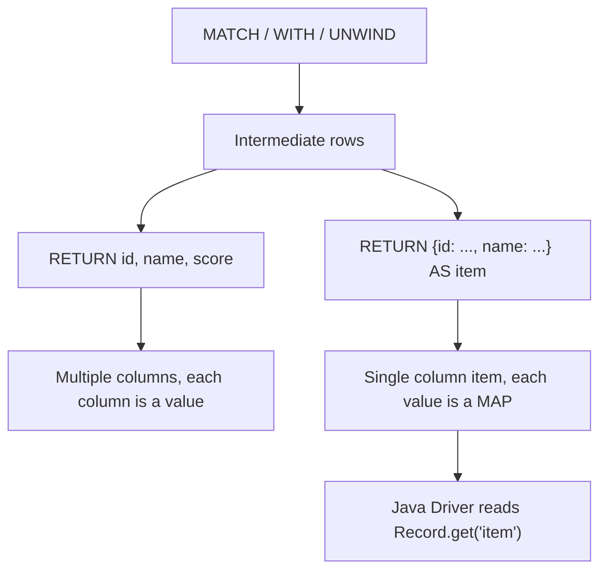
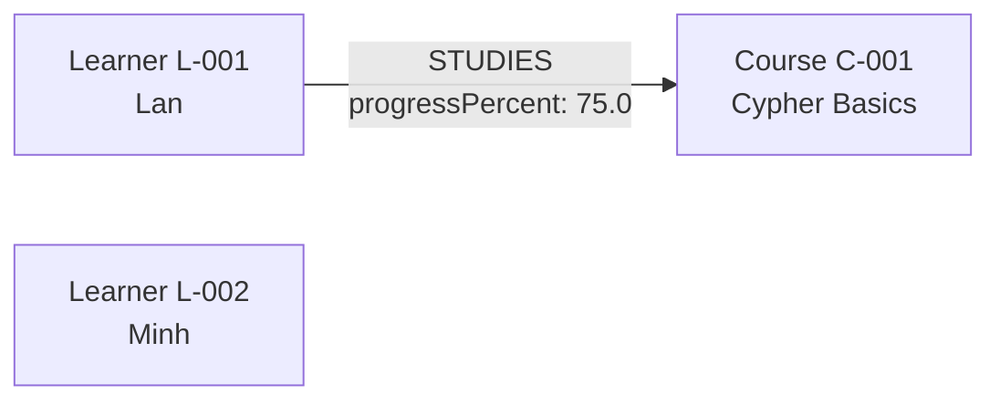

# Lists, Maps, and Return Value Structures in Cypher Queries

In **Neo4j**, connected data is modeled with nodes, relationships, and their properties. When querying a property graph with **Cypher**, results do not have to be just a single node or scalar value: they can be **lists**, **key–value maps**, multiple columns per row, or nested structures tailored for an API.

This lesson belongs to the **Data Types** chapter of the `DATABASE_ENGINE_GRAPH_NEO4J` module. The goal is to understand how to create and process `LIST` and `MAP`, identify which value types can be stored as properties, organize rows and columns produced by `RETURN`, and transfer results to applications using the Java Driver or Spring Data Neo4j.

## 1. Distinguishing Values, Properties, and Query Results

A Cypher expression can return strings, numbers, booleans, `null`, nodes, relationships, paths, lists, or maps. However, **values valid in expressions** and **values allowed to be stored directly in properties** are not the same set.

| Value | Example in Cypher | Can Be Stored as a Property? |
| --- | --- | --- |
| String, number, boolean | `'Lan'`, `28`, `true` | Yes |
| Date/time, duration, point | `date('2026-11-25')`, `duration('PT1H')` | Yes |
| List of compatible same-type property values | `['Java', 'Cypher']`, `[1, 2, 3]` | Yes |
| List containing `null`, nested lists, or maps | `[1, null]`, `[[1], [2]]`, `[{x: 1}]` | Cannot be stored directly as a property |
| Map | `{name: 'Lan', age: 28}` | Cannot store an entire map in one property |
| Node, relationship, path | `n`, `r`, `p` from `MATCH` | No |
| `null` | `null` | No; assigning null to a property deletes the property |

Example expressions that are all valid in a query:

```cypher
RETURN
  ['Neo4j', 'Java'] AS technologies,
  {name: 'Lan', active: true} AS profile,
  [{id: 1}, {id: 2}] AS items,
  [42, 'hello', null] AS mixedValues;
```

However, only `technologies` among those four values is an example of a list suitable for storing as-is in a property; maps and lists containing maps or `null` work well **in query results** but cannot be stored directly as a property.

This rule guides modeling choices: skills as a list of strings can be a property on a learner; whereas courses that have multiple fields or relationships with learners should be nodes connected by relationships.

## 2. LIST: Creating Lists and Reading Elements

`LIST` is an **ordered** sequence of elements; element indexing starts at `0`. Lists in Cypher expressions can contain heterogeneous types and even nested lists or maps.

### 2.1. List Literals, Empty Lists, and Heterogeneous Lists

```cypher
RETURN
  [10, 20, 30] AS scores,
  ['graph', 'database', 'cypher'] AS tags,
  [] AS emptyList,
  [1, 'one', true, null] AS mixedList,
  [[1, 2], [3, 4]] AS nestedList;
```

`mixedList` and `nestedList` are valid for computations or returning from queries, but do not qualify as lists that can be stored directly in a property.

### 2.2. Indexing and Slicing

```cypher
WITH ['Neo4j', 'Java', 'Spring', 'Docker'] AS tools
RETURN
  tools[0] AS firstTool,
  tools[2] AS thirdTool,
  tools[-1] AS lastTool,
  tools[1..3] AS middleTools,
  tools[..2] AS firstTwo,
  tools[2..] AS fromThird;
```

Sample output:

| Expression | Result |
| --- | --- |
| `tools[0]` | `'Neo4j'` |
| `tools[2]` | `'Spring'` |
| `tools[-1]` | `'Docker'` |
| `tools[1..3]` | `['Java', 'Spring']` |
| `tools[..2]` | `['Neo4j', 'Java']` |
| `tools[2..]` | `['Spring', 'Docker']` |

When slicing with `[start..end]`, **the `end` index is exclusive**. Negative indexes count from the end of the list. Accessing an out-of-bounds element can return `null`, so check bounds when input length is not fixed.

### 2.3. Common List Functions

```cypher
WITH [5, 10, 15] AS numbers
RETURN
  size(numbers) AS numberOfItems,
  head(numbers) AS firstNumber,
  last(numbers) AS lastNumber,
  tail(numbers) AS withoutFirst,
  reverse(numbers) AS reversed;
```

| Function | Meaning |
| --- | --- |
| `size(list)` | Count elements |
| `head(list)` | Get the first element; empty list returns `null` |
| `last(list)` | Get the last element; empty list returns `null` |
| `tail(list)` | Return the list without its first element |
| `reverse(list)` | Reverse element order |
| `range(start, end)` | Generate an integer sequence, inclusive of both bounds |
| `range(start, end, step)` | Generate a sequence with a specific step |

Example:

```cypher
RETURN
  range(1, 5) AS oneToFive,
  range(0, 8, 2) AS evenNumbers,
  head([]) AS noFirstItem;
```

Here, `oneToFive` is `[1, 2, 3, 4, 5]`, `evenNumbers` is `[0, 2, 4, 6, 8]`, and `noFirstItem` is `null`.

## 3. Transforming and Filtering LISTs in Cypher Expressions

### 3.1. List Comprehension: Filtering and Mapping

List comprehension syntax:

```text
[variable IN list WHERE condition | expression]
```

`WHERE` filters elements; the `| expression` part defines the output value for each retained element.

```cypher
WITH [1, 2, 3, 4, 5, 6] AS numbers
RETURN
  [n IN numbers WHERE n % 2 = 0] AS evenNumbers,
  [n IN numbers | n * n] AS squares,
  [n IN numbers WHERE n > 3 | n * 10] AS mappedAndFiltered;
```

Results:

- `evenNumbers` → `[2, 4, 6]`.
- `squares` → `[1, 4, 9, 16, 25, 36]`.
- `mappedAndFiltered` → `[40, 50, 60]`.

Practical example: keep only tags starting with `'neo'`, then normalize them to lowercase.

```cypher
WITH ['Neo4j', 'Java', 'neo4j-driver', 'Spring'] AS tags
RETURN
  [tag IN tags
   WHERE toLower(tag) STARTS WITH 'neo'
   | toLower(tag)] AS neoTags;
```

### 3.2. Membership Testing with IN

```cypher
WITH ['Java', 'Cypher', 'Spring'] AS skills
RETURN
  'Cypher' IN skills AS knowsCypher,
  'Python' IN skills AS knowsPython;
```

`IN` is suitable for checking whether a value belongs to a list. When the list contains `null`, an unfound lookup may return `null` instead of `false`:

```cypher
RETURN
  5 IN [5, null] AS definitelyPresent,
  5 IN [2, null] AS cannotConfirmAbsent,
  5 IN [2, 3] AS definitelyAbsent;
```

The first two values are `true` and `null`, respectively; the third is `false`. When using lists for business condition checks, clean missing data and keep three-valued logic in mind.

### 3.3. any, all, none, and single

List predicates let you express conditions without expanding into multiple rows:

```cypher
WITH [4, 6, 8] AS numbers
RETURN
  any(n IN numbers WHERE n > 7) AS hasLargeNumber,
  all(n IN numbers WHERE n % 2 = 0) AS allEven,
  none(n IN numbers WHERE n < 0) AS noNegative,
  single(n IN numbers WHERE n = 6) AS exactlyOneSix;
```

`any` checks if at least one element satisfies the condition, `all` requires every element to match, `none` requires no element to match, and `single` requires exactly one element to match. When conditions involve `null`, predicate results can be affected by three-valued logic.

### 3.4. reduce: Folding Elements into a Single Value

`reduce()` iterates over a list and accumulates a result:

```cypher
WITH [10, 20, 30] AS prices
RETURN reduce(total = 0, price IN prices | total + price) AS totalPrice;
```

The result is `60`. `reduce()` is well suited for ordered folding operations needing custom expressions; when data is spread across rows and you only need a sum, the `sum()` aggregation function is usually more natural.

## 4. UNWIND: Expanding a List into Result Rows

`UNWIND` produces **one row per element** of a list. It bridges list values and Cypher's row-based processing model.

```cypher
UNWIND ['Cypher', 'Java', 'Spring'] AS skill
RETURN skill;
```

The query produces three rows, each with one column named `skill`.

Example processing an input list of maps:

```cypher
WITH [
  {code: 'P-01', quantity: 2},
  {code: 'P-02', quantity: 5},
  {code: 'P-03', quantity: 1}
] AS products
UNWIND products AS product
RETURN
  product.code AS productCode,
  product.quantity AS quantity
ORDER BY productCode;
```

The result has three rows with two columns each. This is a common pattern when ingesting multiple records from a `$rows` parameter.

**Distinguishing an empty list from a list containing null:**

```cypher
UNWIND [] AS element
RETURN element;
```

The query above returns **0 rows**. Conversely:

```cypher
UNWIND [null] AS element
RETURN element;
```

This query produces **1 row**, with `element` equal to `null`. If `UNWIND` sits mid-pipeline, an empty list can leave subsequent steps with zero rows to process.

Do not rely on `UNWIND` element order as a guaranteed output order: use `ORDER BY` in the query whenever ordering is an API requirement.

## 5. MAP: Key–Value Structures in Cypher

`MAP` consists of key–value pairs. Values inside a map can be various Cypher types, including nested lists or maps.

### 5.1. Map Literals

```cypher
WITH {
  learnerId: 'L-001',
  name: 'Lan',
  active: true,
  scores: [8, 9, 10],
  contact: {
    city: 'Da Nang',
    email: 'lan@example.test'
  }
} AS learner
RETURN
  learner.name AS name,
  learner.scores[1] AS secondScore,
  learner.contact.city AS city,
  keys(learner) AS propertyNames;
```

Here:

- `learner.name` reads the value at key `name`.
- `learner.scores[1]` gets the second element of the list inside the map.
- `learner.contact.city` traverses the nested map to read the city.
- `keys(learner)` returns a list of present key names; **do not rely on key order** in business logic.

Maps can hold `null` as an intermediate value:

```cypher
WITH {nickname: null, age: 28} AS person
RETURN
  person.nickname IS NULL AS missingNicknameValue,
  'nickname' IN keys(person) AS nicknameKeyExists,
  person.unknown IS NULL AS absentKeyIsNull;
```

The result `nicknameKeyExists` is `true` because the key exists in the map even though its value is `null`; `unknown` is not in the map.

### 5.2. Choosing MAP or LIST?

| Scenario | Suitable Structure | Example |
| --- | --- | --- |
| Multiple skills where order matters | List | `['Cypher', 'Java']` |
| Profile with multiple named fields | Map | `{name: 'Lan', active: true}` |
| Multiple products with the same structure | List of maps | `[{code: 'P1'}, {code: 'P2'}]` |
| A course connected to multiple learners | Nodes + relationships | `(l)-[:ENROLLED_IN]->(c)` |
| A property storing string tags | Property list | `tags: ['graph', 'db']` |

Lists of maps are very useful for building API responses or passing batch processing parameters. However, **a list of maps cannot be stored intact as a property**. When items have their own identity, properties, and relationships, create nodes/relationships instead of packing the whole structure into one property.

### 5.3. properties(n) Gets a Map of Stored Properties

Create a sample node:

```cypher
MERGE (l:ListMapDemoLearner {learnerId: 'L-001'})
SET l.name = 'Lan',
    l.active = true,
    l.skills = ['Neo4j', 'Java']
RETURN properties(l) AS learnerProperties;
```

`properties(l)` returns a map of the node's stored properties. This map can be returned to the application or used as input for further processing:

```cypher
MATCH (l:ListMapDemoLearner {learnerId: 'L-001'})
RETURN
  keys(l) AS storedPropertyKeys,
  properties(l) AS storedProperties,
  labels(l) AS nodeLabels;
```

Note that `properties(l)` contains only **properties**; it does not include node labels, adjacent relationships, or paths. If needed, fetch those via separate expressions.

## 6. Map Projection: Selecting Fields for Returned Data

`Map projection` is syntax for constructing a map from a map variable or node. It is useful for returning the exact fields an API requires.

Using the node data from the previous section:

```cypher
MATCH (l:ListMapDemoLearner {learnerId: 'L-001'})
RETURN l{
  .learnerId,
  .name,
  .skills
} AS learner;
```

The result has one column `learner`, containing a map with three fields: `learnerId`, `name`, and `skills`. This differs from `RETURN l`, which returns the **entire node object**.

### 6.1. Adding Computed Fields

```cypher
MATCH (l:ListMapDemoLearner {learnerId: 'L-001'})
RETURN l{
  .learnerId,
  .name,
  .skills,
  skillCount: size(l.skills),
  displayStatus: CASE
    WHEN l.active = true THEN 'Active'
    ELSE 'Inactive or unknown'
  END
} AS learnerSummary;
```

The fields `skillCount` and `displayStatus` are computed at query time. They are **not automatically saved** as node properties.

### 6.2. Including All Properties with the .* Syntax

```cypher
MATCH (l:ListMapDemoLearner {learnerId: 'L-001'})
RETURN l{
  .*,
  skillCount: size(l.skills)
} AS learnerDetails;
```

`.*` includes all stored properties of the node into the map, then adds `skillCount`. When building public APIs, explicitly list the fields to return rather than defaulting to `.*` if a node may hold internal or sensitive data.

### 6.3. Map Projection When the Variable Is null

If the variable used for map projection is `null`, the projection result is also `null`. This matters when combined with `OPTIONAL MATCH`: you need to distinguish "no related node" from "node exists but lacks a property".

```cypher
WITH null AS missingLearner
RETURN missingLearner{.name} AS projectedLearner;
```

`projectedLearner` is `null`. If the API should always receive a structure with specific fields, use `CASE` or `coalesce()` according to the data contract.

## 7. When to Use MAP for Updating Properties?

A map can be used to **pass multiple property values** in a single update, without the map itself becoming a nested property.

```cypher
MATCH (l:ListMapDemoLearner {learnerId: 'L-001'})
SET l += {
  city: 'Da Nang',
  active: true
}
RETURN properties(l) AS updatedProperties;
```

`SET l += {...}` updates/adds `city` and `active` individually. Contrast this with:

```cypher
// INVALID example: cannot store a MAP as the value of a property.
MATCH (l:ListMapDemoLearner {learnerId: 'L-001'})
SET l.contact = {city: 'Da Nang', email: 'lan@example.test'};
```

A valid alternative when no separate entity is needed:

```cypher
MATCH (l:ListMapDemoLearner {learnerId: 'L-001'})
SET l.contactCity = 'Da Nang',
    l.contactEmail = 'lan@example.test'
RETURN l.contactCity, l.contactEmail;
```

Or create a linked `Contact` node when contact details have their own structure, lifecycle, or relationships:

```cypher
MATCH (l:ListMapDemoLearner {learnerId: 'L-001'})
MERGE (contact:ListMapDemoContact {contactId: 'CONTACT-001'})
SET contact.city = 'Da Nang',
    contact.email = 'lan@example.test'
MERGE (l)-[:HAS_CONTACT]->(contact)
RETURN l.name, contact.city;
```

Additional notes:

- `SET n += map` adds/updates keys present in the map while preserving other keys.
- `SET n = map` replaces the **entire property set** of `n` with the map's contents; old keys absent from the map are deleted.
- When updating with a map, a `null` value for a key deletes the corresponding property.
- Map values must be valid property values: do not pass nested maps, lists of maps, or lists containing `null` into a property.

For PATCH-style APIs, clearly distinguish "field omitted", "null sent to delete", and "value sent to update" before constructing the map passed to Cypher.

## 8. RETURN: Understanding Row and Column Result Structure

Cypher treats query results as a **table of rows and columns**. Each column corresponds to an alias or expression in `RETURN`; each cell's value can be a number, string, list, map, node, relationship, or path.

```cypher
UNWIND [
  {id: 'L-001', name: 'Lan', score: 9},
  {id: 'L-002', name: 'Minh', score: 8}
] AS learner
RETURN
  learner.id AS learnerId,
  learner.name AS learnerName,
  learner.score AS score
ORDER BY learnerId;
```

The result has **two rows and three columns**:

| learnerId | learnerName | score |
| --- | --- | --- |
| L-001 | Lan | 9 |
| L-002 | Minh | 8 |

If replaced with:

```cypher
UNWIND [
  {id: 'L-001', name: 'Lan', score: 9},
  {id: 'L-002', name: 'Minh', score: 8}
] AS learner
RETURN {
  learnerId: learner.id,
  learnerName: learner.name,
  score: learner.score
} AS item
ORDER BY item.learnerId;
```

There are still **two rows**, but **only one column `item`**; each cell in that column is a map.

This can be visualized as:



**Two distinct structural layers to separate:**

1. **Result record/row**: has the columns named in `RETURN`.
2. **Value of each column**: can be a map, list, or graph entity; if it is a map/list, it carries its own internal structure.

When an application receives multiple rows, the driver provides a list of records; Cypher does not wrap the entire query output into a single list simply because the query returned multiple rows.

## 9. collect: Aggregating Multiple Rows into a LIST

`collect(expression)` is an aggregation function that builds a list of values from multiple rows. It is commonly used to return nested lists inside an API object.

Example aggregating skill names:

```cypher
UNWIND [
  {learnerId: 'L-001', skill: 'Cypher'},
  {learnerId: 'L-001', skill: 'Java'},
  {learnerId: 'L-002', skill: 'Spring'}
] AS row
WITH row.learnerId AS learnerId, row.skill AS skill
ORDER BY learnerId, skill
RETURN learnerId, collect(skill) AS skills
ORDER BY learnerId;
```

Result:

| learnerId | skills |
| --- | --- |
| L-001 | `['Cypher', 'Java']` |
| L-002 | `['Spring']` |

`learnerId` is the grouping key because it appears outside the aggregation function; `collect(skill)` gathers the values within each group.

### 9.1. DISTINCT, Ordering, and null

```cypher
UNWIND ['Cypher', 'Java', 'Cypher', null] AS skill
RETURN
  collect(skill) AS allKnownSkills,
  collect(DISTINCT skill) AS distinctKnownSkills;
```

`collect()` **skips `null` values**. `DISTINCT` removes duplicates; do not assume a specific order from `collect(DISTINCT ...)` without explicit ordering control.

When list ordering matters, sort rows before the aggregation step:

```cypher
UNWIND [
  {learnerId: 'L-001', rank: 2, skill: 'Java'},
  {learnerId: 'L-001', rank: 1, skill: 'Cypher'}
] AS row
WITH row.learnerId AS learnerId, row
ORDER BY row.rank
RETURN learnerId, collect(row.skill) AS orderedSkills;
```

The `ORDER BY` in `WITH` establishes the input row order for `collect()` in the following clause. `ORDER BY` at the very end of the query only sorts **result rows**, not necessarily the elements already inside each list.

### 9.2. Collecting Maps to Build an Object List for an API

```cypher
UNWIND [
  {id: 'C-001', title: 'Cypher Basics', hours: 12},
  {id: 'C-002', title: 'Java Driver', hours: 8}
] AS course
WITH course
ORDER BY course.title
RETURN collect({
  courseId: course.id,
  title: course.title,
  durationHours: course.hours
}) AS courses;
```

This query returns **one row, one column `courses`**, where `courses` is a list of two maps. This structure is very convenient for APIs. It is a **query result value**, not a property stored intact on a node.

## 10. Combining Graph Patterns and Nested Return Structures

When working with a property graph, a learner may take multiple courses, with each relationship storing enrollment date or progress. Results must be structured so each learner appears only once while still retaining full information about their courses.

### 10.1. Preparing a Sample Graph

You can run the commands below multiple times; `MERGE` matches or creates nodes by the specified identifiers, then updates the properties of the practice data.

```cypher
MERGE (lan:ListMapDemoLearner {learnerId: 'L-001'})
SET lan.name = 'Lan',
    lan.skills = ['Cypher', 'Java']
MERGE (minh:ListMapDemoLearner {learnerId: 'L-002'})
SET minh.name = 'Minh',
    minh.skills = ['Spring']
MERGE (course:ListMapDemoCourse {courseId: 'C-001'})
SET course.title = 'Cypher Basics'
MERGE (lan)-[enrollment:STUDIES]->(course)
SET enrollment.progressPercent = 75.0;
```

Data model:



Learner Minh does not yet have a `STUDIES` relationship to any course. When building an API that returns both learners, use `OPTIONAL MATCH`.

### 10.2. One Learner, One Map, Nested Course List

```cypher
MATCH (l:ListMapDemoLearner)
OPTIONAL MATCH (l)-[r:STUDIES]->(c:ListMapDemoCourse)
WITH l, r, c
ORDER BY c.title
WITH l,
     collect(
       CASE
         WHEN c IS NULL THEN null
         ELSE {
           courseId: c.courseId,
           title: c.title,
           progressPercent: r.progressPercent
         }
       END
     ) AS courses
RETURN l{
  .learnerId,
  .name,
  courses: courses
} AS learner
ORDER BY learner.learnerId;
```

The result has two rows, each with one column `learner` as a map. Represented in JSON for clarity:

```json
[
  {
    "learner": {
      "learnerId": "L-001",
      "name": "Lan",
      "courses": [
        {
          "courseId": "C-001",
          "title": "Cypher Basics",
          "progressPercent": 75.0
        }
      ]
    }
  },
  {
    "learner": {
      "learnerId": "L-002",
      "name": "Minh",
      "courses": []
    }
  }
]
```

This is an **equivalent JSON structural representation** of the result records, not a claim that Neo4j Browser or every client outputs this exact JSON format automatically.

Explanation:

1. `MATCH` retrieves both learners.
2. `OPTIONAL MATCH` retains Minh even without a `STUDIES` relationship; in that case `r` and `c` are `null`.
3. `CASE` constructs a course map when `c` is present, and `null` when absent.
4. `collect()` skips `null`; consequently Minh receives `courses: []` rather than a list containing an empty map.
5. Map projection `l{...}` builds the exact structure of one learner along with their courses.

When a relationship carries multiple properties, include them in the map such as `progressPercent: r.progressPercent`. Using relationships to store enrollment progress fits the connected data model; there is no need to pack complex course lists into a single property.

**Note on real-world data:** if multiple nodes already share the same `learnerId` from earlier ingestion, `MERGE` does not enforce graph-wide uniqueness without a constraint. Consider adding a unique constraint on business keys during schema design.

## 11. Returning Nodes, Relationships, and Paths vs. Map Projection

In Cypher, `RETURN n` returns a node object; `RETURN r` returns a relationship; `RETURN path` returns a path. These values are graph entities, not plain maps.

```cypher
MATCH path = (l:ListMapDemoLearner)-[r:STUDIES]->(c:ListMapDemoCourse)
RETURN
  l AS learnerNode,
  r AS enrollmentRelationship,
  c AS courseNode,
  path AS enrollmentPath,
  nodes(path) AS pathNodes,
  relationships(path) AS pathRelationships;
```

Here:

- `learnerNode`, `courseNode`: `NODE` values.
- `enrollmentRelationship`: `RELATIONSHIP` value.
- `enrollmentPath`: `PATH` value.
- `pathNodes`: `LIST` of nodes.
- `pathRelationships`: `LIST` of relationships.

Lists containing nodes/relationships are suitable for query results and graph operations, but cannot be stored directly as property lists.

If an API only needs IDs, names, and progress, select a map with the required fields:

```cypher
MATCH (l:ListMapDemoLearner)-[r:STUDIES]->(c:ListMapDemoCourse)
RETURN {
  learnerId: l.learnerId,
  learnerName: l.name,
  courseId: c.courseId,
  progressPercent: r.progressPercent
} AS enrollment;
```

This creates a cleaner data contract for clients that do not need to know Neo4j's internal entity structure.

## 12. Handling Results with the Java Driver and Spring Data Neo4j

### 12.1. Record and Value in the Java Driver

The Java Driver reads query results as **`Record`** instances. Each record has columns matching the `RETURN` aliases; each column holds a **`Value`** to be read using the appropriate type accessor.

Given the query:

```cypher
MATCH (l:ListMapDemoLearner)
RETURN l{
  .learnerId,
  .name,
  .skills
} AS learner
ORDER BY learner.learnerId;
```

Sample Java code using the Neo4j Java Driver:

```java
import java.util.List;
import java.util.Map;
import org.neo4j.driver.Driver;
import org.neo4j.driver.Session;

public class LearnerQuery {
    public static List<Map<String, Object>> loadLearners(Driver driver) {
        String cypher = """
            MATCH (l:ListMapDemoLearner)
            RETURN l{.learnerId, .name, .skills} AS learner
            ORDER BY learner.learnerId
            """;

        try (Session session = driver.session()) {
            return session.executeRead(tx ->
                tx.run(cypher).list(record ->
                    record.get("learner").asMap()
                )
            );
        }
    }
}
```

`record.get("learner")` retrieves the `learner` column by name, and `asMap()` converts the map into `Map<String, Object>`. If returning multiple columns, read each column by its alias:

```java
String learnerId = record.get("learnerId").asString();
long score = record.get("score").asLong();
List<String> skills = record.get("skills").asList(v -> v.asString());
```

The second code snippet illustrates column extraction and only works when the actual query defines aliases `learnerId`, `score`, and `skills` with matching types. When a value can be `null`, check `record.get("column").isNull()` before calling a type converter.

**Note:** `asMap()` converts values to their corresponding Java objects. If results contain nodes, paths, temporals, or points, the application's JSON/DTO layer may require custom mapping; do not assume every Neo4j type serializes just like primitive JSON.

### 12.2. With Spring Data Neo4j

Spring Data Neo4j can map nodes and relationships to Java entities, but aggregate queries returning arbitrary lists/maps often require projections or DTOs matching the result shape. For instance, an API requiring:

```json
{
  "learnerId": "L-001",
  "name": "Lan",
  "courses": [
    {"courseId": "C-001", "title": "Cypher Basics"}
  ]
}
```

You can write a query returning the exact required columns or build result DTOs aligned with the API contract. Specific mapping behavior depends on your Spring Data Neo4j version, projection type, and custom query style; verify the mapping in your application.

When APIs return nodes and relationships, be cautious about letting a JSON library directly serialize entities with bidirectional relationships. Designing explicit return DTOs/lists/maps usually helps control exposed fields and avoid unintended nested structures.

## 13. List/Map Parameters and Batch Ingestion

A Cypher parameter can be a list of maps. This allows an application to pass multiple records in a single query and process them with `UNWIND`.

```cypher
UNWIND $learners AS input
WITH input
WHERE input.learnerId IS NOT NULL
MERGE (l:ListMapDemoLearner {learnerId: input.learnerId})
SET l.name = input.name
RETURN l.learnerId, l.name;
```

Example `$learners` parameter structure from the application side:

```json
[
  {"learnerId": "L-003", "name": "Ngoc"},
  {"learnerId": "L-004", "name": "Khoa"}
]
```

This list of maps is **query input**, not a property stored on a node. After `UNWIND`, each map becomes a row and each field is written to its respective property.

Data quality checks before writing:

- Never pass `null` as a key value in `MERGE`.
- Normalize numeric, date, and boolean types in the application or via appropriate conversion functions.
- If `input.name` is `null`, `SET l.name = input.name` will delete the `name` property; decide update semantics upfront.
- If using `SET l += input`, allow only expected keys and valid property values. Do not assign an entire map containing nested objects to a single property.
- Set reasonable batch sizes based on data volume, transaction size, and Neo4j resources.

The API contract should clearly specify the data type of each field; Cypher's flexibility with maps does not replace data validation.

## 14. Common Pitfalls

| Scenario | Why Does It Happen? | Resolution |
| --- | --- | --- |
| Assigning `n.profile = {name: 'Lan'}` | Cannot store a map intact as a property | Use flat scalar properties or create a separate node |
| Assigning `n.items = [{id: 1}, {id: 2}]` | Property lists cannot contain maps | Use nodes/relationships or keep the list only in queries |
| Assigning `n.numbers = [1, null, 3]` | Property lists do not support `null` elements | Filter out missing elements before writing |
| `UNWIND []` leaves subsequent clauses with no output | An empty list yields 0 rows | Validate input and design the pipeline accordingly |
| List produced by `collect` has unexpected order | Rows were not sorted before aggregation | Use `ORDER BY` in `WITH` right before the collect step |
| List produced by `collect` has fewer elements than rows | `collect` skips `null` | Count and handle missing cases explicitly |
| `RETURN n` expected to produce a plain JSON map | Returned value is a graph node | Use `n{.field}` or a map literal |
| Matching courses with `MATCH` drops unenrolled learners | `MATCH` keeps only rows matching the pattern | Use `OPTIONAL MATCH` if learners should be retained |
| `RETURN { ... } AS item` but reading `record.get("name")` | Record only has column `item` | Read `record.get("item")` and then access fields inside the map |
| `SET n = map` wipes out existing properties | `=` replaces the entire property set | Use `+=` when performing a partial update |
| Map projection on a `null` variable yields `null` | Source variable has no value | Use `CASE` or handle it in the API |
| Putting nested maps into a property | Confusing query result types with storage types | Flatten fields or model related entities |

## 15. Practice Exercises with Solutions

### Exercise 1 — Lists and Indexing

Given `tools = ['Neo4j', 'Java', 'Spring', 'Docker']`. Return the last element, the first two elements, and the element count.

**Answer:**

```cypher
WITH ['Neo4j', 'Java', 'Spring', 'Docker'] AS tools
RETURN
  last(tools) AS lastTool,
  tools[..2] AS firstTwo,
  size(tools) AS countTools;
```

The results are `'Docker'`, `['Neo4j', 'Java']`, and `4`, respectively.

### Exercise 2 — Transforming a List of Numbers

From `[1, 2, 3, 4, 5]`, select only the odd numbers and double them.

**Answer:**

```cypher
WITH [1, 2, 3, 4, 5] AS numbers
RETURN [n IN numbers WHERE n % 2 = 1 | n * 2] AS doubledOdds;
```

Result: `[2, 6, 10]`.

### Exercise 3 — List of Maps to Multiple Rows

From the list of product maps below, return the code and price of each product, sorted by price descending.

**Answer:**

```cypher
WITH [
  {code: 'SP-001', priceVnd: 120000},
  {code: 'SP-002', priceVnd: 95000},
  {code: 'SP-003', priceVnd: 150000}
] AS products
UNWIND products AS p
RETURN p.code AS code, p.priceVnd AS priceVnd
ORDER BY priceVnd DESC;
```

The result has three rows, with `SP-003` first.

### Exercise 4 — Map Projection

Return a map for `ListMapDemoLearner` nodes containing `learnerId`, `name`, and a `skillsCount` field computed from the `skills` list, assuming `skills` is a property list.

**Answer:**

```cypher
MATCH (l:ListMapDemoLearner)
RETURN l{
  .learnerId,
  .name,
  skillsCount: size(l.skills)
} AS learnerSummary;
```

Each record has one `learnerSummary` column of map type.

### Exercise 5 — Returning a List of Maps

Given three rows containing learner names and scores, combine all of them into a single list of maps in one row.

**Answer:**

```cypher
UNWIND [
  {name: 'Lan', score: 9},
  {name: 'Minh', score: 8},
  {name: 'Ngoc', score: 10}
] AS row
WITH row
ORDER BY row.name
RETURN collect({
  name: row.name,
  score: row.score
}) AS learners;
```

The result is one row with column `learners` containing three maps.

### Exercise 6 — Distinguishing Record and Map

Query:

```cypher
RETURN {id: 'L-001', name: 'Lan'} AS learner;
```

Question: how many rows, how many columns, and what type is the column value?

**Answer:** one row, one column named `learner`; the column value is a `MAP` with two keys `id` and `name`. In the Java Driver, you must read `record.get("learner")` first, and only then access the data inside the map.

## 16. Checklist for Designing Neo4j Result Structures

Before finalizing queries and integrating with an application:

1. Determine whether data should be stored as a single property, a property list, or relationships between nodes.
2. Remember that lists in expressions can contain maps, nodes, and `null`, whereas property lists have stricter constraints.
3. Decide whether `RETURN` needs multiple columns or a single map.
4. Use map projection to select the exact fields needed by the client.
5. Use `UNWIND` when turning an input list into multiple rows; check the impact of an empty list.
6. Use `collect()` when aggregating multiple rows into a list; control ordering and `null` skipping.
7. When data has optional relationships, consider `OPTIONAL MATCH` paired with `CASE` to retain the parent and return a proper empty list.
8. Verify that `RETURN` aliases match the column names read by the Java Driver/DTO.
9. Avoid putting maps or nested lists into properties and avoid unintentionally wiping keys with `SET n = map`.
10. Validate map/list parameters, field types, business keys, and `null` values before writing.

---

**Remember:** `LIST` represents an ordered collection of values; `MAP` gives names to fields; `UNWIND` expands a list into rows; `collect()` gathers rows into a list; and `RETURN` defines the output record/column structure. In Neo4j, rich structures like lists of maps are very useful for queries and APIs, while property storage must obey the supported property type set. Designing return value structures properly keeps Cypher queries clear, easy to optimize, and straightforward to integrate with the Java Driver or Spring Data Neo4j.
