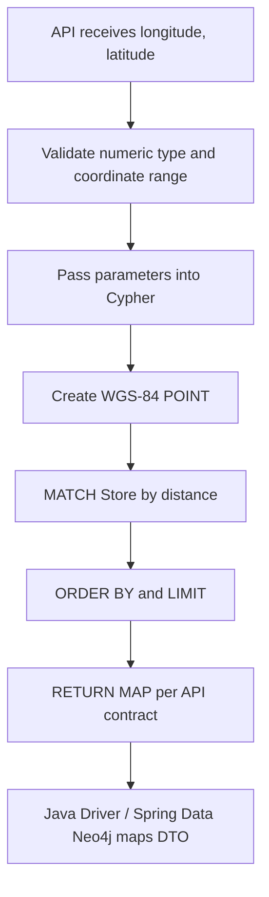

# Spatial Coordinates, Coordinate Reference Systems, and Point Values in Neo4j Cypher

In the **property graph** model, a node stores not only names, identifiers, or creation dates, but can also store the **geographic location** of a store, warehouse, delivery hub, or event venue. Neo4j supports the **`POINT`** spatial value type and Cypher functions to construct coordinates, compute distances, and filter nearby locations.

This lesson belongs to the **Data Types** chapter of the `DATABASE_ENGINE_GRAPH_NEO4J` module. The focus is on understanding **coordinates**, **coordinate reference systems (CRS)**, 2D/3D point forms, storing points on nodes or relationships, spatial queries, indexing, and exchanging data with the Java Driver or Spring Data Neo4j.

After this lesson, you will be able to:

- Choose between **WGS-84** geographic coordinates and **Cartesian** planar coordinates based on data semantics.
- Create, store, read, and inspect `POINT` values using Cypher.
- Calculate distances in the right units, perform radius filtering, and filter by bounding boxes.
- Understand the differences between GeoJSON data, longitude/latitude pairs, and a Neo4j point object.
- Design spatial queries capable of leveraging a **point index**, while avoiding pitfalls in Java integration.

## 1. What Are Spatial Coordinates?

A **point** describes a location in a defined space. The numbers inside a point are meaningful only when the **coordinate reference system** and unit convention are known.

Examples:

- `longitude = 106.7009`, `latitude = 10.7769` represent a geographic location using **longitude/latitude**.
- `x = 100.0`, `y = 250.0` can represent a position on a warehouse floor plan, without indicating whether those are meters, centimeters, or another coordinate system unless the domain defines it.
- `longitude`, `latitude` with `height` represent a geographic position with elevation.
- `x`, `y`, `z` represent a position in a three-dimensional planar coordinate system.

Neo4j stores a point value together with its coordinate reference system metadata, enabling spatial operations to interpret coordinates properly. Do not store two standalone numbers and assume every distance calculation can treat them as a geographic location.

### 1.1. Three Concepts Not to Conflate

| Concept | Example | Role |
| --- | --- | --- |
| Coordinates | `106.7009` and `10.7769` | Numeric values describing position |
| Coordinate Reference System | `wgs-84`, `cartesian` | Defines axis meaning and interpretation |
| Distance Unit | Meters, floor-plan coordinate units | Helps interpret distance results |

For global longitude/latitude data, input units are **degrees**, while `point.distance()` returns results in **meters** for compatible geographic points. For Cartesian coordinates, distance results share the same unit as the input coordinates.

## 2. POINT Coordinate Reference Systems Supported by Neo4j

Neo4j provides the following common point coordinate reference systems:

| CRS | SRID | Dimensions | Typical Axes/Properties | Use Case |
| --- | ---: | --- | --- | --- |
| `wgs-84` | `4326` | 2D | `longitude`, `latitude` | Locations on the Earth's surface |
| `wgs-84-3d` | `4979` | 3D | `longitude`, `latitude`, `height` | Geographic locations with elevation |
| `cartesian` | `7203` | 2D | `x`, `y` | Floor plans, blueprints, or planar coordinates |
| `cartesian-3d` | `9157` | 3D | `x`, `y`, `z` | 3D planar space, e.g., multi-level warehouses |

**CRS** specifies how the coordinate axes are interpreted. **SRID** (*Spatial Reference Identifier*) is the numeric code identifying the corresponding reference system.

Here, **Cartesian** is a planar coordinate system using units chosen by the application. Neo4j does not automatically know whether `x = 100` means 100 meters or 100 centimeters. Built-in Cartesian CRSs do not automatically perform map projections from longitude/latitude.

### 2.1. What Is WGS-84?

WGS-84 (*World Geodetic System 1984*) is the geographic reference system commonly used with GPS and global maps:

- **Latitude**: describes north–south position, measured in degrees.
- **Longitude**: describes east–west position, measured in degrees.
- **Height**: belongs to the 3D variant; the elevation datum in the source data must be defined.

In standard geographic ranges, latitude spans from −90° to +90°, while longitude is expressed around −180° to +180°. During data ingestion, normalize and validate coordinate bounds according to system conventions; in particular, check for swapped longitude/latitude order.

### 2.2. What Are Cartesian Coordinates?

For a warehouse floor plan, you might place the origin at one corner of the warehouse, with the `x`-axis running horizontally and `y` vertically. Then:

```text
             y
             ↑
             |
    A        |       B
             |
-------------O----------------→ x
```

A point `(10, 20)` is meaningful only once axis orientation, origin placement, and measurement unit are agreed upon. If `x` and `y` are measured in meters, Cartesian distances are also in meters; if measured in pixels, distances are in pixels.

**Key takeaway:** you cannot simply rename `x` to `longitude` or attach a different CRS to the same two numbers to convert one coordinate system into another. Real CRS conversion requires a well-defined coordinate transformation.

## 3. Creating POINT Values in Cypher

The `point()` function creates a `POINT` value from a map describing coordinates. The keys in the map determine which coordinate type is created.

### 3.1. WGS-84 2D Geographic Points

```cypher
RETURN point({
  longitude: 106.7009,
  latitude: 10.7769
}) AS hcmPoint;
```

When using `longitude` and `latitude` without specifying another CRS, Cypher creates a two-dimensional WGS-84 geographic point. **Longitude goes with key `longitude`, latitude goes with `latitude`**; do not swap the two values.

You can specify the coordinate reference system explicitly:

```cypher
RETURN point({
  longitude: 106.7009,
  latitude: 10.7769,
  crs: 'wgs-84'
}) AS explicitWgs84;
```

### 3.2. WGS-84 3D Geographic Points

When elevation also needs to be represented:

```cypher
RETURN point({
  longitude: 106.7009,
  latitude: 10.7769,
  height: 12.5
}) AS pointWithHeight;
```

This value uses the `wgs-84-3d` system with SRID `4979`. Clarify which datum and height convention the `height` data follows. GPS sources, topographic maps, and building management systems may use different elevation conventions.

### 3.3. Cartesian 2D and 3D Points

```cypher
RETURN
  point({x: 10.0, y: 25.0}) AS warehousePoint2d,
  point({x: 10.0, y: 25.0, z: 4.5}) AS warehousePoint3d;
```

For Cartesian points, `x`, `y`, and `z` do not inherently represent longitude, latitude, or altitude above sea level. They are simply coordinates in the planar system defined by the business domain.

### 3.4. Creating Points by SRID

An explicit SRID can be used when you want to lock down the coordinate reference system:

```cypher
RETURN
  point({
    longitude: 106.7009,
    latitude: 10.7769,
    srid: 4326
  }) AS geoPoint,
  point({
    x: 10.0,
    y: 25.0,
    srid: 7203
  }) AS localPoint;
```

Within a single `point()` call, the keys and coordinate reference system must be compatible. Do not use `x`/`y` with the WGS-84 SRID as a way to convert coordinates.

## 4. Inspecting Information on a POINT Value

A point value lets you read coordinates and CRS metadata via property-access expressions.

### 4.1. Reading Longitude, Latitude, CRS, and SRID

```cypher
WITH point({
  longitude: 106.7009,
  latitude: 10.7769
}) AS location
RETURN
  location.longitude AS longitude,
  location.latitude AS latitude,
  location.crs AS coordinateSystem,
  location.srid AS referenceId;
```

For this 2D point, `coordinateSystem` is `'wgs-84'` and `referenceId` is `4326`.

### 4.2. Reading Fields of a Cartesian Point

```cypher
WITH point({x: 3.0, y: 4.0}) AS location
RETURN
  location.x AS x,
  location.y AS y,
  location.crs AS coordinateSystem,
  location.srid AS referenceId;
```

For 3D points, also read `location.z` for Cartesian or `location.height` for WGS-84 3D when corresponding data is present.

**Do not blindly apply the same set of fields to every CRS.** When input data may contain multiple coordinate reference systems, check `crs`/`srid` before selecting which coordinates to extract.

### 4.3. POINT Differs from a MAP Containing Coordinates

```cypher
WITH {
  longitude: 106.7009,
  latitude: 10.7769
} AS coordinates
RETURN
  coordinates AS coordinateMap,
  point(coordinates) AS spatialPoint;
```

The two output values have different types:

- `coordinateMap` is a **`MAP`** used in expressions or parameters.
- `spatialPoint` is a **`POINT`**, which has a defined CRS and can be stored directly as a property.

If you assign `coordinateMap` directly to a node property, Neo4j will reject it because a property cannot directly store a nested map. Convert it to a `POINT` or split it into separate scalar properties.

## 5. Storing POINT as a Property on a Node or Relationship

`POINT` is a valid property type in Neo4j. You can directly store the location of a place:

```cypher
MERGE (s:SpatialDemoStore {storeId: 'STORE-001'})
SET
  s.name = 'Central Store',
  s.location = point({
    longitude: 106.7009,
    latitude: 10.7769
  })
RETURN
  s.storeId,
  s.name,
  s.location;
```

`MERGE` finds or creates a node by `storeId`; this example can be re-run to update the demo data. In a real system, to guarantee unique identifiers under concurrent transactions, design an appropriate **unique constraint** on the business key.

### 5.1. Storing Coordinates on a Relationship

Suppose a graph has users and events, and the `CHECKED_IN_AT` relationship represents a check-in; the check-in location can be a property on the relationship itself:

```cypher
MERGE (u:SpatialDemoUser {userId: 'USER-001'})
MERGE (e:SpatialDemoEvent {eventId: 'EVENT-001'})
MERGE (u)-[r:CHECKED_IN_AT]->(e)
SET
  r.location = point({
    longitude: 106.7012,
    latitude: 10.7771
  }),
  r.checkedInAt = datetime('2026-11-25T09:30:00+07:00')
RETURN
  u.userId,
  e.eventId,
  r.location,
  r.checkedInAt;
```

Here the **relationship** stores details of the check-in action. This fits when the data is an attribute of the linking event between two entities rather than a fixed attribute of the user.

### 5.2. When to Store a POINT vs. When to Extract a Place Node?

| Requirement | Usually Suitable Model | Explanation |
| --- | --- | --- |
| Only the store's current coordinates are needed | `Store.location: POINT` | One property suffices for spatial filtering |
| Place has a name, address, and rich metadata | `Place` node and relationship | The place has its own identity and attributes |
| Multiple stores share the same location | Shared `Place` node | Avoids unnecessary data duplication |
| Tracking movement history | Time-ordered location nodes/relationships | A single current `location` property cannot store history |
| Recording location when a link occurs | `POINT` property on the relationship | Coordinates are tied to the linking action itself |

Choose the model based on data relationships and query needs, not solely on how coordinates are represented.

## 6. Computing Distance with point.distance()

The `point.distance(a, b)` function calculates the distance between **two points with compatible coordinate reference systems**.

### 6.1. Distance Between Two Geographic Points

```cypher
WITH
  point({longitude: 106.7009, latitude: 10.7769}) AS a,
  point({longitude: 106.7060, latitude: 10.7810}) AS b
RETURN
  point.distance(a, b) AS distanceMeters,
  round(point.distance(a, b)) AS roundedMeters;
```

For **WGS-84** points, the result is spatial distance in **meters**, suitable for near/far calculations on the Earth's surface using the geodetic calculation supported by Neo4j. Do not interpret this result as travel time or actual road distance.

**Example:** two stores 1.2 km apart by geographic distance might require a 2.5 km drive along streets due to bridges, rivers, or one-way roads. Graph shortest-path algorithms also do not automatically equal road distance unless the graph models the road network and appropriate weights.

### 6.2. Cartesian Distance

```cypher
WITH
  point({x: 0.0, y: 0.0}) AS a,
  point({x: 3.0, y: 4.0}) AS b
RETURN point.distance(a, b) AS distanceInCoordinateUnits;
```

The result is `5.0` according to the Euclidean formula:

\[
d = \sqrt{(x_2-x_1)^2 + (y_2-y_1)^2}
\]

If the floor plan uses meters, the result is 5 meters; if coordinates use centimeters, the result is 5 centimeters. Neo4j does not infer unit conventions from axis names `x` and `y`.

### 6.3. With 3D Points

Distance can be computed for compatible 3D points:

```cypher
WITH
  point({x: 0.0, y: 0.0, z: 0.0}) AS a,
  point({x: 3.0, y: 4.0, z: 12.0}) AS b
RETURN point.distance(a, b) AS distance3d;
```

For Cartesian 3D, the result is `13.0` coordinate units. In 3D geographic data, clearly understand the elevation component, CRS, and distance semantics before using it in business logic.

### 6.4. Do Not Mix CRSs in Distance Calculations

A common mistake is attempting to calculate the distance between a WGS-84 `POINT` and a Cartesian `POINT`:

```cypher
WITH
  point({longitude: 106.7009, latitude: 10.7769}) AS geo,
  point({x: 106.7009, y: 10.7769}) AS planar
RETURN geo.crs AS geoCrs, planar.crs AS planarCrs;
```

Although both points hold identical-looking numbers, they belong to **different coordinate reference systems**. Do not treat a distance between them as meaningful; transform coordinates using a dedicated CRS mechanism and establish a single target system before computing.

When data arrives in multiple CRSs, normalize them during ingestion. Writing inconsistent point types to the same property can cause distance queries to miss results or complicate application logic.

## 7. Querying Locations Within a Radius

Suppose there are stores in the graph:

```cypher
UNWIND [
  {
    storeId: 'STORE-001',
    name: 'Central Store',
    longitude: 106.7009,
    latitude: 10.7769
  },
  {
    storeId: 'STORE-002',
    name: 'East Store',
    longitude: 106.7130,
    latitude: 10.7810
  },
  {
    storeId: 'STORE-003',
    name: 'South Store',
    longitude: 106.6970,
    latitude: 10.7630
  }
] AS row
MERGE (s:SpatialDemoStore {storeId: row.storeId})
SET
  s.name = row.name,
  s.location = point({
    longitude: row.longitude,
    latitude: row.latitude
  })
RETURN s.storeId, s.name, s.location;
```

This snippet can be re-run to update nodes with the same `storeId`.

### 7.1. Finding Within a 2 km Radius

```cypher
WITH point({
  longitude: 106.7009,
  latitude: 10.7769
}) AS center
MATCH (s:SpatialDemoStore)
WHERE s.location IS NOT NULL
  AND point.distance(s.location, center) <= 2000.0
RETURN
  s.storeId,
  s.name,
  point.distance(s.location, center) AS distanceMeters
ORDER BY distanceMeters, s.storeId;
```

Explanation:

1. `center` is the reference location, using WGS-84 2D.
2. `WHERE s.location IS NOT NULL` excludes nodes without a stored location.
3. `point.distance(... ) <= 2000.0` filters points no farther than 2,000 meters according to the distance function.
4. `ORDER BY` sorts closer locations first; `s.storeId` provides stable tie-breaking when distances are equal.

If the `location` property contains Cartesian points, 3D points, or invalid types, enforce uniform CRS handling before running this query.

### 7.2. Using Parameters Instead of Hardcoding Location

An API typically passes user coordinates and radius as parameters:

```cypher
WITH point({
  longitude: $longitude,
  latitude: $latitude
}) AS center
MATCH (s:SpatialDemoStore)
WHERE point.distance(s.location, center) <= $radiusMeters
RETURN
  s.storeId,
  s.name,
  point.distance(s.location, center) AS distanceMeters
ORDER BY distanceMeters
LIMIT 20;
```

**Parameter contract:**

| Parameter | Example | Type / Constraint |
| --- | --- | --- |
| `$longitude` | `106.7009` | Number, valid longitude |
| `$latitude` | `10.7769` | Number, valid latitude |
| `$radiusMeters` | `2000.0` | Non-negative number, in meters |

The application must validate inputs: disallow missing coordinates, invalid formats, or negative radii; to bound system load, enforce reasonable radius caps and `LIMIT`. Never concatenate user parameters into Cypher strings.

### 7.3. Distance Is a Computed Value, Not a Graph Path

`point.distance()` does not traverse relationships between nodes to compute shortest paths. If road-network routing is required, the graph model must contain road vertices/segments and edge weights; pathfinding algorithms then operate on that data.

## 8. Querying Within a Bounding Box with point.withinBBox()

A bounding box is defined by two points in the same CRS:

- Lower-left corner: smaller values along the respective coordinate axes.
- Upper-right corner: larger values along the respective coordinate axes.

The `point.withinBBox(point, lowerLeft, upperRight)` function checks whether a point lies inside the given box.

```cypher
WITH
  point({longitude: 106.6900, latitude: 10.7600}) AS lowerLeft,
  point({longitude: 106.7200, latitude: 10.7900}) AS upperRight
MATCH (s:SpatialDemoStore)
WHERE point.withinBBox(s.location, lowerLeft, upperRight)
RETURN s.storeId, s.name, s.location
ORDER BY s.storeId;
```

Suitable use cases:

- Finding stores within the currently visible map viewport.
- Narrowing candidates to a rectangular region before detailed calculations.
- Filtering positions inside a planar region on a warehouse layout.

**A bounding box is not a circular radius.** A point near a corner of the box can be farther from the center than a point on the inscribed circle. When business rules specify "within 2 km", a distance condition must still be applied.

Near the ±180° meridian, areas crossing the antimeridian may require special handling when representing longitudes and bounding boxes; do not assume every corner pair accurately defines complex regions. Likewise, when filtering by administrative boundary polygons, a simple bounding box may include points outside the polygon.

## 9. Point Indexes and Spatial Query Optimization

When the node count is large, filtering by distance via a full scan can be expensive. Neo4j supports **point indexes** to speed up certain query predicates on `POINT` properties.

### 9.1. Creating a Point Index

Example in Neo4j versions supporting this index syntax:

```cypher
CREATE POINT INDEX spatial_store_location_idx IF NOT EXISTS
FOR (s:SpatialDemoStore)
ON (s.location);
```

An index gives the query planner an additional access path for points. Whether the index is chosen depends on the predicate type, record count, statistics, and Neo4j version.

### 9.2. Predicates Compatible with Spatial Filtering

The following queries are typical candidates for optimization with an index on `location`:

```cypher
WITH point({longitude: 106.7009, latitude: 10.7769}) AS center
MATCH (s:SpatialDemoStore)
WHERE point.distance(s.location, center) < 1500.0
RETURN s.storeId, s.name;
```

```cypher
WITH
  point({longitude: 106.6900, latitude: 10.7600}) AS lowerLeft,
  point({longitude: 106.7200, latitude: 10.7900}) AS upperRight
MATCH (s:SpatialDemoStore)
WHERE point.withinBBox(s.location, lowerLeft, upperRight)
RETURN s.storeId;
```

Do not claim "a query with a point index is always fast" without inspecting the execution plan and real data.

### 9.3. Inspecting Plans with EXPLAIN and PROFILE

```cypher
EXPLAIN
WITH point({longitude: 106.7009, latitude: 10.7769}) AS center
MATCH (s:SpatialDemoStore)
WHERE point.distance(s.location, center) <= 2000.0
RETURN s.storeId;
```

- `EXPLAIN` shows the execution plan without running the query to retrieve results.
- `PROFILE` executes the query and reports runtime metrics, suitable for benchmarking on representative datasets.
- Check the point-index operators or scan operators selected in your actual version.

If a query only uses `ORDER BY point.distance(...) LIMIT 10` without an appropriate spatial predicate, **do not assume** a point index automatically performs a 10-nearest-neighbor lookup. You may need to narrow the candidate set with a spatial filter before sorting, or design an optimization strategy matching your version's capabilities.

### 9.4. Do Not Break Predicates Unnecessarily

When filtering locations within a radius, prefer predicates directly on the property:

```cypher
WHERE point.distance(s.location, center) <= $radiusMeters
```

Avoid converting data to strings or manually extracting `longitude` and `latitude` to compute distance with hand-written arithmetic expressions when Neo4j already provides spatial functions. Doing so can lose geographic semantics and the opportunity to use a point index.

## 10. Ingesting Coordinates from CSV, JSON, and GeoJSON

### 10.1. CSV Strings Must Be Converted to Numbers

Suppose a CSV has columns `storeId`, `longitude`, and `latitude`. Values read from CSV are usually strings and must be converted to numbers.

Query pattern:

```cypher
LOAD CSV WITH HEADERS FROM $csvUrl AS row
WITH
  row,
  toFloatOrNull(row.longitude) AS lon,
  toFloatOrNull(row.latitude) AS lat
WHERE row.storeId IS NOT NULL
  AND lon IS NOT NULL
  AND lat IS NOT NULL
  AND lat >= -90.0 AND lat <= 90.0
  AND lon >= -180.0 AND lon <= 180.0
MERGE (s:SpatialDemoStore {storeId: row.storeId})
SET s.location = point({longitude: lon, latitude: lat})
RETURN count(s) AS processedRows;
```

**Notes on this example:**

- `$csvUrl` must be a data source that Neo4j's configuration allows `LOAD CSV` to access.
- `toFloatOrNull()` detects unparseable inputs; validate coordinate bounds before creating a point.
- `count(s)` counts processed rows in the query; if the CSV has duplicate `storeId` values, that count does not equal the number of newly created unique nodes.
- The filter in this example intentionally rejects out-of-range longitudes and latitudes; the project must specify how skipped rows are logged.
- A large-scale pipeline needs batching, logging, and identifier indexes/constraints per system design.

### 10.2. JSON with Named Fields

API inputs are easier to validate when coordinates are named:

```json
{
  "storeId": "STORE-004",
  "location": {
    "longitude": 106.705,
    "latitude": 10.779
  }
}
```

The application can pass these numbers as parameters:

```cypher
MERGE (s:SpatialDemoStore {storeId: $storeId})
SET s.location = point({
  longitude: $longitude,
  latitude: $latitude
})
RETURN s.storeId, s.location;
```

This converts the JSON/map input into a **`POINT` property**. Do not assign the nested map directly to `s.location` if you intend to use spatial functions.

### 10.3. GeoJSON and Longitude/Latitude Order

GeoJSON typically represents a point with the structure:

```json
{
  "type": "Point",
  "coordinates": [106.7009, 10.7769]
}
```

In standard GeoJSON, the `coordinates` array is ordered **`[longitude, latitude]`**. This is a very common source of bugs because many mapping libraries or input forms present latitude first.

If the application passes the coordinate array as a `$coordinates` parameter, you can explicitly construct the point:

```cypher
WITH $coordinates AS coordinates
WHERE size(coordinates) >= 2
RETURN point({
  longitude: coordinates[0],
  latitude: coordinates[1]
}) AS location;
```

This example assumes array elements are already valid numbers; validate array length, numeric type, and bounds in the application layer or before writing. If GeoJSON includes a third coordinate element, **do not guess** its elevation semantics without an explicit system convention.

### 10.4. Source Coordinates in Another CRS

Some datasets use projected planar coordinates, such as measurements from an engineering map. Never feed those values directly into:

```cypher
// Semantically INVALID if x/y originated in a planar system with a different CRS:
RETURN point({longitude: $x, latitude: $y});
```

To convert planar coordinates to longitude/latitude, you need the **source CRS, target CRS, and an appropriate transformation**. Conversion can be performed in an ETL step or in the application layer using a dedicated geospatial library. Adding a `crs` key or renaming axes does not transform numeric values.

## 11. Java Driver Integration with POINT Values

The Neo4j Java Driver supports passing spatial parameters and reading results as driver point types.

### 11.1. Passing POINT via Parameters

You can use `org.neo4j.driver.Values.point(srid, x, y)`, where for WGS-84, `x` is longitude and `y` is latitude:

```java
import java.util.Map;
import org.neo4j.driver.Driver;
import org.neo4j.driver.Session;
import org.neo4j.driver.Values;

public class SpatialStoreRepository {
    public static void saveStore(Driver driver) {
        String cypher = """
            MERGE (s:SpatialDemoStore {storeId: $storeId})
            SET s.location = $location
            RETURN s.storeId
            """;

        try (Session session = driver.session()) {
            session.executeWrite(tx -> {
                tx.run(cypher, Map.of(
                    "storeId", "STORE-005",
                    "location", Values.point(4326, 106.7009, 10.7769)
                )).consume();
                return null;
            });
        }
    }
}
```

This snippet demonstrates parameter binding. Receiving and binding point values can also be organized as separate longitude/latitude parameters if the application prefers constructing the point inside Cypher.

### 11.2. Reading POINT from a Record

```java
import org.neo4j.driver.Record;
import org.neo4j.driver.types.Point;

// Assuming record comes from:
// MATCH (s:SpatialDemoStore) RETURN s.location AS location
if (!record.get("location").isNull()) {
    Point location = record.get("location").asPoint();
    int srid = location.srid();
    double x = location.x();
    double y = location.y();

    // For SRID 4326, x represents longitude and y represents latitude.
}
```

Check `srid` before mapping `x`/`y` to `longitude`/`latitude` in a DTO. When reading 3D values, handle dimensionality and the `z` component appropriately; do not assume every returned point has three coordinates.

If the API returns JSON, the application must define the response structure, for example:

```json
{
  "longitude": 106.7009,
  "latitude": 10.7769,
  "srid": 4326
}
```

The JSON above is a **recommended DTO structure** for delivering data to clients, not a format enforced by the Java Driver itself.

## 12. Spring Data Neo4j and Location Property Modeling

When using Spring Data Neo4j, entities can represent points using spatial types supported by the framework or via suitable converters, depending on version and configuration.

Practical selection approach:

1. Determine whether the domain field represents a **geographic location**, **planar coordinates**, or a richer business structure.
2. Verify which Java types and converters are supported by your Spring Data Neo4j version.
3. Explicitly track CRS/SRID when mapping between entities, driver, and DTOs.
4. Ensure repository methods and custom queries use the same property name, such as `location`.
5. Inspect actual stored data in Neo4j by querying `RETURN s.location, s.location.crs, s.location.srid`.

Example custom Cypher query for radius search:

```cypher
WITH point({
  longitude: $longitude,
  latitude: $latitude
}) AS center
MATCH (s:SpatialDemoStore)
WHERE point.distance(s.location, center) <= $radiusMeters
RETURN
  s.storeId AS storeId,
  s.name AS name,
  point.distance(s.location, center) AS distanceMeters
ORDER BY distanceMeters;
```

The query returns three simple columns for the application to map into a DTO. Specific projection, converter, and repository setups must match the project's Spring Data Neo4j version.

## 13. POINT in Query Results and API Structures

Cypher can return a raw `POINT` value, or construct a map containing the required coordinates.

### 13.1. Returning Raw POINT

```cypher
MATCH (s:SpatialDemoStore)
WHERE s.location IS NOT NULL
RETURN s.storeId AS storeId, s.location AS location
ORDER BY storeId;
```

Here `location` is a column holding a spatial value, not a string or a pre-built map with `longitude` and `latitude` fields following the application's JSON schema.

### 13.2. Returning a Map Matching the API Contract

```cypher
MATCH (s:SpatialDemoStore)
WHERE s.location IS NOT NULL
  AND s.location.srid = 4326
RETURN {
  storeId: s.storeId,
  name: s.name,
  location: {
    longitude: s.location.longitude,
    latitude: s.location.latitude,
    srid: s.location.srid
  }
} AS store;
```

The result `store` is a **MAP within the query**, which may contain nested maps. This structure fits APIs if the client expects specific fields. It **does not mean** Neo4j stores that nested map intact as a property.

A node can store a `POINT` and still be traversed via relationships to fetch products, managers, or regions. Combining the **connected graph model** and **spatial queries** is a major strength of property graphs.

## 14. Real-World Problem: Finding Stores Near a User

Suppose an application needs to find stores within 3 km of a user's coordinates and return their names, rounded distances, and locations.

```cypher
WITH point({
  longitude: $userLongitude,
  latitude: $userLatitude
}) AS userPoint
MATCH (s:SpatialDemoStore)
WHERE s.location IS NOT NULL
  AND point.distance(s.location, userPoint) <= 3000.0
RETURN {
  storeId: s.storeId,
  name: s.name,
  longitude: s.location.longitude,
  latitude: s.location.latitude,
  distanceMeters: round(point.distance(s.location, userPoint))
} AS nearbyStore
ORDER BY nearbyStore.distanceMeters, nearbyStore.storeId
LIMIT 20;
```

Overall data flow:



Topics to align with product requirements:

- **Location accuracy:** GPS can have error; a 3 km radius is a coordinate filter requirement, not a guarantee of exact physical positioning.
- **Units:** geographic distance is in meters; the UI may convert to kilometers, but must not confuse it with travel time.
- **Sorting rules:** when multiple stores are nearly equidistant, use a secondary key for stable ordering.
- **Performance:** use a point index and bound the result set; measure with `PROFILE` on representative data.
- **Data quality control:** do not store missing coordinates, swapped longitude/latitude, or mixed CRSs in the same dataset without an explicit convention.

## 15. Common Errors and Fixes

| Error or Symptom | Cause | Resolution |
| --- | --- | --- |
| Points appear in the wrong region on the map | Swapped `latitude` and `longitude` | Use explicit keys and verify GeoJSON longitude/latitude order |
| Storing `{lat: ..., lon: ...}` as a single property | `MAP` is not a valid property value | Convert to `POINT` or store two scalar fields |
| `point.distance()` gives no meaningful result | Incompatible CRSs or missing data | Standardize CRS, check for `null`, and reject invalid points |
| Cartesian distance called "meters" | Planar coordinate unit is undefined | Document units explicitly in the data contract |
| Using geographic distance to estimate street length | Straight-line/geodesic distance differs from road routes | Use a road-network graph with appropriate edge weights |
| Treating Cartesian points as WGS-84 | Axes and reference systems have different meanings | Perform proper CRS transformation before ingestion |
| Using bounding box queries as circular radius queries | Rectangles and circles differ | Use `point.distance()` for radius filtering |
| Re-running `CREATE` demo data creates duplicates | `CREATE` always creates nodes | Use `MERGE` on keys and consider constraints |
| Java maps `x` to latitude | Wrong axis order | For SRID 4326, `x` is longitude and `y` is latitude |
| Query remains slow despite a point index | Incompatible plan, predicate, or dataset | Inspect `EXPLAIN`/`PROFILE` and predicates |
| Input JSON coordinates arrive as string `'106.7'` | Numeric type not validated | Convert and check range before creating points |
| Changing only `srid` while keeping raw numbers | Metadata change is not a geometric transform | Apply an actual CRS transformation |
| Sorting by `distance` yields unstable order on ties | Missing secondary sort key | Add an identifier tie-breaker such as `storeId` |
| Storing 3D points when the app only supports 2D | Inconsistent dimensionality and SRID | Standardize schema or support 3D handling |

## 16. Practice Exercises with Solutions

### Exercise 1 — Identifying the Coordinate Reference System

Given two expressions:

```cypher
RETURN
  point({longitude: 106.7009, latitude: 10.7769}) AS p1,
  point({x: 106.7009, y: 10.7769}) AS p2;
```

Are the two points identical, even though they contain the same two numbers?

**Answer:** No. `p1` is WGS-84 2D (SRID 4326); `p2` is Cartesian 2D (SRID 7203). Different CRSs give the exact same two numbers different meanings.

### Exercise 2 — Creating a WGS-84 3D Point

Create a geographic point with longitude `106.7009`, latitude `10.7769`, and height `15`.

**Answer:**

```cypher
RETURN point({
  longitude: 106.7009,
  latitude: 10.7769,
  height: 15.0
}) AS location3d;
```

This is a WGS-84 3D value; the source dataset's elevation convention should be clearly defined.

### Exercise 3 — Calculating Planar Distance

Calculate the Cartesian distance between `(2, 3)` and `(8, 11)`.

**Answer:**

```cypher
RETURN point.distance(
  point({x: 2.0, y: 3.0}),
  point({x: 8.0, y: 11.0})
) AS distance;
```

The result is `10.0` coordinate units, since `sqrt(6² + 8²) = 10`.

### Exercise 4 — Finding Nodes Within 1 km of a Center

Given `SpatialDemoStore.location` as a WGS-84 2D property, find stores within 1,000 meters around `(106.7009, 10.7769)`.

**Answer:**

```cypher
WITH point({
  longitude: 106.7009,
  latitude: 10.7769
}) AS center
MATCH (s:SpatialDemoStore)
WHERE point.distance(s.location, center) <= 1000.0
RETURN
  s.storeId,
  point.distance(s.location, center) AS distanceMeters
ORDER BY distanceMeters, s.storeId;
```

### Exercise 5 — Comparing Radius and Bounding Box Queries

Why can a store inside a bounding box still lie outside the requested radius?

**Answer:** a bbox is a rectangular region, whereas a radius defines a circular region; locations near the corners of the rectangle can be farther from the center than the radius. If an exact radius limit is needed, apply the `point.distance()` predicate.

### Exercise 6 — Reading Points in the Java Driver

Suppose `record.get("location").asPoint()` returns a point with SRID 4326, `x = 106.7009`, and `y = 10.7769`. Which JSON API fields do `x` and `y` map to?

**Answer:** `x` maps to `longitude`, and `y` maps to `latitude`. The application should check the SRID before performing that mapping.

### Exercise 7 — Designing Location History

An IoT device sends coordinates every minute. Should you continuously overwrite a single `device.location` property or create a different data structure?

**Answer:** If only the current position is needed, a single `POINT` property may suffice. If you need trajectory history and observation timestamps, store observations over time (e.g., `LocationObservation` nodes with `position: POINT`, `observedAt: DATETIME`, and a relationship to `Device`). The modeling choice also depends on data volume, retention, and query patterns.

## 17. Spatial Data Implementation Checklist

1. Do source coordinates use WGS-84, Cartesian, or another CRS?
2. Are input coordinates in the right longitude/latitude order?
3. Are units and origin defined for Cartesian systems?
4. Is the data 2D or 3D? What elevation convention is used?
5. Is the `location` property stored as `POINT` with a consistent CRS?
6. Have API/CSV/GeoJSON parameters been validated for numeric type and bounds before writing?
7. Does `point.distance()` use the right unit—for example, meters for WGS-84?
8. Does the query need a circular radius or a bounding box?
9. Is a point index needed, and have you inspected `EXPLAIN`/`PROFILE` on critical queries?
10. Do DTOs/Java Driver/Spring Data Neo4j handle SRID and point types properly?
11. Is location an attribute of a node, a relationship, or an entity with its own history?
12. Does the system need geodesic distance, road-network routing, or both?

---

**Remember:** `POINT` pairs **coordinates** with a **CRS** to define a location. In Neo4j, `wgs-84` fits longitude/latitude, while `cartesian` fits planar coordinates under business-defined units. `point()` creates spatial values, `point.distance()` computes distances, and `point.withinBBox()` filters rectangular areas; a point index can support queries over large datasets. When integrating Cypher with the Java Driver or Spring Data Neo4j, keep axis order, units, SRID, and place semantics consistent across your property graph model.
