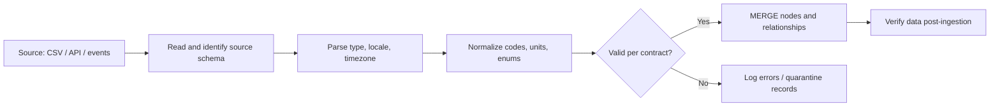

# Data Type Conventions, Units of Measurement, and Input Normalization in Neo4j

When building a **property graph** with Neo4j, a value must not only be "storable", it must also preserve the right **semantics, data type, unit of measurement, and comparison rules**. Two nodes with the same label can originate from different systems: one source sends temperature in °C, another in °F; one sends timestamps with a timezone, another sends local datetime strings; an identifier `"00123"` may get turned into the number `123`. If these values enter the graph unchecked, Cypher queries over relationships, filters, distances, and paths can return wrong results even when the syntax is completely valid.

This lesson establishes input data conventions for Neo4j, from choosing property types and standard units to validation, conversion, ingestion with Cypher, Java Driver/Spring Data Neo4j integration, and data quality monitoring.

## 1. Learning Outcomes

After this lesson, you will be able to:

1. Distinguish between **property** data types, **intermediate Cypher values**, and **node/relationship** structures.
2. Define consistent conventions for property names, value domains, units of measurement, precision, temporal values, identifiers, and missing values.
3. Normalize heterogeneous data before running `MERGE` on nodes/relationships and prevent data-type bugs from silently entering the graph.
4. Write an illustrative ingestion flow in Cypher and pass parameters safely with the Neo4j Java Driver.
5. Use validation queries, constraints, and indexes to maintain consistency as the graph grows.

## 2. Why Are Data Conventions Especially Important for a Property Graph?

Suppose a graph stores the relationship `(:Device)-[:RECORDED]->(:Reading)`. The following properties look similar:

| Source | Input Property | Value | Actual Meaning |
|---|---|---|---|
| A | `temperature` | `25` | 25 °C, integer |
| B | `temperature` | `"77"` | 77 °F, string |
| C | `temperature` | `"25,0"` | 25 °C, comma decimal separator |
| D | `recordedAt` | `"2026-11-25 09:00"` | Local time, unknown timezone |
| E | `recordedAt` | `"2026-11-25T09:00:00+07:00"` | Determinable instant with offset |

If you run `WHERE r.temperature > 30`, string data and numeric data will not automatically align into a meaningful comparison. If every `77` is treated as °C, temperature alerts will be wrong. Without knowing source D's timezone, the exact measurement instant cannot be determined. The more connected relationships a graph has, the more queries are affected by bad data on a single node.

**Core principle:** define a data contract for each property *before* ingesting; pick one canonical representation, convert at the system boundary, and validate before writing.

## 3. Distinguishing Cypher Value Types and Storable Property Types

Cypher can operate on many value types. However, not every intermediate value can be stored directly as a property.

| Category | Common Types/Values | Usage Convention |
|---|---|---|
| Text | `STRING` | Display names, identifiers, unit codes, normalized enums |
| Integer | `INTEGER` | Quantities, counts, smallest currency units, integer timestamps if backed by a clear contract |
| Floating-point | `FLOAT` | Measurements with acceptable error, ratios, numeric coordinates |
| Boolean | `BOOLEAN` | True/false binary states |
| Date and time | `DATE`, `LOCAL TIME`, `ZONED TIME`, `LOCAL DATETIME`, `ZONED DATETIME` | Choose based on temporal meaning and timezone determinability |
| Duration | `DURATION` | Calendar/clock time spans |
| Spatial | `POINT` | Geographic coordinates or planar coordinates with a defined CRS |
| List | Lists whose elements match property types | Simple, homogeneous value sets; avoid mixed/nested lists |
| Intermediate structures | `MAP`, node, relationship, path | Used in queries, parameters, or graph models; never store an entire map/node/path as a property |

Example illustrating the distinction:

```cypher
WITH {
  readingId: 'r-001',
  temperatureC: 25.0,
  observedAt: datetime('2026-11-25T09:00:00+07:00')
} AS payload
CREATE (r:Reading {
  readingId: payload.readingId,
  temperatureC: payload.temperatureC,
  observedAt: payload.observedAt
})
RETURN r;
```

`payload` is a **map used inside Cypher**; its component values are stored individually on the node. Do not run `SET r.payload = payload` to try storing the map as a whole property. When data consists of multiple objects with queryable relationships, model them as nodes and relationships.

Important notes:

- Neo4j `INTEGER` is a 64-bit signed integer; check for overflow before converting from strings or high-precision numeric types.
- `FLOAT` is a double-precision floating-point number; arithmetic can introduce binary representation error. Do not use it as the source of truth for monetary amounts requiring exact precision to the smallest unit.
- A missing property is not synonymous with an empty string, `0`, or `false`. In Neo4j, setting a property to `null` removes that property.
- List properties must obey Neo4j's storage limits, especially element typing; do not design properties as lists of maps or nested lists. For semantically rich collections of objects, use nodes and relationships.
- Neo4j has a flexible schema: having the same property name across nodes does not automatically guarantee the same type or unit. Applications/ingestion pipelines must enforce the data contract, adding constraints where appropriate.

## 4. Designing a "Property Contract" Before Ingestion

For each node label and relationship type, specify:

| Contract Component | Question to Answer | Example for `Reading` |
|---|---|---|
| Name | Does the property name fully convey its meaning? | `temperatureC` instead of `temp` |
| Type | What is the stored type in Neo4j? | `FLOAT` |
| Unit/Domain | Which unit and range is it normalized to? | Degrees Celsius; not below −273.15 °C |
| Required | If missing, may the node still be created? | `readingId` and `observedAt` required |
| Identifier | Is the key unique and stable? | `readingId` supplied by the source system |
| Precision | Where does rounding happen, and what tolerance is allowed? | Round only on display unless domain rules state otherwise |
| Time | Store an instant or local clock time? | `observedAt` with offset/timezone |
| Provenance | Does input need traceability? | `sourceSystem`, `sourceRecordId`, rule version |
| Bad data | Reject, send to a review queue, or use a default? | Reject records missing a timestamp |

A sample model:

```text
(:Device {deviceId: STRING, model: STRING})
    -[:RECORDED]->
(:Reading {
  readingId: STRING,
  observedAt: ZONED DATETIME,
  temperatureC: FLOAT,
  humidityPct: FLOAT,
  active: BOOLEAN,
  sourceSystem: STRING
})
```

The diagram above is a **contract description**, not a schema-creation statement or property-type constraint syntax. In practice, clearly distinguish desired data types from constraints supported by your current Neo4j version/edition.

### 4.1. Naming Rules

- Use clear, consistent names—for example, `camelCase` for properties, `PascalCase` for node labels, and uppercase for relationship types like `RECORDED`.
- Include the unit in measurement field names when the field always has **one fixed unit**: `distanceM`, `durationMs`, `temperatureC`, `humidityPct`, `weightKg`.
- For quantities with multiple valid business units, store both **the numeric value and a controlled unit code**; avoid packing them into a string like `"12 kg"`.
- Do not alter the casing of identifiers out of habit. Only normalize `"abc"` and `"ABC"` to the same code when the domain confirms they are equivalent.
- Do not rename or change the meaning of an existing property without a data migration and query update plan.

### 4.2. Normalizing Identifiers

A code `"000123"` must remain a `STRING` if leading zeros are meaningful. Device codes, SKUs, phone numbers, postal codes, and case IDs are **identifiers**, not mathematical quantities. Conventions must specify rules for extra whitespace, casing, Unicode, and uniqueness scope.

If an ID is unique only **within a single source system**, consider a semantically composite key (e.g., `sourceSystem` + `sourceRecordId`), or construct a canonical namespaced ID; never `MERGE` two nodes from different sources merely because their local IDs collide.

## 5. Normalizing Units of Measurement and Precision

Neo4j stores values; your system must define unit semantics. An example convention table:

| Quantity | Standard Property | Suggested Type | Rule |
|---|---|---|---|
| Distance | `distanceM` | `FLOAT` | Meters; km × 1,000 |
| Weight | `weightKg` | `FLOAT` | Kilograms; g ÷ 1,000 |
| Processing latency | `latencyMs` | `INTEGER` | Milliseconds; check rounding rules when source is fractional seconds |
| Temperature | `temperatureC` | `FLOAT` | °C; from °F: (°F − 32) × 5/9 |
| Relative humidity | `humidityPct` | `FLOAT` | Range 0–100, never mixed with 0–1 ratios |
| Success ratio | `successRatio` | `FLOAT` | Range 0–1; 75% becomes 0.75 |
| Quantity | `quantity` | `INTEGER` | Integer count, non-negative domain if required by business rules |
| Monetary amount | `amountMinor` + `currency` | `INTEGER` + `STRING` | Smallest currency unit per currency; do not assume every currency has two decimal places |
| Geographic location | `location` | `POINT` | Specify CRS, typically WGS 84 for longitude/latitude |

Conversion examples:

```text
77 °F  →  (77 − 32) × 5/9 = 25 °C
2.5 km →  2,500 m
750 ms →  0.75 s
54%    →  humidityPct = 54; if stored as a ratio, humidityRatio = 0.54
```

**Do not confuse "normalization" with "rounding".** Unit normalization happens first, while rounding rules depend on business logic. For example, geographic distances can use floats with tolerance; invoice amounts should use integers in the smallest unit after confirming the currency's decimal places.

For large monetary amounts or requirements needing exact decimal arithmetic:

1. Parse input using an exact decimal type, such as `BigDecimal` in Java, with a well-defined decimal separator convention.
2. Determine the `currency` and its valid number of decimal places.
3. Convert to an integer in the smallest unit and check that it fits within the 64-bit `INTEGER` range before writing to Neo4j.
4. Format for display only in the API/UI; never sum payment totals with `FLOAT` when exact precision is required.

## 6. Normalizing Dates, Times, Durations, and Timezones

Different temporal concepts require different types:

| Meaning | Type to Consider | Example |
|---|---|---|
| Birth date, effective date | `DATE` | `date('2026-11-25')` |
| Globally comparable event timestamp | `ZONED DATETIME` | `datetime('2026-11-25T09:00:00+07:00')` |
| Wall-clock opening hours without date/timezone | `LOCAL TIME` | `localtime('08:30:00')` |
| Local appointment datetime paired with external timezone context | `LOCAL DATETIME` | `localdatetime('2026-11-25T09:00:00')` |
| Time span | `DURATION` or unit-qualified count | `duration('PT90S')` or `latencyMs = 90000` |

Recommended conventions for events recorded from multiple systems:

- Require sources to supply a **reliable offset or timezone** if the value represents an actual instant. A string `"2026-11-25 09:00"` is insufficient to infer an absolute point in time.
- You may normalize instants to UTC at the ingestion layer to simplify exchange. If regional calendar schedules are needed, also retain the original IANA timezone name, such as `"Asia/Ho_Chi_Minh"`, and daylight saving rules where applicable.
- Use `DATE` for pure calendar dates; do not assume UTC midnight represents every local calendar day.
- Never mix epoch **seconds** and epoch **milliseconds**. If epoch integers must be stored, include the unit in the property name, e.g., `createdAtEpochMs`; prefer temporal types when querying by time.
- Distinguish calendar `DURATION` (months/days) from fixed latency measured in milliseconds: "one month" cannot be converted into a fixed number of seconds.

```cypher
WITH
  datetime('2026-11-25T09:00:00+07:00') AS localEvent,
  datetime('2026-11-25T02:00:00Z') AS utcEvent
RETURN localEvent.epochMillis = utcEvent.epochMillis AS sameInstant;
```

The two strings above denote the exact same instant. When storing transaction histories or events, this matters far more than whether the display strings look alike.

## 7. Normalizing Text, Booleans, Enums, and Missing Values

### 7.1. Text and Classification Codes

For fields used in search, matching, or `MERGE`:

- Trim leading/trailing whitespace when allowed by the contract; do not arbitrarily strip internal spaces inside names or codes.
- Decide whether matching is case-sensitive; apply `toLower`/`toUpper` only when backed by an explicit policy.
- Normalize Unicode consistently (such as NFC) at the ingestion layer when data arrives from multiple sources; do not strip diacritics from display names to turn them into unique keys.
- Map aliases to canonical enum codes—for example, `"active"`, `"ACTIVE"` to `"ACTIVE"`—and reject enums outside the allowed catalog.
- Keep both display labels and identifier codes when needed: `statusCode` is more reliable for stable queries than a localized `statusLabel`.

### 7.2. Booleans Are Not Strings

Sources may represent true/false as `"true"/"false"`, `"yes"/"no"`, `"1"/"0"`, or localized terms. Define an explicit mapping table and write a `BOOLEAN`. Do not treat every value other than `"true"` as `false`; an unrecognized value must be treated as **invalid**.

```cypher
WITH toLower(trim(' YES ')) AS rawActive
RETURN CASE
  WHEN rawActive IN ['true', '1', 'yes', 'y'] THEN true
  WHEN rawActive IN ['false', '0', 'no', 'n'] THEN false
  ELSE null
END AS active;
```

### 7.3. Missing, Empty, Unknown, and Not Applicable

| Case | Possible Convention | Note |
|---|---|---|
| No information | Omit the property | `r.temperatureC IS NULL` checks the missing case |
| Empty string from input | Validate and decide whether to reject or treat as missing | Never use `""` in place of zero |
| Numeric value of 0 | Store `0` if it is a valid measurement | `0` differs from "could not be measured" |
| Boolean `false` | Store `false` | Do not convert to missing |
| Business-meaningful "not applicable" | Model status/category explicitly | Do not use sentinel numbers like `-9999` without a specific contract |

In particular, when running:

```cypher
MATCH (r:Reading {readingId: 'r-001'})
SET r.temperatureC = null;
```

the `temperatureC` property is deleted from the node. Therefore, partial updates must distinguish "field omitted" from "intentionally clearing this field"; never pass an unvalidated raw record directly into `SET`.

## 8. Input Normalization Pipeline

A safe ingestion flow can be structured as follows:



Execution steps:

1. **Identify source and schema version.** Know which source sends °F vs. °C; know whether timestamps carry offsets or must inherit a timezone from the source contract.
2. **Parse.** Convert strings to numbers, booleans, and datetimes according to the *declared locale*. `"1,234"` and `"1.234"` can carry different meanings depending on locale; never guess by globally replacing separators.
3. **Normalize.** Convert to canonical units, enums, types, and naming conventions; check for overflow, precision, and non-finite values per the contract.
4. **Validate.** Check required keys, uniqueness, valid ranges, business thresholds, cross-field consistency, and referenced target nodes.
5. **Write to the graph in a controlled way.** Use parameters, constraints, and stable keys so repeated ingestion does not create unintended duplicates.
6. **Observe and remediate.** Track accepted/rejected counts, reasons, source, processing time, and rule version; replay failed records once source data is fixed.

Never silently apply default values to identifiers, monetary amounts, timestamps, or critical measurements. Defaults are valid only when explicitly defined by business rules and auditable.

## 9. Complete Example: Ingesting Sensor Readings with Cypher

**Problem:** A sensor emits records containing `readingId`, `deviceId`, measurement timestamp, temperature in either °C or °F, humidity percentage, and an active flag as a string. In the graph, all records must store `temperatureC` (°C), `humidityPct` (0–100), `active` (BOOLEAN), and `observedAt` (zoned temporal).

In this example, assume `observedAt` and identifiers have already passed syntax validation in the ingestion layer. Input:

| readingId | deviceId | observedAt | rawTemperature | unit | rawHumidity | rawActive |
|---|---|---|---:|---|---:|---|
| r-001 | sensor-01 | 2026-11-25T09:00:00+07:00 | "77" | F | "55" | YES |
| r-002 | sensor-01 | 2026-11-25T09:05:00+07:00 | "30" | C | "54" | no |

Create key constraints to protect uniqueness:

```cypher
CREATE CONSTRAINT device_id_unique IF NOT EXISTS
FOR (d:Device) REQUIRE d.deviceId IS UNIQUE;

CREATE CONSTRAINT reading_id_unique IF NOT EXISTS
FOR (r:Reading) REQUIRE r.readingId IS UNIQUE;
```

Then normalize and write:

```cypher
WITH [
  {
    readingId: 'r-001',
    deviceId: 'sensor-01',
    observedAt: '2026-11-25T09:00:00+07:00',
    rawTemperature: '77',
    unit: 'F',
    rawHumidity: '55',
    rawActive: 'YES'
  },
  {
    readingId: 'r-002',
    deviceId: 'sensor-01',
    observedAt: '2026-11-25T09:05:00+07:00',
    rawTemperature: '30',
    unit: 'C',
    rawHumidity: '54',
    rawActive: 'no'
  }
] AS rows
UNWIND rows AS row
WITH row,
     toFloatOrNull(trim(row.rawTemperature)) AS rawTemp,
     toFloatOrNull(trim(row.rawHumidity)) AS humidityPct,
     toUpper(trim(row.unit)) AS normalizedUnit,
     toLower(trim(row.rawActive)) AS normalizedActive
WITH row, humidityPct, normalizedActive,
     CASE normalizedUnit
       WHEN 'C' THEN rawTemp
       WHEN 'F' THEN (rawTemp - 32.0) * 5.0 / 9.0
       ELSE null
     END AS temperatureC
WITH row, humidityPct, temperatureC,
     CASE
       WHEN normalizedActive IN ['true', '1', 'yes', 'y'] THEN true
       WHEN normalizedActive IN ['false', '0', 'no', 'n'] THEN false
       ELSE null
     END AS active
WHERE row.readingId IS NOT NULL AND trim(row.readingId) <> ''
  AND row.deviceId IS NOT NULL AND trim(row.deviceId) <> ''
  AND temperatureC IS NOT NULL AND temperatureC >= -273.15
  AND humidityPct IS NOT NULL AND humidityPct >= 0 AND humidityPct <= 100
  AND active IS NOT NULL
MERGE (d:Device {deviceId: row.deviceId})
MERGE (r:Reading {readingId: row.readingId})
SET r.temperatureC = temperatureC,
    r.humidityPct = humidityPct,
    r.active = active,
    r.observedAt = datetime(row.observedAt)
MERGE (d)-[:RECORDED]->(r)
RETURN d.deviceId AS deviceId,
       r.readingId AS readingId,
       r.temperatureC AS temperatureC,
       r.humidityPct AS humidityPct,
       r.active AS active
ORDER BY readingId;
```

Expected result:

| deviceId | readingId | temperatureC | humidityPct | active |
|---|---|---:|---:|---|
| sensor-01 | r-001 | 25.0 | 55.0 | `true` |
| sensor-01 | r-002 | 30.0 | 54.0 | `false` |

At the `WHERE` step, unparseable measurements, unknown units, or invalid active flags **do not enter the graph**. However, this statement does not automatically log rejected records; in a real system, record them in the ingestion pipeline or a data quarantine area. An invalid timestamp can cause `datetime(...)` to throw an error and fail the transaction, so validate it before running the write statement. Also verify whether a given `readingId` belongs exclusively to one `deviceId`.

Floating-point numbers can carry tiny representation errors. If the domain requires two decimal places, define an explicit rounding rule rather than assuming every unit conversion yields an exact decimal value.

In a real application, replace the hardcoded list in `WITH` with a `$rows` parameter passed by the Java Driver; never concatenate user input directly into Cypher query text.

## 10. Queries Become Simpler After Normalization

When all records use the same type and unit, querying temperature thresholds by timestamp does not have to guess whether a source sent °C or °F:

```cypher
MATCH (d:Device)-[:RECORDED]->(r:Reading)
WHERE r.observedAt >= datetime('2026-11-25T00:00:00+07:00')
  AND r.observedAt < datetime('2026-11-26T00:00:00+07:00')
  AND r.temperatureC > 29.0
RETURN d.deviceId, r.readingId, r.observedAt, r.temperatureC
ORDER BY r.observedAt;
```

You can create a range index for queries frequently filtering by timestamp:

```cypher
CREATE RANGE INDEX reading_observed_at IF NOT EXISTS
FOR (r:Reading) ON (r.observedAt);
```

An index gives the planner an additional access path, but does not fix wrong types or wrong units. Use `EXPLAIN` and `PROFILE` on real queries to evaluate execution plans; efficiency also depends on selectivity, dataset size, and relationship traversal patterns.

Query to audit existing contract violations:

```cypher
MATCH (r:Reading)
WHERE r.temperatureC IS NULL
   OR r.humidityPct IS NULL
   OR r.humidityPct < 0
   OR r.humidityPct > 100
   OR r.observedAt IS NULL
RETURN r.readingId, r.temperatureC, r.humidityPct, r.observedAt
LIMIT 100;
```

A uniqueness constraint protects against duplicate key values when the key **is present**; it does not replace required-field checks. Property existence or property type constraints may depend on the Neo4j version and edition in use, so consult the documentation for your deployment before adding them to the schema.

## 11. Location Data: Coordinate Systems and Distance Units

Longitude and latitude are not two arbitrary numbers. Specify:

- **Coordinate Reference System (CRS)**: e.g., WGS 84 for geographic coordinates; Cartesian coordinates for planar maps.
- **Axis order**: avoid swapping `latitude` and `longitude`. Latitude ranges from −90 to 90; longitude ranges from −180 to 180.
- **Distance units**: `point.distance` returns distance in meters for supported geographic points, while planar systems follow the unit of that coordinate system.
- **Verify matching CRSs** before computing distance; never compare coordinates from different CRSs directly.

```cypher
WITH
  point({latitude: 10.7769, longitude: 106.7009}) AS a,
  point({latitude: 10.7750, longitude: 106.6990}) AS b
RETURN point.distance(a, b) AS distanceMeters;
```

If a location is an entity with its own metadata and relationships, model `(:Place {location: point(...)})` and link it via relationships rather than storing lat/lon as a string `"10.77,106.70"`.

## 12. Applying in the Java Driver and Spring Data Neo4j

### 12.1. Normalizing Before Calling the Java Driver

In Java, convert exact monetary amounts or critical business quantities using the appropriate types before passing parameters. Example of an amount in USD's smallest unit:

```java
import java.math.BigDecimal;

BigDecimal amountUsd = new BigDecimal("123.45"); // Standard string: decimal dot
long amountMinor = amountUsd.movePointRight(2).longValueExact(); // 12345
String currency = "USD";
```

`longValueExact()` detects values that are non-integer after scaling or exceed the `long` range. For other currencies, the scaling factor must match that currency's policy, not a hardcoded `2`.

After parsing, validating, and normalizing inputs, pass parameters in native types. Illustrative example with Neo4j Java Driver 5:

```java
import java.time.OffsetDateTime;
import java.util.Map;
import org.neo4j.driver.AuthTokens;
import org.neo4j.driver.Driver;
import org.neo4j.driver.GraphDatabase;
import org.neo4j.driver.Session;

try (Driver driver = GraphDatabase.driver(
         "neo4j://localhost:7687", AuthTokens.basic("neo4j", "password"));
     Session session = driver.session()) {

    Map<String, Object> params = Map.of(
        "deviceId", "sensor-01",
        "readingId", "r-003",
        "temperatureC", 25.0,
        "humidityPct", 55.0,
        "active", true,
        "observedAt", OffsetDateTime.parse("2026-11-25T09:10:00+07:00")
    );

    session.executeWrite(tx -> {
        tx.run("""
            MERGE (d:Device {deviceId: $deviceId})
            MERGE (r:Reading {readingId: $readingId})
            SET r.temperatureC = $temperatureC,
                r.humidityPct = $humidityPct,
                r.active = $active,
                r.observedAt = $observedAt
            MERGE (d)-[:RECORDED]->(r)
            """, params).consume();
        return null;
    });
}
```

The sample code assumes connection settings and credentials are supplied securely from the deployment environment. Never hardcode real passwords in source code. In production, reuse a long-lived `Driver` across the application lifecycle rather than creating a driver per record; use transactions and proper exception handling.

An `OffsetDateTime` carries offset information; passing the parsed temporal type directly reduces errors from manual Cypher string formatting. If input provides only `LocalDateTime`, explicitly determine the source timezone before converting it into an instant.

### 12.2. Representing Types in Spring Data Neo4j

An entity can express a property contract using Java types:

```java
import java.time.OffsetDateTime;
import org.springframework.data.neo4j.core.schema.Id;
import org.springframework.data.neo4j.core.schema.Node;
import org.springframework.data.neo4j.core.schema.Property;

@Node("Reading")
public class Reading {
    @Id
    private String readingId;

    @Property("temperatureC")
    private Double temperatureC;

    @Property("humidityPct")
    private Double humidityPct;

    private Boolean active;
    private OffsetDateTime observedAt;

    // Constructor, getters/setters per application conventions.
}
```

`Double`/`Boolean` allow representing missing data in the Java layer; `double`/`boolean` should only be used when the contract guarantees required values that are already validated. Annotations do not replace input normalization, DTO validation, uniqueness constraints, or graph data audits.

In a Spring application, normalize at the ingestion/mapper or service layer before calling repositories, maintaining one unified set of rules across CSV imports, APIs, and event handlers.

## 13. Common Errors and Fixes

| Mistake | Consequence | Fix |
|---|---|---|
| Storing `"25"` alongside `25.0` in the same property | Filtering/sorting/aggregation becomes inconsistent | Parse and cast per contract before writing |
| Storing `25` °C and `77` °F under the same name `temperature` | Inaccurate statistics and alerts | Standardize to `temperatureC` or store explicit value + unit |
| Storing all dates and times as free-form strings | Difficult instant comparisons, timezone errors | Use temporal types and ISO 8601 with offset when needed |
| Using `FLOAT` for exact currency | Rounding errors in addition/subtraction and reconciliation | Use integers in the smallest unit or an appropriate decimal model |
| Converting `"000123"` to `123` | Loses original identifier, merges wrong nodes | Store identifiers as strings |
| Using `false` or `0` to replace missing data | Distorts statistical meaning | Distinguish valid values from missing information |
| Running `MERGE` on display names | Creates duplicates or merges wrong entities | Use stable keys and uniqueness constraints |
| Receiving `"1,234"` and guessing the locale | Off by a factor of a thousand | Declare numeric formats per source and reject ambiguity |
| Storing points without a defined CRS | Wrong distances, invalid coordinate comparisons | Pick a CRS and validate coordinates before ingestion |
| Passing maps/nested lists into a property | Incompatible with the property model | Split into simple properties or nodes/relationships |

## 14. Implementation Checklist and Exercises

Before allowing a new data source to write to the graph, verify:

- [ ] Every property has a name, type, valid range, standard unit, and missing-data rule.
- [ ] Identifiers preserve meaningful characters; unique keys are scoped to the business domain.
- [ ] Numeric inputs have a known locale; monetary amounts and exact quantities are converted losslessly.
- [ ] Instants carry a reliable offset/timezone; epoch seconds and milliseconds are never mixed.
- [ ] Unit, boolean, enum, and Unicode conversion rules are applied consistently at every ingestion entry point.
- [ ] Invalid records are logged and routed for reprocessing, never silently turned into default values.
- [ ] Nodes/relationships are written with parameters, backed by appropriate constraints and an idempotent ingestion strategy.
- [ ] Post-ingestion verification queries exist and rejection rates are monitored.

**Exercise 1 — Designing a Contract.** Create a contract for an `(:Order)` node with `orderId`, `placedAt`, `totalAmount`, `currency`, and `deliveryDistance`. Choose Neo4j types, standard units, valid ranges, required fields, and unique keys. Explain how to store a currency that does not have two decimal places.

**Exercise 2 — Diagnosing Bad Data.** One source ingests `temperature = "86"` with `unit = "F"`; another ingests `temperature = "30"` with `unit = "C"`. Write the conversion to `temperatureC`, filter with a 29 °C alert threshold, and explain why filtering on raw strings is wrong.

**Exercise 3 — Comparing Instants Properly.** Compare `2026-11-25T09:00:00+07:00` with `2026-11-25T02:00:00Z`. Write a Cypher query proving they represent the same instant; explain how to handle a source sending only `2026-11-25 09:00` without declaring a timezone.

**Exercise 4 — Quality Auditing.** Extend the query in Section 9 to capture a list of invalid records before `MERGE`. Explain how to handle two records sharing the same `readingId` but having different `deviceId` values, ensuring one reading is not accidentally linked to two devices.

**Remember:** in Neo4j, the meaning of a property is formed by *data type + unit + valid domain + normalization rules + provenance*. Only when these conventions are consistent can Cypher queries and graph paths accurately reflect business relationships.
