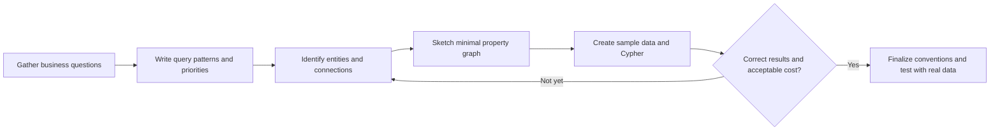
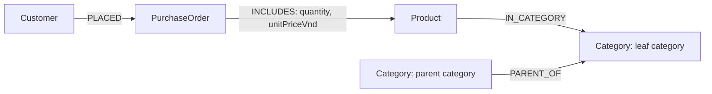

# Going from Business Questions and Query Patterns to a Graph Model

## 1. Lesson Objectives

When designing a graph database with **Neo4j**, the first question should not be “what tables does the system have?” but rather **“what information do users need to find, where do they start, and which relationships must be traversed to find the answer?”**. The *query-first* approach (designing from questions and query patterns) helps create a property graph that directly serves frequently accessed paths, while avoiding turning the graph into a mechanical copy of a relational model.

After this lesson, you will be able to:

- Translate business requirements into a list of **concrete queries**, including starting points, relationships to traverse, filter conditions, returned data, and usage frequency.
- Distinguish when a concept should be a **node**, a **relationship**, a **property**, or an intermediate node representing an entity/event with its own lifecycle.
- Choose relationship directions, labels, relationship types, and identifiers that are clear enough to write **Cypher** and ensure data consistency.
- Build a prototype model, run representative queries, inspect `EXPLAIN`/`PROFILE`, and adjust when path expansion becomes too large.
- Identify decisions that still must be validated with real data: cardinality, path depth, read/write frequency, and growth rate.

This lesson focuses on **data modeling** in Neo4j. Examples of constraints, indexes, and Cypher serve to validate the model; Java Driver implementation, Spring Data Neo4j, and operations are covered in separate topics in the module.

## 2. Why Start from Business Questions?

Neo4j stores data as a **property graph**: nodes represent entities, relationships represent directed links between two nodes, and both nodes and relationships can carry properties. When querying, Cypher can traverse stored connections directly instead of joining multiple junction tables in the application.

However, the same business domain can have multiple valid ways to be modeled. For example, in an e-commerce system:

- If you only need to know **which products** a customer bought, you might imagine a direct relationship `(:Customer)-[:BOUGHT]->(:Product)`.
- If you need to know **which order**, payment status, purchase timestamp, quantity, and unit price at the time of purchase, the order is an important entity and a more appropriate path is `Customer → PurchaseOrder → Product`.
- If you need to manage refunds, split shipments, or line-level discounts, an **OrderLine** with its own identifier may be necessary.

These three approaches are not equivalent in semantics, updatability, and query cost. Therefore, the graph diagram is the **result of clarifying the questions**, not the starting point.

A practical workflow is:



> **Principle:** Optimize for important paths backed by frequency evidence, while preserving business semantics. Do not add every derivable edge simply because traversing a direct edge seems convenient.

## 3. Running Scenario: Product Recommendations in a Sales System

A store wants to use Neo4j to answer the following questions:

1. **Q1 – Purchase history:** Which orders has customer `KH01` placed, newest first?
2. **Q2 – Best-selling products:** Within the “Electronics” category and all of its subcategories, which products sold the most since a given timestamp?
3. **Q3 – Recommendations:** What other products did customers who bought the same products as `KH01` also buy, that `KH01` has never bought?
4. **Q4 – Category hierarchy:** Which category hierarchy path under “Electronics” does a product belong to?

These questions have different query shapes. Q1 is an identifier lookup with a one-hop traversal; Q2 traverses from a category tree to products and then to orders to aggregate; Q3 traverses across multiple entities and excludes already purchased products; Q4 needs to find a **multi-hop path**.

### 3.1. Establish a “Query Contract” Before Drawing the Model

| Query Pattern | Anchor to Look Up First | Expected Path | Conditions and Output | Characteristics to Measure |
|---|---|---|---|---|
| Q1 – Orders of a customer | `Customer.customerId` | Customer → PurchaseOrder | Status, timestamp; return newest orders | Orders/customer, pagination |
| Q2 – Best sellers by category | `Category.categoryId` | Category → subcategories → Product ← PurchaseOrder | Time range, payment status; total quantity | Tree depth, product count, order count |
| Q3 – Recommended products | `Customer.customerId` | Customer → Order → Product ← Order ← Customer → Order → Product | Paid orders only; exclude purchased products; rank | Co-buying customers, product popularity |
| Q4 – Hierarchy path | `Product.sku` and root category | Product → Category ← Category chain | Return category name chain from root to leaf | Depth, multi-parent branches, cycles |

When interviewing domain stakeholders, also ask: Does “purchased” mean **paid**, **delivered**, or all orders? Can a category have multiple parents? Can an order contain the same SKU on multiple lines? These choices determine data structure and query correctness.

### 3.2. Add Non-Functional Requirements

A complete question table should record **frequency**, **scale**, and **latency targets**. The example below uses assumed values for modeling practice, not measurements from a real production system:

| Assumed Parameter | Trial Value | Impact on Decisions |
|---|---|---|
| Q1 is called most frequently | 500 requests/min | Needs an anchor on `customerId` and a row limit |
| Q3 runs on the product page | Target P95 under 200 ms | Must measure fan-out on very popular products |
| Each order has 1–20 SKUs | Up to 20 `INCLUDES` edges/order in the sample | A relationship carrying quantity and price may suffice for v1 |
| Category tree depth up to 4 levels | Limit traversal to 4 hops | Can use `*0..4` instead of an unbounded-length query |
| A product can belong to multiple categories | Many-to-many relationship | Must avoid double-counting when summing sales across the tree |

A P95 target cannot be guaranteed from a diagram alone. You must benchmark on data with a production-like distribution and update the model as the data evolves.

## 4. Going from Business Nouns and Verbs to a Property Graph

### 4.1. Choosing Nodes, Relationships, and Properties

| Concept | Proposed Representation | Rationale |
|---|---|---|
| Customer | `(:Customer {customerId, name})` | Has its own identifier, queried directly |
| Order | `(:PurchaseOrder {orderId, placedAt, status})` | Has status, lifecycle, links to customer and items |
| Product | `(:Product {sku, name})` | Reused across many orders and categories |
| Category | `(:Category {categoryId, name})` | Has hierarchy and is looked up by identifier |
| Customer places order | `(:Customer)-[:PLACED]->(:PurchaseOrder)` | Expresses clear semantics; one customer has many orders |
| Order contains product | `(:PurchaseOrder)-[:INCLUDES {quantity, unitPriceVnd}]->(:Product)` | Quantity and unit price belong to the **purchase event**, not the product's current price |
| Product belongs to category | `(:Product)-[:IN_CATEGORY]->(:Category)` | A product can belong to multiple categories |
| Parent–child category | `(:Category)-[:PARENT_OF]->(:Category)` | Hierarchical structure traversable across multiple levels |
| Customer name, order status | Property | Does not yet need an independent identifier or path within the current question scope |

**Test to decide whether a node is needed:** Does the concept have its own identifier, get referenced by multiple objects, have a status/lifecycle, need to be queried directly, or carry other relationships? If yes, a node is usually a good choice. Properties fit simple values that do not need to be traversed as separate entities.

**Test to decide whether an intermediate node is needed:** Can a link appear multiple times between the same two objects where each occurrence needs its own identifier, status, and separate relationships? If yes, consider an intermediate node. In this example, `INCLUDES` represents **one product line aggregated by SKU per order**. If an order can have two lines with the same SKU under different promotions, shipments, or refund schedules, the model should move to `PurchaseOrder → OrderLine → Product`.

### 4.2. Direction and Relationship Naming Conventions



Relationship names are **verbs/phrases expressing business meaning**; node labels are **nouns**. Use one consistent canonical direction (`PARENT_OF` from parent to child), and Cypher can still traverse in reverse using the `<-` arrow when a question requires it. Avoid generic relationships like `RELATED_TO` and data-dependent names like `PURCHASED_2026`: they obscure meaning and make queries harder to maintain.

Neo4j can store multiple relationships between the same two nodes. That is useful when each edge has distinct semantics, but it also causes aggregations to double-count if the same transaction is accidentally created twice. Identifiers and write strategies must be defined during design.

### 4.3. Distinguishing Current Data from Point-in-Time Event Data

A `Product`'s list price can change. The price paid in an order must reside on `INCLUDES.unitPriceVnd` or on `OrderLine`, because this is a **snapshot** at the time of purchase. Similarly, order status belongs to `PurchaseOrder`, and should not be inferred from the current state of the customer or product.

To avoid currency rounding errors in the VND example, prices are stored as **integer VND**; systems supporting multiple currencies may need a currency code and rounding rules. When business rules introduce refunds, split deliveries, or multiple tax rates, revisit the intermediate-node choice instead of stuffing too many properties onto a single edge.

## 5. Implementing the Minimal Model with Neo4j and Cypher

The statements below use Neo4j 5.x Cypher syntax. They can be run sequentially in Neo4j Browser or a test environment. They create illustrative data and are not intended to simulate all constraints of a real sales system.

### 5.1. Creating Constraints for Anchors

```cypher
CREATE CONSTRAINT customer_id_unique IF NOT EXISTS
FOR (c:Customer) REQUIRE c.customerId IS UNIQUE;

CREATE CONSTRAINT order_id_unique IF NOT EXISTS
FOR (o:PurchaseOrder) REQUIRE o.orderId IS UNIQUE;

CREATE CONSTRAINT product_sku_unique IF NOT EXISTS
FOR (p:Product) REQUIRE p.sku IS UNIQUE;

CREATE CONSTRAINT category_id_unique IF NOT EXISTS
FOR (c:Category) REQUIRE c.categoryId IS UNIQUE;
```

Unique constraints protect identifiers and enable fast key lookups for nodes. They do not automatically guarantee that an order belongs to only one customer, that categories have no cycles, or that an order does not have two identical `INCLUDES` edges: those invariants must be enforced by write logic, validation checks, or additional design rules.

For queries that frequently filter orders by status and timestamp, you can **experiment** with adding an index after checking `PROFILE`:

```cypher
CREATE INDEX order_status_time_idx IF NOT EXISTS
FOR (o:PurchaseOrder) ON (o.status, o.placedAt);
```

Indexes do not automatically make every query faster. If a query starts from a specific customer and traverses a few orders, the `customerId` anchor may matter more than a global timestamp index.

### 5.2. Creating a Small, Rerunnable Dataset

```cypher
MERGE (kh1:Customer {customerId: 'KH01'}) SET kh1.name = 'An'
MERGE (kh2:Customer {customerId: 'KH02'}) SET kh2.name = 'Bình'

MERGE (d1:PurchaseOrder {orderId: 'DH01'})
SET d1.status = 'PAID', d1.placedAt = datetime('2026-11-20T09:00:00+07:00')
MERGE (d2:PurchaseOrder {orderId: 'DH02'})
SET d2.status = 'PAID', d2.placedAt = datetime('2026-11-21T10:00:00+07:00')

MERGE (phim:Product {sku: 'P-KEY'}) SET phim.name = 'Keyboard'
MERGE (chuot:Product {sku: 'P-MOUSE'}) SET chuot.name = 'Mouse'
MERGE (ssd:Product {sku: 'P-SSD'}) SET ssd.name = 'SSD Drive'

MERGE (dienTu:Category {categoryId: 'CAT-ELECTRONICS'})
SET dienTu.name = 'Electronics'
MERGE (ngoaiVi:Category {categoryId: 'CAT-PERIPHERAL'})
SET ngoaiVi.name = 'Peripherals'
MERGE (luuTru:Category {categoryId: 'CAT-STORAGE'})
SET luuTru.name = 'Storage'

MERGE (kh1)-[:PLACED]->(d1)
MERGE (kh2)-[:PLACED]->(d2)

MERGE (d1)-[dong11:INCLUDES]->(phim)
SET dong11.quantity = 1, dong11.unitPriceVnd = 800000
MERGE (d1)-[dong12:INCLUDES]->(ssd)
SET dong12.quantity = 1, dong12.unitPriceVnd = 1500000
MERGE (d2)-[dong21:INCLUDES]->(phim)
SET dong21.quantity = 1, dong21.unitPriceVnd = 800000
MERGE (d2)-[dong22:INCLUDES]->(chuot)
SET dong22.quantity = 2, dong22.unitPriceVnd = 400000

MERGE (dienTu)-[:PARENT_OF]->(ngoaiVi)
MERGE (dienTu)-[:PARENT_OF]->(luuTru)
MERGE (phim)-[:IN_CATEGORY]->(ngoaiVi)
MERGE (chuot)-[:IN_CATEGORY]->(ngoaiVi)
MERGE (ssd)-[:IN_CATEGORY]->(luuTru);
```

`MERGE` is used here so the sample dataset can be rerun easily. In a concurrent write application, proper transactions and constraints are required to prevent duplicates; do not treat `MERGE` alone as a guarantee of all business invariants, especially for edges without their own key.

## 6. Writing Cypher from Each Query Pattern

### Q1. Order History from a Customer

The question already identifies the unique anchor `customerId`, so the query starts at `Customer`, traverses `PLACED`, filters, and sorts orders:

```cypher
MATCH (c:Customer {customerId: $customerId})-[:PLACED]->(o:PurchaseOrder)
WHERE o.status = 'PAID'
RETURN o.orderId AS orderId, o.placedAt AS placedAt
ORDER BY placedAt DESC
LIMIT $limit;
```

Running with `$customerId = 'KH01'`, `$limit = 10` returns `DH01`. If stable pagination is needed when multiple orders share the same timestamp, add a secondary sort key `orderId` to `ORDER BY` and use an appropriate cursor strategy. For large datasets, `LIMIT` only caps the number of returned rows; traversal and sorting still must be measured.

### Q2. Best-Selling Products Across the Category Tree

From the root category, traverse down up to four `PARENT_OF` edges, retrieve products in the matched categories, and then find line items in paid orders:

```cypher
MATCH (root:Category {categoryId: $rootCategoryId})
      -[:PARENT_OF*0..4]->(cat:Category)<-[:IN_CATEGORY]-(p:Product)
WITH DISTINCT p
MATCH (o:PurchaseOrder)-[item:INCLUDES]->(p)
WHERE o.status = 'PAID'
  AND o.placedAt >= datetime($fromTime)
RETURN p.sku AS sku, sum(item.quantity) AS unitsSold
ORDER BY unitsSold DESC, sku
LIMIT $limit;
```

Example parameters: `$rootCategoryId = 'CAT-ELECTRONICS'`, `$fromTime = '2026-11-01T00:00:00+07:00'`, `$limit = 10`. Expected results are `P-KEY: 2`, `P-MOUSE: 2`, `P-SSD: 1` (the first two tie and are ordered by `sku`).

Key decisions in this query:

- `*0..4` includes the root category itself (length 0) and limits depth to at most four hops. This limit must match actual hierarchy rules and must not be set arbitrarily if the tree can grow deeper.
- `WITH DISTINCT p` avoids counting a product multiple times when it belongs to multiple branches or when multiple hierarchy paths lead to the same category.
- `item.quantity` is the actual purchased quantity; `count(item)` only counts **order lines**, not units sold.
- This pattern assumes only `PAID` orders count. If the business includes `SHIPPED` orders or subtracts returned items, the filter condition and data source must be updated.

### Q3. Recommendations from Customers Who Bought the Same Products

The path pattern for this problem is:

```text
KH01 → paid order → shared product
                      ↑
                other's order ← other customer
                                      ↓
                                their order → recommended product
```

The Cypher query starts from the current customer; finds people who bought at least one of the same products; and then counts how many of them bought each candidate product:

```cypher
MATCH (me:Customer {customerId: $customerId})
      -[:PLACED]->(myOrder:PurchaseOrder)-[:INCLUDES]->(shared:Product)
WHERE myOrder.status = 'PAID'
MATCH (shared)<-[:INCLUDES]-(theirOrder:PurchaseOrder)
      <-[:PLACED]-(other:Customer)
WHERE theirOrder.status = 'PAID' AND other <> me
WITH DISTINCT me, other
MATCH (other)-[:PLACED]->(otherOrder:PurchaseOrder)
      -[:INCLUDES]->(candidate:Product)
WHERE otherOrder.status = 'PAID'
  AND NOT EXISTS {
    MATCH (me)-[:PLACED]->(oldOrder:PurchaseOrder)
          -[:INCLUDES]->(candidate)
    WHERE oldOrder.status = 'PAID'
  }
RETURN candidate.sku AS sku,
       count(DISTINCT other) AS similarBuyers
ORDER BY similarBuyers DESC, sku
LIMIT $limit;
```

With `$customerId = 'KH01'`, `$limit = 10`, the sample data yields `P-MOUSE` with `similarBuyers = 1`. `DISTINCT` ensures that a person who bought the shared product or candidate product multiple times is still counted as **one customer**.

This illustrates a “customers who bought this also bought” algorithm. On real data, extremely popular products can cause the number of customers traversed to grow very rapidly, making the query expensive even with an index on the starting customer. Based on measurements, you can add a time window, a co-purchase threshold, group-based candidate selection, or a precomputed recommendation table/graph.

### Q4. Finding Paths from Root Category to Product

```cypher
MATCH (p:Product {sku: $sku})-[:IN_CATEGORY]->(leaf:Category)
MATCH path = (root:Category {categoryId: $rootCategoryId})
             -[:PARENT_OF*0..4]->(leaf)
RETURN [node IN nodes(path) | node.name] AS categoryPath
ORDER BY size(categoryPath);
```

With `$sku = 'P-SSD'` and `$rootCategoryId = 'CAT-ELECTRONICS'`, one result is `['Electronics', 'Storage']`. If a product belongs to multiple categories or a category has multiple paths from the root, the query may return **multiple rows**, which may be valid business output. If the business allows only one parent, that rule must be defined and enforced during writes.

## 7. Validating the Model with Data and Execution Plans

Returning three correct rows on small sample data only proves **a few sample cases are right**. Next, you must verify correctness and cost at larger data scales.

### 7.1. Checking Data and Invariants

| Validation Question | What to Verify |
|---|---|
| Are there nodes with duplicate identifiers? | Unique constraints are active for customers, orders, products, and categories |
| How many customers does an order belong to? | Under typical business rules, **exactly one** customer places an order; must be enforced in the write path |
| Can an order have multiple lines for the same SKU? | If yes, the per-SKU `INCLUDES` edge model must change or have explicit aggregation rules |
| Does the category hierarchy contain cycles? | `PARENT_OF` must form a valid hierarchy according to the chosen rules |
| Are there multiple paths to the same product? | Q2 must place `DISTINCT` in the right spot before summing quantities |
| Are there canceled/refunded orders? | Status filters and quantity calculations must match the definition of “sold” |

Diagnostic queries can be used, for example to detect orders placed by multiple customers:

```cypher
MATCH (c:Customer)-[:PLACED]->(o:PurchaseOrder)
WITH o, count(DISTINCT c) AS customerCount
WHERE customerCount > 1
RETURN o.orderId AS orderId, customerCount;
```

The query above only detects orders with **more than one** customer; it does not detect orders with zero customers. For thorough validation, also define checks for orphan nodes.

### 7.2. Using `EXPLAIN` and `PROFILE` Effectively

```cypher
EXPLAIN
MATCH (c:Customer {customerId: 'KH01'})-[:PLACED]->(o:PurchaseOrder)
RETURN o.orderId;
```

`EXPLAIN` inspects the planned execution plan without running the query; `PROFILE` executes the query and reports actual runtime metrics. When reading a plan, focus on:

1. **Starting point:** Does it use an index/constraint on `customerId`, `sku`, `categoryId`? Is there an unexpected large label scan?
2. **Cardinality:** How many rows does each expansion step produce? Does any step multiply the row count dramatically?
3. **Path depth and breadth:** Does `*0..4` match the category structure? Do best-selling products create high fan-out that blows up Q3?
4. **Processing cost:** Inspect DB hits, memory, sorting, and aggregations; re-measure against a realistic data distribution rather than just a few sample nodes.

Indexes help locate **anchor nodes**, but they do not replace controlling the number of traversed relationships. Putting `LIMIT 10` at the end of a query also does not necessarily prevent the cost of generating candidates earlier. When cost is high, revise the query pattern or model based on the step causing row explosion in `PROFILE`.

### 7.3. Common Modeling Mistakes

| Symptom | Consequence | Better Approach |
|---|---|---|
| Turning every SQL table into a node and every join table into a separate node | Extra traversal hops with no business value | Keep an intermediate node only when an identifier, data, and lifecycle are genuinely needed |
| Storing comma-separated SKUs in a property | Hard to filter, hard to update, and cannot traverse links | Create `INCLUDES` edges to each `Product` |
| Using a direct `Customer → Product` edge as the source of truth for purchases | Loses order context, timestamp, and status | Store purchase events via `PurchaseOrder`; only add derived edges with a clear sync strategy |
| Making every relationship bidirectional by default | Easy to create duplicate edge pairs and double-count | Store one meaningful direction; traverse in whichever direction Cypher needs |
| Traversing unbounded paths everywhere | Path explosion, slow queries, or out-of-memory errors | Anchor queries, bound depth per business rules, and constrain candidate sets |
| Summing quantities immediately after traversing multiple category branches | One order line gets counted multiple times | Deduplicate products before joining to orders |
| Relying solely on `MERGE` and assuming everything is unique | Invalid links can appear under concurrent writes | Combine keys, transactions, business invariants, and data checks |

## 8. When Should You Adjust the Initial Model?

A model that serves Q1 well may not serve Q3 well. Changes should be driven by new questions or measurement evidence:

**Case A – Line items become independent entities.** When each line must track shipment batches, refunds, taxes, discounts, delivery status, and its own identifier, refactor to:

```text
(:PurchaseOrder)-[:HAS_LINE]->(:OrderLine {lineId, quantity, unitPriceVnd})
(:OrderLine)-[:FOR_PRODUCT]->(:Product)
```

Q2 then sums `OrderLine.quantity`; Q3 traverses through `OrderLine`. This migration requires updating all queries, tests, and ingestion pipelines.

**Case B – Recommendations become too slow due to popular products.** If Q3 routinely traverses hundreds of thousands of buyers for the same item, consider bounding candidates by time, precomputing customer/product similarity scores, or using an appropriate graph analytics solution. Derived edges like `(:Product)-[:FREQUENTLY_BOUGHT_WITH]->(:Product)` require refresh rules, computation timestamps, and mechanisms to prevent drift from source orders.

**Case C – Heavy aggregate reporting requirements.** If the primary need is daily/regional revenue and volume reports, a relational database or data warehouse may be a better complement for heavy aggregations. Use the graph where connections and paths create clear value; do not force every analytical report to run directly on a transactional graph model.

**Case D – Category hierarchy changes over time.** Moving a subcategory under a different parent can alter many query results. Explicitly define whether categories form a tree or a DAG, whether hierarchy history is required, and how cycles are checked before updates. For “category at the time of purchase” requirements, current category paths may not suffice; a snapshot or temporal model is needed.

In Java applications, pass parameters to Cypher instead of concatenating query strings from user input. When using Spring Data Neo4j, design entities/relationships around the model validated by paths and query patterns; do not let Java class structures automatically dictate every link in the graph.

## 9. Process for New Projects

Use the following checklist to align domain experts, graph modelers, and application developers:

1. **Collect 5–10 priority questions.** Write them with concrete subjects, conditions, and outputs; agree on definitions for terms like “purchased” and “active”.
2. **Map path shapes.** For each question, mark anchor nodes, relationship sequence, direction, depth, filters, sorting, and aggregations.
3. **List invariants and cardinality.** Document 1–1, 1–n, n–n relationships; whether parallel edges are allowed, whether multiple parents are allowed, and whether history is needed.
4. **Sketch the minimal graph.** Choose labels, relationship types, keys, and properties. Keep naming and direction consistent.
5. **Build a dataset with edge cases.** Do not stop at “one node of each”: include repeat buyers, products in two categories, canceled orders, deep categories, and blockbuster products.
6. **Write parameterized queries and verify results.** Check each pattern against business expectations, especially sums and deduplication.
7. **Measure on representative data.** Use `EXPLAIN`/`PROFILE`, inspect intermediate row counts and response times; prioritize optimizing the most frequent query patterns.
8. **Finalize the query contract.** Document inputs/outputs, assumptions, indexes/constraints, depth limits, and update rules when the model evolves.

### Self-Check Exercises

**Exercise 1.** The store allows an order to have two lines with the same SKU because two different discount campaigns apply. Explain why `INCLUDES {quantity, unitPriceVnd}` is no longer easy to manage and rewrite the path pattern using `OrderLine`.

**Exercise 2.** A product belongs to two branches under “Electronics” simultaneously. How would query Q2 break if `WITH DISTINCT p` were removed? Use a small dataset to demonstrate how units sold get doubled.

**Exercise 3.** Q3 performs well with 10,000 orders but slows down as order volume grows. Name three metrics to inspect in `PROFILE` and propose at least two ways to reduce the candidate set while preserving the “customers who bought the same product” meaning.

**Exercise 4.** The finance team asks for a “net revenue by category at the time of purchase” report. Which data fields and temporal rules are missing from the sample graph? What additional questions should be asked about refunds, discounts, and category changes?

**Completion criteria:** You can take an unfamiliar business question, sketch a sensible Cypher path, explain why each element is a node/relationship/property, identify a risk of double-counting or cardinality explosion, and propose how to measure and confirm the design. At that point, your graph model is driven by concrete query needs rather than just a list of entities.
