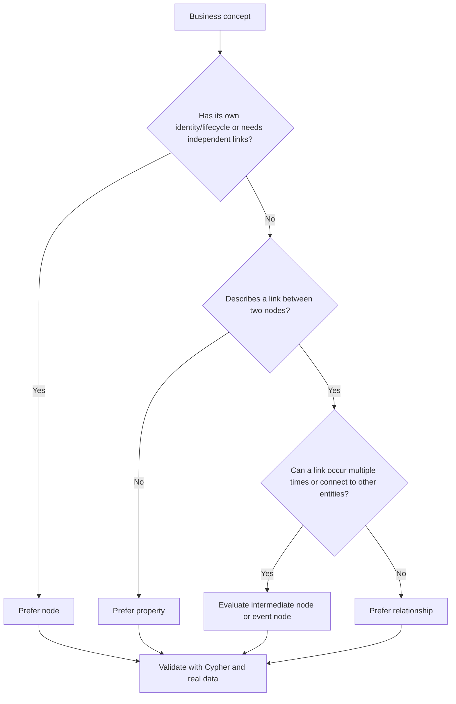
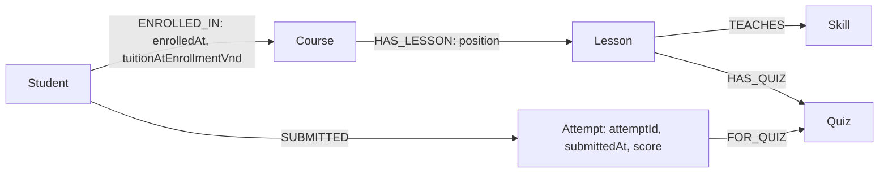

# Choosing Entities as Nodes, Relationships, or Properties

## 1. Lesson Objectives

In **Neo4j**, not every noun in business requirements needs to become a node. A concept can be stored as a **node**, a **relationship**, or a **property**. Choosing the right representation helps Cypher queries express the intended meaning, write data consistently, and avoid unnecessary paths.

This lesson belongs to the **Model Design** section of the `DATABASE_ENGINE_GRAPH_NEO4J` module, focusing on data representation decisions in a **property graph**. It is the foundational step before designing indexes, constraints, path optimization, or mapping the model via the Java Driver and Spring Data Neo4j.

After this lesson, you will be able to:

- Distinguish the responsibilities of nodes, relationships, and properties by **identity, semantics, lifecycle, and query patterns**.
- Turn business requirements into a concrete graph model without mechanically converting every relational table into a node.
- Recognize when a relationship carrying properties is sufficient and when it must be promoted to an **intermediate/event node**.
- Decide where to place properties based on **ownership context**, especially for values that change over time.
- Use Cypher to build, query, and validate the model; recognize risks around duplication and cardinality.

## 2. The Three Core Building Blocks of a Property Graph

| Element | Example Representation | When to Use? | Check Question |
|---|---|---|---|
| **Node** | `(:Student {studentId: 'HV01'})` | An object/event with identity, referenced by others, or needing its own links | “Do we need to look up, update, or connect this object independently?” |
| **Relationship** | `(:Student)-[:ENROLLED_IN]->(:Course)` | A meaningful association between two nodes; always has a type and stored direction | “Does this data describe how two objects relate to each other?” |
| **Property** | `course.title`, `enrollment.enrolledAt` | A value describing a node or a relationship; does not need to be traversed as a separate object | “Who/what does this value belong to, and does it need its own identifier?” |

A node can have multiple **labels**; a relationship has one **type** and connects exactly two nodes. Both nodes and relationships can carry properties. In Cypher, directed syntax `->` or `<-` indicates traversal direction; stored direction does not mean queries can only traverse one way.

Neo4j stores properties as values fitting its property type system, such as strings, numbers, booleans, temporal types, spatial types, and supported arrays. **Do not store a nested object/map directly as a property** expecting to traverse its elements as a graph. If a sub-structure has its own identity or relationships, consider splitting it into a node.

Basic example:

```cypher
(:Student {studentId: 'HV01', name: 'An'})
  -[:ENROLLED_IN {enrolledAt: datetime('2026-10-01T09:00:00+07:00')}]->
(:Course {courseId: 'N4J-101', title: 'Neo4j Basics'})
```

This is **pattern notation illustrating a graph shape**, not a standalone runnable Cypher statement. `Student` and `Course` are nodes; `ENROLLED_IN` is a relationship; student name, course title, and enrollment date are properties on the appropriate elements.

## 3. Decision Process: From Concept to Graph Shape

For each concept in the business requirements, examine five aspects:

1. **Identity:** Is there a code/key identifying a distinct occurrence? Can two objects share the same name yet still be different?
2. **Queries and connections:** Do we need to start queries from this object, find paths to it, or connect it to multiple other object types?
3. **Ownership context:** Does the data describe an object itself or **the association** between two objects? For example, a lesson's order belongs to the lesson's placement in a specific course, not necessarily to the lesson itself.
4. **Multiplicity:** Can the same pair of objects be linked multiple times with independent meanings (multiple enrollments, multiple test attempts)? Do we need to keep the history of each occurrence?
5. **Lifecycle and updates:** Will the concept have its own status, access permissions, generated events, documents, or future relationships?



The diagram above is a **thinking framework**, not an absolute rule. A concept with an identifier can still be represented simply if the system does not need to traverse it; conversely, a value that starts as a property can become a node when relational query needs arise. The final deciding criteria are **business semantics + query patterns + data consistency requirements**.

### 3.1. Signs You Should Use a Node

- Has its own business key, such as `studentId`, `courseId`, `quizId`, `attemptId`.
- Shared across multiple objects, for example a `Skill` taught in multiple lessons.
- Needs multiple related edges traversed, for example from `Course` to `Lesson`, `Instructor`, `Skill`.
- Has independent history or status for **each occurrence**, for example a quiz submission attempt.
- Needs to be referenced, authorized, or processed independently without depending entirely on the two endpoints.

### 3.2. Signs You Should Use a Relationship

- Needs to express a **business verb**: `ENROLLED_IN`, `HAS_LESSON`, `TEACHES`, `SUBMITTED`.
- Both endpoints already have identities and queries need to traverse directly between them.
- Attributes of the link can live on the edge, such as `enrolledAt`, `position`.
- Each pair of endpoints typically has at most one link with that meaning in the given context; there is no need to model each link occurrence as a separate entity.

A relationship with properties does **not automatically** need to become a node just because it has two or ten properties. What matters more is the lifecycle, identity, and separate connections of that link occurrence.

### 3.3. Signs You Should Use a Property

- Is a scalar value/attribute directly describing a node or relationship: `name`, `email`, `createdAt`, `status`, `position`.
- Does not need to hold its own links or be queried as an independent object.
- When updated, the value belongs to a specific object or a specific link occurrence.

An `email` can be looked up using an index and unique constraint **without** creating an `Email` node. Needing to search by an attribute is not a sufficient reason to turn every value into a node.

## 4. Running Scenario: Online Learning Platform

Suppose a training platform needs to serve these questions:

- **Q1:** Which courses is student `HV01` currently enrolled in, and what tuition fee was recorded **at the time of enrollment**?
- **Q2:** In course `N4J-101`, in what order are the lessons displayed?
- **Q3:** How many times has student `HV01` submitted quiz `QUIZ-01`, and what was the score for each attempt?
- **Q4:** Which skills are taught across the courses that student `HV01` is taking?

### 4.1. Classifying Each Concept

| Concept / Data | Choice | Business Rationale |
|---|---|---|
| Student | `(:Student {studentId, name})` | Has identity and participates in many enrollments and quiz attempts |
| Course | `(:Course {courseId, title, currentTuitionVnd})` | Enrolled by many students, contains many lessons |
| Lesson | `(:Lesson {lessonId, title})` | Has its own content and can be reused across multiple courses |
| Skill | `(:Skill {skillCode, name})` | Need to find courses/lessons teaching the same skill |
| Quiz | `(:Quiz {quizId, title})` | Has identity and is referenced by multiple submission attempts |
| Student enrolls in course | `(:Student)-[:ENROLLED_IN]->(:Course)` | Expresses a link between two existing entities |
| Enrollment date, tuition at enrollment | Properties on `ENROLLED_IN` | Belong to the **enrollment event**, not the course's current tuition |
| Course contains lesson | `(:Course)-[:HAS_LESSON]->(:Lesson)` | Need to traverse each course's lesson list |
| Lesson order | `HAS_LESSON.position` | A lesson reused across two courses can appear at two different positions |
| Lesson teaches skill | `(:Lesson)-[:TEACHES]->(:Skill)` | Enables traversing lesson → skill and back |
| Lesson has quiz | `(:Lesson)-[:HAS_QUIZ]->(:Quiz)` | Allows navigating from lesson to quiz |
| Each quiz submission | `(:Attempt {attemptId, submittedAt, score})` | A student can submit the same quiz multiple times; each attempt has its own history |
| Whose attempt, for which quiz | `Student-[:SUBMITTED]->Attempt-[:FOR_QUIZ]->Quiz` | Connects an independent event to the person and quiz |



From the diagram, you can see two contrasting yet consistent decisions:

- `ENROLLED_IN` is a relationship because the example **assumes each student has only one active enrollment in a course** and does not yet manage payments/certificates under individual enrollments.
- `Attempt` is a node because a student **can take the same quiz multiple times**, and each attempt needs an identifier, score, timestamp, and potentially per-question answers in the future.

If the enrollment assumption changes, the model must also change. Section 7 analyzes this situation.

## 5. Placing Properties on the Right Owner

Choosing among the three component types is not enough: placing a property in the **wrong context** can lose history or corrupt updates.

### 5.1. Node Properties vs. Relationship Properties

Suppose a course currently has a list price of `1,500,000 VND`. Student An enrolls when the price is `1,200,000 VND` due to a promotion. Later, the list price changes to `1,800,000 VND`.

```text
(:Course {currentTuitionVnd: 1800000})
(:Student)-[:ENROLLED_IN {tuitionAtEnrollmentVnd: 1200000}]->(:Course)
```

`currentTuitionVnd` describes the **current state of the course**; `tuitionAtEnrollmentVnd` describes the **fee recorded at enrollment**. Storing only the current price on `Course` would lose tuition history when the price changes. Placing `position` on `Lesson` makes a similar mistake if a lesson sits at different positions in different courses.

### 5.2. Simple Property or Shared Node?

For example, if a course has `language = 'vi'`, a language code usually fits well as a property because it is only used for filtering and display. But if business logic needs to traverse “skill A is a prerequisite for skill B”, find lessons teaching the same skill, or group by skills with their own identity, use:

```cypher
(lesson:Lesson)-[:TEACHES]->(skill:Skill)
(prerequisite:Skill)-[:PREREQUISITE_FOR]->(skill)
```

The two lines above are **structural patterns**, not executable statements. An array `lesson.skillCodes` may suffice for storing a few codes for display, but it makes prerequisite relationships, canonical skill names, and path queries hard to express. If you store both an array of codes and `TEACHES` edges simultaneously, you must define the source of truth to prevent drift.

### 5.3. Null Values, Repeated Data, and Structured Values

- In Neo4j, setting a property to `null` **deletes that property**; distinguish missing values from empty strings or `0` according to business rules.
- Do not use a string like `'HV01,HV02,HV03'` as a list of enrollees in a `Course` property: it makes key integrity, filtering, and relationship traversal difficult.
- Avoid packing a list of objects like `{quizId, score, time}` into a `Student` property if you need to query individual submissions. Use `Attempt` so each submission has a clear identity and path.
- Properties can be indexed when queries need an anchor. There is no need to turn a value into a node solely to use an index.

## 6. Creating Data and Cypher Queries from the Model

The examples below use **Neo4j 5.x Cypher** syntax. Run the constraint block first, then the sample data block, and then the parameterized queries. Statements using `MERGE` make the learning dataset easy to rerun; real applications need transactions and consistent write rules.

### 6.1. Identifier Keys for Nodes Requiring Identity

```cypher
CREATE CONSTRAINT student_id_unique IF NOT EXISTS
FOR (s:Student) REQUIRE s.studentId IS UNIQUE;

CREATE CONSTRAINT course_id_unique IF NOT EXISTS
FOR (c:Course) REQUIRE c.courseId IS UNIQUE;

CREATE CONSTRAINT lesson_id_unique IF NOT EXISTS
FOR (l:Lesson) REQUIRE l.lessonId IS UNIQUE;

CREATE CONSTRAINT skill_code_unique IF NOT EXISTS
FOR (s:Skill) REQUIRE s.skillCode IS UNIQUE;

CREATE CONSTRAINT quiz_id_unique IF NOT EXISTS
FOR (q:Quiz) REQUIRE q.quizId IS UNIQUE;

CREATE CONSTRAINT attempt_id_unique IF NOT EXISTS
FOR (a:Attempt) REQUIRE a.attemptId IS UNIQUE;
```

Unique constraints protect node keys and enable identifier-based lookups. They do **not automatically enforce** rules like “each student has at most one `ENROLLED_IN` edge to a course”, “each attempt belongs to one student”, or “no two lessons share the same position in a course”. Those invariants require dedicated write/validation logic.

### 6.2. Sample Dataset

```cypher
MERGE (student:Student {studentId: 'HV01'})
SET student.name = 'An'
MERGE (course:Course {courseId: 'N4J-101'})
SET course.title = 'Neo4j Basics', course.currentTuitionVnd = 1800000
MERGE (lesson1:Lesson {lessonId: 'LESSON-MODEL'})
SET lesson1.title = 'Property graph model'
MERGE (lesson2:Lesson {lessonId: 'LESSON-CYPHER'})
SET lesson2.title = 'Cypher queries'
MERGE (skill:Skill {skillCode: 'GRAPH-MODELING'})
SET skill.name = 'Graph modeling'
MERGE (quiz:Quiz {quizId: 'QUIZ-01'})
SET quiz.title = 'Model quiz'

MERGE (student)-[enroll:ENROLLED_IN]->(course)
SET enroll.enrolledAt = datetime('2026-10-01T09:00:00+07:00'),
    enroll.tuitionAtEnrollmentVnd = 1200000,
    enroll.status = 'ACTIVE'

MERGE (course)-[has1:HAS_LESSON]->(lesson1)
SET has1.position = 1
MERGE (course)-[has2:HAS_LESSON]->(lesson2)
SET has2.position = 2
MERGE (lesson1)-[:TEACHES]->(skill)
MERGE (lesson1)-[:HAS_QUIZ]->(quiz)

MERGE (attempt1:Attempt {attemptId: 'ATT-001'})
SET attempt1.submittedAt = datetime('2026-10-03T10:00:00+07:00'),
    attempt1.score = 60
MERGE (attempt2:Attempt {attemptId: 'ATT-002'})
SET attempt2.submittedAt = datetime('2026-10-04T10:00:00+07:00'),
    attempt2.score = 90
MERGE (student)-[:SUBMITTED]->(attempt1)
MERGE (student)-[:SUBMITTED]->(attempt2)
MERGE (attempt1)-[:FOR_QUIZ]->(quiz)
MERGE (attempt2)-[:FOR_QUIZ]->(quiz);
```

Both `Attempt` nodes have different scores and timestamps, yet both connect to the **same Student and Quiz**. If `score` were placed on a single `Student-[:TOOK]->Quiz` edge, previous attempt data would risk being overwritten or forced into a list that is awkward to query.

### 6.3. Q1 – Tuition Fee at Enrollment Time

```cypher
MATCH (s:Student {studentId: $studentId})-[e:ENROLLED_IN]->(c:Course)
WHERE e.status = 'ACTIVE'
RETURN c.courseId AS courseId,
       c.title AS title,
       c.currentTuitionVnd AS currentTuitionVnd,
       e.tuitionAtEnrollmentVnd AS tuitionAtEnrollmentVnd,
       e.enrolledAt AS enrolledAt,
       e.status AS enrollmentStatus
ORDER BY courseId;
```

With `$studentId = 'HV01'`, the sample data shows `currentTuitionVnd = 1800000` while `tuitionAtEnrollmentVnd = 1200000`. If both values lived on `Course`, the query would not know which price this specific student enrolled at.

### 6.4. Q2 – Lesson Order per Course

```cypher
MATCH (c:Course {courseId: $courseId})-[has:HAS_LESSON]->(l:Lesson)
RETURN l.lessonId AS lessonId, l.title AS title, has.position AS position
ORDER BY position, lessonId;
```

With `$courseId = 'N4J-101'`, the ordered output is: `LESSON-MODEL` at position 1 and `LESSON-CYPHER` at position 2. If `LESSON-MODEL` is reused in another course at position 4, you only need the `position` property on that other relationship; the shared lesson node stays untouched.

### 6.5. Q3 – History of Submissions for a Student

```cypher
MATCH (s:Student {studentId: $studentId})-[:SUBMITTED]->(a:Attempt)
      -[:FOR_QUIZ]->(q:Quiz {quizId: $quizId})
RETURN a.attemptId AS attemptId,
       a.submittedAt AS submittedAt,
       a.score AS score
ORDER BY submittedAt ASC, attemptId;
```

With `$studentId = 'HV01'`, `$quizId = 'QUIZ-01'`, the output is `ATT-001` (score 60) followed by `ATT-002` (score 90). This is a classic case where an occurrence has its **own identifier and requires history querying**, making an `Attempt` node a better fit than a `student.lastScore` property.

### 6.6. Q4 – Querying Across Shared Skills

```cypher
MATCH (s:Student {studentId: $studentId})-[:ENROLLED_IN]->(c:Course)
      -[:HAS_LESSON]->(l:Lesson)-[:TEACHES]->(skill:Skill)
RETURN DISTINCT skill.skillCode AS skillCode, skill.name AS skillName
ORDER BY skillCode;
```

For example, `HV01` returns `GRAPH-MODELING`. If multiple lessons teach the same skill, `DISTINCT` prevents duplicates in the result list. Modeling skills as nodes allows follow-up path queries like “which other courses also teach this skill?” or “which skills are prerequisites?”.

## 7. Tough Case: When Must a Relationship Become a Node?

Assuming **one person enrolls in a course only once** keeps the `ENROLLED_IN` model compact. Now suppose the business expands:

- A student enrolls, cancels, and then **re-enrolls** in a course; the two cohorts must have independent histories.
- Each enrollment has an `enrollmentId`, multiple payments, promo codes, refunds, and invoices.
- Certificates are issued for a **specific enrollment cohort**, not just for a student–course pair.

In that case, consider an `Enrollment` node:

```text
(:Student)-[:HAS_ENROLLMENT]->(:Enrollment {
  enrollmentId: 'ENR-1001',
  enrolledAt: ..., status: 'COMPLETED',
  tuitionAtEnrollmentVnd: 1200000
})-[:FOR_COURSE]->(:Course)

(:Enrollment)-[:HAS_PAYMENT]->(:Payment)
(:Enrollment)-[:EARNED]->(:Certificate)
```

In this structure, `Enrollment` is a **business entity with its own identity and lifecycle**. The direct `ENROLLED_IN` relationship is no longer sufficient as the source of truth for history; if a summary edge is still kept for fast reads, strict synchronization rules are required.

A practical rule of thumb:

| Question | Relationship with Properties | Intermediate Node |
|---|---|---|
| Simply connects two nodes with a few extra values? | Usually sufficient | Usually unnecessary |
| Each link occurrence has its own ID and can repeat multiple times? | Can store parallel edges, but per-occurrence lifecycle is hard to manage | Usually a better fit |
| Need to attach payments, certificates, or support tickets to **that specific link occurrence**? | Relationships cannot serve as endpoints of other relationships | Appropriate |
| Need state control and direct lookups by link occurrence ID? | More complex depending on the model | Clearer |

**Do not turn a relationship into a node just because it has many properties.** The key distinction is whether the “link occurrence” becomes an object with its own identity and relationships.

## 8. Other Decisions Easy to Get Wrong

### 8.1. Is an Address a Property or a Node?

If an address is only for display in a student profile, properties like `city`, `district`, and `street` may suffice. If you need to find students in the same location, link locations to training campuses, look up regions, or manage a canonical location directory, you may need `(:Student)-[:LIVES_IN]->(:Location)`.

Do not automatically treat identical address strings as the same physical location: addresses can omit building numbers, vary in formatting, or represent multiple units inside one building.

### 8.2. Are `Student` and `Instructor` Roles Two Different People?

One person can be both a student and an instructor. If the system identifies the **same person**, you can use a single node `(:Person:Student:Instructor {personId})` with multiple labels or model `Person` linked to roles with independent lifecycles. Avoid creating two unrelated person nodes just because someone holds two roles, if doing so unintentionally splits profile data and relationships.

### 8.3. Is a Skill List a Property or Edges?

`skillCodes: ['GRAPH', 'CYPHER']` is convenient when you only display or filter simple codes. However, if `Skill` has a canonical name, proficiency level, prerequisite links, and connections to hundreds of lessons, `(:Lesson)-[:TEACHES]->(:Skill)` expresses path queries much better.

### 8.4. Should Computed Values Be Stored?

Quiz attempt counts or highest scores can be computed from `Attempt` nodes. Storing `Student.bestScore` or `Quiz.attemptCount` can help very frequent queries, but this is **derived data**: it requires an update workflow whenever source data changes. Before duplicating data, benchmark real queries and define freshness requirements.

### 8.5. Should You Split a Node Because It Has Many Properties?

A node with 20 properties is not necessarily wrong, just as a relationship with 10 properties does not automatically need an intermediate node. Split only when there are **attribute groups with separate lifecycles, access permissions, update frequencies, or relationships**; do not split mechanically by field count.

## 9. Validating the Design and Avoiding Broken Models

### 9.1. Checking Invariants Not Enforced by Identity Constraints

Example to detect a student with multiple `ENROLLED_IN` edges to the same course in a single-enrollment model:

```cypher
MATCH (s:Student)-[e:ENROLLED_IN]->(c:Course)
WITH s, c, count(e) AS relationshipCount
WHERE relationshipCount > 1
RETURN s.studentId AS studentId,
       c.courseId AS courseId,
       relationshipCount;
```

Example to detect duplicate lesson positions within the same course:

```cypher
MATCH (c:Course)-[rel:HAS_LESSON]->(:Lesson)
WITH c, rel.position AS position, count(rel) AS occurrences
WHERE position IS NOT NULL AND occurrences > 1
RETURN c.courseId AS courseId, position, occurrences;
```

These queries are **detection checks**, not automatic write guards. Write operations must be designed inside transactions; under concurrent requests, apply appropriate locks/identifiers and synchronization mechanisms to preserve business invariants.

### 9.2. Performance: Fewer Nodes Does Not Equal Faster Queries

Two models can both return the right answer yet differ greatly in traversal cost. For instance, storing all participants in `Course.studentIds` avoids nodes/edges, but forces array scanning and processing to find shared courses, whereas `ENROLLED_IN` edges express the relationship cleanly and allow traversal from constrained anchors.

Conversely, turning every string such as `name`, `email`, or `language` into a separate node increases node/edge count and path length without necessarily serving any business question.

Use `EXPLAIN` to inspect the planned execution plan and `PROFILE` to observe execution on representative data:

```cypher
EXPLAIN
MATCH (s:Student {studentId: 'HV01'})-[:ENROLLED_IN]->(c:Course)
RETURN c.courseId;
```

When evaluating, inspect whether anchors use an index/constraint, how row counts grow at each traversal step, DB hits, memory, execution time, and relationship degree on single nodes. **Supernodes** such as very popular skills can cause a query to fan out across many branches; in those cases, optimizing query patterns and bounding candidate sets may matter more than converting edges into intermediate nodes.

### 9.3. Common Modeling Pitfalls

| Pitfall | Consequence | Decision to Consider |
|---|---|---|
| Turning every noun into a node | Cluttered graph, pointless traversal hops | Keep simple descriptive values as properties |
| Copying SQL join tables as nodes by default | Intermediate nodes with no business meaning | Use relationships when the link has no independent lifecycle |
| Storing enrollment date on `Student` | A student in multiple courses cannot have per-enrollment dates | Put `enrolledAt` on `ENROLLED_IN` or `Enrollment` |
| Storing lesson order on `Lesson` | Reusing a lesson in multiple courses causes ordering conflicts | Put `position` on `HAS_LESSON` |
| Storing `lastQuizScore` and dropping older attempts | Loses attempt history | Create `Attempt` nodes with their own IDs |
| Storing `course.studentIds` as a comma-separated string | Hard to query links and prevent duplicates | Use `ENROLLED_IN` edges |
| Creating two opposite edges for the same link | Easy to drift out of sync and double-count | Pick one meaningful stored direction and traverse backward when needed |
| Using names as unique identifier keys | Name changes cause confusion; duplicate names are common | Use stable IDs and keep names as properties |
| Storing the same fact on multiple nodes/edges without rules | Copies diverge over time | Establish a source of truth and clear update process |

## 10. Practice Exercises

### Exercise 1 – Classifying Concepts

A course has an instructor, display language, multiple lessons, a list of skills, and a start time for each student. For each concept, choose node/relationship/property and explain your choice using **ownership context, identity, and query paths**.

*Hint:* Does student A's start time in course X belong to A itself or course X?

### Exercise 2 – Spotting a Model That Loses History

An initial model has `(:Student)-[:TAKES {score}]->(:Quiz)` and the application always overwrites `score` on retakes. Identify what information is lost, sketch an alternative model using `Attempt`, and write Cypher to retrieve a student's highest score for a quiz.

### Exercise 3 – Promoting a Relationship to a Lifecycle Node

A training center allows re-enrollment after expiration; each enrollment has multiple payment transactions and its own certificate. Design `Enrollment` and describe how to verify that each `Payment` belongs to exactly one `Enrollment`.

### Exercise 4 – Comparing Two Design Choices

Propose two options for `Skill`: (a) an array of skill codes on `Lesson`; (b) a `Skill` node and `TEACHES` relationship. Give an example business question where option (b) has a clear advantage; then explain when option (a) is still sufficient.

### Exercise 5 – Measuring Performance

Suppose a skill is linked to 200,000 lessons. Write a query pattern going from `Skill` to related courses and name at least three metrics to inspect in `PROFILE`. Explain why **simply adding an index on `skillCode`** does not necessarily solve the cost of fanning out over too many relationships.

## 11. Pre-Finalization Checklist

1. Does every important node have a **stable identifier** and a clear role in queries?
2. Does every relationship have a **meaningful business name**, a consistent direction, and defined multiplicity constraints?
3. Is every property placed on the **node or relationship occurrence that owns** it?
4. Are there time-varying values needing snapshots, or repeated events needing independent nodes?
5. Is any data duplicated across places without a designated source of truth?
6. Do key Cypher queries return accurate results even with multiple participations, multiple paths, and duplicate data?
7. Do indexes/constraints and invariant checks cover all critical identifiers and links?
8. Have you run `EXPLAIN`/`PROFILE` on data of representative scale and distribution?

**Completion criteria:** Given a new requirement, you can explain why a piece of data is a node, relationship, or property; recognize when a relationship must be promoted to an event node; place properties on the proper owner; and write Cypher queries to verify the decision. A good Neo4j model is shaped by **data semantics and how users actually query it**, not by the count of nouns, columns, or tables in input documents.
