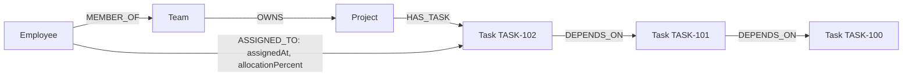

# Naming Labels, Relationship Types, and Properties Consistently

## 1. Lesson Objectives

In **Neo4j**, the names of node labels, relationship types, and property keys are part of the data contract between the application, **Cypher** queries, and operators. A structurally sound graph is still error-prone if the same concept appears as `Task`, `TASK`, and `task`, or if the “assign work” relationship sometimes uses `ASSIGNED_TO` and other times uses `HAS_ASSIGNEE` without a direction convention.

This lesson belongs to the **Model Design** chapter of the `DATABASE_ENGINE_GRAPH_NEO4J` module. It focuses on establishing a naming convention applicable to property graphs, relationship/path queries in Cypher, constraints, indexes, Java/Spring Data Neo4j code, and long-term evolution. This is a **recommended team convention**, not the only naming syntax enforced by Neo4j.

After this lesson, you will be able to:

- Distinguish the types of names in a graph schema and agree on a recognizable style.
- Name labels, relationship types, and properties according to **business meaning, relationship direction, scope, and unit of measurement**.
- Write consistent Cypher, avoiding bugs caused by case sensitivity and unmanaged synonyms.
- Establish naming rules for identifier keys, constraints, indexes, and application code mappings.
- Inspect an actual schema, detect non-standard names, and plan controlled renames.

## 2. Why Is Consistent Naming a Technical Concern?

Neo4j is a property graph: nodes have labels, relationships have types, and both nodes and relationships have properties. Cypher uses these exact names to describe path patterns:

```cypher
MATCH (employee:Employee)-[:ASSIGNED_TO]->(task:Task)
WHERE task.status = 'IN_PROGRESS'
RETURN employee.fullName AS employeeName, task.title AS taskTitle;
```

In this example, `Employee` and `Task` are **labels**; `ASSIGNED_TO` is a **relationship type**; `status`, `fullName`, and `title` are **property keys**. `employee`, `task`, `employeeName`, and `taskTitle` are query variables and aliases, not fixed parts of the graph.

Schema names are case-sensitive. `:Task` and `:task` do not represent the same label; `[:ASSIGNED_TO]` and `[:AssignedTo]` are different types; `task.dueAt` and `task.due_at` are two different keys. Querying the wrong name can return no results or `null` for a property, even when the business data actually exists. Depending on version/configuration, query tools may emit warnings about nonexistent names, but you should not rely on warnings to protect the data contract.

Practical impacts of inconsistent naming:

1. **Correctness:** filters or paths miss nodes/edges if different ingestion pipelines use different names.
2. **Understandability:** someone reading `OWNS` may not know which direction it points; `LINK` or `RELATED_TO` fails to explain the relationship.
3. **Performance:** indexes/constraints are created for specific labels and keys, and do not automatically apply to other name variants.
4. **Integration:** Java code, Spring Data Neo4j mappings, import pipelines, and reports must all share one schema contract.
5. **Change management:** renaming a widely used field can affect many queries, ingestion jobs, and UI screens.

## 3. A Practical Naming Convention

| Element | Recommended Convention | Good Examples | Examples to Avoid |
|---|---|---|---|
| Node label | **Singular** noun, `PascalCase` | `Employee`, `Project`, `Task` | `employees`, `TASK`, `TaskNode` |
| Relationship type | Verb/phrase expressing the link, `UPPER_SNAKE_CASE` | `MEMBER_OF`, `HAS_TASK`, `DEPENDS_ON` | `RELATED`, `link`, `ProjectTaskRel` |
| Property key | `lowerCamelCase`; clear within the object's scope | `employeeId`, `fullName`, `dueAt` | `Employee_Name`, `due_at`, `date1` |
| Cypher variable | `lowerCamelCase`, short yet clear | `employee`, `assignedTask` | `X1`, `EmployeeNode` |
| Cypher parameter | `lowerCamelCase`, close to property name | `$employeeId`, `$fromDate` | `$ID`, `$ARG_1` |
| Result alias | `lowerCamelCase`, aligned with API | `employeeName`, `taskId` | `EMP_NAME`, `col1` |
| Constraint/index name | Lowercase `snake_case`, indicating target and purpose | `employee_id_unique`, `task_status_due_date_idx` | `index1`, `newConstraint` |

This is a **sample convention**. If an organization already uses `camelCase` for relationship types across the entire graph, consistency and controlled transitions matter more than forcing everything into a new style. Whichever style you choose, publish a single rule per name kind and enforce it in new schemas.

### 3.1. Labels: Naming a Node's Identity Properly

`(:Task)` is a specific work item; `(:Project)` is a project; `(:Employee)` is an employee managed by the system. Label names should be **domain nouns**, avoiding implementation details like `TaskEntity`, `TaskTable`, or `GraphTaskNode` unless that term carries genuine domain meaning.

Neo4j allows a node to have **multiple labels**, such as `(:Person:Employee)`. Use multiple labels only when they represent meaningful classifications: `Person` is the human, `Employee` is their organizational role. Do not use labels merely to echo frequently changing attributes, such as `:ACTIVE` for every task state, when business logic only needs a `status` property.

Singular nouns make single-node patterns read more clearly: `MATCH (task:Task)` reads as “a task belonging to the Task group”; `:Tasks` often makes readers confuse a label with a collection. The singular rule is a readability guideline, not a Neo4j limitation.

### 3.2. Relationship Types: Naming Like a Directed Clause

When reading an arrow, form a complete sentence:

```text
(Employee)-[:MEMBER_OF]->(Team)      Employee is a member of Team
(Team)-[:OWNS]->(Project)            Team owns Project
(Project)-[:HAS_TASK]->(Task)        Project has Task
(Employee)-[:ASSIGNED_TO]->(Task)   Employee is assigned to Task
(Task A)-[:DEPENDS_ON]->(Task B)    Task A depends on Task B
```

Choose **one stored direction** that expresses the business fact and document it in the schema contract. When needing the reverse query, Cypher can use `<-`:

```cypher
MATCH (task:Task)<-[:ASSIGNED_TO]-(employee:Employee)
RETURN task.taskId AS taskId, employee.employeeId AS employeeId;
```

There is no need to add `(:Task)-[:HAS_ASSIGNEE]->(:Employee)` just to query in reverse. Storing two edges expressing the same fact increases the risk of out-of-sync updates and double-counting.

**Be especially careful with relationships between nodes of the same label.** `(:Task)-[:DEPENDS_ON]->(:Task)` points from **the blocked task** to **the prerequisite task that must finish first**. Flipping the arrow reverses the dependency meaning. Likewise, distinguish `PARENT_OF` from `CHILD_OF`, and `FOLLOWS` from `FOLLOWED_BY`, and stick to one convention.

Avoid putting timestamps or statuses in relationship type names like `ASSIGNED_2026` or `ASSIGNED_ACTIVE`; use a stable type with properties like `assignedAt` and `status` when the nature of the relationship does not change. Only create separate types when there are **distinct business semantics**, e.g., `REVIEWED` vs. `APPROVED` if those two actions are genuinely distinct.

### 3.3. Properties: Clarifying Owner, Data Type, and Unit

A good property explains what it belongs to on its own:

- `employeeId`, `projectId`, `taskId`: business keys clearly stating the entity type; avoid ambiguous `id` when handling multiple nodes at once.
- `fullName`, `title`, `description`: person name, title, and description; avoid reusing `name` for multiple meanings where readers must guess from context.
- `createdAt`, `updatedAt`, `assignedAt`: timestamps when events occurred; use the `At` suffix consistently for temporal instant values.
- `dueAt` or `dueDate`: choose **one name tied to one type** (e.g., `dueAt` is a zoned datetime, `dueDate` is a calendar date) instead of mixing them interchangeably.
- `estimatedMinutes`, `durationSeconds`, `costVnd`, `allocationPercent`: putting the unit in the name avoids mismatches during data exchange.
- `isArchived`, `isBlocked`: clear boolean flags; for multi-value states, use `status` with a defined set of allowed values.

Place properties on the **right owner of the information**. `Employee.fullName` describes the employee. Conversely, `ASSIGNED_TO.assignedAt` and `ASSIGNED_TO.allocationPercent` describe **the assignment of an employee to a task**. Putting `allocationPercent` on `Employee` would fail to express that the person allocates 40% to Task A and 60% to Task B.

Choose `status` with standardized values, such as `TODO`, `IN_PROGRESS`, `DONE`. This **value set** is also a data contract: `InProgress`, `IN_PROGRESS`, and `doing` are not automatically treated as the same status by Neo4j. When updating statuses or adding new ones, application filters must be updated accordingly.

### 3.4. Technical Names vs. Display Names

User-facing display text can be in Vietnamese or any natural language, while schema names used in code should be stable, easy to type, and minimally tool-dependent. For example:

```cypher
CREATE (:Project {projectId: 'PRJ-01', name: 'Platform Upgrade'});
```

`Project`, `projectId`, and `name` are technical names; `'Platform Upgrade'` is a **display value**. Neo4j supports backtick-escaped identifiers for names with spaces/special characters, but naming schema elements like ``:`Project Name` `` or ``.`Start Date` `` creates friction in Cypher authoring, integration, and maintenance. Prefer consistent ASCII technical names, keeping localized content in property values or the presentation layer.

## 4. Running Scenario: Project Management and Task Dependencies

Suppose a work management platform needs to answer four questions:

1. **Q1:** Which tasks are currently assigned to employee `EMP-001` and what are their due dates?
2. **Q2:** Which tasks block `TASK-102`, directly or across dependency hops?
3. **Q3:** Which projects and tasks does team `TEAM-PLATFORM` own?
4. **Q4:** What percentage of time is each person allocated to `TASK-101`?

Minimal model:



The diagram shows **direction and naming vocabulary**, not every edge in the sample dataset later. In the dataset, the project also contains `TASK-100` and `TASK-101`, and employees can be assigned multiple tasks.

| Concept | Standardized Representation | Names Not Used Alongside |
|---|---|---|
| Employee | `(:Employee {employeeId, fullName, workEmail})` | `:Staff`, `:employee` if sharing the same definition |
| Team | `(:Team {teamId, name})` | `:Teams`, `:Group` if lacking distinct meaning |
| Project | `(:Project {projectId, name})` | `:Projects`, `:Initiative` if merely an alias |
| Task | `(:Task {taskId, title, status, dueDate})` | `:Ticket`, `:WorkItem` if referring to the exact same entity |
| Employee belongs to team | `Employee-[:MEMBER_OF]->Team` | `IN_TEAM`, `BELONGS` for the same relationship |
| Team owns project | `Team-[:OWNS]->Project` | `PROJECT_OWNER` with unclear direction |
| Project has task | `Project-[:HAS_TASK]->Task` | `LINKED_TO` too generic |
| Employee assigned to task | `Employee-[:ASSIGNED_TO {assignedAt, allocationPercent}]->Task` | `ASSIGN`, `HAS_ASSIGNEE` for the same assignment |
| Task A waits on B | `A-[:DEPENDS_ON]->B` | `BLOCKS` in the same direction since meaning is reversed |

**Relationship direction contract:** `DEPENDS_ON` always runs from the task needing input to the prerequisite task. To find tasks **blocked by** a task X, traverse in reverse: `(:Task)-[:DEPENDS_ON]->(X)`.

In the sample dataset, it is assumed each `(Employee, Task)` pair has only **one active assignment**. If you need to store multiple assignment waves, approvals, or assignee change history, revisit the model—potentially introducing an `Assignment` node with its own identity and lifecycle. Consistent naming does not replace sound modeling decisions.

## 5. Creating Sample Data Following Neo4j Conventions

The examples use Cypher for Neo4j 5.x. Run the next two blocks sequentially on a **test database**. The sample data is independent of production systems.

### 5.1. Clearly Named Constraints and Indexes

```cypher
CREATE CONSTRAINT employee_id_unique IF NOT EXISTS
FOR (e:Employee) REQUIRE e.employeeId IS UNIQUE;

CREATE CONSTRAINT team_id_unique IF NOT EXISTS
FOR (t:Team) REQUIRE t.teamId IS UNIQUE;

CREATE CONSTRAINT project_id_unique IF NOT EXISTS
FOR (p:Project) REQUIRE p.projectId IS UNIQUE;

CREATE CONSTRAINT task_id_unique IF NOT EXISTS
FOR (t:Task) REQUIRE t.taskId IS UNIQUE;

CREATE RANGE INDEX task_status_due_date_idx IF NOT EXISTS
FOR (t:Task) ON (t.status, t.dueDate);
```

The name `task_status_due_date_idx` clearly states the target entity, properties, and purpose of the index. A unique constraint on `taskId` prevents duplicate identifiers **when the property has a value**; by itself, a unique constraint does not require every `Task` node to have `taskId`. To enforce property existence, choose constraints/checks suited to your Neo4j version, edition, and business rules.

A composite index on `(status, dueDate)` can benefit queries matching its filter/sort pattern; having an index does not guarantee every query uses it. Verify with `EXPLAIN` or `PROFILE` on representative data.

### 5.2. Data Demonstrating Consistent Names and Directions

```cypher
MERGE (lan:Employee {employeeId: 'EMP-001'})
SET lan.fullName = 'Lan', lan.workEmail = 'lan@example.invalid'
MERGE (minh:Employee {employeeId: 'EMP-002'})
SET minh.fullName = 'Minh', minh.workEmail = 'minh@example.invalid'

MERGE (team:Team {teamId: 'TEAM-PLATFORM'})
SET team.name = 'Platform'
MERGE (project:Project {projectId: 'PRJ-API'})
SET project.name = 'API Upgrade'

MERGE (task100:Task {taskId: 'TASK-100'})
SET task100.title = 'Finalize API contract',
    task100.status = 'DONE', task100.dueDate = date('2026-12-01')
MERGE (task101:Task {taskId: 'TASK-101'})
SET task101.title = 'Implement endpoint',
    task101.status = 'IN_PROGRESS', task101.dueDate = date('2026-12-05')
MERGE (task102:Task {taskId: 'TASK-102'})
SET task102.title = 'Integration testing',
    task102.status = 'TODO', task102.dueDate = date('2026-12-10')

MERGE (lan)-[membership1:MEMBER_OF]->(team)
SET membership1.joinedAt = date('2025-05-01')
MERGE (minh)-[membership2:MEMBER_OF]->(team)
SET membership2.joinedAt = date('2026-04-15')
MERGE (team)-[:OWNS]->(project)
MERGE (project)-[:HAS_TASK]->(task100)
MERGE (project)-[:HAS_TASK]->(task101)
MERGE (project)-[:HAS_TASK]->(task102)

MERGE (lan)-[assignment1:ASSIGNED_TO]->(task101)
SET assignment1.assignedAt = datetime('2026-11-20T09:00:00+07:00'),
    assignment1.allocationPercent = 60
MERGE (lan)-[assignment2:ASSIGNED_TO]->(task102)
SET assignment2.assignedAt = datetime('2026-11-21T09:00:00+07:00'),
    assignment2.allocationPercent = 40
MERGE (minh)-[assignment3:ASSIGNED_TO]->(task100)
SET assignment3.assignedAt = datetime('2026-11-18T09:00:00+07:00'),
    assignment3.allocationPercent = 50

MERGE (task101)-[:DEPENDS_ON]->(task100)
MERGE (task102)-[:DEPENDS_ON]->(task101);
```

`MERGE` makes rerunning sample data easy based on existing anchors. It does not automatically enforce all relationship invariants under concurrent writes. Production systems must manage transactions, guard against duplicate edges, and define clearly when to update versus create a new assignment.

## 6. Writing Cypher That Reads Like Business Documentation

### Q1. Tasks Assigned to an Employee

```cypher
MATCH (employee:Employee {employeeId: $employeeId})
      -[assignment:ASSIGNED_TO]->(task:Task)
WHERE task.status <> 'DONE'
RETURN task.taskId AS taskId,
       task.title AS taskTitle,
       task.status AS status,
       task.dueDate AS dueDate,
       assignment.allocationPercent AS allocationPercent
ORDER BY dueDate ASC, taskId;
```

With `$employeeId = 'EMP-001'`, the sample data returns `TASK-101` then `TASK-102`. The variable names `employee`, `assignment`, `task` reflect query roles; `taskId`, `taskTitle`, `dueDate` reflect the application's result contract.

### Q2. Traversing Dependencies in the Standard Direction

```cypher
MATCH (task:Task {taskId: $taskId})
      -[:DEPENDS_ON*1..5]->(prerequisite:Task)
RETURN DISTINCT prerequisite.taskId AS prerequisiteId,
       prerequisite.title AS prerequisiteTitle,
       prerequisite.status AS status
ORDER BY prerequisiteId;
```

With `$taskId = 'TASK-102'`, this returns `TASK-101` and `TASK-100`: `TASK-102` directly depends on `TASK-101`, and `TASK-101` depends on `TASK-100`. `*1..5` caps traversal at 5 hops for the example; production bounds must match business rules and graph shape.

To find tasks **depending on** `TASK-101`, traverse in reverse:

```cypher
MATCH (dependent:Task)-[:DEPENDS_ON]->
      (task:Task {taskId: $taskId})
RETURN dependent.taskId AS dependentId;
```

Both queries preserve a single relationship type and the same direction contract; do not add a `BLOCKS` type merely for reverse lookup convenience.

### Q3. Tasks Belonging to Projects Owned by a Team

```cypher
MATCH (team:Team {teamId: $teamId})-[:OWNS]->(project:Project)
      -[:HAS_TASK]->(task:Task)
RETURN project.projectId AS projectId,
       task.taskId AS taskId,
       task.title AS taskTitle,
       task.status AS status
ORDER BY projectId, taskId;
```

With `$teamId = 'TEAM-PLATFORM'`, the output lists all three tasks: `TASK-100`, `TASK-101`, `TASK-102`. The path reads naturally like a sentence: “Team **owns** Project; Project **has task** Task”.

### Q4. Assignment Properties Live on the Edge

```cypher
MATCH (employee:Employee)-[assignment:ASSIGNED_TO]->
      (task:Task {taskId: $taskId})
RETURN employee.employeeId AS employeeId,
       employee.fullName AS employeeName,
       assignment.assignedAt AS assignedAt,
       assignment.allocationPercent AS allocationPercent
ORDER BY employeeId;
```

With `$taskId = 'TASK-101'`, this returns `EMP-001` with 60% allocation. `allocationPercent` is an attribute of the **Employee–Task association**, not a global property across all of the employee's work.

### 6.1. Naming Conventions in Long Queries

When a query references multiple nodes with the same label, name variables by role rather than `t1`, `t2`:

```cypher
MATCH (dependentTask:Task)-[:DEPENDS_ON]->(prerequisiteTask:Task)
WHERE dependentTask.status = 'TODO'
RETURN dependentTask.taskId AS dependentId,
       prerequisiteTask.taskId AS prerequisiteId;
```

Variable names are local to a Cypher query; `t` may be fine in a very short query, but `dependentTask` and `prerequisiteTask` prevent direction mistakes in long queries. Likewise, parameter `$taskId` should align with the semantics of `task.taskId`.

## 7. Spotting Misleading Names and Schema Drift

| Drift Pattern | Example | Risk | How to Fix the Convention |
|---|---|---|---|
| Case differences | `:Task`, `:task`, `:TASK` | Three distinct labels; queries miss nodes | Standardize exclusively on `:Task` |
| Synonymous relationship names | `ASSIGN_TO`, `ASSIGNED_TO`, `HAS_ASSIGNEE` | Same domain meaning, but queries must handle multiple types | Standardize on `Employee-[:ASSIGNED_TO]->Task` |
| Overly generic relationships | `RELATED_TO`, `HAS`, `LINK` | Cannot tell meaning or direction from Cypher pattern | Name type as a domain verb |
| Unspecified direction | `(:Task)-[:DEPENDS_ON]->(:Task)` stored inconsistently by different teams | Blocking/blocked lookups return wrong direction | Write a canonical sentence for the arrow |
| Same meaning across multiple key styles | `dueDate`, `due_date`, `deadline` | Fragmented data; queries return `null` | One key and one type/semantic definition |
| Same key name with different meanings | `date` means creation date in one place, due date in another | Integration misunderstandings | Use `createdAt`, `dueDate` |
| Data type mismatch with name | `durationSeconds` storing minutes | Calculation errors | Align name, unit, and type |
| Unnormalized status values | `done`, `DONE`, `Finished` | Filters miss rows or group inaccurately | Define enum set `TODO`, `IN_PROGRESS`, `DONE` |
| Mixed singular/plural | `:Projects` and `:Project` | Creates two node groups for one entity | Singular noun label `:Project` |

### 7.1. Distinguishing Naming Bugs from Truly Missing Data

Suppose a node `(:Task {taskId: 'TASK-101', dueDate: date('2026-12-05')})` exists. These two queries are not equivalent:

```cypher
// Follows the schema contract
MATCH (task:Task {taskId: 'TASK-101'})
RETURN task.dueDate AS dueDate;
```

```cypher
// Wrong key: due_date is a different property
MATCH (task:Task {taskId: 'TASK-101'})
RETURN task.due_date AS dueDate;
```

The second query can return `null` for `dueDate` even though the due date exists under `dueDate`. Similarly, `MATCH (task:task)` will not automatically match nodes labeled `Task`.

### 7.2. Do Not Replace Domain Names with UI Labels

“Task”, “ticket”, “card”, and “work item” might be four words in the UI referring to one domain entity `Task`. Conversely, `Issue` and `Task` might be two distinct entities if the business clearly separates incidents from resolution tasks. Maintain a **domain glossary**: each concept has one canonical name, definition, examples, and disallowed synonyms in the schema.

## 8. Auditing the Live Schema and Detecting Name Drift

In Neo4j, names present in the database can be listed using system procedures. Run on a database with appropriate permissions:

```cypher
CALL db.labels() YIELD label
RETURN label ORDER BY label;
```

```cypher
CALL db.relationshipTypes() YIELD relationshipType
RETURN relationshipType ORDER BY relationshipType;
```

```cypher
CALL db.propertyKeys() YIELD propertyKey
RETURN propertyKey ORDER BY propertyKey;
```

For constraints and indexes, use schema administration commands:

```cypher
SHOW CONSTRAINTS;
```

```cypher
SHOW INDEXES;
```

**Note:** name lists may include tokens/schema names that still exist in metadata without guaranteeing each name is attached to current data. If you see both `Task` and `task`, inspect node counts and verify domain definitions before rushing into bulk renames.

Example counting nodes with suspected label variants:

```cypher
MATCH (node)
WHERE any(labelName IN labels(node)
          WHERE labelName IN ['Task', 'task', 'TASK'])
RETURN labels(node) AS nodeLabels, count(*) AS nodeCount
ORDER BY nodeCount DESC;
```

Checking for legacy property `due_date` remaining on `Task` nodes:

```cypher
MATCH (task:Task)
WHERE task.due_date IS NOT NULL
RETURN count(task) AS legacyPropertyCount;
```

These two queries help locate drifted names. They are not enough to identify every record needing migration if data has multiple labels, duplicate nodes, or legacy names with different meanings; always verify against the business contract before changing data.

### 8.1. Checking Anchors with `EXPLAIN`/`PROFILE`

```cypher
EXPLAIN
MATCH (task:Task {taskId: 'TASK-101'})
RETURN task.title;
```

`EXPLAIN` shows the planned execution plan; `PROFILE` executes the query and reports actual metrics. If a constraint/index was created on `:Task(taskId)` but the application queries `:task(taskId)`, those are two different schemas. Verify exact label, key, and anchor lookup plan before concluding data is missing or an index is ineffective.

## 9. Safely Renaming Schema Elements When Conventions Change

Renaming is not just editing a word in documentation. It can touch Neo4j data, constraints/indexes, API Cypher queries, import pipelines, entity mappings, reporting jobs, and downstream replicas. Treat renaming as a **versioned migration**.

A typical process includes:

1. **Inventory:** locate all legacy labels/types/keys in data and readers/writers; separate accidental variants from genuinely distinct concepts.
2. **Publish mapping:** e.g., `:task` → `:Task`, `due_date` → `dueDate`, `:ASSIGN_TO` → `:ASSIGNED_TO`; specify the canonical source and how to handle records where both old and new names exist.
3. **Assess and prepare rollback:** appropriate backups, staging environment, affected node/edge counts, and read/write queries requiring updates.
4. **Migrate and verify in scoped transactions/batches:** verify counts, identifiers, properties, edges, and duplicates; do not break old data while active apps still rely on it.
5. **Update software and schema:** update Cypher, imports, Java mappings, constraints/indexes, dashboards; check deployment version compatibility.
6. **Retire legacy names under control:** only after new read/write paths are stable and zero dependencies are verified.

Illustrative **migration ideas**; run only after inventory, backup, and testing in an appropriate environment:

```cypher
// Normalize legacy label on nodes verified as Task
MATCH (task:task)
SET task:Task
REMOVE task:task;
```

```cypher
// Copy legacy key only on records missing the new key
MATCH (task:Task)
WHERE task.due_date IS NOT NULL AND task.dueDate IS NULL
SET task.dueDate = task.due_date
REMOVE task.due_date;
```

**Important:** if both `due_date` and `dueDate` already exist with different values, do not overwrite blindly with the simple rule above. Reconcile conflicting records and decide which value is authoritative.

In common Neo4j 5.x versions, changing an old relationship type to a new type requires **creating the new relationship and deleting the old one**, because relationship type cannot be modified like a property. Illustrative example for migrating a verified batch of edges:

```cypher
MATCH (employee:Employee)-[oldRel:ASSIGN_TO]->(task:Task)
CREATE (employee)-[newRel:ASSIGNED_TO]->(task)
SET newRel = properties(oldRel)
DELETE oldRel;
```

This pattern is **illustrative**, not production-ready migration code: if an equivalent `ASSIGNED_TO` edge already exists, `CREATE` can produce duplicates; recreating edges also changes internal relationship IDs. You must pre-check migrated records, preserve all properties, handle transactions/batching, and update all dependent components.

## 10. Keeping Names Consistent from Data to Java

Applications using the **Neo4j Java Driver** should pass values via Cypher parameters and keep agreed label/type/key names in constants or centrally managed queries. Never concatenate raw user input into an arbitrary label or relationship type name. Even in Cypher versions supporting dynamic schema names, validate against an allowlist and evaluate query plan impacts.

In **Spring Data Neo4j**, node labels and relationship types can be declared explicitly via annotations. The abbreviated snippet below illustrates matching graph names:

```java
@Node("Task")
class TaskEntity {
    @Id
    private String taskId;

    private String title;
    private String status;
    private LocalDate dueDate;

    @Relationship(type = "DEPENDS_ON", direction = Relationship.Direction.OUTGOING)
    private Set<TaskEntity> prerequisites;
}
```

This Java snippet focuses on **name mapping conventions**, not a complete compilable entity: a real project needs imports, constructors, accessors, and proper persistence configuration. Here `@Node("Task")` matches label `Task`, `dueDate` matches property key `dueDate`, and `DEPENDS_ON` matches the relationship type and direction.

If Java uses a different field name for internal conventions, map the property explicitly rather than letting both sides infer differently. When renaming `Task` or changing `dueDate` to `dueAt`, treat it as a data contract change with migration tests and query updates.

## 11. Checklist for Design and Code Reviews

Before merging a Neo4j schema change, verify:

1. **Labels:** does each entity type have a singular `PascalCase` name defined in the domain glossary?
2. **Relationship types:** do names read as directed clauses? Are arrows documented, especially for self-referential edges like `Task-[:DEPENDS_ON]->Task`?
3. **Properties:** do keys use `lowerCamelCase` with clear meaning and defined types? Do temporal, currency, and quantity attributes specify units?
4. **Identity:** do key nodes use stable business keys (`taskId`, `employeeId`), with appropriate constraints and deduplication strategy?
5. **Enum values:** do `status`, `priority`, and `role` share a uniform value set across ingestion and APIs?
6. **Cypher:** are variables, aliases, and parameters readable; do all queries follow one relationship direction contract?
7. **Integration:** do schema, import jobs, Java Driver, Spring Data Neo4j, APIs, and reports use the exact same names?
8. **Changes:** if renaming, have you inventoried legacy data, conflicts, migration steps, rollback plans, and verification queries?

## 12. Practice Exercises

### Exercise 1 — Naming by Convention

A library management system has “readers”, “books”, “authors”, and “borrowings”. Propose labels, relationship types, edge directions, and properties for the questions: “Who borrowed which book?”, “Who wrote this book?”, “Which borrowings are overdue?”. Explain when “borrowing” needs its own node with identity and lifecycle rather than just a timestamped edge.

### Exercise 2 — Fixing Inconsistent Cypher

The canonical graph has `(:Employee)-[:ASSIGNED_TO]->(:Task {taskId, dueDate})`. A team writes:

```cypher
MATCH (t:task)-[:HAS_ASSIGNEE]->(e:Employee)
WHERE t.due_date < date()
RETURN t.id, e.name;
```

Identify all contract mismatches and rewrite the query to find **overdue tasks and their assigned employees**. Explicitly state your assumption that `Employee`'s display name property is `fullName` and `Task`'s identifier is `taskId`.

### Exercise 3 — Relationship Direction Semantics

Given the path `TASK-102 -[:DEPENDS_ON]-> TASK-101 -[:DEPENDS_ON]-> TASK-100`, write two separate Cypher queries: one to find all prerequisites of `TASK-102`; one to find all tasks affected if `TASK-101` is delayed. Explain the arrow direction in each case.

### Exercise 4 — Handling Post-Import Drift

After three data imports, the database contains `:Task`, `:Tasks`, `:task` and two properties `dueDate`, `deadline`. Explain how to use schema listing procedures and counting queries to determine scope, how to decide whether the two keys are truly synonymous, and a migration plan that avoids data loss when both keys coexist.

### Exercise 5 — Reviewing Application Mappings

A Java application defines field `expectedHours` while the graph stores `estimatedMinutes`. Distinguish a **naming bug** from a **unit mismatch bug**, propose a verifiable mapping/conversion approach, and describe tests needed to prevent multiplying or dividing duration incorrectly.

**Completion criteria:** You can define a graph naming convention on your own, read every relationship as a directed sentence, name properties with clear semantics and units, write consistent Cypher, and spot name variants that cause wrong results. Good naming makes a Neo4j model both **readable as business language** and **stable as a contract** across data, queries, and applications.
