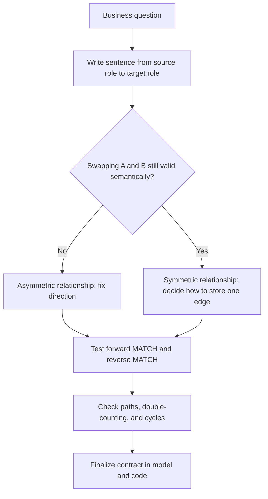
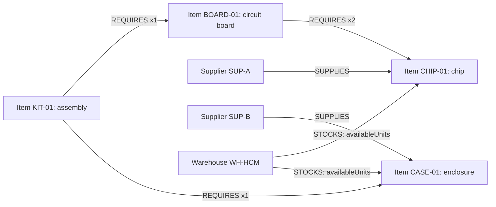

# Designing Relationship Directions Based on Business Semantics

## 1. Lesson Objectives

In **Neo4j**, every relationship connects from a **start node** to an **end node**. Two nodes can be queried in either direction, but the **stored direction** must express a clear business fact. If you flip the direction of `REQUIRES` in a manufacturing system, you might conclude backward that a component requires an assembly rather than the assembly requiring the component. This bug is dangerous because the Cypher query can still succeed while returning the wrong meaning.

This lesson belongs to the **Model Design** chapter of `DATABASE_ENGINE_GRAPH_NEO4J`, within the scope of using property graphs and Cypher to model connected data, relationships, and paths. After this lesson, you will be able to:

- Write a **directed definition sentence** for every relationship type: “What does A do to B?”.
- Distinguish the **stored direction** of an edge from the **traversal direction** in `MATCH`.
- Choose directions for asymmetric relationships, symmetric relationships, mutual relationships, and relationships between nodes of the same label.
- Design multi-hop paths without confusing direct relationships with indirect ones.
- Validate directions using sample data, Cypher, business invariants, and `EXPLAIN`/`PROFILE` when needed.

The focus is on **model semantics**, not on assuming arrow direction alone determines speed. Indexes, constraints, the Java Driver, Spring Data Neo4j, and operations must follow the designed direction contract, but they do not replace clarifying business rules.

## 2. What Does Direction Mean in Neo4j?

Suppose a warehouse manages a component:

```cypher
(warehouse:Warehouse)-[:STOCKS]->(part:Item)
```

This is an **illustrative graph pattern**, not a standalone Cypher command. The stored direction is `Warehouse → Item`, reading as “the warehouse stocks the item”. Another pattern:

```cypher
(part:Item)<-[:STOCKS]-(warehouse:Warehouse)
```

still represents the **same relationship direction**. The `<-` arrow only indicates that the variable on the right is the source and the variable on the left is the target.

Three basic query forms:

| Cypher Pattern | Meaning when `STOCKS` is stored `Warehouse → Item` |
|---|---|
| `(w:Warehouse)-[:STOCKS]->(i:Item)` | Go from warehouse to items stocked by that warehouse |
| `(i:Item)<-[:STOCKS]-(w:Warehouse)` | Go from item back to warehouses stocking it |
| `(w:Warehouse)-[:STOCKS]-(i:Item)` | Do not constrain the direction of the matched relationship |

Neo4j stores directed relationships, yet the query engine **can traverse both forward and backward**. Therefore, there is no need to create an extra `(:Item)-[:STORED_IN]->(:Warehouse)` edge just to query from product to warehouse. A second reverse edge is only justified when it carries an **independent business fact** with its own lifecycle rules; if both represent the same fact, keeping both increases the risk of copies drifting out of sync.

> **Core rule:** Pick one direction that expresses the business fact clearly, store edges in that direction, and use `<-` when a question needs reverse traversal. Do not use which direction a UI screen happens to display as a reason to flip the edge's semantics.

### 2.1. The Edge Label and Arrow Direction Must Match

`SUPPLIES` is a verb describing an action by a supplier toward an item:

```text
(Supplier)-[:SUPPLIES]->(Item)
```

If you change it to `Item-[:SUPPLIES]->Supplier` while keeping type `SUPPLIES`, the sentence “Item supplies Supplier” becomes nonsensical. Another name like `SUPPLIED_BY` can fit the reverse direction, but you should **choose one convention as the single source of truth** rather than storing both just to avoid writing `<-`.

### 2.2. Relationship Direction Differs from Query Starting Point

A business workflow might frequently ask: “Which warehouses have part `P-CHIP`?” The query **starts from** `Item` because it has a selective `sku` key, then traverses **backward** along `STOCKS` to `Warehouse`:

```cypher
MATCH (item:Item {sku: $sku})<-[:STOCKS]-(warehouse:Warehouse)
RETURN warehouse.warehouseId AS warehouseId;
```

Stored direction does not need to change to match the query anchor. Deciding which node to start from, how indexes are used, and traversal cost must be evaluated using query patterns and real data.

## 3. Method for Choosing Direction from Business Questions

For a relationship being designed, follow these steps:

1. **Write the fact as a subject–verb–object sentence.** For example: “An assembly item **requires** another component.”
2. **Identify the role of each endpoint.** Both the “parent assembly” and the “required component” may carry the label `Item`; variable names must clarify both roles.
3. **Name the relationship type as a directed verb.** `REQUIRES` points from the item needing the part to the required item.
4. **Write positive and negative examples.** `KIT-01` requires `BOARD-01`; it is not true that `BOARD-01` requires `KIT-01`.
5. **Define forward and reverse queries.** Forward: “What does the kit require?”. Reverse: “Which kits are affected if a chip is out of stock?”.
6. **Confirm logical properties.** Is the relationship symmetric? Transitive? Are loops or self-references allowed? These determine Cypher queries and write validation.
7. **Align the contract across writers and readers.** Ingestion pipelines, application Cypher, and Java mappings must all use the exact same direction.



The diagram above is a thinking workflow. The question “does swapping the two endpoints preserve meaning?” must be answered according to **business semantics**, not just a feeling of visual symmetry in a diagram.

## 4. Classifying Relationships Before Deciding Direction

### 4.1. Asymmetric Relationships: Flipping Reverses Meaning

| Relationship | Standard Direction | Reading | Reverse Query Question |
|---|---|---|---|
| Supply | `Supplier-[:SUPPLIES]->Item` | Supplier supplies item | Which suppliers supply an item? |
| Inventory | `Warehouse-[:STOCKS]->Item` | Warehouse stocks quantity of item | Which warehouses hold an item? |
| Bill of materials | `AssemblyItem-[:REQUIRES]->ComponentItem` | Assembly requires component | Which assemblies use this component? |
| Hierarchy | `Category-[:PARENT_OF]->Category` | Parent category contains child category | What parents does a category have? |
| Dependency | `Task-[:DEPENDS_ON]->Task` | Left task depends on right task finishing first | Which tasks are blocked by this task? |
| Following | `Account-[:FOLLOWS]->Account` | Left account follows right account | Who is following this account? |

`DEPENDS_ON`, `REQUIRES`, and `FOLLOWS` are typically **asymmetric**: A depending on B does not mean B depends on A. Queries can traverse in reverse, while the stored fact remains unchanged.

### 4.2. Symmetric Relationships: Bidirectional Meaning, Still Technically Directed

For example, when two employees collaborate in a network, `COLLABORATES_WITH` is defined by business rules as **symmetric**: if A collaborates with B, then B collaborates with A.

Neo4j still stores **one directed relationship**. You can enforce a deterministic storage rule, such as making the node with the lexicographically smaller `employeeId` the source:

```text
EMP-001 -[:COLLABORATES_WITH]-> EMP-002
```

When querying collaboration neighbors, use an undirected pattern:

```cypher
MATCH (employee:Employee {employeeId: $employeeId})
      -[:COLLABORATES_WITH]-(colleague:Employee)
RETURN DISTINCT colleague.employeeId AS colleagueId;
```

**There is no need to store a pair of opposite edges** to represent a single symmetric relationship if the system standardizes on storing one edge and always queries accordingly. For unanchored full-graph scans, an undirected pattern can match each edge in both endpoint assignments; apply appropriate canonicalization and deduplication when counting pairs.

Note: the ID-based direction rule is only an **application convention**. Node unique constraints do not prevent two concurrent threads from writing two opposite symmetric edges; the write path must enforce the “one edge per pair” invariant.

### 4.3. Relationships That Can Occur in Both Directions as Two Separate Events

Account following differs from symmetric collaboration:

```text
(:Account {accountId: 'A'})-[:FOLLOWS]->(:Account {accountId: 'B'})
(:Account {accountId: 'B'})-[:FOLLOWS]->(:Account {accountId: 'A'})
```

These are **two independent actions**. A following B does not imply B follows A; if both actually occurred, storing two edges with the same type in opposite directions is appropriate. Do not use an undirected `-[:FOLLOWS]-` pattern to infer that the other person also performed the follow action.

### 4.4. Transitive vs. Non-Transitive Relationships

If `KIT → REQUIRES → BOARD` and `BOARD → REQUIRES → CHIP`, then `KIT` **indirectly requires** `CHIP`. You can traverse multiple hops to discover dependencies, but you **should not automatically create** an extra direct edge `KIT → REQUIRES → CHIP`. Direct edges usually mean “listed as a direct component”, whereas multi-hop results are **derived** facts.

Conversely, “A collaborates with B” and “B collaborates with C” **does not imply** A collaborates with C. Never assume a business relationship between A and C holds just because a graph contains path `A–B–C`. Distinguish *reachability* from *individual edge semantics*.

## 5. Running Scenario: Product Components, Supply, and Warehouses

An electronics manufacturer uses Neo4j to manage assemblies (`Item`), components, suppliers, and warehouses. Key questions:

- **Q1:** Which **direct** components does `KIT-01` require, and in what quantities?
- **Q2:** To build one `KIT-01`, how many **leaf components at the end of the BOM chain** are needed?
- **Q3:** Which suppliers supply the components needed for `KIT-01`?
- **Q4:** In which warehouses is `CHIP-01` available, and with how much available stock?
- **Q5:** If `CHIP-01` runs out of stock, which subassemblies and finished products are **affected**?

The proposed model uses three node labels `Item`, `Supplier`, `Warehouse` and three relationship types `REQUIRES`, `SUPPLIES`, `STOCKS`:



`Item` has `sku`, `name`, and `kind` (`ASSEMBLY` or `COMPONENT`). `REQUIRES.unitsPerParent` is the component quantity required by **one** unit of the source node. `STOCKS.availableUnits` describes the inventory **of an item at a specific warehouse**; this property does not belong on `Item` alone because the same item can have different stock levels across warehouses.

### 5.1. Relationship Direction Contract

| Type | Source → Target | Business Definition | Should Reverse Edges Be Created Automatically? |
|---|---|---|---|
| `REQUIRES` | Assembly `Item` → Required `Item` | One unit of source requires `unitsPerParent` units of target | No; that reverses component semantics |
| `SUPPLIES` | `Supplier` → `Item` | Supplier can supply the item | Unnecessary; traverse backward from Item |
| `STOCKS` | `Warehouse` → `Item` | Warehouse manages stock of the item | Unnecessary; traverse backward from Item |

All three relationships have clear business directions, yet questions Q3–Q5 **usually start from the target side**. The stored direction does not need to be flipped to serve them.

### 5.2. Assumptions That Must Be Stated Before Querying

For the example to be unambiguous, assume temporarily:

1. `Item.sku`, `Supplier.supplierId`, and `Warehouse.warehouseId` are stable keys.
2. Each `(source Item, target Item)` pair has **one** `REQUIRES` relationship with a positive quantity; no parallel edges for the same component in the same recipe.
3. The `REQUIRES` network is a **DAG** (directed acyclic graph): an item cannot directly or indirectly require itself.
4. `Item` nodes with no outgoing `REQUIRES` edges are **leaf components** when calculating production demand; data must be complete enough to distinguish true leaf components from records missing BOM entries.
5. Edge quantity is units required **per one unit of source**, not purchased quantity or inventory.
6. Stock of the same item across warehouses is stored separately on each `STOCKS` edge.

These assumptions are part of the model contract. If the domain includes BOM revisions, substitute parts, scrap rates, or time-effective recipes, expand the model appropriately before using BOM calculation queries as authoritative financial/manufacturing data.

## 6. Building Sample Data with Cypher

The examples below use **Neo4j 5.x**. Run them on a test database; constraint commands and data creation commands serve different purposes. Relationships are written strictly in the directions specified in the contract table.

### 6.1. Identifiers and Anchors

```cypher
CREATE CONSTRAINT item_sku_unique IF NOT EXISTS
FOR (item:Item) REQUIRE item.sku IS UNIQUE;

CREATE CONSTRAINT supplier_id_unique IF NOT EXISTS
FOR (supplier:Supplier) REQUIRE supplier.supplierId IS UNIQUE;

CREATE CONSTRAINT warehouse_id_unique IF NOT EXISTS
FOR (warehouse:Warehouse) REQUIRE warehouse.warehouseId IS UNIQUE;
```

Unique constraints assist lookups and prevent two nodes with the same label from sharing the declared key value. They do **not automatically guarantee** that an `Item` always has `sku`, disallow `REQUIRES` cycles, or enforce `unitsPerParent > 0`. Additional invariants must be enforced during writes and checked periodically.

### 6.2. Rerunnable Sample Dataset

```cypher
MERGE (kit:Item {sku: 'KIT-01'})
SET kit.name = 'Device Kit', kit.kind = 'ASSEMBLY'
MERGE (board:Item {sku: 'BOARD-01'})
SET board.name = 'Circuit Board', board.kind = 'ASSEMBLY'
MERGE (chip:Item {sku: 'CHIP-01'})
SET chip.name = 'Control Chip', chip.kind = 'COMPONENT'
MERGE (case:Item {sku: 'CASE-01'})
SET case.name = 'Device Enclosure', case.kind = 'COMPONENT'

MERGE (supplierA:Supplier {supplierId: 'SUP-A'})
SET supplierA.name = 'Supplier A'
MERGE (supplierB:Supplier {supplierId: 'SUP-B'})
SET supplierB.name = 'Supplier B'
MERGE (warehouse:Warehouse {warehouseId: 'WH-HCM'})
SET warehouse.name = 'HCMC Warehouse'

MERGE (kit)-[kitToBoard:REQUIRES]->(board)
SET kitToBoard.unitsPerParent = 1
MERGE (kit)-[kitToCase:REQUIRES]->(case)
SET kitToCase.unitsPerParent = 1
MERGE (board)-[boardToChip:REQUIRES]->(chip)
SET boardToChip.unitsPerParent = 2

MERGE (supplierA)-[:SUPPLIES]->(chip)
MERGE (supplierB)-[:SUPPLIES]->(case)

MERGE (warehouse)-[stockChip:STOCKS]->(chip)
SET stockChip.availableUnits = 120
MERGE (warehouse)-[stockCase:STOCKS]->(case)
SET stockCase.availableUnits = 35;
```

`MERGE` against anchored nodes and specific edge patterns avoids recreating identical structures across sequential runs, but it **does not replace** concurrency control, unique constraints, and transactions. If data already contains duplicate edges of the same meaning or multiple BOM versions, resolve them via explicit data rules before rerunning scripts.

## 7. Forward, Reverse, and Multi-Hop Path Queries

### Q1. From Assembly to Direct Components

```cypher
MATCH (parent:Item {sku: $assemblySku})
      -[requirement:REQUIRES]->(component:Item)
RETURN component.sku AS componentSku,
       component.name AS componentName,
       requirement.unitsPerParent AS unitsPerParent
ORDER BY componentSku;
```

With `$assemblySku = 'KIT-01'`, the output is `BOARD-01` (1) and `CASE-01` (1). Because this is a **one-hop** query, it does not return `CHIP-01`, since the chip is only an **indirect** component of the kit.

### Q2a. Components Required Directly or Indirectly

```cypher
MATCH path = (root:Item {sku: $assemblySku})
             -[:REQUIRES*1..5]->(required:Item)
WITH required, min(length(path)) AS shortestDepth
RETURN required.sku AS requiredSku, shortestDepth
ORDER BY shortestDepth, requiredSku;
```

With the sample dataset, `BOARD-01` and `CASE-01` appear at depth 1; `CHIP-01` appears at depth 2. `*1..5` requires **at least one** edge and at most five edges. `min(length(path))` reports the shortest dependency distance within that bound, not the required part quantity.

The depth bound is a business/performance assumption: if a BOM is deeper than five levels, this query **misses** deeper components. If cycles or supernodes exist, path counts can explode even if the final output only has a few SKUs.

### Q2b. Total Leaf Components for One Finished Assembly

To calculate requirements at the **end of the chain**, multiply quantities along each path's edges; if the same leaf component appears via multiple BOM branches, sum demands across branches:

```cypher
MATCH path = (root:Item {sku: $assemblySku})
             -[:REQUIRES*1..5]->(leaf:Item)
WHERE NOT EXISTS {
  MATCH (leaf)-[:REQUIRES]->(:Item)
}
WITH leaf,
     reduce(units = 1, requirement IN relationships(path) |
            units * requirement.unitsPerParent) AS unitsOnPath
RETURN leaf.sku AS leafSku,
       sum(unitsOnPath) AS unitsPerAssembly
ORDER BY leafSku;
```

With `$assemblySku = 'KIT-01'`, expected results are `CASE-01` needing 1 unit and `CHIP-01` needing 2 units. Path `KIT-01 → BOARD-01 → CHIP-01` has multiplier \(1 \times 2 = 2\).

Conditions for this formula to be valid: `REQUIRES` forms a DAG, every edge has a valid positive `unitsPerParent`, **every** path to leaf components stays within five hops, and no redundant derived edges duplicate direct components. If cycles, scrap, rounding rules, mixed units of measure, or time-versioned BOMs exist, a different calculation design and test suite are required. This is a modeling exercise, **not** a complete MRP engine.

### Q3. Going from Finished Product to Suppliers by Traversing `SUPPLIES` Backward

```cypher
MATCH (root:Item {sku: $assemblySku})
      -[:REQUIRES*1..5]->(leaf:Item)
WHERE NOT EXISTS {
  MATCH (leaf)-[:REQUIRES]->(:Item)
}
MATCH (supplier:Supplier)-[:SUPPLIES]->(leaf)
RETURN DISTINCT leaf.sku AS leafSku,
       supplier.supplierId AS supplierId,
       supplier.name AS supplierName
ORDER BY leafSku, supplierId;
```

With `KIT-01`, `SUP-A` supplies `CHIP-01` and `SUP-B` supplies `CASE-01`. Even though the query navigates from finished product to supplier, the edge remains stored as `Supplier-[:SUPPLIES]->Item`. `DISTINCT` prevents duplicate rows when multiple dependency paths lead to the same component.

This query tells you which suppliers **are recorded as able to supply** the part; it does not assert supplier stock, open purchase orders, or capacity to fulfill the quantity. Those concepts require dedicated data/relationships.

### Q4. Traversing `STOCKS` Backward from Component to Warehouse

```cypher
MATCH (item:Item {sku: $sku})
      <-[stock:STOCKS]-(warehouse:Warehouse)
RETURN warehouse.warehouseId AS warehouseId,
       warehouse.name AS warehouseName,
       stock.availableUnits AS availableUnits
ORDER BY warehouseId;
```

With `$sku = 'CHIP-01'`, the output includes `WH-HCM` with 120 available units. There is no reversed `Item-[:STOCKS]->Warehouse` edge, yet the question from the item side is answered directly.

### Q5. Reverse Impact Query from a Component

When `CHIP-01` is out of stock, nodes **upstream** in the dependency chain are the impacted items:

```cypher
MATCH (affected:Item)-[:REQUIRES*1..5]->
      (component:Item {sku: $sku})
RETURN DISTINCT affected.sku AS affectedSku,
       affected.name AS affectedName
ORDER BY affectedSku;
```

With `$sku = 'CHIP-01'`, the query returns `BOARD-01` and `KIT-01`: both the board and the kit require the chip along a path. Edges still point **from the requiring item to the required item**, while the query looks for **source nodes** by reading the pattern from the target side.

## 8. Relationship Direction Governs Data Validation

### 8.1. Detecting Edges Written Backward Against the Contract

An edge `(:Item {sku:'CHIP-01'})-[:REQUIRES]->(:Item {sku:'BOARD-01'})` would state “chip requires circuit board”. If the business reality is the opposite, this is a **data bug**, not an equivalent alternative representation.

To audit edges whose source is a leaf component in the sample model:

```cypher
MATCH (source:Item)-[requirement:REQUIRES]->(target:Item)
WHERE source.kind = 'COMPONENT'
RETURN source.sku AS unexpectedSourceSku,
       target.sku AS targetSku,
       requirement.unitsPerParent AS quantity;
```

This query is only valid as a check **when business rules state a `COMPONENT` never has subcomponents**. If a component can itself consist of subcomponents, adjust the check rule; do not rely on `kind` to infer rules if its definition is unclear.

### 8.2. Detecting Cycles in Dependency Relationships

For a BOM, a cycle like `A → B → C → A` breaks the meaning of “leaf component” and can make path-expansion queries very expensive:

```cypher
MATCH path = (start:Item)-[:REQUIRES*1..10]->(finish:Item)
WHERE start = finish
RETURN start.sku AS cycleItemSku,
       [item IN nodes(path) | item.sku] AS exampleCycle
LIMIT 20;
```

This is a **depth-bounded diagnostic query** and may miss cycles longer than ten edges. To enforce the **acyclic** invariant, the write path must check reachability from target back to source before inserting an edge and use appropriate transactions/locking to prevent two concurrent writes from forming a cycle.

### 8.3. Detecting Duplicate Component Edges and Invalid Quantities

```cypher
MATCH (parent:Item)-[requirement:REQUIRES]->(component:Item)
WITH parent, component,
     count(requirement) AS relationshipCount
WHERE relationshipCount > 1
RETURN parent.sku AS parentSku,
       component.sku AS componentSku,
       relationshipCount;
```

```cypher
MATCH (parent:Item)-[requirement:REQUIRES]->(component:Item)
WHERE requirement.unitsPerParent IS NULL
   OR requirement.unitsPerParent <= 0
RETURN parent.sku AS parentSku,
       component.sku AS componentSku,
       requirement.unitsPerParent AS invalidUnits;
```

These queries **detect** violations; they do not prevent bad writes. In Neo4j, multiple relationships of the same type can exist between the same pair of nodes; node unique constraints do not enforce “one edge per pair”. For real writes, define BOM keys/versions and transaction locking—or introduce an identified link node if each BOM line's lifecycle becomes complex.

### 8.4. Verify Meaning Before Deleting or Flipping Edges

Never fix a relationship's direction by **flipping all edges** without verification. A dataset with `(:Account)-[:FOLLOWS]->(:Account)` can legitimately contain edges in both directions between the same pair; flipping one flips **who follows whom**. With `REQUIRES`, flipping an edge can introduce cycles or alter manufacturing ratios. Migrations must distinguish misdirected edges from edges that were valid under an old schema's meaning.

## 9. Treating Names, Directions, and Properties as One Unified Contract

A relationship is more than an arrow. A complete definition should include:

| Contract Field | What to Finalize | Example `REQUIRES` |
|---|---|---|
| Type | Single canonical name from standard vocabulary | `REQUIRES` |
| Source label/role | Start node and role | Assembly `Item` |
| Target label/role | End node and role | Required `Item` |
| Definition sentence | Meaning read forward | “One unit of source Item requires n units of target Item” |
| Edge properties | Name, unit, value domain | `unitsPerParent`, positive number |
| Cardinality | How many nodes one source/target can connect to | One Item has many components; one component used by many Items |
| Logical properties | Symmetry, transitivity, self-loops | Asymmetric; dependency chains can be deep; **acyclic** |
| Write controls | Keys, uniqueness, transactions | One edge per source–target pair per BOM version |
| Query patterns | Forward/reverse traversal | Forward for components, reverse for impacted finished products |

If you choose `PARENT_OF` from parent to child, all ingestion must follow that direction even if the application usually starts from the child. If you choose `FOLLOWS`, distinguish the two opposite actions. If you choose `COLLABORATES_WITH` as symmetric, define a single-edge storage rule and query undirectedly. These are three **distinct semantics**, so no single “every edge is bidirectional” approach applies universally.

## 10. Cypher Patterns, Indexes, and Application Integration

### 10.1. Checking Plans for Forward and Reverse Queries

```cypher
EXPLAIN
MATCH (item:Item {sku: 'CHIP-01'})<-[:STOCKS]-(warehouse:Warehouse)
RETURN warehouse.warehouseId;
```

Switch `EXPLAIN` to `PROFILE` to execute and view actual metrics. Inspect the `Item.sku` **anchor**, row counts after expansion, DB hits, and degree skew (how many warehouses hold a given item). Do not assume reverse traversal is always slower than forward traversal; cost depends on data distribution, indexes, cardinality, and execution plans.

### 10.2. Passing Parameters and Avoiding Direction Mistakes in Java/Spring Data Neo4j

When using the **Neo4j Java Driver**, pass values like `$sku` and `$assemblySku` via parameters rather than concatenating user input into Cypher strings. Centralize relationship types and directions in a single source so queries do not accidentally use `SUPPLIES` with two conflicting meanings.

With **Spring Data Neo4j**, if `Item` has a `requiredComponents` collection, the relationship mapping must specify **type `REQUIRES` with outgoing direction** from the parent item to its components. When querying items **that require** the current component, mappings/queries on the component side need incoming direction or Cypher with `<-`. Both reads share one direction contract.

Do not equate Java class ownership direction with business meaning simply because one entity holds a collection of another. `REQUIRES` can carry `unitsPerParent`; mappings must preserve edge properties rather than merely linking two nodes and losing BOM quantities.

### 10.3. When Should You Add a Derived Relationship Direction?

For frequent queries like “which component impacts thousands of finished products”, teams may precompute a derived structure or summary relationship. However, an edge like `Item-[:IMPACTS]->Item` has **different semantics** from direct `REQUIRES` and requires synchronization rules, depth scope, refresh timestamps, and a clear distinction from the source of truth. Do not add reversed `REQUIRES` edges or “shortcuts” under the same type as an unverified optimization.

## 11. Common Mistakes

| Practice | Problem | How to Handle It |
|---|---|---|
| Storing `Supplier-[:SUPPLIES]->Item` and also `Item-[:SUPPLIES]->Supplier` | Second edge uses wrong verb and mixes directions | Store only Supplier → Item; query backward with `<-` |
| Reading `A-[:DEPENDS_ON]->B` as B depending on A | Flips business meaning while Cypher still runs | Write the definition sentence and test a concrete A/B pair |
| Using `-[:FOLLOWS]-` to infer mutual following | Following is asymmetric | Check both A → B and B → A separately |
| Storing both directions for symmetric relationships without rules | Doubles collaboration pairs, causes sync drift | Single edge with canonical direction and undirected queries |
| Treating every path as a direct relationship | Double-counts BOM quantities or misreads dependency chains | Separate 1-hop queries from multi-hop queries |
| Using `*` or huge depth bounds regardless of distribution | Risk of path explosion | Bound per business rules, profile with `PROFILE`, prevent cycles |
| Putting `availableUnits` on `Item` instead of `STOCKS` | Cannot represent per-warehouse stock | Put the property on the Warehouse–Item relationship |
| Assuming node unique constraints block cycles or duplicate edges | Allows graph with broken invariants | Enforce via transaction logic and diagnostic queries |
| Trying to optimize by flipping all relationship directions | Changes data semantics and breaks dependent queries | Keep business direction; inspect execution plans instead |

## 12. Practice Exercises

### Exercise 1 — Choosing Directions for Three Domains

Given requirements: (a) students taking courses, (b) one person following another, (c) two researchers collaborating as equals. Propose relationship type, stored direction, symmetry, and Cypher to find all connections of a node. Explain why the reverse-edge storage strategy differs in each case.

### Exercise 2 — Finding a Direction-Flip Bug

A team ingested `(:Item {sku:'CHIP-01'})-[:REQUIRES]->(:Item {sku:'BOARD-01'})`, whereas the specification states **the circuit board requires two chips**. Identify the wrong direction, how to check if the right edge already exists, and a controlled remediation plan that avoids duplicates or losing quantities.

### Exercise 3 — Two Traversals for One Relationship

Given `Supplier-[:SUPPLIES]->Item`, write one Cypher query starting from `$supplierId` to find supplied SKUs and one Cypher query starting from `$sku` to find suppliers. Do not add a `SUPPLIED_BY` type; explain how the arrows work in both queries.

### Exercise 4 — Distinguishing Indirect Components and Quantity Multipliers

New BOM: `KIT-01` requires 2 `BOARD-01`, each `BOARD-01` requires 3 `CHIP-01`; in addition, `KIT-01` directly requires 1 `CHIP-01`. Compute total chips needed for one kit and adjust the Cypher in Q2b to verify the result. Discuss why you cannot simply do `DISTINCT leaf` before summing path multipliers.

### Exercise 5 — Cycle Prevention and Performance

Suppose an ingestion pipeline tries to add `CHIP-01-[:REQUIRES]->KIT-01`. Illustrate the resulting cycle, write a query detecting a path from `KIT-01` to `CHIP-01` before adding the edge, and list the transaction synchronization steps needed when multiple threads update BOMs concurrently. Finally, name three `PROFILE` metrics to monitor when multi-hop queries run too slowly.

## 13. Relationship Direction Design Checklist

1. Does every relationship type have a **source → verb → target** description confirmed by domain stakeholders?
2. Are node roles clear, especially when both endpoints share a label (`Item → Item`, `Task → Task`)?
3. Is the relationship **symmetric, asymmetric, or two independent actions**? Are two opposite edges genuinely needed?
4. Do reverse queries intentionally use `<-` or undirected patterns instead of storing a duplicate edge?
5. Is the relationship transitive, and does the question ask for **direct links or multi-hop paths**?
6. Are invariants for **quantities, cycles, parallel edges, cardinality, and data versions** verified?
7. Do edge properties belong to that **specific link occurrence** and use clear units?
8. Do ingestion pipelines, Cypher, the Java Driver, and Spring Data Neo4j share the same direction, type, and property names?
9. Have key queries been tested on data with opposite edges, branching paths, and edge cases?

**Completion criteria:** You can read any edge as an accurate business sentence, pick an unambiguous stored direction, write corresponding forward/reverse Cypher queries, distinguish symmetric relationships from two independent events, and spot risks of cycles or double-counting on multi-hop paths. Relationship direction is part of **data semantics**, and must stay consistent across design, ingestion, and Neo4j querying.
