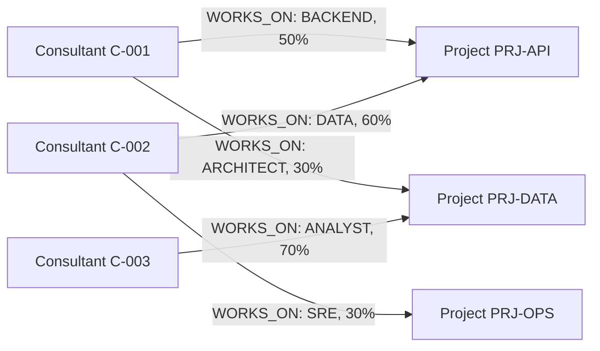
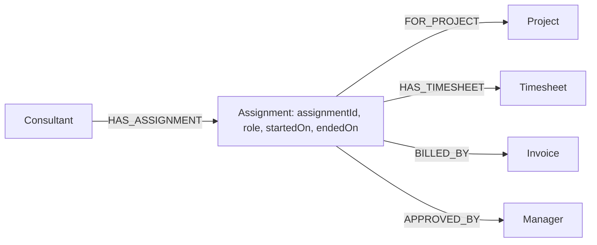

# Modeling Many-to-Many Relationships and Relationships with Properties

## 1. Objectives and Scope

In **Neo4j**, a **many-to-many** (N:N) relationship is a situation where a node in group A can link to multiple nodes in group B, while a node in group B can simultaneously link to multiple nodes in group A. Property graphs represent this association with a **direct relationship** between the two nodes; the relationship can also carry properties describing **that specific link occurrence**. Therefore, you do not need to translate an SQL join table into an intermediate node in every case.

For example: a consultant participates in many projects, and a project has many consultants. On each assignment, the **role**, **allocation percentage**, and **agreed rate** belong to the *consultant–project* link, not to a consultant or a project individually.

After this lesson, you will be able to:

- Identify N:N cardinality accurately and distinguish it from 1:N and 1:1 relationships.
- Choose between a direct relationship with properties and an intermediate node with an independent lifecycle.
- Name types, directions, and properties so Cypher queries express business semantics accurately.
- Create data, query, and aggregate over relationships with properties in Cypher.
- Handle error-prone scenarios: duplicate edges, multiple participations, effective-date history, `MERGE`, and concurrent writes.
- Propose constraints, indexes, and validation checks on real data.

This lesson belongs to the **Model Design** chapter of the `DATABASE_ENGINE_GRAPH_NEO4J` module, where Neo4j is used to model connected data with property graphs and query paths with Cypher. The hands-on material focuses on modeling decisions; deep query tuning, bulk import, the Java Driver, Spring Data Neo4j, and operations are covered in subsequent topics of the module.

## 2. Understanding Many-to-Many Relationships Precisely

### 2.1. Cardinality Describes Business Rules

| Relationship Type | Reading | Example Assumption |
|---|---|---|
| 1:1 | Each A links to at most one B and vice versa | One person has one primary profile |
| 1:N | One A links to many B, each B belongs to at most one A | One project has many milestones, each milestone belongs to one project |
| N:N | One A links to many B, one B links to many A | One consultant works on many projects; one project has many consultants |

The 1 and N bounds also require clarifying **minimums** (0 or 1) and **maximums** (1 or many). For example, a new project might not have any consultants assigned yet, and a consultant on leave might not be assigned to any project. Thus, the appropriate rule here is `Consultant 0..N ↔ 0..N Project`.

Neo4j does not infer or enforce cardinality from arrows in Cypher patterns. The syntax `(:Consultant)-[:WORKS_ON]->(:Project)` only specifies the **connection type and stored direction**; it does not mean each consultant can have only one edge. Rules like “a consultant has only one active assignment on the same project” must be designed and enforced in the write path.

### 2.2. Difference Between a Join Table and a Relationship

In a relational model, a join table typically represents N:N:

```text
CONSULTANT (consultant_id, full_name)
PROJECT    (project_id, title)
WORK_ASSIGNMENT (
    consultant_id, project_id, role,
    allocation_percent, agreed_rate_vnd_per_hour, started_on
)
```

In a property graph, when each consultant–project pair has only **one assignment within the scope of the current model**, you can represent it directly:

```text
(:Consultant {consultantId: 'C-001', fullName: 'An'})
  -[:WORKS_ON {
      role: 'BACKEND',
      allocationPercent: 50,
      agreedRateVndPerHour: 500000,
      startedOn: date('2026-10-01'),
      status: 'ACTIVE'
  }]->
(:Project {projectId: 'PRJ-API', title: 'API Upgrade'})
```

The snippet above is a **structural illustration**, not a standalone runnable Cypher command. Both endpoints have their own identifiers; the `WORKS_ON` relationship describes the assignment and carries the assignment's properties.



The graph clearly demonstrates N:N: `C-001` connects to two projects, while `PRJ-API` has both `C-001` and `C-002`. Every edge shares the `WORKS_ON` type; they differ in their endpoints and the properties of **each** edge.

## 3. Identifying Business Questions Before Choosing a Model

Suppose a staffing system needs to answer:

1. **Q1 – Staff by project:** Which consultants are currently on project `PRJ-API`? What is each person's role and allocation percentage?
2. **Q2 – Projects by consultant:** Which projects is consultant `C-001` working on, and starting from what date?
3. **Q3 – Shared projects:** Which projects are consultants `C-001` and `C-002` both working on?
4. **Q4 – Aggregation:** What total capacity percentage and estimated hourly labor cost is currently allocated to a project?
5. **Q5 – Constraint check:** Does any consultant have a total allocation percentage across active projects exceeding 100%?

These questions suggest a minimal model:

| Component | Representation | Rationale |
|---|---|---|
| Consultant | `(:Consultant {consultantId, fullName})` | Has identity, joins multiple projects, and is queried independently |
| Project | `(:Project {projectId, title})` | Has identity, staffed by multiple consultants |
| Assignment | `(:Consultant)-[:WORKS_ON]->(:Project)` | Direct N:N relationship; queries commonly start from either endpoint |
| Role on project | `WORKS_ON.role` | A person can serve as `BACKEND` on one project and `ARCHITECT` on another |
| Allocation percentage | `WORKS_ON.allocationPercent` | Varies per person–project pair |
| Agreed rate | `WORKS_ON.agreedRateVndPerHour` | Snapshot rate agreed for this assignment, not necessarily the consultant's current standard rate |
| Start date | `WORKS_ON.startedOn` | Timestamp/date of the assignment |
| Status | `WORKS_ON.status` | Assignment can be `ACTIVE` or `ENDED`; requires explicit status rules |

**Key assumption:** In the sample data, each `(Consultant, Project)` pair has only **one assignment** and one current set of properties. There is no re-enrollment history, parallel contracts, or payments tied to specific cohorts. Section 8 changes the model when these assumptions no longer hold.

## 4. Where Do Properties Belong?

### 4.1. Endpoint Properties vs. Relationship Properties

| Data | Proper Location | Why? |
|---|---|---|
| Consultant name | `Consultant.fullName` | Does not change by project |
| Project title | `Project.title` | Does not change by consultant |
| Internal HR title | `Consultant.jobTitle` | Describes organizational rank, not role on a specific project |
| Execution role on project | `WORKS_ON.role` | One person plays different roles across projects |
| Capacity percentage dedicated to project | `WORKS_ON.allocationPercent` | Varies per person–project pair |
| Assignment start date | `WORKS_ON.startedOn` | Date of that specific association |
| Consultant's latest rate | `Consultant.currentRateVndPerHour` if needed | Must not automatically overwrite agreed rates on older assignments |
| Rate committed for assignment | `WORKS_ON.agreedRateVndPerHour` | Snapshot of the agreement between both sides |

Putting `allocationPercent` on `Consultant` would make it impossible for consultant An to have 50% on `PRJ-API` and 30% on `PRJ-DATA` simultaneously. Putting `agreedRateVndPerHour` on `Project` would prevent the project from having different agreed rates per person.

### 4.2. Always Specify Units and Data Types

`allocationPercent` can be stored as an integer from 0 to 100 per application rules. `agreedRateVndPerHour` uses **integer VND/hour** to avoid floating-point issues for base currency amounts. `startedOn` is a `date` if hours/minutes are unnecessary; exact instants should use `datetime` with appropriate timezone info.

`status = 'ACTIVE'` differs from `status = 'ENDED'`. Neo4j does not automatically enforce enum domains; standardize and validate them on write. Missing or `null` properties must also have explicit definitions: an unknown end date differs from a blank end date caused by an input error.

### 4.3. Relationship Direction Is a Readable Contract

```text
Consultant -[:WORKS_ON]-> Project
    “Consultant works on Project”
```

Pointing from `Consultant` to `Project` makes the pattern read naturally. To find consultants from a project, Cypher traverses backward: `(consultant:Consultant)-[:WORKS_ON]->(project:Project)` or `(project)<-[:WORKS_ON]-(consultant)`. Do not store a reverse `PROJECT_HAS_CONSULTANT` edge just for lookup convenience.

## 5. Initializing the Prototype Model with Neo4j 5.x

The following Cypher examples can be executed sequentially in Neo4j Browser or a test environment. Keep DDL (constraints/indexes) separate from data statements. The sample data is academic and fictional, not data from a real organization.

### 5.1. Creating Identifier Keys for Both Node Types

```cypher
CREATE CONSTRAINT consultant_id_unique IF NOT EXISTS
FOR (c:Consultant) REQUIRE c.consultantId IS UNIQUE;

CREATE CONSTRAINT project_id_unique IF NOT EXISTS
FOR (p:Project) REQUIRE p.projectId IS UNIQUE;
```

Unique constraints prevent two nodes with the same label from sharing **the same declared identifier value** and support anchored lookups. Note: a unique property constraint does not automatically force every node to have that property; mandatory ID requirements must be protected further depending on edition capabilities and write rules.

You can experiment with a relationship property index when queries **anchor on an edge property**, such as frequently finding everyone holding a specific role:

```cypher
CREATE RANGE INDEX works_on_role_idx IF NOT EXISTS
FOR ()-[assignment:WORKS_ON]-() ON (assignment.role);
```

An index on `role` **does not guarantee** speeding up queries starting from `Project.projectId`; those queries can locate the project first and traverse its connected edges. Effectiveness depends on selectivity, data distribution, and execution plans. Check with `EXPLAIN`/`PROFILE` before adding more indexes.

### 5.2. Creating Nodes and Relationships with Properties

```cypher
MERGE (an:Consultant {consultantId: 'C-001'})
SET an.fullName = 'An'
MERGE (binh:Consultant {consultantId: 'C-002'})
SET binh.fullName = 'Bình'
MERGE (chi:Consultant {consultantId: 'C-003'})
SET chi.fullName = 'Chi'

MERGE (api:Project {projectId: 'PRJ-API'})
SET api.title = 'API Upgrade'
MERGE (data:Project {projectId: 'PRJ-DATA'})
SET data.title = 'Data Platform'
MERGE (ops:Project {projectId: 'PRJ-OPS'})
SET ops.title = 'Operations Observability'

MERGE (an)-[a1:WORKS_ON]->(api)
SET a1.role = 'BACKEND',
    a1.allocationPercent = 50,
    a1.agreedRateVndPerHour = 500000,
    a1.startedOn = date('2026-10-01'),
    a1.status = 'ACTIVE'

MERGE (an)-[a2:WORKS_ON]->(data)
SET a2.role = 'ARCHITECT',
    a2.allocationPercent = 30,
    a2.agreedRateVndPerHour = 600000,
    a2.startedOn = date('2026-10-10'),
    a2.status = 'ACTIVE'

MERGE (binh)-[b1:WORKS_ON]->(api)
SET b1.role = 'DATA',
    b1.allocationPercent = 60,
    b1.agreedRateVndPerHour = 450000,
    b1.startedOn = date('2026-10-05'),
    b1.status = 'ACTIVE'

MERGE (binh)-[b2:WORKS_ON]->(ops)
SET b2.role = 'SRE',
    b2.allocationPercent = 30,
    b2.agreedRateVndPerHour = 450000,
    b2.startedOn = date('2026-10-15'),
    b2.status = 'ACTIVE'

MERGE (chi)-[c1:WORKS_ON]->(data)
SET c1.role = 'ANALYST',
    c1.allocationPercent = 70,
    c1.agreedRateVndPerHour = 400000,
    c1.startedOn = date('2026-10-20'),
    c1.status = 'ACTIVE';
```

`MERGE` relies on the **relationship pattern between two existing nodes** to match or create the edge. This suits test data with strictly one `WORKS_ON` edge per pair. Do not put `role`, `status`, or frequently changing values inside the identifying pattern of `MERGE`, because when a value changes, the statement can create a second edge instead of updating the existing one:

```cypher
// Likely to create a second edge if role changed: avoid using this to update an assignment
MATCH (c:Consultant {consultantId: $consultantId})
MATCH (p:Project {projectId: $projectId})
MERGE (c)-[:WORKS_ON {role: $role}]->(p);
```

Under a **one edge per pair** model, use the two endpoints and relationship type as the match pattern; then set properties using `SET` or `ON CREATE SET` according to history rules:

```cypher
MATCH (c:Consultant {consultantId: $consultantId})
MATCH (p:Project {projectId: $projectId})
MERGE (c)-[assignment:WORKS_ON]->(p)
ON CREATE SET assignment.startedOn = date($startedOn),
              assignment.status = 'ACTIVE'
SET assignment.role = $role,
    assignment.allocationPercent = $allocationPercent;
```

This parameterized update block is illustrative; you must still validate allocation percentages, write permissions, and statuses. **`MERGE` does not automatically create a unique constraint on endpoint pairs**. Under concurrent writes or when duplicate edges already exist, write logic needs transactions, synchronization strategies, and extra checks; if a pair has multiple duplicate edges, `MERGE` can match multiple rows.

## 6. Reading and Aggregating Over Many-to-Many Edges

### Q1. Consultants Currently Working on a Project

```cypher
MATCH (c:Consultant)-[assignment:WORKS_ON]->
      (p:Project {projectId: $projectId})
WHERE assignment.status = 'ACTIVE'
RETURN c.consultantId AS consultantId,
       c.fullName AS fullName,
       assignment.role AS role,
       assignment.allocationPercent AS allocationPercent
ORDER BY allocationPercent DESC, consultantId;
```

With `$projectId = 'PRJ-API'`, the output is `C-002 / DATA / 60` and `C-001 / BACKEND / 50`. The pattern `(c)-[:WORKS_ON]->(p)` is a direct N:N relationship, even though this query selects one specific project.

### Q2. Active Projects of a Consultant

```cypher
MATCH (c:Consultant {consultantId: $consultantId})
      -[assignment:WORKS_ON]->(p:Project)
WHERE assignment.status = 'ACTIVE'
RETURN p.projectId AS projectId,
       p.title AS projectTitle,
       assignment.role AS role,
       assignment.startedOn AS startedOn
ORDER BY startedOn, projectId;
```

With `$consultantId = 'C-001'`, results include `PRJ-API` starting `2026-10-01` and `PRJ-DATA` starting `2026-10-10`. When reversing the question direction, we **traverse the exact same set of edges**, without creating reversed data.

### Q3. Finding Shared Projects of Two Consultants

```cypher
MATCH (first:Consultant {consultantId: $firstConsultantId})
      -[firstAssignment:WORKS_ON]->(p:Project)
      <-[secondAssignment:WORKS_ON]-
      (second:Consultant {consultantId: $secondConsultantId})
WHERE firstAssignment.status = 'ACTIVE'
  AND secondAssignment.status = 'ACTIVE'
RETURN DISTINCT p.projectId AS projectId, p.title AS projectTitle
ORDER BY projectId;
```

With `$firstConsultantId = 'C-001'` and `$secondConsultantId = 'C-002'`, the query returns `PRJ-API`. `DISTINCT` avoids duplicating a project when the database already contains redundant matching paths; however, `DISTINCT` **does not fix the root cause of duplicate edges** in the database.

### Q4. Total Allocation Percentage and Estimated Capacity Cost

```cypher
MATCH (c:Consultant)-[assignment:WORKS_ON]->
      (p:Project {projectId: $projectId})
WHERE assignment.status = 'ACTIVE'
RETURN p.projectId AS projectId,
       count(DISTINCT c) AS consultantCount,
       sum(assignment.allocationPercent) AS totalAllocationPercent,
       sum(
         assignment.allocationPercent *
         assignment.agreedRateVndPerHour / 100.0
       ) AS estimatedCapacityCostVndPerHour;
```

For `PRJ-API`: **2 consultants**, total allocation **110% of one full-time person's capacity** (50% + 60%), and estimated hourly capacity cost is **520,000 VND/hour** (`0.5 × 500,000 + 0.6 × 450,000`). `110%` here is the combined FTE-equivalent capacity of **two people**, not a warning that an individual exceeded 100%.

The calculation in the example uses floating-point division to illustrate capacity estimation, **not an actual billing formula**. Time-tracking and invoicing systems require actual hours worked, currency/rounding rules, and potentially independent event nodes. If duplicate assignment edges exist in the data, `sum()` will overcount even though `count(DISTINCT c)` still returns the right headcount.

### Q5. Detecting Consultants Allocated Over 100%

```cypher
MATCH (c:Consultant)-[assignment:WORKS_ON]->(:Project)
WHERE assignment.status = 'ACTIVE'
WITH c, sum(assignment.allocationPercent) AS totalAllocationPercent
WHERE totalAllocationPercent > 100
RETURN c.consultantId AS consultantId,
       c.fullName AS fullName,
       totalAllocationPercent
ORDER BY totalAllocationPercent DESC;
```

The sample dataset has no violations: An = 80%, Bình = 90%, Chi = 70%. This check is valid under the assumption that percentages apply to **the same current time window**. If multi-period history exists, do not sum all historical edges into current allocation.

### Q6. Filtering by a Property Stored on the Relationship

```cypher
MATCH (c:Consultant)-[assignment:WORKS_ON]->(p:Project)
WHERE assignment.status = 'ACTIVE'
  AND assignment.role = $role
RETURN c.consultantId AS consultantId,
       p.projectId AS projectId,
       assignment.allocationPercent AS allocationPercent
ORDER BY consultantId, projectId;
```

With `$role = 'BACKEND'`, the sample data returns `C-001 / PRJ-API / 50`. `role` is the **role on a specific project**; placing this attribute on the `Consultant` node would break the query whenever one person holds different roles across different projects.

## 7. Preventing Duplicate Edges and Double-Counting

### 7.1. Different Nature of Duplicate Nodes vs. Duplicate Relationships

- **Duplicate nodes**: two `Consultant` nodes sharing the same `consultantId`; a unique constraint on `Consultant.consultantId` prevents this when properly applied.
- **Duplicate edges**: two `WORKS_ON` relationships connecting `C-001` to `PRJ-API`, whether their properties match or differ.
- **Valid parallel edges**: if business rules allow two separate contracts or two distinct assignment waves, two link occurrences can both be legitimate; in that case, never delete edges merely because endpoints match.

Under the **one assignment per pair** assumption, duplicate edges can be detected as follows:

```cypher
MATCH (c:Consultant)-[assignment:WORKS_ON]->(p:Project)
WITH c, p, count(assignment) AS assignmentCount
WHERE assignmentCount > 1
RETURN c.consultantId AS consultantId,
       p.projectId AS projectId,
       assignmentCount
ORDER BY assignmentCount DESC;
```

This query only **detects** violations under the current assumption; it does not prevent or resolve conflicts automatically. Never run bulk `DELETE` without verifying whether the records represent distinct participations.

### 7.2. Double-Counting When Querying Multiple Paths

A project has multiple consultants and multiple required skills. If you combine both edge types in one query:

```cypher
MATCH (c:Consultant)-[:WORKS_ON]->(p:Project)
      -[:REQUIRES]->(skill:Skill)
RETURN p.projectId AS projectId,
       count(c) AS consultantRows;
```

For example, if a project has 3 consultants and 4 skills, this pattern produces **12 rows** (3 × 4), causing `count(c)` to return 12. If you need the count of **unique** consultants, use `count(DISTINCT c)`; if you need sums of properties on `WORKS_ON`, **aggregate metrics from that relationship type before** joining to skills:

```cypher
MATCH (c:Consultant)-[assignment:WORKS_ON]->(p:Project)
WHERE assignment.status = 'ACTIVE'
WITH p, count(DISTINCT c) AS consultantCount,
     sum(assignment.allocationPercent) AS allocatedPercent
RETURN p.projectId AS projectId,
       consultantCount, allocatedPercent;
```

The key is understanding the **cardinality of path patterns**. `DISTINCT` on the final projection removes duplicate rows, yet placing it too late still allows sums to execute over multiplied rows.

### 7.3. Relationship Property Indexes Do Not Enforce Pair Uniqueness

An index on `WORKS_ON(role)` helps certain queries filtering by `role`, but it **does not** enforce that one person has only one assignment per project. Constraints on individual relationship properties also cannot express uniqueness based on **both endpoint node identifiers**. Pairwise invariants must be handled through controlled write design, application rules, or promoting the link to an assignment node with its own key when necessary.

## 8. When Is a Relationship with Properties No Longer Enough?

A relationship can hold many properties, but a relationship **cannot serve as the endpoint of another relationship** in a property graph. That distinction becomes critical when an assignment becomes an entity with its own connections.

Suppose business requirements evolve:

- A consultant can join a project, leave, and **rejoin**, with each stint having its own assignment code.
- Each stint requires multiple `Timesheet`, `Invoice`, `Approval`, or contract addendum links.
- Rates change via addenda; agreement history must not be overwritten.
- Each stint has its own status, approver, and lifecycle; APIs must look up directly by `assignmentId`.

In that scenario, introduce an **Assignment** or **Engagement** node:



Cypher pattern for two distinct assignment stints:

```cypher
MATCH (c:Consultant {consultantId: 'C-001'})
MATCH (p:Project {projectId: 'PRJ-API'})
MERGE (a1:Assignment {assignmentId: 'ASG-001'})
SET a1.role = 'BACKEND',
    a1.startedOn = date('2026-01-10'),
    a1.endedOn = date('2026-04-30')
MERGE (c)-[:HAS_ASSIGNMENT]->(a1)
MERGE (a1)-[:FOR_PROJECT]->(p)
MERGE (a2:Assignment {assignmentId: 'ASG-002'})
SET a2.role = 'ARCHITECT',
    a2.startedOn = date('2026-10-01')
MERGE (c)-[:HAS_ASSIGNMENT]->(a2)
MERGE (a2)-[:FOR_PROJECT]->(p);
```

This is an **example of an alternative model**: if tested on the same database as Section 5's dataset, you would be creating `Assignment` alongside `WORKS_ON`. In production, choose **one canonical source of truth** and migrate queries/legacy edges under control; never treat both representations as two independent assignments when summing metrics.

If using an `Assignment` node, create a unique constraint on `assignmentId` before ingesting real data. Also verify that each `Assignment` links to exactly one `Consultant` and one `Project` per business rules. An identity constraint alone does not enforce endpoint multiplicity.

### 8.1. Quick Decision Table

| Question | Relationship with Properties | Assignment Node |
|---|---|---|
| Only need to know who is on which project and their current role? | Compact, direct traversal | Adds an extra traversal hop |
| Consultant–project pair has multiple independent participations? | Can create parallel edges, but identification and history are trickier | Each stint has an explicit `assignmentId` |
| Need to link invoices or timesheets to a specific assignment? | Cannot attach edges directly to a relationship | Provides a node anchor for links |
| Each stint has its own status, approvals, and access controls? | Harder to manage per stint | Fits independent lifecycles well |
| Most frequent read path is Consultant → Project? | One hop | Two hops; derived summary data can be considered after measuring |

**Practical rule:** do not convert a relationship into a node just because it has many properties. Convert it when **the association itself** has an identifier, lifecycle, or its own relationships to manage.

## 9. Time-Bounded Many-to-Many Relationships

Properties `startedOn` and `endedOn` can describe a **single effective date range** on each edge:

```cypher
MATCH (c:Consultant)-[assignment:WORKS_ON]->(p:Project)
WHERE assignment.startedOn <= date($asOfDate)
  AND (
    assignment.endedOn IS NULL OR
    assignment.endedOn >= date($asOfDate)
  )
RETURN c.consultantId AS consultantId,
       p.projectId AS projectId,
       assignment.role AS role;
```

This example assumes the end date is **inclusive**; if business rules use half-open intervals `[start, end)`, the condition must be `< end`. Define boundary **inclusivity/exclusivity**, timezones, and whether overlapping stints for the same consultant are permitted up front.

A single `WORKS_ON` edge with two timestamps cannot cleanly store multiple **leave-and-rejoin** periods. If each stint has an ID, rate changes, or requires timesheets, use `Assignment` as shown in Section 8. Avoid overwriting historical `startedOn` values just to record a new participation.

For “active” queries, you can use `status = 'ACTIVE'`, date-range predicates, or both. Explicitly define whether `ACTIVE` is an application-managed state or derived from dates; storing both without synchronization causes different queries to return conflicting results.

## 10. Extension: Many-to-Many Between Projects and Skills

N:N does not occur only between people and projects. A project can require many skills, and a skill can be required by many projects. If `Skill` has its own code and needs connections to other entities, use a node:

```text
(Project)-[:REQUIRES {minimumLevel: 3}]->(Skill)
(Consultant)-[:HAS_SKILL {proficiencyLevel: 4, assessedOn: ...}]->(Skill)
```

Here `minimumLevel` belongs to **a project's requirement for a skill**, whereas `proficiencyLevel` belongs to **a consultant's assessed proficiency in that skill**. Both can vary per edge; placing these levels on the `Skill` node would be wrong because Project A may require level 3 while Project B requires level 5 for the same skill.

When both `REQUIRES` and `HAS_SKILL` appear together in one query, watch for multi-path multiplication. For instance, a project with 3 skills and 2 consultants each knowing 2 skills can generate multiple rows for the same person–project pair. Aggregations must be placed accurately after deciding the unit being counted: **people, skills, assignments, or person–skill pairs**.

## 11. Performance and How to Evaluate the Design

### 11.1. Start from an Anchor, Then Measure Relationship Expansion

```cypher
EXPLAIN
MATCH (c:Consultant)-[assignment:WORKS_ON]->
      (p:Project {projectId: 'PRJ-API'})
WHERE assignment.status = 'ACTIVE'
RETURN c.fullName, assignment.role;
```

`EXPLAIN` shows the planned execution plan without running the query; `PROFILE` runs the query and prints actual metrics. Inspect:

1. Does the query look up `Project` by `projectId` via a constraint/index?
2. Starting from the project, how many `WORKS_ON` edges are traversed? Are there **supernodes** causing excessive fan-out?
3. How many rows does each step produce? Is row multiplication occurring when joining multiple N:N branches?
4. Do `DISTINCT`, aggregations, and sorting consume high DB hits and memory?
5. Does response latency (e.g., P95) meet targets under a realistic data distribution?

Introducing an intermediate `Assignment` node can model business semantics better when an independent lifecycle exists, but it does not automatically speed up queries: paths become longer. Conversely, a direct relationship does not guarantee cheap queries if an anchor connects to millions of edges. Optimize based on **frequent query paths and measured metrics**, not node count alone.

### 11.2. Writing Many Edges with the Java Driver or Data Imports

In Java applications, pass `consultantId`, `projectId`, `role`, and property values via **Cypher parameters**—never concatenate user input directly into query strings. During bulk imports, verify both endpoints exist first, normalize identifiers, and define duplicate-handling rules. A `MATCH` failing to find an endpoint can cause an import row to **silently skip creating a relationship**; therefore, track input row counts, created counts, and error counts.

With Spring Data Neo4j, relationships with properties typically require a dedicated mapping class holding the properties and target node; this mapping class is **not necessarily** a Neo4j node. For instance, domain design can use `@RelationshipProperties` for assignment details and `@TargetNode` for `Project`. Only use `@Node` for `Assignment` when the business model actually adopts the intermediate-node design from Section 8.

## 12. Common Modeling Mistakes

| Mistake | Consequence | How to Handle |
|---|---|---|
| Converting every SQL join table into a node | Adds traversal hops even when the link has no separate identity | Use a relationship with properties when only describing the link |
| Putting `role` or `allocationPercent` on `Consultant` | Cannot represent different values per project | Move properties onto `WORKS_ON` |
| Creating two opposite types for the same fact | Hard to sync, easy to double-count | Store one meaningful direction; traverse backward in Cypher when needed |
| Using `MERGE` with mutable properties like `role` | Role changes can spawn extra relationships | Match on endpoints + type as the logical key under a one-edge/pair model |
| Treating node unique constraints as a one-edge/pair constraint | Duplicate edges can still occur | Validate and control writes per endpoint pair |
| Overwriting a single edge upon re-participation | Loses history of prior assignment stints | Use an `Assignment` node or dedicated event strategy |
| Summing after joining multiple N:N branches | Quantities and totals get multiplied | Aggregate at the right unit and position in the query |
| Cramming all invoices/timesheets into properties on `WORKS_ON` | Cannot query individual documents or their own relationships | Use `Assignment`, `Invoice`, and `Timesheet` nodes |
| Treating indexes as a universal fix | Cannot solve supernode fan-out or wrong cardinality | Analyze `PROFILE`, candidate sets, and path patterns |

## 13. Practice Exercises

### Exercise 1. Designing the Student–Course-Section Relationship

A student can enroll in many class sections; a class section has many students. Each enrollment has an enrollment date, status, and final grade. Design the nodes, relationships, and properties, then explain **when** an `Enrollment` node with its own identifier is needed because a student can retake the same class across multiple terms.

### Exercise 2. Writing Queries from Both Directions

Given `Consultant-[:WORKS_ON]->Project`, write Cypher returning: (a) all active projects for `C-002`; (b) all consultants on `PRJ-DATA`, including `role`, `allocationPercent`, and start date. Distinguish node properties from relationship properties in the output.

### Exercise 3. Demonstrating a Double-Counting Bug

A project has 2 consultants, 3 required skills, and `WORKS_ON` and `REQUIRES` edges. Write a query that miscounts consultants by combining both branches, then write a fixed query using `count(DISTINCT ...)` or proper subquery pre-aggregation. Explain why `sum(allocationPercent)` cannot be fixed simply by applying `DISTINCT` to nodes.

### Exercise 4. Detecting Duplicate Edges and Updating Safely

Suppose two `WORKS_ON` edges exist from `C-001` to `PRJ-API` due to two concurrent write requests. Write Cypher to detect violating pairs and propose investigation steps before merging. Why does adding `role` to `MERGE` make things worse when a consultant changes roles?

### Exercise 5. Multi-Stint History

A consultant joins a project from January to March, leaves, and returns in August. Each stint has its own invoices and timesheets. Compare storing two `WORKS_ON` edges against an `Assignment` node model, detailing pros/cons for identity, history queries, and consistency.

### Exercise 6. Designing a Performance Benchmark

A large project has 100,000 consultants and each consultant participates in 20 projects. Outline the steps to generate synthetic data with an equivalent distribution, the `PROFILE` query to measure, the metrics to observe, and the risk of putting `LIMIT` at the end of an aggregation query. Propose at least two optimizations based on query characteristics rather than arbitrarily adding indexes.

## 14. Pre-Finalization Checklist

1. Have minimum/maximum cardinalities between both node types been explicitly documented?
2. Are direction, relationship type, and business meaning consistent for every edge?
3. Are properties of **the link occurrence** placed on the relationship rather than on an endpoint?
4. Does the “one edge per pair” assumption hold for real history, contracts, and participations?
5. Are node identifier keys, concurrency rules, and duplicate-edge checks in place?
6. Do aggregation queries avoid row multiplication across multiple N:N branches or paths?
7. When invoices, timesheets, or approvals exist, is an event/`Assignment` node with its own ID needed?
8. Do timestamps, statuses, currency units, and percentages have clear definitions and update rules?
9. Have you checked `EXPLAIN`/`PROFILE` on data of sufficient scale and realistic distribution?

**Completion criteria:** You can model an N:N relationship using a direct relationship, explain why properties live on the edge, write Cypher from both endpoints, recognize risks of duplicate edges and double-counting, and know when to replace an edge with an event node carrying its own identity/lifecycle. That foundation ensures your Neo4j model is both **business-accurate** and able to support path queries while maintaining data consistency.
