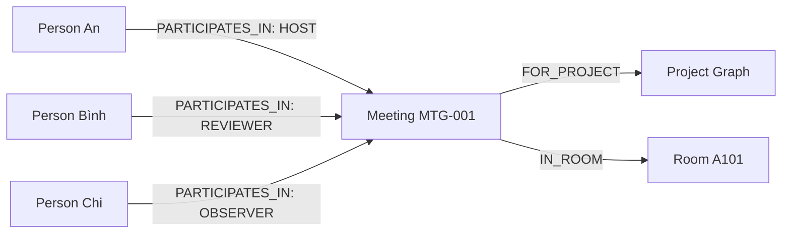
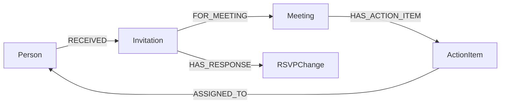

# Intermediate Nodes for Events or Multi-Party Relationships

## 1. Lesson Objectives

In **Neo4j**, every relationship connects **two nodes**. However, business domains often involve situations that cannot be fully expressed by a pair of nodes: a meeting involves multiple people, a room, and a project; a contract involves a buyer, a seller, and a guarantor; a delivery shipment involves an order, a driver, a vehicle, and a warehouse. Each occurrence can also carry its own **identifier, status, timestamp, and history**.

A common design pattern is using an **intermediate node** to represent an *event* or *multi-party association* and connecting it to each participant via clearly named relationships. This is also called **reification**: turning an association or occurrence into an entity that can be queried and linked independently.

This lesson belongs to the **Model Design** chapter of the `DATABASE_ENGINE_GRAPH_NEO4J` module. Its content builds on the **property graph** model, using Cypher to traverse relationships, find paths, and verify consistency; identifiers, constraints, indexes, and performance are discussed where those decisions affect the design. The Java Driver, Spring Data Neo4j, ingestion, and operations are covered at the model-integration level.

After this lesson, you will be able to:

- Explain why a single Neo4j relationship cannot directly connect three or more nodes.
- Recognize when a two-party link with properties is enough and when an intermediate node representing **an occurrence** is needed.
- Represent each participant's role, per-participant data, and data belonging to the event itself.
- Write Cypher to create data, look up participants, query history, and detect time conflicts.
- Analyze invariants such as event identity, participant counts, duplicate edges, schedule overlaps, and history changes.
- See the trade-off between business semantics and traversal cost when adding an intermediate node.

## 2. Core Problem: A Relationship Is a Binary Link

A property graph has three primary building blocks: **nodes** (entities), **relationships** (directed links between two nodes), and **properties** (values describing nodes or relationships). For instance:

```cypher
(:Person)-[:MEMBER_OF]->(:Team)
```

This pattern represents a person belonging to a team. If each person only needs to link to a team at a point in time, you can put `joinedAt` or `role` on the relationship. However, a relationship **cannot have three endpoints** to connect `Person`, `Meeting`, and `Room` at once, nor can a relationship **serve as the endpoint of another relationship**.

Consider a meeting attended by three people—An, Bình, Chi—in room A101 to review the Graph project. Pairwise connections do not establish on their own that all three attended **the same session**:

```text
An --- Bình
 |     |
Chi --- Room A101 --- Project Graph
```

If tomorrow An and Bình meet again in the same room, edges like `MET_WITH` or `USES_ROOM` cannot tell which edges belong to **the first meeting** and which belong to **the second meeting**. Putting dates and times on separate pairwise edges can duplicate the same event and make consistent updates difficult.

Instead, create `(:Meeting {meetingId, startAt, endAt, status})` and connect each role to **that specific meeting node**:



`Meeting` establishes a **shared context** for all participants, the room, and the project. Each meeting has its own identifier, so two meetings with the exact same attendees are still **two distinct events**.

> **Principle:** Intermediate nodes are useful when an event or multi-party association needs to be identified, looked up, change state, or link to other objects. Do not create an intermediate node for every relationship merely because it carries a few properties.

## 3. Distinguishing Three Common Representations

| Representation | Graph Shape | Appropriate When | Limitations to Consider |
|---|---|---|---|
| Direct relationship with properties | `Person-[:MEMBER_OF {joinedAt}]->Team` | A binary link between two entities without an independent lifecycle/ID | Hard to link a third object to **that specific association** |
| Event node | `Person-[:PARTICIPATES_IN]->Meeting-[:IN_ROOM]->Room` | An occurrence with an ID, timestamp, status, and multiple parties | Longer path; requires constraints on participant count/types |
| Business link node | `Customer-[:HAS_ORDER]->PurchaseOrder-[:WITH_SELLER]->Seller` | Contracts, orders, enrollments, or transactions with identity and lifecycle | Must define source of truth, identifiers, and update rules |

What **event nodes** and **business link nodes** have in common is that they turn something one might phrase as “A relates to B” into an entity with its own identity. An event does not have to last only minutes: an `Enrollment` can span months; a `Contract` can stay active for years.

### 3.1. An Intermediate Node Is Not Equivalent to an SQL Join Table

For example, `Student-[:ENROLLED_IN {enrolledAt}]->Course` is enough if the application only needs to know which courses a student is enrolled in and each pair has one active enrollment. But when each enrollment needs an `enrollmentId`, multiple payments, certificates, and retake history, an `Enrollment` node represents each occurrence separately.

Adding an intermediate node is a **decision about semantics and lifecycle**, not a rule that “every many-to-many relationship needs a node”. In Neo4j, binary N:N can still be modeled directly with multiple relationships between appropriate pairs of nodes.

### 3.2. Signs You Should Split Out an Event Node

Ask:

1. **Does the occurrence have an ID?** E.g., `meetingId`, `shipmentId`, `paymentId`, `interviewId`.
2. **Do multiple parties share a common context?** E.g., host, attendees, room, project.
3. **Can the same pair of objects repeat the event?** The same two people can meet multiple times on different days.
4. **Does it have its own status and timestamps?** E.g., `SCHEDULED`, `CANCELLED`, `COMPLETED`, `startAt`, `endAt`.
5. **Do other entities link to this occurrence?** E.g., meeting notes, attachments, action items, approval requests.
6. **Is there an audit/retrospective requirement?** E.g., retrieving the exact attendees and decisions from last month's meeting.

If several answers are “yes”, an intermediate node usually makes the model clearer. If there are only two parties, one current state, and no need to query individual occurrences, a relationship with properties is usually cleaner.

## 4. Defining Event Boundaries and Participant Roles

Suppose a meeting management system needs to answer these questions:

- **Q1:** Which meetings does person `P-AN` have in a given time range? What role do they hold in each?
- **Q2:** Who is attending `MTG-001`, which project is it for, and which room is it using?
- **Q3:** Which **meetings** have An and Bình attended together, even if they met multiple times?
- **Q4:** Is room `R-A101` double-booked for two overlapping meetings?
- **Q5:** Within a meeting, how many people hold each role (`HOST`, `REVIEWER`, `OBSERVER`)?

### 4.1. Deciding Nodes, Relationships, and Properties

| Element | Representation | Rationale |
|---|---|---|
| Participant | `(:Person {personId, fullName})` | Has own identity, attends many meetings |
| Specific meeting | `(:Meeting {meetingId, startAt, endAt, status, title})` | An **event with identity**, timestamps, and own status |
| Project | `(:Project {projectId, name})` | Referenced by many meetings |
| Meeting room | `(:Room {roomId, name})` | Reused across many events and requires schedule checks |
| Person attends meeting | `(:Person)-[:PARTICIPATES_IN]->(:Meeting)` | Attendees connect directly to the specific event |
| Role, invite response | `PARTICIPATES_IN.role`, `PARTICIPATES_IN.rsvpStatus` | Belongs to **one person in one meeting**, not the person's permanent role |
| Meeting belongs to project | `(:Meeting)-[:FOR_PROJECT]->(:Project)` | Anchors the event in project context |
| Meeting uses room | `(:Meeting)-[:IN_ROOM]->(:Room)` | Enables checking schedules backward from Room to Meeting |
| Start/end times | `Meeting.startAt`, `Meeting.endAt` | Time belongs to the **entire event**, not duplicated on each attendee's edge |

This model applies one **direction convention**: a person `PARTICIPATES_IN` a meeting; a meeting is `FOR_PROJECT` a project and `IN_ROOM` a room. When querying from project/room back to meetings, Cypher simply traverses in reverse; do not create inverse types duplicating the same fact.

### 4.2. Distinguishing Event Data from Per-Participation Data

`Meeting.startAt` and `Meeting.endAt` apply to everyone in the meeting. If rescheduled, only `Meeting` needs to be updated. Conversely, An can be `HOST`, Bình `REVIEWER`, and Chi `OBSERVER`; roles live on **each `PARTICIPATES_IN` relationship**.

Similarly, An's `rsvpStatus = 'ACCEPTED'` cannot live on `Meeting`, because Bình might accept while Chi has not responded yet. If you need to store *the full history of every time an attendee changed their response*, a current-state property on the edge will not suffice; consider an `InvitationResponse`/`RSVPChange` event node or a properly designed audit log.

### 4.3. Cardinality Is a Business Invariant, Not an Automatically Inferred Property

In this example:

| Relationship Pattern | Desired Rule | How to Check |
|---|---|---|
| `Person → Meeting` | One person can attend many Meetings | No limit needed on Meetings/person |
| `Person → Meeting` within one session | At most **one participation edge** per person–meeting pair | Check duplicate edges per pair |
| `Meeting → Project` | Each Meeting belongs to **exactly one** Project | Check `FOR_PROJECT` edge count per Meeting |
| `Meeting → Room` | In-person meetings use at most **one** Room | Check `IN_ROOM` edge count and meeting format |
| `Meeting ← Person` with HOST role | Each Meeting needs **exactly one** host | Count edges with `role = 'HOST'` |

Edge-count and coverage constraints are **not enforced by graph structure alone**. A unique constraint on `Meeting.meetingId` does not guarantee exactly one Project, one HOST, or non-overlapping room bookings. The system must enforce these with business rules and proper write logic.

## 5. Building the Prototype Model with Cypher in Neo4j 5.x

The following examples use **Neo4j 5.x**, with timestamps in timezone `+07:00`. Run them on a test database, and never put sample identifiers into production data.

### 5.1. Constraints and Indexes for Query Anchors

```cypher
CREATE CONSTRAINT person_id_unique IF NOT EXISTS
FOR (p:Person) REQUIRE p.personId IS UNIQUE;

CREATE CONSTRAINT meeting_id_unique IF NOT EXISTS
FOR (m:Meeting) REQUIRE m.meetingId IS UNIQUE;

CREATE CONSTRAINT project_id_unique IF NOT EXISTS
FOR (p:Project) REQUIRE p.projectId IS UNIQUE;

CREATE CONSTRAINT room_id_unique IF NOT EXISTS
FOR (r:Room) REQUIRE r.roomId IS UNIQUE;

CREATE RANGE INDEX meeting_start_at_idx IF NOT EXISTS
FOR (m:Meeting) ON (m.startAt);
```

Identity constraints enable key lookups and prevent two nodes with the same label from sharing **the same ID value when present**. A simple unique constraint does not force nodes to always have that key; systems requiring mandatory IDs need additional checks or constraints suited to the Neo4j version/edition.

A temporal index can help queries starting with a `Meeting.startAt` range, whereas query Q1 starting from an identified `Person` and traversing their Meetings may not need a global time index. The execution plan determines how nodes are found; measure with `EXPLAIN`/`PROFILE` on representative data.

### 5.2. Sample Dataset: Two Distinct Meetings Sharing Attendees and Room

```cypher
MERGE (an:Person {personId: 'P-AN'})
SET an.fullName = 'An'
MERGE (binh:Person {personId: 'P-BINH'})
SET binh.fullName = 'Bình'
MERGE (chi:Person {personId: 'P-CHI'})
SET chi.fullName = 'Chi'

MERGE (project:Project {projectId: 'PRJ-GRAPH'})
SET project.name = 'Graph Platform'
MERGE (room:Room {roomId: 'R-A101'})
SET room.name = 'Room A101'

MERGE (first:Meeting {meetingId: 'MTG-001'})
SET first.title = 'Graph model review',
    first.startAt = datetime('2026-12-02T09:00:00+07:00'),
    first.endAt = datetime('2026-12-02T10:00:00+07:00'),
    first.status = 'SCHEDULED'
MERGE (second:Meeting {meetingId: 'MTG-002'})
SET second.title = 'Cypher query discussion',
    second.startAt = datetime('2026-12-02T10:00:00+07:00'),
    second.endAt = datetime('2026-12-02T11:00:00+07:00'),
    second.status = 'SCHEDULED'

MERGE (first)-[:FOR_PROJECT]->(project)
MERGE (second)-[:FOR_PROJECT]->(project)
MERGE (first)-[:IN_ROOM]->(room)
MERGE (second)-[:IN_ROOM]->(room)

MERGE (an)-[anFirst:PARTICIPATES_IN]->(first)
SET anFirst.role = 'HOST', anFirst.rsvpStatus = 'ACCEPTED'
MERGE (binh)-[binhFirst:PARTICIPATES_IN]->(first)
SET binhFirst.role = 'REVIEWER', binhFirst.rsvpStatus = 'ACCEPTED'
MERGE (chi)-[chiFirst:PARTICIPATES_IN]->(first)
SET chiFirst.role = 'OBSERVER', chiFirst.rsvpStatus = 'INVITED'

MERGE (an)-[anSecond:PARTICIPATES_IN]->(second)
SET anSecond.role = 'HOST', anSecond.rsvpStatus = 'ACCEPTED'
MERGE (binh)-[binhSecond:PARTICIPATES_IN]->(second)
SET binhSecond.role = 'REVIEWER', binhSecond.rsvpStatus = 'ACCEPTED';
```

Points to observe:

- `MTG-001` and `MTG-002` are **two nodes**, even though both belong to the Graph project, take place in Room A101, and include An and Bình.
- Meeting 1 includes Chi; Meeting 2 does not. Each person's role and invite status sit on the relationship to the exact Meeting.
- Meeting 1 ends exactly when Meeting 2 begins. Under the **half-open interval** convention `[startAt, endAt)`, these two meetings **do not overlap**.
- `MERGE` keeps the example rerunnable; it does not automatically enforce edge-count rules or concurrency safety without synchronization mechanisms.

## 6. Querying from the Event Node and Across Multiple Participants

### Q1. A Person's Meeting Schedule Within a Time Range

```cypher
MATCH (p:Person {personId: $personId})
      -[participation:PARTICIPATES_IN]->(m:Meeting)
WHERE m.startAt >= datetime($fromTime)
  AND m.startAt < datetime($toTime)
  AND m.status <> 'CANCELLED'
RETURN m.meetingId AS meetingId,
       m.title AS title,
       m.startAt AS startAt,
       m.endAt AS endAt,
       participation.role AS role,
       participation.rsvpStatus AS rsvpStatus
ORDER BY startAt, meetingId;
```

With `$personId = 'P-AN'`, `$fromTime = '2026-12-02T00:00:00+07:00'`, and `$toTime = '2026-12-03T00:00:00+07:00'`, the query returns **two meetings**, `MTG-001` and `MTG-002`. The filter here checks **start time**; if business requirements ask for any meeting *overlapping* the search window, change the condition to `m.startAt < datetime($toTime) AND m.endAt > datetime($fromTime)`.

### Q2. Participants, Project, and Room of a Meeting

```cypher
MATCH (m:Meeting {meetingId: $meetingId})
MATCH (p:Person)-[participation:PARTICIPATES_IN]->(m)
WITH m, collect({
  personId: p.personId,
  fullName: p.fullName,
  role: participation.role,
  rsvpStatus: participation.rsvpStatus
}) AS participants
MATCH (m)-[:FOR_PROJECT]->(project:Project)
OPTIONAL MATCH (m)-[:IN_ROOM]->(room:Room)
RETURN m.meetingId AS meetingId,
       m.title AS title,
       project.projectId AS projectId,
       room.roomId AS roomId,
       participants
ORDER BY meetingId;
```

With `$meetingId = 'MTG-001'`, `participants` includes An (`HOST`), Bình (`REVIEWER`), and Chi (`OBSERVER`), with `projectId = 'PRJ-GRAPH'` and `roomId = 'R-A101'`.

This query assumes each Meeting has **at least one** participant, **exactly one** Project, and at most one Room. If bad data creates two `FOR_PROJECT` edges, results may duplicate rows. If meetings awaiting invitations must also be shown, replace the required `MATCH` on participants with `OPTIONAL MATCH` and handle empty participants per the API contract.

### Q3. Which Meetings Have Two People Attended Together?

```cypher
MATCH (firstPerson:Person {personId: $firstPersonId})
      -[:PARTICIPATES_IN]->(m:Meeting)
      <-[:PARTICIPATES_IN]-
      (secondPerson:Person {personId: $secondPersonId})
RETURN DISTINCT m.meetingId AS meetingId,
       m.title AS title,
       m.startAt AS startAt
ORDER BY startAt, meetingId;
```

Testing `$firstPersonId = 'P-AN'` and `$secondPersonId = 'P-BINH'` yields **two rows**, for `MTG-001` and `MTG-002`. Storing only a `(:Person)-[:MET_WITH]->(:Person)` edge would not be able to distinguish two separate meetings, their rooms, projects, and times.

### Q4. Detecting Overlapping Room Bookings

With half-open intervals `[startAt, endAt)`, two intervals A and B **overlap** when `A.startAt < B.endAt` **and** `B.startAt < A.endAt`. This allows A to end right when B begins.

```cypher
MATCH (room:Room {roomId: $roomId})<-[:IN_ROOM]-(first:Meeting)
MATCH (room)<-[:IN_ROOM]-(second:Meeting)
WHERE first.meetingId < second.meetingId
  AND first.status IN ['SCHEDULED', 'IN_PROGRESS']
  AND second.status IN ['SCHEDULED', 'IN_PROGRESS']
  AND first.startAt < second.endAt
  AND second.startAt < first.endAt
RETURN room.roomId AS roomId,
       first.meetingId AS firstMeetingId,
       second.meetingId AS secondMeetingId,
       first.startAt AS firstStart,
       second.startAt AS secondStart;
```

With `$roomId = 'R-A101'`, the sample data **returns no rows**, because one meeting ends at 10:00 and the other begins at 10:00. Changing `MTG-002.startAt` to 09:30 makes the query detect the overlapping pair.

`first.meetingId < second.meetingId` uses a stable ID to return only one ordering per pair. **A conflict-detection query does not prevent two concurrent booking transactions.** The system must validate and write bookings with appropriate transactions/synchronization; a unique constraint on `meetingId` cannot enforce non-overlapping time intervals.

### Q5. Counting Attendees by Role

```cypher
MATCH (p:Person)-[participation:PARTICIPATES_IN]->
      (m:Meeting {meetingId: $meetingId})
RETURN participation.role AS role,
       count(DISTINCT p) AS personCount
ORDER BY role;
```

With `MTG-001`, the result is three groups: `HOST: 1`, `OBSERVER: 1`, `REVIEWER: 1`. `count(DISTINCT p)` counts distinct people, whereas `count(participation)` counts edges; if one person accidentally got two duplicate edges, those two counts would differ. Never use `DISTINCT` to mask data bugs without investigating the root cause.

### Q6. Finding All Meetings for a Project

```cypher
MATCH (project:Project {projectId: $projectId})
      <-[:FOR_PROJECT]-(m:Meeting)
WHERE m.status <> 'CANCELLED'
RETURN m.meetingId AS meetingId,
       m.title AS title,
       m.startAt AS startAt
ORDER BY startAt;
```

With `$projectId = 'PRJ-GRAPH'`, there are two meetings. This query shows that an intermediate node not only supports querying **from people to meetings**, but also from other stakeholders back to **the event itself**.

## 7. Data Invariants to Enforce

Structuring the event node properly is not enough to guarantee the graph matches business rules. Define and check the following invariants.

### 7.1. One Person Has Only One Participation Edge per Meeting

```cypher
MATCH (p:Person)-[participation:PARTICIPATES_IN]->(m:Meeting)
WITH p, m, count(participation) AS edgeCount
WHERE edgeCount > 1
RETURN p.personId AS personId,
       m.meetingId AS meetingId,
       edgeCount
ORDER BY edgeCount DESC;
```

This query detects person–meeting pairs with multiple edges. If a person can hold multiple **roles** in the same meeting, decide whether to store `roles` on one relationship or make each role an independent entity. Do not assume all parallel edges are valid or delete them blindly without agreeing on the rule.

### 7.2. Each Meeting Has Exactly One Project and at Most One Room

```cypher
MATCH (m:Meeting)
OPTIONAL MATCH (m)-[rel:FOR_PROJECT]->(:Project)
WITH m, count(rel) AS projectLinks
WHERE projectLinks <> 1
RETURN m.meetingId AS meetingId, projectLinks;
```

```cypher
MATCH (m:Meeting)
OPTIONAL MATCH (m)-[rel:IN_ROOM]->(:Room)
WITH m, count(rel) AS roomLinks
WHERE roomLinks > 1
RETURN m.meetingId AS meetingId, roomLinks;
```

In practice, online meetings might not use a Room, or a meeting might span multiple Projects. If business rules allow that, update the invariant and read logic accordingly; do not keep a “strictly one” rule just because the sample model used it.

### 7.3. Each Meeting Has Exactly One HOST

```cypher
MATCH (m:Meeting)
OPTIONAL MATCH (p:Person)-[participation:PARTICIPATES_IN]->(m)
WITH m,
     sum(CASE WHEN participation.role = 'HOST' THEN 1 ELSE 0 END)
       AS hostCount
WHERE hostCount <> 1
RETURN m.meetingId AS meetingId, hostCount;
```

`OPTIONAL MATCH` ensures meetings **with zero participants** are included, catching `hostCount = 0`. If the system allows multiple co-hosts, change this rule; that is a business decision, not a Neo4j limitation.

### 7.4. Start Time Must Be Earlier Than End Time

```cypher
MATCH (m:Meeting)
WHERE m.startAt IS NULL
   OR m.endAt IS NULL
   OR m.startAt >= m.endAt
RETURN m.meetingId AS meetingId,
       m.startAt AS startAt,
       m.endAt AS endAt;
```

Standardize on temporal types (`datetime`), timezones, and the `[startAt, endAt)` convention. Do not mix unstandardized date strings with Neo4j native temporal values if you need comparisons or overlap checks. For meetings spanning timezones, store timestamps with explicit offsets/timezones to avoid confusing absolute instants and local wall-clock time.

### 7.5. Attendee Schedule Overlaps

Besides room conflicts, a person might be invited to two meetings at the same time. The model can check events of **the same Person**:

```cypher
MATCH (person:Person {personId: $personId})
      -[firstAttendance:PARTICIPATES_IN]->(first:Meeting)
MATCH (person)-[secondAttendance:PARTICIPATES_IN]->(second:Meeting)
WHERE first.meetingId < second.meetingId
  AND first.status = 'SCHEDULED'
  AND second.status = 'SCHEDULED'
  AND firstAttendance.rsvpStatus = 'ACCEPTED'
  AND secondAttendance.rsvpStatus = 'ACCEPTED'
  AND first.startAt < second.endAt
  AND second.startAt < first.endAt
RETURN person.personId AS personId,
       first.meetingId AS firstMeetingId,
       second.meetingId AS secondMeetingId;
```

Only `ACCEPTED` invites are checked here. If policy should also block pending invites (`INVITED`) or allow “tentative” bookings, redefine the filter. Also decide whether `IN_PROGRESS` meetings count toward overlaps.

## 8. When One Event Node Is Not Enough: Sub-Links with Independent Lifecycles

The `Person-[:PARTICIPATES_IN {role, rsvpStatus}]->Meeting` pattern serves current participation state. However, new requirements may demand separate nodes for **individual interactions**, not just the meeting:

- Sending multiple invitations where an invitee declines and later accepts; needing timestamp, sender, and reason for **each status change**.
- One person receiving multiple action items during a meeting, each with its own deadline, reviewer, and status.
- Each attendee having an evaluation form or attendance record approved by someone else.

In such cases, you can add `Invitation`, `RSVPChange`, `ActionItem`, or `AttendanceRecord` nodes, connecting them to `Meeting` and `Person` via meaningful relationships:



**Do not create all of these nodes upfront.** Start from real business questions. Intermediate nodes are appropriate when sub-interactions have **their own identities/histories/child links**, not to make the graph more elaborate.

### 8.1. Multi-Session or Recurring Events

A weekly recurring meeting usually involves two distinct concepts:

- `MeetingSeries`: recurrence rules/schedule and shared series configuration.
- `Meeting`: **each individual occurrence** with its actual time, attendees, room, status, and minutes.

```text
(:MeetingSeries {seriesId: 'SER-001'})
    -[:HAS_OCCURRENCE]->(:Meeting {meetingId: 'MTG-001'})
    -[:FOR_PROJECT]->(:Project)
```

This snippet is **structural**: in practice `MeetingSeries` links to many `Meeting` nodes and each `Meeting` links directly to its Project as needed. Storing only a single `Meeting` node and overwriting `startAt` every week loses the history of individual sessions.

### 8.2. Multi-Party Associations Are Not Only Meetings

| Domain | Intermediate Node | Parties/Links Likely Needed |
|---|---|---|
| Delivery | `Shipment` | Order, driver, vehicle, origin/destination warehouses |
| Recruiting interview | `InterviewSession` | Candidate, interviewers, job opening, room |
| Tri-party contract | `Contract` | Buyer, seller, guarantor, signed documents |
| Payment session | `PaymentTransaction` | Payer, payee, invoice, payment method |
| Course enrollment with payments/certificates | `Enrollment` | Student, course, payment transactions, certificate |

Each example admits multiple valid designs. What matters is that edges point into or out of **the exact event node**, so distinct events are not conflated simply because they share some participants.

## 9. Write Correctness and External Data Imports

### 9.1. Event Identity Must Be Independent of Participant Combinations

Do not use “same people + same room + same project” to assume two meetings are the same. A meeting can change its time, attendees, or room while keeping its original `meetingId`. Conversely, two distinct meetings can share all of those attributes.

Typical Meeting creation workflow:

1. Receive a stable `meetingId` or an idempotency-controlled creation request key.
2. Verify required `Person`, `Project`, and `Room` nodes exist or create them per explicit rules.
3. Validate `startAt < endAt` and time-conflict rules.
4. Create/match the Meeting by identifier; attach participation, project, and room edges properly.
5. Write all related updates inside an appropriate transaction to avoid partial states.
6. Verify counts, roles, and agreed invariants.

`MERGE` helps avoid recreating a node with the same `meetingId` when a unique constraint exists, yet it **does not guarantee** exactly one edge per `(Person, Meeting)` pair under concurrent writes. Prevent duplicate edges and coordinate writes explicitly; never treat rerunning a `MERGE` statement as sufficient protection for all invariants.

### 9.2. Ordering and Sync Scope During Imports

When importing schedules from external systems, define ID mappings and sequence: create/match `Person`, `Project`, and `Room` nodes; create/match `Meeting`; then link edges. If `MATCH` fails to find an endpoint, the input row **may silently fail to create a relationship** without raising a syntax error. Log input row counts, created/updated Meeting counts, expected vs. actual edge counts, and missing IDs to avoid silent link loss.

In the Java Driver, pass values via Cypher parameters instead of concatenating user input into query strings. With Spring Data Neo4j, the `Meeting` node has its own identifier; edges like `PARTICIPATES_IN` with properties `role` and `rsvpStatus` can be mapped with an appropriate relationship-properties class. A relationship-properties mapping class is **not** a Neo4j node; those are two distinct design choices.

## 10. Measuring Performance by Query Patterns, Not Node Count

Inserting `Meeting` between `Person` and `Project` makes certain queries traverse **two edges** instead of one. This is an intentional trade-off to model a specific event accurately. Avoid adding a shortcut edge `Person-[:WORKS_ON]->Project` for every meeting solely for shorter traversals, unless the business genuinely has an independent “works on project” concept with a mechanism to keep derived data synchronized.

### 10.1. Using `EXPLAIN`/`PROFILE` to Inspect Anchors

```cypher
EXPLAIN
MATCH (p:Person {personId: 'P-AN'})-[:PARTICIPATES_IN]->(m:Meeting)
RETURN m.meetingId, m.startAt;
```

`EXPLAIN` shows the planned execution plan; `PROFILE` executes the query and reports metrics. Check:

- Does it use anchors on `Person.personId`, `Meeting.meetingId`, and `Room.roomId` where appropriate?
- How many `PARTICIPATES_IN` and `IN_ROOM` edges are expanded per step, and are there supernodes?
- When traversing across multiple participant groups, does cardinality multiply?
- How many DB hits/memory do `collect`, `DISTINCT`, sorting, and time filters consume?
- Does latency meet requirements on large datasets with realistic distributions?

### 10.2. Avoiding Row Multiplication Across Multiple Event Branches

Suppose a Meeting has 5 attendees and 3 ActionItems. The pattern:

```cypher
MATCH (p:Person)-[:PARTICIPATES_IN]->(m:Meeting)
      -[:HAS_ACTION_ITEM]->(item:ActionItem)
RETURN m.meetingId AS meetingId,
       count(p) AS participantRows;
```

can return **15 rows** for 5 people × 3 ActionItems, distorting `count(p)` if you want **unique people**. Use `count(DISTINCT p)` for people or aggregate each branch independently before joining; do not use `DISTINCT` to hide underlying data bugs.

Example when only counting participants per meeting:

```cypher
MATCH (p:Person)-[:PARTICIPATES_IN]->(m:Meeting)
WITH m, count(DISTINCT p) AS participantCount
RETURN m.meetingId AS meetingId, participantCount
ORDER BY meetingId;
```

If you need both ActionItem counts and attendee counts simultaneously, aggregate each relationship type independently before joining; avoid multiplying two sets and calling `sum()` over repeated properties.

### 10.3. Checking Schedule Conflicts at Scale

Query Q4 pairs two Meetings of **the same room**, so pair counts can grow quickly when a room has extensive history. On large datasets, narrow the date window, filter statuses early, bound the time range being checked, and inspect the plan to avoid scanning full history when validating a single new booking request. An index on `Meeting.startAt` can assist certain starting points, yet it does not automatically eliminate pairwise join costs for rooms with many Meetings.

## 11. Common Modeling Mistakes

| Poor Design | Consequence | How to Handle |
|---|---|---|
| Using `Person-[:MET_WITH]->Person` edges for every meeting | Loses event boundaries and room/project context | Use a `Meeting` node with its own `meetingId` |
| Storing attendees as a `personIds` list/string on Meeting | Hard to traverse from Person, keep roles, and enforce identity | Use `Person-[:PARTICIPATES_IN]->Meeting` |
| Putting `startAt` on every participation edge | Rescheduling requires updating many edges, prone to drift | Put event times on `Meeting` |
| Putting `rsvpStatus` on Meeting | Cannot distinguish individual responses | Put it on `PARTICIPATES_IN` |
| Creating event nodes without stable identifiers | Easy to merge mistakenly or create duplicate occurrences | Use `meetingId` and appropriate constraints |
| Assuming a Meeting can have unlimited Projects/Rooms | Queries return duplicated rows; ingestion breaks semantics | Define cardinality and verify invariants |
| Relying on a unique constraint alone to prevent schedule overlaps | Unique IDs do not check time intervals | Check interval overlaps and synchronize writes |
| Overwriting a weekly Meeting instead of creating new occurrences | Loses individual session history | Split `MeetingSeries` and `Meeting` when needed |
| Joining multiple branches and summing at the end | Totals get multiplied by path combinations | Aggregate each entity type properly before joining |
| Creating intermediate nodes for every simple edge | Longer paths and noisy data with zero benefit | Use nodes only when true identity/lifecycle/multi-party context exists |

## 12. Practice Exercises

### Exercise 1 – From Pairwise Edges to a Multi-Party Event

A recruiting center stores `Candidate-[:INTERVIEWED_BY]->Interviewer` edges. Candidate A interviews with the same two interviewers across two different rounds. Explain what information cannot be represented with pairwise edges alone, and design `InterviewSession` connected to `Candidate`, `Interviewer`, `JobOpening`, and `Room`; decide which properties belong on `InterviewSession` versus on each interviewer's edge.

### Exercise 2 – Querying from Two Sides

Using the meeting model from Section 5, write Cypher returning: (a) meetings to which `P-BINH` is invited as `REVIEWER`; (b) meetings using room `R-A101` on `2026-12-02`. Explain why both queries reuse the same `Meeting` node instead of storing a direct `Person-[:USES_ROOM]->Room` edge.

### Exercise 3 – Invitation Response History

Chi initially accepts an invite, later declines, and finally accepts again. If `rsvpStatus` is only stored on the current edge, what information is lost? Propose a child event node with sufficient identity, timestamps, and links to audit this history.

### Exercise 4 – Room Conflict Analysis

Given meetings in the same room: A `[09:00, 10:00)`, B `[10:00, 11:00)`, C `[09:30, 10:30)`. List all overlapping pairs and write the general Cypher overlap condition to detect them. Why is comparing `startAt <= endAt` incorrect under the half-open interval convention?

### Exercise 5 – Checking Event Invariants

An import job created `Meeting MTG-003` with two `FOR_PROJECT` edges, two people with role `HOST`, and two duplicate `PARTICIPATES_IN` edges for An. Write Cypher queries to detect each type of violation, and describe how to distinguish data errors from legitimately expanded business rules.

### Exercise 6 – Avoiding Metric Multiplication Across Branches

A meeting has 8 people, 5 `ActionItem`s, and 2 attachments. If all three branches are traversed in one Cypher pattern, how many row combinations can be generated? Write a query that computes people count, action item count, and attachment count independently so totals are not multiplied incorrectly.

### Exercise 7 – Choosing a Node vs. a Relationship with Properties

Compare two requirements: (a) a student is currently enrolled in a course with an enrollment date; (b) a student has multiple retake cohorts, each with payments and a certificate. Choose a model for each case, explaining when `ENROLLED_IN` is enough and when an identified `Enrollment` node is required.

## 13. Pre-Finalization Checklist

1. Is **one occurrence** clearly defined, and which ID distinguishes two different occurrences?
2. Which parties participate in the event, and on which edge does each party's role live?
3. Which data belongs to the whole event versus **each participant / participation**?
4. Have 1:1, 1:N, N:N relationships and min/max bounds been documented?
5. Are there rules for history, status transitions, rescheduling/cancellations, and recurring events?
6. Do unique constraints and write logic protect identity, prevent duplicate edges, and preserve atomicity?
7. Do you need overlap checks for time intervals, rooms, attendees, or other resources?
8. Do queries from multiple endpoints return the right events without mis-multiplying counts?
9. Has the model been profiled with `EXPLAIN`/`PROFILE` on realistic data?

**Completion criteria:** You can recognize when a multi-party association or occurrence needs its own identifier, design an intermediate node linking each party via clearly named relationships, assign properties accurately, write Cypher queries from different endpoints, and identify invariants to enforce. Such a model preserves **event boundaries**, history, and business context even when the same participants interact repeatedly.
