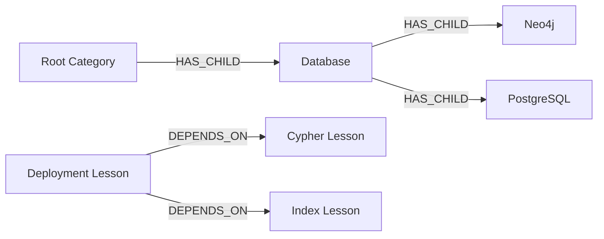
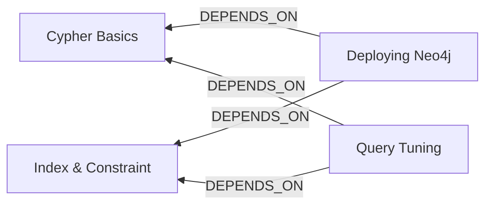

# Modeling Hierarchies, Networks, and Ordered Data in Neo4j

Within the **Model Design** section of `DATABASE_ENGINE_GRAPH_NEO4J`, this lesson focuses on representing three common relationship structures using a **property graph**: hierarchies, interconnected networks, and ordered sequences. Neo4j stores **nodes**, directed **relationships**, labels, and properties; Cypher lets you query related nodes, depths, paths, and display order. Choosing the right model determines how validity is checked, query performance, and update cost.

## 1. Objectives and How to Identify the Problem

After this lesson, you will be able to:

- Distinguish **trees**, **directed acyclic graphs (DAGs)**, **networks**, and **ordered sequences**; decide when multiple models should be combined.
- Explicitly define relationship direction, node identifiers, allowed connection counts, whether cycles are valid, and whether order carries business meaning.
- Write Cypher to fetch children/descendants, ancestors, transitive dependencies, two-hop recommendations, shortest hop-count paths, and position-ordered items.
- Recognize constraint limitations, how to maintain integrity during transactional updates, and how to inspect execution plans with `EXPLAIN`/`PROFILE`.

| Business Question | Appropriate Model | Invariant to Maintain |
| --- | --- | --- |
| Parent–child categories, folder trees, org charts with one direct manager | **Tree** | Every non-root node has exactly one parent; no cycles |
| A task depends on multiple tasks, a lesson has multiple prerequisites | **DAG** | Multiple incoming/outgoing edges allowed; no directed cycles |
| Users following each other, connected stations, collaborating entities | **Network** | Multiple paths, branches, and cycles may be valid |
| Playlists, step-by-step workflows, chapters in a learning path | **Ordered sequence** | Order is explicit data; never infer from storage order |

**Key distinction:** A `HAS_CHILD` relationship can form a tree, yet allowing a node to have two parents turns the structure into something that is no longer a tree. A `NEXT` chain is also a graph, yet the application must enforce how many predecessors/successors each element may have. Neo4j does not infer or enforce these business rules solely from relationship names.

## 2. Designing Relationships Before Writing Cypher

Ask the following questions for each relationship type:

1. **Meaning and direction:** `(parent)-[:HAS_CHILD]->(child)` means parent points to child; `(task)-[:DEPENDS_ON]->(prerequisite)` means task points to a prerequisite that must finish first. The two directions carry distinct meanings.
2. **Cardinality:** Can a child have at most one parent, multiple parents, or unlimited parents? Can a step have two next steps?
3. **Cycles:** Is it valid to follow the same relationship type and return to the starting node? Cycles can be natural for `FOLLOWS`, yet invalid for `DEPENDS_ON` when interpreted as prerequisites.
4. **Identity:** Use `categoryId`, `taskId`, `accountId`, etc. as stable business keys; create uniqueness constraints to prevent duplicate nodes. Never use Neo4j's internal ID as a durable business key.
5. **Order and time:** Any ordering must be modeled explicitly with a `position` property, `NEXT` edges, or both with sync rules. If a relationship has an effective validity window, consider temporal properties on the edge or an event node.

Overview example:



Both graph clusters use directed edges. The category cluster is designed as a **tree**; the prerequisite cluster is a **DAG** and allows multiple prerequisites per lesson.

## 3. Tree Hierarchies: Categories and Folders

### 3.1. Model and Invariants

For a category system, choose:

- Node `(:Category {categoryId, name})`.
- Relationship `(parent:Category)-[:HAS_CHILD]->(child:Category)`.
- One root node per tree with no parent; every other node has **exactly one incoming `HAS_CHILD` edge** from its parent.
- No cycles; a node must never be a descendant of itself.

If a category can belong to multiple groups simultaneously, consider a **classification DAG** or separate `TAGGED_WITH`/`BELONGS_TO` relationships instead of silently breaking the single-parent rule.

### 3.2. Creating Sample Data

```cypher
CREATE CONSTRAINT category_id_unique IF NOT EXISTS
FOR (c:Category) REQUIRE c.categoryId IS UNIQUE;

MERGE (root:Category {categoryId: 'data'})
SET root.name = 'Data'
MERGE (db:Category {categoryId: 'database'})
SET db.name = 'Databases'
MERGE (graph:Category {categoryId: 'graph'})
SET graph.name = 'Graph Databases'
MERGE (neo:Category {categoryId: 'neo4j'})
SET neo.name = 'Neo4j'
MERGE (root)-[:HAS_CHILD]->(db)
MERGE (db)-[:HAS_CHILD]->(graph)
MERGE (graph)-[:HAS_CHILD]->(neo);
```

`MERGE` avoids recreating matched patterns; the `categoryId` key lets Neo4j identify nodes consistently. However, a node uniqueness constraint **does not guarantee** that a Category has only one parent, nor does it block `HAS_CHILD` cycles. Both rules must be checked when writing data.

### 3.3. Querying Trees

**Fetching direct children:**

```cypher
MATCH (parent:Category {categoryId: $parentId})-[:HAS_CHILD]->(child:Category)
RETURN child.categoryId AS id, child.name AS name
ORDER BY name, id;
```

**Fetching descendants up to six levels deep**, with distance from root:

```cypher
MATCH (root:Category {categoryId: $rootId})
MATCH p = (root)-[:HAS_CHILD*1..6]->(descendant:Category)
RETURN descendant.categoryId AS id,
       descendant.name AS name,
       min(length(p)) AS depth
ORDER BY depth, id;
```

Length `1..6` bounds the number of relationships in a path. If **all** descendants are required, you can use `*1..`, but evaluate tree size and expansion cost first; the depth limit of six above will miss deeper nodes.

**Fetching ancestors** of a category:

```cypher
MATCH p = (ancestor:Category)-[:HAS_CHILD*1..]->
          (target:Category {categoryId: $categoryId})
RETURN ancestor.categoryId AS id,
       ancestor.name AS name,
       length(p) AS distance
ORDER BY distance;
```

In a valid tree, each ancestor has one path to the target node. If multiple paths appear for the same node, the data may have turned into a DAG or violated the tree invariant.

### 3.4. Moving a Subtree to a New Parent

When moving node `A` under `B`, verify:

- `A` and `B` are different nodes.
- `B` is **not a descendant** of `A`; otherwise a cycle would be created.
- Detach the old parent edge and create the new parent edge in the **same transaction**, while preventing concurrent tree edits from breaking the single-parent rule.

Cypher example illustrating the operation in one transaction, assuming the application manages concurrent update control:

```cypher
MATCH (child:Category {categoryId: $childId})
MATCH (newParent:Category {categoryId: $newParentId})
WHERE child <> newParent
  AND NOT EXISTS {
    MATCH (child)-[:HAS_CHILD*1..]->(newParent)
  }
OPTIONAL MATCH (:Category)-[old:HAS_CHILD]->(child)
WITH child, newParent, collect(old) AS oldRels
FOREACH (rel IN oldRels | DELETE rel)
MERGE (newParent)-[:HAS_CHILD]->(child)
RETURN child.categoryId AS movedId,
       newParent.categoryId AS parentId;
```

If zero rows are returned, treat the operation as **failed** and check why (missing node, identical node, or cycle prevention). Path checks and updates must be coordinated with write-layer locking/synchronization, because two concurrent update transactions could both pass the check against stale data.

## 4. Multi-Prerequisite Hierarchies: Dependency DAGs

### 4.1. When Is a Tree Not Enough?

A `Deploying Neo4j` lesson may require **both** `Cypher Basics` **and** `Index & Constraint`. One prerequisite can also be reused by many other lessons. Thus a single-parent tree does not fit; use a DAG:



Choose `(task)-[:DEPENDS_ON]->(prerequisite)` and keep it consistent. A DAG permits multiple paths to the same node, while forbidding `A` from transitively depending on `A` itself.

### 4.2. Creating and Querying Dependencies

```cypher
CREATE CONSTRAINT task_id_unique IF NOT EXISTS
FOR (t:Task) REQUIRE t.taskId IS UNIQUE;

MERGE (build:Task {taskId: 'build'})
SET build.name = 'Build'
MERGE (test:Task {taskId: 'test'})
SET test.name = 'Test'
MERGE (deploy:Task {taskId: 'deploy'})
SET deploy.name = 'Deploy'
MERGE (test)-[:DEPENDS_ON]->(build)
MERGE (deploy)-[:DEPENDS_ON]->(test);
```

**Fetching all transitive prerequisites** of a task:

```cypher
MATCH (:Task {taskId: $taskId})-[:DEPENDS_ON*1..]->
      (prerequisite:Task)
RETURN DISTINCT prerequisite.taskId AS prerequisiteId
ORDER BY prerequisiteId;
```

**Identifying tasks impacted** when a task changes:

```cypher
MATCH (affected:Task)-[:DEPENDS_ON*1..]->
      (:Task {taskId: $changedTaskId})
RETURN DISTINCT affected.taskId AS affectedId
ORDER BY affectedId;
```

**Checking before adding `A DEPENDS_ON B`:**

```cypher
MATCH (a:Task {taskId: $taskId})
MATCH (b:Task {taskId: $prerequisiteId})
WHERE a <> b
  AND NOT EXISTS {
    MATCH (b)-[:DEPENDS_ON*1..]->(a)
  }
MERGE (a)-[:DEPENDS_ON]->(b)
RETURN a.taskId AS taskId, b.taskId AS prerequisiteId;
```

Reason: if `B` already depends directly or indirectly on `A`, adding `A → B` creates a cycle. As with trees, a single check query is **not enough for concurrency safety**. The application must coordinate transactions/locks or serialize dependency updates.

### 4.3. Cycle Detection and Execution Order

The following query finds **some** cycles up to eight hops long when inspecting sample data:

```cypher
MATCH p = (t:Task)-[:DEPENDS_ON*1..8]->(t)
RETURN t.taskId AS startTask,
       [n IN nodes(p) | n.taskId] AS cycle
LIMIT 10;
```

Returning no rows **does not prove** the entire graph has no cycles longer than eight hops. On large graphs, use a full validation procedure or an appropriate graph algorithm.

A DAG can be placed in **topological order**: every prerequisite precedes any task depending on it. Computing depth with `length(p)` or sorting by `taskId` **does not replace** a topological sort algorithm (such as Kahn's algorithm or DFS with cycle detection). You can run the algorithm in application code or use an appropriate graph processing library if installed.

## 5. Networks: Multi-Directional, Multi-Type Connections

### 5.1. Separating Relationships by Exact Semantics

In social networks, `(a)-[:FOLLOWS]->(b)` is typically **directed**: A following B does not imply B follows A. Collaborations or transit links may be interpreted as bidirectional in the domain; Neo4j still stores directed relationships, while queries can traverse either side using `-[:CONNECTS]-`. Never assume two opposite relationships exist unless you explicitly store them.

Edges can carry properties, for example:

```cypher
MATCH (a:Account {accountId: $from})
MATCH (b:Account {accountId: $to})
MERGE (a)-[f:FOLLOWS]->(b)
ON CREATE SET f.since = date();
```

For complex facts with independent lifecycles (a transaction, an event, an enrollment), consider creating a separate **event node** instead of stuffing all fields into a relationship.

### 5.2. Two-Hop Connection Recommendations

When recommending accounts followed by **many accounts that I already follow**:

```cypher
MATCH (me:Account {accountId: $accountId})
      -[:FOLLOWS]->(via:Account)
      -[:FOLLOWS]->(suggested:Account)
WHERE suggested <> me
  AND NOT EXISTS {
    MATCH (me)-[:FOLLOWS]->(suggested)
  }
RETURN suggested.accountId AS suggestedId,
       count(DISTINCT via) AS viaCount
ORDER BY viaCount DESC, suggestedId
LIMIT 10;
```

This query follows a **two-directed-hop** path pattern; it does not imply mutual following. `viaCount` represents the number of qualifying intermediate accounts.

### 5.3. Shortest Path by Hop Count

For transit links between stations, assuming `CONNECTS` represents a leg traversable in both directions:

```cypher
MATCH (start:Station {code: $fromCode})
MATCH (finish:Station {code: $toCode})
MATCH p = shortestPath((start)-[:CONNECTS*..10]-(finish))
RETURN [n IN nodes(p) | n.code] AS stations,
       length(p) AS hops;
```

`shortestPath` here minimizes **relationship count**, not total `distanceKm`, `cost`, or `duration`. The bound `..10` means routes requiring more than ten hops will not be found. When weighted shortest paths are needed, consider Dijkstra in Neo4j Graph Data Science **if** the plugin and graph projection are configured, or run a weighted algorithm in the application.

Networks often contain supernodes (e.g., celebrity accounts). Multi-hop expansions from those nodes can generate huge numbers of paths; bound queries by business scope and inspect execution plans.

## 6. Ordered Data: `position`, `NEXT`, and Entry Nodes

**Relationship storage or default return order is not business order.** If the application needs “item 1, 2, 3” or “next step”, order must exist explicitly in the model and be enforced with `ORDER BY` in queries.

### 6.1. Three Common Options

| Representation | Example | Appropriate When | Things to Watch |
| --- | --- | --- | --- |
| Order property on item node | `(:Lesson {position: 2})` | Each lesson belongs to only one fixed list | When a lesson appears in multiple paths, a single `position` fails |
| Property on relationship or entry node | `(list)-[:HAS_ITEM {position: 2}]->(item)` or `ListEntry.position` | The same item can appear in different lists | Needs uniqueness rules for position **per list** and reorder handling |
| `NEXT` edge | `(step1)-[:NEXT]->(step2)` | Workflows requiring “next step” navigation | Must prevent forks, cycles, missing head/tail; reordering updates multiple edges |

For playlists or learning paths, a **member node `ListEntry`** is usually the most flexible: the same track/lesson can appear across multiple lists, or even multiple times in one list, with each occurrence holding its own position.

### 6.2. Example: Playlist with Member Nodes

Model:

```text
(:Playlist {playlistId})
    -[:HAS_ENTRY]->
(:ListEntry {entryId, listId, position})
    -[:REFERS_TO]->
(:Track {trackId, title})
```

These two constraints prevent duplicate entries and duplicate positions when both `listId` and `position` are set:

```cypher
CREATE CONSTRAINT list_entry_id_unique IF NOT EXISTS
FOR (e:ListEntry) REQUIRE e.entryId IS UNIQUE;

CREATE CONSTRAINT list_entry_position_unique IF NOT EXISTS
FOR (e:ListEntry) REQUIRE (e.listId, e.position) IS UNIQUE;
```

`(listId, position)` is a composite key scoped to **one playlist**, not a global position. Note: a uniqueness constraint does not inherently require properties to be present; the application must ensure `listId` and `position` are never missing and match the Playlist owning the entry. Property existence constraints depend on Neo4j edition/configuration.

Creating a sample entry (assuming `entryId` and `position` were validly allocated):

```cypher
MERGE (list:Playlist {playlistId: 'pl-1'})
ON CREATE SET list.name = 'Neo4j Learning Path'
MERGE (track:Track {trackId: 'tr-1'})
ON CREATE SET track.title = 'Introduction to Property Graphs'
MERGE (entry:ListEntry {entryId: 'entry-1'})
SET entry.listId = 'pl-1', entry.position = 0
MERGE (list)-[:HAS_ENTRY]->(entry)
MERGE (entry)-[:REFERS_TO]->(track);
```

Reading in display order:

```cypher
MATCH (:Playlist {playlistId: $playlistId})
      -[:HAS_ENTRY]->(entry:ListEntry)
      -[:REFERS_TO]->(track:Track)
RETURN entry.entryId AS entryId,
       entry.position AS position,
       track.trackId AS trackId,
       track.title AS title
ORDER BY position ASC, entryId ASC;
```

`entryId` acts as a tie-breaker so results remain deterministic if data has not yet enforced unique positions. When reordering multiple entries, update them **inside one transaction**. If a unique constraint exists on position, swapping `0 ↔ 1` directly can hit a transient position collision; use a valid temporary-position strategy or phased renumbering.

**Note:** Because `listId` both sits on `ListEntry` and is implied by the `HAS_ENTRY` edge, the system must keep both consistent; if you prefer avoiding duplicated data, adjust the model and position-uniqueness check accordingly.

### 6.3. Example: Step Sequence Using `NEXT`

Suppose a workflow follows a single linear path:

```text
(Workflow)-[:STARTS_WITH]->(Step A)-[:NEXT]->(Step B)-[:NEXT]->(Step C)
```

Querying steps in order from the head node:

```cypher
MATCH (:Workflow {workflowId: $workflowId})
      -[:STARTS_WITH]->(head:Step)
MATCH p = (head)-[:NEXT*0..]->(step:Step)
RETURN step.stepId AS stepId,
       length(p) AS ordinal
ORDER BY ordinal;
```

`length(p)` works as an ordinal only when the chain is strictly valid: one head node, at most one incoming/outgoing `NEXT` edge per step, no cycles, and no cross-links into another workflow. If conditional branching is allowed, the model becomes a **workflow graph**; branch rules must be explicitly modeled, and it is no longer a linear sequence.

### 6.4. Choosing Storage for Drag-and-Drop Reordering

- **Read full list, display by index:** `ListEntry.position` + `ORDER BY` is usually straightforward.
- **Step forward/backward one item:** `NEXT` makes adjacent lookups direct.
- **Same content reused across many lists:** separate the content node from the **occurrence** node.
- **Frequent reordering:** consider sparse position gaps (`10, 20, 30...`) to reduce renumbering, then normalize periodically when gaps run out; all operations must still preserve position uniqueness.
- **Need both:** you can maintain both `position` and `NEXT`, but they represent the same fact twice, so updates must be atomic with drift checks.

## 7. Combining Multiple Models in a Learning System

A Neo4j learning platform might contain:

- `Category-[:HAS_CHILD]->Category`: **category tree** for navigation.
- `Lesson-[:DEPENDS_ON]->Lesson`: **prerequisite knowledge DAG** to verify readiness before studying.
- `LearningPath-[:HAS_ENTRY]->PathEntry-[:REFERS_TO]->Lesson`: **ordered sequence** to personalize learning progression.
- `Learner-[:FOLLOWS]->Learner`: **network** for peer recommendations.

These relationships answer different questions. “Which lesson comes first in the path?” is an ordering concern; “which lesson must be studied first?” is a dependency concern. Merging both meanings onto `NEXT` or `HAS_CHILD` makes data hard to validate and breaks queries.

Example fetching lessons in learning-path order while listing **direct prerequisites**:

```cypher
MATCH (:LearningPath {pathId: $pathId})
      -[:HAS_ENTRY]->(entry:PathEntry)
      -[:REFERS_TO]->(lesson:Lesson)
OPTIONAL MATCH (lesson)-[:DEPENDS_ON]->(required:Lesson)
RETURN entry.position AS position,
       lesson.lessonId AS lessonId,
       lesson.title AS title,
       collect(DISTINCT required.lessonId) AS directPrerequisites
ORDER BY position, lessonId;
```

`OPTIONAL MATCH` keeps lessons with no prerequisites; `collect` returns an empty list when no `required` exists. These are **direct** prerequisites; to retrieve all transitive prerequisites, use a variable-length path query as in the DAG section. A path's display order **does not automatically satisfy** all prerequisite constraints: separately verify that every required lesson appears earlier in the path or was completed elsewhere.

## 8. Performance, Indexes, and Operational Integrity

### Choosing the Query Starting Point

Hierarchy/network queries should generally start from a node looked up by an indexed or uniqueness-constrained ID, then expand relationships:

```cypher
EXPLAIN
MATCH (root:Category {categoryId: $rootId})
      -[:HAS_CHILD*1..4]->(child:Category)
RETURN DISTINCT child.categoryId;
```

Use `EXPLAIN` to inspect the plan without executing; use `PROFILE` to gather runtime statistics in a test/suitable environment. Look for how Neo4j locates the starting node (index seek vs. label scan), intermediate row counts, and relationship expansion degree. Uniqueness constraints create backing indexes for key lookups.

### Avoiding Path Explosion

- Bound hop counts to real domain requirements. In branching graphs, path counts grow rapidly with depth.
- Use `DISTINCT` when needing a **set of unique result nodes**, since a node can be reached by multiple paths in a DAG/network. `DISTINCT` does not eliminate the cost of generating intermediate paths.
- Avoid `MATCH p = ...` if you only need to test whether a relationship exists; `EXISTS { MATCH ... }` expresses intent more clearly for existence checks.
- Watch out for supernodes (nodes with thousands/millions of relationships), full-network queries, and slapping `LIMIT` at the end after a massive expansion.
- For ordered data, scope queries to a specific playlist, sort explicitly with `ORDER BY`, and paginate if lists are long.

### Responsibilities of Constraints and Transactions

| What to Protect | Suggested Mechanism |
| --- | --- |
| Unique IDs for Category/Task/Account/Entry | Uniqueness constraint on business key properties |
| Unique position **within the same list** | Composite uniqueness on `(listId, position)` if using `ListEntry` |
| At most one parent per child | Write rules, transactions, incoming-edge count checks; not enforced by `categoryId` uniqueness constraint |
| No cycles in trees/DAGs | Reachability check before inserting edges, concurrency controls, and periodic data audits |
| Unbranched/acyclic `NEXT` chains | In-degree/out-degree checks, connectivity checks, transactional edge updates |
| Records in proper order | Queries with `ORDER BY` or valid chain traversal; never rely on storage order |

During bulk imports, typically create/merge nodes by business keys first, then create relationships using those keys; process batches with `UNWIND` and appropriately sized transactions. With the **Java Driver**, pass parameters (`$rootId`, `$taskId`, etc.) and scope transactions to business units of work. With **Spring Data Neo4j**, define relationship directions accurately and consider explicit Cypher queries or projections for heavily branching graphs to avoid accidentally loading huge subgraphs. This also provides the foundation for tuning, monitoring, and operating a reliable graph data system.

## 9. Common Modeling Mistakes

| Symptom | Consequence | How to Handle |
| --- | --- | --- |
| Using `HAS_CHILD` for both “belongs to category” and “knowledge dependency” | Parent–child queries mix with prerequisite rules | Separate `HAS_CHILD` and `DEPENDS_ON` |
| Adding a second parent to a tree node | Multiple paths reach the node; breaks “single parent” invariant | Intentionally switch to a DAG or separate link node |
| Adding an edge in a DAG without checking the reverse path | Creates impossible dependency cycles | Check reachability and coordinate transactions |
| Believing `MERGE` or node constraints prevent cycles | Data becomes logically broken even with unique IDs | Enforce invariants in the business/write layer |
| Omitting position and relying on `MATCH` result order | List order can shift across reads | Store `position` or `NEXT`; use `ORDER BY` |
| Putting `position` on a lesson reused across multiple playlists | Each playlist wants a different order, yet only one slot exists | Put it on the membership edge or `ListEntry` node |
| Calling `shortestPath` for weighted routes and assuming it is fastest | Fewest hops does not mean fewest minutes or lowest cost | Use a weighted algorithm matching the problem |
| Expanding `*1..` from a supernode without business bounds | Slow queries generating massive intermediate paths | Start from indexed roots, bound depth, check `PROFILE` |

## 10. Hands-On Practice

**Exercise 1 – Hierarchy:** Design a category tree `Backend → Database → Graph → Neo4j`. Write a query fetching descendants of `Backend` with `depth`; try adding an edge from `Neo4j` back to `Backend` and explain why it must be rejected.

**Exercise 2 – DAG:** Model tasks `Build`, `Test`, `Deploy`, where `Test` depends on `Build` and `Deploy` depends on `Test`. Write a query returning all prerequisites of `Deploy`. Check what happens if someone tries to add `Build-[:DEPENDS_ON]->Deploy`.

**Exercise 3 – Ordering:** Create two learning paths both containing lesson `Cypher Basics` at different positions. Explain why `position` belongs on the path entry; write a query listing entries in ascending position order, then describe how to swap two entries when composite uniqueness is enabled.

### Checklist Before Moving the Model to Production

- Every relationship has **one clear meaning and direction**.
- Trees, DAGs, networks, and sequences have **explicitly documented invariants**, including whether cycles are allowed.
- Nodes have **business keys** and appropriate constraints.
- Critical relationship updates execute **inside transactions** with concurrency controls.
- Ordered queries use `ORDER BY`; path queries define scope bounds and have been checked with `EXPLAIN`/`PROFILE`.
- Before optimizing, distinguish whether the question asks about **relationships**, **paths**, **prerequisites**, or **display order** to choose the right model.

A solid Neo4j model starts from business semantics: **trees** for single-parent hierarchies; **DAGs** for acyclic multi-prerequisite dependencies; **networks** for rich interconnections; **sequences** for explicit order. A property graph allows all of these structures to coexist in one database, provided each relationship preserves its exact meaning and invariants are enforced on writes.
