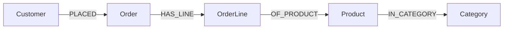

# Evaluating a Model Using Sample Queries, Integrity, and Update Cost

> **Chapter:** Model Design
> **Scope:** Neo4j property graph, Cypher, indexes/constraints, and design decisions affecting querying, data writes, and operations.

A graph model that looks intuitive is not necessarily a good model. In Neo4j, the same business domain can be represented using nodes, relationships, properties on relationships, or properties copied onto another node. These representations may all be semantically valid, yet produce vastly different query paths, data-control capabilities, and update costs.

A verifiable way to evaluate is to put **the model through three simultaneous tests**:

1. **Sample queries:** Do the questions the system actually needs to answer find a selective starting point, traverse a reasonable number of relationships, and return accurate results?
2. **Integrity:** Does the model represent and protect identities, link cardinalities, business rules, and historical data?
3. **Update cost:** How many nodes, relationships, indexes, and derived data items must each write event modify? Does it introduce inconsistent data or write bottlenecks?

An option is considered good only when it satisfies all three. No Neo4j model is optimal for every workload; evaluate against **specific queries and write operations**, actual frequencies, and mandatory business rules.

## 1. Learning Outcomes and Context

After this lesson, you will be able to:

- Turn business requirements into a representative set of Cypher queries, including key lookups, relationship traversals, aggregations, and multi-hop queries.
- Read `EXPLAIN` / `PROFILE` output to locate expensive graph traversals, filters, sorts, and aggregations.
- Distinguish constraints that Neo4j can declare natively from invariants that must be protected in transactions and application logic.
- Estimate *write amplification* when adding intermediate nodes, duplicating properties, or pre-computing results.
- Design a fair A/B benchmark between alternatives and document the trade-offs behind a model choice.

The running example is a sales system: customers place orders, each order has order lines, order lines reference products, and products belong to categories. This is a small property graph, yet sufficient to expose common trade-offs in modeling connected data.

## 2. Defining Business Semantics Before Choosing Graph Shape

Entities and relationships to represent:

| Component | Key Properties | Meaning |
|---|---|---|
| `Customer` | `customerId`, `name` | Customer with stable business identity. |
| `Order` | `orderId`, `placedAt`, `status` | Order with placement timestamp and status. |
| `OrderLine` | `lineId`, `quantity`, `unitPriceAtPurchase` | An order line; stores **unit price at the time of transaction**. |
| `Product` | `productId`, `name`, `currentPrice` | Product and its current selling price. |
| `Category` | `categoryId`, `name` | Product group. |

Assumed business rules for the problem:

- One `Order` belongs to exactly one `Customer`.
- One `OrderLine` belongs to exactly one `Order` and references exactly one `Product`.
- `quantity` must be greater than 0, and `unitPriceAtPurchase` must be non-negative. In the example, money is stored as **integer currency units**, avoiding floating-point rounding.
- A completed order must have at least one order line; a draft order may have no lines yet.
- In this example, a product appears on at most one line of the same order. If the business allows multiple lines for the same product (for example, split promotions), the corresponding validation rule must be updated.
- Changing `Product.currentPrice` must not alter historical prices on `OrderLine`.

These rules are not default properties of Neo4j. They are **business invariants** that we must verify in each model.

### 2.1. Option A: Storing Order Lines Directly on a Relationship

`(:Customer)-[:PLACED]->(:Order)-[:CONTAINS {quantity, unitPriceAtPurchase}]->(:Product)`

Strength: reading products in an order requires only one hop from order to product, and relatively few entities need to be created when adding a line. Weakness: the order line has no separate node to receive additional relationships or manage a lifecycle; controlling per-line identity and link rules can be more complex.

### 2.2. Option B: Order Lines as Nodes with Independent Identity

`(:Customer)-[:PLACED]->(:Order)-[:HAS_LINE]->(:OrderLine)-[:OF_PRODUCT]->(:Product)`

`(:Product)-[:IN_CATEGORY]->(:Category)`



Strength: `OrderLine` can carry a unique `lineId` key, adjustment info, promotions, or return status; constraints can be written for node identity. Weakness: one order line requires creating an extra node and two relationships, and order queries must traverse an extra hop.

**Initial choice for illustration:** Option B. This is a design hypothesis, not a conclusion. It must be measured against the workload in the following sections to determine whether the cost of the intermediate node is acceptable.

## 3. Turning Requirements into Representative Queries and Write Operations

Do not merely verify that a single `MATCH` query runs on a few sample records. First, describe the workload in terms of real user behavior and processing flows.

| Code | Scenario | Notable Access Path | Metrics to Measure |
|---|---|---|---|
| Q1 | List a customer's 20 newest orders | `Customer → Order`, sorted by time | p95, number of orders scanned before `LIMIT` |
| Q2 | View order details and products | `Order → OrderLine → Product` | p95, number of relationship expansions, correct even for empty draft orders |
| Q3 | Best-selling products in a time range | Filter `Order` by status/date then aggregate `OrderLine` | p95, input row count to aggregation, memory |
| Q4 | Products frequently bought together with product X | `Product ← OrderLine ← Order → OrderLine → Product` | Intermediate path count, skew caused by extremely popular products |
| Q5 | Calculate historical order total | `Order → OrderLine` | Accuracy of locked-in order price, summation cost |
| W1 | Add an order line to a draft order | Create node and links, update indexes | Write latency, created entity count, concurrent conflicts |
| W2 | Change a product's current price | Write `Product` | Does it corrupt old order prices or force bulk updates? |
| W3 | Transition an order to `COMPLETED` | Change status with line-item check | Invariant enforcement, write contention |
| W4 | Change a product's category | Modify `IN_CATEGORY` | Number of relationships changed and copied data needing sync |

Frequency matters too. For example, if Q1 runs hundreds of times per second while Q3 runs only a few times per hour in a reporting job, the model should prioritize Q1 even if Q3 needs an extra aggregation step. When real metrics are unavailable, document **assumptions** explicitly and replace them with logs/APM from the Java Driver, Spring Data Neo4j, or Cypher-calling services once the system is running.

Separate two additional input cases: ordinary customers with a few orders versus customers with hundreds of thousands of orders; ordinary products versus extremely popular products. Large skew in *node degree* often makes test results on small datasets misleading.

## 4. Setting Up Data and Minimum Integrity Guardrails

### 4.1. Unique Keys and Indexes

With Neo4j 5.x Cypher syntax and newer versions supporting the corresponding syntax, you can declare:

```cypher
CREATE CONSTRAINT customer_id_unique IF NOT EXISTS
FOR (c:Customer) REQUIRE c.customerId IS UNIQUE;

CREATE CONSTRAINT order_id_unique IF NOT EXISTS
FOR (o:Order) REQUIRE o.orderId IS UNIQUE;

CREATE CONSTRAINT line_id_unique IF NOT EXISTS
FOR (l:OrderLine) REQUIRE l.lineId IS UNIQUE;

CREATE CONSTRAINT product_id_unique IF NOT EXISTS
FOR (p:Product) REQUIRE p.productId IS UNIQUE;

CREATE CONSTRAINT category_id_unique IF NOT EXISTS
FOR (cat:Category) REQUIRE cat.categoryId IS UNIQUE;

CREATE INDEX order_status_date IF NOT EXISTS
FOR (o:Order) ON (o.status, o.placedAt);
```

`IS UNIQUE` constraints support key lookups and prevent **two nodes from sharing the same declared key value**. However, uniqueness **does not force every node to have the key property**. Existence/key constraint types depend on version and edition; verify actual environment capabilities before relying on them. In particular, uniqueness of `OrderLine.lineId` does not automatically guarantee that an order line has exactly one order, exactly one product, or `quantity > 0`.

The composite index `(status, placedAt)` is created for Q3: equality filtering on status and range bounds on timestamp. There is no guarantee that the Cypher planner will use an index for every query; inspect actual execution plans. Nor should you add an index to every property, as indexes consume memory/disk and add write overhead.

### 4.2. Small Dataset for Testing Syntax

Example creating one customer, one completed order, one product, and one order line. Each `MERGE` may encounter an already existing entity; `ON CREATE SET` preserves previously recorded historical prices.

```cypher
MERGE (c:Customer {customerId: 'C001'})
  ON CREATE SET c.name = 'Lan'
MERGE (o:Order {orderId: 'O001'})
  ON CREATE SET o.placedAt = datetime('2026-11-01T09:00:00Z'),
                o.status = 'COMPLETED'
MERGE (p:Product {productId: 'P001'})
  ON CREATE SET p.name = 'Keyboard',
                p.currentPrice = 800000
MERGE (cat:Category {categoryId: 'CAT01'})
  ON CREATE SET cat.name = 'Accessories'
MERGE (l:OrderLine {lineId: 'L001'})
  ON CREATE SET l.quantity = 2,
                l.unitPriceAtPurchase = 750000
MERGE (c)-[:PLACED]->(o)
MERGE (o)-[:HAS_LINE]->(l)
MERGE (l)-[:OF_PRODUCT]->(p)
MERGE (p)-[:IN_CATEGORY]->(cat);
```

This dataset is enough to test Q1, Q2, Q5 and verify the total calculation of **1,500,000** currency units. It is **not enough** to draw performance conclusions. Before running A/B comparisons, load data reflecting realistic scale, link density, time distribution, and top-selling products.

## 5. Reading the Model Through Sample Queries

Variables such as `$customerId`, `$orderId`, `$productId`, `$from`, `$to`, and `$limit` are **parameters** passed by the application; never concatenate user input directly into Cypher strings. In time examples, `$from` and `$to` are valid ISO 8601 strings, then converted to `datetime`.

### Q1 — Order History by Customer

```cypher
MATCH (c:Customer {customerId: $customerId})-[:PLACED]->(o:Order)
RETURN o.orderId AS orderId,
       o.placedAt AS placedAt,
       o.status AS status
ORDER BY placedAt DESC
LIMIT $limit;
```

**Points to observe:**

- Does the customer key constraint help the planner locate the single `Customer` node?
- If a customer has 500,000 orders, does traversing from the customer to all orders and sorting before taking 20 orders become a bottleneck?
- Is status filtering required before sorting? Is consistent pagination by `placedAt` and `orderId` needed?

If Q1 is a hot read path and each customer has many orders, one optimization hypothesis is to additionally store `Order.customerId` with a composite index `(customerId, placedAt)`:

```cypher
CREATE INDEX order_customer_date IF NOT EXISTS
FOR (o:Order) ON (o.customerId, o.placedAt);

MATCH (o:Order {customerId: $customerId})
RETURN o.orderId AS orderId, o.placedAt AS placedAt
ORDER BY placedAt DESC
LIMIT $limit;
```

This creates an opportunity to look up orders by index key range without traversing all of the customer's `PLACED` edges. **In return**, `customerId` is duplicated: creating or transferring order ownership must consistently update both the property and the relationship. Evaluate the cost after confirming the index is used and the query is genuinely faster.

### Q2 — Order Details, Including Data with Missing Links

```cypher
MATCH (o:Order {orderId: $orderId})
OPTIONAL MATCH (o)-[:HAS_LINE]->(l:OrderLine)
OPTIONAL MATCH (l)-[:OF_PRODUCT]->(p:Product)
RETURN o.orderId AS orderId,
       l.lineId AS lineId,
       p.productId AS productId,
       l.quantity AS quantity,
       l.unitPriceAtPurchase AS unitPriceAtPurchase
ORDER BY lineId;
```

The query starts from a unique `orderId` and traverses two relationships. Using two separate `OPTIONAL MATCH` clauses keeps order lines missing `OF_PRODUCT` visible (with `productId` as `null`), which is very useful for data inspection. Using a single mandatory `MATCH` for the whole path could silently drop faulty lines without warning.

For Option A, from `Order` you only follow one `CONTAINS` edge to read quantity and unit price. Thus Q2 typically has fewer traversal hops in A; however, **hop count does not directly equal runtime**. Actual cost also depends on line count, indexes, cache, loaded records, and how the client processes results.

### Q3 — Best-Selling Products Aggregation

```cypher
MATCH (o:Order)
WHERE o.status = 'COMPLETED'
  AND o.placedAt >= datetime($from)
  AND o.placedAt < datetime($to)
MATCH (o)-[:HAS_LINE]->(l:OrderLine)-[:OF_PRODUCT]->(p:Product)
RETURN p.productId AS productId,
       sum(l.quantity) AS unitsSold
ORDER BY unitsSold DESC
LIMIT $limit;
```

The query has three main cost components: finding the order set by time, expanding order lines, and aggregating/sorting. The `(status, placedAt)` index can help the first step; it does not eliminate traversal volume if the time window covers millions of orders.

When Q3 runs frequently over large time windows, consider asynchronous reporting or a daily summary table/node. However, this is **derived data**: every completed, cancelled, or returned order will require increment/decrement rules and a reconciliation mechanism. Prove the need with measurements before adding this structure.

### Q4 — Products Frequently Appearing in the Same Order

```cypher
MATCH (p:Product {productId: $productId})
      <-[:OF_PRODUCT]-(seed:OrderLine)
      <-[:HAS_LINE]-(o:Order)
WHERE o.status = 'COMPLETED'
  AND o.placedAt >= datetime($from)
WITH DISTINCT p, o
MATCH (o)-[:HAS_LINE]->(:OrderLine)-[:OF_PRODUCT]->(other:Product)
WHERE other <> p
RETURN other.productId AS productId,
       count(DISTINCT o) AS coOrderCount
ORDER BY coOrderCount DESC
LIMIT $limit;
```

`DISTINCT` prevents double-counting the same order when multiple paths reach it. The query also illustrates the weakness of starting from an extremely popular product: the number of intermediate `OrderLine` and `Order` nodes can become very large before date filtering. When measuring, test both ordinary products and *hot products*; inspect intermediate row counts at each operator.

If co-purchase recommendations are a hot feature, a summary edge such as `(:Product)-[:BOUGHT_TOGETHER {count, window}]->(:Product)` can shorten the read path. Yet each new order creates many product pairs to update; for an order with `k` distinct products, the number of unordered pairs is `k × (k − 1) / 2`. Summary data must also handle order cancellations, returns, and validity windows. That is a read/write trade-off to measure separately.

### Q5 — Calculating Order Total Using Purchased Prices

```cypher
MATCH (o:Order {orderId: $orderId})
OPTIONAL MATCH (o)-[:HAS_LINE]->(l:OrderLine)
RETURN o.orderId AS orderId,
       sum(coalesce(l.quantity * l.unitPriceAtPurchase, 0)) AS totalAmount;
```

You must use `unitPriceAtPurchase`, not `Product.currentPrice`. A draft order with no lines yet has a total of 0. If you pre-store `o.totalAmount` to speed up reads, specify which transaction updates the total, handle returns, and reconcile recalculation from order lines. If the application supports multiple currencies, store and validate `currency`; never sum amounts in two different currencies as if they were the same unit.

### 5.1. Distinguishing Plan from Execution

Use `EXPLAIN` to view the estimated plan **without running the query**, and `PROFILE` to execute the query and inspect actual statistics:

```cypher
EXPLAIN
MATCH (o:Order {orderId: $orderId})-[:HAS_LINE]->(l:OrderLine)
RETURN l.lineId;

PROFILE
MATCH (o:Order {orderId: $orderId})-[:HAS_LINE]->(l:OrderLine)
RETURN l.lineId;
```

Indicators to inspect:

| Indicator/Plan | Question to Answer |
|---|---|
| `NodeUniqueIndexSeek` / `NodeIndexSeek` | Does the query start from a property with good selectivity? |
| `NodeByLabelScan` / `AllNodesScan` | Is it scanning a large set of nodes that could have been filtered earlier? |
| `Expand` and `Rows` count | How many rows does each input node expand into? Is there a supernode? |
| `Sort` / `Top` / `Aggregation` | Is a large volume of records processed before `LIMIT` or before grouping? |
| `CartesianProduct` | Are `MATCH` patterns accidentally disconnected, multiplying row counts? |
| `DB Hits`, page cache, memory, time | How do data accesses and resource pressure change as scale grows? |

Operator names and displayed statistics may vary by Neo4j version and runtime. **`DB Hits` is not time in milliseconds**, and a single run's timing does not represent p95. `PROFILE` **actually executes the statement**; do not run it for write queries on production data merely to inspect the plan.

## 6. Verifying Integrity with Active Queries

Unique key constraints only solve part of the problem. In a property graph, links can be technically valid yet still violate business rules. Treat the validation queries below as *executable specifications* and run them on test data, after migrations, and in reconciliation jobs as needed.

### 6.1. Each Order Has Exactly One Customer

```cypher
MATCH (o:Order)
OPTIONAL MATCH (c:Customer)-[:PLACED]->(o)
WITH o, count(c) AS customerLinks
WHERE customerLinks <> 1
RETURN o.orderId AS orderId, customerLinks;
```

If the result is non-empty, there is an order with no customer or multiple `PLACED` edges pointing to the order. `count(c)` also counts duplicate edges, which fits when requiring strictly **one relationship**.

### 6.2. Each Order Line Has Exactly One Order, One Product, and Valid Values

```cypher
MATCH (l:OrderLine)
OPTIONAL MATCH (o:Order)-[:HAS_LINE]->(l)
WITH l, count(o) AS orderLinks
OPTIONAL MATCH (l)-[:OF_PRODUCT]->(p:Product)
WITH l, orderLinks, count(p) AS productLinks
WHERE orderLinks <> 1
   OR productLinks <> 1
   OR l.quantity IS NULL
   OR l.quantity <= 0
   OR l.unitPriceAtPurchase IS NULL
   OR l.unitPriceAtPurchase < 0
RETURN l.lineId AS lineId,
       orderLinks,
       productLinks,
       l.quantity AS quantity,
       l.unitPriceAtPurchase AS unitPriceAtPurchase;
```

Two `OPTIONAL MATCH` clauses and two aggregations are used to avoid cross-multiplying edge counts when a line simultaneously has multiple orders and multiple products. If a product must be unique within an order, check additionally:

```cypher
MATCH (o:Order)-[:HAS_LINE]->(l:OrderLine)-[:OF_PRODUCT]->(p:Product)
WITH o, p, count(DISTINCT l) AS numberOfLines
WHERE numberOfLines > 1
RETURN o.orderId AS orderId,
       p.productId AS productId,
       numberOfLines;
```

This rule is a **business choice**. Do not enforce it mechanically for systems that allow the same product on multiple lines under different conditions.

### 6.3. Completed Orders Must Have Order Lines

```cypher
MATCH (o:Order)
WHERE o.status = 'COMPLETED'
  AND NOT EXISTS {
    MATCH (o)-[:HAS_LINE]->(:OrderLine)
  }
RETURN o.orderId AS invalidCompletedOrder;
```

This can be extended by status: whether cancelled orders may contain lines; whether a negative total is valid upon refund; how a partially returned `OrderLine` tracks `returnedQuantity`. Put those decisions into the business specification before automatically repairing data.

### 6.4. Checking Duplicated Data

If optimizing Q1 with `Order.customerId`, detect mismatches between the property and the edge:

```cypher
MATCH (c:Customer)-[:PLACED]->(o:Order)
WHERE o.customerId IS NULL OR o.customerId <> c.customerId
RETURN o.orderId AS orderId,
       c.customerId AS linkedCustomer,
       o.customerId AS copiedCustomer;
```

This check only catches orders that **already have** a `PLACED` edge; combine it with check 6.1 to catch orders missing the edge. This is why every data-duplication optimization requires explicit write rules and reconciliation queries.

### 6.5. How Do Constraints, Transactions, and the Application Share Responsibilities?

| Rule Type | Appropriate Protection Mechanism |
|---|---|
| Unique `customerId`, `orderId`, `lineId` | Neo4j uniqueness constraint; check presence separately when needed. |
| Each line has exactly one order and one product | Create/update logic inside transactions, result checks, reconciliation jobs; single-key constraints do not protect this cardinality. |
| `quantity > 0`, non-negative price, valid state transitions | Validate at the application boundary and in the write path; re-verify data with Cypher. |
| Completed orders have at least one line | Order-completion transaction must verify the condition; evaluate race conditions under concurrent writes. |
| Old order prices unchanged when product price changes | Store snapshot on order lines; do not bulk-update snapshots when `currentPrice` changes. |
| Duplicated property matches source relationship | Write in the same transaction when strong consistency is needed; reconcile periodically or accept eventual consistency under an explicit contract. |

A Neo4j relationship always has two valid endpoint nodes; however, that **does not** guarantee the right labels, direction, cardinality, or business role. Nor should you expect a `MERGE` statement by itself to protect all concurrent update cases. Uniqueness constraints protect node identity; multi-step operations require transactions and corresponding race/retry handling strategies.

## 7. Measuring Update Cost Instead of Optimizing Only the Read Path

When adding an order line to an existing order:

| Operation | A — `CONTAINS` with properties | B — `OrderLine` with identity |
|---|---|---|
| Created components | Typically 1 `CONTAINS` relationship | 1 `OrderLine` node and 2 relationships |
| Writing quantity/unit price | Relationship properties | Node properties |
| Protecting line identity | Check relationship constraint capabilities and actual business requirements | Uniqueness constraint on `lineId` |
| Linking promotions/returns at line level | Can be difficult or require model changes | Can extend directly from the `OrderLine` node |
| Fetching products of an order | 1 relationship hop | 2 relationship hops |
| Changing `Product.currentPrice` | No need to modify historical snapshot | No need to modify historical snapshot |

The table above reflects **logical changes**, not measured I/O or latency. Each node/relationship also incurs storage, logging, locking, index, and transaction-synchronization costs. Thus a rough gauge can be used:

`WriteCost(W) ≈ nodeWrites + relationshipWrites + indexUpdates + derivedDataUpdates`

The terms do not have equal weights; this formula only **lists cost sources**, not a runtime calculation. When actually measuring, use transactions/second, write p95 latency, CPU, memory, page cache, deadlock/retry counts, logs, and index size.

### 7.1. Example of an Atomic Write Operation

After validating the order, product, quantity, and permissions, the application can create an order line with one Cypher statement inside a transaction:

```cypher
MATCH (o:Order {orderId: $orderId})
MATCH (p:Product {productId: $productId})
WHERE o.status = 'DRAFT'
  AND $quantity > 0
  AND $unitPriceAtPurchase >= 0
CREATE (l:OrderLine {
  lineId: $lineId,
  quantity: $quantity,
  unitPriceAtPurchase: $unitPriceAtPurchase
})
CREATE (o)-[:HAS_LINE]->(l)
CREATE (l)-[:OF_PRODUCT]->(p)
RETURN l.lineId AS lineId;
```

This statement creates a node and two relationships as a single write unit. If `lineId` collides, the uniqueness constraint blocks duplicate creation. If the order/product is not found or the `DRAFT` condition fails, the statement returns no rows; the caller **must check** the result count. Under concurrent competing requests, design appropriate locking/state mechanisms or optimistic concurrency, and verify retry behavior. `CREATE` with a fixed `lineId` does not automatically provide idempotency: repeating the same request will hit the constraint, so the application must recognize already-completed requests or manage a separate idempotency key.

In the Java Driver, execute the entire related update flow within one write transaction. With Spring Data Neo4j, verify service `@Transactional` boundaries and actual custom Cypher queries. What matters is that **all updates sharing an invariant** live inside a single transaction with clear error handling.

### 7.2. Three Traps of Pre-Storing Data to Speed Up Reads

**Storing order total on `Order`:** Q5 reads faster, but adding/editing/deleting lines, discounts, order cancellations, or refunds must all update the total. Missing a single write branch silently corrupts data. An update protocol and a reconciliation job for `sum(quantity × unitPriceAtPurchase)` are required.

**Copying category onto millions of `OrderLine` nodes:** Historical reporting queries may save one hop to `Product`, yet changing a category causes massive write fan-out. Moreover, you must distinguish "category at time of sale" (a preserved historical snapshot) from "current category" (must stay synchronized with the product). Those two meanings lead to two different update rules.

**Storing co-purchase results on `BOUGHT_TOGETHER` edges:** Reading recommendations is faster, yet an order with many products creates many pairs to increment/decrement when orders complete, cancel, or return. Asynchronous updates are possible, provided recommendation products tolerate lag and have a recomputation mechanism.

Before every denormalization decision, answer: **What is the authoritative source of truth? Which events cause copied data to change? Must synchronization be immediate or can it be delayed? Are there reconciliation queries and error-repair procedures?**

## 8. Benchmarking Methodology for Models A and B

Do not compare merely with a single `PROFILE` snapshot on 10 nodes. A good test must ensure **semantic equivalence of results** and reflect production-like usage load.

### Step 1 — Lock Down Correctness Before Performance

Create identical business data in A and B. Verify that Q1–Q5 return the same orders, products, quantities, and historical totals. Run the integrity checks from Section 6. A model that returns wrong results is disqualified no matter how fast it is.

### Step 2 — Choose Data with Appropriate Scale and Skew

Example *hypothetical* load-generation dataset: 500,000 customers, 5 million orders, 15 million order lines, with some customers having very many orders and a few products accounting for a substantial share of sales. These numbers only illustrate benchmark design, **not Neo4j performance figures**. Include edge cases such as orders with zero lines, many lines, customers with zero orders, rarely bought products, and data near time boundaries.

### Step 3 — Measure Reads and Writes Under Identical Conditions

Hold Neo4j version, configuration, memory, hardware, dataset, appropriate indexes, concurrency level, and semantically equivalent queries constant. Run warmup before measuring steady-state load; if cold-cache analysis is needed, measure it as a separate scenario. Repeat enough times to capture a distribution rather than a single number.

Measure at minimum:

- **Reads:** p50/p95/p99 latency, throughput, `Rows` and `DB Hits` per operator, intermediate row counts, page-cache misses, and memory.
- **Writes:** p95 latency, transactions/second, retry/conflict rate, storage growth of nodes/relationships/indexes, and maintenance operation duration.
- **Correctness:** invariant violations after concurrent writes, after migrations, and after cancellations/returns.
- **Operations:** rebuild/reconciliation time for derived data, error observability, and schema evolution cost.

Example actual results table (leave blank until run):

| Metric | A | B | Acceptance Threshold / Notes |
|---|---:|---:|---|
| Q2 p95 latency | Not yet measured | Not yet measured | Per order-detail SLO |
| Q4 p95 with popular products | Not yet measured | Not yet measured | Must test tail distribution |
| W1 p95 latency | Not yet measured | Not yet measured | Per add-line SLO |
| Write throughput at target concurrency | Not yet measured | Not yet measured | Zero invariant errors |
| Cardinality violations after contention test | Not yet measured | Not yet measured | **0** |
| Data and index storage size | Not yet measured | Not yet measured | Within operational budget |

Do not fill "estimated" numbers into actual result columns. If you want sample SLOs before running, you might assume Q1 p95 no higher than 120 ms, Q2 p95 no higher than 150 ms, and W1 p95 no higher than 100 ms in a well-defined test environment; those thresholds must be tuned to the real product.

### Step 4 — Select a Model Using Elimination Criteria and Weights

A sensible decision order:

1. Eliminate any option that fails invariants or lacks a reliable consistency-protection path.
2. Eliminate any option that misses mandatory SLOs at p95/p99 or target write load.
3. Among the remaining options, weigh query/write frequency, application complexity, storage, migration cost, and rate of business change.

Total cost can be expressed generally as:

`TotalCost = Σ [readFrequencyᵢ × normalizedReadCostᵢ] + Σ [writeFrequencyⱼ × normalizedWriteCostⱼ] + maintenanceCost`

This is a way to structure a decision, not a direct runtime equation. **Only sum normalized quantities with consistent units/weights**; never add `DB Hits` directly to milliseconds or bytes.

### Step 5 — Record the Decision and Re-Evaluation Conditions

Example decision record:

> Choose B (`OrderLine` as a node) when line-item identity, line-level returns, and business extensibility matter; Q2/W1 still meet SLOs after benchmarking. Add `Order.customerId` with an index only if Q1 on high-degree customers is genuinely bounded by sorting; when added, update atomically and deploy reconciliation. If order placement is simple, lines have no independent identity, and measurements show B's overhead is substantial, consider A.

Set **re-evaluation conditions** such as "Q1 p95 exceeds SLO for customers with over 10,000 orders" or "W1 throughput misses target load." Model decisions should change based on measurements and business changes, not mere design preference.

## 9. Common Mistakes When Evaluating a Graph Model

| Mistake | Consequence | How to Fix |
|---|---|---|
| Drawing a pretty graph without defining queries | Hot query paths must scan many nodes/edges | Start from a Q/W set with frequencies and input data |
| Testing on a few dozen nodes with uniform degree | Misses supernodes, data skew, and sorting cost | Build a test set with realistic scale and distribution |
| Looking only at hop count | Ignores selectivity, intermediate rows, sort/aggregate, and cache | Read `PROFILE` and measure real latency under load |
| Confusing uniqueness with cardinality/required properties | Lines missing an order or having two products can still exist | Combine constraints, transactions, and validation queries |
| Using current price to calculate past orders | Historical reports change whenever product prices change | Use the `unitPriceAtPurchase` snapshot |
| Copying properties to speed up reads without defining write flows | Data between nodes/edges drifts out of sync | Define source of truth, transactions, and reconciliation |
| Expanding paths without a selective starting point | Path and memory explosion | Anchor queries to keys/indexes, bound ranges, and inspect intermediate rows |
| Comparing one read query and picking a model | Writes become slow, migrations hard, invariants difficult to protect | Measure reads, writes, correctness, and operational cost together |

## 10. Short Practice Exercise: Making an Evidence-Based Decision

Suppose the system has two new requirements:

- Each order has multiple lines and each line can be partially returned, tracking its own processing history.
- The customer screen displays the 20 most recent orders with low p95, even for customers with 100,000 orders.

Formulate **two testable hypotheses**:

**Hypothesis 1:** Choose B because `OrderLine` has its own identity and status, fitting the return workflow. Add the invariant `0 ≤ returnedQuantity ≤ quantity` and a Cypher check for it. Measure W1 cost and return operations, not just Q2.

**Hypothesis 2:** Keep `PLACED` to represent ownership, while adding `Order.customerId` and the `(customerId, placedAt)` index only if Q1 on customers with many orders misses its SLO. Compare plans and p95 between queries starting from the customer versus querying `Order` directly via the index; design the check in Section 6.4 to detect drift.

A solid practice deliverable should include: equivalent queries for A/B, mandatory invariants, test data configuration and distribution, read/write measurements, a table of **actual measured** results, the chosen decision, and re-evaluation conditions.

---

### Key Takeaways

Evaluating a property graph in Neo4j is a problem of **accurate data semantics + right queries + acceptable mutation cost**. `EXPLAIN` and `PROFILE` clarify execution paths; constraints and transactions protect rules within their capabilities; and workloads measured under load confirm that an option is fast and operationally sound. Every optimization step using intermediate nodes, extra relationships, or duplicated data must be re-evaluated across all three axes.
