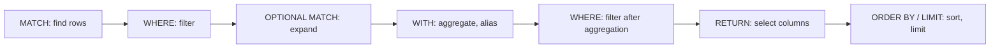

# Cypher Query Structure and How Clauses Work Together

> **Chapter:** Cypher Basics  
> **Scope:** Querying property graphs in Neo4j with Cypher. This lesson focuses on how a query is structured and how the output of one clause becomes the input to the next.

## 1. Learning Objectives

After this lesson, you will be able to:

- Read a graph pattern consisting of nodes, labels, relationships, relationship directions, and properties.
- Distinguish the roles of the `MATCH`, `OPTIONAL MATCH`, `WHERE`, `WITH`, `RETURN`, `ORDER BY`, `SKIP`, `LIMIT`, `UNWIND`, and write clauses.
- Predict how the number of result rows changes when expanding relationships, filtering, aggregating, or selecting optional matches.
- Use `WITH` to split a query into stages, define aliases, and control variable scope.
- Combine clauses into a complete query while avoiding common pitfalls with `null`, Cartesian products, and duplicate rows.

## 2. Foundational Mindset: A Graph Query Is a Stream of Rows

In Neo4j, data is represented using **nodes** (vertices) and **relationships** (directed edges); both can hold properties. Cypher is a declarative query language: you describe **the graph pattern and the result to retrieve**, and Neo4j chooses the corresponding execution plan.

Example graph pattern:

```cypher
(p:Person {id: 'p1'})-[r:WORKS_ON]->(pr:Project)
```

| Component | Meaning |
|---|---|
| `(p:Person)` | A node bound to variable `p`, with label `Person`. |
| `{id: 'p1'}` | Node property condition in the pattern. |
| `-[r:WORKS_ON]->` | A relationship of type `WORKS_ON`, bound to variable `r`, directed from `p` to `pr`. |
| `(pr:Project)` | The target node bound to variable `pr`, with label `Project`. |
| `(a)--(b)` | A relationship pattern that does not require a specific direction. |

A query can be read-only, write-only, or combine reads and writes:

```cypher
MATCH (p:Person)-[:WORKS_ON]->(pr:Project)
WHERE p.age >= 25
RETURN p.name AS nguoi, pr.name AS duAn;
```

Think of intermediate results as a table of **rows**: each row contains the bound variables, such as `p` and `pr`. As you add clauses:

1. `MATCH` searches for the pattern and can produce **multiple rows** for a single node if that node matches multiple relationships.
2. `WHERE` filters out rows or constrains the pattern to match, depending on the clause it accompanies.
3. `WITH` passes a set of variables and values to the next stage; it can aggregate, filter, sort, or limit.
4. `RETURN` specifies the columns returned to the application.

This is a mental model for understanding results; it does not force Neo4j to execute physically in exact line-by-line order.

## 3. Sample Graph Used Throughout This Lesson

Run the following block in a **practice database** to create four people, three projects, and their project participation relationships. `MERGE` reuses matching nodes or relationships if you re-run the example; `SET` assigns known sample values.

```cypher
MERGE (an:Person {id: 'p1'})
SET an.name = 'An', an.age = 30, an.city = 'Hà Nội'
MERGE (binh:Person {id: 'p2'})
SET binh.name = 'Bình', binh.age = 27, binh.city = 'TP. Hồ Chí Minh'
MERGE (chi:Person {id: 'p3'})
SET chi.name = 'Chi', chi.age = 35, chi.city = 'Hà Nội'
MERGE (dung:Person {id: 'p4'})
SET dung.name = 'Dũng', dung.age = 24, dung.city = 'Đà Nẵng'

MERGE (api:Project {id: 'pr1'})
SET api.name = 'Graph API', api.status = 'active'
MERGE (reco:Project {id: 'pr2'})
SET reco.name = 'Recommendation', reco.status = 'planned'
MERGE (pipeline:Project {id: 'pr3'})
SET pipeline.name = 'Data Pipeline', pipeline.status = 'active'

MERGE (an)-[w1:WORKS_ON]->(api)
SET w1.role = 'lead'
MERGE (an)-[w2:WORKS_ON]->(reco)
SET w2.role = 'advisor'
MERGE (binh)-[w3:WORKS_ON]->(api)
SET w3.role = 'developer'
MERGE (chi)-[w4:WORKS_ON]->(reco)
SET w4.role = 'lead'

MERGE (an)-[:KNOWS]->(binh)
MERGE (binh)-[:KNOWS]->(chi);
```

The main relationships can be visualized as follows:

```text
An   ──WORKS_ON──> Graph API (active)
  ╰──WORKS_ON──> Recommendation (planned)
Bình ──WORKS_ON──> Graph API (active)
Chi  ──WORKS_ON──> Recommendation (planned)
Dũng    (no WORKS_ON)

Data Pipeline (active)   (no participants yet)

An ──KNOWS──> Bình ──KNOWS──> Chi
```

Note: the observations about row counts and results below assume the practice database contains only the corresponding sample data, with no duplicate `WORKS_ON` relationships.

## 4. Structural Framework of a Query

| Clause | Role and Common Combinations |
|---|---|
| `MATCH` | Finds nodes/relationships matching a pattern and binds variables, typically starting a read stage. |
| `OPTIONAL MATCH` | Searches for a pattern if present; otherwise, keeps the input row and assigns `null` to new unmatched variables. |
| `WHERE` | Places conditions on `MATCH`, `OPTIONAL MATCH`, or filters rows after `WITH`. Its position determines its meaning. |
| `WITH` | Forwards variables, expressions, and aggregation results; creates a variable scope boundary. |
| `RETURN` | Selects the final expressions/columns returned to the caller; can use `DISTINCT`. |
| `ORDER BY` | Orders rows after `WITH` or `RETURN`. |
| `SKIP`, `LIMIT` | Skips a number of rows and limits the row count, commonly used with `ORDER BY`. |
| `UNWIND` | Expands elements of a list into individual rows for further processing. |
| `CREATE`, `MERGE`, `SET`, `REMOVE`, `DELETE` | Creates, finds-or-creates, updates, and deletes graph data. |
| `CALL` | Invokes a procedure or subquery in queries that need deeper logic decomposition. |

Cypher does not require every query to include all clauses. For example, read queries usually end with `RETURN`, while update statements may return no columns at all. `WHERE` and `ORDER BY` are parts attached to appropriate clauses, not steps that can be placed arbitrarily anywhere.

### 4.1. Basic Read Pattern

```cypher
MATCH (p:Person)
WHERE p.age >= 30
RETURN p.name AS ten, p.age AS tuoi
ORDER BY tuoi DESC;
```

- `MATCH` selects `Person` nodes.
- `WHERE` keeps only people aged 30 or older.
- `RETURN` projects the properties into two columns aliased `ten` and `tuoi`.
- `ORDER BY` sorts results from oldest to youngest.

With the sample data, the result is **Chi (35)** followed by **An (30)**.

### 4.2. Expanding Relationships Increases Row Count

```cypher
MATCH (p:Person {id: 'p1'})-[r:WORKS_ON]->(pr:Project)
RETURN p.name AS nhanSu, r.role AS vaiTro, pr.name AS duAn;
```

Node `An` has two `WORKS_ON` relationships, so there are **two rows**, one for `Graph API` and one for `Recommendation`. A `MATCH` on a single node may return only one row for An, but when expanding to projects, a single input node can produce multiple matches. When chaining multiple patterns, always ask yourself: *how many patterns can each current row match in the next step?*

## 5. `MATCH`, `WHERE`, and Filter Conditions

`MATCH` requires the pattern to match. Example:

```cypher
MATCH (p:Person)-[:WORKS_ON]->(pr:Project)
WHERE pr.status = 'active' AND p.age >= 25
RETURN p.name AS nhanSu, pr.name AS duAn;
```

The result has two rows: **An – Graph API** and **Bình – Graph API**. Chi only participates in a `planned` project, and Dũng has no `WORKS_ON` relationship, so neither matches the requirement.

Commonly used condition expressions:

```cypher
WHERE p.age >= 25
WHERE p.city IN ['Hà Nội', 'Đà Nẵng']
WHERE p.name STARTS WITH 'B'
WHERE p.age IS NOT NULL
WHERE p.age >= 25 AND p.city = 'Hà Nội'
```

Each `WHERE` line above is an individual condition example, not a complete query to run consecutively. For input values that can vary, you should **parameterize**:

```cypher
MATCH (p:Person)
WHERE p.age >= $minAge
RETURN p.name AS ten, p.age AS tuoi;
```

`$minAge` is passed in by the application or query runner. Avoid string concatenation from user input to build Cypher conditions.

## 6. `OPTIONAL MATCH`: Keeping Rows When No Relationship Is Found

`MATCH` behaves like an inner join: if there is no match, the row is dropped. `OPTIONAL MATCH` behaves like a left outer join: the preceding row is preserved, and the new variables in the unmatched pattern receive `null`.

```cypher
MATCH (p:Person)
OPTIONAL MATCH (p)-[:WORKS_ON]->(pr:Project)
RETURN p.name AS nhanSu, pr.name AS duAn
ORDER BY nhanSu, duAn;
```

With the sample data, the result has **five rows**:

| nhanSu | duAn |
|---|---|
| An | Graph API |
| An | Recommendation |
| Bình | Graph API |
| Chi | Recommendation |
| Dũng | `null` |

`OPTIONAL MATCH` is very useful when you need to report entities without relationships as well, such as people who have not joined any project.

### 6.1. Where `WHERE` Is Placed Determines Which Rows Are Kept

Placing `WHERE` immediately after `OPTIONAL MATCH`:

```cypher
MATCH (p:Person)
OPTIONAL MATCH (p)-[:WORKS_ON]->(pr:Project)
WHERE pr.status = 'active'
RETURN p.name AS nhanSu, collect(pr.name) AS duAnDangChay
ORDER BY nhanSu;
```

Here `WHERE` is a condition **on the optional pattern**: Neo4j searches for `active` projects for each person. If no project satisfies the condition, that person is still retained. Both Chi and Dũng get an empty list `[]`; An and Bình get `['Graph API']`. The `collect` function ignores `null` values.

Moving the condition to **after `WITH`** changes the meaning:

```cypher
MATCH (p:Person)
OPTIONAL MATCH (p)-[:WORKS_ON]->(pr:Project)
WITH p, pr
WHERE pr.status = 'active'
RETURN p.name AS nhanSu, pr.name AS duAn;
```

Now `WHERE` **filters the entire intermediate row set** after `WITH`. Chi's row has a `planned` project so it is dropped; Dũng's row has `pr = null` so it is also dropped. Only An and Bình with project `Graph API` remain. Both forms look similar, yet they have different semantics for data missing relationships.

### 6.2. `null` and Counting

```cypher
MATCH (p:Person)
OPTIONAL MATCH (p)-[:WORKS_ON]->(pr:Project)
RETURN p.name AS nhanSu,
       count(*) AS soDongTrungGian,
       count(pr) AS soDuAn
ORDER BY nhanSu;
```

For Dũng, `count(*) = 1` because `OPTIONAL MATCH` keeps one row; `count(pr) = 0` because `pr` is `null`. This is an important distinction: `count(*)` counts rows, whereas `count(bieuThuc)` counts only non-`null` values.

When checking for missing data, use `IS NULL` or `IS NOT NULL` instead of `= null`; normal equality comparison with `null` does not evaluate to `true`.

## 7. `WITH`: Chaining Stages and Controlling Variable Scope

`WITH` is an essential clause for structuring long queries. It can:

- Forward only the variables needed in the next step.
- Create aliases and computed expressions.
- Aggregate with `count`, `collect`, `sum`, `avg`, etc.
- Filter computed results using `WHERE`.
- Sort or limit rows **before** expanding relationships in a later stage.

### 7.1. Forwarding Variables and Defining Aliases

```cypher
MATCH (p:Person)
WITH p.name AS ten, p.age AS tuoi
WHERE tuoi >= 30
RETURN ten, tuoi
ORDER BY tuoi DESC;
```

After `WITH p.name AS ten, p.age AS tuoi`, the variables `ten` and `tuoi` remain in scope; the variable `p` is **no longer in scope**. The following query is invalid because it uses `p` out of scope:

```cypher
// Variable scope error illustration: DO NOT run as a valid query
MATCH (p:Person)
WITH p.name AS ten
RETURN p.age AS tuoi;
```

To continue using `p`, pass it through `WITH` (for example `WITH p, p.name AS ten`), or explicitly pass the properties you will use. `WITH *` preserves all existing variables, though listing variables explicitly is usually easier to control in long queries.

### 7.2. Aggregating and Filtering Aggregated Results

```cypher
MATCH (p:Person)
OPTIONAL MATCH (p)-[:WORKS_ON]->(pr:Project)
WITH p, count(pr) AS soDuAn
WHERE soDuAn >= 2
RETURN p.name AS nhanSu, soDuAn;
```

`WITH p, count(pr) AS soDuAn` groups rows by `p`, producing one row per person with their corresponding project count. `WHERE soDuAn >= 2` executes **after** the aggregation has been computed. With the sample graph, only **An – 2** is returned.

Note: after an aggregating `WITH`, the variable `pr` is no longer available unless you include it in the output; including `pr` as a grouping key would change the grouping granularity. When you only need the count, expose `count(pr)` under an alias instead of keeping individual projects.

### 7.3. Placing `ORDER BY` and `LIMIT` Before Another `MATCH`

```cypher
MATCH (p:Person)
WITH p
ORDER BY p.age DESC
LIMIT 2
OPTIONAL MATCH (p)-[:WORKS_ON]->(pr:Project)
RETURN p.name AS nhanSu, collect(pr.name) AS duAn
ORDER BY nhanSu;
```

`WITH ... ORDER BY ... LIMIT 2` selects the **two oldest people before** searching for projects. In the sample data, these are Chi and An. If `LIMIT 2` were placed at the end, the limit would apply after expansion or aggregation; the meaning could be different.

## 8. `RETURN`, `DISTINCT`, Sorting, and Pagination

`RETURN` determines the final columns. You can return variables, properties, calculations, map projections, or aggregation results:

```cypher
MATCH (p:Person)-[:WORKS_ON]->(pr:Project)
RETURN p.name AS nhanSu,
       pr.name AS duAn,
       p.age + 1 AS tuoiNamSau
ORDER BY nhanSu ASC, duAn ASC
SKIP 0
LIMIT 10;
```

- `AS` names the columns for convenient consumption by the application.
- `ORDER BY x ASC|DESC` specifies the sort order; ascending is the default.
- `SKIP n` skips the first `n` rows of the sorted result; `LIMIT m` takes at most the next `m` rows.
- When paginating, choose a deterministic ordering (if needed, add a unique key as a tie-breaker). Without `ORDER BY`, result order is not guaranteed.

A person with multiple projects appears on multiple rows. If you only need a **deduplicated** list of people's names:

```cypher
MATCH (p:Person)-[:WORKS_ON]->(:Project)
RETURN DISTINCT p.name AS nhanSu
ORDER BY nhanSu;
```

`DISTINCT` removes duplicate rows **across the returned expressions**. It does not by itself fix the root cause producing multiple rows. When you need to count unique values, you can use `count(DISTINCT pr)`; when you need to collect unique names, use `collect(DISTINCT pr.name)`.

The order of elements in a list produced by `collect` should not be assumed if the input does not have a suitable ordering.

## 9. Combining Multiple Clauses into a Complete Query

Requirement: **Retrieve people aged 25 or older who have at least one project; return their name, project count, and list of projects; sort people with more projects first, at most five people.**

```cypher
MATCH (p:Person)
WHERE p.age >= 25
OPTIONAL MATCH (p)-[:WORKS_ON]->(pr:Project)
WITH p,
     count(pr) AS soDuAn,
     collect(DISTINCT pr.name) AS danhSachDuAn
WHERE soDuAn >= 1
RETURN p.name AS nhanSu, soDuAn, danhSachDuAn
ORDER BY soDuAn DESC, nhanSu ASC
LIMIT 5;
```

Data flow analysis:

| Stage | Operation | Remaining Rows in Sample Data |
|---|---|---|
| `MATCH (p:Person)` | Selects all people. | 4: An, Bình, Chi, Dũng. |
| `WHERE p.age >= 25` | Filters out people under 25. | 3: An, Bình, Chi. |
| `OPTIONAL MATCH ...` | Expands projects and keeps people without projects. | 4 rows: An has 2, Bình has 1, Chi has 1. |
| `WITH p, count(...), collect(...)` | Groups rows by person. | 3 rows, one row per person. |
| `WHERE soDuAn >= 1` | Filters on the computed project count. | 3 rows in this example. |
| `RETURN ... ORDER BY ... LIMIT 5` | Selects columns, sorts, limits. | 3 rows returned. |

Expected result:

| nhanSu | soDuAn | danhSachDuAn |
|---|---:|---|
| An | 2 | Graph API, Recommendation |
| Bình | 1 | Graph API |
| Chi | 1 | Recommendation |

In the `danhSachDuAn` column, the database returns a **list**; the order of An's two elements may differ from the order listed in the table because the query has not requested sorting the list elements.

One way to sketch the stages:



## 10. Other Coordinating Clauses

### 10.1. `UNWIND` Converts a List into Rows

`UNWIND` is commonly used when receiving a list of IDs from an application and needing to look up the corresponding nodes:

```cypher
UNWIND ['p1', 'p2', 'khong-ton-tai'] AS id
OPTIONAL MATCH (p:Person {id: id})
RETURN id, p.name AS ten;
```

`UNWIND` creates three rows from the elements; `OPTIONAL MATCH` keeps the row whose ID does not exist, returning `ten = null`. To look up multiple nodes by ID, `WHERE p.id IN $ids` is sometimes simpler; choose based on whether you need to preserve the input ID positions and values.

### 10.2. Writing Data: `CREATE`, `MERGE`, `SET`, `DELETE`

Once you can read graph patterns, you can combine write clauses:

```cypher
// Find or create a project by id
MERGE (pr:Project {id: 'pr4'})
ON CREATE SET pr.name = 'Cypher Lab', pr.status = 'planned'
ON MATCH SET pr.name = 'Cypher Lab'
RETURN pr.id AS id, pr.name AS ten;
```

`CREATE` always creates new elements matching the specified pattern; `MERGE` matches an existing pattern or creates the missing parts. `MERGE` **does not automatically guarantee uniqueness under concurrent operations**: for business IDs, an appropriate uniqueness constraint should be in place. `ON CREATE SET` and `ON MATCH SET` in the example apply depending on the newly created or matched branch.

```cypher
// Update the found node
MATCH (pr:Project {id: 'pr4'})
SET pr.status = 'active'
RETURN pr.name AS ten, pr.status AS trangThai;
```

`REMOVE` removes specified labels or properties using the appropriate syntax. `DELETE` deletes bound nodes or relationships; deleting a node that still has relationships with plain `DELETE` will be rejected, whereas `DETACH DELETE` deletes the node along with its attached relationships. Execute the write examples on a practice database so you do not modify production data.

### 10.3. `CALL` and Subqueries

`CALL` allows invoking procedures or subqueries when you need to encapsulate logic, process multiple stages, or return results for further processing. Variable scoping passed into and returned from a subquery follows specific rules depending on Cypher syntax and version. In this foundational lesson, master `MATCH`, `OPTIONAL MATCH`, `WITH`, and `RETURN` before using `CALL` for complex scenarios.

## 11. Common Pitfalls When Combining Clauses

| Symptom | Common Cause | Resolution |
|---|---|---|
| People without projects are missing | Using mandatory `MATCH` when looking up relationships. | Use `OPTIONAL MATCH` if unmatched people must be preserved. |
| People still disappear even with `OPTIONAL MATCH` | Moving conditions on optional variables to `WHERE` after `WITH`, filtering out `null` rows. | Attach the condition to `OPTIONAL MATCH` or handle `null` explicitly according to your goal. |
| Undefined variable error | Reusing a variable that was not forwarded through `WITH`. | Forward the needed variable or property through `WITH`. |
| Duplicate rows in results | One node matches multiple relationships; expansion creates extra rows. | Check cardinality; use `DISTINCT` or aggregation when appropriate for the problem. |
| Incorrect count with optional matches | Using `count(*)` to count nullable relationship entities. | Use `count(pr)` or `count(r)` to count matched values. |
| Row count explosion | Combining independent patterns, e.g., `MATCH (p:Person), (pr:Project)`, creating a Cartesian product. | Connect through actual relationships/conditions; use a Cartesian product only when intentional. |
| Unstable pagination results | `SKIP`/`LIMIT` lacks a deterministic sort order. | Use `ORDER BY` with an appropriate tie-breaker. |
| Aggregation at the wrong granularity | Keeping too many variables as grouping keys in `WITH`. | Keep only the genuinely required grouping keys and aggregate expressions. |

Example of an unintended Cartesian product:

```cypher
// Before the example creating pr4: 4 Person x 3 Project = 12 rows
MATCH (p:Person), (pr:Project)
RETURN p.name AS nhanSu, pr.name AS duAn;
```

If the intent is "which projects each person is working on", the correct pattern is `(p:Person)-[:WORKS_ON]->(pr:Project)`.

## 12. Observing the Execution Plan

Understanding how clauses connect is the first step to query tuning. With Neo4j, you can inspect the estimated plan using `EXPLAIN` and the plan with actual runtime statistics using `PROFILE`:

```cypher
EXPLAIN
MATCH (p:Person)-[:WORKS_ON]->(pr:Project)
WHERE p.id = 'p1'
RETURN pr.name;
```

```cypher
PROFILE
MATCH (p:Person)-[:WORKS_ON]->(pr:Project)
WHERE p.id = 'p1'
RETURN pr.name;
```

When reading a plan, pay attention to intermediate row counts, how initial nodes are located, and relationship expansion steps. For large datasets, an appropriate index or constraint on lookup properties typically speeds up finding starting points. `EXPLAIN` does not execute the query; `PROFILE` does execute it, so be careful when using it with write queries.

## 13. Self-Check Exercises

**Exercise 1.** List **all** people and the number of projects each person participates in, including people with 0 projects. Expected result: An 2, Bình 1, Chi 1, Dũng 0.

<details>
<summary>Suggested Solution</summary>

```cypher
MATCH (p:Person)
OPTIONAL MATCH (p)-[:WORKS_ON]->(pr:Project)
RETURN p.name AS nhanSu, count(pr) AS soDuAn
ORDER BY nhanSu;
```

</details>

**Exercise 2.** List all people and a list of **only their active projects**. People without active projects must still appear.

<details>
<summary>Suggested Solution</summary>

```cypher
MATCH (p:Person)
OPTIONAL MATCH (p)-[:WORKS_ON]->(pr:Project)
WHERE pr.status = 'active'
RETURN p.name AS nhanSu, collect(pr.name) AS duAnDangChay
ORDER BY nhanSu;
```

</details>

**Exercise 3.** Find people participating in **two or more projects**, returning their name and project count. Use `WITH` to filter after counting.

<details>
<summary>Suggested Solution</summary>

```cypher
MATCH (p:Person)-[:WORKS_ON]->(pr:Project)
WITH p, count(pr) AS soDuAn
WHERE soDuAn >= 2
RETURN p.name AS nhanSu, soDuAn
ORDER BY soDuAn DESC;
```

</details>

## 14. Key Takeaways

When reading a long Cypher query, trace **the variables currently in scope, the expected row counts, and the meaning of each step**. `MATCH`/`OPTIONAL MATCH` determine which patterns produce rows, `WHERE` filters at the position where it is attached, `WITH` controls forwarded data and scope, and `RETURN` shapes the final output. Mastering this flow is the foundation for learning path queries, advanced aggregations, tuning with indexes/constraints, and integrating with the Java Driver or Spring Data Neo4j.
