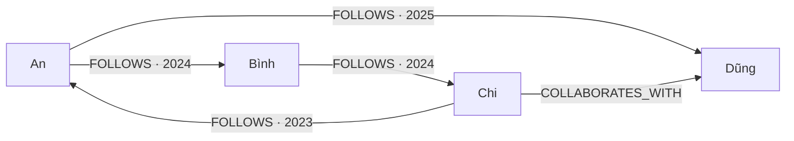

# MATCH to Find Directed or Undirected Relationships

In Neo4j, a **property graph** represents data using **nodes**, **relationships**, and **properties**. Every relationship always has a **start node**, an **end node**, a **relationship type**, and optionally properties. When writing read queries in Cypher, the `MATCH` clause allows you to specify the direction of a relationship or leave it unspecified (undirected).

This lesson belongs to the **Read Queries** chapter of the `DATABASE_ENGINE_GRAPH_NEO4J` module. The focus is on choosing the right connection direction between nodes in Cypher, understanding the returned results, and applying it to real-world problems. This knowledge is the foundation for path queries, query optimization using indexes/constraints, and integrating Neo4j with the Java Driver or Spring Data Neo4j.

## 1. Learning Outcomes

After this lesson, you will be able to:

1. Read and write the three basic patterns: `(a)-[:TYPE]->(b)`, `(a)<-[:TYPE]-(b)`, and `(a)-[:TYPE]-(b)`.
2. Explain the difference between the **stored direction** of a relationship and the **traversal direction** in `MATCH`.
3. Find relationships by type, properties, and both endpoint nodes; extract information from a relationship variable.
4. Explain why an undirected query pattern can produce more rows than expected and how to use `DISTINCT` when appropriate.
5. Write parameterized queries, sort/limit results, and recognize factors affecting performance.

## 2. Relationship Direction in a Property Graph

Suppose there are two people, An and Bình, and An follows Bình. This model can be stored using a `FOLLOWS` relationship:

```text
(An)-[:FOLLOWS]->(Bình)
```

Here:

- **An** is the start node (source/start node).
- **Bình** is the end node (target/end node).
- **`FOLLOWS`** is the relationship type.
- The arrow `->` indicates the direction of the relationship.

**Every relationship in Neo4j has a stored direction.** Leaving the direction unspecified in a query simply means **accepting relationships stored in either direction**. It does not turn the relationship into an undirected one in the database, nor does it automatically create a reverse relationship.

This is especially important for business logic:

| Relationship | Typical Meaning | Does Direction Matter? |
| --- | --- | --- |
| `(a)-[:FOLLOWS]->(b)` | `a` follows `b`. | Yes; `a` follows `b` does not mean `b` follows `a`. |
| `(a)-[:PURCHASED]->(o)` | Customer `a` purchased order `o`. | Yes; direction expresses the roles of both endpoints. |
| `(a)-[:REPORTS_TO]->(b)` | Employee `a` reports to `b`. | Yes; reversing direction changes the meaning. |
| `(a)-[:COLLABORATES_WITH]->(b)` | `a` and `b` collaborate. | The domain may treat it as bidirectional, yet the relationship is **still** stored with a direction; when reading, you may omit direction. |

Do not choose `-[]-` just because you want to get "more data": for asymmetric relationships like `FOLLOWS`, omitting direction can lead to wrong business conclusions.

## 3. Self-Contained Sample Dataset

The examples below use the `DemoPerson` label and a `key` property dedicated to this lesson, avoiding confusion with `Person` nodes in other lessons. Run them on a **test database**. The `MERGE` command allows re-running the examples without creating duplicate nodes or relationships for the same pattern, assuming the initial sample data has no duplicate records.

```cypher
MERGE (an:DemoPerson {key: 'rq002-an'})
SET an.name = 'An'
MERGE (binh:DemoPerson {key: 'rq002-binh'})
SET binh.name = 'Bình'
MERGE (chi:DemoPerson {key: 'rq002-chi'})
SET chi.name = 'Chi'
MERGE (dung:DemoPerson {key: 'rq002-dung'})
SET dung.name = 'Dũng'

MERGE (an)-[f1:FOLLOWS]->(binh)
SET f1.since = 2024
MERGE (chi)-[f2:FOLLOWS]->(an)
SET f2.since = 2023
MERGE (an)-[f3:FOLLOWS]->(dung)
SET f3.since = 2025
MERGE (binh)-[f4:FOLLOWS]->(chi)
SET f4.since = 2024

MERGE (chi)-[c:COLLABORATES_WITH]->(dung)
SET c.project = 'Graph System';
```

Connection diagram:



There are **four `FOLLOWS` relationships** and **one `COLLABORATES_WITH` relationship**. Note that Chi follows An, but An **does not** have a reverse `FOLLOWS` relationship to Chi.

## 4. Outgoing MATCH: `->`

Syntax:

```cypher
MATCH (a:LabelA)-[:RELATIONSHIP_TYPE]->(b:LabelB)
RETURN a, b;
```

The arrow `->` requires a relationship going **from the left node to the right node**. Example: find the people An is following:

```cypher
MATCH (an:DemoPerson {key: 'rq002-an'})-[:FOLLOWS]->(nguoi:DemoPerson)
RETURN nguoi.key AS key, nguoi.name AS name
ORDER BY key;
```

Result:

| key | name |
| --- | --- |
| `rq002-binh` | Bình |
| `rq002-dung` | Dũng |

For the relationship `(an)-[:FOLLOWS]->(nguoi)`, variable `an` is placed at the **start end** of the relationship. Therefore, Chi does not appear: in the data, **Chi follows An**.

You can also swap the positions of the nodes in the expression while still representing the **same physical direction**:

```cypher
MATCH (nguoi:DemoPerson)<-[:FOLLOWS]-(an:DemoPerson {key: 'rq002-an'})
RETURN nguoi.name AS name
ORDER BY name;
```

The result is still Bình and Dũng. The arrow determines the relationship direction, not the variable names or the visual order of the two nodes.

## 5. Incoming MATCH: `<-`

Find the people **who follow An**:

```cypher
MATCH (an:DemoPerson {key: 'rq002-an'})<-[:FOLLOWS]-(nguoi:DemoPerson)
RETURN nguoi.key AS key, nguoi.name AS name
ORDER BY key;
```

Result:

| key | name |
| --- | --- |
| `rq002-chi` | Chi |

With the pattern `(an)<-[:FOLLOWS]-(nguoi)`, the arrowhead points **into An**: the relationship has `nguoi` as its start node and `an` as its end node.

Quick comparison:

| Pattern with anchor node `an` | Meaning | Result on sample dataset |
| --- | --- | --- |
| `(an)-[:FOLLOWS]->(p)` | An follows `p`. | Bình, Dũng |
| `(an)<-[:FOLLOWS]-(p)` | `p` follows An. | Chi |
| `(an)-[:FOLLOWS]-(p)` | A follow relationship connects An and `p` in either direction. | Bình, Chi, Dũng |

## 6. Undirected MATCH: `-[]-`

To find people who have a **`FOLLOWS` connection with An, regardless of direction**:

```cypher
MATCH (an:DemoPerson {key: 'rq002-an'})-[:FOLLOWS]-(nguoi:DemoPerson)
RETURN nguoi.key AS key, nguoi.name AS name
ORDER BY key;
```

Result:

| key | name |
| --- | --- |
| `rq002-binh` | Bình |
| `rq002-chi` | Chi |
| `rq002-dung` | Dũng |

The pattern `-[:FOLLOWS]-` only requires the two nodes to be connected by a relationship of the matching type; the actual relationship can go **outgoing from An** or **incoming to An**.

When the business domain views a connection as "collaborating with each other", this syntax can be very appropriate:

```cypher
MATCH (chi:DemoPerson {key: 'rq002-chi'})
      -[:COLLABORATES_WITH]-
      (dongNghiep:DemoPerson)
RETURN dongNghiep.name AS collaborator;
```

Result: **Dũng**. However, `(chi)-[:COLLABORATES_WITH]-(dung)` does not mean Neo4j stored two opposite relationships: in the sample data there is only **one** relationship `Chi -> Dũng`.

### 6.1. Undirected Patterns Still Have an Actual Stored Direction

When you need to know the actual direction of each connection, bind a variable to the relationship and use `startNode()` and `endNode()`:

```cypher
MATCH (an:DemoPerson {key: 'rq002-an'})-[r:FOLLOWS]-(p:DemoPerson)
RETURN
  p.name AS neighbor,
  CASE
    WHEN startNode(r) = an THEN 'An follows this person'
    ELSE 'This person follows An'
  END AS actualDirection,
  r.since AS since
ORDER BY neighbor;
```

Expected result:

| neighbor | actualDirection | since |
| --- | --- | ---: |
| Bình | An follows this person | 2024 |
| Chi | This person follows An | 2023 |
| Dũng | An follows this person | 2025 |

`startNode(r)` and `endNode(r)` always return the two endpoints according to the **stored direction** of `r`, regardless of whether the `MATCH` query specifies a direction.

### 6.2. Row Count Caveat When Both Endpoints Are Unbound

If neither endpoint is anchored to a specific node, an undirected pattern can match **two endpoint variable assignments** for a single relationship: `a` as source and `b` as target, or vice versa. Therefore, do not confuse row count with the number of physical relationships.

```cypher
MATCH (a:DemoPerson)-[r:FOLLOWS]-(b:DemoPerson)
RETURN
  count(*) AS matchedRows,
  count(DISTINCT r) AS distinctRelationships;
```

With the sample data containing only four `FOLLOWS` relationships, no self-loops, and no other added data, the result is:

| matchedRows | distinctRelationships |
| ---: | ---: |
| 8 | 4 |

To retrieve **each physical relationship once**, match by direction from source to target:

```cypher
MATCH (source:DemoPerson)-[r:FOLLOWS]->(target:DemoPerson)
RETURN source.name AS follower, target.name AS followed, r.since AS since
ORDER BY follower, followed;
```

The result has only four rows, one row per `FOLLOWS` relationship. When undirected matching is genuinely needed, `DISTINCT r` or `count(DISTINCT r)` eliminates duplicate matches **by relationship**, whereas `DISTINCT` on a property like `name` can accidentally merge different nodes that share the same name.

> Note: Row counts also depend on pattern structure. For instance, self-loops (`(p)-[:R]->(p)`), parallel relationships between the same two nodes, or multi-hop patterns must be considered separately. Do not infer row counts solely from node counts.

## 7. Specifying Relationship Type and Reading Properties

In Cypher, a variable inside square brackets represents the **relationship**:

```cypher
MATCH (an:DemoPerson {key: 'rq002-an'})-[r:FOLLOWS]->(p:DemoPerson)
WHERE r.since >= 2025
RETURN an.name AS follower,
       p.name AS followed,
       type(r) AS relationshipType,
       r.since AS since;
```

The result is one row: **An → Dũng**, type `FOLLOWS`, since 2025. In this query:

- `r` is the relationship variable; `r.since` retrieves the `since` property.
- `:FOLLOWS` restricts the relationship type to search for.
- `type(r)` returns the string representing the relationship type, here `'FOLLOWS'`.
- `WHERE r.since >= 2025` applies the condition to the **relationship property**, not a node property.

If you omit the relationship type, Cypher can match any type:

```cypher
MATCH (chi:DemoPerson {key: 'rq002-chi'})-[r]-(p:DemoPerson)
RETURN p.name AS neighbor, type(r) AS type
ORDER BY type, neighbor;
```

With the sample data, there are three connections based on the physical relationships attached to Chi: `Chi -> An` (`FOLLOWS`), `Bình -> Chi` (`FOLLOWS`), and `Chi -> Dũng` (`COLLABORATES_WITH`).

Shorthand forms to remember:

| Syntax | Interpretation |
| --- | --- |
| `(a)-[:FOLLOWS]->(b)` | Exact type `FOLLOWS`, direction from `a` to `b`. |
| `(a)<-[:FOLLOWS]-(b)` | Exact type `FOLLOWS`, direction from `b` to `a`. |
| `(a)-[:FOLLOWS]-(b)` | Exact type `FOLLOWS`, accepts either direction. |
| `(a)-[r:FOLLOWS]->(b)` | Same as the first pattern, also binding variable `r`. |
| `(a)-->(b)` | Any relationship going from `a` to `b`, unrestricted type. |
| `(a)--(b)` | Any relationship between `a` and `b` in either direction, unrestricted type. |

## 8. Combining Conditions on Both Nodes and the Relationship

A `MATCH` pattern can simultaneously constrain the **source node**, **target node**, and **relationship properties**:

```cypher
MATCH (source:DemoPerson {key: 'rq002-an'})
      -[r:FOLLOWS]->
      (target:DemoPerson {key: 'rq002-binh'})
WHERE r.since >= 2024
RETURN source.name AS sourceName,
       target.name AS targetName,
       r.since AS since;
```

The result is **An, Bình, 2024**. The following reverse-direction query returns no rows on the sample dataset:

```cypher
MATCH (binh:DemoPerson {key: 'rq002-binh'})
      -[:FOLLOWS]->
      (an:DemoPerson {key: 'rq002-an'})
RETURN binh.name, an.name;
```

Thus, the existence of a relationship between two nodes **does not** guarantee that the reverse direction exists.

### 8.1. Checking Existence Instead of Returning the Full Connection

When you only need to know whether An is following Bình, you can count the matching relationships:

```cypher
MATCH (an:DemoPerson {key: 'rq002-an'})
      -[:FOLLOWS]->
      (binh:DemoPerson {key: 'rq002-binh'})
RETURN count(*) > 0 AS follows;
```

Result: `true`. If there are multiple parallel relationships of the same type between two nodes, `count(*)` may be greater than 1, yet the existence check remains true.

### 8.2. Keeping Nodes Without Connections Using OPTIONAL MATCH

A regular `MATCH` produces no rows when the relationship pattern does not match. When you need to keep the starting node even if it has no relationships yet, use `OPTIONAL MATCH`:

```cypher
MATCH (p:DemoPerson {key: 'rq002-dung'})
OPTIONAL MATCH (p)-[:FOLLOWS]->(q:DemoPerson)
RETURN p.name AS person, q.name AS follows;
```

Dũng does not follow anyone in the sample data, so the result still has one row: `person = 'Dũng'` and `follows = null`. This is useful when building UIs that display a list of users even when they do not have follow relationships yet.

## 9. Writing Parameterized Queries for Applications

Never concatenate user input directly into Cypher strings. Use parameters, such as `$personKey` and `$fromYear`, to filter safely and reuse query plans:

```cypher
MATCH (p:DemoPerson {key: $personKey})-[r:FOLLOWS]->(q:DemoPerson)
WHERE r.since >= $fromYear
RETURN q.key AS key, q.name AS name, r.since AS since
ORDER BY since DESC, key ASC;
```

With `personKey = 'rq002-an'` and `fromYear = 2024`, the results sorted by descending year are Dũng (2025) then Bình (2024).

Java Driver example (assuming the application has already configured and provided a Neo4j `Driver`):

```java
import java.util.List;
import java.util.Map;
import org.neo4j.driver.Driver;

public class FollowQuery {
    public static List<String> followedNames(Driver driver, String personKey) {
        try (var session = driver.session()) {
            return session.executeRead(tx ->
                tx.run("""
                    MATCH (p:DemoPerson {key: $personKey})
                          -[:FOLLOWS]->(q:DemoPerson)
                    RETURN q.name AS name
                    ORDER BY name
                    """, Map.of("personKey", personKey))
                  .list(record -> record.get("name").asString())
            );
        }
    }
}
```

Calling `followedNames(driver, "rq002-an")` returns the list of names `[Bình, Dũng]`. For Spring Data Neo4j, you can use the same Cypher pattern in repository queries with bound parameters; output mapping depends on the application's data types and entities.

## 10. Sorting, Limiting, and Avoiding Duplicate Results

When displaying large lists, establish a deterministic order before taking a slice of results:

```cypher
MATCH (p:DemoPerson {key: 'rq002-an'})-[r:FOLLOWS]-(q:DemoPerson)
RETURN q.key AS key, q.name AS name, r.since AS since
ORDER BY since DESC, key ASC
LIMIT 2;
```

The result is **Dũng (2025)** then **Bình (2024)**. Because the query is undirected, Chi is also An's neighbor, but the Chi → An relationship started in 2023 and therefore falls outside the top two rows.

When you need each unique target node, for example when multiple relationships of different types connect to the same person:

```cypher
MATCH (p:DemoPerson {key: 'rq002-chi'})-[r]-(q:DemoPerson)
RETURN DISTINCT q.key AS key, q.name AS name
ORDER BY key;
```

`DISTINCT` here eliminates duplicate `(key, name)` tuples. If you need to count **relationships**, use `count(DISTINCT r)`; if you need to count **neighbor nodes**, use `count(DISTINCT q)`. These two concepts differ when multiple types or multiple relationships connect the same pair of nodes.

## 11. Performance: Choosing Starting Points and Traversal Direction

On large graphs, performance depends on the number of nodes scanned, filter selectivity, and the number of relationships expanded. A query starting from a node with a clear identifier is generally easier to optimize than an unanchored pattern.

If `DemoPerson.key` is a unique identifier in your real model, you can create a **unique constraint** on the test database:

```cypher
CREATE CONSTRAINT demo_person_key_unique IF NOT EXISTS
FOR (p:DemoPerson) REQUIRE p.key IS UNIQUE;
```

This constraint prevents two `DemoPerson` nodes from sharing the same non-null `key` and creates a backing index for key lookups. The command will fail if existing data violates uniqueness.

Evaluating the query plan:

```cypher
EXPLAIN
MATCH (p:DemoPerson {key: $personKey})-[:FOLLOWS]->(q:DemoPerson)
RETURN q.name AS name;
```

`EXPLAIN` shows the expected plan without executing the query. `PROFILE` **executes the query** and provides runtime operational statistics. Depending on data, indexes, and the Neo4j version, the plan may use an index seek for the node and then expand relationships in the specified direction.

Practical guidelines:

1. Specify the **exact relationship type** (`:FOLLOWS`, `:REPORTS_TO`, ...) so you do not traverse unrelated types.
2. Use a **specific direction** when required by the business question; `->` and `<-` express the exact direction needed. Undirected patterns may expand in both directions.
3. Start from a **well-filtered node** (label + identifier property) whenever possible; consider constraints/indexes for frequently looked-up properties.
4. `RETURN` only the needed columns, and use `ORDER BY` with `LIMIT` for pagination/list rendering.
5. Measure with `EXPLAIN`/`PROFILE` and realistic data; never assume directed queries are always faster or that every query uses an index.

## 12. Common Mistakes

| Symptom | Cause | Solution |
| --- | --- | --- |
| Searching for "who An follows" returns Chi | Used `(an)<-[:FOLLOWS]-(p)` or omitted direction. | Use `(an)-[:FOLLOWS]->(p)`. |
| Searching for "who follows An" returns Bình, Dũng | Used outgoing direction. | Use `(an)<-[:FOLLOWS]-(p)`. |
| Assuming collaboration relationships have no stored direction | Confused `-[:COLLABORATES_WITH]-` with a physically undirected relationship. | Remember every relationship in Neo4j is directed; queries may omit direction constraints. |
| Counting eight "relationships" even though only four were created | Both node variables were unbound, and the undirected pattern created two endpoint assignments. | Use `count(DISTINCT r)` or match by stored direction if you need each relationship once. |
| `MATCH` query returns no rows | No relationship with matching direction, type, or filters. | Check data and conditions; use `OPTIONAL MATCH` if the root node must be preserved. |
| Results contain multiple rows for the same person | Multiple relationships or multiple matching paths to the same person. | Decide whether to count nodes, relationships, or matches, then apply `DISTINCT` accordingly. |
| `LIMIT` changes which people are returned | Missing a deterministic `ORDER BY`. | Sort by business criteria, adding a unique key as a tie-breaker. |

## 13. Practice Exercises

Use the dataset from Section 3. Try writing Cypher queries before checking the answers.

**Exercise 1.** Query the list of people Bình is following, including their names and the year they started following.

**Exercise 2.** Find all people who have a direct `FOLLOWS` relationship with Chi, regardless of direction. Return names in alphabetical order.

**Exercise 3.** Find all `FOLLOWS` relationships **incoming to Chi**, returning the follower's name and the follow year.

**Exercise 4.** Write a query showing how many physical `FOLLOWS` relationships exist in the sample data, even when using an undirected pattern.

**Exercise 5.** Find who An started following from 2025 onward using parameter `$fromYear`. Who is the expected result?

### Reference Answers

**Exercise 1**

```cypher
MATCH (p:DemoPerson {key: 'rq002-binh'})-[r:FOLLOWS]->(q:DemoPerson)
RETURN q.name AS followed, r.since AS since;
```

Result: **Chi, 2024**.

**Exercise 2**

```cypher
MATCH (p:DemoPerson {key: 'rq002-chi'})-[:FOLLOWS]-(q:DemoPerson)
RETURN q.name AS neighbor
ORDER BY neighbor;
```

Result: **An, Bình**. The `COLLABORATES_WITH` relationship with Dũng is not of type `FOLLOWS` and is therefore excluded.

**Exercise 3**

```cypher
MATCH (p:DemoPerson {key: 'rq002-chi'})<-[r:FOLLOWS]-(q:DemoPerson)
RETURN q.name AS follower, r.since AS since;
```

Result: **Bình, 2024**.

**Exercise 4**

```cypher
MATCH (a:DemoPerson)-[r:FOLLOWS]-(b:DemoPerson)
RETURN count(DISTINCT r) AS totalRelationships;
```

Result: **4** physical relationships.

**Exercise 5**

```cypher
MATCH (p:DemoPerson {key: 'rq002-an'})-[r:FOLLOWS]->(q:DemoPerson)
WHERE r.since >= $fromYear
RETURN q.name AS followed
ORDER BY followed;
```

With `fromYear = 2025`, result: **Dũng**.

## 14. Summary

- `(a)-[:R]->(b)` matches direction **from a to b**; `(a)<-[:R]-(b)` matches direction **from b to a**; `(a)-[:R]-(b)` matches **either direction**.
- The stored direction of a relationship in Neo4j always exists, even when a query omits direction; direction in `MATCH` describes the pattern to match.
- Bind a variable `[r:R]` to read properties `r.property`, type `type(r)`, and endpoints `startNode(r)`/`endNode(r)`.
- Distinguish **matched rows**, **physical relationships**, and **neighbor nodes**; choose `DISTINCT` or `count(DISTINCT ...)` based on your goal.
- Use labels, identifiers, parameters, and query plans for accurate and performant execution as you move on to real-world graph problems, path queries, and Java application integration.
