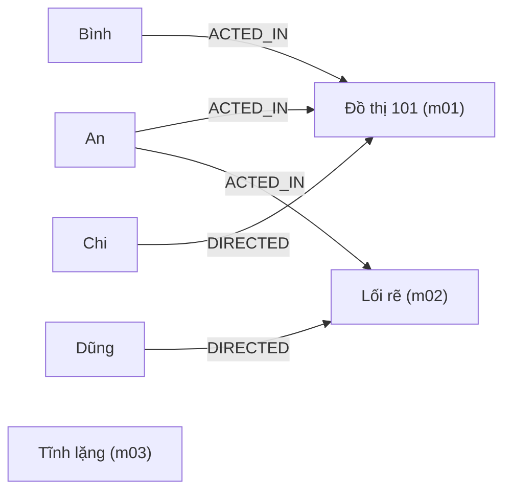

# Combining Connected Patterns and Identifying Unintended Cartesian Products

In Neo4j, data is modeled as a **property graph**: nodes carry labels and properties, while directed relationships connect nodes. The **Cypher** language uses `MATCH` to find matching graph patterns. When a query contains multiple patterns, how node and relationship variables are linked determines whether the results reflect real connections or simply combine every pair from two independent datasets.

This lesson belongs to the **Read Queries** chapter of the `DATABASE_ENGINE_GRAPH_NEO4J` module. It focuses on **combining connected patterns in `MATCH`** and **detecting unintended Cartesian products**. This is a critical skill before querying complex paths, tuning Cypher plans, designing indexes/constraints, and invoking queries from the Java Driver or Spring Data Neo4j.

## 1. Learning Outcomes

After this lesson, you will be able to:

1. Combine two or more `MATCH` patterns via **shared node variables** or explicit connecting relationships.
2. Distinguish **connected patterns** from **disconnected patterns**; know when row counts will multiply.
3. Calculate expected row counts in queries with multiple branches, multiple relationships, or `OPTIONAL MATCH`.
4. Identify unintended Cartesian products from Cypher queries, returned results, and `EXPLAIN`/`PROFILE` plans.
5. Rewrite queries to express connection constraints accurately, and use `DISTINCT`, `WITH`, and aggregations appropriately.

## 2. What Is a Connected Pattern?

Consider a movie system with three types of entities: actors, movies, and directors.

```text
(Actor)-[:ACTED_IN]->(Movie)<-[:DIRECTED]-(Director)
```

This is a **connected pattern** because both relationships connect to **the same movie node**. In Cypher, the variable `m` represents that exact shared movie node:

```cypher
MATCH (a:Person)-[:ACTED_IN]->(m:Movie)<-[:DIRECTED]-(d:Person)
RETURN a.name, m.title, d.name;
```

Placing the two patterns in two separate clauses also preserves the connection if the variable `m` is reused:

```cypher
MATCH (a:Person)-[:ACTED_IN]->(m:Movie)
MATCH (d:Person)-[:DIRECTED]->(m)
RETURN a.name, m.title, d.name;
```

Here, the second `MATCH` clause requires director `d` to have directed **the exact movie `m` found in the first clause**. The query only produces (actor, movie, director) triples that are actually connected in the graph.

Conversely, if two different movie variables are used without any linking condition:

```cypher
MATCH (a:Person)-[:ACTED_IN]->(actedMovie:Movie)
MATCH (d:Person)-[:DIRECTED]->(directedMovie:Movie)
RETURN a.name, actedMovie.title, d.name, directedMovie.title;
```

then the two query branches are **independent**. Cypher can combine every acting row with **every** directing row, even when `actedMovie` and `directedMovie` are completely different movies. That is a classic situation that causes an **unintended Cartesian product**.

## 3. Practice Dataset

The examples use dedicated labels `RQ003Person`, `RQ003Movie`, and key property `key` so the dataset is self-contained and independent of other lessons. Run the initialization on a **practice database**, because `MERGE`/`SET` modifies data. Assume the dataset has no duplicate keys or parallel relationships of the same pattern; when re-run on clean sample data, `MERGE` does not create duplicate nodes or relationships.

```cypher
MERGE (an:RQ003Person {key: 'an'})
SET an.name = 'An'
MERGE (binh:RQ003Person {key: 'binh'})
SET binh.name = 'Bình'
MERGE (chi:RQ003Person {key: 'chi'})
SET chi.name = 'Chi'
MERGE (dung:RQ003Person {key: 'dung'})
SET dung.name = 'Dũng'

MERGE (m1:RQ003Movie {key: 'm01'})
SET m1.title = 'Đồ thị 101'
MERGE (m2:RQ003Movie {key: 'm02'})
SET m2.title = 'Lối rẽ'
MERGE (m3:RQ003Movie {key: 'm03'})
SET m3.title = 'Tĩnh lặng'

MERGE (an)-[r1:ACTED_IN]->(m1)
SET r1.role = 'Chính'
MERGE (an)-[r2:ACTED_IN]->(m2)
SET r2.role = 'Phụ'
MERGE (binh)-[r3:ACTED_IN]->(m1)
SET r3.role = 'Phụ'

MERGE (chi)-[:DIRECTED]->(m1)
MERGE (dung)-[:DIRECTED]->(m2);
```

Connection diagram:



Data overview:

| Group | Count | Details |
| --- | ---: | --- |
| `RQ003Person` nodes | 4 | An, Bình, Chi, Dũng |
| `RQ003Movie` nodes | 3 | `m01`, `m02`, `m03` |
| `ACTED_IN` relationships | 3 | An → m01, An → m02, Bình → m01 |
| `DIRECTED` relationships | 2 | Chi → m01, Dũng → m02 |
| Unconnected movies | 1 | m03 has no actors/directors in the sample dataset |

From here on, all **expected result** counts are based strictly on the dataset above, with no extra nodes or relationships added.

## 4. Combining Connected Patterns Properly

### 4.1. Writing a Single Path Pattern with Two Relationships

```cypher
MATCH (a:RQ003Person)-[:ACTED_IN]->(m:RQ003Movie)<-[:DIRECTED]-(d:RQ003Person)
RETURN
  a.key AS actorKey,
  a.name AS actor,
  m.title AS movie,
  d.name AS director
ORDER BY m.key, a.key;
```

Result:

| actorKey | actor | movie | director |
| --- | --- | --- | --- |
| `an` | An | Đồ thị 101 | Chi |
| `binh` | Bình | Đồ thị 101 | Chi |
| `an` | An | Lối rẽ | Dũng |

Both An and Bình acted in m01, so they produce **two distinct rows** with director Chi. This is the valid row count for a connected pattern, not a meaningless Cartesian product. Movie m03 does not appear because it has no matching acting and directing relationships.

### 4.2. Splitting into Two MATCH Clauses with a Shared Variable

```cypher
MATCH (a:RQ003Person)-[:ACTED_IN]->(m:RQ003Movie)
MATCH (d:RQ003Person)-[:DIRECTED]->(m)
RETURN a.name AS actor, m.title AS movie, d.name AS director
ORDER BY m.key, a.key;
```

The result is still **3 rows**, just like in Section 4.1. In the second `MATCH`, `m` is already bound by the previous clause; it is not an arbitrary new movie.

### 4.3. Writing Comma-Separated Patterns That Remain Connected

```cypher
MATCH
  (a:RQ003Person)-[:ACTED_IN]->(m:RQ003Movie),
  (d:RQ003Person)-[:DIRECTED]->(m)
RETURN a.name AS actor, m.title AS movie, d.name AS director
ORDER BY m.key, a.key;
```

Here the two patterns share **variable `m`**, so they remain connected. Commas or the number of `MATCH` clauses **do not by themselves determine** whether a Cartesian product occurs; what matters is **whether the patterns have linking constraints**.

### 4.4. Using WHERE to Filter Connected Patterns

```cypher
MATCH (a:RQ003Person)-[r:ACTED_IN]->(m:RQ003Movie)
MATCH (d:RQ003Person)-[:DIRECTED]->(m)
WHERE r.role = 'Chính'
RETURN a.name AS actor, m.title AS movie, d.name AS director;
```

Result: **An – Đồ thị 101 – Chi**. The condition `r.role = 'Chính'` filters the acting role, while the shared variable `m` ensures both relationships belong to the same movie.

## 5. Cartesian Product: Recognizing It by Row Count

Given two independent result sets:

- Set A has `n` rows.
- Set B has `m` rows.

If a query combines **every row of A with every row of B**, the result has:

\[
N_{\text{result}} = n \times m
\]

Example without constraining connections between people and movies:

```cypher
MATCH (p:RQ003Person)
MATCH (m:RQ003Movie)
RETURN count(*) AS totalRows;
```

There are **4 people × 3 movies = 12 rows**. Combinations like `(Chi, 'Tĩnh lặng')` still appear even though Chi has no relationship with m03. The query is asking for all **person–movie pairs**, rather than "who participated in which movie".

Compare with the connected query:

```cypher
MATCH (p:RQ003Person)-[:ACTED_IN]->(m:RQ003Movie)
RETURN count(*) AS totalRows;
```

The result is **3 rows**, corresponding to the three actual `ACTED_IN` relationships.

### 5.1. Unintended Cartesian Product in Multi-Relationship Queries

A common mistake when retrieving **actors along with the director of a movie**:

```cypher
// WRONG business intent: actedMovie is not connected to directedMovie.
MATCH (a:RQ003Person)-[:ACTED_IN]->(actedMovie:RQ003Movie)
MATCH (d:RQ003Person)-[:DIRECTED]->(directedMovie:RQ003Movie)
RETURN a.name AS actor,
       actedMovie.key AS actedMovie,
       d.name AS director,
       directedMovie.key AS directedMovie
ORDER BY actedMovie, actor, directedMovie;
```

The acting branch has **3 rows**; the directing branch has **2 rows**. The result has 3 × 2 = **6 rows**:

| actor | actedMovie | director | directedMovie | Same movie? |
| --- | --- | --- | --- | --- |
| An | m01 | Chi | m01 | Yes |
| An | m01 | Dũng | m02 | No |
| Bình | m01 | Chi | m01 | Yes |
| Bình | m01 | Dũng | m02 | No |
| An | m02 | Chi | m01 | No |
| An | m02 | Dũng | m02 | Yes |

The three "No" rows are combinations **not supported by an actor–movie–director path**. If this result is displayed in a UI, the system could misattribute directors to movies.

**Fix by reusing the same movie variable:**

```cypher
MATCH (a:RQ003Person)-[:ACTED_IN]->(m:RQ003Movie)
MATCH (d:RQ003Person)-[:DIRECTED]->(m)
RETURN a.name AS actor, m.key AS movieKey, d.name AS director
ORDER BY movieKey, actor;
```

The result drops back to the **3 correct rows**. When business logic requires a real relationship between two branches, express it **directly using a shared-variable graph pattern or a connecting relationship**.

### 5.2. Why DISTINCT Cannot Fix a Missing Connection

```cypher
MATCH (a:RQ003Person)-[:ACTED_IN]->(actedMovie:RQ003Movie)
MATCH (d:RQ003Person)-[:DIRECTED]->(directedMovie:RQ003Movie)
RETURN DISTINCT a.name AS actor, d.name AS director
ORDER BY actor, director;
```

`DISTINCT` only removes rows with **the same tuple of returned values**. It does not know which actor and director belong to the same movie. In this example, `(An, Chi)`, `(An, Dũng)`, `(Bình, Chi)`, and `(Bình, Dũng)` still exist—where `(Bình, Dũng)` is an invalid match if asking "directors of movies Bình acted in".

**Rule:** fix the pattern join condition first; use `DISTINCT` only when business logic genuinely requires deduplication.

## 6. When Is Row Multiplication Valid?

Even a **connected pattern** can return multiple rows, because one node can connect to many other nodes.

For example, movie m01 has **2 actors** and **1 director**, so the pattern:

```cypher
MATCH (a:RQ003Person)-[:ACTED_IN]->(m:RQ003Movie {key: 'm01'})
MATCH (d:RQ003Person)-[:DIRECTED]->(m)
RETURN a.name AS actor, d.name AS director
ORDER BY actor;
```

returns **2 rows**, corresponding to two actor–director pairs **for the same movie**. If m01 gets a second director, the pattern can return **2 actors × 2 directors = 4 rows** for that single movie. This enumerates valid combinations scoped to **the same movie node**, which is different from pairing every movie with every other movie.

To distinguish the two cases, ask yourself:

1. What event or connection does each row represent?
2. Do the variables across branches actually point to the same node, or merely share a property name?
3. Can a node have multiple relationships of the same type or multiple people per branch?
4. If one branch doubles in size, is the row increase **expected by the domain**, or a sign of a missing join condition?

## 7. WHERE, WITH, and Variable Scope

### 7.1. A Filter Condition Is Not Automatically a Graph Link

The following example still defines **two independent movie nodes**, then filters by property value:

```cypher
MATCH (a:RQ003Person)-[:ACTED_IN]->(m1:RQ003Movie)
MATCH (d:RQ003Person)-[:DIRECTED]->(m2:RQ003Movie)
WHERE m1.key = m2.key
RETURN a.name, m1.title, d.name;
```

On the sample dataset, the result happens to be three rows because the three movies have distinct `key` values. However, `m1.key = m2.key` only compares **string values**; if two different movie nodes share the same `key`, the filter can still mismatch them. Furthermore, the query planner may have to perform a value join between two sets. If the requirement is **the same movie node**, sharing a single variable `m` expresses it more accurately:

```cypher
MATCH (a:RQ003Person)-[:ACTED_IN]->(m:RQ003Movie)
MATCH (d:RQ003Person)-[:DIRECTED]->(m)
RETURN a.name, m.title, d.name;
```

Note: the Cypher planner may optimize `WHERE m1.key = m2.key` into a value join; you cannot conclude that the execution plan **always** materializes the full Cartesian product before filtering. The main issue is how the constraint is expressed and business correctness.

### 7.2. WITH Keeps or Drops Variables; It Does Not Connect Patterns

`WITH` passes selected variables to the next part of the query and can be used for early aggregation. However, merely adding `WITH` **does not create a connection**:

```cypher
MATCH (p:RQ003Person)
WITH p
MATCH (m:RQ003Movie)
RETURN count(*) AS totalRows;
```

The result is still **12** because every person is paired with every movie. Conversely:

```cypher
MATCH (a:RQ003Person)-[:ACTED_IN]->(m:RQ003Movie)
WITH a, m
MATCH (d:RQ003Person)-[:DIRECTED]->(m)
RETURN a.name AS actor, m.title AS movie, d.name AS director;
```

This query carries variable `m` across `WITH`, then reuses it to match the right movie with its director. `WITH` can also change **row count** when using `DISTINCT` or aggregations; choose carefully, as omitting a variable from `WITH` makes it unavailable later in the query.

### 7.3. Caution with OPTIONAL MATCH and Row Multiplication

`OPTIONAL MATCH` preserves rows from the preceding part even when no pattern matches; unmatched variables receive `null`. Yet if there are **multiple matching patterns**, a single row can still expand into multiple rows.

```cypher
MATCH (m:RQ003Movie)
OPTIONAL MATCH (a:RQ003Person)-[:ACTED_IN]->(m)
OPTIONAL MATCH (d:RQ003Person)-[:DIRECTED]->(m)
RETURN
  m.key AS movieKey,
  count(*) AS rowsAfterMatches,
  count(DISTINCT a) AS actorCount,
  count(DISTINCT d) AS directorCount
ORDER BY movieKey;
```

With the sample data:

| movieKey | rowsAfterMatches | actorCount | directorCount |
| --- | ---: | ---: | ---: |
| m01 | 2 | 2 | 1 |
| m02 | 1 | 1 | 1 |
| m03 | 1 | 0 | 0 |

Movie m01 produces two rows because it has two actors; director Chi appears in **both** rows. Movie m03 retains one row with actor and director variables set to `null`; hence `count(*) = 1` even though the movie has neither relationship.

If you replace `count(DISTINCT d)` with `count(d)`, m01 is counted as having **two directors** even though there is actually only **one director**. This is not a Cartesian product bug between disconnected movie sets, but **row multiplication across multiple branches matching the same movie**.

### 7.4. Early Aggregation to Reduce Row Multiplication

If you only need the counts of actors and directors, instead of listing every person pair, aggregate each branch per movie:

```cypher
MATCH (m:RQ003Movie)
OPTIONAL MATCH (a:RQ003Person)-[:ACTED_IN]->(m)
WITH m, count(DISTINCT a) AS actorCount
OPTIONAL MATCH (d:RQ003Person)-[:DIRECTED]->(m)
RETURN
  m.key AS movieKey,
  actorCount,
  count(DISTINCT d) AS directorCount
ORDER BY movieKey;
```

Here `WITH m, count(DISTINCT a)` collapses actor rows down to **one row per movie** before querying directors. As a result, the subsequent part does not carry duplicate copies of actor rows. The exact result is:

| movieKey | actorCount | directorCount |
| --- | ---: | ---: |
| m01 | 2 | 1 |
| m02 | 1 | 1 |
| m03 | 0 | 0 |

This optimization helps when branches have high fan-out, though it is no substitute for writing properly connected patterns.

## 8. Filtering by Existence Instead of Multiplying Combinations

Sometimes the question is simply: **Which movies have both an actor and a director?** If you do not need to list every actor–director pair, check the existence of the two patterns:

```cypher
MATCH (m:RQ003Movie)
WHERE EXISTS {
  MATCH (:RQ003Person)-[:ACTED_IN]->(m)
}
AND EXISTS {
  MATCH (:RQ003Person)-[:DIRECTED]->(m)
}
RETURN m.key AS movieKey, m.title AS movie
ORDER BY movieKey;
```

The result is **m01** and **m02**, one row per movie. The subquery `EXISTS { ... }` references the outer query's `m` variable and returns a boolean; it does not need to multiply every actor by every director just to return the movie list.

This is the right choice for "does a relationship exist?" queries, especially when each movie has many participants.

## 9. Detecting Issues with EXPLAIN and PROFILE

Neo4j provides two plan inspection tools:

- `EXPLAIN`: shows the **estimated** plan without executing the query.
- `PROFILE`: **executes** the query and adds actual runtime statistics, typically including rows flowing through each operator and DB hits.

Let us analyze the query with two independent branches:

```cypher
EXPLAIN
MATCH (a:RQ003Person)-[:ACTED_IN]->(actedMovie:RQ003Movie)
MATCH (d:RQ003Person)-[:DIRECTED]->(directedMovie:RQ003Movie)
RETURN a.name, actedMovie.title, d.name, directedMovie.title;
```

And observe the actual row counts:

```cypher
PROFILE
MATCH (a:RQ003Person)-[:ACTED_IN]->(actedMovie:RQ003Movie)
MATCH (d:RQ003Person)-[:DIRECTED]->(directedMovie:RQ003Movie)
RETURN a.name, actedMovie.title, d.name, directedMovie.title;
```

Depending on the Neo4j version, statistics, and optimizer decisions, you may see a `CartesianProduct` operator or an equivalent execution structure representing **the combination of independent result sets**. Some tools show warnings for disconnected patterns; warning messages and exact plan shapes should not be treated as immutable across versions.

To evaluate a plan, inspect these together:

1. **Pattern connectivity**: is there a shared node variable or a relationship connecting the two branches?
2. **Rows**: how much does the row count grow across steps—does it grow as the product of the two branches?
3. **DB Hits / cost**: how many nodes must the engine scan and how many relationships must it expand?
4. **Result semantics**: does each row truly assert the link the business question expects?

Compare against the plan of the fixed query:

```cypher
PROFILE
MATCH (a:RQ003Person)-[:ACTED_IN]->(m:RQ003Movie)
MATCH (d:RQ003Person)-[:DIRECTED]->(m)
RETURN a.name, m.title, d.name;
```

The fixed query produces **3 results**, while the disconnected query produces **6 results** on the sample dataset. However, fewer rows do not automatically prove a query is faster in every database; performance must be evaluated alongside indexes, node degrees, and the actual plan.

### 9.1. Indexes and Query Anchors

On large datasets, filtering the starting node by a high-selectivity key limits the initial row count before expanding relationships:

```cypher
MATCH (a:RQ003Person {key: $actorKey})-[:ACTED_IN]->(m:RQ003Movie)
MATCH (d:RQ003Person)-[:DIRECTED]->(m)
RETURN a.name AS actor, m.title AS movie, d.name AS director
ORDER BY m.key;
```

With `actorKey = 'an'`, the result is An with both movies m01 and m02 and their respective directors. In real systems, you can create an appropriate unique constraint/index on the identifier property `RQ003Person.key`; constraints/indexes **speed up node lookup**, but **do not fix** a query missing a join condition. Never create indexes just to mask a Cartesian product.

## 10. When Is a Cartesian Product Intentional?

Not every Cartesian product is wrong. For example, an application might need to list **every person–movie pair** to build a rating matrix or generate test scenarios. In that case:

```cypher
MATCH (p:RQ003Person)
MATCH (m:RQ003Movie)
RETURN p.name AS person, m.title AS movie
ORDER BY p.key, m.key;
```

The query intentionally produces **12 pairs**. Be clear about the distinction:

| Question | Appropriate Query Style |
| --- | --- |
| "Who acted in which movie?" | `MATCH (p)-[:ACTED_IN]->(m)` |
| "Who acted in a movie directed by whom?" | `MATCH (p)-[:ACTED_IN]->(m)<-[:DIRECTED]-(d)` |
| "How many actors and directors does each movie have?" | Aggregate by `m`, considering `OPTIONAL MATCH` and `count(DISTINCT ...)` |
| "Which movies have both an actor and a director?" | Check `EXISTS` on the same variable `m` |
| "All pairs of people and movies, even unrelated?" | **Intentional** Cartesian product; estimate row count before running |

When intentionally pairing every combination, control input sizes; multiplying two very large sets can generate massive output volumes.

## 11. Common Mistakes and Fixes

| Symptom | Possible Cause | How to Fix |
| --- | --- | --- |
| Results naturally multiply `n × m` | Two patterns share no node and have no connecting relationship. | Bind both branches to the same node variable if referring to the same entity. |
| Two different movies paired in one actor–director row | Used independent `actedMovie` and `directedMovie` variables. | Reuse a single variable `m`. |
| Added `DISTINCT` but wrong pairs remain | `DISTINCT` only removes duplicate output tuples; it does not verify connections. | Fix the `MATCH` structure before considering `DISTINCT`. |
| Actor/director counts exceed reality | `OPTIONAL MATCH` branches expand multiple rows together. | Use `count(DISTINCT node)` or aggregate each branch separately. |
| Movies with no participants disappear | `MATCH` requires both relationships to exist. | Use `OPTIONAL MATCH` if you want to keep all movies. |
| Plan shows `CartesianProduct` or sudden Rows spike | Independent match sets or multi-branch combinations. | Check patterns, input row counts, and intended semantics. |
| Added `WITH` but results still blow up | `WITH` passes rows along without adding a linking condition. | Carry the connecting variable forward or aggregate at the right grain. |
| Used `LIMIT` only to "fix" oversized output | Limits output rows without fixing incorrect pairings. | Connect the patterns properly first, then apply `ORDER BY`/`LIMIT`. |

## 12. Practice Exercises

Use the dataset from Section 3. Write your queries and predict the row count before checking the answers.

**Exercise 1.** Write a query listing actor name, movie title, and director name **for the same movie** using two `MATCH` clauses. How many rows are returned?

**Exercise 2.** Using two independent patterns, query all acting and directing relationships. How many rows are returned? How many rows have an actor and director from different movies?

**Exercise 3.** Find the list of movies that **have at least one actor and at least one director**, one row per movie, without listing every person pair.

**Exercise 4.** Count the number of actors and directors for **all three movies**, including `m03` which has no relationships yet.

**Exercise 5.** Inspect the following query and explain why it does not solve the bug:

```cypher
MATCH (a:RQ003Person)-[:ACTED_IN]->(m1:RQ003Movie)
WITH a, m1
MATCH (d:RQ003Person)-[:DIRECTED]->(m2:RQ003Movie)
RETURN DISTINCT a.name, d.name;
```

### Reference Answers

**Exercise 1**

```cypher
MATCH (a:RQ003Person)-[:ACTED_IN]->(m:RQ003Movie)
MATCH (d:RQ003Person)-[:DIRECTED]->(m)
RETURN a.name AS actor, m.title AS movie, d.name AS director
ORDER BY m.key, a.key;
```

**3 rows**: An–m01–Chi, Bình–m01–Chi, An–m02–Dũng.

**Exercise 2**

```cypher
MATCH (a:RQ003Person)-[:ACTED_IN]->(m1:RQ003Movie)
MATCH (d:RQ003Person)-[:DIRECTED]->(m2:RQ003Movie)
RETURN
  count(*) AS total,
  sum(CASE WHEN m1 = m2 THEN 1 ELSE 0 END) AS sameMovie,
  sum(CASE WHEN m1 <> m2 THEN 1 ELSE 0 END) AS differentMovie;
```

Result: `total = 6`, `sameMovie = 3`, `differentMovie = 3`.

**Exercise 3**

```cypher
MATCH (m:RQ003Movie)
WHERE EXISTS { MATCH (:RQ003Person)-[:ACTED_IN]->(m) }
  AND EXISTS { MATCH (:RQ003Person)-[:DIRECTED]->(m) }
RETURN m.key AS movieKey, m.title AS movie
ORDER BY movieKey;
```

**2 movies**: `m01` and `m02`.

**Exercise 4**

```cypher
MATCH (m:RQ003Movie)
OPTIONAL MATCH (a:RQ003Person)-[:ACTED_IN]->(m)
WITH m, count(DISTINCT a) AS actors
OPTIONAL MATCH (d:RQ003Person)-[:DIRECTED]->(m)
RETURN m.key AS movieKey, actors, count(DISTINCT d) AS directors
ORDER BY movieKey;
```

Result: `m01 = (2, 1)`, `m02 = (1, 1)`, `m03 = (0, 0)`.

**Exercise 5**

`WITH a, m1` only carries variables forward after the acting branch; the next `MATCH` clause uses `m2`, which is a **new movie variable** disconnected from `m1`. `RETURN DISTINCT` can reduce duplicate pairs by **name**, yet still fails to ensure that `a` acted in a movie directed by `d`. The fix is to reuse `m1`:

```cypher
MATCH (a:RQ003Person)-[:ACTED_IN]->(m:RQ003Movie)
WITH a, m
MATCH (d:RQ003Person)-[:DIRECTED]->(m)
RETURN a.name AS actor, m.title AS movie, d.name AS director;
```

## 13. Key Takeaways

- **Connected** means patterns constrain the same node/relationship or link through actual relationship paths; shared node variables express this in Cypher.
- A **Cartesian product** occurs when independent result sets are combined in all pairs: `n × m` rows. It can be intentional, but is usually a bug when the question expects a real connection.
- **Connected patterns can still validly multiply rows** when branches have multiple relationships. Always distinguish total matched rows from unique nodes or unique relationships.
- `DISTINCT` deduplicates, `WITH` passes variables or aggregates, and `OPTIONAL MATCH` preserves unmatched rows; none of them automatically restores a forgotten join condition.
- Use `EXPLAIN`/`PROFILE` to inspect the plan and row counts; **fix query semantics first**, then tune performance and indexes.
