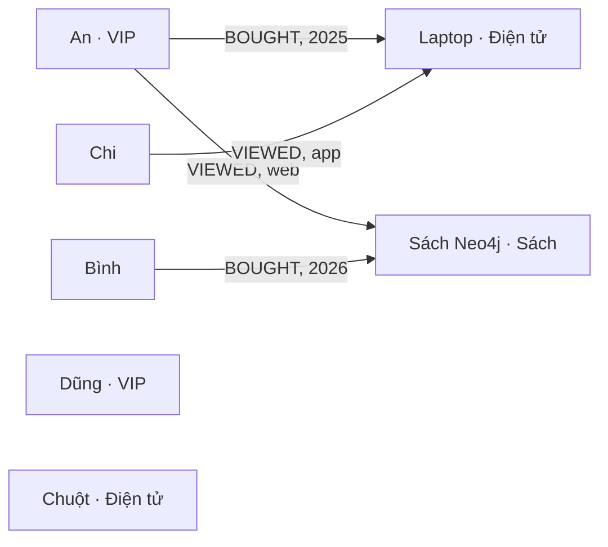

# WHERE to Filter Properties, Labels, Relationship Types, and Existence

In Neo4j, data is organized according to the **property graph** model: nodes have labels and properties, while relationships have types, directions, and their own properties. Cypher's `MATCH` clause finds graph patterns; **`WHERE`** adds conditions to keep only results that satisfy business requirements.

This lesson belongs to the **Read Queries** chapter of the `DATABASE_ENGINE_GRAPH_NEO4J` module, focusing on four common condition groups: **properties**, **node labels**, **relationship types**, and **existence**. Mastering them helps you write accurate connected queries, avoid misfiltering data when traversing paths, and lay the groundwork for index/constraint tuning and integration with the Java Driver or Spring Data Neo4j.

## 1. Learning Outcomes

After this lesson, you will be able to:

1. Use `WHERE` with comparison, logical, string, and list operators on node or relationship properties.
2. Filter nodes by **labels** and by combined conditions on labels and properties.
3. Filter by **relationship type** using `type(r)` and distinguish it from node label filtering.
4. Check whether a property has a value using `IS [NOT] NULL` and check pattern existence using `EXISTS { ... }`.
5. Understand `null` behavior, `WHERE` placement after `OPTIONAL MATCH`, parameterization, and performance evaluation.

## 2. Practice Dataset

Suppose an online store needs to answer questions such as: "Which VIP customers are active?", "Who has bought a product?", "Who has not bought any product?", or "Which customers have viewed electronics products?". We will use two node labels `RQ004Customer` and `RQ004Product`, two relationship types `BOUGHT` and `VIEWED`, and an additional label `RQ004VIP`.

Run the following setup **only in a practice database**. The `key` values and `RQ004...` labels are specific to this lesson to avoid conflicts with other lessons. `MERGE` is suitable for re-running on a clean sample dataset where each key represents a single node and there are no parallel relationships of the same pattern.

```cypher
MERGE (an:RQ004Customer {key: 'c01'})
SET an.name = 'An', an.city = 'Hà Nội',
    an.age = 28, an.active = true,
    an.email = 'an@example.test'
SET an:RQ004VIP

MERGE (binh:RQ004Customer {key: 'c02'})
SET binh.name = 'Bình', binh.city = 'Đà Nẵng',
    binh.age = 34, binh.active = true,
    binh.email = 'binh@example.test'

MERGE (chi:RQ004Customer {key: 'c03'})
SET chi.name = 'Chi', chi.city = 'Hà Nội',
    chi.age = 30, chi.active = false
REMOVE chi.email

MERGE (dung:RQ004Customer {key: 'c04'})
SET dung.name = 'Dũng', dung.city = 'TP. Hồ Chí Minh',
    dung.age = 22, dung.active = true
SET dung:RQ004VIP
REMOVE dung.email

MERGE (laptop:RQ004Product {key: 'p01'})
SET laptop.name = 'Laptop', laptop.category = 'Điện tử',
    laptop.price = 22000000, laptop.available = true

MERGE (book:RQ004Product {key: 'p02'})
SET book.name = 'Sách Neo4j', book.category = 'Sách',
    book.price = 380000, book.available = true

MERGE (mouse:RQ004Product {key: 'p03'})
SET mouse.name = 'Chuột', mouse.category = 'Điện tử',
    mouse.price = 450000, mouse.available = false

MERGE (an)-[b1:BOUGHT]->(laptop)
SET b1.year = 2025, b1.quantity = 1
MERGE (binh)-[b2:BOUGHT]->(book)
SET b2.year = 2026, b2.quantity = 2
MERGE (an)-[v1:VIEWED]->(book)
SET v1.channel = 'web'
MERGE (chi)-[v2:VIEWED]->(laptop)
SET v2.channel = 'app';
```

Data diagram:



| Data Group | Count | Notes |
| --- | ---: | --- |
| `RQ004Customer` | 4 | An, Bình, Chi, Dũng |
| Customers with extra `RQ004VIP` label | 2 | An, Dũng |
| `RQ004Product` | 3 | Laptop, Sách Neo4j, Chuột |
| `BOUGHT` relationships | 2 | An → Laptop, Bình → Sách Neo4j |
| `VIEWED` relationships | 2 | An → Sách Neo4j, Chi → Laptop |
| Customers without `email` property | 2 | Chi, Dũng |

All expected results below assume only this exact dataset exists for the `RQ004...` labels.

## 3. Syntax and Role of WHERE

The most common structure:

```cypher
MATCH (c:RQ004Customer)
WHERE c.active = true
RETURN c.key AS customerKey, c.name AS customer
ORDER BY customerKey;
```

Result: **An, Bình, Dũng**. Chi is excluded because `active = false`.

In Cypher, `WHERE` is a condition clause attached to `MATCH` (or `OPTIONAL MATCH`); it can also follow `WITH` to filter rows passed to the next part of the query. `WHERE` keeps rows for which the predicate evaluates to **`true`**; both `false` and `null` are discarded.

A simple pattern can filter using an inline property map:

```cypher
MATCH (c:RQ004Customer {city: 'Hà Nội'})
RETURN c.name AS customer
ORDER BY customer;
```

Which is equivalent in filtering semantics to:

```cypher
MATCH (c:RQ004Customer)
WHERE c.city = 'Hà Nội'
RETURN c.name AS customer
ORDER BY customer;
```

Both queries find **An and Chi**. For non-equality conditions or combining multiple condition types, `WHERE` is generally clearer.

## 4. Filtering by Node Properties

### 4.1. Equality, Inequality, and Range Comparisons

| Operator | Example | Meaning |
| --- | --- | --- |
| `=` | `c.city = 'Hà Nội'` | Value equals the specified string |
| `<>` | `c.city <> 'Hà Nội'` | Value differs from the specified string |
| `>`, `>=` | `c.age >= 28` | Greater than / greater than or equal to |
| `<`, `<=` | `p.price < 1000000` | Less than / less than or equal to |
| `IN` | `c.age IN [22, 28]` | Equals one of the values in the list |

Example finding active customers aged 25–35:

```cypher
MATCH (c:RQ004Customer)
WHERE c.age >= 25 AND c.age <= 35 AND c.active = true
RETURN c.name AS customer, c.age AS age
ORDER BY age, customer;
```

Result: **An (age 28)** and **Bình (age 34)**. Chi is 30 but inactive; Dũng is 22 and outside the age range.

Example filtering by a list of cities:

```cypher
MATCH (c:RQ004Customer)
WHERE c.city IN ['Hà Nội', 'Đà Nẵng']
RETURN c.name AS customer, c.city AS city
ORDER BY c.key;
```

Result: **An, Bình, Chi**.

> **Data types and case sensitivity:** `c.age = 28` differs from `c.age = '28'` because one side is a number and the other is a string. Standard string comparisons are case-sensitive and sensitive to Vietnamese diacritics. Property name `city` also differs from `City`.

### 4.2. Combining Conditions with AND, OR, NOT

```cypher
MATCH (c:RQ004Customer)
WHERE c.active = true
  AND (c.city = 'Hà Nội' OR c.city = 'Đà Nẵng')
RETURN c.name AS customer
ORDER BY c.key;
```

Result: **An and Bình**. Parentheses clarify intent: the customer must be active and in one of the two cities. For complex expressions, use parentheses instead of relying on the reader remembering the precedence of `NOT`, `AND`, and `OR`.

Negation example:

```cypher
MATCH (c:RQ004Customer)
WHERE NOT (c.city = 'Hà Nội')
RETURN c.name AS customer
ORDER BY c.key;
```

Result: **Bình and Dũng**. If `city` does not exist, `NOT (c.city = 'Hà Nội')` evaluates to `null` instead of automatically becoming `true`; see the null handling section below.

### 4.3. String Filtering and Expressions

```cypher
MATCH (c:RQ004Customer)
WHERE c.name STARTS WITH 'A'
RETURN c.name AS customer;
```

Result: **An**. Common operators:

| Syntax | Example | Interpretation |
| --- | --- | --- |
| `STARTS WITH` | `c.name STARTS WITH 'A'` | Begins with string |
| `ENDS WITH` | `c.name ENDS WITH 'nh'` | Ends with string |
| `CONTAINS` | `p.name CONTAINS 'Neo4j'` | Contains substring |
| `=~` | `c.name =~ 'A.*'` | Matches regular expression across the entire string |

To search names case-insensitively, you can write:

```cypher
MATCH (c:RQ004Customer)
WHERE toLower(c.name) = toLower($name)
RETURN c.key AS customerKey, c.name AS customer;
```

With `name = 'an'`, the result is An. However, wrapping a property in a function like `toLower(c.name)` can restrict the use of a standard range index for direct lookups. On large systems, consider a normalized search property with an appropriate index; case folding alone does not resolve all Vietnamese diacritic rules.

## 5. Filtering by Node Labels

**Labels** categorize nodes; **properties** store values on nodes. A node can carry multiple labels. In the sample dataset, An and Dũng have both `RQ004Customer` and `RQ004VIP`.

### 5.1. Using Labels Directly in MATCH

```cypher
MATCH (c:RQ004Customer:RQ004VIP)
RETURN c.name AS vipCustomer
ORDER BY c.key;
```

Result: **An, Dũng**. A two-label pattern requires the node to carry **both labels**.

### 5.2. Using Label Predicates in WHERE

```cypher
MATCH (c:RQ004Customer)
WHERE c:RQ004VIP AND c.active = true
RETURN c.name AS activeVip
ORDER BY c.key;
```

Result: **An, Dũng**. The expression `c:RQ004VIP` checks whether node `c` has the `RQ004VIP` label. It is not a comparison against a property named `RQ004VIP`.

Find active customers who do **not** carry the VIP label:

```cypher
MATCH (c:RQ004Customer)
WHERE NOT c:RQ004VIP AND c.active = true
RETURN c.name AS regularActiveCustomer;
```

Result: **Bình**.

| Need | Suitable Syntax |
| --- | --- |
| Find only VIP customers | `MATCH (c:RQ004Customer:RQ004VIP)` |
| Find customers, then filter VIP with other conditions | `WHERE c:RQ004VIP AND c.active = true` |
| Filter non-VIP customers | `WHERE NOT c:RQ004VIP` |
| Retrieve label names for display/inspection | `RETURN labels(c) AS labels` |

In dynamic queries, never concatenate unchecked user-provided label names directly into Cypher strings. Depending on the Neo4j version, dynamic label syntax varies; if your application uses flexible label names, check the syntax supported by your deployed version and validate against an allowlist of labels.

## 6. Filtering by Relationship Type and Properties

A relationship type such as `BOUGHT` or `VIEWED` **is not a node label**. Normally, you restrict the type directly in the pattern:

```cypher
MATCH (c:RQ004Customer)-[r:BOUGHT]->(p:RQ004Product)
RETURN c.name AS customer, p.name AS product, r.year AS year
ORDER BY c.key;
```

Result:

| customer | product | year |
| --- | --- | ---: |
| An | Laptop | 2025 |
| Bình | Sách Neo4j | 2026 |

### 6.1. Using type(r) in WHERE

Once variable `r` is bound to the relationship, `type(r)` returns the relationship type name as a string:

```cypher
MATCH (c:RQ004Customer)-[r]->(p:RQ004Product)
WHERE type(r) = 'VIEWED'
RETURN c.name AS customer, p.name AS product, r.channel AS channel
ORDER BY c.key;
```

Result:

| customer | product | channel |
| --- | --- | --- |
| An | Sách Neo4j | web |
| Chi | Laptop | app |

Filtering multiple types at once with `IN`:

```cypher
MATCH (c:RQ004Customer)-[r]->(p:RQ004Product)
WHERE type(r) IN ['BOUGHT', 'VIEWED']
  AND p.price > 1000000
RETURN c.name AS customer,
       type(r) AS action,
       p.name AS product
ORDER BY c.key, action;
```

Result: **An – BOUGHT – Laptop** and **Chi – VIEWED – Laptop**. Sách Neo4j is excluded because its price is under one million; Chuột has no relationships with any customer yet.

**Which approach to choose?** When the exact relationship type is known, `-[r:BOUGHT]->` is usually easier to read and gives the optimizer more information. When the type condition depends on an expression or a set of types, `type(r)` is useful; however, do not use it when a simple fixed-type pattern already expresses your intent.

### 6.2. Combining Relationship Properties with Node Properties

```cypher
MATCH (c:RQ004Customer)-[r:BOUGHT]->(p:RQ004Product)
WHERE r.year >= 2026 AND p.available = true
RETURN c.name AS customer,
       p.name AS product,
       r.quantity AS quantity,
       r.year AS year;
```

Result: **Bình – Sách Neo4j – quantity 2 – year 2026**. `r.year` and `r.quantity` are relationship properties; `p.available` is a product node property.

**Relationship direction still matters:** `(c)-[r:BOUGHT]->(p)` searches for purchases going from customer to product. Writing the reverse `(c)<-[r:BOUGHT]-(p)` on this dataset returns no results. `WHERE` conditions never automatically flip the direction of `MATCH`.

## 7. Checking Property Existence

Not every node has the same set of properties. For instance, Chi and Dũng do not have `email`. Accessing a missing property in Cypher returns `null`.

Find customers **with an email**:

```cypher
MATCH (c:RQ004Customer)
WHERE c.email IS NOT NULL
RETURN c.name AS customer, c.email AS email
ORDER BY c.key;
```

Result: **An** and **Bình**.

Find customers **missing an email**:

```cypher
MATCH (c:RQ004Customer)
WHERE c.email IS NULL
RETURN c.name AS customer
ORDER BY c.key;
```

Result: **Chi** and **Dũng**.

| Expression | When `email` exists | When `email` does not exist |
| --- | --- | --- |
| `c.email IS NOT NULL` | `true` | `false` |
| `c.email IS NULL` | `false` | `true` |
| `c.email = 'an@example.test'` | `true` or `false` depending on value | `null` |
| `c.email <> 'an@example.test'` | `true` or `false` depending on value | `null` |

**Never use** `c.email = null` or `c.email <> null` to check for missing data. Those comparisons do not evaluate to `true` when the property is missing. For node/relationship properties, prefer `IS NULL` and `IS NOT NULL`. The older `exists(n.property)` function syntax from legacy Cypher docs has been replaced/removed in modern versions; `IS NOT NULL` is the modern, explicit way.

If you need a default display value, you can use `coalesce`:

```cypher
MATCH (c:RQ004Customer)
RETURN c.name AS customer,
       coalesce(c.email, 'Not provided') AS emailDisplay
ORDER BY c.key;
```

Note that `coalesce` does not add the missing property to stored data; it only picks a fallback value for the returned expression.

### 7.1. Three-Valued Logic

In Cypher, boolean expressions can evaluate to `true`, `false`, or `null`. For example:

```cypher
MATCH (c:RQ004Customer)
WHERE NOT (c.email = 'an@example.test')
RETURN c.name AS customer
ORDER BY c.key;
```

The result is only **Bình**. An is excluded because her email matches; Chi and Dũng are also excluded because their email is missing, the comparison returns `null`, and `NOT null` is still `null`.

If you want "does not have that email, **including having no email at all**", state it explicitly:

```cypher
MATCH (c:RQ004Customer)
WHERE c.email IS NULL
   OR c.email <> 'an@example.test'
RETURN c.name AS customer
ORDER BY c.key;
```

Result: **Bình, Chi, Dũng**.

## 8. Checking Relationship Pattern Existence with EXISTS

Checking a property with `IS NOT NULL` and checking a graph pattern with **`EXISTS { ... }`** serve two different needs. `EXISTS` returns true/false depending on whether at least one matching row exists in the subquery.

### 8.1. Customers Who Bought at Least One Product

```cypher
MATCH (c:RQ004Customer)
WHERE EXISTS {
  MATCH (c)-[:BOUGHT]->(:RQ004Product)
}
RETURN c.name AS buyer
ORDER BY c.key;
```

Result: **An, Bình**. Variable `c` inside `EXISTS { ... }` references **the same customer node** from the outer query, checking existence for each specific customer.

`EXISTS` does not need to return each purchased product: as soon as at least one pattern matches, the predicate is `true`. This avoids row multiplication when a customer buys multiple products and you only need the customer list.

### 8.2. Customers Who Have Never Bought Any Product

```cypher
MATCH (c:RQ004Customer)
WHERE NOT EXISTS {
  MATCH (c)-[:BOUGHT]->(:RQ004Product)
}
RETURN c.name AS nonBuyer
ORDER BY c.key;
```

Result: **Chi, Dũng**. Chi has a `VIEWED` relationship but no `BOUGHT`; Dũng has no product relationships yet.

### 8.3. Pattern Existence with Conditions on the Target Node

Find customers who **viewed at least one product in the `Điện tử` category**:

```cypher
MATCH (c:RQ004Customer)
WHERE EXISTS {
  MATCH (c)-[:VIEWED]->(p:RQ004Product)
  WHERE p.category = 'Điện tử'
}
RETURN c.name AS viewer
ORDER BY c.key;
```

Result: **Chi**. An viewed Sách Neo4j, which belongs to the `Sách` category.

### 8.4. Combining Labels, Properties, and EXISTS

Find **VIP**, **active** customers who **bought a product costing at least 1,000,000**:

```cypher
MATCH (c:RQ004Customer)
WHERE c:RQ004VIP
  AND c.active = true
  AND EXISTS {
    MATCH (c)-[:BOUGHT]->(p:RQ004Product)
    WHERE p.price >= 1000000
  }
RETURN c.name AS vipBuyer;
```

Result: **An**. Dũng is an active VIP but has not made any purchases.

### 8.5. Distinguishing EXISTS, MATCH, and OPTIONAL MATCH

| Business Intent | Approach |
| --- | --- |
| Only need to know if a customer **has** any purchase relationship | `WHERE EXISTS { MATCH (c)-[:BOUGHT]->(...) }` |
| Only get customers **without** any purchase relationship | `WHERE NOT EXISTS { MATCH (c)-[:BOUGHT]->(...) }` |
| Need to return **every product** a customer bought | `MATCH (c)-[:BOUGHT]->(p) RETURN ...` |
| Need to keep the customer **even with no purchases** | `OPTIONAL MATCH (c)-[:BOUGHT]->(p)` |
| Need to check that the **`email` property** has a value | `WHERE c.email IS NOT NULL` |

Do not write a query returning all relationships followed by `DISTINCT` to simulate an existence check when the question is fundamentally yes/no.

## 9. WHERE Placement with OPTIONAL MATCH

`OPTIONAL MATCH` preserves existing rows when the relationship pattern fails to match and assigns `null` to unmatched variables. **`WHERE` placed immediately after `OPTIONAL MATCH` is part of the optional join condition**, so pay attention to the difference between filtering the optional pattern and filtering the resulting rows.

### 9.1. Keep All Customers, Only Collect High-Priced Purchases

```cypher
MATCH (c:RQ004Customer)
OPTIONAL MATCH (c)-[:BOUGHT]->(p:RQ004Product)
WHERE p.price >= 1000000
RETURN c.name AS customer,
       collect(p.name) AS expensivePurchases
ORDER BY c.key;
```

Result:

| customer | expensivePurchases |
| --- | --- |
| An | `['Laptop']` |
| Bình | `[]` |
| Chi | `[]` |
| Dũng | `[]` |

The price condition belongs to `OPTIONAL MATCH`. For Bình, Sách Neo4j does not meet the price threshold so the optional match fails, yet **Bình's customer row is preserved**. `collect` ignores `null` values, so an empty list is returned.

### 9.2. Filter Rows After OPTIONAL MATCH

```cypher
MATCH (c:RQ004Customer)
OPTIONAL MATCH (c)-[:BOUGHT]->(p:RQ004Product)
WITH c, p
WHERE p.price >= 1000000
RETURN c.name AS customer, p.name AS product;
```

The result shrinks to **only An – Laptop**. Here `WHERE` comes **after `WITH`**, so it filters the already-joined rows. Rows with `p = null` (Chi, Dũng) and the row with a lower-priced product (Bình) are all filtered out.

**Practical rule:** when you want to preserve the root node even if no qualifying relationship exists, attach `WHERE` directly to the corresponding `OPTIONAL MATCH`; when you want to discard non-matching result rows altogether, filter in a later stage such as `WITH ... WHERE`.

## 10. Parameterized Queries in Applications

In real applications, filter criteria come from search boxes, APIs, or configuration. Parameters `$...` separate the query statement from input values and avoid direct Cypher string concatenation.

```cypher
MATCH (c:RQ004Customer)
WHERE c.city = $city
  AND c.active = $active
  AND c.age >= $minAge
RETURN c.key AS customerKey, c.name AS customer
ORDER BY customerKey;
```

With parameters `city = 'Hà Nội'`, `active = true`, and `minAge = 25`, the result is **An**.

Java Driver example (assuming `driver` is configured, using a Driver version supporting `executeRead`):

```java
import java.util.List;
import java.util.Map;
import org.neo4j.driver.Driver;

public class CustomerSearch {
    public static List<String> findActiveNames(Driver driver, String city) {
        try (var session = driver.session()) {
            return session.executeRead(tx ->
                tx.run("""
                    MATCH (c:RQ004Customer)
                    WHERE c.city = $city AND c.active = true
                    RETURN c.name AS name
                    ORDER BY c.key
                    """, Map.of("city", city))
                  .list(record -> record.get("name").asString())
            );
        }
    }
}
```

Calling `findActiveNames(driver, "Hà Nội")` returns `[An]`. The same principle applies to `@Query` methods with parameter binding in Spring Data Neo4j. Property values and parameters should match their expected data types: `$minAge` as a number, `$active` as a boolean.

## 11. Checking Performance When Filtering with WHERE

`WHERE` conditions are not necessarily evaluated strictly left-to-right as written in the query text; the **Cypher planner** can choose an optimal plan based on data statistics, indexes, and query shape. Never assume the first written predicate always executes first.

On a test database, you can consider indexing frequently queried properties:

```cypher
CREATE RANGE INDEX rq004_customer_city_idx IF NOT EXISTS
FOR (c:RQ004Customer) ON (c.city);
```

If each customer has a unique `key`, the following constraint enforces uniqueness and aids lookups:

```cypher
CREATE CONSTRAINT rq004_customer_key_unique IF NOT EXISTS
FOR (c:RQ004Customer) REQUIRE c.key IS UNIQUE;
```

The constraint will fail if existing nodes already have duplicate `key` values. Depending on Neo4j version and index type, not all string predicates or function calls on properties use indexes in the same way.

Inspect the plan **without executing** the query:

```cypher
EXPLAIN
MATCH (c:RQ004Customer)
WHERE c.city = 'Hà Nội' AND c.active = true
RETURN c.key, c.name;
```

When you want to inspect actual row counts and data accesses, use `PROFILE` (which **executes** the query):

```cypher
PROFILE
MATCH (c:RQ004Customer)
WHERE c.city = 'Hà Nội' AND c.active = true
RETURN c.key, c.name;
```

Things to check:

1. Does the query start from a label and/or property with suitable selectivity?
2. Does it perform an index seek, a label scan, or an all-nodes scan? The actual plan is decided by the planner.
3. Do the filter conditions reduce row counts before large relationship expansions?
4. Do you only need existence or all relationships? `EXISTS { ... }` usually expresses yes/no checks better.
5. Are `null` values and relationship directions handled semantically correctly? A fast plan is still wrong if it filters out the wrong data.

Indexes and constraints improve data access efficiency, but they **cannot fix** an incorrect `WHERE` condition or a disconnected relationship pattern.

## 12. Common Mistakes

| Symptom | Common Cause | How to Fix |
| --- | --- | --- |
| Searching for VIP customers returns nobody | Mistook `RQ004VIP` for property `c.RQ004VIP` instead of a label. | Use `WHERE c:RQ004VIP` or a multi-label pattern. |
| Searching for buyers also returns viewers | Didn't filter `type(r)` or used an untyped relationship pattern. | Use `-[r:BOUGHT]->` or `WHERE type(r) = 'BOUGHT'`. |
| Cannot find customers missing email | Wrote `c.email = null`. | Use `c.email IS NULL`. |
| `NOT (c.email = '...')` drops people without email | `NOT null` is still `null`. | Add `c.email IS NULL OR ...` if missing values should be included. |
| Wanted to keep all customers, but only buyers returned | `WHERE` was placed after `WITH`, filtering out unmatched rows. | Attach the condition to `OPTIONAL MATCH` or restructure the intent. |
| Duplicate customers returned for multiple purchases | Used `MATCH` returning one row per relationship. | Use `EXISTS { ... }` for existence checks, or `DISTINCT` when deduplication is genuinely needed. |
| Slow query after applying a function to a property | Function expressions can prevent standard index usage. | Check `PROFILE`; consider a normalized property and an appropriate index. |
| Empty result despite known relationships | Wrong `->`/`<-` direction, relationship type, or string case. | Verify the `MATCH` pattern and stored type/direction. |

## 13. Practice Exercises

Use the dataset from Section 2 and predict the row count before checking the answers.

**Exercise 1.** Find active customers aged 25 or older living in Hà Nội or Đà Nẵng.

**Exercise 2.** Find customers who carry the `RQ004VIP` label but have not bought any product.

**Exercise 3.** Find customers who performed `BOUGHT` or `VIEWED` on a product in the `Điện tử` category. Return customer name, action type, and product name.

**Exercise 4.** Find customers who do not have an `email` yet but **have viewed** at least one product.

**Exercise 5.** Write a query returning **all customers** and names of purchased products priced at 1,000,000 or more, including customers with no qualifying products.

**Exercise 6.** Analyze why the following query does not return Chi and Dũng:

```cypher
MATCH (c:RQ004Customer)
WHERE c.email <> 'an@example.test'
RETURN c.name;
```

### Reference Answers

**Exercise 1**

```cypher
MATCH (c:RQ004Customer)
WHERE c.active = true
  AND c.age >= 25
  AND c.city IN ['Hà Nội', 'Đà Nẵng']
RETURN c.name AS customer
ORDER BY c.key;
```

Result: **An and Bình**.

**Exercise 2**

```cypher
MATCH (c:RQ004Customer)
WHERE c:RQ004VIP
  AND NOT EXISTS {
    MATCH (c)-[:BOUGHT]->(:RQ004Product)
  }
RETURN c.name AS vipWithoutPurchase;
```

Result: **Dũng**.

**Exercise 3**

```cypher
MATCH (c:RQ004Customer)-[r]->(p:RQ004Product)
WHERE type(r) IN ['BOUGHT', 'VIEWED']
  AND p.category = 'Điện tử'
RETURN c.name AS customer,
       type(r) AS action,
       p.name AS product
ORDER BY c.key, action;
```

Result: **An – BOUGHT – Laptop** and **Chi – VIEWED – Laptop**.

**Exercise 4**

```cypher
MATCH (c:RQ004Customer)
WHERE c.email IS NULL
  AND EXISTS {
    MATCH (c)-[:VIEWED]->(:RQ004Product)
  }
RETURN c.name AS viewerWithoutEmail;
```

Result: **Chi**.

**Exercise 5**

```cypher
MATCH (c:RQ004Customer)
OPTIONAL MATCH (c)-[:BOUGHT]->(p:RQ004Product)
WHERE p.price >= 1000000
RETURN c.name AS customer,
       collect(p.name) AS products
ORDER BY c.key;
```

Result: **An = [Laptop]**, **Bình = []**, **Chi = []**, **Dũng = []**.

**Exercise 6**

For Chi and Dũng, `email` is missing so `c.email` is `null`. The expression `null <> 'an@example.test'` evaluates to `null`, not `true`; therefore `WHERE` excludes both rows. To include customers without an email:

```cypher
MATCH (c:RQ004Customer)
WHERE c.email IS NULL OR c.email <> 'an@example.test'
RETURN c.name AS customer
ORDER BY c.key;
```

Result: **Bình, Chi, Dũng**.

## 14. Key Takeaways

- `WHERE` adds predicates to `MATCH`, `OPTIONAL MATCH`, or filters rows after `WITH`; only expressions evaluating to `true` preserve results.
- Filter **properties** using `=`, `<>`, `>=`, `IN`, logical, and string operators; pay attention to data types and case sensitivity.
- Filter **node labels** with `n:Label` and filter **relationship types** with `-[r:TYPE]->` or `type(r)`.
- Check **property presence** with `IS NOT NULL`; check **relationship pattern existence** with `EXISTS { MATCH ... }` and negate with `NOT EXISTS { ... }`.
- Understand `null` and the difference between `OPTIONAL MATCH ... WHERE` and `WITH ... WHERE` to avoid accidentally dropping root nodes.
- Parameterize input values, design appropriate indexes, and verify with `EXPLAIN`/`PROFILE` before tuning Neo4j queries in Java/Spring applications.
