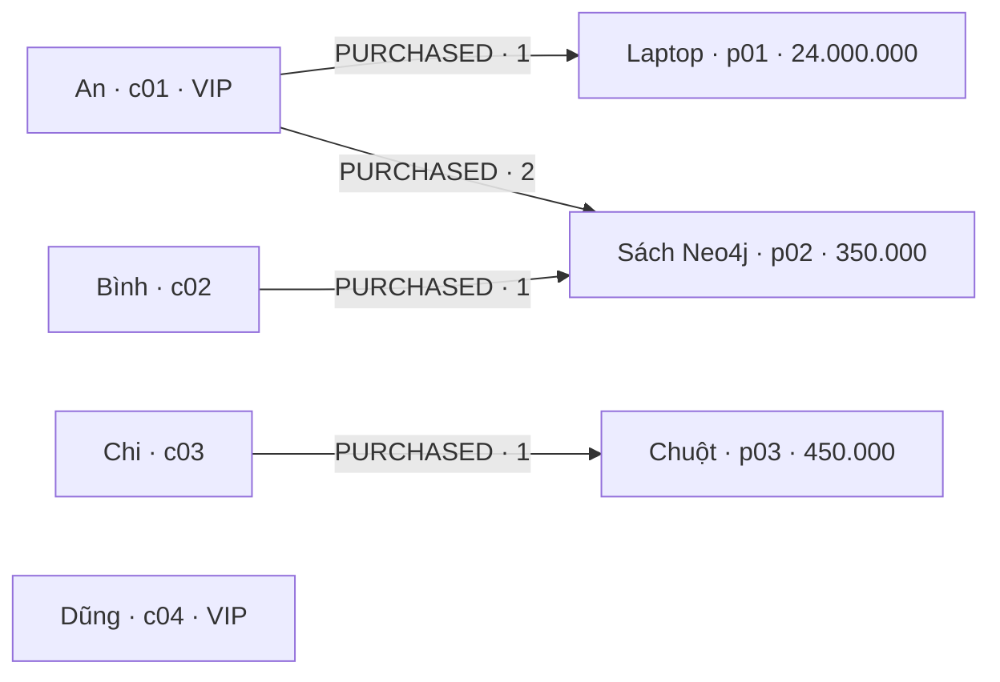

# RETURN to Select Fields, Return Entities, and Assign Aliases

In **Neo4j**, data is represented as a **property graph** consisting of nodes, relationships, and properties. The `MATCH` clause in **Cypher** identifies matching graph patterns, while **`RETURN`** determines which data from those patterns is output in the query result. Understanding `RETURN` lets you shape output data to fit your needs: selecting a few properties, returning whole nodes or relationships, representing paths, assigning aliases, deduplicating, and aggregating.

This lesson belongs to the **Read Queries** chapter of the `DATABASE_ENGINE_GRAPH_NEO4J` module. The examples below connect data modeling, relationship/path queries, and Java Driver or Spring Data Neo4j applications. The data-creation block is for hands-on practice; the focus of this lesson is **reading and formatting results**, not write operations.

## 1. Learning Outcomes

After this lesson, you will be able to:

1. Distinguish returning **properties**, **expressions**, **nodes**, **relationships**, **paths**, **maps**, and **lists**.
2. Specify columns and aliases with `RETURN ... AS ...`; understand how aliases are used in `ORDER BY` and `WITH` steps.
3. Use `RETURN DISTINCT` to deduplicate semantically and avoid confusing row counts with entity counts.
4. Combine `RETURN` with `ORDER BY`, `SKIP`, `LIMIT`, `count`, `sum`, and `collect`.
5. Choose the appropriate return format for APIs, UIs, or the Java Driver and verify results on the sample dataset.

## 2. Self-Contained Practice Dataset

Suppose a sales system stores customers, products, and purchases. To avoid conflicts with other lessons, the examples use dedicated labels `RQ005Customer` and `RQ005Product`, and a `key` property. Run the following setup **in a practice database**. The `MERGE`/`SET` commands create or update data; they are not part of the `RETURN` queries themselves.

```cypher
MERGE (an:RQ005Customer {key: 'c01'})
SET an.name = 'An', an.city = 'Hà Nội',
    an.active = true, an.email = 'an@example.test'
SET an:RQ005VIP

MERGE (binh:RQ005Customer {key: 'c02'})
SET binh.name = 'Bình', binh.city = 'Đà Nẵng',
    binh.active = true, binh.email = 'binh@example.test'

MERGE (chi:RQ005Customer {key: 'c03'})
SET chi.name = 'Chi', chi.city = 'Hà Nội',
    chi.active = false
REMOVE chi.email

MERGE (dung:RQ005Customer {key: 'c04'})
SET dung.name = 'Dũng', dung.city = 'TP. Hồ Chí Minh',
    dung.active = true
SET dung:RQ005VIP
REMOVE dung.email

MERGE (laptop:RQ005Product {key: 'p01'})
SET laptop.name = 'Laptop', laptop.price = 24000000,
    laptop.category = 'Điện tử'

MERGE (book:RQ005Product {key: 'p02'})
SET book.name = 'Sách Neo4j', book.price = 350000,
    book.category = 'Sách'

MERGE (mouse:RQ005Product {key: 'p03'})
SET mouse.name = 'Chuột', mouse.price = 450000,
    mouse.category = 'Điện tử'

MERGE (an)-[r1:PURCHASED]->(laptop)
SET r1.quantity = 1, r1.year = 2026
MERGE (an)-[r2:PURCHASED]->(book)
SET r2.quantity = 2, r2.year = 2026
MERGE (binh)-[r3:PURCHASED]->(book)
SET r3.quantity = 1, r3.year = 2025
MERGE (chi)-[r4:PURCHASED]->(mouse)
SET r4.quantity = 1, r4.year = 2026;
```

The snippet above assumes nodes have distinct `key` values and each customer–product pair has only one `PURCHASED` relationship in the sample data. In a real system, a customer may buy the same product multiple times; in that case, model an Order/Transaction node or an explicit transaction identifier rather than treating each customer–product pair as a single purchase.

Diagram:



Sample dataset summary:

| Dataset | Count | Details |
| --- | ---: | --- |
| `RQ005Customer` nodes | 4 | An, Bình, Chi, Dũng |
| `RQ005Product` nodes | 3 | Laptop, Sách Neo4j, Chuột |
| `PURCHASED` relationships | 4 | An bought 2 products; Bình and Chi bought 1 each |
| Customers with no purchases | 1 | Dũng |
| Customers without `email` property | 2 | Chi, Dũng |

All subsequent example outputs assume only these sample records exist under the `RQ005...` labels.

## 3. Basic Structure of RETURN

```cypher
MATCH (c:RQ005Customer)
RETURN c.name;
```

`MATCH` binds variable `c` to each matching customer node. `RETURN c.name` retrieves the **`name` property value** of each node, so the result has one column defaulted to `c.name` and four rows. Without `ORDER BY`, **row order is not guaranteed**.

| Syntax | Returned Data | Application Example |
| --- | --- | --- |
| `RETURN c.name` | Property value, such as a string | List of customer names |
| `RETURN c.key, c.name` | Multiple value columns | List of keys and names |
| `RETURN c` | Neo4j node object | Processing labels and all node properties |
| `RETURN r` | Relationship object | Inspecting type, direction, and properties of the relationship |
| `RETURN path` | Path object | Visualizing node–relationship chains |
| `RETURN c { .key, .name }` | Map built from node properties | Formatting API response structures |
| `RETURN count(c)` | Aggregated value | Counting customers |

A `RETURN` clause does not discover relationships or data on its own: it only outputs variables and expressions already in scope at that point. A typical query follows the form `MATCH ... WHERE ... RETURN ... ORDER BY ... LIMIT ...`.

## 4. Selecting One or More Properties

### 4.1. Selecting Only the Needed Fields

```cypher
MATCH (c:RQ005Customer)
RETURN c.key, c.name, c.city
ORDER BY c.key;
```

With the sample data, the result is:

| c.key | c.name | c.city |
| --- | --- | --- |
| c01 | An | Hà Nội |
| c02 | Bình | Đà Nẵng |
| c03 | Chi | Hà Nội |
| c04 | Dũng | TP. Hồ Chí Minh |

This is **scalar/value projection**: each property becomes a column. When building APIs, select only the fields the application genuinely needs to avoid transferring redundant data, especially if nodes contain large or sensitive properties.

### 4.2. Naming Columns with AS

```cypher
MATCH (c:RQ005Customer)
RETURN c.key AS customerId,
       c.name AS customerName,
       c.city AS city
ORDER BY customerId;
```

The result still has four rows as in Section 4.1, but the column names are now `customerId`, `customerName`, and `city`. The **`AS`** keyword assigns an *alias* to the output expression without renaming the property stored in the graph.

You should use aliases when:

- Internal property names differ from display names, e.g., `c.key AS customerId`.
- The query retrieves similarly named properties from multiple nodes, e.g., `c.name AS customerName` and `p.name AS productName`.
- Returning an expression or aggregation result, e.g., `count(r) AS purchaseCount`.
- A Java application calls `record.get("customerName")` to read the exact column.

### 4.3. Retrieving Properties from Multiple Connected Entities

```cypher
MATCH (c:RQ005Customer)-[r:PURCHASED]->(p:RQ005Product)
RETURN c.name AS customer,
       p.name AS product,
       r.quantity AS quantity,
       p.price AS unitPrice
ORDER BY c.key, p.key;
```

Result:

| customer | product | quantity | unitPrice |
| --- | --- | ---: | ---: |
| An | Laptop | 1 | 24000000 |
| An | Sách Neo4j | 2 | 350000 |
| Bình | Sách Neo4j | 1 | 350000 |
| Chi | Chuột | 1 | 450000 |

**Why does An appear in two rows?** The `MATCH` pattern finds two distinct purchase relationships for An, so `RETURN` receives two input rows. The repeated customer name here reflects valid connected data, not Cypher duplicating the An node.

## 5. Returning Whole Nodes, Relationships, or Paths

### 5.1. Returning a Node

```cypher
MATCH (c:RQ005Customer {key: 'c01'})
RETURN c AS customerNode;
```

The `customerNode` column holds **a Neo4j node value**: its labels (e.g., `RQ005Customer` and `RQ005VIP` for An) along with properties `key`, `name`, `city`, `active`, and `email`. This is not merely a name string or a custom-built map. Exact presentation depends on Neo4j Browser, the API client, or the driver.

A returned node does not automatically include all its surrounding relationships in the payload. If the application needs relationships, you must query and return them explicitly.

### 5.2. Returning a Relationship

```cypher
MATCH (c:RQ005Customer {key: 'c01'})
      -[r:PURCHASED]->
      (p:RQ005Product {key: 'p01'})
RETURN r AS purchaseRelationship;
```

The `purchaseRelationship` column holds a **relationship entity** of type `PURCHASED`, starting at An, ending at Laptop, with properties `quantity = 1` and `year = 2026`.

If you only need to describe the relationship as fields usable in a table or JSON, query them directly:

```cypher
MATCH (c:RQ005Customer)-[r:PURCHASED]->(p:RQ005Product)
RETURN c.key AS customerId,
       p.key AS productId,
       type(r) AS relationshipType,
       r.quantity AS quantity
ORDER BY customerId, productId;
```

`type(r)` returns the relationship type name as a string. `r.quantity` is just a property value, whereas `r` is the relationship object.

### 5.3. Returning Both Nodes and Relationships

```cypher
MATCH (c:RQ005Customer {key: 'c01'})-[r:PURCHASED]->(p:RQ005Product)
RETURN c AS customerNode, r AS purchaseRelationship, p AS productNode
ORDER BY p.key;
```

The query produces **two rows**: An–purchase relationship–Laptop and An–purchase relationship–Sách Neo4j. All three columns retain their respective graph data types. This is useful when a client needs to inspect connection structure.

### 5.4. Returning a Path

```cypher
MATCH path = (c:RQ005Customer {key: 'c01'})
             -[:PURCHASED]->
             (p:RQ005Product)
RETURN path AS purchasePath;
```

Variable `path` represents a **path** made up of the matched nodes and relationships. With the sample data, An has two one-hop paths: An → Laptop and An → Sách Neo4j.

To inspect path components as separate data structures:

```cypher
MATCH path = (c:RQ005Customer {key: 'c01'})
             -[:PURCHASED]->
             (p:RQ005Product)
RETURN nodes(path) AS pathNodes,
       relationships(path) AS pathRelationships
ORDER BY p.key;
```

`nodes(path)` is the list of nodes along the path; `relationships(path)` is the list of relationships. From these one-hop examples, you can scale up to multi-hop pathfinding problems in graphs.

> **Distinction:** `RETURN c` returns a node; `RETURN properties(c)` returns a map of the node's properties; `RETURN c.name` returns a string value. They may display similar information, yet **their data types and client-side handling differ**.

## 6. RETURN with Expressions, Functions, and null Values

### 6.1. Computed Expressions

`RETURN` accepts expressions, not just existing properties:

```cypher
MATCH (c:RQ005Customer)-[r:PURCHASED]->(p:RQ005Product)
RETURN c.name AS customer,
       p.name AS product,
       r.quantity AS quantity,
       p.price AS unitPrice,
       r.quantity * p.price AS lineTotal
ORDER BY c.key, p.key;
```

The `lineTotal` column values are:

| customer | product | lineTotal |
| --- | --- | ---: |
| An | Laptop | 24000000 |
| An | Sách Neo4j | 700000 |
| Bình | Sách Neo4j | 350000 |
| Chi | Chuột | 450000 |

`lineTotal` is a **computed column**, not a `lineTotal` property persisted on the relationship or node.

### 6.2. Functions on Nodes and Relationships

```cypher
MATCH (c:RQ005Customer {key: 'c01'})-[r:PURCHASED]->(p:RQ005Product)
RETURN labels(c) AS customerLabels,
       properties(p) AS productProperties,
       type(r) AS relationshipType,
       properties(r) AS relationshipProperties
ORDER BY p.key;
```

Meaning:

| Expression | Result Type | Purpose |
| --- | --- | --- |
| `labels(c)` | List of label strings | Checks which labels a node carries |
| `properties(p)` | Property map | Retrieves all product properties as a map |
| `type(r)` | String | Retrieves the relationship type |
| `properties(r)` | Property map | Retrieves `quantity`, `year` of the relationship |
| `elementId(c)` | Element identifier string provided by Neo4j | Internal lookup/reference tool scoped to version and system |

For durable business identifiers, use `c.key` or a dedicated identifier property with an appropriate constraint; **never treat `elementId()` as a long-term business key**.

### 6.3. Missing Property Values

In the sample data, Chi and Dũng do not have `email`. If you query:

```cypher
MATCH (c:RQ005Customer)
RETURN c.key AS customerId,
       c.name AS customer,
       c.email AS email
ORDER BY customerId;
```

then the `email` column for Chi and Dũng will be `null`. To substitute a fallback for **display**:

```cypher
MATCH (c:RQ005Customer)
RETURN c.name AS customer,
       coalesce(c.email, 'Not provided') AS emailDisplay
ORDER BY c.key;
```

`coalesce` returns the first non-`null` argument. In this query, it displays `'Not provided'` for Chi and Dũng **without writing any property** to the graph.

## 7. Map Projection: Selecting Fields into a Structure

When an API needs to return an **object with named fields** rather than separate flat columns, Cypher supports *map projection*:

```cypher
MATCH (c:RQ005Customer {key: 'c01'})
RETURN c { .key, .name, .city } AS customer;
```

The result is a map equivalent to:

```json
{
  "key": "c01",
  "name": "An",
  "city": "Hà Nội"
}
```

In `c { .key, .name, .city }`, the selectors `.key`, `.name`, and `.city` extract the corresponding fields from **node `c`**. The result **is a map**, not a node.

You can also add new keys using expressions:

```cypher
MATCH (p:RQ005Product {key: 'p02'})
RETURN p {
  .key,
  .name,
  .price,
  priceAfterTenPercentDiscount: p.price * 0.9
} AS productView;
```

The returned map contains `key`, `name`, `price`, and `priceAfterTenPercentDiscount`. The calculation is strictly for formatting the result and does not update the product price in the database. Note that multiplying by `0.9` may yield a floating-point number; in financial domains, define appropriate rounding rules, data types, and currency units.

If you intentionally want **all properties** plus a computed field, use `.*`:

```cypher
MATCH (p:RQ005Product {key: 'p02'})
RETURN p { .*, displayName: p.name + ' (' + p.category + ')' } AS productView;
```

`.*` includes all existing properties in the map. When building public APIs, prefer **explicit field selection** over dumping all properties by default to avoid leaking unintended data when the schema evolves.

### 7.1. Nested Maps for Orders or Connection Records

```cypher
MATCH (c:RQ005Customer {key: 'c01'})-[r:PURCHASED]->(p:RQ005Product)
RETURN {
  customer: c { .key, .name },
  product: p { .key, .name, .price },
  quantity: r.quantity,
  lineTotal: r.quantity * p.price
} AS purchase
ORDER BY p.key;
```

Each row contains a `purchase` map combining buyer info, product info, and line total. An produces **two rows** because she has two purchase relationships. Nested maps are often convenient to serialize directly into API response objects.

> **Note:** `RETURN c { .name }` is not the same as `RETURN c.name`. The former returns a **map** `{name: 'An'}`, while the latter returns the **string** `'An'`.

## 8. RETURN * and Variable Scope

`RETURN *` returns **all variables currently in query scope**:

```cypher
MATCH (c:RQ005Customer {key: 'c01'})-[r:PURCHASED]->(p:RQ005Product)
RETURN *
ORDER BY p.key;
```

In this query, `*` returns `c` (node), `r` (relationship), and `p` (node). If a `WITH` clause preceded it, only variables forwarded by `WITH` remain in scope.

Example:

```cypher
MATCH (c:RQ005Customer)-[r:PURCHASED]->(p:RQ005Product)
WITH c.name AS customerName, p.name AS productName
RETURN *
ORDER BY customerName, productName;
```

The result has only two columns, `customerName` and `productName`; variables `c`, `r`, and `p` are no longer available afterward because `WITH` did not carry them forward.

When designing APIs or production queries, avoid `RETURN *` unless you actively control the scope: adding a variable earlier in the query could unexpectedly alter the output structure. `RETURN *` is best suited for exploratory queries during development.

## 9. RETURN DISTINCT: Selecting Unique Results

`DISTINCT` eliminates **rows that duplicate the entire tuple of returned expressions**:

```cypher
MATCH (c:RQ005Customer)
RETURN DISTINCT c.city AS city;
```

The dataset has four customers across **three distinct cities**: Hà Nội, Đà Nẵng, and TP. Hồ Chí Minh. The result has three rows; do not assume any ordering without `ORDER BY`.

If you also return the customer name:

```cypher
MATCH (c:RQ005Customer)
RETURN DISTINCT c.city AS city, c.name AS customer
ORDER BY customer;
```

the result has **four rows** because the *(city, customer)* tuple differs for all four people. `DISTINCT` does not apply solely to a single implicitly chosen column.

### 9.1. Deduplicating Entities vs. Deduplicating Values

When matching purchase relationships:

```cypher
MATCH (c:RQ005Customer)-[:PURCHASED]->(p:RQ005Product)
RETURN c.name AS customer
ORDER BY customer;
```

The result has four rows: `An`, `An`, `Bình`, `Chi`. If you only want the list of buyers:

```cypher
MATCH (c:RQ005Customer)-[:PURCHASED]->(:RQ005Product)
RETURN DISTINCT c.key AS customerId, c.name AS customer
ORDER BY customerId;
```

The result is the three customers **An, Bình, Chi**. Including `key` prevents conflating different customers who happen to share the same name in real data.

To count distinct entities, use `count(DISTINCT c)`. Counting `count(c)` in a relationship pattern may count a customer multiple times if that customer has multiple relationships. Depending on the business question, **number of purchase events**, **number of distinct products**, and **number of distinct customers** are three separate metrics.

**Important:** `DISTINCT` only deduplicates output rows; it does not fix `MATCH` patterns missing joins or having wrong filter predicates.

## 10. ORDER BY, SKIP, and LIMIT When Returning Data

`RETURN` can be paired with sorting and pagination:

```cypher
MATCH (c:RQ005Customer)
RETURN c.key AS customerId, c.name AS customer
ORDER BY customerId ASC
SKIP 1
LIMIT 2;
```

With keys `c01` through `c04`, the result is `(c02, Bình)` and `(c03, Chi)`.

| Clause | Purpose |
| --- | --- |
| `ORDER BY customerId ASC` | Sorts ascending by key |
| `ORDER BY unitPrice DESC` | Sorts descending by price when `unitPrice` is a returned alias |
| `SKIP 1` | Skips the first row in the established order |
| `LIMIT 2` | Returns at most two rows |

Aliases declared in `RETURN` can be referenced for sorting, e.g., `RETURN p.price AS unitPrice ORDER BY unitPrice DESC`. Without `ORDER BY`, `LIMIT` may return different rows across runs or execution plans. When paginating, add a unique key as a **tie-breaker** if the primary sort column can have duplicate values:

```cypher
MATCH (p:RQ005Product)
RETURN p.key AS productId, p.name AS product, p.price AS price
ORDER BY price DESC, productId ASC
LIMIT 2;
```

The results are **Laptop (24,000,000)** and **Chuột (450,000)**. For large or frequently changing datasets, keyset/cursor pagination is usually preferable to deep `SKIP` offsets.

## 11. Aggregating with RETURN: count, sum, collect

`RETURN` can produce **aggregated results** instead of returning one row per matched pattern.

### 11.1. Counting Nodes or Relationships

```cypher
MATCH (c:RQ005Customer)
RETURN count(c) AS customerCount;
```

Result: `customerCount = 4`.

```cypher
MATCH (:RQ005Customer)-[r:PURCHASED]->(:RQ005Product)
RETURN count(r) AS purchaseRelationshipCount;
```

Result: `purchaseRelationshipCount = 4`. Counting customers **who have purchased**:

```cypher
MATCH (c:RQ005Customer)-[:PURCHASED]->(:RQ005Product)
RETURN count(DISTINCT c) AS buyerCount;
```

Result: `buyerCount = 3`.

`count(*)` counts **input rows**, even when an expression is `null`; whereas `count(expr)` counts only occurrences where `expr` is **non-`null`**. With `OPTIONAL MATCH`, this distinction is often critical.

### 11.2. Grouping by Customer and Computing Revenue

```cypher
MATCH (c:RQ005Customer)
OPTIONAL MATCH (c)-[r:PURCHASED]->(p:RQ005Product)
RETURN c.key AS customerId,
       c.name AS customer,
       count(r) AS purchaseRelations,
       coalesce(sum(r.quantity * p.price), 0) AS totalSpent,
       collect(p.name) AS products
ORDER BY customerId;
```

Result:

| customerId | customer | purchaseRelations | totalSpent | products |
| --- | --- | ---: | ---: | --- |
| c01 | An | 2 | 24700000 | Laptop, Sách Neo4j |
| c02 | Bình | 1 | 350000 | Sách Neo4j |
| c03 | Chi | 1 | 450000 | Chuột |
| c04 | Dũng | 0 | 0 | Empty list |

Columns `customerId` and `customer` act as **grouping keys**; aggregate functions compute over the rows belonging to each customer. Because `OPTIONAL MATCH` is used, Dũng still appears even with no purchases; `count(r)` returns 0 and `collect(p.name)` ignores `null`. Do not rely on **element ordering inside `collect`** unless you explicitly sort the input beforehand.

### 11.3. Returning a List of Products as Maps

```cypher
MATCH (c:RQ005Customer)
OPTIONAL MATCH (c)-[r:PURCHASED]->(p:RQ005Product)
RETURN c.key AS customerId,
       c.name AS customer,
       collect(p {
         .key,
         .name,
         .price
       }) AS products
ORDER BY customerId;
```

Each row returns a customer and a list of product maps. For Dũng, `p` is `null`; the map projection `p { ... }` is also `null` and `collect` skips it, producing an empty list. If purchase quantity is also needed, build an outer map and handle `null` carefully when using `OPTIONAL MATCH`.

### 11.4. Recognizing Implicit Grouping Keys in RETURN

The following example counts purchase relationships **per product**:

```cypher
MATCH (c:RQ005Customer)-[r:PURCHASED]->(p:RQ005Product)
RETURN p.key AS productId,
       p.name AS product,
       count(r) AS purchaseRelations,
       sum(r.quantity) AS unitsPurchased
ORDER BY productId;
```

Result:

| productId | product | purchaseRelations | unitsPurchased |
| --- | --- | ---: | ---: |
| p01 | Laptop | 1 | 1 |
| p02 | Sách Neo4j | 2 | 3 |
| p03 | Chuột | 1 | 1 |

**Sách Neo4j** appears in two purchase relationships (An and Bình), while total units purchased is **3** (An bought 2, Bình bought 1). This illustrates why you must pick the right aggregation formula instead of looking only at row count.

## 12. WITH and Aliases Across Stages

`WITH` can rename variables, retain intermediate fields, and aggregate before the final `RETURN`:

```cypher
MATCH (c:RQ005Customer)-[r:PURCHASED]->(p:RQ005Product)
WITH c, sum(r.quantity * p.price) AS totalSpent
WHERE totalSpent >= $minimum
RETURN c.key AS customerId,
       c.name AS customer,
       totalSpent
ORDER BY totalSpent DESC, customerId ASC;
```

With `minimum = 1000000`, only **An (24,700,000)** matches. `WITH` groups purchase rows by customer and aliases the sum as `totalSpent`; the subsequent stage filters on that alias and selects the final columns.

**Variable scope:** After `WITH c, sum(...) AS totalSpent`, variables `p` and `r` are no longer in scope. Writing `RETURN p.name` at that point is invalid unless `p` was forwarded through `WITH` (or re-matched). Aliasing in `RETURN` sets the **output column name**, whereas aliasing in `WITH` gives an **intermediate variable** a name for downstream stages.

## 13. Reading RETURN Results in the Java Driver

A query returning columns with stable aliases maps cleanly to DTOs or Java objects. The example below assumes the application has initialized a `Driver` from a Neo4j Java Driver version supporting `executeRead`.

```java
import java.util.List;
import java.util.Map;
import org.neo4j.driver.Driver;

public class CustomerReader {
    public record CustomerView(String customerId, String customerName) {}

    public static List<CustomerView> findByCity(Driver driver, String city) {
        try (var session = driver.session()) {
            return session.executeRead(tx ->
                tx.run("""
                    MATCH (c:RQ005Customer)
                    WHERE c.city = $city
                    RETURN c.key AS customerId,
                           c.name AS customerName
                    ORDER BY customerId
                    """, Map.of("city", city))
                  .list(row -> new CustomerView(
                      row.get("customerId").asString(),
                      row.get("customerName").asString()
                  ))
            );
        }
    }
}
```

With `city = "Hà Nội"`, the returned list contains `CustomerView("c01", "An")` and `CustomerView("c03", "Chi")`. Note:

1. The key passed to `row.get("customerName")` must match the **alias in `RETURN`**.
2. `asString()` is appropriate for string columns; numeric values, maps, or graph entities require reading the matching `Value` type.
3. If the query returns `RETURN c AS customerNode`, `row.get("customerNode").asNode()` returns a node object; it is not the same type as `RETURN c.name AS customerName`.
4. Use parameter `$city` to pass values rather than concatenating input directly into the Cypher string.
5. When writing repository queries in Spring Data Neo4j, aliases and returned data shapes must match the DTO/projection or entity mapping in use.

## 14. Choosing a RETURN Shape by Use Case

| Goal | Example RETURN | Reason |
| --- | --- | --- |
| Customer table listing | `c.key AS id, c.name AS name` | Minimal columns, clear names |
| Need whole node for graph operations | `c AS customerNode` | Preserves node type and labels |
| Display details of a purchase | `c.name, p.name, r.quantity` | Combines data from two nodes and a relationship |
| Path analysis | `path AS purchasePath` | Preserves path structure |
| Object-shaped API response | `c { .key, .name } AS customer` | Projects fields into a map |
| Nested object API response | `{customer: c { .name }, product: p { .name }} AS purchase` | Packages data into the desired structure |
| List of distinct cities | `DISTINCT c.city AS city` | Avoids repeating identical values |
| Count distinct buyers | `count(DISTINCT c) AS buyerCount` | Accurately counts entities |
| Product list per customer | `c.key, collect(p.name) AS products` | Aggregates multiple relationship rows into a list |

In real systems, choosing the `RETURN` format is part of API contract design: changing an alias, column type, or return type (e.g., node to map) may require updating the Java/Spring Data Neo4j code consuming the results.

## 15. Common Mistakes

| Symptom | Cause | How to Fix |
| --- | --- | --- |
| `row.get("name")` fails or returns missing data | Query actually returns `c.name` or aliases it as `customerName` | Use `AS name` or read the exact column name |
| Expected customer name string, got a node | Wrote `RETURN c` instead of `RETURN c.name` | Select the property value or map as needed |
| Expected a node, got a map | Wrote `RETURN c { .key, .name }` | Remember map projection differs from a node; use `RETURN c` if a node is needed |
| Customer An appears twice | One customer has two `PURCHASED` relationships | Use `DISTINCT c`/`DISTINCT c.key` when unique customers are desired |
| Wrong buyer count | `count(c)` counted relationship rows instead of distinct people | Use `count(DISTINCT c)` |
| Dũng missing from summary list | Used `MATCH`, requiring a purchase relationship | Use `OPTIONAL MATCH` when non-buying customers must be kept |
| `collect` order is unstable | Input was not sorted before aggregation | Sort according to intent, or sort the list after aggregation |
| `RETURN p.name` reports undefined variable | Preceding `WITH` did not forward variable `p` | Forward the variable or re-query within proper scope |
| `LIMIT` pagination is inconsistent | Missing `ORDER BY` or tie-breaker key | Add deterministic sort criteria |
| API columns change unexpectedly | Used `RETURN *` and later modified `MATCH`/`WITH` | Explicitly specify columns and fixed aliases |
| Exposing sensitive fields | Used `RETURN n` or `n {.*}` unintentionally | Select only permitted fields needed by the client |

## 16. Practice Exercises

Practice on the dataset from Section 2. Write each query and predict the **row count, column names, and data types** before checking the answers.

**Exercise 1.** Return customer `key` aliased as `id`, `name` as `fullName`, and `city` as `city`; sort by `id`.

**Exercise 2.** List all four purchase relationships, returning customer name, product name, quantity, and line total aliased as `lineTotal`.

**Exercise 3.** Return the list of **unique buying customers**, using their identifier key to avoid conflating people with the same name. How many rows are returned?

**Exercise 4.** Return all customers along with `purchaseCount` and `totalSpent`. Customers with no purchases must still appear with 0.

**Exercise 5.** For `key = 'c01'`, return a `customer` map containing only `key`, `name`, and `city`, excluding `email`.

**Exercise 6.** Return the whole purchase relationship between An and Laptop, then modify the query to return only `type(r)` and `r.quantity`. How do the two results differ in data type?

**Exercise 7.** Paginate the product list by price descending; take the top two products with column names `productId`, `productName`, `unitPrice`.

**Exercise 8.** Explain why the following query does not return the true **buyer count**:

```cypher
MATCH (c:RQ005Customer)-[:PURCHASED]->(:RQ005Product)
RETURN count(c) AS buyerCount;
```

### Reference Answers and Explanations

**Exercise 1**

```cypher
MATCH (c:RQ005Customer)
RETURN c.key AS id, c.name AS fullName, c.city AS city
ORDER BY id;
```

Returns four rows from `c01` to `c04` with three columns: `id`, `fullName`, `city`.

**Exercise 2**

```cypher
MATCH (c:RQ005Customer)-[r:PURCHASED]->(p:RQ005Product)
RETURN c.name AS customer, p.name AS product,
       r.quantity AS quantity,
       r.quantity * p.price AS lineTotal
ORDER BY c.key, p.key;
```

Four rows; line totals are `24,000,000`, `700,000`, `350,000`, `450,000`.

**Exercise 3**

```cypher
MATCH (c:RQ005Customer)-[:PURCHASED]->(:RQ005Product)
RETURN DISTINCT c.key AS customerId, c.name AS customer
ORDER BY customerId;
```

Three rows: **An, Bình, Chi**. Dũng has not purchased anything.

**Exercise 4**

```cypher
MATCH (c:RQ005Customer)
OPTIONAL MATCH (c)-[r:PURCHASED]->(p:RQ005Product)
RETURN c.key AS customerId,
       count(r) AS purchaseCount,
       coalesce(sum(r.quantity * p.price), 0) AS totalSpent
ORDER BY customerId;
```

Result: `c01 → (2, 24,700,000)`, `c02 → (1, 350,000)`, `c03 → (1, 450,000)`, `c04 → (0, 0)`.

**Exercise 5**

```cypher
MATCH (c:RQ005Customer {key: 'c01'})
RETURN c { .key, .name, .city } AS customer;
```

The result is **a map** with three keys, excluding `email`.

**Exercise 6**

```cypher
MATCH (c:RQ005Customer {key: 'c01'})
      -[r:PURCHASED]->
      (p:RQ005Product {key: 'p01'})
RETURN r AS purchaseRelationship;
```

This query returns a **relationship**. To return scalar columns:

```cypher
MATCH (c:RQ005Customer {key: 'c01'})
      -[r:PURCHASED]->
      (p:RQ005Product {key: 'p01'})
RETURN type(r) AS relationshipType,
       r.quantity AS quantity;
```

The second result contains the string `'PURCHASED'` and the integer `1`, rather than a full relationship entity.

**Exercise 7**

```cypher
MATCH (p:RQ005Product)
RETURN p.key AS productId,
       p.name AS productName,
       p.price AS unitPrice
ORDER BY unitPrice DESC, productId ASC
LIMIT 2;
```

Two rows: **Laptop (24,000,000)** and **Chuột (450,000)**.

**Exercise 8**

`count(c)` counts each matched row of the customer–relationship–product pattern. An has two purchase relationships and is therefore counted twice, yielding `4`. The actual buyer count is `3`, requiring:

```cypher
MATCH (c:RQ005Customer)-[:PURCHASED]->(:RQ005Product)
RETURN count(DISTINCT c) AS buyerCount;
```

## 17. Key Takeaways

- **`RETURN` defines the output shape**: property values, expressions, nodes, relationships, paths, maps, or aggregated results.
- `AS` assigns column aliases so results are self-explanatory and Java/Spring Data Neo4j clients can read columns consistently; `WITH` forwards aliases to subsequent stages.
- `RETURN node` preserves the **node type**, `RETURN node.property` returns a **scalar value**, and `RETURN node { .property }` returns a **map**.
- `DISTINCT` removes duplicate rows across all returned expressions. Counting people, relationships, or items requires choosing `count(DISTINCT ...)` or `count(...)` appropriately.
- `ORDER BY` establishes result order; pairing with `SKIP`/`LIMIT` needs a stable sort key for accurate pagination.
- `count`, `sum`, and `collect` aggregate multiple `MATCH` rows into summary data. With `OPTIONAL MATCH`, distinguish `count(*)` from `count(expr)` when `null` is present.
- Selecting explicit fields and output aliases reduces payload size, prevents leaking unnecessary properties, and keeps API contracts stable when applications query Neo4j via the Java Driver or Spring Data Neo4j.
