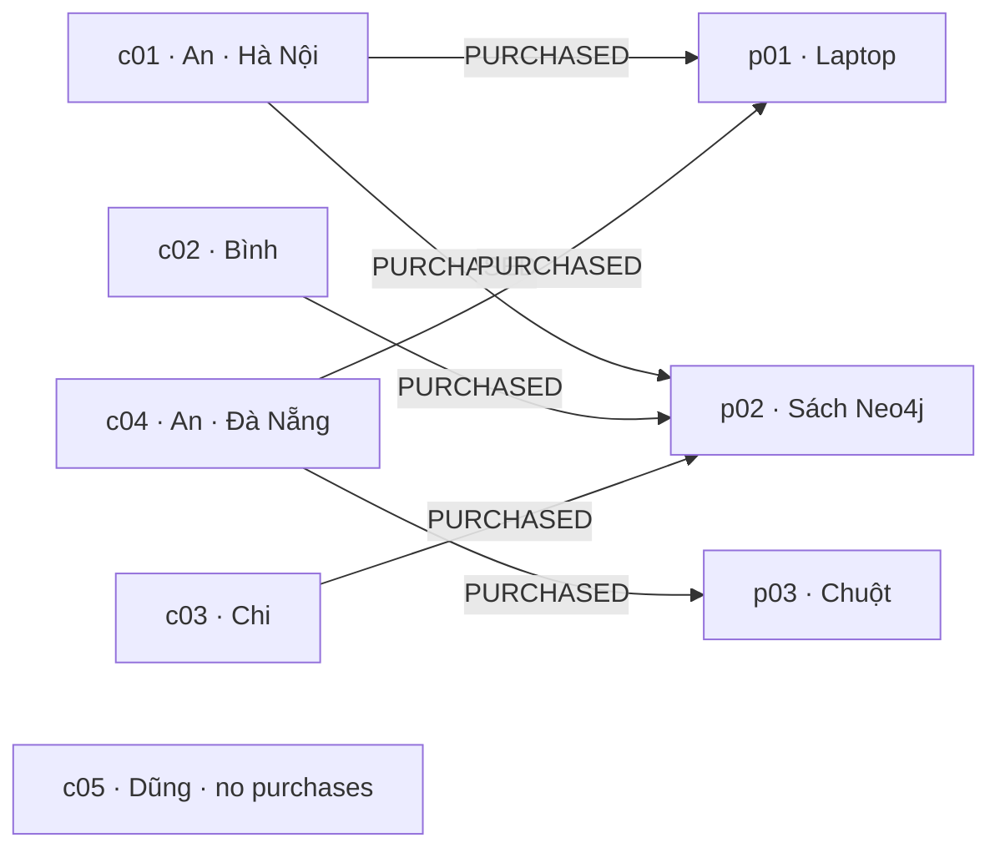

# DISTINCT to Handle Duplicate Values and Understand Its Impact on Results

In Neo4j, **Cypher** returns results as **rows**. Each row holds the values selected by `RETURN`: properties, nodes, relationships, paths, maps, or aggregated values. One person can appear across multiple rows because they have multiple connections in the **property graph**. This is valid behavior, yet when building reports or APIs, we sometimes want to **eliminate duplicate rows**.

The **`DISTINCT`** keyword serves that need. However, what "duplicate" means depends on the **selected expressions**: two customers sharing the same name can be two distinct nodes; two purchases of the same product can also be two distinct relationships. If `DISTINCT` is used in the wrong place, a query can hide important data or produce inaccurate statistics.

This lesson belongs to the **Read Queries** chapter in the `DATABASE_ENGINE_GRAPH_NEO4J` module. It focuses on how `DISTINCT` works, its impact on row counts and aggregations, and its connections to Cypher optimization, indexes/constraints, relationship queries, the Java Driver, and Spring Data Neo4j.

## 1. Learning Outcomes

After this lesson, you will be able to:

1. Distinguish **duplicate rows**, **duplicate property values**, and **duplicate graph entities**.
2. Write `RETURN DISTINCT`, `WITH DISTINCT`, `count(DISTINCT ...)`, and `collect(DISTINCT ...)` with accurate semantics.
3. Explain why adding or removing columns in `RETURN DISTINCT` can change the row count.
4. Analyze the effect of `DISTINCT` when combined with `MATCH`, `OPTIONAL MATCH`, `ORDER BY`, `SKIP`, and `LIMIT`.
5. Recognize cases where `DISTINCT` masks a broken join pattern, drops information, or introduces unnecessary processing overhead.
6. Read results with stable aliases from the Java Driver and evaluate query plans with `EXPLAIN`/`PROFILE`.

## 2. Practice Dataset

Consider a sales system containing customers and products. Each customer has a unique `key`, while **names are not required to be unique**. Two customers are intentionally given the same name **An** to distinguish deduplication by **value** from deduplication by **entity**.

Run the following Cypher snippet in a **test database**. The labels `RQ006Customer` and `RQ006Product` are dedicated to this lesson to avoid collisions with other data. `MERGE` prevents re-runs on a clean sample dataset from creating duplicate nodes/relationships for the same pattern, assuming no duplicate keys or parallel relationships between the same pair exist beforehand.

```cypher
MERGE (c1:RQ006Customer {key: 'c01'})
SET c1.name = 'An', c1.city = 'Hà Nội'
MERGE (c2:RQ006Customer {key: 'c02'})
SET c2.name = 'Bình', c2.city = 'TP. Hồ Chí Minh'
MERGE (c3:RQ006Customer {key: 'c03'})
SET c3.name = 'Chi', c3.city = 'Hà Nội'
MERGE (c4:RQ006Customer {key: 'c04'})
SET c4.name = 'An', c4.city = 'Đà Nẵng'
MERGE (c5:RQ006Customer {key: 'c05'})
SET c5.name = 'Dũng', c5.city = 'Hà Nội'

MERGE (p1:RQ006Product {key: 'p01'})
SET p1.name = 'Laptop', p1.category = 'Điện tử', p1.price = 20000000
MERGE (p2:RQ006Product {key: 'p02'})
SET p2.name = 'Sách Neo4j', p2.category = 'Sách', p2.price = 400000
MERGE (p3:RQ006Product {key: 'p03'})
SET p3.name = 'Chuột', p3.category = 'Điện tử', p3.price = 500000

MERGE (c1)-[r1:PURCHASED]->(p1)
SET r1.quantity = 1, r1.year = 2026
MERGE (c1)-[r2:PURCHASED]->(p2)
SET r2.quantity = 1, r2.year = 2025
MERGE (c2)-[r3:PURCHASED]->(p2)
SET r3.quantity = 2, r3.year = 2026
MERGE (c3)-[r4:PURCHASED]->(p2)
SET r4.quantity = 1, r4.year = 2026
MERGE (c4)-[r5:PURCHASED]->(p1)
SET r5.quantity = 1, r5.year = 2026
MERGE (c4)-[r6:PURCHASED]->(p3)
SET r6.quantity = 1, r6.year = 2025;
```

Connection diagram:



| Metric | Count in Sample Dataset |
| --- | ---: |
| `RQ006Customer` nodes | 5 |
| Distinct customer names | 4 (An, Bình, Chi, Dũng) |
| Distinct cities | 3 (Hà Nội, TP. Hồ Chí Minh, Đà Nẵng) |
| `RQ006Product` nodes | 3 |
| `PURCHASED` relationships | 6 |
| Customers **who purchased** (distinct nodes) | 4 (`c01` through `c04`) |
| Customers **with no purchases** | 1 (`c05`) |

Expected results in the following sections assume only the sample dataset above exists under the `RQ006...` labels.

## 3. Why Do Queries Without DISTINCT Return Repeated Rows?

Simple example:

```cypher
MATCH (c:RQ006Customer)
RETURN c.name AS customerName
ORDER BY customerName;
```

The result has **5 rows**:

| customerName |
| --- |
| An |
| An |
| Bình |
| Chi |
| Dũng |

The two `An` rows come from **two distinct nodes**, `c01` and `c04`. Cypher does not automatically deduplicate when `RETURN` selects only names.

If querying across purchase relationships:

```cypher
MATCH (c:RQ006Customer)-[:PURCHASED]->(p:RQ006Product)
RETURN c.key AS customerKey,
       c.name AS customerName,
       p.name AS product
ORDER BY customerKey, p.key;
```

Result:

| customerKey | customerName | product |
| --- | --- | --- |
| c01 | An | Laptop |
| c01 | An | Sách Neo4j |
| c02 | Bình | Sách Neo4j |
| c03 | Chi | Sách Neo4j |
| c04 | An | Laptop |
| c04 | An | Chuột |

There are **6 rows** because `MATCH` finds 6 purchase relationships. The same customer can appear multiple times when connected to multiple products; the same product can appear multiple times because it is bought by multiple customers. This is the **nature of connected data**, not a bug.

A question to ask before applying `DISTINCT` is: **what unit of output should be considered unique?** Customer name, customer node, product, customer–product pair, or purchase relationship? Each choice can yield a different row count.

## 4. RETURN DISTINCT: Deduplicating by What Is Returned

### 4.1. Single Column

```cypher
MATCH (c:RQ006Customer)
RETURN DISTINCT c.name AS customerName
ORDER BY customerName;
```

The result is **4 names**: An, Bình, Chi, and Dũng. `DISTINCT` keeps one row per **distinct `c.name` value**. In this query, the two An nodes are collapsed because we only return the name.

Similarly, listing distinct cities:

```cypher
MATCH (c:RQ006Customer)
RETURN DISTINCT c.city AS city
ORDER BY city;
```

The result has **3 rows**: Hà Nội, Đà Nẵng, and TP. Hồ Chí Minh (ordered according to the system's string collation rules).

### 4.2. Multiple Columns: DISTINCT Evaluates the Entire Tuple

```cypher
MATCH (c:RQ006Customer)
RETURN DISTINCT c.city AS city,
                c.name AS customerName
ORDER BY city, customerName;
```

The result has **5 rows** because no two nodes share **both name and city** in the sample dataset. `DISTINCT` evaluates the **entire `(city, customerName)` tuple**, not just the column immediately following the `DISTINCT` keyword.

| RETURN Clause | Row Count | "Unique" By |
| --- | ---: | --- |
| `RETURN c.name` | 5 | No deduplication |
| `RETURN DISTINCT c.name` | 4 | Customer name |
| `RETURN DISTINCT c.city` | 3 | City |
| `RETURN DISTINCT c.city, c.name` | 5 | `(city, name)` pair |
| `RETURN DISTINCT c.key, c.name` | 5 | `(key, name)` pair |

Merely adding a column that distinguishes previously identical rows can increase the output row count. Never assume `DISTINCT` always gives "one row per customer"; it gives **one row per distinct tuple of returned values**.

### 4.3. Entities Differ from Property Values

```cypher
MATCH (c:RQ006Customer)
RETURN DISTINCT c AS customerNode;
```

The result has **5 nodes**, because `c01` and `c04` are two **distinct entities** even though both have `name = 'An'`.

If you only need customers who made a purchase:

```cypher
MATCH (c:RQ006Customer)-[:PURCHASED]->(:RQ006Product)
RETURN DISTINCT c.key AS customerKey, c.name AS name
ORDER BY customerKey;
```

The result is **4 customers**: `c01`, `c02`, `c03`, `c04`. Using the application key `key` distinguishes customers with duplicate names and produces clean output for APIs. In real systems, enforce a uniqueness constraint on `key` when it serves as a business identifier.

## 5. DISTINCT Across Multiple Variables: Do Not Lose Real Connections

Suppose you need to display a list of **customer name–product name pairs**:

```cypher
MATCH (c:RQ006Customer)-[:PURCHASED]->(p:RQ006Product)
RETURN DISTINCT c.name AS customerName,
                p.name AS productName
ORDER BY customerName, productName;
```

The result has only **5 rows**:

| customerName | productName |
| --- | --- |
| An | Chuột |
| An | Laptop |
| An | Sách Neo4j |
| Bình | Sách Neo4j |
| Chi | Sách Neo4j |

The two relationships **c01 → Laptop** and **c04 → Laptop** project onto the same `('An', 'Laptop')` pair, so `DISTINCT` collapses them. If the goal is **one row per actual customer–product pair**, the 5-row result is **missing information**.

The right way when individual customers must be identified:

```cypher
MATCH (c:RQ006Customer)-[:PURCHASED]->(p:RQ006Product)
RETURN DISTINCT c.key AS customerKey,
                c.name AS customerName,
                p.key AS productKey,
                p.name AS productName
ORDER BY customerKey, productKey;
```

The result is **6 rows**, distinguishing `c01` from `c04`. You can also `RETURN DISTINCT c, p` if the client needs Neo4j entities, though when mapping to DTOs it is better to project explicit keys and properties.

Another important distinction:

- `RETURN DISTINCT c, p` removes duplicate occurrences of **node pairs**.
- `RETURN DISTINCT r` removes duplicate occurrences of **physical relationships**, provided variable `r` was bound in `MATCH`.
- If the same pair of nodes has **multiple valid relationships** (such as two separate transactions), `DISTINCT c, p` can collapse them whereas `DISTINCT r` keeps each relationship.

Therefore, when designing a transaction graph, decide whether "one purchase" is **a relationship** or **an Order/Transaction node**; you cannot infer transaction counts solely from customer–product pairs.

## 6. Counting with count and count(DISTINCT ...)

`RETURN DISTINCT` changes the **number of returned rows**. In analytics, we often want to count distinct values or entities directly inside aggregate functions.

```cypher
MATCH (c:RQ006Customer)-[r:PURCHASED]->(p:RQ006Product)
RETURN
  count(*) AS matchedRows,
  count(r) AS purchaseRelationships,
  count(c) AS customerOccurrences,
  count(DISTINCT c) AS uniqueCustomerNodes,
  count(DISTINCT c.name) AS uniqueCustomerNames,
  count(DISTINCT p) AS uniqueProductNodes;
```

Result:

| matchedRows | purchaseRelationships | customerOccurrences | uniqueCustomerNodes | uniqueCustomerNames | uniqueProductNodes |
| ---: | ---: | ---: | ---: | ---: | ---: |
| 6 | 6 | 6 | 4 | 3 | 3 |

Interpretation:

- There are **6 matched rows** because there are 6 purchase relationships.
- `count(c) = 6` because An `c01` and An `c04` each have two relationships.
- `count(DISTINCT c) = 4` counts **4 distinct buying customer nodes**.
- `count(DISTINCT c.name) = 3` counts **3 distinct buyer names**: An, Bình, Chi.
- `count(DISTINCT p) = 3` counts **3 distinct product nodes** that were bought.

### 6.1. Counting Multi-Column Tuples

To count **distinct displayed name pairs**, you can apply `WITH DISTINCT` to the two columns and then count rows:

```cypher
MATCH (c:RQ006Customer)-[:PURCHASED]->(p:RQ006Product)
WITH DISTINCT c.name AS customerName,
              p.name AS productName
RETURN count(*) AS distinctDisplayedPairs;
```

The result is **5**. Conversely, counting **customer key–product key** pairs:

```cypher
MATCH (c:RQ006Customer)-[:PURCHASED]->(p:RQ006Product)
WITH DISTINCT c.key AS customerKey,
              p.key AS productKey
RETURN count(*) AS distinctCustomerProductPairs;
```

The result is **6**. This is a clear way to express `DISTINCT` over **multiple expressions simultaneously** before counting.

### 6.2. DISTINCT Is Not a Uniqueness Constraint

`DISTINCT` only processes **the output of a single query**. It does not prevent two nodes with the same `key` from existing in the database. If business logic requires `RQ006Customer.key` to be unique, you need an appropriate **data constraint**, for example:

```cypher
// Run only on a test database or when schema changes have been approved.
CREATE CONSTRAINT rq006_customer_key_unique IF NOT EXISTS
FOR (c:RQ006Customer) REQUIRE c.key IS UNIQUE;
```

This command may fail if existing data violates the constraint. Constraints/indexes serve data integrity and lookup performance; `RETURN DISTINCT` serves result deduplication. These two tools solve **two different problems**.

## 7. WITH DISTINCT: Deduplicating Between Stages

`WITH` passes data to the next stage and controls which variables stay in scope. When combined with `DISTINCT`, it can **reduce intermediate rows** before subsequent matches or aggregations.

Example getting customers who made a purchase, then returning keys and names:

```cypher
MATCH (c:RQ006Customer)-[:PURCHASED]->(:RQ006Product)
WITH DISTINCT c
RETURN c.key AS customerKey,
       c.name AS customerName
ORDER BY customerKey;
```

After `MATCH` there are 6 rows; after `WITH DISTINCT c` there are **4 rows**, corresponding to 4 distinct customer nodes. The final result also has 4 rows.

An example with a subsequent step:

```cypher
MATCH (c:RQ006Customer)-[:PURCHASED]->(:RQ006Product)
WITH DISTINCT c
MATCH (c)-[:PURCHASED]->(p:RQ006Product)
RETURN c.key AS customerKey, p.name AS product
ORDER BY customerKey, p.key;
```

After `WITH DISTINCT c` there are 4 customers. The following `MATCH` then expands each customer's purchase relationships, bringing the result back to **6 rows**. `WITH DISTINCT` does not mean the rest of the query stays deduplicated forever: **a subsequent pattern match can generate multiple new rows**.

In long queries, decide carefully at which stage deduplication makes sense; deduplicating too early can discard data needed for downstream calculations.

### 7.1. Deduplicating Too Early Breaks Aggregations

The following two queries are **not equivalent**:

```cypher
// Correct: calculates each purchase relationship per customer.
MATCH (c:RQ006Customer)-[r:PURCHASED]->(p:RQ006Product)
RETURN c.key AS customerKey,
       sum(r.quantity * p.price) AS totalSpent
ORDER BY customerKey;
```

and:

```cypher
// Wrong if the goal is calculating revenue: purchase rows have already been dropped.
MATCH (c:RQ006Customer)-[r:PURCHASED]->(p:RQ006Product)
WITH DISTINCT c
RETURN c.key AS customerKey,
       count(*) AS remainingRows
ORDER BY customerKey;
```

The second query only has one row per customer, having lost `r`, `p`, and the amounts for each relationship; `remainingRows` is always 1 for every buying customer. **Never use `WITH DISTINCT` as an "optimization" when later stages still need the individual matches.**

## 8. collect(DISTINCT ...): Lists Without Duplicates

`collect` aggregates multiple rows into a list. If expressions repeat, the list will also contain duplicates unless `DISTINCT` is specified.

```cypher
MATCH (p:RQ006Product)<-[:PURCHASED]-(c:RQ006Customer)
RETURN p.key AS productKey,
       collect(c.name) AS buyerNames,
       collect(DISTINCT c.name) AS distinctBuyerNames,
       collect(DISTINCT c.key) AS distinctBuyerKeys
ORDER BY productKey;
```

Meaning for each product:

| Product | buyerNames | distinctBuyerNames | distinctBuyerKeys |
| --- | --- | --- | --- |
| Laptop (`p01`) | An, An | An | c01, c04 |
| Sách Neo4j (`p02`) | An, Bình, Chi | An, Bình, Chi | c01, c02, c03 |
| Chuột (`p03`) | An | An | c04 |

The cells show the expected **elements**, without guaranteeing list element order; `collect` does not guarantee ordering unless you explicitly sort inputs before aggregating.

Notably for Laptop, `collect(DISTINCT c.name)` yields only `'An'`, even though **two distinct customers** bought Laptop. To count customers accurately, use `count(DISTINCT c)` or `count(DISTINCT c.key)`.

If an API needs the list of customer keys in a deterministic order, you can deduplicate and sort prior to `collect`:

```cypher
MATCH (p:RQ006Product)<-[:PURCHASED]-(c:RQ006Customer)
WITH DISTINCT p, c
ORDER BY p.key, c.key
RETURN p.key AS productKey,
       collect(c.key) AS customerKeys
ORDER BY productKey;
```

This pattern preserves distinct customers and sorts the input to `collect`; for instance, `p01` produces `['c01', 'c04']`. If ordering is not required, `collect(DISTINCT c.key)` alone suffices.

## 9. DISTINCT, OPTIONAL MATCH, and null

`OPTIONAL MATCH` preserves the root node when no relationship matches, assigning `null` to unmatched relationship/node variables. Try:

```cypher
MATCH (c:RQ006Customer)
OPTIONAL MATCH (c)-[r:PURCHASED]->(p:RQ006Product)
RETURN
  count(*) AS rowsAfterOptionalMatch,
  count(r) AS matchedRelationships,
  count(DISTINCT c) AS allCustomers,
  count(DISTINCT p) AS distinctProducts;
```

Result:

| rowsAfterOptionalMatch | matchedRelationships | allCustomers | distinctProducts |
| ---: | ---: | ---: | ---: |
| 7 | 6 | 5 | 3 |

Because the four buying customers yield 6 rows and non-buying customer `c05` is preserved via **one row with `r = null`, `p = null`**, `count(*) = 7`. `count(r)` counts only the 6 non-`null` relationships.

### 9.1. DISTINCT Keeps One null Row; count(DISTINCT ...) Ignores null

```cypher
MATCH (c:RQ006Customer)
OPTIONAL MATCH (c)-[:PURCHASED]->(p:RQ006Product)
RETURN DISTINCT p.name AS productName
ORDER BY productName;
```

The result has **4 distinct values**: `'Laptop'`, `'Sách Neo4j'`, `'Chuột'`, and **`null`** (representing customers with no matched product). Multiple `null` rows are collapsed by `DISTINCT` into **one `null` row**.

Conversely:

```cypher
MATCH (c:RQ006Customer)
OPTIONAL MATCH (c)-[:PURCHASED]->(p:RQ006Product)
RETURN count(DISTINCT p.name) AS distinctProductNames;
```

The result is **3** because `count(expr)` ignores `null`, even with `DISTINCT`. Similarly, `collect(DISTINCT p.name)` omits `null` from the list.

Key takeaway: **row deduplication** and **counting non-null values** follow different rules.

## 10. DISTINCT with ORDER BY, SKIP, and LIMIT

When paginating a deduplicated list, the order of operations affects the result.

```cypher
MATCH (c:RQ006Customer)
RETURN DISTINCT c.city AS city
ORDER BY city ASC
SKIP 1
LIMIT 2;
```

Here, the query selects **three distinct cities**, sorts them, skips the first, and takes the next two. `ORDER BY` is required for stable pagination; add tie-breakers if items can tie on the sort key.

Compare with taking the first two customers first and only then deduplicating cities:

```cypher
MATCH (c:RQ006Customer)
WITH c
ORDER BY c.key
LIMIT 2
RETURN DISTINCT c.city AS city
ORDER BY city;
```

This only considers customers `c01` (Hà Nội) and `c02` (TP. Hồ Chí Minh), so the result contains **the two cities of the first two customers**. That differs semantically from "take two cities after computing the distinct list of cities".

### 10.1. Do Not Use LIMIT to Patch an Over-Returning Query

`LIMIT 10` only caps the number of output rows. If the `MATCH` pattern lacks connections, has the wrong direction, or generates unintended rows, `LIMIT` does not fix that bug. Define the exact result unit and join conditions first, then apply `DISTINCT`, sorting, and pagination.

## 11. DISTINCT Cannot Fix a Cartesian Product

Consider pairing **every customer** with **every product** without a connecting relationship:

```cypher
MATCH (c:RQ006Customer)
MATCH (p:RQ006Product)
RETURN count(*) AS combinations;
```

With 5 customers × 3 products, the query yields **15 rows**. If you only return:

```cypher
MATCH (c:RQ006Customer)
MATCH (p:RQ006Product)
RETURN DISTINCT c.key AS customerKey
ORDER BY customerKey;
```

then the result has 5 customer keys. Yet that **does not mean** every customer bought a product; `DISTINCT` merely hides the fact that independent sets were multiplied.

If the question is **"which customers made a purchase?"**, connect the relationship:

```cypher
MATCH (c:RQ006Customer)-[:PURCHASED]->(:RQ006Product)
RETURN DISTINCT c.key AS customerKey
ORDER BY customerKey;
```

The result has only **the 4 buying customers** (`c01`–`c04`). This is a difference in **semantic correctness**, not merely row count.

If you need to count actual purchase events, do not deduplicate by name or customer–product pair when multiple valid transactions can occur. Choose the corresponding transaction entity or relationship as the unit of count.

## 12. Performance Evaluation and Choosing DISTINCT Scope

To deduplicate, the engine may have to **track seen values** or process rows in an appropriate sort order. On large result sets, this consumes CPU, memory, or intermediate resources. Actual impact depends on the query plan, input row count, cardinality of unique values, indexes, and Neo4j version.

Inspect the plan without executing the query:

```cypher
EXPLAIN
MATCH (c:RQ006Customer)-[:PURCHASED]->(p:RQ006Product)
RETURN DISTINCT c.key AS customerKey
ORDER BY customerKey;
```

To observe actual row counts and cost on test data:

```cypher
PROFILE
MATCH (c:RQ006Customer)-[:PURCHASED]->(p:RQ006Product)
RETURN DISTINCT c.key AS customerKey
ORDER BY customerKey;
```

`EXPLAIN` only generates the estimated plan; `PROFILE` **executes the query** and reports runtime statistics. Depending on the plan, you may see operators handling uniqueness such as `Distinct`, `OrderedDistinct`, or equivalent aggregation operators. **Operator names and order are not fixed** across versions and scenarios.

Practical guidelines:

1. **Match the right relationships first:** `MATCH (c)-[:PURCHASED]->(p)` rather than joining disconnected sets and trying to deduplicate afterward.
2. **Project only needed fields:** deduplicating whole nodes or large maps can cost more than deduplicating a short key, provided the key truly identifies the output unit.
3. **Avoid redundant DISTINCT:** if the query already guarantees one row per unique key, adding `DISTINCT` brings no benefit.
4. **Use indexes/constraints for sensible entry points:** indexes speed up property-based node lookups, though they do not eliminate duplicates produced by relationship branches.
5. **Place DISTINCT according to downstream needs:** early deduplication can shrink intermediate rows, but must retain everything needed for accurate downstream aggregation.
6. **Measure with `PROFILE`:** inspect cardinality (rows), DB hits, and cost instead of guessing whether `DISTINCT` makes a query faster or slower.

For a service returning a list of buying customers, `RETURN DISTINCT c.key AS customerKey` is appropriate when the API needs unique keys. For transaction-count or revenue reports, keep the purchase relationships until the corresponding aggregation step.

## 13. Using DISTINCT in the Java Driver

Suppose an application wants to return the list of **buying customers in Hà Nội**, each customer exactly once. Using an application key and stable aliases prevents confusing customers with identical names.

```cypher
MATCH (c:RQ006Customer)-[:PURCHASED]->(:RQ006Product)
WHERE c.city = $city
RETURN DISTINCT c.key AS customerKey,
                c.name AS customerName
ORDER BY customerKey;
```

With `city = 'Hà Nội'`, the result is **c01 – An** and **c03 – Chi**. Customer c05 – Dũng lives in Hà Nội but **has not made a purchase**, so he does not appear.

Java Driver example, assuming a connected `Driver` instance and a Driver version supporting `executeRead`:

```java
import java.util.List;
import java.util.Map;
import org.neo4j.driver.Driver;

public class BuyerReader {
    public record Buyer(String customerKey, String customerName) {}

    public static List<Buyer> findBuyersInCity(Driver driver, String city) {
        try (var session = driver.session()) {
            return session.executeRead(tx ->
                tx.run("""
                    MATCH (c:RQ006Customer)-[:PURCHASED]->(:RQ006Product)
                    WHERE c.city = $city
                    RETURN DISTINCT c.key AS customerKey,
                                    c.name AS customerName
                    ORDER BY customerKey
                    """, Map.of("city", city))
                  .list(record -> new Buyer(
                      record.get("customerKey").asString(),
                      record.get("customerName").asString()
                  ))
            );
        }
    }
}
```

In Spring Data Neo4j, a similar Cypher pattern can be placed inside a `@Query` method with bound parameters; the projection/DTO type must match column names and types. Note that `DISTINCT` in Cypher deduplicates **database return values**; if the backend performs additional mapping, filtering, or grouping, uniqueness at the API layer must be enforced by the application's business key.

## 14. Quick Selection Table

| Need | Suitable Construct | Result on Sample Dataset |
| --- | --- | --- |
| List all customer name rows | `RETURN c.name` | 5 rows |
| List distinct customer names | `RETURN DISTINCT c.name` | 4 names |
| List distinct customer entities | `RETURN DISTINCT c` | 5 nodes |
| List buying customers without duplicates | `MATCH (c)-[:PURCHASED]->(...) RETURN DISTINCT c.key` | 4 customers |
| Count purchase relationships | `count(r)` | 6 |
| Count distinct buying customer nodes | `count(DISTINCT c)` | 4 |
| Count distinct buyer names | `count(DISTINCT c.name)` | 3 |
| Count customer name–product name pairs | `WITH DISTINCT c.name, p.name RETURN count(*)` (with aliases) | 5 |
| Count customer key–product key pairs | `WITH DISTINCT c.key, p.key RETURN count(*)` (with aliases) | 6 |
| List of buyer names per product | `collect(DISTINCT c.name)` | Laptop has only one name An |
| List of buyer keys per product | `collect(DISTINCT c.key)` | Laptop has c01 and c04 |
| Keep non-buying customers in stats | `OPTIONAL MATCH` with `count(r)` | c05 has 0 relationships |

## 15. Common Mistakes and Fixes

| Symptom | Cause | Solution |
| --- | --- | --- |
| Name An appears once despite two customers | `DISTINCT` applied to `c.name`, not entity/key | Include `c.key` or return `DISTINCT c` |
| Person–product pairs missing records | Two people with the same name bought the same product | Use unique identifier keys for both endpoints |
| Buyer count returns 6 instead of 4 | `count(c)` counted relationship rows | Use `count(DISTINCT c)` |
| Buyer name count returns 3 instead of 4 | `count(DISTINCT c.name)` merged the two Ans | Count node `c` or a unique key |
| Adding a column to `RETURN DISTINCT` increases rows | Multi-column tuples differ | Define the exact tuple that should be unique |
| `count(DISTINCT p.name)` is lower than `RETURN DISTINCT p.name` rows with non-buyers | `count` skips `null`, whereas `RETURN DISTINCT` keeps one `null` row | Decide whether `null` should be included |
| Using `WITH DISTINCT c` loses `r.quantity` | `WITH` dropped relationship and product variables | Keep needed data or aggregate before deduplicating |
| `DISTINCT` hides a disconnected join bug | Two `MATCH` patterns are disconnected, yet outputs are collapsed | Add the proper business connection pattern/condition |
| `LIMIT` returns shifting pages | Missing a deterministic `ORDER BY` | Sort by key and paginate after deduplicating |
| Queries using `DISTINCT` are slow on large graphs | Huge intermediate set or `DISTINCT` over bulky values | Narrow patterns, project only needed fields, check `PROFILE` |

## 16. Practice Exercises

Use the dataset in Section 2. Predict the **row count** and **what unit is being treated as unique** before checking the solutions.

**Exercise 1.** List the distinct cities of customers. How many rows are returned?

**Exercise 2.** List the names of customers who bought at least one product, without duplicate **names**. Then modify the query to avoid duplicate **customer nodes**. Do both results have the same row count?

**Exercise 3.** Count purchase relationships, distinct buying customers, and distinct purchased products.

**Exercise 4.** Return each distinct customer name–product name pair. Why is the row count lower than the number of physical customer–product pairs?

**Exercise 5.** Use `collect(DISTINCT ...)` to get the list of **customer keys** that bought each product. For Laptop, which two customers should appear?

**Exercise 6.** Keep all customers, including non-buyers, and return the purchase relationship count per customer. What value should Dũng have?

**Exercise 7.** Compare the row count of `RETURN DISTINCT p.name` and `count(DISTINCT p.name)` when using `OPTIONAL MATCH` from all customers to products.

**Exercise 8.** Explain why `RETURN DISTINCT c.key` does not fix the following query if the goal is "customers who bought products":

```cypher
MATCH (c:RQ006Customer), (p:RQ006Product)
RETURN DISTINCT c.key AS customerKey;
```

### Reference Answers

**Exercise 1**

```cypher
MATCH (c:RQ006Customer)
RETURN DISTINCT c.city AS city
ORDER BY city;
```

The result has **3 rows**.

**Exercise 2**

```cypher
MATCH (c:RQ006Customer)-[:PURCHASED]->(:RQ006Product)
RETURN DISTINCT c.name AS buyerName
ORDER BY buyerName;
```

There are **3 names**: An, Bình, Chi. To get **4 distinct customers**:

```cypher
MATCH (c:RQ006Customer)-[:PURCHASED]->(:RQ006Product)
RETURN DISTINCT c.key AS customerKey, c.name AS buyerName
ORDER BY customerKey;
```

The result is `c01`, `c02`, `c03`, `c04`.

**Exercise 3**

```cypher
MATCH (c:RQ006Customer)-[r:PURCHASED]->(p:RQ006Product)
RETURN count(r) AS purchases,
       count(DISTINCT c) AS buyers,
       count(DISTINCT p) AS products;
```

Result: **6 purchase relationships, 4 buying customers, 3 products**.

**Exercise 4**

```cypher
MATCH (c:RQ006Customer)-[:PURCHASED]->(p:RQ006Product)
RETURN DISTINCT c.name AS customerName, p.name AS productName
ORDER BY customerName, productName;
```

There are **5 rows** because two different customers named An both bought Laptop and their name pairs were merged. Use `c.key` and `p.key` to distinguish all six actual pairs.

**Exercise 5**

```cypher
MATCH (p:RQ006Product)<-[:PURCHASED]-(c:RQ006Customer)
RETURN p.key AS productKey,
       collect(DISTINCT c.key) AS buyerKeys
ORDER BY productKey;
```

Laptop (`p01`) has **c01 and c04** (element order in the list is not guaranteed).

**Exercise 6**

```cypher
MATCH (c:RQ006Customer)
OPTIONAL MATCH (c)-[r:PURCHASED]->(:RQ006Product)
RETURN c.key AS customerKey,
       count(r) AS purchaseCount
ORDER BY customerKey;
```

Result: `c01 = 2`, `c02 = 1`, `c03 = 1`, `c04 = 2`, `c05 = 0`.

**Exercise 7**

```cypher
MATCH (c:RQ006Customer)
OPTIONAL MATCH (c)-[:PURCHASED]->(p:RQ006Product)
RETURN DISTINCT p.name AS productName;
```

Returns **4 rows**: three product names and one `null`. Query:

```cypher
MATCH (c:RQ006Customer)
OPTIONAL MATCH (c)-[:PURCHASED]->(p:RQ006Product)
RETURN count(DISTINCT p.name) AS distinctProductNames;
```

Returns one row containing **3** because `count` ignores `null`.

**Exercise 8**

The two patterns `(c:RQ006Customer)` and `(p:RQ006Product)` are independent, generating **15 combined rows** before projecting the output column. `DISTINCT c.key` simply collapses them into **5 customer keys**, including non-buyer Dũng. The correct query must require the `PURCHASED` relationship:

```cypher
MATCH (c:RQ006Customer)-[:PURCHASED]->(:RQ006Product)
RETURN DISTINCT c.key AS customerKey
ORDER BY customerKey;
```

The result is **the 4 buying customer keys**.

## 17. Key Takeaways

- `DISTINCT` removes rows with the **same tuple of selected values**; it does not automatically deduplicate by business key or entity.
- `RETURN DISTINCT c.name` differs from `RETURN DISTINCT c` when multiple nodes share the same name; a unique business identifier prevents unintended merging.
- `count(DISTINCT x)` counts **non-null** distinct `x` values, whereas `collect(DISTINCT x)` gathers non-null unique values into a list.
- `WITH DISTINCT` deduplicates **at one stage**; subsequent `MATCH` clauses can generate multiple rows again. Deduplicating too early can lose data needed for aggregations.
- `RETURN DISTINCT` can keep **one `null` row**, while `count(DISTINCT ...)` **does not count `null`**.
- `DISTINCT` cannot fix broken joins, Cartesian products, or missing filters. Fix the graph pattern structure first, then apply `DISTINCT`.
- For stable API or pagination results, project explicit keys, assign aliases, sort with `ORDER BY`, and check execution cost with `EXPLAIN`/`PROFILE`.
