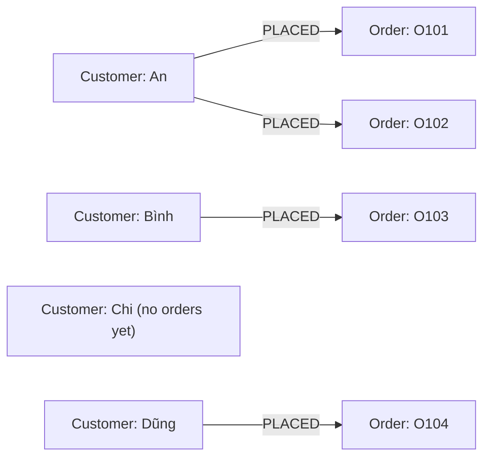
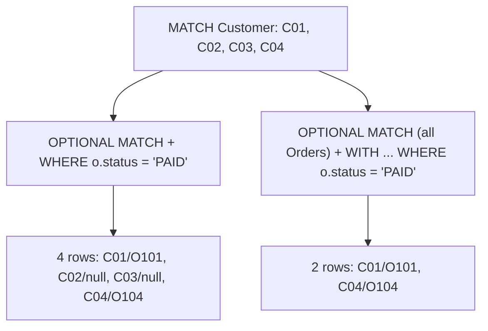

# OPTIONAL MATCH, `null` Values, and Filter Placement in Cypher

## 1. Purpose and Context

In Neo4j, data is represented as a **property graph**: nodes store entities, relationships connect entities, and properties hold information on nodes or relationships. When querying relationships with **Cypher**, not every node has every possible connection. For instance, a customer may not have placed any order yet; an employee may not have a manager assigned; a course may have no enrolled students.

`OPTIONAL MATCH` preserves input rows even when the requested graph pattern **does not match**. Any unbound new variables receive the value `null`. It is an essential tool for read queries, yet also a common source of wrong results if `WHERE` is placed in the wrong position.

After this lesson, you will be able to:

1. Distinguish `MATCH` from `OPTIONAL MATCH` and predict result row counts when relationships are missing.
2. Explain how `null` arises and propagates through comparisons, logical operators, and aggregations.
3. Distinguish a `WHERE` attached to `OPTIONAL MATCH` from a `WHERE` after `WITH` using concrete results.
4. Write queries that preserve all root nodes while matching only qualifying relationships.
5. Spot pitfalls such as `COUNT(*)`, misplaced `IS NULL` checks, and multiple `OPTIONAL MATCH` clauses multiplying row counts.

The content uses Cypher syntax aligned with modern Neo4j and fits the modeling, index/constraint, query tuning, Java Driver, and Spring Data Neo4j learning path in the `DATABASE_ENGINE_GRAPH_NEO4J` module. In production, verify the exact syntax and capabilities supported by your Neo4j version.

## 2. Understanding `OPTIONAL MATCH` with a Simple Picture

For the pattern `(c:Customer)-[:PLACED]->(o:Order)`:

- `MATCH` finds customer–order pairs that **have a matching relationship**. Customers without orders are dropped from the result.
- `OPTIONAL MATCH` attempts to find the same pair yet **preserves the customer** even when no order is found; variable `o` is then `null`.

You can think of how `OPTIONAL MATCH` preserves rows as similar to a *left outer join* in SQL, keeping in mind that Cypher operates on **graph patterns**, previously bound variables, and clause ordering. That analogy helps learn the semantics, not as a mechanical one-to-one query translation rule.



`OPTIONAL MATCH` **never creates new relationships or nodes**. It simply returns rows with unmatched variables set to `null`. If a customer has two orders, that customer still appears in **two rows**; "optional" means "may find zero matches", not "take at most one record".

## 3. Preparing Data for the Examples

Suppose a sales system has four customers:

| Customer | `id` | `vip` | Orders |
|---|---|---|---|
| An | `C01` | `true` | `O101` paid, `O102` cancelled |
| Bình | `C02` | `false` | `O103` cancelled |
| Chi | `C03` | `false` | No orders yet |
| Dũng | `C04` | `true` | `O104` paid |

We use `(:Customer)-[:PLACED]->(:Order)`. Each `Order` has `id`, `status`, and `total`. Paid status is `PAID`; cancelled status is `CANCELLED`. All examples below assume the practice database contains only this dataset for the labels and relationships under discussion.

Create constraints on business keys so the script is re-runnable:

```cypher
CREATE CONSTRAINT customer_id_unique IF NOT EXISTS
FOR (c:Customer) REQUIRE c.id IS UNIQUE;

CREATE CONSTRAINT order_id_unique IF NOT EXISTS
FOR (o:Order) REQUIRE o.id IS UNIQUE;
```

Load customers:

```cypher
UNWIND [
  {id: 'C01', name: 'An',   vip: true},
  {id: 'C02', name: 'Bình', vip: false},
  {id: 'C03', name: 'Chi',  vip: false},
  {id: 'C04', name: 'Dũng', vip: true}
] AS row
MERGE (c:Customer {id: row.id})
SET c.name = row.name,
    c.vip = row.vip;
```

Load orders and create relationships:

```cypher
UNWIND [
  {id: 'O101', customerId: 'C01', status: 'PAID',      total: 120},
  {id: 'O102', customerId: 'C01', status: 'CANCELLED', total: 40},
  {id: 'O103', customerId: 'C02', status: 'CANCELLED', total: 70},
  {id: 'O104', customerId: 'C04', status: 'PAID',      total: 200}
] AS row
MERGE (o:Order {id: row.id})
SET o.status = row.status,
    o.total = row.total
WITH o, row
MATCH (c:Customer {id: row.customerId})
MERGE (c)-[:PLACED]->(o);
```

In this sample dataset, `MERGE` preserves idempotency based on identifier keys and relationship patterns. When loading real data from files, add handling for missing identifiers, missing referenced nodes, record conflicts, and concurrency.

Verify the dataset:

```cypher
MATCH (c:Customer)
RETURN count(c) AS customerCount;

MATCH (o:Order)
RETURN count(o) AS orderCount;

MATCH (:Customer)-[r:PLACED]->(:Order)
RETURN count(r) AS placedCount;
```

Expected: **4 customers**, **4 orders**, **4 `PLACED` relationships**.

## 4. How Do `MATCH` and `OPTIONAL MATCH` Differ?

### 4.1. `MATCH` Drops Rows Without Relationships

```cypher
MATCH (c:Customer)-[:PLACED]->(o:Order)
RETURN c.id AS customer, o.id AS orderId
ORDER BY customer, orderId;
```

| `customer` | `orderId` |
|---|---|
| `C01` | `O101` |
| `C01` | `O102` |
| `C02` | `O103` |
| `C04` | `O104` |

`C03` does not appear because Chi has no orders and no graph pattern matches.

### 4.2. `OPTIONAL MATCH` Preserves Customers Without Orders

```cypher
MATCH (c:Customer)
OPTIONAL MATCH (c)-[:PLACED]->(o:Order)
RETURN c.id AS customer, o.id AS orderId
ORDER BY customer, orderId;
```

| `customer` | `orderId` |
|---|---|
| `C01` | `O101` |
| `C01` | `O102` |
| `C02` | `O103` |
| `C03` | `null` |
| `C04` | `O104` |

`MATCH (c:Customer)` first produces four rows, one per customer. `OPTIONAL MATCH` expands each row along `PLACED`: An's row expands to two rows; Chi's row remains with `o` bound to `null`. The result has **5 rows**.

### 4.3. Which Rows Does `OPTIONAL MATCH` Preserve?

An important rule: `OPTIONAL MATCH` preserves **rows currently present when the clause executes**. It does not resurrect rows already filtered out by an earlier `MATCH` or `WHERE`.

Example:

```cypher
MATCH (c:Customer)
WHERE c.vip = true
OPTIONAL MATCH (c)-[:PLACED]->(o:Order)
RETURN c.id AS customer, o.id AS orderId
ORDER BY customer, orderId;
```

Only `C01` and `C04` remain, because `WHERE c.vip = true` already filtered out Bình and Chi **before** `OPTIONAL MATCH` executed. Using `OPTIONAL MATCH` does not bring back previously excluded customers.

## 5. `null` in Cypher: Absence of Value, Not a String

When `OPTIONAL MATCH` fails to match, new variables from the optional pattern receive `null`:

```cypher
MATCH (c:Customer)
OPTIONAL MATCH (c)-[:PLACED]->(o:Order)
RETURN c.id AS customer,
       o AS orderNode,
       o.status AS status,
       o.total > 100 AS isLargeOrder
ORDER BY customer;
```

For `C03`, `orderNode`, `status`, and `isLargeOrder` are all `null`. Accessing a property of a `null` node variable returns `null` rather than inventing a default value. If a node exists yet **lacks the property** being read, reading that property also yields `null`.

### 5.1. Three-Valued Logic: `true`, `false`, `null`

Cypher uses three-valued logic when predicates involve `null`:

| Expression | Result | Explanation |
|---|---|---|
| `null = 5` | `null` | Cannot determine equality or inequality |
| `null <> 5` | `null` | Cannot determine inequality |
| `null = null` | `null` | Equality cannot detect missing values |
| `null IS NULL` | `true` | Proper check for missing value |
| `null IS NOT NULL` | `false` | Value does not exist |
| `false AND null` | `false` | One side is false, so `AND` is false |
| `true AND null` | `null` | Cannot determine true or false |
| `true OR null` | `true` | One side is true, so `OR` is true |
| `false OR null` | `null` | Cannot determine true or false |

**In `WHERE`, only rows where the predicate evaluates to `true` are kept**. Both `false` **and** `null` results are discarded when `WHERE` filters rows.

For instance, for `C03`, `o.status <> 'CANCELLED'` is not `true`; it is `null`. Therefore, writing `WHERE o.status <> 'CANCELLED'` after optionally matching orders will drop customers who have no orders.

### 5.2. `IS NULL`, `IS NOT NULL`, and `coalesce`

```cypher
MATCH (c:Customer)
OPTIONAL MATCH (c)-[:PLACED]->(o:Order)
RETURN c.id AS customer,
       o IS NULL AS noMatchedOrder,
       coalesce(o.status, 'NO ORDER') AS displayStatus
ORDER BY customer, displayStatus;
```

`IS NULL` is the right check when testing whether a variable or property is missing. `coalesce(x, y, ...)` returns the **first non-`null` value**; it is useful for default display strings, though it does not change the fact that a relationship or property may be absent.

In Neo4j, setting a property to `null` normally **removes that property**. Thus, distinguish a missing property in stored data from a `null` value in query results.

## 6. Core Topic: Where Should `WHERE` Be Placed?

### 6.1. `WHERE` Attached to `OPTIONAL MATCH`: Filtering the *Optional Pattern*

Goal: **display all customers**, while matching only `PAID` orders if any exist.

```cypher
MATCH (c:Customer)
OPTIONAL MATCH (c)-[:PLACED]->(o:Order)
WHERE o.status = 'PAID'
RETURN c.id AS customer, o.id AS paidOrder
ORDER BY customer, paidOrder;
```

Result:

| `customer` | `paidOrder` | Explanation |
|---|---|---|
| `C01` | `O101` | An has one `PAID` order; `O102` does not match |
| `C02` | `null` | Bình has a `CANCELLED` order but no `PAID` order |
| `C03` | `null` | Chi has no orders yet |
| `C04` | `O104` | Dũng has one `PAID` order |

Key point: in Cypher, a `WHERE` **immediately following `OPTIONAL MATCH` is part of that `OPTIONAL MATCH`**. It defines what counts as a valid optional match. If no order satisfies `PAID`, the query still keeps the customer row with `o = null`. This is exactly what we need when preserving all customers as the base set.

For simple property equality checks, you can equivalently write:

```cypher
MATCH (c:Customer)
OPTIONAL MATCH (c)-[:PLACED]->(o:Order {status: 'PAID'})
RETURN c.id AS customer, o.id AS paidOrder
ORDER BY customer, paidOrder;
```

### 6.2. `WHERE` After `WITH`: Filtering *Already-Produced Rows*

Now move the condition after `WITH`:

```cypher
MATCH (c:Customer)
OPTIONAL MATCH (c)-[:PLACED]->(o:Order)
WITH c, o
WHERE o.status = 'PAID'
RETURN c.id AS customer, o.id AS paidOrder
ORDER BY customer;
```

Result:

| `customer` | `paidOrder` |
|---|---|
| `C01` | `O101` |
| `C04` | `O104` |

At the `WITH c, o` point, the query has already produced **5 rows** including cancelled orders and Chi's `o = null` row. The subsequent `WHERE` acts as a **row filter**; it eliminates `O102`, `O103`, and the `null` row. Only the two customers with `PAID` orders remain.



The two Cypher queries differ only in `WHERE` placement, yet answer **two different business questions**:

| Question to Answer | Correct Way to Write |
|---|---|
| "All customers; include `PAID` orders if any" | `OPTIONAL MATCH ... WHERE o.status = 'PAID'` |
| "Only customers who have a `PAID` order" | `MATCH ... WHERE o.status = 'PAID'`, or `OPTIONAL MATCH ... WITH ... WHERE ...` if optional is needed for another reason |
| "All customers with count of `PAID` orders, including 0" | `OPTIONAL MATCH ... WHERE ... WITH c, count(o) ...` |
| "Customers who have never placed any order" | `NOT EXISTS { MATCH ... }` or `OPTIONAL MATCH ... WITH ... WHERE o IS NULL` |

### 6.3. A `WHERE` on an Existing Variable Can Also Surprise You

Here, the condition on `c` is placed **inside** the optional part:

```cypher
MATCH (c:Customer)
OPTIONAL MATCH (c)-[:PLACED]->(o:Order)
WHERE c.vip = true
RETURN c.id AS customer, o.id AS orderId
ORDER BY customer, orderId;
```

`C02` still appears with `orderId = null`, even though Bình **has** order `O103`; because `c.vip = true` causes the optional match to fail. `C03` also appears with `null`. If the requirement is **VIP customers only**, move `WHERE c.vip = true` directly under `MATCH (c:Customer)`:

```cypher
MATCH (c:Customer)
WHERE c.vip = true
OPTIONAL MATCH (c)-[:PLACED]->(o:Order)
RETURN c.id AS customer, o.id AS orderId
ORDER BY customer, orderId;
```

Only rows belonging to `C01` and `C04` remain. This example shows you cannot look only at variable names in a predicate; inspect **which clause the `WHERE` is attached to**.

### 6.4. Does Adding `OR o IS NULL` After `WITH` Restore All Customers?

Try it:

```cypher
MATCH (c:Customer)
OPTIONAL MATCH (c)-[:PLACED]->(o:Order)
WITH c, o
WHERE o.status = 'PAID' OR o IS NULL
RETURN c.id AS customer, o.id AS orderId
ORDER BY customer;
```

The result has `C01/O101`, `C03/null`, `C04/O104` — **Bình (`C02`) is missing**.

Why: Bình had a matching relationship in `OPTIONAL MATCH`, producing row `C02/O103`; no fallback `C02/null` row was created. Once `WITH ... WHERE` drops `O103`, Bình is gone. `OR o IS NULL` only keeps Chi, who **genuinely had zero relationships** during the unfiltered optional match.

If you want to preserve every customer and only match `PAID` orders, filter **inside `OPTIONAL MATCH`** as shown in Section 6.1, instead of trying to recover dropped rows later.

## 7. Common Query Patterns

### 7.1. Counting Qualifying Orders, Including Customers with 0 Orders

```cypher
MATCH (c:Customer)
OPTIONAL MATCH (c)-[:PLACED]->(o:Order)
WHERE o.status = 'PAID'
WITH c, count(o) AS paidOrderCount, sum(o.total) AS paidTotal
RETURN c.id AS customer,
       paidOrderCount,
       paidTotal
ORDER BY customer;
```

| `customer` | `paidOrderCount` | `paidTotal` |
|---|---:|---:|
| `C01` | 1 | 120 |
| `C02` | 0 | 0 |
| `C03` | 0 | 0 |
| `C04` | 1 | 200 |

In Cypher, `count(o)` **ignores `null`**, so Bình and Chi get a qualifying order count of 0. `sum(o.total)` ignores `null` inputs and returns 0 when no numeric values exist. If you only want to count `PAID` orders, avoid writing `count(*)` in this pattern: on an optional row where `o = null`, `count(*)` counts **one row**, not **zero orders**.

Compare:

```cypher
MATCH (c:Customer)
OPTIONAL MATCH (c)-[:PLACED]->(o:Order)
WHERE o.status = 'PAID'
RETURN c.id AS customer,
       count(*) AS rowCount,
       count(o) AS paidOrderCount
ORDER BY customer;
```

For `C02` and `C03`, `rowCount = 1` whereas `paidOrderCount = 0`. In graphs where multiple relationships can reach the same order, you may need `count(DISTINCT o)` to avoid double-counting due to multiple join paths.

### 7.2. Finding Customers Who Have Placed No Orders at All

```cypher
MATCH (c:Customer)
OPTIONAL MATCH (c)-[:PLACED]->(o:Order)
WITH c, o
WHERE o IS NULL
RETURN c.id AS customer;
```

The result is only `C03`. **The `o IS NULL` predicate must be applied after the match has generated rows**. Placing `WHERE o IS NULL` directly after `OPTIONAL MATCH` makes it part of the optional pattern; real matched `Order` nodes are never `null`, so the result would return customers with `o = null` and no longer mean "only customers with no orders".

In many cases, an existence check is clearer and avoids generating intermediate rows:

```cypher
MATCH (c:Customer)
WHERE NOT EXISTS {
  MATCH (c)-[:PLACED]->(:Order)
}
RETURN c.id AS customer;
```

### 7.3. Distinguishing "No Orders" from "No Paid Orders"

```cypher
MATCH (c:Customer)
RETURN c.id AS customer,
       EXISTS {
         MATCH (c)-[:PLACED]->(:Order)
       } AS hasAnyOrder,
       EXISTS {
         MATCH (c)-[:PLACED]->(o:Order)
         WHERE o.status = 'PAID'
       } AS hasPaidOrder
ORDER BY customer;
```

| `customer` | `hasAnyOrder` | `hasPaidOrder` |
|---|---|---|
| `C01` | `true` | `true` |
| `C02` | `true` | `false` |
| `C03` | `false` | `false` |
| `C04` | `true` | `true` |

These are two distinct business definitions. **Bình has an order, but no `PAID` order**; **Chi has no orders at all**. `EXISTS { ... }` directly tests whether a relationship pattern exists, which is ideal when you do not need to return individual orders.

### 7.4. Filtering Root Customers While Still Preserving Customers Without Orders

Suppose you want all VIP customers and their `PAID` orders (if any):

```cypher
MATCH (c:Customer)
WHERE c.vip = true
OPTIONAL MATCH (c)-[:PLACED]->(o:Order)
WHERE o.status = 'PAID'
RETURN c.id AS customer, o.id AS paidOrder
ORDER BY customer;
```

The condition `c.vip` selects **input customers**; the condition `o.status` selects **optionally matched orders**. Keep those two questions separate when designing queries.

### 7.5. Multiple `OPTIONAL MATCH` Clauses Can Multiply Rows

In a property graph, one node can connect to many nodes across different relationship types. If you perform two independent one-to-many optional matches on the same customer, the intermediate row count can be the product of each branch's matches:

```cypher
// Structural example when the model also has :FOLLOWS relationships
MATCH (c:Customer)
OPTIONAL MATCH (c)-[:PLACED]->(o:Order)
OPTIONAL MATCH (c)-[:FOLLOWS]->(b:Brand)
RETURN c.id AS customer,
       count(DISTINCT o) AS orderCount,
       count(DISTINCT b) AS brandCount;
```

If a customer has **2 orders** and **3 followed brands**, combining both branches can yield **6 intermediate rows**. `DISTINCT` helps count unique nodes; on large datasets, consider aggregating each branch separately before combining to avoid row explosion. The example above adds `Brand`/`FOLLOWS` to illustrate structure; this lesson's sample dataset **does not contain** those nodes or relationships.

## 8. Self-Check Workflow When a Query Drops Expected Rows

When `OPTIONAL MATCH` output is not what you expected, check in this order:

1. **What is the root set?** Did the first `MATCH` clause already filter out nodes? Run a quick query with just the initial `MATCH` and `RETURN` to count.
2. **How many patterns match per row?** One node can yield 0, 1, or many relationships, so row expansion is normal.
3. **Which clause does `WHERE` belong to?** After `MATCH`/`OPTIONAL MATCH`, it applies to that clause's pattern; after `WITH`, it filters forwarded rows.
4. **Can predicates on optional variables evaluate to `null`?** `o.status = 'PAID'` when `o = null` is also `null`; `WHERE` drops rows whenever the predicate is not `true`.
5. **Are aggregations counting nodes or rows?** Compare `count(o)`, `count(*)`, and `count(DISTINCT o)`.
6. **Does the problem actually need optional data or just an existence check?** If you only need `true`/`false`, consider `EXISTS { ... }`.

To analyze performance, start with `EXPLAIN` and then use `PROFILE` on representative data:

```cypher
EXPLAIN
MATCH (c:Customer {id: $customerId})
OPTIONAL MATCH (c)-[:PLACED]->(o:Order)
WHERE o.status = 'PAID'
RETURN c.id, o.id;
```

In production systems, indexes/constraints on `Customer.id`, filter selectivity, and node degree affect how Neo4j executes the query. Never "optimize" by moving `WHERE` if doing so **changes query semantics**; preserve business requirements and verify row counts/results first.

## 9. Practice Exercises and Suggested Answers

### Exercise 1 — Keep All Customers, Match Only Cancelled Orders

Requirement: return `customer`, `cancelledOrder`, including customers without any `CANCELLED` order. Expected: `C01/O102`, `C02/O103`, `C03/null`, `C04/null`.

**Reference Answer:**

```cypher
MATCH (c:Customer)
OPTIONAL MATCH (c)-[:PLACED]->(o:Order)
WHERE o.status = 'CANCELLED'
RETURN c.id AS customer, o.id AS cancelledOrder
ORDER BY customer;
```

### Exercise 2 — Only Customers with Paid Orders

Requirement: return a **deduplicated** list of `customer` values containing only customers with at least one `PAID` order.

**Reference Answer:**

```cypher
MATCH (c:Customer)-[:PLACED]->(o:Order)
WHERE o.status = 'PAID'
RETURN DISTINCT c.id AS customer
ORDER BY customer;
```

Result: `C01`, `C04`.

### Exercise 3 — Fix a Query That Drops Customers

The query below was written to "count `PAID` orders for **every** customer", yet it returns only customers with paid orders:

```cypher
MATCH (c:Customer)
OPTIONAL MATCH (c)-[:PLACED]->(o:Order)
WITH c, o
WHERE o.status = 'PAID'
RETURN c.id, count(o);
```

Fix it to return all four customers with counts 1, 0, 0, 1 for `C01` through `C04`.

**Reference Answer:**

```cypher
MATCH (c:Customer)
OPTIONAL MATCH (c)-[:PLACED]->(o:Order)
WHERE o.status = 'PAID'
RETURN c.id AS customer, count(o) AS paidOrderCount
ORDER BY customer;
```

Moving the predicate into `OPTIONAL MATCH` keeps customers without qualifying orders with `o = null`.

### Exercise 4 — Analyze Three Cases

Predict the result for `C02` across these three queries:

```cypher
// A: predicate attached to OPTIONAL MATCH
MATCH (c:Customer {id: 'C02'})
OPTIONAL MATCH (c)-[:PLACED]->(o:Order)
WHERE o.status = 'PAID'
RETURN c.id, o.id;
```

```cypher
// B: filter predicate after WITH
MATCH (c:Customer {id: 'C02'})
OPTIONAL MATCH (c)-[:PLACED]->(o:Order)
WITH c, o
WHERE o.status = 'PAID'
RETURN c.id, o.id;
```

```cypher
// C: filter predicate after WITH, adding null branch
MATCH (c:Customer {id: 'C02'})
OPTIONAL MATCH (c)-[:PLACED]->(o:Order)
WITH c, o
WHERE o.status = 'PAID' OR o IS NULL
RETURN c.id, o.id;
```

**Explanation:**

- **A:** one row `C02, null` because no `PAID` order matched the optional pattern.
- **B:** no rows because row `C02/O103` was filtered out after `WITH`.
- **C:** still no rows; `OPTIONAL MATCH` already found `O103`, so no `C02/null` row was generated.

## 10. Key Notes for Java Driver and Spring Data Neo4j

When integrating Cypher into repositories, the Java Driver, or Spring Data Neo4j, decide what shape the API should return: a **possibly empty list**, a **possibly absent object**, or a **record preserving the root node with optional fields**. These cases are not equivalent.

For instance, `OPTIONAL MATCH` can return **one record with column `orderId = null`** for a customer with no orders; that is different from a query returning **zero records**. When mapping to Java, inspect/handle `null` values in returned columns according to the driver API or mapping configuration before instantiating DTOs. Never assume a missing relationship means a missing customer.

For APIs listing customers alongside their `PAID` order count, a query using `OPTIONAL MATCH ... WHERE ... count(o)` accurately expresses keeping customers with count 0. If the API only needs to confirm whether an order exists, `EXISTS { ... }` can return a boolean directly and avoid building large intermediate row sets. As data grows, measure with `PROFILE` on the semantically correct query before optimizing.

**Core rule:** `OPTIONAL MATCH` preserves input rows when the **optional pattern** does not match; `null` represents the missing part; `WHERE` attached to `OPTIONAL MATCH` constrains the matched pattern, whereas `WHERE` after `WITH` filters already-formed rows. Mastering these three rules prevents most "missing rows" bugs in Neo4j read queries.
