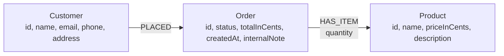

# Writing Cypher Queries That Return Only the Data Needed by the Application

## 1. Why Should Read Queries Care About What They Return?

In **Neo4j**, data is organized according to the **property graph** model: each node and relationship can carry many properties; **Cypher** queries can traverse many relationships and return nodes, relationships, paths, or computed values. When a Java application, REST API, or Spring Data Neo4j needs only a few fields to render, returning entire nodes and all related relationships can be wasteful.

For example, a "Recent Orders" screen only needs **order ID, status, total amount, and creation timestamp**, yet the query returns full `Customer`, `Order`, and `Product` nodes. Excess data inflates payload sizes sent over Bolt, increases object/JSON deserialization cost, and consumes memory holding the results. A query pattern traversing multiple relationships can also **multiply row counts** before data even reaches the application.

Core principle:

> **Start from the screen/API data contract, then write a Cypher query that produces the exact shape, row count, and fields required by that contract.**

This does not mean never returning nodes or paths: full-property editors or path visualizers may need them. Yet for lists, summary cards, dashboards, and most read endpoints, **projected** data is usually the right choice.

### 1.1. Three Dimensions to Constrain

| Dimension | Design Question | Common Cypher Tools |
|---|---|---|
| **Fields** | Which properties does each row need? | `RETURN n.id AS id`, map projection `n{.id, .name}` |
| **Row count** | At most how many results does each request need? | `WHERE`, `ORDER BY`, `LIMIT`, `SKIP`, or cursor pagination |
| **Graph expansion** | How many relationships to traverse and how should child nodes be grouped? | Scoped `MATCH` patterns, `WITH`, `OPTIONAL MATCH`, `collect()` |

Reducing **response size** does not automatically reduce **query execution cost**: a query returning 10 rows may still have to scan or sort many rows. Later sections clearly separate these two concerns.

## 2. Running Example: Orders List API

Suppose a sales system has the following nodes and relationships:



An endpoint `GET /customers/{customerId}/orders` needs to return a list of orders, up to 20 orders at a time. Illustrative data contract:

```json
[
  {
    "orderId": "ORD-101",
    "status": "SHIPPED",
    "totalInCents": 265000,
    "createdAt": "2026-11-20T09:15:00Z"
  }
]
```

This endpoint **does not need** email, phone number, address, internal notes, the products inside each order, or the entire graph structure. The returned data should contain only the four fields listed above.

### 2.1. Over-Fetching Approaches

```cypher
MATCH (customer:Customer {id: $customerId})-[:PLACED]->(o:Order)
RETURN customer, o;
```

The query above returns two **nodes** per row. The driver receives all properties of `customer` and `o`, including properties the endpoint does not use. If a customer has many orders, customer data is also repeated across many rows.

```cypher
MATCH (customer:Customer {id: $customerId})-[:PLACED]->(o:Order)
RETURN *;
```

`RETURN *` returns **every variable currently in query scope**; here `customer` and `o`. It does not fetch every node in the database, yet still returns more data than the API requires.

Similarly, `RETURN properties(o)` or `RETURN o{.*}` still fetches **all properties** of the order; changing how the data is packaged does not narrow what is retrieved.

### 2.2. Projecting Exactly the Four Needed Fields

```cypher
MATCH (:Customer {id: $customerId})-[:PLACED]->(o:Order)
RETURN
  o.id AS orderId,
  o.status AS status,
  o.totalInCents AS totalInCents,
  toString(o.createdAt) AS createdAt
ORDER BY o.createdAt DESC, o.id DESC
LIMIT $pageSize;
```

Here:

- `(:Customer {id: $customerId})` locates the customer; no variable is bound because the customer node is neither returned nor used elsewhere.
- `RETURN o.id ...` projects only the four fields requested by the application. Aliases `orderId`, `status`, ... are the column names seen by the Java Driver.
- `toString(o.createdAt)` illustrates converting a temporal value to a string for a DTO/JSON. If the application needs the native temporal object, return `o.createdAt` and convert in Java.
- `ORDER BY o.createdAt DESC, o.id DESC` establishes deterministic ordering. `id` should be a unique key to break ties when multiple orders share the same timestamp.
- `LIMIT $pageSize` caps the number of returned rows. The application still must bound page size to a reasonable range, such as 1–100.

This query assumes each order is linked to a customer via a single `PLACED` relationship. If data can have duplicate paths to the same order, fix the data constraints or handle duplicates intentionally.

**Note:** `LIMIT` restricts output rows, yet the database may still have to inspect or sort many orders to find the first slice. Filtering, indexing, and sorting efficiency must be verified separately.

## 3. Choosing Result Shape: Explicit Columns or Map Projection?

### 3.1. Returning Flat Columns

```cypher
MATCH (p:Product)
WHERE p.id = $productId
RETURN
  p.id AS id,
  p.name AS name,
  p.priceInCents AS priceInCents;
```

This shape maps easily to a Java record or DTO. Alias names must stay aligned with code calling `Record.get("id")` and `Record.get("name")`.

### 3.2. Returning a Map with Only the Needed Keys

```cypher
MATCH (p:Product {id: $productId})
RETURN p{
  .id,
  .name,
  priceInCents: p.priceInCents
} AS product;
```

**Map projection** `p{.id, .name, ...}` constructs a map containing only the selected fields. `.id` and `.name` pull the corresponding properties from the node; `priceInCents: ...` lets you specify an explicit expression or rename the key.

For example, if the API wants a `displayName` key:

```cypher
MATCH (p:Product {id: $productId})
RETURN p{
  .id,
  displayName: coalesce(p.name, 'Unnamed')
} AS product;
```

`coalesce(...)` picks the first non-`null` value, useful when an API expects a default. However, missing source fields are sometimes bugs that should be surfaced; do not replace `null` with defaults indiscriminately.

When a node lacks a property, test projections against mapper expectations and response schemas. Decide upfront whether the API expects `null`, an omitted field, or a data error before writing the mapper.

### 3.3. When Should You Return Nodes or Paths?

| Need | Appropriate Result Type |
|---|---|
| Product card: ID, name, price | Scalar columns or map projection |
| Order list: ID, status, date | Scalar columns, `ORDER BY`, and `LIMIT` |
| Order details including line items | An order map/DTO with an aggregated child list |
| UI visualizing the actual nodes and edges of a path | Nodes, relationships, or paths bounded by hop count and result limit |
| Admin tool editing every property of a node | Full node may be returned if genuinely needed |

Never use `RETURN n` merely because it is shorter than `RETURN n.id, n.name`; choose according to the data contract.

## 4. Limiting Rows Before Expanding Relationships

A classic hazard in property graphs is **row multiplication**. If 1 order has 8 product line items, the following query returns 8 rows repeating the order details:

```cypher
MATCH (:Customer {id: $customerId})-[:PLACED]->(o:Order)
MATCH (o)-[line:HAS_ITEM]->(p:Product)
RETURN o.id AS orderId, p.name AS productName, line.quantity AS quantity;
```

If the API expects **one row per order**, simply appending `LIMIT 20` at the end can limit to 20 **product line items**, not 20 **orders**. One order with many products can consume most of the page, and orders with no products disappear because `MATCH` requires the relationship to exist.

### 4.1. Paginate Orders First, Then Aggregate Line Items

Suppose a detailed list endpoint needs each order with its ID, status, and `items`:

```json
[
  {
    "orderId": "ORD-101",
    "status": "SHIPPED",
    "items": [
      {"productId": "P-7", "name": "Keyboard", "quantity": 1},
      {"productId": "P-9", "name": "Mouse", "quantity": 2}
    ]
  }
]
```

Query:

```cypher
MATCH (:Customer {id: $customerId})-[:PLACED]->(o:Order)
WHERE o.status IN $allowedStatuses
WITH o
ORDER BY o.createdAt DESC, o.id DESC
SKIP $offset
LIMIT $pageSize

OPTIONAL MATCH (o)-[line:HAS_ITEM]->(p:Product)
WITH
  o,
  collect(
    CASE
      WHEN p IS NULL THEN null
      ELSE {
        productId: p.id,
        name: p.name,
        quantity: line.quantity
      }
    END
  ) AS items
RETURN
  o.id AS orderId,
  o.status AS status,
  items
ORDER BY o.createdAt DESC, o.id DESC;
```

How the stages work:

1. `MATCH` finds the customer's orders; `WHERE` keeps only the requested statuses.
2. `WITH o ORDER BY ... SKIP ... LIMIT ...` selects the **page of orders** before querying line items.
3. `OPTIONAL MATCH` preserves orders that have no matching line items; a plain `MATCH` would drop empty orders.
4. `collect(...)` gathers line items into a list per `o`. The `p IS NULL` branch avoids inserting a dummy map into the list; `collect()` ignores `null`.
5. `RETURN` outputs only the requested fields and restores the final ordering.

**Important caveat:** Paginating by order alone does not cap **the number of line items within a single order**. If one order has tens of thousands of items, the response will still be huge. In such cases, design a separate detail endpoint, enforce business caps, or paginate line items. You cannot put a small `LIMIT` at the very end while keeping the meaning "N orders, each with all its line items".

### 4.2. Do Not Use DISTINCT as a Cure-All

`DISTINCT` helps when an item legitimately appears multiple times via the traversal pattern, yet it does not redefine a one-order-per-row contract:

```cypher
MATCH (o:Order)-[:HAS_ITEM]->(p:Product)
RETURN DISTINCT o.id AS orderId, p.id AS productId;
```

The result still has **one row per distinct order–product pair**. If the client expects one row per order, decide whether to use `collect()`, another aggregation, or drop the product traversal altogether if unneeded.

If you only need the **product count** instead of the full list, returning an aggregated value is much cheaper than sending every product to Java just to count them:

```cypher
MATCH (o:Order {id: $orderId})
OPTIONAL MATCH (o)-[:HAS_ITEM]->(p:Product)
RETURN o.id AS orderId, count(p) AS productCount;
```

This example counts relationship rows with a matching product. It is **not the sum of `quantity`** across line items; if the contract requires total units, sum `line.quantity` with an appropriate `null`-handling rule.

## 5. Paginating the Right Entity in the Right Order

### 5.1. Pagination with SKIP/LIMIT

```cypher
MATCH (:Customer {id: $customerId})-[:PLACED]->(o:Order)
RETURN o.id AS orderId, o.status AS status
ORDER BY o.createdAt DESC, o.id DESC
SKIP $offset
LIMIT $pageSize;
```

For page 2 with page size 20, pass `$offset = 20`. This is simple to implement, though large offsets can force the database to walk through many results before the target page. If data changes between requests, inserts/deletes can also cause duplicates or skips across pages.

**Never paginate without `ORDER BY`**, because result order is not guaranteed. When multiple records share the same date, include a unique key like `o.id` for stable pagination.

### 5.2. Cursor Pagination for Long Lists

If an API fetches sequential pages ordered by `createdAt DESC, id DESC`, use the position of the last item from the previous page:

```cypher
MATCH (:Customer {id: $customerId})-[:PLACED]->(o:Order)
WHERE
  $cursorCreatedAt IS NULL
  OR o.createdAt < $cursorCreatedAt
  OR (
    o.createdAt = $cursorCreatedAt
    AND o.id < $cursorId
  )
RETURN
  o.id AS orderId,
  o.status AS status,
  o.totalInCents AS totalInCents,
  o.createdAt AS createdAt
ORDER BY o.createdAt DESC, o.id DESC
LIMIT $pageSize;
```

In this example, `$cursorCreatedAt` must have the same **temporal type** as `o.createdAt` (e.g., passed via the Java Driver as a compatible temporal value), and `$cursorId` must match the type of `o.id`. For the first page, pass `null` for `cursorCreatedAt`. Thereafter, pass the `createdAt` and `orderId` of the last item to request the next page.

Cursors avoid many pitfalls of deep offsets, though runtime efficiency still depends on the data model, indexes, and query plan. Nor does a cursor create an immutable snapshot if data changes between requests; the application needs an appropriate consistency policy.

## 6. Parameterized Filtering and Index Awareness

Returning fewer fields will not make up for a query scanning the entire graph. For an endpoint looking up a customer by ID:

```cypher
MATCH (c:Customer {id: $customerId})
RETURN c.id AS id, c.name AS name;
```

pair it with an appropriate **unique constraint or index** on `:Customer(id)` according to the data model. For example, if `Customer.id` is truly a unique business key:

```cypher
CREATE CONSTRAINT customer_id_unique IF NOT EXISTS
FOR (c:Customer)
REQUIRE c.id IS UNIQUE;
```

That statement is a **schema-modifying operation**, run only during environment setup after verifying existing data satisfies uniqueness. Never execute constraint creation on every read request.

Key reminders:

- Place `WHERE` and entry-point selection properly to minimize traversed nodes/relationships; specify exact labels and relationship types whenever known.
- Use **parameters** `$customerId`, `$pageSize`, `$allowedStatuses`, ... rather than concatenating user input. Validate values (types, page bounds, allowed statuses).
- Indexes help locate starting nodes, yet do not guarantee every `ORDER BY`/`LIMIT` is cheap. Test queries against realistic data.
- Fetching only needed data also reduces passing sensitive properties across application layers; however, access control must still be enforced independently.

## 7. Returning Lean Results to the Java Driver

When Cypher columns match the DTO directly, Java code avoids reading whole nodes and stripping fields manually.

Example using the Neo4j Java Driver API supporting `Session.executeRead(...)`:

```java
import java.util.List;
import java.util.Map;
import org.neo4j.driver.Driver;
import org.neo4j.driver.Result;
import org.neo4j.driver.Session;
import org.neo4j.driver.SessionConfig;

public class OrderQueries {
    public record OrderSummary(
            String orderId,
            String status,
            long totalInCents,
            String createdAt
    ) {}

    public static List<OrderSummary> findRecentOrders(
            Driver driver, String customerId, int requestedPageSize) {

        if (customerId == null || customerId.isBlank()) {
            throw new IllegalArgumentException("customerId is required");
        }
        int pageSize = Math.max(1, Math.min(requestedPageSize, 100));

        String cypher = """
                MATCH (:Customer {id: $customerId})-[:PLACED]->(o:Order)
                RETURN
                    o.id AS orderId,
                    o.status AS status,
                    o.totalInCents AS totalInCents,
                    toString(o.createdAt) AS createdAt
                ORDER BY o.createdAt DESC, o.id DESC
                LIMIT $pageSize
                """;

        try (Session session = driver.session(
                SessionConfig.forDatabase("neo4j"))) {
            return session.executeRead(tx -> {
                Result result = tx.run(
                        cypher,
                        Map.of("customerId", customerId, "pageSize", pageSize)
                );
                return result.list(record -> new OrderSummary(
                        record.get("orderId").asString(),
                        record.get("status").asString(),
                        record.get("totalInCents").asLong(),
                        record.get("createdAt").asString()
                ));
            });
        }
    }
}
```

Points to remember:

- `record.get("orderId")` looks up columns by their **Cypher alias**. If an alias changes without updating the mapper, the code will fail.
- `result.list(...)` materializes the list in memory, so enforce a sensible row limit. For large datasets or streaming needs, check the cursor/stream API of your driver version.
- The snippet assumes schema conformance: `status` and `createdAt` exist, and `totalInCents` is an integer fitting `long`. When values can be `null`, use a nullable DTO and check `Value.isNull()` before calling conversion methods.
- Choose the database name and configure the Java Driver version appropriately for your environment; the sample snippet does not dictate `Driver` wiring or authentication.

### 7.1. With Spring Data Neo4j

In Spring Data Neo4j, do not assume every list endpoint must load full aggregate entities and all related relationships. For summary reads, use **DTOs/projections** or custom queries with `Neo4jClient` and a mapper converting `Record` to a DTO.

Illustrative mapping idea:

```java
// Inside a component with an injected Neo4jClient:
record ProductCard(String id, String name, long priceInCents) {}

Collection<ProductCard> cards = neo4jClient.query("""
        MATCH (p:Product)
        WHERE p.id IN $productIds
        RETURN p.id AS id, p.name AS name,
               p.priceInCents AS priceInCents
        """)
    .bind(productIds).to("productIds")
    .fetchAs(ProductCard.class)
    .mappedBy((typeSystem, record) ->
        new ProductCard(
            record.get("id").asString(),
            record.get("name").asString(),
            record.get("priceInCents").asLong()
        )
    )
    .all();
```

This snippet is meant to sit **inside a class/component** that already has `neo4jClient` and `productIds`; imports, wiring, and empty-input handling depend on the project. Check the exact API of your Spring Data Neo4j version. The key idea is defining the **DTO contract first**, then having Cypher produce only the columns the DTO needs.

If using repository `@Query` methods and interface projections, verify mapping rules and feature support for your exact Spring Data Neo4j version; switching from a full entity to a DTO is not always just changing the return type.

## 8. Total Counts, Detailed Lists, and the N+1 Problem

A paginated API may need both `items` and `totalItems`. A `LIMIT`-bounded list query does not tell you the total number of orders before pagination.

If the API genuinely needs a total count, run a dedicated query with the same filters:

```cypher
MATCH (:Customer {id: $customerId})-[:PLACED]->(o:Order)
WHERE o.status IN $allowedStatuses
RETURN count(o) AS totalItems;
```

Do not include `HAS_ITEM` expansion in the count query when the goal is only counting orders, as joining product line items can distort the count or add unnecessary cost. If the model allows multiple paths to the same order, consider `count(DISTINCT o)` and data constraints.

Conversely, **do not** run a count query by default on every request: if the UI only needs to know "is there a next page?", fetch `pageSize + 1` records to determine `hasNext`, then return at most `pageSize` items to the client.

A common Java-side mistake:

1. First query fetches 20 orders.
2. For each order, code executes another query to fetch its products.
3. Total: **21 queries** for a single page.

This is the classic **N+1 queries** anti-pattern. Avoid it either with an aggregated `collect()` query as in Section 4, or with a single batch query fetching line items for the **list of orderIds** and joining in Java. Choose based on child row volume and API needs; "cramming everything into one query" is not always better if it explodes intermediate result sizes.

## 9. Measuring Results: Fewer Bytes Does Not Guarantee a Faster Query

Evaluate across two sets of metrics:

| Neo4j Server Side | Application / API Side |
|---|---|
Intermediate and final row counts per operator in the execution plan | JSON response size or bytes received from the driver |
`DB Hits`, scan/expand/sort operators, execution time | Number of records/objects materialized |
Index usage, query memory consumption | Time spent mapping/serializing to DTO/JSON |
Result size before and after `collect()` | End-to-end latency, JVM memory, round-trip count |

Inspect the plan without executing the query:

```cypher
EXPLAIN
MATCH (:Customer {id: $customerId})-[:PLACED]->(o:Order)
RETURN o.id AS orderId, o.status AS status
ORDER BY o.createdAt DESC, o.id DESC
LIMIT $pageSize;
```

To observe execution statistics, run `PROFILE` with the exact same query and parameters:

```cypher
PROFILE
MATCH (:Customer {id: $customerId})-[:PLACED]->(o:Order)
RETURN o.id AS orderId, o.status AS status
ORDER BY o.createdAt DESC, o.id DESC
LIMIT $pageSize;
```

`PROFILE` **executes the query**. The example above is read-only; for queries containing writes, consider side effects before running. Plan output displays operators, Rows, DB Hits, and index usage depending on the tool and Neo4j version. It does not measure HTTP/JSON bytes sent by your API; observe those on the application side.

A helpful comparison is holding the dataset and parameters constant:

| Approach | Returned Result | What to Compare |
|---|---|---|
| `RETURN customer, o` | Full nodes, customer repeated across rows | Payload/DTO size, Java processing |
| `RETURN o.id, o.status, ...` | Four required columns | Payload/DTO size, query latency |
| Expanding products before `LIMIT` | Rows per order–product relationship | Row cardinality, pagination correctness |
| `LIMIT` orders first, then `collect()` | One row per order containing item list | Row cardinality, memory and item list size |

Never assume a query is optimal just because it returns fewer columns; traversing extra relationships, `DISTINCT`, `collect()`, or `ORDER BY` introduces other costs. Pick the design that both satisfies the API contract and meets measured performance targets.

## 10. Common Design Mistakes

| Practice | Problem | Fix |
|---|---|---|
| `RETURN *` in public APIs | Output changes when query variables change; leaks or over-fetches data | Return explicit aliases or map projections |
| `RETURN n` when only `n.id` is needed | Sends whole node and unused properties | `RETURN n.id AS id` |
| `MATCH` all relationships, then `LIMIT` | Caps expanded rows, wrong pagination unit | Identify root node set and paginate before expanding |
| Missing `ORDER BY` | Unstable page results | Sort with a tie-breaker key |
| `OPTIONAL MATCH` with misplaced filter | Accidentally drops rows missing relationships | Clarify `null` semantics and filter placement |
| `collect()` all relationships of all nodes | Huge lists, high memory usage | Bound root nodes and child data, or split endpoints |
| Slapping `DISTINCT` on everything | Deduplication cost without fixing true cardinality | Define which entity one row represents |
| Fetching all orders and filtering status in Java | Wastes bandwidth and RAM | Move filter predicates into `WHERE` |
| Querying items once per order | N+1 round-trips | Use a batch query or controlled relationship aggregation |
| Returning `createdAt` inconsistently as string vs. temporal | Inconsistent mappers/JSON | Standardize type and convert at a single layer |

## 11. Applied Exercises

### Exercise 1: Product Card API

Requirement: return only `id`, `name`, and `priceInCents` for a product matching `$productId`. Write Cypher without returning the full node.

<details>
<summary>Suggested Solution</summary>

```cypher
MATCH (p:Product {id: $productId})
RETURN
  p.id AS id,
  p.name AS name,
  p.priceInCents AS priceInCents;
```

</details>

### Exercise 2: Paginating 10 Orders

An application wants 10 orders for a customer, sorted by `createdAt` descending with tie-breaker `id`. Identify why the snippet below is wrong:

```cypher
MATCH (:Customer {id: $customerId})-[:PLACED]->(o:Order)
MATCH (o)-[:HAS_ITEM]->(p:Product)
RETURN o.id, p.name
LIMIT 10;
```

**Hint:** This snippet has no sorting, paginates over **order–product rows** instead of orders, and drops orders with no products. Start from `o`, apply `ORDER BY ... LIMIT 10` inside `WITH`, and only then join `HAS_ITEM` if the API genuinely needs products.

### Exercise 3: Verifying an Optimization

A new query returns only 4 columns instead of the full `Order` node. API response latency barely changed. Can we conclude the change is useless?

**Hint:** Not yet. Compare transferred byte count, DTO deserialization/mapping time, and Java heap usage. Also inspect `PROFILE`: the server may still spend most of its time scanning or sorting; in that case, you need indexes, better filters, or a different pagination strategy to improve speed.

## 12. Key Takeaways

In Neo4j, optimizing read queries begins by defining **what one result row represents** and **which exact properties the application needs**. Use explicit `RETURN` projections or map projections to narrow columns; use `WHERE`, `ORDER BY`, and pagination to bound rows; use `WITH` before expanding relationships and `collect()` when an API needs nested structures.

With the Java Driver or Spring Data Neo4j, map Cypher aliases directly to DTOs and avoid loading unnecessary entities and relationships. Finally, evaluate both the **Neo4j query plan** and **application-side payload, object allocations, and processing time** to confirm real-world gains.
