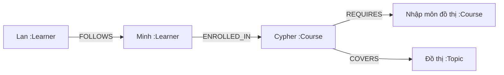
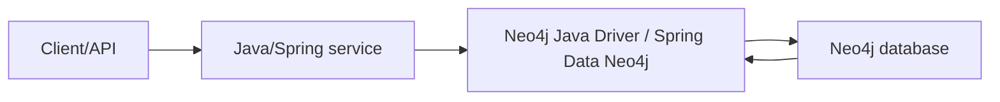

# Cơ sở dữ liệu đồ thị là gì và bài toán Neo4j giải quyết

> **Chương:** Tổng quan Neo4j  
> **Phạm vi:** `DATABASE_ENGINE_GRAPH_NEO4J` — sử dụng Neo4j để mô hình hóa dữ liệu liên kết theo *property graph* và truy vấn quan hệ, đường đi bằng Cypher. Đây là nền tảng để học tiếp về node, relationship, index, constraint, tối ưu truy vấn, nhập dữ liệu, Java Driver, Spring Data Neo4j và vận hành hệ thống đồ thị.

## 1. Mục tiêu học tập

Sau bài này, bạn có thể:

1. Giải thích cơ sở dữ liệu đồ thị là gì và phân biệt **node**, **relationship**, **label** và **property**.
2. Nhận ra những yêu cầu mà **quan hệ giữa các thực thể là đối tượng cần truy vấn trực tiếp**, chẳng hạn tìm người quen nhiều cấp, chuỗi phụ thuộc, gợi ý và phát hiện nhóm giao dịch đáng ngờ.
3. Diễn giải khi nào một mô hình *property graph* phù hợp hơn cách tổ chức bảng quan hệ hoặc tài liệu JSON, đồng thời nhận biết giới hạn của nó.
4. Đọc và viết những truy vấn Cypher cơ bản để tìm một kết nối, đi qua nhiều kết nối và xác định đường đi.
5. Giải thích vì sao **hướng quan hệ, độ dài đường đi, điểm bắt đầu và số lượng kết nối** ảnh hưởng đến kết quả và chi phí truy vấn.
6. Xác định các câu hỏi thiết kế ban đầu trước khi đưa Neo4j vào ứng dụng thực tế.

## 2. Khi dữ liệu không chỉ là các bản ghi riêng lẻ

Giả sử một nền tảng học tập lưu học viên, khóa học, chủ đề và các khóa học tiên quyết. Những câu hỏi đơn giản như “Tên khóa học C102 là gì?” thường chỉ cần tìm một bản ghi. Nhưng hệ thống còn phải trả lời:

- Một học viên đang theo dõi những ai, kể cả người được theo dõi *gián tiếp* qua một hoặc hai cấp?
- Những khóa học nào đã được người trong mạng lưới của học viên hoàn thành mà học viên chưa học?
- Muốn học Spring Data Neo4j thì cần đi qua chuỗi kiến thức tiên quyết nào?
- Hai thực thể liên hệ với nhau qua những bước trung gian nào, và đường đi nào có ít bước nhất?

Điểm chung là câu trả lời phụ thuộc vào **cấu trúc kết nối**. Mỗi kết nối có ý nghĩa riêng, có hướng, đôi khi mang dữ liệu bổ sung như thời điểm ghi danh, trạng thái học hoặc vai trò của người tham gia. Khi chuỗi kết nối dài hoặc chiều sâu chưa biết trước, việc tìm dữ liệu rồi tự ghép các cấp quan hệ trong mã ứng dụng dễ trở nên phức tạp.

**Cơ sở dữ liệu đồ thị (graph database)** là một loại cơ sở dữ liệu được thiết kế để lưu trữ và truy vấn dữ liệu có tính liên kết cao. Thay vì xem mối liên hệ chỉ là một khóa ngoại để đối chiếu, hệ thống biểu diễn mối liên hệ thành phần tử của mô hình dữ liệu mà truy vấn có thể đi qua trực tiếp.

Về mặt khái niệm, một đồ thị gồm tập **đỉnh** \(V\) và tập **cạnh** \(E\), thường ký hiệu \(G=(V,E)\). Trong ứng dụng nghiệp vụ, đỉnh đại diện thực thể, cạnh đại diện quan hệ giữa các thực thể. Neo4j sử dụng một dạng đồ thị cụ thể là **labeled property graph**.

## 3. Property graph trong Neo4j

Một *property graph* có bốn thành phần cốt lõi:

| Thành phần | Ý nghĩa | Ví dụ trong hệ thống học tập |
| --- | --- | --- |
| **Node** (nút/đỉnh) | Đại diện cho một thực thể, đối tượng hoặc khái niệm | Học viên Lan; khóa học Cypher; chủ đề Graph |
| **Label** (nhãn) | Phân loại node; một node có thể có nhiều label | `:Learner`, `:Course`, `:Topic` |
| **Relationship** (quan hệ/cạnh) | Kết nối trực tiếp hai node, có **loại** và **hướng** | `(Lan)-[:FOLLOWS]->(Minh)` |
| **Property** (thuộc tính) | Dữ liệu dạng cặp khóa–giá trị gắn với node hoặc relationship | `Learner.id`, `Course.title`, `ENROLLED_IN.status` |

Sơ đồ khái niệm:



Đọc một mẫu Cypher:

```cypher
(l:Learner {id: 'U1'})-[:FOLLOWS]->(m:Learner)
```

Mẫu này có nghĩa: một node `l` mang label `Learner`, có property `id = 'U1'`, kết nối **theo chiều đi ra** bằng relationship loại `FOLLOWS` đến một node `m` mang label `Learner`.

Một số điểm cần nắm chắc:

- **Relationship có hướng.** `(a)-[:FOLLOWS]->(b)` không tự động suy ra `(b)-[:FOLLOWS]->(a)`. Nếu bài toán chỉ quan tâm có kết nối, Cypher có thể dùng mẫu không chỉ định chiều như `(a)-[:RELATED_TO]-(b)`; dữ liệu relationship vẫn có hướng lưu trữ.
- **Relationship có thể mang thuộc tính.** Trong `(u)-[e:ENROLLED_IN]->(c)`, `e.status = 'COMPLETED'` mô tả việc *u học c*, không phải trạng thái cố định của học viên hoặc của khóa học.
- **Hai node có thể nối bởi nhiều relationship.** Chẳng hạn cùng một người có thể vừa `FOLLOWS` vừa `MENTORS` một người khác. Quy tắc nghiệp vụ quyết định loại và số lượng kết nối được phép.
- **Label không phải bảng SQL.** Một node có thể đồng thời mang nhiều label, chẳng hạn `:Person:Instructor`; label giúp mô tả và chọn tập node cần tìm.
- **Neo4j không tự hiểu mọi quy tắc nghiệp vụ.** Tên quan hệ như `REQUIRES` mang ý nghĩa do ứng dụng quy định; nếu cần cấm chu trình tiên quyết hoặc cấm ghi danh trùng, ứng dụng phải thiết kế và kiểm soát các bất biến đó.

### Graph database không đồng nghĩa với mọi “graph” khác

*Property graph* của Neo4j là một cách biểu diễn đồ thị phục vụ ứng dụng. **RDF/knowledge graph** thường dùng bộ ba subject–predicate–object và hệ sinh thái truy vấn SPARQL. Chúng có vùng giao nhau về ý tưởng liên kết thực thể, nhưng mô hình, hệ quy chiếu ngữ nghĩa và ngôn ngữ truy vấn không đồng nhất. **Biểu đồ trực quan (graph visualization)** chỉ là cách hiển thị: cơ sở dữ liệu đồ thị vẫn có giá trị khi ứng dụng trả về bảng kết quả hoặc JSON thay vì vẽ mạng lưới.

## 4. Neo4j giải quyết những lớp bài toán nào?

Neo4j là hệ quản trị cơ sở dữ liệu đồ thị sử dụng property graph và ngôn ngữ truy vấn **Cypher**. Thế mạnh nổi bật là mô tả những mẫu kết nối phức tạp bằng các mẫu đường đi dễ đọc và truy vấn các thực thể liên quan qua nhiều bước.

| Bài toán | Node thường gặp | Relationship có ý nghĩa | Câu hỏi điển hình |
| --- | --- | --- | --- |
| Mạng xã hội, cộng đồng | Người dùng, nhóm, bài viết | `FOLLOWS`, `MEMBER_OF`, `LIKES` | Ai kết nối với tôi qua tối đa hai cấp? |
| Gợi ý nội dung, sản phẩm | Người dùng, sản phẩm, chủ đề | `VIEWED`, `PURCHASED`, `SIMILAR_TO` | Người có hành vi gần nhau còn quan tâm điều gì? |
| Phòng chống gian lận | Tài khoản, thiết bị, thẻ, giao dịch | `USES_DEVICE`, `TRANSFERRED_TO`, `OWNS` | Nhiều tài khoản có dùng chung thiết bị và dòng tiền không? |
| Quản lý phụ thuộc | Dịch vụ, thư viện, khóa học, tác vụ | `DEPENDS_ON`, `REQUIRES` | Một thành phần hỏng ảnh hưởng gián tiếp đến đâu? |
| Danh mục tri thức, phân quyền | Tài liệu, tác giả, nhóm, tài nguyên | `REFERENCES`, `MEMBER_OF`, `CAN_ACCESS` | Người này được cấp quyền qua những nhóm nào? |
| Định tuyến, khám phá đường đi | Trạm, địa điểm, nút mạng | `CONNECTED_TO`, `ROUTE_TO` | Có đường đi hợp lệ không? Đường nào ngắn nhất theo số bước? |

Điểm quyết định không nằm ở việc hệ thống có bảng “quan hệ” hay không — phần lớn hệ thống đều có. Neo4j đặc biệt hữu ích khi **việc khám phá chuỗi kết nối là một thao tác thường xuyên hoặc trọng tâm sản phẩm**. Ví dụ, một trang quản trị chỉ hiển thị danh sách khóa học theo mã có thể chưa cần đồ thị; nhưng hệ thống liên tục phân tích nhiều tầng tiên quyết, gợi ý theo mạng học viên và tìm đường liên kết giữa các chủ đề có một nhu cầu đồ thị rõ ràng.

### Ví dụ: điều tra gian lận qua thực thể dùng chung

Một giao dịch đơn lẻ có thể không đáng ngờ. Nhưng nếu nhiều tài khoản chưa từng tương tác trực tiếp lại cùng sử dụng một thiết bị, cùng nhận tiền qua một nhóm tài khoản trung gian, thì **mẫu kết nối** trở thành tín hiệu điều tra. Biểu diễn tài khoản, thiết bị và giao dịch thành node/relationship giúp đặt câu hỏi “Những tài khoản nào cách tài khoản đang xét tối đa ba kết nối qua thiết bị chung?”.

Đó là ứng dụng của khám phá quan hệ, **không phải kết luận tự động rằng mọi cụm kết nối đều gian lận**. Kết quả còn cần quy tắc nghiệp vụ, dữ liệu theo thời gian, đánh giá rủi ro và kiểm chứng.

## 5. So sánh tư duy dữ liệu: quan hệ, tài liệu và đồ thị

Giả sử cơ sở dữ liệu quan hệ có các bảng `learners`, `courses`, `follows`, `enrollments`, `course_prerequisites`. Với một kết nối trực tiếp, SQL `JOIN` thường rõ ràng và hiệu quả. Khi cần theo dõi chuỗi tiên quyết chưa biết trước bao nhiêu cấp, ta có thể dùng **recursive CTE**, truy vấn nhiều lần hoặc xử lý bằng code. Trong Neo4j, chuỗi đó có thể thể hiện trực tiếp bằng một mẫu đường đi của Cypher.

| Tiêu chí | CSDL quan hệ (ví dụ PostgreSQL) | CSDL tài liệu (ví dụ MongoDB) | Neo4j/property graph |
| --- | --- | --- | --- |
| Mô hình trung tâm | Bảng, hàng, khóa, khóa ngoại | Tài liệu và cấu trúc lồng nhau | Node, relationship, label, property |
| Tác vụ tự nhiên | Giao dịch, báo cáo có cấu trúc, tổng hợp bảng | Đọc/ghi một tài liệu hoặc cụm dữ liệu thường đi cùng nhau | Khám phá quan hệ và đường đi qua nhiều thực thể |
| Kết nối qua nhiều cấp | `JOIN`, recursive CTE hoặc code ứng dụng | Tham chiếu/lookup hoặc code ứng dụng | Mẫu quan hệ có độ dài xác định hoặc biến thiên |
| Lợi thế thường thấy | Ràng buộc, SQL và hệ sinh thái phân tích trưởng thành | Linh hoạt đối với dữ liệu tài liệu phân cấp | Biểu diễn trực tiếp kết nối nghiệp vụ và truy vấn theo đường đi |
| Điều cần cân nhắc | Số lượng phép nối và cách tối ưu truy vấn | Quan hệ đa chiều gây khó khi phải cập nhật nhiều tài liệu | Traversal rộng, node kết nối quá nhiều, truy vấn toàn đồ thị, chi phí vận hành |

Không thể kết luận “Neo4j luôn nhanh hơn SQL”. Cơ sở dữ liệu quan hệ có chỉ mục, tối ưu hóa join và truy vấn đệ quy rất mạnh; Neo4j cũng có thể chậm nếu truy vấn bắt đầu quá rộng hoặc mở rộng quá nhiều đường đi. Lựa chọn nên dựa trên **truy vấn thực tế, quy mô dữ liệu, phân bố số kết nối, yêu cầu giao dịch, khả năng vận hành và phép đo trên dữ liệu đại diện**.

Một hệ thống cũng có thể dùng nhiều công nghệ: ví dụ cơ sở dữ liệu quan hệ quản lý đơn hàng, còn Neo4j lưu mạng lưới phụ thuộc hoặc kết nối để phục vụ tìm kiếm/gợi ý. Khi đó phải xác định nguồn dữ liệu chuẩn và cơ chế đồng bộ để tránh các phiên bản dữ liệu mâu thuẫn.

## 6. Thực hành: mô hình một nền tảng học tập bằng Neo4j

Chúng ta xây dựng một đồ thị nhỏ, có thể chạy trên môi trường Neo4j hỗ trợ Cypher. Ví dụ sử dụng cú pháp constraint của **Neo4j 5.x trở lên**. Chạy từng khối theo thứ tự trên cơ sở dữ liệu dùng để thực hành, không dùng dữ liệu sản xuất.

### 6.1. Xác định thực thể và quan hệ

| Loại | Ý nghĩa và chiều | Dữ liệu tiêu biểu |
| --- | --- | --- |
| `(:Learner)` | Học viên | `id`, `name` |
| `(:Course)` | Khóa học | `id`, `title`, `level` |
| `(:Topic)` | Chủ đề kiến thức | `code`, `name` |
| `(Learner)-[:FOLLOWS]->(Learner)` | Học viên nguồn theo dõi học viên đích | Có thể thêm `since` |
| `(Learner)-[:ENROLLED_IN]->(Course)` | Một lượt ghi danh, với trạng thái học | `status` |
| `(Course)-[:REQUIRES]->(Course)` | Khóa ở đầu mũi tên **cần học** khóa ở cuối mũi tên | Có thể thêm `requiredLevel` |
| `(Course)-[:COVERS]->(Topic)` | Khóa học bao quát chủ đề | Có thể thêm `depth` |

Ví dụ, `(Spring Data Neo4j)-[:REQUIRES]->(Cypher)` có nghĩa **Spring Data Neo4j cần kiến thức Cypher**. Quy ước chiều phải nhất quán; đổi chiều một cạnh sẽ thay đổi ý nghĩa mọi truy vấn đường đi.

### 6.2. Định danh dữ liệu bằng constraint

Mỗi node có một mã nghiệp vụ ổn định (`id` hoặc `code`). Constraint giúp ngăn các node có cùng label và cùng mã bị tạo trùng:

```cypher
CREATE CONSTRAINT learner_id_unique IF NOT EXISTS
FOR (l:Learner) REQUIRE l.id IS UNIQUE;

CREATE CONSTRAINT course_id_unique IF NOT EXISTS
FOR (c:Course) REQUIRE c.id IS UNIQUE;

CREATE CONSTRAINT topic_code_unique IF NOT EXISTS
FOR (t:Topic) REQUIRE t.code IS UNIQUE;
```

Constraint duy nhất như trên tạo chỉ mục phục vụ tìm node theo khóa đã khai báo. Trong thực tế, `UNIQUE` không đồng nghĩa bắt buộc property tồn tại trên mọi node; nếu nghiệp vụ yêu cầu cả hai tính chất, cần thiết kế ràng buộc phù hợp với phiên bản/edition Neo4j đang dùng và kiểm tra khả năng hỗ trợ. **Không dùng ID nội bộ của node làm mã nghiệp vụ bền vững** vì nó không phải hợp đồng định danh ổn định cho hệ thống bên ngoài.

### 6.3. Tạo các node

`MERGE` tìm mẫu phù hợp hoặc tạo mới nếu chưa có; `SET` cập nhật thuộc tính. Việc dùng `MERGE` theo mã nghiệp vụ giúp chạy lại dữ liệu mẫu dễ kiểm soát hơn so với tạo node mới mỗi lần.

```cypher
MERGE (lan:Learner {id: 'U1'})
SET lan.name = 'Lan';

MERGE (minh:Learner {id: 'U2'})
SET minh.name = 'Minh';

MERGE (an:Learner {id: 'U3'})
SET an.name = 'An';

MERGE (graph:Course {id: 'C101'})
SET graph.title = 'Nhập môn đồ thị', graph.level = 'Cơ bản';

MERGE (cypher:Course {id: 'C102'})
SET cypher.title = 'Truy vấn Cypher', cypher.level = 'Trung cấp';

MERGE (java:Course {id: 'C103'})
SET java.title = 'Java căn bản', java.level = 'Cơ bản';

MERGE (sdn:Course {id: 'C104'})
SET sdn.title = 'Spring Data Neo4j', sdn.level = 'Nâng cao';

MERGE (graphTopic:Topic {code: 'GRAPH'})
SET graphTopic.name = 'Đồ thị';

MERGE (javaTopic:Topic {code: 'JAVA'})
SET javaTopic.name = 'Java';
```

### 6.4. Tạo các relationship

Các mẫu `MATCH` tìm node đã có; các mẫu `MERGE` nối chúng bằng relationship cụ thể. Khi liên kết đã xác định, đặt dữ liệu về trạng thái trên relationship để biểu diễn trạng thái **của lần học một khóa**, không đặt trên node học viên hoặc khóa học.

```cypher
MATCH (lan:Learner {id: 'U1'}),
      (minh:Learner {id: 'U2'}),
      (an:Learner {id: 'U3'})
MERGE (lan)-[:FOLLOWS]->(minh)
MERGE (minh)-[:FOLLOWS]->(an);

MATCH (lan:Learner {id: 'U1'}),
      (minh:Learner {id: 'U2'}),
      (an:Learner {id: 'U3'}),
      (graph:Course {id: 'C101'}),
      (cypher:Course {id: 'C102'}),
      (java:Course {id: 'C103'}),
      (sdn:Course {id: 'C104'})
MERGE (lan)-[e1:ENROLLED_IN]->(graph)
SET e1.status = 'COMPLETED'
MERGE (lan)-[e2:ENROLLED_IN]->(java)
SET e2.status = 'IN_PROGRESS'
MERGE (minh)-[e3:ENROLLED_IN]->(cypher)
SET e3.status = 'COMPLETED'
MERGE (an)-[e4:ENROLLED_IN]->(sdn)
SET e4.status = 'COMPLETED';

MATCH (graph:Course {id: 'C101'}),
      (cypher:Course {id: 'C102'}),
      (java:Course {id: 'C103'}),
      (sdn:Course {id: 'C104'}),
      (graphTopic:Topic {code: 'GRAPH'}),
      (javaTopic:Topic {code: 'JAVA'})
MERGE (cypher)-[:REQUIRES]->(graph)
MERGE (sdn)-[:REQUIRES]->(cypher)
MERGE (sdn)-[:REQUIRES]->(java)
MERGE (graph)-[:COVERS]->(graphTopic)
MERGE (cypher)-[:COVERS]->(graphTopic)
MERGE (java)-[:COVERS]->(javaTopic)
MERGE (sdn)-[:COVERS]->(graphTopic)
MERGE (sdn)-[:COVERS]->(javaTopic);
```

Sau khi tạo dữ liệu, đồ thị có 3 học viên, 4 khóa học, 2 chủ đề cùng các kết nối trực tiếp. Mô hình nhỏ này đủ để thực hành cả truy vấn một bước lẫn nhiều bước.

### 6.5. Truy vấn một kết nối

Tìm khóa học của Lan và trạng thái học:

```cypher
MATCH (u:Learner {id: 'U1'})-[e:ENROLLED_IN]->(c:Course)
RETURN u.name AS hoc_vien,
       c.title AS khoa_hoc,
       e.status AS trang_thai
ORDER BY c.id;
```

Kết quả dự kiến: Lan đã hoàn thành **Nhập môn đồ thị** (`COMPLETED`) và đang học **Java căn bản** (`IN_PROGRESS`). `MATCH` tìm một mẫu con trong đồ thị, còn `RETURN` chọn dữ liệu cần trả về — không bắt buộc trả toàn bộ node.

### 6.6. Truy vấn quan hệ nhiều cấp

Tìm các học viên mà Lan theo dõi trực tiếp hoặc gián tiếp trong tối đa hai bước:

```cypher
MATCH (lan:Learner {id: 'U1'})-[:FOLLOWS*1..2]->(other:Learner)
RETURN DISTINCT other.id AS id, other.name AS hoc_vien
ORDER BY id;
```

`*1..2` chỉ độ dài đường đi từ **1 đến 2 relationship**. Kết quả dự kiến là **Minh** (một bước) và **An** (hai bước). `DISTINCT` hữu ích khi nhiều đường đi khác nhau có thể dẫn tới cùng một node. Đây là ví dụ ngắn cho *variable-length traversal* — một nhu cầu thường gặp của graph database.

Với dữ liệu lớn, không nên mặc định dùng đường đi có số bước không giới hạn. Khi mỗi node có nhiều nhánh, số đường đi ứng viên có thể tăng rất nhanh; cần giới hạn chiều sâu và lọc loại quan hệ phù hợp với câu hỏi.

### 6.7. Gợi ý khóa học qua mạng học viên

Yêu cầu: “Tìm khóa học mà người Lan theo dõi trong tối đa hai bước đã hoàn thành, nhưng Lan chưa ghi danh.”

```cypher
MATCH (lan:Learner {id: 'U1'})-[:FOLLOWS*1..2]->(peer:Learner)
      -[e:ENROLLED_IN]->(course:Course)
WHERE e.status = 'COMPLETED'
  AND NOT EXISTS {
    MATCH (lan)-[:ENROLLED_IN]->(course)
  }
RETURN DISTINCT course.id AS id, course.title AS goi_y
ORDER BY id;
```

Kết quả dự kiến: **C102 – Truy vấn Cypher** (Minh đã hoàn thành) và **C104 – Spring Data Neo4j** (An đã hoàn thành). Truy vấn minh họa rõ cách kết hợp **hành vi của người liên quan** với **điều kiện loại trừ** để tạo danh sách gợi ý. Đây chỉ là quy tắc gợi ý đơn giản; hệ thống thật còn cần xếp hạng, kiểm tra điều kiện tiên quyết và tránh gợi ý không phù hợp với trình độ.

### 6.8. Tìm toàn bộ chuỗi kiến thức tiên quyết

Yêu cầu: “Spring Data Neo4j phụ thuộc trực tiếp hoặc gián tiếp vào các khóa nào?”

```cypher
MATCH (target:Course {id: 'C104'})-[:REQUIRES*1..3]->(pre:Course)
RETURN DISTINCT pre.id AS id, pre.title AS kien_thuc_can
ORDER BY id;
```

Kết quả dự kiến: **C101 – Nhập môn đồ thị**, **C102 – Truy vấn Cypher**, **C103 – Java căn bản**. Trong dữ liệu mẫu, C104 cần C102 và C103 trực tiếp; C102 lại cần C101, nên C101 là phụ thuộc gián tiếp. Lưu ý truy vấn trả **tập hợp khóa tiên quyết**, chưa tự tạo thứ tự học tối ưu. Muốn đưa ra thứ tự học hợp lệ còn cần xét cấu trúc phụ thuộc, và phải phát hiện/loại bỏ chu trình nếu nghiệp vụ không cho phép.

### 6.9. Tìm đường đi ngắn nhất theo số bước

Từ Lan đến An, tìm chuỗi quan hệ `FOLLOWS` có ít cạnh nhất trong giới hạn năm bước:

```cypher
MATCH (start:Learner {id: 'U1'}),
      (finish:Learner {id: 'U3'})
MATCH path = shortestPath((start)-[:FOLLOWS*..5]->(finish))
RETURN [n IN nodes(path) | n.name] AS duong_di,
       length(path) AS so_buoc;
```

Kết quả dự kiến: `['Lan', 'Minh', 'An']`, `so_buoc = 2`. `shortestPath` ở ví dụ này tối thiểu hóa **số relationship**, không tự tính khoảng cách địa lý, thời gian di chuyển hay trọng số. Bài toán đường đi có trọng số hoặc tối ưu theo nhiều điều kiện cần mô hình và thuật toán phù hợp; không thể suy ra từ số bước.

## 7. Tại sao cách truy vấn đồ thị quan trọng?

Xét hai truy vấn có cùng mục đích tìm người được Lan theo dõi:

```cypher
// Có điểm bắt đầu được xác định bằng mã học viên.
MATCH (lan:Learner {id: 'U1'})-[:FOLLOWS]->(peer:Learner)
RETURN peer.name;
```

```cypher
// Bắt đầu từ mọi học viên và sau đó kiểm tra mã.
MATCH (lan:Learner)-[:FOLLOWS]->(peer:Learner)
WHERE lan.id = 'U1'
RETURN peer.name;
```

Bộ lập kế hoạch có thể tối ưu hai dạng trên thành kế hoạch tương đương; không thể dựa vào vị trí viết `WHERE` để khẳng định tốc độ. Ý tưởng quan trọng hơn là **cần có một điểm bắt đầu chọn lọc** (ví dụ node có `id` duy nhất), rồi chỉ mở rộng những loại relationship và những số bước cần thiết. Khi không có điều kiện chọn lọc, truy vấn có thể phải quét nhiều node hoặc nhiều mối liên kết không liên quan.

Để kiểm tra thay vì đoán, dùng:

```cypher
EXPLAIN
MATCH (lan:Learner {id: 'U1'})-[:FOLLOWS*1..2]->(peer:Learner)
RETURN DISTINCT peer.name;
```

`EXPLAIN` cho xem kế hoạch dự kiến mà không thực thi truy vấn; `PROFILE` thực thi và cung cấp số liệu hoạt động của kế hoạch. Khi đọc kế hoạch, hãy quan tâm cách tìm node bắt đầu, thao tác mở rộng quan hệ, lượng hàng trung gian và số lần chạm dữ liệu. Định nghĩa index/constraint hữu ích khi phù hợp với điều kiện lọc và cách truy vấn được sử dụng.

### Những yếu tố khiến truy vấn đồ thị tốn kém

- **Node có bậc lớn:** một thực thể liên kết với hàng trăm nghìn thực thể khác có thể tạo ra lượng nhánh rất lớn chỉ trong một bước.
- **Đường đi quá dài hoặc không giới hạn:** số tổ hợp cần xét tăng nhanh khi có nhiều nhánh.
- **Loại relationship quá rộng:** duyệt mọi loại cạnh có thể khiến câu hỏi nghiệp vụ bị lẫn với kết nối không liên quan.
- **Lọc quá muộn:** tạo số lượng đường đi trung gian lớn rồi mới loại bỏ có thể tốn chi phí.
- **Mẫu lặp hoặc kết quả trùng:** cùng một node có thể đạt được qua nhiều đường đi; cần xác định bài toán muốn trả node duy nhất hay từng đường đi riêng biệt.

Độ phức tạp và hiệu năng thực tế phụ thuộc dữ liệu, cấu trúc đồ thị, kế hoạch truy vấn, cấu hình và phiên bản Neo4j. “Đi qua relationship” không có nghĩa mọi traversal đều tốn thời gian hằng số.

## 8. Thiết kế mô hình: chọn node hay property hay relationship?

Không có quy tắc rằng mọi danh từ đều phải là node, mọi động từ đều phải là relationship. Hãy quyết định dựa trên cách dữ liệu được truy vấn và thay đổi.

**Dùng property** cho giá trị mô tả có thể đọc cùng đối tượng, ví dụ `Course.title`, `Learner.name`. **Dùng node** khi một khái niệm có định danh và cần được liên kết, tái sử dụng hoặc truy vấn độc lập, ví dụ `Topic` được nhiều khóa học cùng bao quát. **Dùng relationship** khi điều cần diễn đạt là kết nối giữa hai thực thể, ví dụ `REQUIRES` hoặc `ENROLLED_IN`; property của relationship mô tả chính kết nối đó.

Ví dụ, nếu một học viên có thể học lại cùng một khóa nhiều lần, một relationship `ENROLLED_IN` với một `status` có thể không đủ để phân biệt các lần học. Khi đó có thể mô hình một node `Enrollment` mang mã lần đăng ký, thời gian và kết quả, liên kết với học viên và khóa học. Mô hình nên phản ánh **định danh, lịch sử và truy vấn nghiệp vụ**, không chỉ tối thiểu hóa số node.

Trước khi chốt thiết kế, cần trả lời:

1. **Thực thể nào cần danh tính ổn định?** Thuộc tính nào là khóa nghiệp vụ?
2. **Quan hệ có hướng nào đúng với ngôn ngữ nghiệp vụ?** Có cần hai chiều về mặt ngữ nghĩa không?
3. **Một cặp thực thể có thể có nhiều quan hệ cùng loại không?** Có cần ghi lịch sử/phiên bản theo thời gian?
4. **Các câu hỏi thường truy cập bao nhiêu cấp?** Có điều kiện chọn lọc nào giúp thu hẹp điểm bắt đầu?
5. **Điều kiện hợp lệ là gì?** Có cho phép chu trình, các quan hệ trùng lặp hoặc thiếu thuộc tính bắt buộc không?
6. **Dữ liệu đổi với tần suất nào và đến từ đâu?** Cần cập nhật giao dịch, nhập CSV, đồng bộ từ hệ thống khác hay xử lý sự kiện?

## 9. Những giới hạn và hiểu nhầm thường gặp

**“Hễ có quan hệ giữa bảng thì phải chuyển sang Neo4j.”** Không đúng. Với các phép tra cứu đơn giản, giao dịch có cấu trúc và báo cáo tổng hợp, một RDBMS có thể đáp ứng tốt. Cần xác định tác vụ nào hưởng lợi từ mô hình và truy vấn đồ thị trước khi đưa thêm một hệ quản trị vào hệ thống.

**“Đồ thị không có schema nên chẳng cần ràng buộc.”** Neo4j linh hoạt về hình dạng dữ liệu, nhưng dữ liệu ứng dụng vẫn cần tên loại nhất quán, mã định danh và constraint phù hợp. Không kiểm soát schema ở mức nghiệp vụ dễ dẫn đến node trùng, relationship sai hướng và kết quả truy vấn khó tin cậy.

**“Graph database tự tính mọi đường đi tối ưu.”** Tìm đường ít bước, tìm đường theo trọng số, tìm mọi đường thỏa điều kiện và tìm nhóm có độ kết nối cao là những bài toán khác nhau. Cần chọn truy vấn hoặc thuật toán đáp ứng đúng tiêu chí và giới hạn quy mô tìm kiếm.

**“Một sơ đồ đẹp chứng minh mô hình tốt.”** Hình trực quan giúp kiểm tra tư duy nhưng không chứng minh rằng dữ liệu đủ chính xác, truy vấn đủ nhanh hoặc mô hình phù hợp với nhu cầu vận hành. Cần kiểm chứng bằng truy vấn và dữ liệu đại diện.

**“Dùng graph nghĩa là bỏ qua giao dịch và phân quyền.”** Dữ liệu đồ thị vẫn cần quản lý kết nối, tính nhất quán, giao dịch, sao lưu, kiểm soát truy cập và vận hành. Neo4j hỗ trợ các cơ chế giao dịch; lựa chọn cấu hình triển khai và tính năng phụ thuộc phiên bản, edition và nhu cầu hệ thống.

## 10. Neo4j trong ứng dụng Java và Spring

Đối với hệ thống xây bằng Java, một luồng điển hình là:



- **Cypher** biểu đạt điều cần tìm hoặc cập nhật trong đồ thị.
- **Neo4j Java Driver** cung cấp cách kết nối, gửi truy vấn với tham số và quản lý đơn vị công việc/giao dịch từ Java.
- **Spring Data Neo4j** hỗ trợ ánh xạ mô hình domain sang node/relationship và xây dựng repository trong ứng dụng Spring; vẫn cần hiểu mô hình đồ thị và truy vấn phía dưới.
- **Index, constraint và phân tích kế hoạch** giúp hệ thống giữ được tính đúng đắn và hiệu năng khi dữ liệu tăng.
- **Nhập dữ liệu, sao lưu, theo dõi và bảo mật** là phần công việc vận hành cần thiết khi chuyển từ dữ liệu mẫu sang môi trường thực tế.

Một nguyên tắc quan trọng khi gọi Cypher từ ứng dụng là **truyền giá trị qua parameter** thay vì ghép chuỗi đầu vào của người dùng vào câu truy vấn:

```cypher
MATCH (learner:Learner {id: $learnerId})-[:ENROLLED_IN]->(course:Course)
RETURN course.id, course.title;
```

Ứng dụng cung cấp giá trị cho `$learnerId` bằng API tham số của driver. Cách này tách cấu trúc truy vấn khỏi dữ liệu đầu vào và giúp truy vấn an toàn, dễ bảo trì hơn. Nội dung về Java Driver, Spring Data Neo4j và tối ưu được học sâu hơn ở các bài chuyên đề.

## 11. Bài tập tự kiểm tra

**Bài 1 — Đọc mô hình.** Cho mẫu `(a:Course)-[:REQUIRES]->(b:Course)`. Khóa nào phụ thuộc khóa nào? Nếu truy vấn đi theo chiều `<-[:REQUIRES]-` từ `b` thì tìm được loại khóa gì?

**Bài 2 — Sửa truy vấn.** Viết Cypher tìm học viên đã hoàn thành khóa `C102` trong dữ liệu mẫu. Kết quả mong đợi là ai?

**Bài 3 — Đường đi.** Nếu thêm `(An)-[:FOLLOWS]->(Lan)`, điều gì thay đổi trong truy vấn theo dõi tối đa hai bước từ Lan? Truy vấn không giới hạn chiều sâu có thể gặp vấn đề gì khi đồ thị có chu trình?

**Bài 4 — Thiết kế.** Bạn cần lưu nhiều lần học lại cùng một khóa và theo dõi điểm từng lần. Nên chỉ đặt `score` trên node `Course`, đặt trên relationship `ENROLLED_IN`, hay tạo node cho từng lần đăng ký? Giải thích quyết định theo yêu cầu lịch sử.

**Bài 5 — Lựa chọn công nghệ.** Một ứng dụng chỉ tra cứu sản phẩm theo SKU và xuất tổng doanh thu từng tháng. Một ứng dụng khác liên tục tìm mọi dịch vụ phụ thuộc gián tiếp vào dịch vụ vừa ngừng hoạt động. Ứng dụng nào có lý do mạnh hơn để thử nghiệm Neo4j, và cần đo những gì trước khi quyết định?

<details>
<summary>Gợi ý đáp án</summary>

1. `a` cần `b`; đi ngược từ `b` sẽ thấy những khóa phụ thuộc vào `b`.
2. `MATCH (u:Learner)-[e:ENROLLED_IN]->(:Course {id: 'C102'}) WHERE e.status = 'COMPLETED' RETURN u.name;` → **Minh**.
3. Lan vẫn thấy Minh và An trong tối đa hai bước; chu trình làm xuất hiện nhiều khả năng duyệt vòng, do đó phải giới hạn độ dài, xác định kiểu đường đi và tránh mở rộng không cần thiết.
4. Nếu mỗi lần học có định danh, thời gian, điểm và trạng thái riêng, dùng node cho lần đăng ký (ví dụ `Enrollment`) thường thể hiện lịch sử rõ hơn; nếu nghiệp vụ bảo đảm mỗi cặp học viên–khóa chỉ có đúng một lượt, property trên relationship có thể đủ.
5. Ứng dụng phân tích phụ thuộc nhiều tầng có lý do thử Neo4j rõ hơn. Cần đo thời gian truy vấn, dữ liệu trung gian, độ sâu, bậc của node, tốc độ cập nhật, độ phức tạp tích hợp và chi phí vận hành trên dữ liệu giống thực tế.

</details>

## 12. Ghi nhớ cốt lõi

- Graph database mô hình hóa và truy vấn **mối liên hệ** như thành phần trực tiếp của dữ liệu.
- Neo4j dùng *labeled property graph*: node, label, relationship có hướng, property trên node và relationship.
- Cypher diễn đạt các mẫu kết nối từ một bước đến nhiều bước; `MATCH`, `RETURN`, `MERGE` và mẫu đường đi là nền tảng để bắt đầu.
- Các bài toán mạng lưới, gợi ý, điều tra liên kết và chuỗi phụ thuộc là ứng viên phù hợp; tính hiệu quả phải được chứng minh bằng yêu cầu và phép đo cụ thể.
- Thiết kế tốt bắt đầu từ câu hỏi nghiệp vụ, định danh ổn định, chiều quan hệ, ràng buộc hợp lệ và giới hạn traversal — sau đó mới đến việc viết code hay chọn framework.
