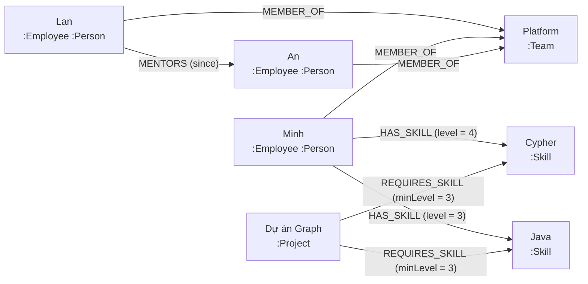
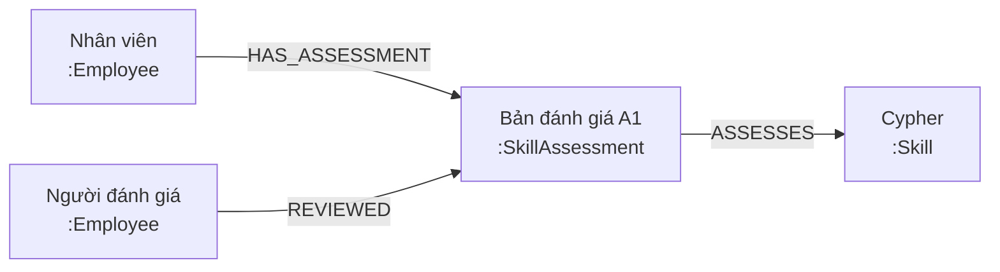

# Mô hình đồ thị thuộc tính: nút, quan hệ, nhãn và thuộc tính

> **Chương:** Tổng quan Neo4j  
> **Module:** `DATABASE_ENGINE_GRAPH_NEO4J`  
> **Trọng tâm:** Cách tổ chức dữ liệu theo *labeled property graph* trong Neo4j, phân biệt node, relationship, label, relationship type và property; áp dụng mô hình đó để đọc và viết Cypher.
>
> Bài này đặt nền tảng cho các chủ đề tiếp theo về index, constraint, phân tích và tối ưu truy vấn, nhập dữ liệu, Java Driver, Spring Data Neo4j và vận hành cơ sở dữ liệu đồ thị.

## 1. Mục tiêu học tập

Sau khi học xong, bạn có thể:

1. Mô tả chính xác thành phần của **labeled property graph** và cách chúng liên kết với nhau.
2. Phân biệt ý nghĩa của **node**, **relationship**, **label**, **relationship type** và **property**, kể cả các trường hợp dễ nhầm lẫn.
3. Giải thích vì sao một relationship trong Neo4j luôn có hướng và có đúng một loại, còn một node có thể mang nhiều label.
4. Chọn cách biểu diễn thông tin dưới dạng node, relationship hoặc property theo yêu cầu truy vấn và lịch sử dữ liệu.
5. Tạo một mô hình có dữ liệu mẫu bằng Cypher, truy vấn node, quan hệ, property, đường đi hai bước và kiểm tra dữ liệu thiếu.
6. Nhận diện rủi ro về định danh, chiều cạnh, dữ liệu lặp, null, kiểu property, node có nhiều kết nối và giới hạn của constraint.

## 2. Property graph là gì?

Về toán học, đồ thị thường được mô tả bởi tập đỉnh `V` và tập cạnh `E`. Trong cơ sở dữ liệu đồ thị, khái niệm đó được mở rộng để biểu diễn **thực thể có dữ liệu mô tả** và **kết nối mang ý nghĩa nghiệp vụ**.

Neo4j tổ chức dữ liệu theo **labeled property graph** (đồ thị thuộc tính có nhãn). Mô hình có hai loại phần tử chính:

- **Node** biểu diễn một thực thể hoặc khái niệm, chẳng hạn nhân viên, kỹ năng, dự án, nhóm.
- **Relationship** nối một node nguồn với một node đích và nói lên bản chất kết nối, chẳng hạn `HAS_SKILL`, `MEMBER_OF`, `REQUIRES_SKILL`.

Bên cạnh đó, **label** phân loại node, còn **property** lưu dữ liệu của node hoặc relationship dưới dạng cặp khóa–giá trị.

Ví dụ, một nhóm kỹ thuật cần tìm nhân viên có kỹ năng phù hợp để triển khai dự án Neo4j:



Trong sơ đồ này, `Minh` không chỉ là một bản ghi nhân viên. Việc Minh *có kỹ năng Cypher ở mức 4* được diễn đạt thành một relationship `HAS_SKILL` tới node `Cypher`, với property `level = 4` nằm **trên chính relationship**. Dự án cũng trỏ tới node kỹ năng ấy, nhưng qua relationship loại `REQUIRES_SKILL` với property `minLevel = 3`. Nhờ đó, câu hỏi “Ai đáp ứng mức kỹ năng dự án yêu cầu?” có thể đặt trực tiếp trên các kết nối.

Đồ thị Neo4j có thể chứa nhiều loại node và relationship trong cùng một không gian dữ liệu. Bạn không cần tạo một bảng riêng chỉ để ghép hai thực thể; tuy nhiên, vẫn phải thiết kế và kiểm soát các quy tắc nghiệp vụ về quan hệ.

## 3. Node: thực thể có danh tính

Một **node** là đơn vị biểu diễn đối tượng cần được tham chiếu hoặc liên kết. Node có thể không mang label hoặc property, nhưng trong ứng dụng thực tế thường có cả hai để mô hình rõ nghĩa.

Ví dụ biểu diễn nhân viên:

```cypher
(:Employee:Person {
  employeeId: 'E02',
  name: 'Minh',
  department: 'Platform'
})
```

Đọc cấu trúc:

- `(:Employee:Person)` là **một node** có **hai label** `Employee` và `Person`.
- `employeeId`, `name`, `department` là **tên property**.
- `'E02'`, `'Minh'`, `'Platform'` là **giá trị property**.
- Khóa nghiệp vụ `employeeId` cho phép ứng dụng nhận biết cùng một nhân viên qua nhiều lần cập nhật.

Cú pháp `(:Label {key: value})` biểu diễn mẫu node trong Cypher; nó chưa có nghĩa là đã lưu node vào database. Muốn tạo hoặc tìm node cần dùng mệnh đề như `CREATE`, `MERGE` hoặc `MATCH`.

### 3.1. Danh tính của node không phải nội dung hiển thị

Hai nhân viên có thể cùng tên “Minh”; cùng một nhân viên cũng có thể đổi tên hoặc chuyển phòng ban. Vì thế, `name` và `department` không nên là khóa ổn định nếu nghiệp vụ không bảo đảm chúng là duy nhất.

Một thiết kế thông dụng:

| Property | Vai trò | Có thể thay đổi? |
| --- | --- | --- |
| `employeeId` | Định danh nghiệp vụ | Thường cần ổn định |
| `name` | Dữ liệu hiển thị | Có |
| `department` | Thông tin tổ chức | Có |
| `email` | Kênh liên hệ | Có; chỉ dùng làm khóa khi nghiệp vụ bảo đảm |

Neo4j cung cấp định danh nội bộ cho phần tử như `elementId()`, nhưng **không nên dùng làm khóa nghiệp vụ để lưu lâu dài tại hệ thống bên ngoài**. Định danh nghiệp vụ do ứng dụng quản lý giúp dữ liệu bền vững hơn qua nhập/xuất, tái tạo hoặc tích hợp.

### 3.2. Khi nào một khái niệm nên là node?

Một thông tin nên được cân nhắc thành node khi nó:

- Có **danh tính riêng** và được dùng lại ở nhiều nơi.
- Cần tham gia **nhiều loại quan hệ**.
- Là điểm bắt đầu/kết thúc của câu hỏi traversal.
- Có vòng đời, thuộc tính hoặc quy tắc cập nhật độc lập.

Ví dụ “Cypher” nên là node `:Skill` nếu rất nhiều nhân viên và dự án cùng tham chiếu đến kỹ năng này. Nếu mỗi nhân viên chỉ lưu một chuỗi `skillName = 'Cypher'` thì rất khó biểu diễn sự kết nối trực tiếp giữa “nhân viên có kỹ năng” và “dự án yêu cầu kỹ năng”.

## 4. Relationship: kết nối có hướng và có ý nghĩa

Một **relationship** trong Neo4j nối **chính xác hai node**: node bắt đầu và node kết thúc. Nó có **hướng**, **một relationship type** và có thể có property.

```cypher
(minh:Employee)-[hs:HAS_SKILL {level: 4}]->(cypher:Skill)
```

Trong mẫu trên:

| Thành phần | Ý nghĩa |
| --- | --- |
| `minh` | Biến tham chiếu node đầu |
| `hs` | Biến tham chiếu relationship |
| `HAS_SKILL` | Relationship type |
| `level: 4` | Property của relationship |
| `cypher` | Biến tham chiếu node cuối |
| `->` | Chiều từ nhân viên tới kỹ năng |

### 4.1. Hướng là dữ liệu của relationship

`(Minh)-[:HAS_SKILL]->(Cypher)` có nghĩa *Minh có kỹ năng Cypher*. Nếu đảo chiều thành `(Cypher)-[:HAS_SKILL]->(Minh)` thì cách đọc không còn khớp với quy ước. Đặt hướng nhất quán giúp viết truy vấn và tránh lỗi khi thêm dữ liệu.

Khi truy vấn, ta có thể:

```cypher
// Từ nhân viên đi tới các kỹ năng
MATCH (e:Employee)-[:HAS_SKILL]->(s:Skill)
RETURN e.name, s.name;

 // Từ một kỹ năng, tìm những người có kỹ năng đó
MATCH (s:Skill {code: 'CYPHER'})<-[:HAS_SKILL]-(e:Employee)
RETURN e.name;

 // Tìm kết nối mà không yêu cầu chiều trong mẫu MATCH
MATCH (e:Employee)-[:HAS_SKILL]-(s:Skill)
RETURN e.name, s.name;
```

Ở truy vấn thứ ba, mẫu Cypher **không yêu cầu chiều**, nhưng relationship trong database vẫn có chiều lưu trữ. Không nên tạo hai cạnh ngược nhau chỉ để hỗ trợ truy vấn đi từ hai phía nếu nghiệp vụ vốn chỉ có một chiều.

### 4.2. Một relationship có đúng một type

Node có thể mang đồng thời `:Person` và `:Employee`, nhưng một relationship cụ thể chỉ mang một type, ví dụ `:HAS_SKILL` hoặc `:MENTORS`.

Một cặp node có thể có nhiều relationship, cùng type hoặc khác type. Ví dụ người A có thể vừa `MENTORS` vừa `COLLABORATES_WITH` người B. Neo4j **không mặc định cấm** nhiều relationship `HAS_SKILL` giữa cùng một cặp Employee–Skill; ứng dụng phải xác định “một trạng thái hiện tại” hay “nhiều lần đánh giá” và tạo dữ liệu phù hợp.

Relationship không phải node nên không có relationship khác “gắn vào” nó như đích của một cạnh mới. Nếu **một sự kiện kết nối cần được người khác tham gia, phê duyệt hoặc tham chiếu độc lập**, hãy cân nhắc mô hình sự kiện đó thành node.

### 4.3. Property của relationship mô tả kết nối

Ví dụ:

```cypher
(e:Employee)-[:HAS_SKILL {
  level: 4,
  assessedAt: date('2026-11-01')
}]->(s:Skill)
```

`level` và `assessedAt` không phải đặc điểm vĩnh viễn của nhân viên hay kỹ năng. Chúng mô tả trạng thái **nhân viên này sở hữu kỹ năng kia tại một thời điểm đánh giá**. Đó là lý do property của relationship thường phù hợp với vai trò, trạng thái, thời gian bắt đầu, mức độ liên quan hoặc trọng số.

Nếu cần lưu *toàn bộ lịch sử các lần đánh giá* với người đánh giá, minh chứng và phê duyệt, một node `:SkillAssessment` có định danh riêng có thể phù hợp hơn một relationship `HAS_SKILL` được ghi đè mỗi lần.

## 5. Label và relationship type: hai cách định nghĩa ngữ nghĩa khác nhau

**Label** nói node *thuộc nhóm đối tượng nào*; **relationship type** nói *hai đối tượng liên quan như thế nào*.

| Khía cạnh | Label | Relationship type |
| --- | --- | --- |
| Áp dụng lên | Node | Relationship |
| Số lượng trên một phần tử | Một node có thể có không, một hoặc nhiều label | Mỗi relationship có một type |
| Cú pháp mẫu | `(e:Employee:Person)` | `-[r:HAS_SKILL]->` |
| Mục đích | Chọn nhóm thực thể, tổ chức schema/index/constraint | Chọn đúng ý nghĩa của kết nối |
| Ví dụ | `:Employee`, `:Skill`, `:Project` | `MEMBER_OF`, `MENTORS`, `REQUIRES_SKILL` |

### 5.1. Nhiều label trên một node

Một nhân viên vừa là con người (`:Person`), vừa là nhân sự trong tổ chức (`:Employee`). Khi đó:

```cypher
MATCH (e:Employee:Person)
RETURN e.employeeId, e.name;
```

Chỉ các node **đồng thời có cả hai label** mới phù hợp mẫu này. Dùng nhiều label có thể hữu ích cho tập thực thể giao nhau, nhưng không nên xem label như hệ thống kế thừa lớp OOP. Neo4j không tự suy ra kiểu `Employee` là con của `Person` nếu ứng dụng chưa gán cả hai label.

### 5.2. Label hay relationship cho “vai trò”?

Giả sử Lan hướng dẫn An. Có hai khái niệm khác nhau:

- `(Lan:Mentor)`: Lan được phân loại như một người giữ vai trò mentor trong tổ chức.
- `(Lan)-[:MENTORS]->(An)`: Lan **đang hướng dẫn An** theo một mối quan hệ cụ thể.

Nếu nghiệp vụ cần hỏi “Lan hướng dẫn ai, từ bao giờ?”, chỉ label `Mentor` không đủ; cần relationship tới người được hướng dẫn. Nếu chỉ cần phân nhóm nhân viên được cấp quyền làm mentor, label hoặc property cho vai trò có thể phù hợp hơn. Có thể dùng cả hai khi cả hai khái niệm đều có ý nghĩa và cơ chế đồng bộ rõ ràng.

### 5.3. Quy ước đặt tên

Trong một dự án Neo4j, quy ước rõ ràng giúp schema dễ đọc:

- Label thường là danh từ dạng PascalCase: `Employee`, `Project`, `SkillAssessment`.
- Relationship type thường là động từ/cụm hành động chữ hoa có gạch dưới: `HAS_SKILL`, `REQUIRES_SKILL`, `MEMBER_OF`.
- Property thường dùng camelCase: `employeeId`, `minLevel`, `assessedAt`.

Đây là **quy ước thiết kế**, không phải bắt buộc của Cypher. Tên label, type và property có phân biệt chữ hoa–chữ thường; `:Employee` khác `:employee`. Tên đặc biệt có thể cần dùng dấu backtick khi viết Cypher, nhưng nên ưu tiên tên dễ dùng và ổn định.

## 6. Property: cặp khóa–giá trị trên node hoặc relationship

Property lưu những thuộc tính mô tả phần tử của đồ thị. Trong Cypher:

```cypher
(e:Employee {
  employeeId: 'E01',
  name: 'Lan',
  active: true,
  yearsOfExperience: 6,
  rating: 4.5,
  joinedAt: date('2022-09-01'),
  tags: ['backend', 'graph']
})
```

Ví dụ trên minh họa các kiểu giá trị thường dùng: chuỗi, boolean, số nguyên, số thực, ngày và danh sách giá trị.

Neo4j còn hỗ trợ các kiểu giá trị thời gian và không gian phù hợp. Tuy nhiên cần phân biệt **giá trị Cypher có thể xử lý trong truy vấn** với **giá trị được phép lưu trực tiếp làm property**. Chẳng hạn, map lồng nhau hoặc danh sách map không phải cấu trúc property lưu trực tiếp theo kiểu tài liệu JSON. Khi cần một cấu trúc con có quan hệ độc lập, hãy cân nhắc tách thành node hoặc lưu ở một cấu trúc bên ngoài.

### 6.1. Property thiếu khác với chuỗi rỗng hoặc số 0

Một node không bắt buộc phải có đủ mọi property. Xét ba trường hợp:

```cypher
// Trường không có trên node
MATCH (e:Employee {employeeId: 'E01'})
REMOVE e.nickname;

// Trường có giá trị chuỗi rỗng
MATCH (e:Employee {employeeId: 'E01'})
SET e.nickname = '';

// SET ... = null làm property không tồn tại
MATCH (e:Employee {employeeId: 'E01'})
SET e.nickname = null;
```

Trong Neo4j, property không tồn tại sẽ được đọc thành `null`; đặt property thành `null` có hiệu ứng xóa property đó. Vì vậy **“chưa có dữ liệu”** khác với `''`, `false` hoặc `0`. Nếu nghiệp vụ cần phân biệt *chưa nhập*, *không áp dụng* và *đã chủ động xóa*, nên biểu diễn trạng thái bằng property riêng hoặc mô hình sự kiện có nghĩa rõ ràng.

Lưu ý: `SET e.nickname = null` trên cùng dữ liệu có thể xóa giá trị `''` đã gán trước đó. Ba câu lệnh ở trên minh họa trạng thái từng bước, không phải ba tình trạng tồn tại đồng thời.

### 6.2. Property trên node hay relationship?

| Câu hỏi | Vị trí property phù hợp | Lý do |
| --- | --- | --- |
| Tên nhân viên là gì? | `Employee.name` | Mô tả nhân viên |
| Tên kỹ năng là gì? | `Skill.name` | Mô tả kỹ năng dùng chung |
| Nhân viên A biết kỹ năng B mức mấy? | `HAS_SKILL.level` | Mô tả cặp A–B |
| Dự án P yêu cầu kỹ năng B tối thiểu mấy? | `REQUIRES_SKILL.minLevel` | Mô tả cặp P–B |
| Nhân viên gia nhập nhóm từ ngày nào? | `MEMBER_OF.since` | Mô tả tư cách thành viên cụ thể |
| Đánh giá kỹ năng được ai duyệt? | Có thể cần node `SkillAssessment` | Bản đánh giá có thể có danh tính và vòng đời riêng |

### 6.3. Danh sách property không thay thế mọi relationship

Lưu `skills: ['Java', 'Cypher']` trên node nhân viên có thể hợp lý với dữ liệu rất đơn giản, ít thay đổi và chỉ cần hiển thị. Nhưng khi nhiều dự án tham chiếu cùng kỹ năng, mỗi kỹ năng có tên chuẩn, mức độ, người đánh giá và điều kiện tiên quyết, node `:Skill` cộng với `:HAS_SKILL` giúp biểu diễn câu hỏi nghiệp vụ rõ hơn. Lựa chọn dựa trên **những phép truy vấn và cập nhật thực tế**.

## 7. Thiết kế mô hình mẫu: nhân sự, kỹ năng và dự án

Ta xây dựng một đồ thị nhỏ để luyện tập. Bối cảnh: nhóm Platform cần tìm nhân viên đáp ứng kỹ năng cho dự án triển khai cơ sở dữ liệu đồ thị.

### 7.1. Các loại node

| Label | Khóa nghiệp vụ | Property ví dụ |
| --- | --- | --- |
| `:Employee:Person` | `employeeId` | `name`, `department` |
| `:Team` | `code` | `name` |
| `:Skill` | `code` | `name` |
| `:Project` | `code` | `name`, `tags` |

### 7.2. Các loại relationship

| Mẫu | Ý nghĩa và chiều | Property |
| --- | --- | --- |
| `(Employee)-[:MEMBER_OF]->(Team)` | Nhân viên tham gia nhóm | `role`, `since` |
| `(Employee)-[:HAS_SKILL]->(Skill)` | Nhân viên có mức kỹ năng hiện tại | `level`, `assessedAt` |
| `(Project)-[:REQUIRES_SKILL]->(Skill)` | Dự án yêu cầu một kỹ năng | `minLevel` |
| `(Employee)-[:MENTORS]->(Employee)` | Nhân viên đầu hướng dẫn nhân viên cuối | `since` |

**Quy tắc nghiệp vụ mẫu:** mức kỹ năng nằm trong khoảng 1–5; đối với mỗi nhân viên–kỹ năng, mô hình này chỉ giữ *một mức đánh giá hiện tại*. Nếu thực tế có nhiều kỳ đánh giá, thiết kế cần thay đổi để lưu lịch sử.

### 7.3. Constraint cho khóa nghiệp vụ

Ví dụ dùng Cypher của Neo4j **5.x trở lên**. Chạy trên cơ sở dữ liệu học tập trước khi tạo node:

```cypher
CREATE CONSTRAINT employee_id_unique IF NOT EXISTS
FOR (e:Employee) REQUIRE e.employeeId IS UNIQUE;

CREATE CONSTRAINT team_code_unique IF NOT EXISTS
FOR (t:Team) REQUIRE t.code IS UNIQUE;

CREATE CONSTRAINT skill_code_unique IF NOT EXISTS
FOR (s:Skill) REQUIRE s.code IS UNIQUE;

CREATE CONSTRAINT project_code_unique IF NOT EXISTS
FOR (p:Project) REQUIRE p.code IS UNIQUE;
```

Các constraint trên giúp ngăn hai node có cùng label và cùng mã nghiệp vụ. Chúng **không** tự bảo đảm property mã luôn có mặt trên mọi node, cũng không tự cấm hai relationship cùng type nối cùng cặp node. Khả năng dùng các ràng buộc bổ sung phụ thuộc phiên bản/edition và yêu cầu hệ thống.

### 7.4. Tạo node bằng MERGE

`MERGE` tìm hoặc tạo một mẫu; ở ví dụ này ta dùng **khóa nghiệp vụ** trong `MERGE` rồi `SET` các property có thể thay đổi. Không đưa tên nhân viên vào phần nhận diện của `MERGE`, vì đổi tên không nên tạo ra người mới.

```cypher
UNWIND [
  {id: 'E01', name: 'Lan', department: 'Platform'},
  {id: 'E02', name: 'Minh', department: 'Platform'},
  {id: 'E03', name: 'An', department: 'Platform'}
] AS row
MERGE (e:Employee {employeeId: row.id})
SET e.name = row.name, e.department = row.department
SET e:Person;

MERGE (t:Team {code: 'T-PLATFORM'})
SET t.name = 'Platform';

UNWIND [
  {code: 'JAVA', name: 'Java'},
  {code: 'CYPHER', name: 'Cypher'},
  {code: 'NEO4J', name: 'Neo4j'}
] AS row
MERGE (s:Skill {code: row.code})
SET s.name = row.name;

MERGE (p:Project {code: 'P-GRAPH'})
SET p.name = 'Triển khai nền tảng đồ thị',
    p.tags = ['backend', 'graph'];
```

Sau bước này, đồ thị có **8 node**: ba nhân viên, một nhóm, ba kỹ năng, một dự án.

### 7.5. Tạo relationship và property của chúng

Khi dùng `MATCH` để tìm hai đầu đã có trước rồi `MERGE` relationship, ta tránh việc tạo node thiếu định danh do dùng mẫu `MERGE` quá rộng. Dữ liệu thực tế cần thêm xử lý khi mã đầu vào không tìm thấy node.

```cypher
UNWIND [
  {employeeId: 'E01', role: 'Lead'},
  {employeeId: 'E02', role: 'Member'},
  {employeeId: 'E03', role: 'Member'}
] AS row
MATCH (e:Employee {employeeId: row.employeeId})
MATCH (t:Team {code: 'T-PLATFORM'})
MERGE (e)-[m:MEMBER_OF]->(t)
SET m.role = row.role,
    m.since = date('2026-01-01');

UNWIND [
  {employeeId: 'E01', skillCode: 'JAVA', level: 4},
  {employeeId: 'E01', skillCode: 'CYPHER', level: 2},
  {employeeId: 'E02', skillCode: 'JAVA', level: 3},
  {employeeId: 'E02', skillCode: 'CYPHER', level: 4},
  {employeeId: 'E03', skillCode: 'CYPHER', level: 3},
  {employeeId: 'E03', skillCode: 'NEO4J', level: 4}
] AS row
MATCH (e:Employee {employeeId: row.employeeId})
MATCH (s:Skill {code: row.skillCode})
MERGE (e)-[h:HAS_SKILL]->(s)
SET h.level = row.level,
    h.assessedAt = date('2026-11-01');

UNWIND [
  {skillCode: 'JAVA', minLevel: 3},
  {skillCode: 'CYPHER', minLevel: 3}
] AS row
MATCH (p:Project {code: 'P-GRAPH'})
MATCH (s:Skill {code: row.skillCode})
MERGE (p)-[r:REQUIRES_SKILL]->(s)
SET r.minLevel = row.minLevel;

MATCH (lan:Employee {employeeId: 'E01'})
MATCH (an:Employee {employeeId: 'E03'})
MERGE (lan)-[m:MENTORS]->(an)
SET m.since = date('2026-09-01');
```

Kết quả mong đợi là **12 relationship**:

- 3 `MEMBER_OF`.
- 6 `HAS_SKILL`.
- 2 `REQUIRES_SKILL`.
- 1 `MENTORS`.

Ví dụ có thể chạy lại trên dữ liệu mẫu ở trạng thái nhất quán nhờ `MERGE` theo cặp node đã xác định. Dù vậy, **`MERGE` không thay cho thiết kế khóa hoặc ràng buộc toàn cục về tính duy nhất của relationship**, nhất là khi nhiều phiên ghi đồng thời.

## 8. Đọc mô hình bằng Cypher

Những truy vấn sau dùng dữ liệu mẫu ở mục 7. Hãy chú ý sự khác biệt giữa việc **tìm một node theo label** và **đi qua những relationship đã biết loại, chiều**.

### 8.1. Chọn node theo label và property

```cypher
MATCH (e:Employee {department: 'Platform'})
RETURN e.employeeId AS ma, e.name AS ten
ORDER BY ma;
```

Kết quả mong đợi: **Lan, Minh, An**. Cả ba thuộc nhóm `:Employee` và có `department = 'Platform'`.

Để tìm các node vừa mang label `Employee` vừa mang label `Person`:

```cypher
MATCH (e:Employee:Person)
RETURN e.name AS ten, labels(e) AS nhan
ORDER BY ten;
```

Hàm `labels(e)` trả về các label của node; đừng dựa vào thứ tự phần tử trong danh sách label khi kiểm tra nghiệp vụ.

### 8.2. Đi qua một relationship và lấy property của cạnh

```cypher
MATCH (e:Employee {employeeId: 'E02'})
      -[h:HAS_SKILL]->(s:Skill)
RETURN e.name AS nhan_vien,
       s.name AS ky_nang,
       h.level AS muc_do,
       h.assessedAt AS ngay_danh_gia
ORDER BY s.code;
```

Minh có **Cypher mức 4** và **Java mức 3**. Đây là ví dụ trực tiếp cho việc property `level` thuộc relationship `HAS_SKILL`, vì cùng một kỹ năng có thể có mức độ khác nhau đối với mỗi nhân viên.

### 8.3. Truy vấn từ phía đích bằng chiều đảo

```cypher
MATCH (s:Skill {code: 'CYPHER'})
      <-[h:HAS_SKILL]-(e:Employee)
WHERE h.level >= 3
RETURN e.name AS nhan_vien, h.level AS muc_do
ORDER BY muc_do DESC, nhan_vien;
```

Kết quả: **Minh (4)** và **An (3)**. Biểu thức `<-[:HAS_SKILL]-` đi từ kỹ năng *ngược theo hướng mũi tên* để tìm nhân viên sở hữu kỹ năng đó. Dữ liệu không bị đảo chiều; ta chỉ thay đổi vị trí bắt đầu khi viết mẫu.

### 8.4. Truy vấn hai bước quan hệ

Câu hỏi: “Lan đang hướng dẫn ai, và người đó đang có các kỹ năng nào?”

```cypher
MATCH (lan:Employee {employeeId: 'E01'})
      -[:MENTORS]->(mentee:Employee)
      -[h:HAS_SKILL]->(skill:Skill)
RETURN mentee.name AS nguoi_duoc_huong_dan,
       skill.name AS ky_nang,
       h.level AS muc_do
ORDER BY skill.code;
```

Kết quả dự kiến: **An — Cypher 3**, **An — Neo4j 4**. Một đường đi được tạo bởi hai relationship liên tiếp, mỗi bước có ý nghĩa nghiệp vụ riêng.

### 8.5. Ghép yêu cầu dự án với năng lực của nhân viên

Câu hỏi: “Nhân viên nào đáp ứng **mọi** kỹ năng bắt buộc của dự án P-GRAPH, với mức hiện tại không thấp hơn mức yêu cầu?”

```cypher
MATCH (p:Project {code: 'P-GRAPH'})
MATCH (e:Employee)
WHERE NOT EXISTS {
  MATCH (p)-[required:REQUIRES_SKILL]->(skill:Skill)
  WHERE NOT EXISTS {
    MATCH (e)-[known:HAS_SKILL]->(skill)
    WHERE known.level >= required.minLevel
  }
}
RETURN e.employeeId AS ma, e.name AS phu_hop
ORDER BY ma;
```

Kết quả: **Minh**. Lan có Java 4 nhưng Cypher 2 thấp hơn yêu cầu 3; An có Cypher 3 nhưng chưa có kết nối `HAS_SKILL` đến Java. Mô hình đồ thị cho phép so sánh **hai loại quan hệ hướng về cùng một node kỹ năng**, với thông số khác nhau trên từng cạnh.

Cấu trúc phủ định kép đọc như sau: *không tồn tại kỹ năng bắt buộc nào mà nhân viên không đáp ứng*. Nếu dự án không có bất kỳ quan hệ `REQUIRES_SKILL` nào, điều kiện này đúng với mọi nhân viên theo logic tập rỗng; hệ thống thực tế cần định nghĩa cách xử lý dự án chưa khai báo yêu cầu.

### 8.6. Kiểm tra thông tin chưa có

Nếu cần biết An có khai báo kỹ năng Java không:

```cypher
MATCH (an:Employee {employeeId: 'E03'})
OPTIONAL MATCH (an)-[h:HAS_SKILL]->(s:Skill {code: 'JAVA'})
RETURN an.name AS nhan_vien,
       s.name AS ky_nang,
       h.level AS muc_do;
```

Kết quả: tên **An** vẫn xuất hiện, nhưng `ky_nang` và `muc_do` là `null`. `OPTIONAL MATCH` giữ hàng kết quả khi mẫu quan hệ không khớp. Điều này **chưa chứng minh An không biết Java ngoài đời**; nó chỉ cho biết đồ thị chưa lưu một relationship khớp truy vấn.

### 8.7. Khám phá cấu trúc phần tử

```cypher
MATCH (e:Employee {employeeId: 'E02'})
      -[h:HAS_SKILL]->(s:Skill {code: 'CYPHER'})
RETURN labels(e) AS node_labels,
       keys(e) AS node_property_keys,
       properties(e) AS node_properties,
       type(h) AS relationship_type,
       properties(h) AS relationship_properties;
```

Các hàm trên giúp kiểm tra mô hình khi khám phá dữ liệu:

- `labels(node)`: danh sách label của node.
- `keys(element)`: tên property hiện có trên node hoặc relationship.
- `properties(element)`: map các property hiện có.
- `type(relationship)`: relationship type.

`properties()` trả về một **map trong kết quả Cypher**; điều đó không có nghĩa ta có thể lưu nguyên một map lồng nhau như một property đơn lẻ của node.

## 9. Những quyết định mô hình hóa quan trọng

Một mô hình đồ thị tốt bắt đầu bằng **câu hỏi truy vấn**, **định danh** và **quy tắc cập nhật**.

### 9.1. Có cần node cho sự kiện không?

Mô hình `(Employee)-[:HAS_SKILL {level, assessedAt}]->(Skill)` đủ để lưu trạng thái hiện tại. Nếu mỗi nhân viên có nhiều bản đánh giá cùng kỹ năng trong các quý khác nhau, ghi đè `level` làm mất lịch sử.

Có thể chuyển lịch sử thành node:



Node `SkillAssessment` có `assessmentId`, `score`, `assessedAt` và có thể được phê duyệt, bình luận hay liên kết với minh chứng. Mô hình này có nhiều phần tử hơn nhưng bảo toàn cấu trúc nghiệp vụ nếu bản đánh giá thật sự có vòng đời riêng.

### 9.2. Có cần tạo quan hệ hai chiều?

Giả sử `(e)-[:MEMBER_OF]->(t)` đã biểu diễn nhân viên thuộc nhóm. Muốn tìm thành viên từ phía nhóm, ta dùng `(t)<-[:MEMBER_OF]-(e)`. Không cần thêm `(t)-[:HAS_MEMBER]->(e)` nếu hai cạnh chỉ lặp lại cùng một sự thật. Hai cạnh tương đương dễ lệch nhau khi cập nhật.

Nếu *hai chiều thật sự là hai nghĩa độc lập* — ví dụ A theo dõi B và B theo dõi A — có thể tồn tại hai relationship `FOLLOWS` ngược chiều, vì đó là hai hành vi khác nhau.

### 9.3. Một giá trị nên là property hay node dùng chung?

Nếu `department` chỉ dùng để hiển thị tên phòng ban, một property trên nhân viên có thể đủ. Nhưng nếu phòng ban có người quản lý, ngân sách, lịch sử sáp nhập và dự án, có lý do để tách thành node `:Department` và dùng `MEMBER_OF`/`ASSIGNED_TO`. Không có mô hình đúng cho mọi hệ thống; một thay đổi yêu cầu truy vấn có thể thay đổi cách chia node và relationship.

### 9.4. Cần kiểm soát số lượng kết nối

Một node có hàng chục nghìn hoặc hàng triệu relationship (thường gọi là node bậc cao) có thể làm một traversal mở rộng quá nhiều nhánh. Mẫu tìm kiếm “mọi đường đi với mọi loại quan hệ, không giới hạn số bước” thường không phải điểm xuất phát tốt. Nên xác định **node bắt đầu**, **relationship type**, **hướng**, **độ sâu** và **điều kiện lọc** trước khi truy vấn.

Trong các bài chuyên sâu về tối ưu, có thể dùng `EXPLAIN`/`PROFILE` để xem kế hoạch truy vấn và chi phí thực tế. Việc dùng property graph không đảm bảo mọi traversal đều nhanh.

## 10. Sai lầm thường gặp và cách tránh

| Sai lầm | Hệ quả | Cách tiếp cận |
| --- | --- | --- |
| Dùng `name` làm khóa duy nhất dù có thể trùng | Gộp nhầm thực thể hoặc tạo trùng | Dùng mã nghiệp vụ ổn định và constraint phù hợp |
| Đảo chiều `MEMBER_OF` tùy lúc tạo dữ liệu | Truy vấn thiếu kết quả | Định nghĩa hướng và duy trì nhất quán |
| Đặt `HAS_SKILL.level` thành `Skill.level` | Mọi nhân viên có cùng mức độ | Đặt property theo đúng chủ thể của thông tin |
| Dùng label `Mentor` thay cho quan hệ “ai hướng dẫn ai” | Không trả lời được câu hỏi có hai đầu cụ thể | Dùng `MENTORS` giữa hai nhân viên |
| Tưởng mọi node `Employee` luôn có `email` | Kết quả `null`, logic ứng dụng sai | Kiểm tra dữ liệu thiếu và ràng buộc phù hợp |
| Thấy `MERGE` là tin tuyệt đối không tạo relationship trùng | Có thể sai khi mô hình khóa hoặc ghi đồng thời không được kiểm soát | Quản lý tính duy nhất theo yêu cầu nghiệp vụ |
| Lưu toàn bộ lịch sử vào một property cập nhật liên tục | Mất phiên bản cũ | Mô hình sự kiện/đánh giá độc lập nếu cần |
| Cố lưu JSON lồng nhau như property | Không khớp khả năng lưu property | Tách node hoặc biểu diễn lại cấu trúc |
| Duyệt relationship quá rộng | Tăng số đường đi và thời gian truy vấn | Giới hạn loại, chiều, điểm bắt đầu và số bước |

### Một lưu ý về schema và tính đúng đắn

Neo4j cho phép dữ liệu có nhiều hình dạng, nhưng điều đó không có nghĩa là ứng dụng không cần schema. Tối thiểu nên thống nhất label/type, định danh, các property bắt buộc về mặt nghiệp vụ, hướng relationship, tính duy nhất hợp lệ và cách xử lý dữ liệu thiếu.

Index và constraint hỗ trợ tìm node và thực thi một số ràng buộc. Chúng **không tự hiểu** toàn bộ ngữ nghĩa kinh doanh: ví dụ không tự biết rằng người có `HAS_SKILL.level = 2` chưa đạt `REQUIRES_SKILL.minLevel = 3`. Logic đó vẫn phải được biểu diễn trong truy vấn hoặc tầng nghiệp vụ.

## 11. Tự luyện tập

**Bài 1 — Xác định thành phần.** Phân loại các đối tượng trong mẫu sau thành label, relationship type và property:

```cypher
(a:Employee:Person {employeeId: 'E03'})
  -[r:MEMBER_OF {role: 'Member'}]->
(t:Team {code: 'T-PLATFORM'})
```

**Bài 2 — Chiều quan hệ.** Viết Cypher lấy tên nhóm mà Minh đang tham gia. Sau đó viết Cypher bắt đầu từ node `Team` để lấy tên các nhân viên trong nhóm mà không tạo thêm relationship.

**Bài 3 — Property đúng vị trí.** Một nhân viên cần kỹ năng Java ở mức 3 cho dự án A và mức 5 cho dự án B. `minLevel` nên đặt ở đâu? Giải thích vì sao không nên đặt trên `Skill`.

**Bài 4 — Đọc dữ liệu thiếu.** Trong dữ liệu mẫu, An không có relationship `HAS_SKILL` tới Java. Viết truy vấn xác định các nhân viên chưa có khai báo kỹ năng Java. Nêu vì sao kết quả không đủ kết luận họ hoàn toàn không biết Java.

**Bài 5 — Phát triển mô hình.** Hệ thống cần lưu ba kỳ đánh giá kỹ năng Cypher của Minh với người phê duyệt riêng cho từng kỳ. Phác thảo mô hình node và relationship để không ghi đè lịch sử.

**Bài 6 — Kiểm tra kết quả.** Vì sao truy vấn “nhân viên đạt mọi yêu cầu của dự án P-GRAPH” chỉ trả Minh dù Lan có mức Java cao hơn Minh?

<details>
<summary>Gợi ý đáp án</summary>

1. Node đầu có hai label `Employee`, `Person` và property `employeeId`; relationship type `MEMBER_OF` có property `role`; node đích có label `Team` và property `code`.
2. Từ Minh: `MATCH (e:Employee {employeeId:'E02'})-[:MEMBER_OF]->(t:Team) RETURN t.name;`. Từ nhóm: `MATCH (t:Team {code:'T-PLATFORM'})<-[:MEMBER_OF]-(e:Employee) RETURN e.name;`.
3. `minLevel` thuộc từng relationship `(Project)-[:REQUIRES_SKILL]->(Skill)`, vì mỗi dự án có mức yêu cầu khác nhau với cùng kỹ năng.
4. Ví dụ: `MATCH (e:Employee) WHERE NOT EXISTS { MATCH (e)-[:HAS_SKILL]->(:Skill {code:'JAVA'}) } RETURN e.name;`. Kết quả dữ liệu mẫu: **An**. Đây là “chưa khai báo trong đồ thị”, không phải một kết luận về năng lực thực tế.
5. Tạo mỗi lần đánh giá thành node `(:SkillAssessment {assessmentId, score, assessedAt})`, nối từ nhân viên bằng `HAS_ASSESSMENT`, tới kỹ năng bằng `ASSESSES`, và từ người phê duyệt bằng `APPROVED` hoặc relationship phù hợp.
6. Lan đạt Java 4 nhưng chỉ có Cypher 2, dưới ngưỡng 3. Minh có cả Java 3 và Cypher 4 nên đáp ứng **tất cả** yêu cầu.

</details>

## 12. Ghi nhớ cốt lõi

- **Node** là thực thể hoặc khái niệm có danh tính; một node có thể mang nhiều **label**.
- **Relationship** nối hai node, luôn có **hướng** và đúng một **type**; Cypher vẫn có thể tìm theo chiều ngược hoặc không chỉ định chiều.
- **Property** là thông tin mô tả node hoặc chính mối quan hệ. Đặt property đúng chỗ giúp câu hỏi nghiệp vụ có câu trả lời nhất quán.
- Dùng **node** cho đối tượng cần tham chiếu độc lập, **relationship** cho kết nối mang nghĩa, **property** cho giá trị mô tả; sự kiện có lịch sử riêng có thể cần node độc lập.
- Định danh nghiệp vụ, constraint, thống nhất label/type, xử lý `null` và kiểm soát traversal là nền tảng để đưa mô hình đồ thị từ ví dụ vào ứng dụng Java/Spring và Neo4j thực tế.
