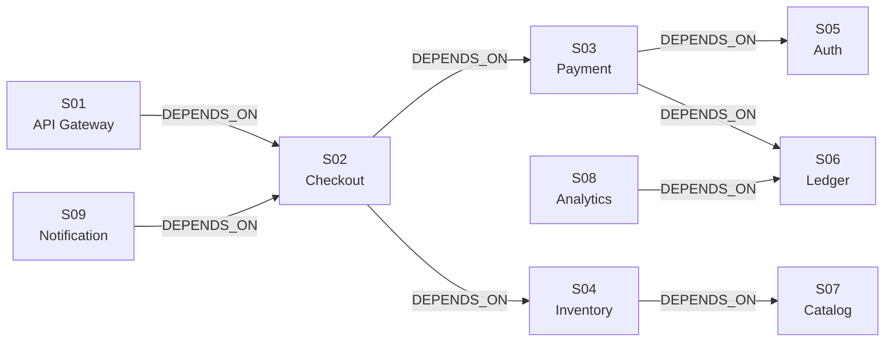
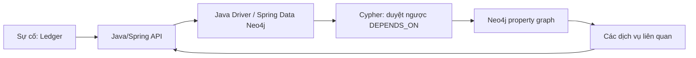

# Cách nhìn dữ liệu qua các mối liên hệ thay vì bảng và phép nối

> **Chương:** Tổng quan Neo4j  
> **Module:** `DATABASE_ENGINE_GRAPH_NEO4J`  
> **Trọng tâm:** Chuyển từ tư duy “truy xuất bản ghi rồi ghép các bảng” sang tư duy “bắt đầu từ một thực thể và đi theo các mối liên hệ có ý nghĩa”; biết khi nào cách nhìn này giúp giải quyết vấn đề tốt hơn.
>
> Trong module này, Neo4j được dùng để mô hình hóa dữ liệu liên kết theo **property graph** và truy vấn quan hệ, đường đi bằng **Cypher**. Bài học đặt cơ sở tư duy cho các chủ đề node, relationship, index, constraint, tối ưu truy vấn, nhập dữ liệu, Java Driver, Spring Data Neo4j và vận hành hệ thống đồ thị.

## 1. Mục tiêu học tập

Sau bài này, bạn có thể:

1. Diễn giải cùng một nghiệp vụ bằng **bảng–khóa ngoại–phép nối** và bằng **node–relationship–đường đi**.
2. Phân biệt câu hỏi truy vấn một bản ghi, truy vấn một kết nối và truy vấn **chuỗi kết nối nhiều cấp**.
3. Mô tả chiều và ý nghĩa của quan hệ `DEPENDS_ON`, nhất là sự khác nhau giữa “A phụ thuộc B” và “B có thể ảnh hưởng A”.
4. Đọc các truy vấn SQL dùng `JOIN`, `WITH RECURSIVE` và đối chiếu chúng với các mẫu Cypher tương ứng.
5. Xây dựng và truy vấn một đồ thị phụ thuộc dịch vụ nhỏ bằng Cypher, xác định phạm vi ảnh hưởng của sự cố và một đường đi giải thích kết quả.
6. Chỉ ra giới hạn của truy vấn đồ thị: tăng nhánh, chu trình, trùng kết quả, điều kiện nghiệp vụ và tính nhất quán dữ liệu.
7. Đề xuất tiêu chí kiểm chứng trước khi lựa chọn Neo4j cho một hệ thống thật.

## 2. Từ bản ghi sang mối liên hệ: thay đổi ở câu hỏi

Hãy tưởng tượng một hệ thống có các dịch vụ `Checkout`, `Payment`, `Inventory`, `Auth` và `Ledger`. Người vận hành muốn biết:

- Dịch vụ `Checkout` gọi hoặc phụ thuộc trực tiếp vào dịch vụ nào?
- Nếu `Ledger` gặp sự cố, những dịch vụ nào có **khả năng** bị tác động, kể cả qua nhiều cấp?
- Từ `API Gateway` tới `Ledger` có chuỗi phụ thuộc nào giải thích phạm vi ảnh hưởng?
- Nếu thay đổi một thành phần, toàn bộ các hệ thống nằm “phía trên” nó là những hệ thống nào?

Câu hỏi đầu chỉ cần **một bước kết nối**. Những câu sau đòi hỏi đi qua một chuỗi quan hệ, đôi khi chưa biết trước chiều sâu.

Có hai cách tổ chức cùng một sự thật:

**Góc nhìn quan hệ (relational):** thông tin dịch vụ nằm ở bảng `services`; mỗi cặp phụ thuộc là một hàng trong bảng `service_dependencies` chứa hai khóa ngoại. Ta nối các hàng có cùng khóa để tìm dịch vụ liên quan.

**Góc nhìn đồ thị (graph):** mỗi dịch vụ là một **node**; quan hệ phụ thuộc là một **relationship có hướng** giữa hai node. Ta xuất phát từ một node đã biết và duyệt theo những relationship phù hợp.

Điều quan trọng: dữ liệu không nhất thiết thay đổi về **sự thật nghiệp vụ**. Thứ thay đổi là **cấu trúc được đặt ở trung tâm mô hình và cách biểu đạt truy vấn**. Cơ sở dữ liệu quan hệ cũng biểu diễn và truy vấn được đồ thị qua bảng cạnh, `JOIN` và truy vấn đệ quy; graph database làm các kết nối trở thành thành phần trực tiếp của mô hình và của ngôn ngữ truy vấn.

### Một cách tự hỏi để chọn góc nhìn

- Nếu câu hỏi là “Dịch vụ `S06` tên gì?” — ta chủ yếu tra **thuộc tính của một thực thể**.
- Nếu câu hỏi là “`S02` phụ thuộc trực tiếp ai?” — ta tìm **một cấp quan hệ**.
- Nếu câu hỏi là “Ai phụ thuộc trực tiếp hoặc gián tiếp vào `S06` qua tối đa bốn cấp?” — ta đang tìm **một vùng của mạng lưới kết nối**.
- Nếu câu hỏi là “Tác động truyền qua chuỗi nào?” — ta phải trả về **đường đi**, không chỉ danh sách thực thể.

Đây là các kiểu truy vấn khác nhau, dù đều bắt đầu từ cùng tập dữ liệu.

## 3. Tình huống xuyên suốt: phụ thuộc giữa các dịch vụ

Giả sử một nền tảng thương mại điện tử có chín dịch vụ:

| Mã | Dịch vụ | Vai trò |
| --- | --- | --- |
| `S01` | API Gateway | Điểm vào của API |
| `S02` | Checkout | Điều phối quá trình thanh toán |
| `S03` | Payment | Xử lý nghiệp vụ thanh toán |
| `S04` | Inventory | Quản lý tồn kho |
| `S05` | Auth | Xác thực và phân quyền |
| `S06` | Ledger | Ghi sổ giao dịch |
| `S07` | Catalog | Thông tin sản phẩm |
| `S08` | Analytics | Phân tích số liệu |
| `S09` | Notification | Gửi thông báo |

Một mối liên hệ được viết:

```text
(A)-[:DEPENDS_ON]->(B)
```

Quy ước của toàn bài: **A phụ thuộc vào B**. Khi B không sẵn sàng, A **có thể** bị ảnh hưởng. Đây là mô hình phụ thuộc logic, chưa phải khẳng định mọi lỗi của B đều làm A ngừng hoạt động.

Các quan hệ mẫu:



Sơ đồ có **9 node dịch vụ** và **8 relationship phụ thuộc**. Ví dụ, đường đi từ API Gateway tới Ledger là:

```text
API Gateway → Checkout → Payment → Ledger
```

Đường đi này gồm **3 relationship**. Nhìn theo chiều ngược lại, khi Ledger gặp sự cố, Payment, Checkout, API Gateway và cả Notification có thể bị tác động theo các cấp khác nhau; Analytics phụ thuộc trực tiếp vào Ledger.

### Phân biệt hai hướng của cùng một quan hệ

Với dữ liệu:

```text
(Payment)-[:DEPENDS_ON]->(Ledger)
```

- Đi **theo chiều mũi tên** từ Payment tới Ledger để hỏi: “Payment cần gì?”
- Đi **ngược chiều mũi tên** từ Ledger tới Payment để hỏi: “Ai cần Ledger?”

Hai câu hỏi sử dụng **cùng một relationship**, nhưng chiều duyệt khác nhau. Không cần tạo thêm một cạnh ngược `(Ledger)-[:IMPACTS]->(Payment)` chỉ để tìm tác động ngược, vì như vậy dễ lưu hai phiên bản của cùng một sự thật rồi cập nhật lệch nhau.

## 4. Nếu dùng cơ sở dữ liệu quan hệ, ta lưu như thế nào?

Một thiết kế quan hệ chuẩn hóa đơn giản gồm hai bảng:

```sql
CREATE TABLE services (
    id VARCHAR(10) PRIMARY KEY,
    name VARCHAR(100) NOT NULL
);

CREATE TABLE service_dependencies (
    dependent_id VARCHAR(10) NOT NULL REFERENCES services(id),
    dependency_id VARCHAR(10) NOT NULL REFERENCES services(id),
    required BOOLEAN NOT NULL DEFAULT TRUE,
    PRIMARY KEY (dependent_id, dependency_id)
);
```

Bảng `services` lưu thực thể. Bảng `service_dependencies` lưu hai đầu mối quan hệ:

| dependent_id | dependency_id | Ý nghĩa |
| --- | --- | --- |
| `S01` | `S02` | API Gateway phụ thuộc Checkout |
| `S02` | `S03` | Checkout phụ thuộc Payment |
| `S02` | `S04` | Checkout phụ thuộc Inventory |
| `S03` | `S05` | Payment phụ thuộc Auth |
| `S03` | `S06` | Payment phụ thuộc Ledger |
| `S04` | `S07` | Inventory phụ thuộc Catalog |
| `S08` | `S06` | Analytics phụ thuộc Ledger |
| `S09` | `S02` | Notification phụ thuộc Checkout |

Ở đây:

- `dependent_id` là dịch vụ **phụ thuộc**.
- `dependency_id` là dịch vụ **được phụ thuộc vào**.
- `PRIMARY KEY (dependent_id, dependency_id)` bảo đảm mỗi cặp chỉ có một hàng theo **quy tắc của ví dụ này**.
- `required` cho phép phân biệt một phụ thuộc bắt buộc với một liên kết tùy chọn trong các mô hình mở rộng.

### 4.1. Truy vấn một cấp bằng JOIN

Lấy danh sách dịch vụ mà Checkout phụ thuộc trực tiếp:

```sql
SELECT dependency.id, dependency.name
FROM services AS checkout
JOIN service_dependencies AS link
  ON link.dependent_id = checkout.id
JOIN services AS dependency
  ON dependency.id = link.dependency_id
WHERE checkout.id = 'S02'
ORDER BY dependency.id;
```

Kết quả: **Payment (S03)** và **Inventory (S04)**.

Trong truy vấn này, hai phép `JOIN` giúp khôi phục mối liên hệ từ các khóa ngoại: từ hàng Checkout sang hàng liên kết, rồi sang hàng dịch vụ đích.

Đó là cách tổ chức hợp lệ và thường rất hiệu quả. Không nên cho rằng có `JOIN` thì truy vấn tự động chậm; cơ sở dữ liệu quan hệ có chỉ mục, bộ tối ưu hóa, nhiều chiến lược join và khả năng xử lý giao dịch rất mạnh.

### 4.2. Khi số cấp không biết trước

Để tìm cả những phụ thuộc gián tiếp của Checkout, ta cần nối quan hệ nhiều lần. Nếu luôn đúng hai cấp, có thể viết thêm `JOIN`. Nếu độ sâu thay đổi, các hệ quản trị quan hệ như PostgreSQL hỗ trợ **recursive common table expression**:

```sql
-- Ví dụ theo cú pháp PostgreSQL.
WITH RECURSIVE prerequisites(service_id, depth) AS (
    -- Các phụ thuộc trực tiếp của Checkout
    SELECT link.dependency_id, 1
    FROM service_dependencies AS link
    WHERE link.dependent_id = 'S02'

    UNION ALL

    -- Từ một phụ thuộc, tiếp tục tìm phụ thuộc của nó
    SELECT link.dependency_id, p.depth + 1
    FROM prerequisites AS p
    JOIN service_dependencies AS link
      ON link.dependent_id = p.service_id
    WHERE p.depth < 4
)
SELECT DISTINCT s.id, s.name
FROM prerequisites AS p
JOIN services AS s
  ON s.id = p.service_id
ORDER BY s.id;
```

Kết quả từ dữ liệu mẫu: **Payment, Inventory, Auth, Ledger, Catalog** — tương ứng `S03` đến `S07`. Giới hạn `depth < 4` khống chế số cấp tối đa; `DISTINCT` gộp các dịch vụ nếu chúng được tìm thấy qua nhiều nhánh.

Lưu ý: câu lệnh trên dùng `UNION ALL` và chỉ giới hạn chiều sâu; nếu dữ liệu có **chu trình phụ thuộc**, truy vấn có thể đi lại qua những node đã xuất hiện cho tới khi chạm giới hạn. `DISTINCT` ở ngoài không ngăn lượng hàng trung gian tăng trong quá trình đệ quy. Khi dùng SQL thật, cần thiết kế kiểm soát chu trình và điều kiện dừng theo bài toán.

**Nhận xét:** SQL giải được bài toán. Tuy nhiên, khi yêu cầu là “theo loại quan hệ nào, qua bao nhiêu cấp, đi theo hướng nào, trả về những đường nào?”, cách biểu diễn bằng một chuỗi kết nối trong Cypher thường gần với ngôn ngữ nghiệp vụ hơn.

## 5. Biểu diễn cùng dữ liệu theo property graph

Trong Neo4j:

- Mỗi dịch vụ trở thành node `(:Service {id, name})`.
- Mỗi hàng `service_dependencies` trở thành relationship `-[:DEPENDS_ON]->`.
- Giá trị `required` thuộc **relationship**, vì nó mô tả việc *dịch vụ A phụ thuộc vào dịch vụ B*.

```text
(:Service {id:'S02', name:'Checkout'})
   -[:DEPENDS_ON {required:true}]->
(:Service {id:'S03', name:'Payment'})
```

Một sự khác nhau trong cách đọc là ta có thể nêu ngay **mẫu liên kết cần tìm** mà không phải viết rõ cặp điều kiện khóa ngoại để ghép hai đầu.

### 5.1. Tạo dữ liệu mẫu trong Neo4j

Các ví dụ dưới đây dùng cú pháp Cypher được hỗ trợ trong Neo4j 5.x. Hãy chạy trong **database thực hành**, theo đúng thứ tự; nếu database đã chứa các dịch vụ khác thì kết quả thống kê toàn cục sẽ bao gồm cả dữ liệu đó.

Tạo constraint để mã dịch vụ là duy nhất trong tập node có label `Service`:

```cypher
CREATE CONSTRAINT service_id_unique IF NOT EXISTS
FOR (s:Service) REQUIRE s.id IS UNIQUE;
```

Tạo chín node bằng `MERGE` theo khóa nghiệp vụ:

```cypher
UNWIND [
  {id: 'S01', name: 'API Gateway'},
  {id: 'S02', name: 'Checkout'},
  {id: 'S03', name: 'Payment'},
  {id: 'S04', name: 'Inventory'},
  {id: 'S05', name: 'Auth'},
  {id: 'S06', name: 'Ledger'},
  {id: 'S07', name: 'Catalog'},
  {id: 'S08', name: 'Analytics'},
  {id: 'S09', name: 'Notification'}
] AS row
MERGE (s:Service {id: row.id})
SET s.name = row.name;
```

Tạo tám relationship. `MATCH` xác định hai đầu node đã tồn tại; `MERGE` tìm hoặc tạo relationship cùng type và chiều giữa hai node đã xác định:

```cypher
UNWIND [
  {dependentId: 'S01', dependencyId: 'S02'},
  {dependentId: 'S02', dependencyId: 'S03'},
  {dependentId: 'S02', dependencyId: 'S04'},
  {dependentId: 'S03', dependencyId: 'S05'},
  {dependentId: 'S03', dependencyId: 'S06'},
  {dependentId: 'S04', dependencyId: 'S07'},
  {dependentId: 'S08', dependencyId: 'S06'},
  {dependentId: 'S09', dependencyId: 'S02'}
] AS row
MATCH (dependent:Service {id: row.dependentId})
MATCH (dependency:Service {id: row.dependencyId})
MERGE (dependent)-[link:DEPENDS_ON]->(dependency)
SET link.required = true;
```

Kiểm tra trên database chỉ có dữ liệu thực hành:

```cypher
MATCH (s:Service)
RETURN count(s) AS so_dich_vu;   // Mong đợi: 9
```

```cypher
MATCH ()-[r:DEPENDS_ON]->()
RETURN count(r) AS so_quan_he;   // Mong đợi: 8
```

**Lưu ý kỹ thuật:** constraint trên `Service.id` bảo vệ tính duy nhất của node theo mã, không tự cấm mọi tình huống tạo relationship trùng khi có nhiều phiên ghi đồng thời. Nếu nghiệp vụ cần ràng buộc mạnh cho quan hệ, phải thiết kế cách ghi và kiểm soát tương ứng. `MERGE` cũng không tạo được relationship nếu một trong hai `MATCH` đầu không tìm thấy node.

### 5.2. Cypher: đọc một kết nối

Truy vấn tương ứng với `JOIN` ở mục 4.1:

```cypher
MATCH (checkout:Service {id: 'S02'})
      -[:DEPENDS_ON]->(dependency:Service)
RETURN dependency.id AS id, dependency.name AS name
ORDER BY id;
```

Kết quả: **S03 – Payment**, **S04 – Inventory**.

Cách đọc: “Tìm node Checkout có mã S02, đi theo một relationship `DEPENDS_ON` hướng ra, rồi lấy những node dịch vụ ở đầu kia”.

Trong Cypher, `MATCH` dùng **mẫu đồ thị**. Biến `checkout` và `dependency` đại diện cho node, còn dấu `-[:DEPENDS_ON]->` mô tả loại và chiều kết nối.

Tại mức một cấp, SQL và Cypher đều gọn và dễ tối ưu. Lợi ích của cách nhìn đồ thị hiện rõ hơn khi cấu trúc kết nối đóng vai trò chính trong truy vấn.

## 6. Biểu diễn nhiều cấp bằng một mẫu đường đi

Câu hỏi: “Checkout phụ thuộc trực tiếp hoặc gián tiếp vào những dịch vụ nào trong tối đa bốn bước?”

```cypher
MATCH (checkout:Service {id: 'S02'})
      -[:DEPENDS_ON*1..4]->(dependency:Service)
RETURN DISTINCT dependency.id AS id, dependency.name AS name
ORDER BY id;
```

Trong mẫu:

- `(checkout:Service {id: 'S02'})` xác định **điểm bắt đầu**.
- `:DEPENDS_ON` chọn **đúng loại relationship** cần đi theo.
- `->` chọn **chiều từ dịch vụ phụ thuộc tới dịch vụ được phụ thuộc**.
- `*1..4` cho phép đường đi có từ **1 đến 4 relationship**.
- `(dependency:Service)` là node tìm thấy ở cuối đường đi.
- `DISTINCT` trả về mỗi dịch vụ một lần, ngay cả khi có nhiều đường đi tới nó.

Kết quả vẫn là năm dịch vụ `S03`, `S04`, `S05`, `S06` và `S07`. Với dữ liệu mẫu, đường đi xa nhất từ Checkout có hai relationship; giới hạn bốn bước là **mức tối đa cho phép**, không buộc đường đi phải dài bốn bước.

### Có thể trả chính đường đi thay vì chỉ node

```cypher
MATCH path = (checkout:Service {id: 'S02'})
             -[:DEPENDS_ON*1..3]->(dependency:Service)
RETURN [n IN nodes(path) | n.name] AS chuoi_dich_vu,
       length(path) AS so_buoc
ORDER BY so_buoc, chuoi_dich_vu;
```

`path` là biến đại diện **đường đi**. `nodes(path)` lấy các node theo thứ tự từ đầu tới cuối, còn `length(path)` trả số relationship.

Một vài đường đi dự kiến:

| Chuỗi dịch vụ | Số bước |
| --- | ---: |
| Checkout → Payment | 1 |
| Checkout → Inventory | 1 |
| Checkout → Payment → Auth | 2 |
| Checkout → Payment → Ledger | 2 |
| Checkout → Inventory → Catalog | 2 |

Trả về **đường đi** giúp giải thích “vì sao” một node được tìm thấy. Đây là điểm quan trọng trong phân tích ảnh hưởng, điều tra, phát hiện chuỗi phụ thuộc và giải thích gợi ý.

**Phân biệt:** truy vấn trả `DISTINCT dependency` chỉ trả **tập node đích**. Truy vấn trả `path` có thể trả **nhiều đường đi đến cùng một node** khi đồ thị có nhiều tuyến. Chọn kiểu kết quả theo câu hỏi, tránh nhầm số đường đi với số dịch vụ.

## 7. Phân tích ảnh hưởng: duyệt ngược chiều phụ thuộc

Giờ đổi câu hỏi: “Nếu Ledger (`S06`) không sẵn sàng, những dịch vụ nào có **nguy cơ** bị ảnh hưởng theo chuỗi phụ thuộc?”

Với quy ước `A -[:DEPENDS_ON]-> B`, ta đi **ngược mũi tên** từ Ledger:

```cypher
MATCH (failed:Service {id: 'S06'})
      <-[:DEPENDS_ON*1..4]-(affected:Service)
RETURN DISTINCT affected.id AS id, affected.name AS name
ORDER BY id;
```

Kết quả mong đợi:

| Dịch vụ có thể bị ảnh hưởng | Số bước ít nhất tới Ledger | Đường phụ thuộc minh họa |
| --- | ---: | --- |
| Payment (`S03`) | 1 | Payment → Ledger |
| Analytics (`S08`) | 1 | Analytics → Ledger |
| Checkout (`S02`) | 2 | Checkout → Payment → Ledger |
| API Gateway (`S01`) | 3 | API Gateway → Checkout → Payment → Ledger |
| Notification (`S09`) | 3 | Notification → Checkout → Payment → Ledger |

Đây là **phân tích ứng viên bị ảnh hưởng theo cấu trúc**, chưa phải bằng chứng chắc chắn các dịch vụ thực tế đã gặp lỗi. Hệ thống thật cần biết mức độ phụ thuộc, circuit breaker, cache, đường dự phòng, cấu hình và tình trạng vận hành.

### 7.1. Truy vấn SQL tương ứng với duyệt ngược

Để thấy đây là **cùng một bài toán có thể giải bằng mô hình quan hệ**, ta cũng có thể viết truy vấn PostgreSQL:

```sql
WITH RECURSIVE impacted(service_id, depth) AS (
    -- Các dịch vụ phụ thuộc trực tiếp vào Ledger
    SELECT link.dependent_id, 1
    FROM service_dependencies AS link
    WHERE link.dependency_id = 'S06'

    UNION ALL

    -- Tiếp tục đi ngược: ai phụ thuộc vào những dịch vụ đã tìm thấy?
    SELECT link.dependent_id, i.depth + 1
    FROM impacted AS i
    JOIN service_dependencies AS link
      ON link.dependency_id = i.service_id
    WHERE i.depth < 4
)
SELECT DISTINCT s.id, s.name
FROM impacted AS i
JOIN services AS s
  ON s.id = i.service_id
ORDER BY s.id;
```

Đoạn SQL này giải được đúng câu hỏi. Cypher làm rõ quan hệ cần duyệt bằng mẫu `<-[:DEPENDS_ON*1..4]-`, trong khi SQL diễn tả từng bước bằng phép nối tới tập kết quả đệ quy. Mức thuận tiện và hiệu năng thực tế còn phụ thuộc truy vấn, dữ liệu và hệ quản trị đang dùng.

### 7.2. Giải thích ảnh hưởng bằng đường đi ngắn nhất theo số bước

Câu hỏi: “Từ API Gateway tới Ledger, chuỗi phụ thuộc ít bước nhất là gì?”

```cypher
MATCH (start:Service {id: 'S01'})
MATCH (target:Service {id: 'S06'})
MATCH path = shortestPath(
  (start)-[:DEPENDS_ON*..6]->(target)
)
RETURN [n IN nodes(path) | n.name] AS chuoi,
       length(path) AS so_buoc;
```

Kết quả dự kiến:

```text
['API Gateway', 'Checkout', 'Payment', 'Ledger']
so_buoc = 3
```

Ở đây, “ngắn nhất” là **ít relationship nhất**, không có nghĩa là tuyến có độ trễ thấp nhất, rủi ro thấp nhất hay xác suất gây lỗi cao nhất. Các bài toán tối ưu theo trọng số cần thông tin trọng số và phương pháp phù hợp.

### 7.3. Nếu relationship có mức độ quan trọng

Trong ví dụ tạo dữ liệu, các relationship `DEPENDS_ON` đều có `required = true`. Ta có thể yêu cầu mọi cạnh trên một đường đi đều là phụ thuộc bắt buộc:

```cypher
MATCH path = (failed:Service {id: 'S06'})
             <-[:DEPENDS_ON*1..4]-(affected:Service)
WHERE all(r IN relationships(path) WHERE r.required = true)
RETURN DISTINCT affected.id AS id, affected.name AS name
ORDER BY id;
```

`relationships(path)` lấy các cạnh của đường đi; `all(...)` kiểm tra điều kiện trên tất cả cạnh. Nếu dữ liệu sau này có quan hệ tùy chọn, truy vấn sẽ loại bỏ đường đi chứa cạnh không thỏa điều kiện.

**Cần lưu ý:** một thuộc tính như `required = true` chỉ là **mô tả nghiệp vụ do hệ thống định nghĩa**. Nó không thay thế đo lường, mô phỏng hỏng hóc hay luật đánh giá rủi ro. Truy vấn lọc trên tất cả cạnh cũng có thể tốn chi phí nếu số đường đi ứng viên lớn.

## 8. “Mối liên hệ là dữ liệu” nghĩa là gì?

Trong ví dụ quan hệ, `service_dependencies` là bảng trung gian có hai khóa ngoại. Trong đồ thị, `DEPENDS_ON` là một thành phần dữ liệu riêng có **type**, **hướng**, **hai đầu** và có thể có **property**.

Mô hình đồ thị cho phép thể hiện trực tiếp câu:

```text
Dịch vụ A --DEPENDS_ON(required=true)--> Dịch vụ B
```

Vì vậy, khi đặt câu hỏi, ta thường bắt đầu bằng một mẫu quan hệ:

- “Ai phụ thuộc A?” → `(A)<-[:DEPENDS_ON]-(other)`.
- “A phụ thuộc ai?” → `(A)-[:DEPENDS_ON]->(other)`.
- “A phụ thuộc ai qua tối đa ba cấp?” → `(A)-[:DEPENDS_ON*1..3]->(other)`.
- “A và B nối với nhau qua những dịch vụ nào?” → trả biến `path` cùng `nodes(path)`.

Tuy nhiên, **relationship không đồng nghĩa với mọi sự kiện**, và không phải mọi thuộc tính đều cần chuyển thành node. Ví dụ:

| Nghiệp vụ cần lưu | Mô hình ứng viên | Lý do |
| --- | --- | --- |
| Tên của dịch vụ | `Service.name` | Mô tả một thực thể |
| A phụ thuộc B | `(A)-[:DEPENDS_ON]->(B)` | Mối liên hệ cần duyệt |
| Tính bắt buộc của kết nối A→B | `DEPENDS_ON.required` | Thuộc tính của quan hệ |
| Mỗi dịch vụ thuộc một nhóm chịu trách nhiệm | `Service.teamCode` hoặc `(Service)-[:OWNED_BY]->(Team)` | Tùy có cần duyệt/lưu thông tin nhóm độc lập |
| Một lần triển khai có ID, thời gian, người phê duyệt | Node `:Deployment` với các relationship liên quan | Sự kiện có danh tính và lịch sử riêng |
| Nhiều lần kiểm tra độ ổn định của A→B | Node đánh giá hoặc chuỗi sự kiện riêng | Tránh ghi đè lịch sử vào một property duy nhất |

Nếu nhóm `Team` chỉ là một chuỗi hiển thị, một property có thể đủ. Nếu cần hỏi “Đội nào sở hữu mọi dịch vụ bị ảnh hưởng?” hoặc “Những người nào trực ca trong đội phụ trách?”, việc mô hình hóa `Team` thành node giúp kết nối các lớp nghiệp vụ qua những relationship khác nhau.

### Đừng máy móc đổi mọi JOIN thành relationship

Trong mô hình quan hệ, không phải cứ có khóa ngoại thì nhất thiết phải chuyển thành relationship; không phải cứ có bảng thì phải thành node. Hãy hỏi **người dùng có cần đi qua kết nối này hay không**, kết nối có **ý nghĩa, hướng, thuộc tính và vòng đời** gì, và mô hình nào giảm phức tạp của những truy vấn quan trọng.

Một property graph cũng có thể chứa các node không nối với nhau; đồng thời không có quy tắc bắt buộc phải vẽ tất cả node thành một mạng dày đặc.

## 9. Những điều vẫn phải kiểm soát khi duyệt đồ thị

Truy vấn có cú pháp ngắn chưa đảm bảo hoạt động hiệu quả, đúng hay an toàn trong mọi đồ thị.

### 9.1. Chọn điểm bắt đầu đủ hẹp

Ví dụ:

```cypher
MATCH (service:Service {id: $serviceId})
      -[:DEPENDS_ON*1..3]->(dependency:Service)
RETURN DISTINCT dependency.id;
```

Tham số `$serviceId` chọn một dịch vụ cụ thể. Constraint hoặc index phù hợp giúp hệ quản trị định vị node bắt đầu; sau đó traversal tập trung vào các kết nối liên quan.

Nếu bỏ điều kiện `id` và mở rộng từ **mọi** node `Service`, số lượng đường đi cần kiểm tra có thể lớn hơn nhiều. `EXPLAIN` và `PROFILE` giúp xem kế hoạch và hoạt động truy vấn trước khi kết luận một biểu thức nhanh hay chậm.

### 9.2. Giới hạn độ dài và loại quan hệ

Một node có bậc lớn — chẳng hạn dịch vụ dùng chung được hàng nghìn dịch vụ khác phụ thuộc — có thể tạo nhiều nhánh khi đi ngược. Với mức phân nhánh trung bình lớn, việc tăng giới hạn từ hai lên bốn bước có thể làm số ứng viên tăng mạnh.

Cần định nghĩa cụ thể:

- Loại relationship được phép đi qua, chẳng hạn chỉ `DEPENDS_ON`.
- Hướng traversal: từ phụ thuộc đến thành phần cần thiết, hay chiều ngược khi tìm tác động.
- Giới hạn số bước và điều kiện dừng.
- Điều kiện business trên node/cạnh như môi trường, trạng thái và tính bắt buộc.
- Mục tiêu kết quả: tập node duy nhất, một đường giải thích, tất cả đường đi hay số đường đi.

### 9.3. Chu trình và kết quả trùng

Đồ thị có thể có chu trình:

```text
A → B → C → A
```

Với quan hệ phụ thuộc, đây có thể là dấu hiệu thiết kế cần kiểm tra. Truy vấn nhiều cấp phải xử lý rõ mức sâu và yêu cầu đường đi, bởi chu trình có thể sinh nhiều mẫu đường đi hoặc khiến khái niệm “phụ thuộc phía trên” trở nên khó hiểu.

`DISTINCT` giúp loại trùng **kết quả cuối**, nhưng không ngăn việc mở rộng những nhánh trung gian tốn kém. Nếu quy tắc nghiệp vụ cấm chu trình phụ thuộc, hệ thống phải có kiểm tra thích hợp khi tạo/cập nhật cạnh; Neo4j không tự suy ra luật này chỉ từ type `DEPENDS_ON`.

### 9.4. Kết nối đúng chiều chưa đủ: phải đúng ngữ nghĩa

Trong hệ thống thật, các quan hệ có thể khác nhau:

- `DEPENDS_ON`: phụ thuộc để hoạt động.
- `CALLS`: có lời gọi runtime.
- `RUNS_ON`: chạy trên hạ tầng.
- `OWNED_BY`: đội chịu trách nhiệm.
- `MONITORED_BY`: hệ thống theo dõi.

Các quan hệ này không thể dùng thay thế tùy tiện. “A gọi B” không phải lúc nào cũng đồng nghĩa “A không thể hoạt động nếu B lỗi”. Nếu truy vấn trộn mọi type mà không phân biệt ngữ nghĩa, kết quả phân tích ảnh hưởng sẽ thiếu độ tin cậy.

### 9.5. Chất lượng dữ liệu và giao dịch

Dữ liệu thiếu cạnh có thể tạo **âm tính giả** (không tìm thấy dịch vụ thực sự phụ thuộc). Cạnh lỗi thời có thể tạo **dương tính giả** (đánh dấu dịch vụ không còn phụ thuộc). Vì thế, ngoài model cần:

- Khóa nghiệp vụ, constraint và quy ước tên node/relationship type.
- Nguồn dữ liệu chuẩn để tránh tạo nhiều bản sao một quan hệ.
- Quy trình nhập dữ liệu, phát hiện sai lệch, cập nhật hoặc xóa cạnh khi topology thay đổi.
- Quản lý giao dịch, quyền truy cập và kiểm tra quan hệ khi vận hành.

Nếu Neo4j là hệ thống bổ sung bên cạnh cơ sở dữ liệu quan hệ, phải thiết kế cách đồng bộ dữ liệu, độ trễ được phép và quy trình khôi phục khi đồng bộ thất bại.

## 10. Khi nào thực sự nên cân nhắc Neo4j?

**Phù hợp để thử nghiệm** khi nhiều tính năng chính của ứng dụng cần tìm kết nối qua nhiều cấp, phân tích đường đi, tìm thành phần liên quan hoặc thay đổi mẫu quan hệ theo câu hỏi. Các ví dụ:

- Phân tích ảnh hưởng trong sơ đồ dịch vụ, hạ tầng, thư viện và gói phần mềm.
- Gợi ý nội dung qua quan hệ người dùng–sản phẩm–chủ đề.
- Điều tra chuỗi chuyển tiền, tài khoản dùng chung thiết bị hoặc nhóm liên quan.
- Phân tích chuỗi tiên quyết của khóa học, kiến thức hay quy trình.
- Tìm đường cấp quyền qua nhóm–vai trò–tài nguyên.

**Cần cân nhắc kỹ hơn** khi hệ thống chủ yếu tra cứu bản ghi theo ID, lọc một bảng, tổng hợp dữ liệu dạng cột hoặc chỉ cần một, hai phép `JOIN` cố định. PostgreSQL hay một RDBMS tương đương có thể đáp ứng rất tốt và đơn giản hơn về tổng chi phí vận hành nếu đó đã là công nghệ hiện hữu.

Bảng so sánh theo **nhu cầu**, không phải bảng xếp hạng tốc độ:

| Kiểu công việc | CSDL quan hệ | Neo4j/property graph |
| --- | --- | --- |
| Tra một dịch vụ theo ID | Phù hợp; khóa chính/index | Phù hợp; constraint/index |
| Tìm phụ thuộc trực tiếp | `JOIN` đơn giản | Một relationship trong `MATCH` |
| Duyệt phụ thuộc không biết trước số cấp | Recursive CTE hoặc xử lý ứng dụng | Mẫu đường đi độ dài biến thiên |
| Giải thích vì sao A liên quan B | Truy vết qua hàng trung gian/đệ quy | Trả `path`, node và relationship |
| Tổng hợp doanh thu theo tháng | Thế mạnh quen thuộc của SQL | Cần đánh giá kỹ theo workload |
| Mạng lưới nhiều loại thực thể và liên kết | Có thể mô hình hóa bằng nhiều bảng | Có thể biểu diễn trực tiếp theo type/label |
| Ràng buộc dữ liệu và giao dịch | RDBMS có cơ chế trưởng thành | Có cơ chế giao dịch và constraint, phải thiết kế phù hợp |

Không có quy tắc “Neo4j nhanh hơn SQL vì không dùng JOIN”. Chi phí còn phụ thuộc **phân bố số cạnh trên node**, độ sâu cần duyệt, số đường đi khả thi, điểm bắt đầu, điều kiện lọc, chỉ mục, mô hình dữ liệu, concurrency và hạ tầng.

### Thử nghiệm lựa chọn công nghệ một cách có cơ sở

Trước khi chốt công nghệ, nên lập một bộ truy vấn thực tế có các mức khó:

1. **Tra đơn:** tìm một node hoặc hàng theo mã.
2. **Một cấp:** tìm những thành phần phụ thuộc trực tiếp.
3. **Nhiều cấp:** tìm phạm vi ảnh hưởng trong 2, 4, 6 bước.
4. **Đường đi:** trả đường đi giải thích với các ràng buộc phù hợp.
5. **Cập nhật:** thêm/xóa phụ thuộc và truy vấn lại trong điều kiện nhiều phiên truy cập.

Dùng dữ liệu thử có phân bố kết nối gần thực tế, nhất là **node có số cạnh rất lớn**, chu trình, nhiều đường tới cùng đích và dữ liệu thay đổi liên tục. So sánh cả độ đúng, thời gian phản hồi, tài nguyên, tính nhất quán, cách giám sát và chi phí duy trì. Khi dữ liệu ngoài đời chứa nhiều quan hệ hơn dữ liệu demo, phép đo có thể thay đổi đáng kể.

## 11. Từ truy vấn mẫu đến Java và Spring

Trong ứng dụng Java, truy vấn Cypher thường được gọi qua **Neo4j Java Driver** hoặc qua tầng repository của **Spring Data Neo4j**.

Ví dụ, một API nhận mã dịch vụ gặp sự cố có thể dùng truy vấn tham số:

```cypher
MATCH (failed:Service {id: $failedServiceId})
      <-[:DEPENDS_ON*1..4]-(affected:Service)
RETURN DISTINCT affected.id AS id, affected.name AS name
ORDER BY id;
```

Ứng dụng truyền `failedServiceId` bằng cơ chế **parameter** của driver, thay vì ghép chuỗi dữ liệu đầu vào vào nội dung Cypher. Kết quả có thể được ánh xạ thành danh sách dịch vụ bị ảnh hưởng, rồi bổ sung trạng thái monitoring trước khi ra quyết định cảnh báo.

Một luồng tổng quát:



Trong hệ thống vận hành, một màn hình “dịch vụ có nguy cơ bị ảnh hưởng” còn cần biết **thời điểm đồng bộ topology, độ tin cậy của dữ liệu quan hệ và trạng thái sự cố**. Một kết quả traversal đúng theo dữ liệu cũ chưa chắc là chẩn đoán đúng của thời điểm hiện tại.

Các nội dung như cấu hình driver, mapping domain, transaction, index, constraint và kiểm tra kế hoạch truy vấn sẽ được học kỹ ở những chủ đề chuyên biệt của module.

## 12. Bài tập áp dụng

**Bài 1 — Hai cách diễn đạt.** Giải thích bằng từ ngữ nghiệp vụ vì sao hai hàng `services(S03, Payment)` và `services(S06, Ledger)` có thể được liên kết qua một hàng `service_dependencies(S03, S06)`. Sau đó biểu diễn chính sự thật đó bằng một mẫu Cypher.

**Bài 2 — Duyệt theo chiều.** Viết Cypher tìm tất cả phụ thuộc trực tiếp của Payment (`S03`). Kết quả mong đợi là những dịch vụ nào?

**Bài 3 — Duyệt ngược.** Nếu Auth (`S05`) gặp sự cố, những dịch vụ nào xuất hiện khi đi ngược quan hệ `DEPENDS_ON` tối đa bốn bước? Vì sao Analytics không nằm trong kết quả?

**Bài 4 — Đường đi.** Viết Cypher trả tên các node trong đường đi ngắn nhất theo số bước từ Notification (`S09`) tới Ledger (`S06`). Đường đi dự kiến dài bao nhiêu bước?

**Bài 5 — Phát hiện vấn đề mô hình.** Sau khi tạo dữ liệu mẫu, một thành viên đề nghị thêm `(Ledger)-[:IMPACTS]->(Payment)` và cập nhật song song với `(Payment)-[:DEPENDS_ON]->(Ledger)`. Nêu một rủi ro cụ thể và cách truy vấn từ Ledger để tránh nhân đôi thông tin.

**Bài 6 — Chọn công nghệ.** Một hệ thống quản lý cửa hàng chỉ tra sản phẩm theo SKU và xuất báo cáo doanh thu từng tháng. Hệ thống thứ hai liên tục truy vấn chuỗi phụ thuộc vài cấp và cần trả đường đi giải thích. Hệ thống nào nên được chọn làm ứng viên thử Neo4j sớm hơn? Bạn sẽ đo điều gì?

**Bài 7 — Kiểm tra hiểu kết quả.** Nếu đồ thị có hai đường khác nhau từ Checkout tới Ledger, câu `RETURN DISTINCT dependency.id` và câu `RETURN path` có nhất thiết trả cùng số hàng không? Giải thích.

<details>
<summary>Gợi ý lời giải</summary>

1. `Payment` phụ thuộc `Ledger`, biểu diễn thành `(payment:Service {id:'S03'})-[:DEPENDS_ON]->(ledger:Service {id:'S06'})`.
2. `MATCH (:Service {id:'S03'})-[:DEPENDS_ON]->(s:Service) RETURN s.name;`. Kết quả: **Auth** và **Ledger**.
3. `MATCH (:Service {id:'S05'})<-[:DEPENDS_ON*1..4]-(s:Service) RETURN DISTINCT s.name;`. Kết quả: **Payment**, **Checkout**, **API Gateway**, **Notification**. Analytics phụ thuộc Ledger nhưng không có đường phụ thuộc tới Auth trong dữ liệu mẫu.
4. `MATCH (a:Service {id:'S09'}), (b:Service {id:'S06'}) MATCH p = shortestPath((a)-[:DEPENDS_ON*..6]->(b)) RETURN [n IN nodes(p) | n.name] AS route, length(p) AS hops;`. Kết quả: **Notification → Checkout → Payment → Ledger**, **3 bước**.
5. Rủi ro cập nhật một cạnh nhưng quên cạnh còn lại dẫn đến kết quả mâu thuẫn. Tìm chiều ngược bằng `MATCH (ledger:Service {id:'S06'})<-[:DEPENDS_ON]-(s:Service) RETURN s.name;`.
6. Hệ thống chuỗi phụ thuộc có lý do thử graph database rõ hơn. Đo độ đúng của đường đi, độ trễ khi tăng chiều sâu/số nhánh, chi phí cập nhật và vận hành, quy mô thực và khả năng đồng bộ dữ liệu.
7. Không. `DISTINCT` gộp nhiều tuyến dẫn tới cùng một node đích thành một hàng; `path` có thể trả nhiều hàng vì các tuyến là các đối tượng kết quả khác nhau.

</details>

## 13. Tổng kết: tư duy đường đi là công cụ giải bài toán

- Mô hình quan hệ tổ chức dữ liệu bằng **hàng, bảng và khóa**; mô hình đồ thị biểu diễn **thực thể và kết nối** trực tiếp thành node và relationship.
- CSDL quan hệ vẫn giải được truy vấn nhiều cấp bằng **recursive CTE**; Neo4j cung cấp cách diễn đạt trực tiếp bằng **mẫu đường đi Cypher**.
- Một mũi tên `DEPENDS_ON` có nghĩa nghiệp vụ cụ thể. Đi xuôi tìm **phụ thuộc**, đi ngược tìm **thành phần phụ thuộc vào mình**.
- Truy vấn **node** và truy vấn **đường đi** trả hai loại câu trả lời khác nhau: “ai liên quan?” và “liên quan bằng chuỗi nào?”.
- Khi sử dụng Neo4j, cần giới hạn traversal, kiểm soát dữ liệu và đo hiệu năng trên workload thật. Bài toán liên kết phức tạp là lý do đáng để cân nhắc graph database; việc lựa chọn cuối cùng phải dựa trên kết quả kiểm chứng.
