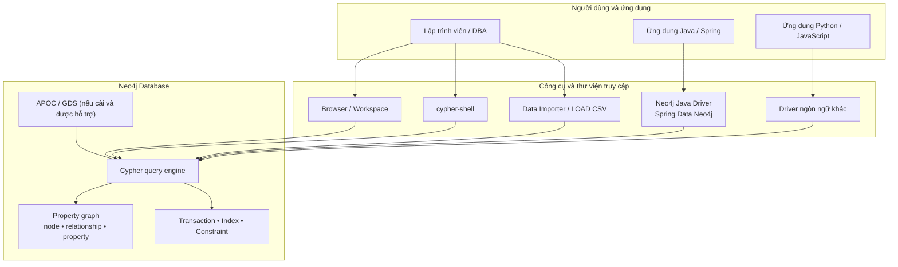
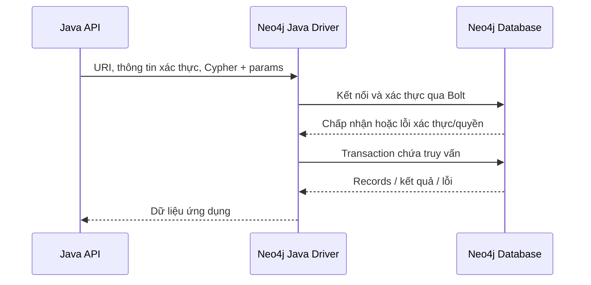
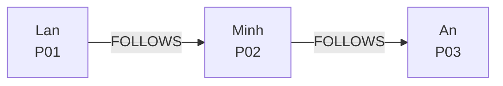

# Hệ sinh thái Neo4j: máy chủ, công cụ truy vấn, thư viện và dịch vụ quản lý

> **Chương:** Tổng quan Neo4j  
> **Module:** `DATABASE_ENGINE_GRAPH_NEO4J`  
> **Trọng tâm:** Hiểu vai trò của từng thành phần trong hệ sinh thái Neo4j và cách ghép chúng thành một luồng phát triển, truy vấn, tích hợp và vận hành cơ sở dữ liệu đồ thị.
>
> Neo4j là nền tảng lưu trữ và truy vấn dữ liệu liên kết theo **property graph** và **Cypher**. Các bài học tiếp theo của module đi sâu vào node, relationship, index, constraint, tối ưu truy vấn, nhập dữ liệu, Java Driver, Spring Data Neo4j và vận hành đồ thị. Bài này giúp chọn đúng công cụ cho từng công việc trước khi đi vào chi tiết kỹ thuật.

## 1. Mục tiêu học tập

Sau khi hoàn thành, bạn có thể:

1. Phân biệt **Neo4j Database** (máy chủ lưu trữ và thực thi truy vấn) với giao diện truy vấn, ứng dụng client, thư viện, plugin và nền tảng được quản lý.
2. Mô tả các cách chạy Neo4j: cài đặt trực tiếp, Docker, môi trường phát triển có giao diện, triển khai tự quản và dịch vụ cloud **Neo4j Aura**.
3. Chọn công cụ truy vấn phù hợp: giao diện web như **Neo4j Browser/Workspace**, dòng lệnh **cypher-shell**, hoặc driver của ngôn ngữ lập trình.
4. Hiểu vai trò của **Neo4j Data Importer**, `LOAD CSV` và những công cụ nhập dữ liệu quy mô lớn.
5. Giải thích **Bolt**, URI kết nối, xác thực, TLS, session, transaction và việc ứng dụng Java/Spring gửi Cypher đến máy chủ.
6. Phân biệt **Neo4j Java Driver**, **Spring Data Neo4j**, **APOC** và **Graph Data Science (GDS)**.
7. Thực hiện luồng thực hành nhỏ từ khởi chạy database, nhập node/relationship, truy vấn bằng Cypher tới gọi từ Java.
8. Đề xuất kiến trúc triển khai, các điểm cần theo dõi và tiêu chí chọn môi trường phù hợp.

## 2. Bức tranh tổng thể: Neo4j là cả một hệ sinh thái

Tên “Neo4j” trong hội thoại có thể chỉ máy chủ cơ sở dữ liệu, bộ công cụ thao tác dữ liệu hoặc dịch vụ cloud. Các thành phần có vai trò khác nhau:

| Lớp | Thành phần điển hình | Chức năng |
| --- | --- | --- |
| **Cơ sở dữ liệu** | Neo4j Database (DBMS) | Lưu node/relationship/property, quản lý transaction, thực thi Cypher, dùng index và constraint |
| **Cách triển khai** | Gói cài đặt máy chủ, Docker, môi trường container/Kubernetes | Khởi chạy và quản lý tiến trình database trong hạ tầng tự vận hành |
| **Cloud được quản lý** | Neo4j Aura / AuraDB | Cung cấp và vận hành database như dịch vụ; người dùng tập trung vào dữ liệu và truy vấn |
| **Truy vấn tương tác** | Neo4j Browser, các giao diện Query/Workspace tùy môi trường | Gửi Cypher, đọc bảng kết quả, xem sơ đồ và kiểm tra kế hoạch truy vấn |
| **Dòng lệnh** | `cypher-shell` | Chạy Cypher từ terminal, hỗ trợ tác vụ có thể lặp lại và automation |
| **Nhập dữ liệu** | Neo4j Data Importer, `LOAD CSV`, công cụ nhập offline | Chuyển dữ liệu ban đầu/thường xuyên từ nguồn ngoài sang node và relationship |
| **Tích hợp ứng dụng** | Java Driver, Python/JavaScript/.NET/Go drivers | Kết nối ứng dụng, gửi Cypher và nhận bản ghi trả về |
| **Tích hợp Spring** | Spring Data Neo4j | Ánh xạ domain thành đồ thị và cung cấp repository, transaction integration |
| **Mở rộng** | APOC, Graph Data Science (GDS) | Thêm procedures/functions và thuật toán phân tích đồ thị theo tính năng được hỗ trợ |
| **Vận hành** | Monitoring, log, backup/restore, security, quản lý phiên bản | Duy trì tính sẵn sàng, an toàn, tính toàn vẹn và hiệu năng |

Các tên sản phẩm, giao diện và quyền truy cập có thể thay đổi theo **phiên bản Neo4j, edition, gói Aura và thời điểm sử dụng**. Khi triển khai thật, hãy đối chiếu tài liệu của đúng phiên bản; bài này trình bày vai trò và nguyên lý ít thay đổi.

### 2.1. Sơ đồ quan hệ giữa các thành phần



**Điểm mấu chốt:** Browser hoặc Spring Data Neo4j **không phải** cơ sở dữ liệu độc lập. Chúng gửi truy vấn hoặc hỗ trợ thao tác lên **máy chủ Neo4j**. Một ứng dụng có thể dùng Neo4j mà không mở Browser, và một giao diện Browser có thể kết nối tới database từ xa.

## 3. Neo4j Database: máy chủ thực sự lưu và xử lý dữ liệu

Neo4j Database là hệ quản trị cơ sở dữ liệu đồ thị. Dữ liệu được lưu thành **labeled property graph**:

- **Node:** thực thể, ví dụ `(:Person {id: 'P01', name: 'Lan'})`.
- **Label:** phân loại node, ví dụ `:Person`, `:Course`.
- **Relationship:** kết nối có hướng và có type, ví dụ `(Lan)-[:FOLLOWS]->(Minh)`.
- **Property:** cặp khóa–giá trị gắn với node hoặc relationship, ví dụ `level: 4`.

Máy chủ chịu trách nhiệm:

1. **Lưu trữ** đồ thị, bảo vệ tính nhất quán của dữ liệu ở cấp database.
2. **Thực thi Cypher:** nhận mẫu node/relationship, lọc và trả dữ liệu.
3. **Transaction:** thực hiện các thao tác đọc/ghi theo cơ chế giao dịch có các thuộc tính ACID phù hợp.
4. **Lập kế hoạch và tối ưu truy vấn:** sử dụng thống kê và các cấu trúc hỗ trợ để chọn cách tìm node, mở rộng relationship.
5. **Index, constraint:** hỗ trợ tra cứu và ràng buộc hợp lệ theo khả năng của phiên bản/edition.
6. **Kết nối và bảo mật:** xác thực, phân quyền, cấu hình kết nối và mã hóa phù hợp.
7. **Vận hành:** log, cấu hình, quan sát, phục hồi, quản lý dung lượng và nâng cấp.

Ví dụ dữ liệu:

```cypher
(:Person {id: 'P01', name: 'Lan'})
  -[:FOLLOWS {since: date('2026-01-01')}]->
(:Person {id: 'P02', name: 'Minh'})
```

Sơ đồ trên là **mẫu mô tả**. Để ghi dữ liệu, phải dùng lệnh như `CREATE` hoặc `MERGE` trong một phiên làm việc với database. Để tìm dữ liệu, dùng `MATCH`.

### 3.1. Cypher chạy ở đâu?

Cypher là ngôn ngữ khai báo để mô tả **điều cần tìm hoặc thay đổi** trên property graph. Bạn có thể viết cùng một truy vấn trong:

- Cửa sổ query của Browser/Workspace.
- Terminal có `cypher-shell`.
- Chuỗi truy vấn truyền vào Java Driver.
- Truy vấn tùy chỉnh trong Spring Data Neo4j.

Những nơi này là **điểm gửi truy vấn**. Máy chủ Neo4j mới là nơi thực thi. Nhận thức này giúp phân biệt lỗi trình duyệt, lỗi client, lỗi mạng và lỗi kế hoạch truy vấn phía database.

### 3.2. Community và Enterprise: edition không phải nơi triển khai

Neo4j có các edition/phương án phân phối với phạm vi tính năng khác nhau. Về mặt lựa chọn kiến trúc:

| Tiêu chí | Community | Enterprise / triển khai có giấy phép tương ứng |
| --- | --- | --- |
| Học Cypher, mô hình node/relationship | Có | Có |
| Bài tập trên một database | Phù hợp | Phù hợp |
| Tính năng quản trị quy mô doanh nghiệp | Có phạm vi giới hạn | Có phạm vi rộng hơn tùy phiên bản và giấy phép |
| Triển khai yêu cầu tính sẵn sàng cao, phân quyền chi tiết, quản trị nhiều database | Cần kiểm tra giới hạn | Có thể đáp ứng với cấu hình/tính năng phù hợp |
| Mục tiêu chọn | Phòng lab, thử nghiệm, ứng dụng đáp ứng giới hạn edition | Nhu cầu thương mại và vận hành rộng hơn |

**Không đồng nhất “Enterprise” với “chạy cloud”**: một Enterprise deployment có thể tự quản trên hạ tầng của mình. Tương tự, **Aura là dịch vụ được quản lý**, không phải tên gọi khác của Neo4j Browser. Mọi giới hạn edition, license và đặc tính clustering/backup phải được xác minh ở tài liệu của bản đang dùng.

### 3.3. Một DBMS có thể chứa những database nào?

Trong các edition hỗ trợ quản trị đa database, một DBMS có thể có các database logic và cơ chế quản trị tương ứng. Ứng dụng phải dùng đúng **tên database**. Đừng suy từ việc đăng nhập thành công rằng ứng dụng đang đọc đúng môi trường dữ liệu.

Khi đã kết nối với quyền phù hợp, có thể kiểm tra:

```cypher
SHOW DATABASES;
```

Danh sách và các hành động quản trị khả dụng phụ thuộc quyền, edition và phiên bản. Trong Java Driver, có thể chỉ rõ database khi tạo session; trong công cụ truy vấn, kiểm tra database đang được chọn trước khi chạy lệnh ghi.

## 4. Các cách chạy Neo4j

Một dịch vụ Neo4j có thể chạy trên máy cá nhân, máy chủ nội bộ, container hoặc nền tảng được quản lý. Điều khác biệt chính là **ai chịu trách nhiệm hạ tầng và vận hành**.

### 4.1. Máy cá nhân: Neo4j Desktop hoặc cài đặt trực tiếp

**Neo4j Desktop** (khi được cung cấp cho hệ điều hành/phiên bản đó) là ứng dụng phục vụ phát triển và khám phá dữ liệu cục bộ, giúp quản lý instance cùng công cụ kết nối. Desktop không nên bị hiểu là một engine lưu trữ khác Neo4j Database: nó là môi trường hỗ trợ **chạy/quản lý database để phát triển**.

Cài trực tiếp server bằng gói phù hợp cũng cho phép vận hành database cục bộ. Cách này có lợi khi cần thử cấu hình, quan sát log và tìm hiểu quá trình khởi động.

Phù hợp cho:

- Học Cypher và thử mô hình property graph.
- Tạo bộ dữ liệu ít người dùng.
- Phát triển API trước khi kết nối môi trường dùng chung.

Nhược điểm: việc dừng máy hoặc tắt tiến trình làm database không sẵn sàng; cần tự lưu giữ dữ liệu, cấu hình và thông tin kết nối nếu muốn tiếp tục sử dụng.

### 4.2. Docker: chạy một máy chủ Neo4j có thể tái tạo

Docker giúp đóng gói database trong container. Lệnh sau là **ví dụ dành riêng cho máy thực hành** có Docker và cổng trống:

```bash
docker run --name neo4j-lab \
  -p 127.0.0.1:7474:7474 \
  -p 127.0.0.1:7687:7687 \
  -e NEO4J_AUTH=neo4j/ChangeThisDemoPassword123 \
  -v neo4j_lab_data:/data \
  neo4j:5
```

Trong PowerShell, có thể đặt lệnh trên **một dòng** hoặc dùng ký hiệu tiếp dòng phù hợp với PowerShell. Ví dụ đặt mật khẩu minh họa; phải thay bằng giá trị riêng và **không dùng mật khẩu demo trong môi trường thật**.

Giải thích:

- `neo4j:5`: một image theo dòng phiên bản 5; khi cần tính tái lập chặt chẽ nên **ghim bản image cụ thể** thay vì chỉ ghim dòng major.
- `7474`: cổng HTTP thường dùng cho giao diện Browser trên cấu hình cục bộ.
- `7687`: cổng thường dùng của giao thức **Bolt** mà driver sử dụng.
- `127.0.0.1:...`: chỉ ánh xạ cổng vào loopback của máy host trong ví dụ lab.
- `NEO4J_AUTH`: thiết lập thông tin đăng nhập ban đầu cho môi trường tương ứng với image.
- `neo4j_lab_data:/data`: volume giúp dữ liệu không phụ thuộc vòng đời container. Dữ liệu tồn tại trong volume cũng cần được bảo vệ và sao lưu khi quan trọng.

Khởi chạy xong, thử mở `http://localhost:7474` và xác thực tới database. Lưu ý các cổng, giao diện web, cấu hình security và cơ chế khởi tạo có thể khác nếu dùng một distribution hoặc bản Neo4j khác.

Nếu image đã chạy với một volume chứa database trước đó, việc đổi `NEO4J_AUTH` trong lệnh chạy lại **không nhất thiết thay đổi mật khẩu của user đã tồn tại**. Phải dùng cơ chế quản trị tài khoản phù hợp.

### 4.3. Neo4j trên server/Kubernetes

Với triển khai tự quản, đội vận hành có thể chạy Neo4j trên máy ảo, máy vật lý hoặc container có cấu hình bền vững. Trong môi trường Kubernetes, cần chú ý đặc biệt đến lưu trữ có trạng thái, mạng, quản lý secret, phân bổ tài nguyên, nâng cấp và cách các instance phối hợp khi có triển khai nhiều máy.

Khi chọn hạ tầng tự quản, bạn chịu trách nhiệm nhiều việc hơn:

- Phiên bản và tương thích với ứng dụng.
- Cấu hình CPU, RAM, bộ nhớ đĩa và bộ nhớ cache.
- Xác thực, TLS, phân quyền và phân đoạn mạng.
- Backup và **diễn tập khôi phục**.
- Theo dõi sức khỏe, log, metrics và cảnh báo.
- Nâng cấp, kiểm tra kế hoạch khôi phục và xử lý sự cố.

### 4.4. Neo4j Aura: database được quản lý trên cloud

**Neo4j Aura** là nhóm dịch vụ cloud được quản lý của Neo4j; **AuraDB** là hình thức database đồ thị được quản lý. Người dùng tạo một instance/dịch vụ, nhận URI kết nối và thông tin xác thực, rồi dùng Cypher qua driver hoặc giao diện được cung cấp.

Mô hình trách nhiệm thường là:

| Việc cần làm | Tự quản | AuraDB được quản lý |
| --- | --- | --- |
| Chuẩn bị máy/cluster cơ sở | Đội của bạn | Nhà cung cấp dịch vụ |
| Cập nhật hạ tầng database nền tảng | Đội của bạn lập kế hoạch và thực hiện | Nhà cung cấp quản lý theo dịch vụ |
| Thiết kế node, relationship, Cypher | Đội ứng dụng | Đội ứng dụng |
| Kiểm soát danh tính người dùng và cấu hình quyền ở lớp ứng dụng | Đội ứng dụng | Đội ứng dụng |
| Chất lượng dữ liệu, index và constraint ứng dụng | Đội ứng dụng | Đội ứng dụng |
| Kết nối mạng, chính sách truy cập ứng dụng | Đội ứng dụng | Đội ứng dụng, phối hợp chính sách dịch vụ |
| Năng lực tài nguyên, chi phí, retention/khôi phục theo gói | Đội vận hành quản lý | Chọn và kiểm chứng khả năng của gói dịch vụ |

Dùng Aura giảm nhiều gánh nặng hạ tầng, nhưng **không chuyển trách nhiệm mô hình dữ liệu và truy vấn đúng** sang nhà cung cấp. Gói dịch vụ khác nhau có thể khác giới hạn, quyền quản trị, lựa chọn backup, khôi phục, import, bảo mật và tính năng phân tích; không nên mặc định một tính năng có ở mọi gói.

## 5. Công cụ truy vấn: Browser, Workspace và cypher-shell

Sau khi database chạy, bạn cần cách gửi Cypher và xem kết quả. Ba nhóm công cụ thường gặp là **giao diện web**, **dòng lệnh**, và **mã ứng dụng**.

### 5.1. Neo4j Browser: nơi thực hành Cypher trực quan

Neo4j Browser là công cụ tương tác để:

- Gõ các câu lệnh Cypher.
- Xem kết quả dạng bảng hoặc đồ thị khi phù hợp.
- Kiểm tra node, relationship và property.
- Chạy `EXPLAIN`, `PROFILE` để xem kế hoạch thực thi.
- Khám phá, xác minh dữ liệu sau khi import.

Ví dụ:

```cypher
MATCH (p:Person)-[r:FOLLOWS]->(q:Person)
RETURN p, r, q
LIMIT 25;
```

Trả node và relationship có thể giúp giao diện vẽ sơ đồ. Nếu chỉ trả `p.name` và `q.name`, bạn thường thấy bảng gồm hai chuỗi; database vẫn là đồ thị dù giao diện không vẽ một cạnh nào.

**Neo4j Browser không phải nơi duy nhất chạy Cypher.** Giao diện là client, có thể kết nối tới nhiều database nếu thông tin mạng, quyền và cấu hình cho phép.

### 5.2. Workspace / Query / Explore

Trong một số môi trường Neo4j, nhất là các trải nghiệm cloud, bạn có thể gặp giao diện **Workspace**, các khu vực **Query**, **Explore**, hay cách tổ chức UI khác tùy phiên bản/gói. Các giao diện này hỗ trợ gửi truy vấn, khám phá graph, hiển thị dữ liệu và làm việc với instance.

Về mặt chức năng:

- **Query:** soạn và chạy Cypher, kiểm tra bảng kết quả.
- **Explore/visualization:** quan sát node và relationship, lọc và mở rộng mạng lưới bằng tương tác.
- **Quản lý dự án/connection:** chọn instance và database mà giao diện truy cập.

Không nên phụ thuộc vào tên tab hay vị trí nút trong tài liệu học thuật lâu dài vì giao diện thay đổi theo bản phát hành. Hãy nhận biết **nhiệm vụ** cần thực hiện và kiểm tra mình đang kết nối vào database nào.

Một số công cụ trực quan hóa như **Neo4j Bloom** có thể xuất hiện ở các phiên bản hoặc gói có hỗ trợ. Chức năng trực quan là một lớp công cụ; nó không thay thế xác định đúng Cypher hay duy trì dữ liệu của DBMS.

### 5.3. cypher-shell: truy vấn qua terminal

`cypher-shell` là công cụ dòng lệnh kết nối tới Neo4j và chạy Cypher. Khi được cài đặt và có quyền, bạn có thể dùng lệnh có hình thức:

```bash
cypher-shell -a 'neo4j://localhost:7687' -u neo4j
```

Cách nhập mật khẩu an toàn tùy môi trường: có thể sử dụng prompt tương tác và secret management thay vì đưa mật khẩu trực tiếp vào command line (vì command line có thể xuất hiện trong lịch sử shell hoặc công cụ giám sát tiến trình).

Khi đã vào phiên `cypher-shell`:

```cypher
RETURN 'Neo4j connected' AS message;
```

Công cụ thích hợp cho:

- Chạy tập truy vấn mẫu hoặc script lặp lại.
- Kiểm tra database trên máy chủ không có giao diện đồ họa.
- Tích hợp một số bước quản trị/tạo dữ liệu với quy trình triển khai có kiểm soát.

**Phân biệt:** `cypher-shell` là client. Nó không tự khởi động máy chủ và không lưu một bản database riêng. Nếu không kết nối được, cần kiểm tra **server đang chạy**, URI, cổng, thông tin xác thực và quyền mạng.

### 5.4. Chọn công cụ nào cho công việc?

| Nhu cầu | Công cụ thường hợp lý |
| --- | --- |
| Học cú pháp, thử nhanh một `MATCH` | Browser hoặc giao diện Query |
| Nhìn những node và relationship đã lưu | Browser / giao diện Explore hoặc công cụ hình ảnh được hỗ trợ |
| Chạy Cypher trong terminal trên server/CI | `cypher-shell` |
| Gọi truy vấn từ backend Java | Neo4j Java Driver hoặc Spring Data Neo4j |
| Lập báo cáo/cảnh báo có nghiệp vụ | Backend/service sử dụng driver và xử lý kết quả |
| Nhập hai bảng CSV thành node và relationship | Neo4j Data Importer hoặc `LOAD CSV` phù hợp |
| Tìm cộng đồng, centrality, similarity nâng cao | Graph Data Science (khi triển khai và gói hỗ trợ) |

## 6. Nhập dữ liệu: từ CSV và hệ thống bên ngoài đến đồ thị

Lưu graph không có nghĩa dữ liệu nguồn đã sẵn là node và relationship. Trong dự án thật, đầu vào thường là bảng CSV, RDBMS, dữ liệu sự kiện, log hoặc API.

Luồng nhập dữ liệu cần giải quyết đồng thời:

1. **Ánh xạ thực thể:** mỗi hàng nào trở thành node? Có khóa nghiệp vụ nào?
2. **Ánh xạ kết nối:** cột nào chỉ định node nguồn và node đích?
3. **Kiểu dữ liệu:** ngày, số, boolean, định danh và những trường rỗng.
4. **Tính lặp lại:** chạy import lần hai có tạo trùng node/cạnh không?
5. **Kiểm tra hậu nhập:** số node, số relationship, mối liên hệ thiếu đầu hoặc sai chiều.

### 6.1. Neo4j Data Importer

Neo4j Data Importer là công cụ hỗ trợ thiết kế ánh xạ dữ liệu dạng bảng/CSV vào mô hình node–relationship một cách trực quan trong các môi trường được hỗ trợ.

Ví dụ có hai tệp:

```csv
# people.csv (dòng dữ liệu thực tế không chứa chú thích này)
id,name
P01,Lan
P02,Minh
P03,An
```

```csv
# follows.csv (dòng dữ liệu thực tế không chứa chú thích này)
sourceId,targetId,since
P01,P02,2026-01-01
P02,P03,2026-03-01
```

Trong một quy trình nhập trực quan:

1. Chọn các trường `people.id` và `follows.sourceId/targetId` để nhận diện node và liên kết.
2. Ánh xạ hàng `people` thành node label `Person` với property `id`, `name`.
3. Ánh xạ hàng `follows` thành relationship `FOLLOWS` có chiều **source → target**.
4. Ánh xạ `since` thành giá trị ngày hoặc chuyển kiểu theo công cụ.
5. Xác minh schema, quyền và các yêu cầu được hỗ trợ trước khi nhập.
6. Chạy Cypher kiểm tra kết quả.

Khi chọn cách nhập, cần xem **Data Importer đang kết nối đến môi trường Neo4j nào** và khả năng nhập của phiên bản/gói. Công cụ nhập dữ liệu chỉ hỗ trợ biến đổi và gửi dữ liệu; các ràng buộc nhất quán vẫn do thiết kế và DBMS/ứng dụng kiểm soát.

### 6.2. LOAD CSV: nhập có điều khiển bằng Cypher

`LOAD CSV` là mệnh đề Cypher đọc dữ liệu CSV từ nguồn mà **máy chủ Neo4j có quyền truy cập**. Ví dụ sau là khung dùng khi tệp `people.csv` đã được cung cấp đúng cách và URL `file:///people.csv` hợp lệ trong cấu hình import của database:

```cypher
LOAD CSV WITH HEADERS FROM 'file:///people.csv' AS row
WITH row
WHERE row.id IS NOT NULL AND trim(row.id) <> ''
MERGE (p:Person {id: row.id})
SET p.name = row.name;
```

Với quan hệ, cần tìm **hai node đã nhập trước**:

```cypher
LOAD CSV WITH HEADERS FROM 'file:///follows.csv' AS row
MATCH (source:Person {id: row.sourceId})
MATCH (target:Person {id: row.targetId})
MERGE (source)-[r:FOLLOWS]->(target)
SET r.since = date(row.since);
```

Khi chạy thật, dữ liệu `since` rỗng hoặc sai định dạng có thể gây lỗi; cần kiểm tra hoặc chuyển đổi đầu vào phù hợp. `MATCH` không tìm được node đầu thì không tạo relationship cho hàng đó, nên phải **đếm và đối soát dữ liệu** sau khi nhập.

**Bẫy phổ biến:** `file:///people.csv` được hiểu ở **phía server/container**, không phải tùy ý đọc tệp nằm trên máy người đang mở Browser. Với Docker, cần bố trí tệp qua volume/import directory và cấu hình phù hợp. Một số môi trường cloud có giới hạn hoặc cơ chế nhập khác; hãy dùng nguồn và công cụ được gói dịch vụ hỗ trợ.

### 6.3. Nhập offline và nhập tăng dần khác nhau

Một số công cụ quản trị hỗ trợ **nhập dữ liệu hàng loạt khi database đích chưa hoạt động theo cách sử dụng thông thường**. Đây là bài toán khác với việc gọi `LOAD CSV` để **cập nhật dữ liệu trong database đang chạy**.

- **Nhập lần đầu quy mô lớn:** quan tâm throughput, dung lượng, sơ đồ mã định danh, yêu cầu dừng/chạy database và edition.
- **Nhập tăng dần:** quan tâm tính idempotent, transaction, dữ liệu mới/cũ, thay đổi mối liên hệ và xử lý lỗi.
- **Đồng bộ liên tục:** cần định nghĩa nguồn sự thật, độ trễ chấp nhận được, xử lý lại sự kiện, phát hiện dữ liệu lệch.

Tên và tùy chọn CLI quản trị, chẳng hạn nhóm lệnh của `neo4j-admin database import`, thay đổi theo version; luôn đọc hướng dẫn chính xác của bản server đang dùng.

## 7. Giao thức kết nối: Bolt, URI, TLS và cơ chế xác thực

Một backend Java không kết nối database bằng cách “mở URL của Browser rồi scrape HTML”. Nó sử dụng **driver** và giao thức truy cập database, phổ biến là **Bolt**.

### 7.1. Hai cổng thường gặp trong môi trường local

| Cổng mặc định thường gặp | Công dụng | Đối tượng sử dụng |
| --- | --- | --- |
| `7474` | HTTP cho Browser và endpoint tương ứng trong cấu hình hỗ trợ | Trình duyệt/web tools |
| `7687` | Bolt cho driver và `cypher-shell` | Backend Java/Python/JavaScript và CLI |

Đây là **quy ước thường gặp** khi chạy Neo4j cục bộ, không phải cổng bắt buộc trong mọi kiến trúc. Trong cloud, reverse proxy hoặc cấu hình bảo mật có thể làm cổng/URI truy cập khác đi.

### 7.2. Các dạng URI thường thấy

| URI minh họa | Ý nghĩa khái quát |
| --- | --- |
| `bolt://localhost:7687` | Kết nối Bolt trực tiếp tới endpoint local |
| `neo4j://localhost:7687` | Kết nối theo cơ chế định tuyến của Neo4j Driver; tùy topology |
| `neo4j+s://example.databases.neo4j.io` | Neo4j URI có TLS và xác minh chứng chỉ theo cấu hình driver; dạng thường gặp với Aura |
| `neo4j+ssc://host:7687` | Dạng dùng TLS với chứng chỉ tự ký khi môi trường hỗ trợ; cần đánh giá an toàn trước khi sử dụng |

Với Aura, **lấy URI chính xác từ thông tin kết nối instance**. Đừng tự suy hostname, giao thức hoặc port. Ứng dụng production nên dùng TLS và xác thực chứng chỉ phù hợp; không dùng ví dụ plaintext local như lựa chọn mặc định cho kết nối qua mạng công cộng.

### 7.3. Vai trò của xác thực và phân quyền

Kết nối thành công thường đi qua:



Những lỗi thường cần phân biệt:

- **URI/cổng sai** → không mở được kết nối mạng.
- **Sai tên người dùng hoặc mật khẩu** → kết nối bị từ chối ở bước xác thực.
- **Thiếu quyền** → xác thực được nhưng thao tác bị chặn.
- **Sai database** → có thể không thấy dữ liệu mong đợi hoặc không có quyền.
- **Sai chứng chỉ/cấu hình TLS** → kết nối an toàn không được thiết lập.
- **Truy vấn sai hoặc dữ liệu không khớp** → kết nối được nhưng câu lệnh báo lỗi/trả 0 hàng.

Mật khẩu và khóa truy cập nên lưu trong hệ thống quản lý secret hoặc cấu hình bảo mật, không ghi cố định trong mã nguồn, file ví dụ công khai hay log.

## 8. Neo4j Java Driver: cầu nối từ ứng dụng đến cơ sở dữ liệu

**Neo4j Java Driver** là thư viện chính thức để ứng dụng Java gửi Cypher, dùng parameter, nhận bản ghi và quản lý giao dịch với Neo4j.

Một cách tổ chức trách nhiệm thường dùng:

- **Driver:** giữ cấu hình kết nối và quản lý tài nguyên kết nối dùng lại.
- **Session:** ngữ cảnh làm việc với database; tạo theo đơn vị công việc, sau đó đóng.
- **Transaction:** nhóm thao tác đọc/ghi cần bảo đảm tính nhất quán. Driver cung cấp transaction functions phù hợp với cơ chế retry của driver.
- **Result/Record:** dữ liệu trả về từ Cypher, cần chuyển thành kiểu/domain object của Java.

### 8.1. Ví dụ Java gọi Cypher có parameter

Giả sử dữ liệu thực hành ở mục 11 đã được tạo trên database tên `neo4j`. Mã ví dụ dùng Java Driver **5.x** với `executeRead`:

```java
import org.neo4j.driver.AuthTokens;
import org.neo4j.driver.Driver;
import org.neo4j.driver.GraphDatabase;
import org.neo4j.driver.Session;
import org.neo4j.driver.SessionConfig;
import org.neo4j.driver.Values;

import java.util.List;

public final class Neo4jDemo {
    public static void main(String[] args) {
        String uri = System.getenv("NEO4J_URI");
        String user = System.getenv("NEO4J_USERNAME");
        String password = System.getenv("NEO4J_PASSWORD");

        try (Driver driver = GraphDatabase.driver(
                uri, AuthTokens.basic(user, password))) {
            driver.verifyConnectivity();

            try (Session session = driver.session(
                    SessionConfig.forDatabase("neo4j"))) {
                List<String> following = session.executeRead(tx ->
                    tx.run(
                        "MATCH (:Person {id: $personId})" +
                        "-[:FOLLOWS]->(other:Person) " +
                        "RETURN other.name AS name ORDER BY name",
                        Values.parameters("personId", "P01"))
                      .list(record -> record.get("name").asString())
                );

                System.out.println(following); // [Minh]
            }
        }
    }
}
```

Mã chỉ là ví dụ sử dụng API, cần có dependency `org.neo4j.driver:neo4j-java-driver` tương thích với phiên bản dự án và các biến môi trường `NEO4J_URI`, `NEO4J_USERNAME`, `NEO4J_PASSWORD`. Nếu tên database không phải `neo4j`, thay giá trị trong `SessionConfig`.

**Ý nghĩa các lựa chọn:**

1. Driver được tạo và đóng bằng `try-with-resources`.
2. Session dùng riêng cho công việc rồi đóng; không chia sẻ một Session qua nhiều request đồng thời.
3. `executeRead` thể hiện transaction đọc do driver quản lý.
4. `$personId` là **parameter**, không ghép dữ liệu người dùng trực tiếp vào truy vấn.
5. `record.get("name").asString()` ánh xạ từng giá trị trả về thành một kiểu Java.

Trong ứng dụng backend hoạt động lâu dài, thông thường **Driver được quản lý như một tài nguyên dùng chung có vòng đời rõ ràng**; không tạo rồi hủy Driver cho mỗi HTTP request. Session hoặc đơn vị công việc có vòng đời ngắn hơn. Tránh ghi hoặc gọi dịch vụ bên ngoài có side effect trong callback được retry mà không thiết kế idempotency.

### 8.2. Driver không tự thiết kế mô hình dữ liệu

Java Driver biết cách giao tiếp với Neo4j, nhưng không tự quyết định nên có label `Person`, type `FOLLOWS` hay constraint nào. Đó là trách nhiệm của thiết kế domain.

Tương tự, Java Driver không làm các câu truy vấn chậm tự nhiên trở nên nhanh. Nếu truy vấn mở rộng quá rộng, cần tối ưu Cypher, lựa chọn điểm bắt đầu và index/constraint phù hợp.

## 9. Spring Data Neo4j: tích hợp trong ứng dụng Spring

**Spring Data Neo4j (SDN)** là tầng tích hợp với Spring, cho phép định nghĩa entity graph và repository theo cách gần với domain model Java.

Một ví dụ đơn giản về mapping (lược bỏ constructor/getter/setter để tập trung vào annotation):

```java
import org.springframework.data.annotation.Id;
import org.springframework.data.neo4j.core.schema.Node;
import org.springframework.data.neo4j.core.schema.Relationship;

import java.util.HashSet;
import java.util.Set;

@Node("Person")
public class Person {
    @Id
    private String id;

    private String name;

    @Relationship(type = "FOLLOWS",
                  direction = Relationship.Direction.OUTGOING)
    private Set<Person> following = new HashSet<>();

    // Constructor, getter/setter hoặc cách khởi tạo phù hợp
    // cần có khi triển khai mapping thực tế.
}
```

Một repository có thể cung cấp thao tác truy xuất:

```java
import org.springframework.data.neo4j.repository.Neo4jRepository;
import org.springframework.data.neo4j.repository.query.Query;

import java.util.List;

public interface PersonRepository
        extends Neo4jRepository<Person, String> {

    @Query("""
        MATCH (p:Person {id: $personId})
              -[:FOLLOWS]->(other:Person)
        RETURN other
        ORDER BY other.name
        """)
    List<Person> findFollowing(String personId);
}
```

Ví dụ trên cho thấy SDN:

- Biết entity Java tương ứng với node label `:Person`.
- Biết field `following` mô tả relationship `FOLLOWS` có hướng ra.
- Cung cấp repository và khả năng gắn truy vấn Cypher vào phương thức.

**Không nên xem SDN là sự thay thế kiến thức Cypher.** Với mô hình nhiều mối quan hệ hoặc truy vấn phức tạp, vẫn phải hiểu chiều cạnh, phép lọc, kết quả trả về và cách ánh xạ. Quản lý vòng đời entity, chiến lược ID, transaction và hiệu năng tải quan hệ cần được thiết kế theo đặc điểm của phiên bản SDN và Spring Boot được dùng.

### 9.1. Java Driver và Spring Data Neo4j khác nhau ở đâu?

| Khía cạnh | Java Driver | Spring Data Neo4j |
| --- | --- | --- |
| Mức trừu tượng | Kết nối, session, transaction, query, record | Entity mapping, repository, tích hợp Spring |
| Cách gửi Cypher | Gọi trực tiếp `tx.run(...)` | Repository, `@Query` hoặc API truy vấn |
| Ánh xạ dữ liệu | Ứng dụng tự xử lý Record | Framework hỗ trợ ánh xạ entity |
| Kiểm soát cú pháp và payload | Rất trực tiếp | Có thể trực tiếp qua custom query; phải chú ý cơ chế mapping |
| Trường hợp hợp lý | Java độc lập, service cần điều khiển truy vấn rõ ràng | Ứng dụng Spring có domain repository |
| Điều vẫn cần biết | Node, relationship, Cypher, transaction | Node, relationship, Cypher, transaction |

SDN dùng cơ chế kết nối với Neo4j và không sở hữu một graph database riêng. Tránh thiết kế hai tầng quản lý transaction song song mà chưa kiểm tra hành vi tích hợp của framework.

## 10. Thư viện mở rộng: APOC và Graph Data Science

Không phải mọi thành phần có chữ “Neo4j” đều được tích hợp mặc định vào server.

### 10.1. APOC: procedures và functions bổ sung

**APOC** là một bộ procedure/function mở rộng cho Neo4j, cung cấp các tiện ích như xử lý dữ liệu, chuyển đổi, thao tác tập hợp và các tác vụ graph trong phạm vi bản cài đặt hỗ trợ.

Ví dụ, trong một môi trường **đã cài và cho phép APOC**, bạn có thể kiểm tra thủ tục có sẵn theo hướng dẫn của bản server tương ứng; các cách liệt kê, tên procedure và quyền cần thiết có thể thay đổi theo bản phát hành.

Những điểm phải nhớ:

- APOC là **phần mở rộng**, không đồng nghĩa với toàn bộ ngôn ngữ Cypher.
- Một thủ tục APOC được dùng trong ví dụ trên Internet có thể **không khả dụng** trên database của bạn.
- Có các giới hạn và cơ chế cho phép plugin, procedure, import/export tùy môi trường.
- Tác vụ liên quan đến filesystem, network hoặc cấu hình bảo mật phải tuân theo quyền và chính sách vận hành.

Với các tác vụ chỉ cần Cypher chuẩn như tạo node, tìm relationship và lọc property, không nên thêm phụ thuộc vào APOC khi không thật sự cần.

### 10.2. Graph Data Science (GDS): thuật toán phân tích đồ thị

**Neo4j Graph Data Science** là hệ thư viện/năng lực phân tích đồ thị phục vụ những bài toán như:

- Xác định node có vai trò trung tâm trong mạng lưới.
- Tìm cộng đồng/nhóm kết nối.
- Đo độ tương tự hoặc tạo cơ sở cho gợi ý.
- Khai thác thuật toán đường đi với các điều kiện thích hợp.
- Xây dựng các pipeline phân tích liên quan đến đồ thị theo chức năng được cấp.

Không nên nhầm hai nhóm tác vụ:

| Cypher thông thường | Graph Data Science |
| --- | --- |
| Tạo và cập nhật node/relationship | Chạy thuật toán phân tích mạng lưới |
| Tìm mẫu quan hệ và các đường đi cụ thể | Phân tích cấu trúc, centrality, community, similarity |
| Kiểm tra dữ liệu nghiệp vụ hiện có | Có thể cần tạo **graph projection** và quản lý bộ nhớ cho thuật toán |
| Là phần nền tảng của Neo4j | Tùy phiên bản, gói dịch vụ, license và cấu hình bổ sung |

Nhiều quy trình GDS tạo một **đồ thị chiếu trong bộ nhớ** phục vụ thuật toán, khác với graph lưu trữ lâu dài trong database. Không tự động giả định kết quả thuật toán đã được ghi thành property trong database; thao tác stream hoặc write-back phụ thuộc thủ tục gọi và cách sử dụng.

### 10.3. Tại sao phải kiểm tra tương thích plugin?

Một plugin có thể yêu cầu phiên bản Neo4j tương thích, bộ nhớ đủ lớn, quyền thực thi, giấy phép và quy trình khởi động riêng. Đặc biệt với cloud managed, khả năng cài plugin tùy ý thường khác môi trường tự quản.

Trước khi chọn một thư viện:

1. Xác định câu hỏi nghiệp vụ mà Cypher thông thường chưa giải quyết hiệu quả.
2. Đối chiếu **server version, plugin version, edition và gói cloud**.
3. Xem quyền, bộ nhớ, cách khai báo procedure và chính sách an toàn.
4. Thử nghiệm trên dữ liệu mẫu và theo dõi chi phí.
5. Thiết lập cơ chế thay thế khi một thủ tục không có ở môi trường khác.

## 11. Thực hành xuyên suốt: từ máy chủ đến truy vấn và Java

Mục tiêu lab là chứng minh **cùng một đồ thị** có thể được sử dụng từ Browser, cypher-shell và Java Driver.

### 11.1. Chuẩn bị database

Chọn một trong hai cách:

- Chạy một instance Neo4j local (Desktop, cài server hoặc Docker ở mục 4).
- Sử dụng một instance AuraDB dành riêng cho học tập và lấy URI được cung cấp.

Bạn cần biết chính xác: **URI**, **username**, **password**, **database name**. Đối với local theo ví dụ Docker: Browser thường mở ở `http://localhost:7474`; driver/CLI dùng cổng Bolt `7687`. Nếu dùng Aura, dùng URI bảo mật do instance cấp.

### 11.2. Tạo graph mẫu

Chạy từng khối trong Browser hoặc giao diện Query, trên database thực hành không có dữ liệu xung đột.

Đầu tiên tạo constraint cho mã nghiệp vụ:

```cypher
CREATE CONSTRAINT person_id_unique IF NOT EXISTS
FOR (p:Person) REQUIRE p.id IS UNIQUE;
```

Sau đó tạo ba node:

```cypher
UNWIND [
  {id: 'P01', name: 'Lan'},
  {id: 'P02', name: 'Minh'},
  {id: 'P03', name: 'An'}
] AS row
MERGE (p:Person {id: row.id})
SET p.name = row.name;
```

Cuối cùng tạo hai relationship:

```cypher
MATCH (lan:Person {id: 'P01'})
MATCH (minh:Person {id: 'P02'})
MATCH (an:Person {id: 'P03'})
MERGE (lan)-[r1:FOLLOWS]->(minh)
SET r1.since = date('2026-01-01')
MERGE (minh)-[r2:FOLLOWS]->(an)
SET r2.since = date('2026-03-01');
```

Dữ liệu mong đợi:



`MERGE` giúp tránh việc tạo thêm node với cùng mã đã có và, trong ví dụ không có tranh chấp ghi, tránh tạo lại relationship giữa hai node khớp. Nó không thay thế mọi ràng buộc quan hệ trong kịch bản ghi đồng thời.

### 11.3. Truy vấn trong Browser hoặc Workspace

Truy vấn một cấp:

```cypher
MATCH (:Person {id: 'P01'})-[:FOLLOWS]->(p:Person)
RETURN p.id AS id, p.name AS name;
```

Kết quả dự kiến: **P02 — Minh**.

Truy vấn hai cấp:

```cypher
MATCH (:Person {id: 'P01'})-[:FOLLOWS*1..2]->(p:Person)
RETURN DISTINCT p.id AS id, p.name AS name
ORDER BY id;
```

Kết quả dự kiến: **Minh** (một bước) và **An** (hai bước).

Xem sơ đồ trong giao diện có hỗ trợ:

```cypher
MATCH (a:Person)-[r:FOLLOWS]->(b:Person)
RETURN a, r, b;
```

### 11.4. Chạy cùng Cypher bằng cypher-shell

Kết nối bằng URI, tài khoản và mật khẩu của môi trường. Sau đó chạy:

```cypher
MATCH (:Person {id: 'P01'})-[:FOLLOWS]->(p:Person)
RETURN p.name AS name;
```

Kết quả vẫn là **Minh** nếu cả hai client truy cập **cùng database**. Nếu khác kết quả, hãy kiểm tra instance, database name, thông tin xác thực và transaction đã ghi thành công.

### 11.5. Chạy cùng Cypher từ Java

Sử dụng chương trình Java Driver ở mục 8, cấu hình biến môi trường kết nối hợp lệ. Mã dùng chính câu truy vấn một cấp với `$personId = 'P01'` và trả danh sách tên `[Minh]`.

Từ đây có thể nâng cấp thành một endpoint REST:

```text
GET /people/P01/following
→ service Java/Spring
→ driver hoặc repository
→ Neo4j Cypher
→ ["Minh"]
```

Đường dữ liệu là **HTTP request vào ứng dụng → backend truy vấn qua driver → database → kết quả → JSON**, không phải trình duyệt ứng dụng gọi trực tiếp cổng Bolt và mang mật khẩu database tới người dùng cuối.

### 11.6. Kiểm tra trong phòng lab

Một bài thực hành hoàn thành khi bạn có thể xác nhận:

| Phép kiểm tra | Kết quả mong đợi |
| --- | --- |
| `MATCH (p:Person) RETURN count(p)` trên database chỉ có lab | 3 node |
| `MATCH ()-[r:FOLLOWS]->() RETURN count(r)` | 2 relationship |
| Từ P01 đi một bước | Minh |
| Từ P01 đi một đến hai bước | Minh và An |
| Browser và cypher-shell truy vấn cùng database | Kết quả phù hợp |
| Java Driver truy vấn P01 | Trả tên Minh |
| Đổi truy vấn sang ID không có, ví dụ P99 | Không có hàng kết quả, không tự tạo node |

Với database đã có dữ liệu khác, hãy lọc theo đúng tập mã lab thay vì đếm toàn database. Nếu dữ liệu không khớp, tìm nguyên nhân trước khi chạy lại lệnh tạo.

## 12. Vận hành: những việc một DBMS cần có sau khi chạy được

Làm được một truy vấn `MATCH` chỉ chứng minh kết nối và dữ liệu demo cơ bản. Để chạy trong môi trường thực tế, cần chuẩn bị:

### 12.1. Quan sát hệ thống

Theo dõi tối thiểu:

- Trạng thái database và khả năng chấp nhận kết nối.
- Độ trễ truy vấn thường gặp, lỗi, timeout và tải đồng thời.
- CPU, bộ nhớ, dung lượng lưu trữ, tốc độ I/O và tăng trưởng dữ liệu.
- Các truy vấn có kế hoạch mở rộng quá nhiều node/relationship.
- Log hệ thống, log query/diagnostics và cảnh báo theo khả năng phiên bản/edition.

Dùng `EXPLAIN` để xem kế hoạch dự kiến mà không thực thi truy vấn; `PROFILE` thực thi và cung cấp số liệu thực tế của kế hoạch. Với dữ liệu quan trọng, nên chạy `PROFILE` trước trên môi trường phù hợp vì nó **có thực thi** truy vấn.

### 12.2. Tính toàn vẹn dữ liệu

Constraint duy nhất hỗ trợ khóa nghiệp vụ như `Person.id`. Index giúp truy vấn tìm node từ thuộc tính được lọc; không tự động tăng tốc mọi phép duyệt hay mọi câu Cypher.

Các câu hỏi cần giải quyết:

- Có cho phép hai node có cùng `email` hoặc cùng `id` không?
- Thuộc tính nào là bắt buộc?
- Một cặp node có thể có bao nhiêu relationship cùng loại?
- Có cho phép chu trình, self-loop hoặc quan hệ sai chiều không?
- Có cần lưu lịch sử của relationship hay chỉ trạng thái hiện tại?

Một số bất biến nghiệp vụ đòi hỏi kiểm soát ở ứng dụng hoặc quy trình ghi, không được Neo4j tự suy ra chỉ từ tên label/type.

### 12.3. Backup và khôi phục

Kế hoạch vận hành cần xác định:

1. **RPO:** mức mất dữ liệu tối đa có thể chấp nhận.
2. **RTO:** thời gian khôi phục dịch vụ mục tiêu.
3. Cơ chế backup/snapshot phù hợp với edition, gói dịch vụ và trạng thái database.
4. Nơi lưu bản sao, thời gian giữ và kiểm soát truy cập.
5. Cách **khôi phục thử** và kiểm chứng node/relationship sau khôi phục.

Cơ chế backup chính xác khác nhau giữa Community, Enterprise, tự quản và Aura. Không mặc định chỉ cần sao chép tùy tiện các file dữ liệu của database đang ghi là có bản backup nhất quán.

### 12.4. Bảo mật

- Tách account dịch vụ với account quản trị.
- Cấp quyền tối thiểu cần thiết theo khả năng edition/gói.
- Dùng TLS cho kết nối từ xa và kiểm tra chứng chỉ.
- Không đưa mật khẩu/URI nhạy cảm vào repo, source code, screenshot hoặc log.
- Giới hạn kết nối mạng và quản lý thời hạn secret.
- Đánh giá quyền của procedures, plugins và tác vụ import/export.

Đặc biệt, nếu database thuộc mạng nội bộ, **không để người dùng web kết nối trực tiếp tới cổng Bolt** với tài khoản dùng chung. Backend thực hiện truy cập dữ liệu theo quyền nghiệp vụ.

### 12.5. Tương thích phiên bản và nâng cấp

Cần xem đồng thời:

- Phiên bản Neo4j Database.
- Neo4j Java Driver.
- Phiên bản Spring Boot/Spring Data Neo4j.
- Các plugin như APOC/GDS.
- Giao thức và thông số TLS.
- Cú pháp Cypher và những tính năng dùng trong ứng dụng.
- Chính sách nâng cấp, thay đổi cấu hình và quy trình rollback/khôi phục.

Không nên tự động cập nhật image hoặc gói production lên bản mới nhất mà bỏ qua thử nghiệm tương thích. Tương tự, ví dụ trên Internet có thể dùng API driver của đời cũ nên chưa chắc tương thích với dự án hiện tại.

## 13. Chọn bộ công cụ cho ba tình huống thực tế

### Tình huống A — Học Cypher trên máy cá nhân

**Nhu cầu:** một người học, dữ liệu ít, ưu tiên thao tác nhanh.

Bộ công cụ hợp lý: một instance local qua Docker/Desktop, Browser hoặc giao diện Query, dữ liệu mẫu bằng `UNWIND`/`MERGE`, và `cypher-shell` nếu muốn luyện CLI. Với mục đích này, nhiều tính năng Enterprise thường chưa phải điều kiện đầu tiên.

### Tình huống B — Xây backend Spring Boot cho nhóm

**Nhu cầu:** nhiều lập trình viên, môi trường dev/staging, tích hợp repository, kiểm soát schema và test.

Bộ công cụ hợp lý: Neo4j instance dùng chung hoặc instance riêng theo môi trường; **Spring Data Neo4j** hay **Java Driver** tùy cách truy cập; Cypher có tham số; constraint/index được quản lý trong quy trình deploy; monitoring cơ bản, secret và bản sao dữ liệu thử. Cần kiểm tra phiên bản Spring và driver tương thích.

### Tình huống C — Hệ thống đồ thị hoạt động liên tục

**Nhu cầu:** SLA, tăng trưởng dữ liệu, backup, bảo mật, phục hồi và tối ưu.

Cân nhắc **AuraDB** nếu muốn giảm công việc hạ tầng trong phạm vi gói phù hợp, hoặc **Enterprise tự quản** nếu có yêu cầu triển khai, bảo mật, kiểm soát hạ tầng riêng và có đội vận hành tương ứng.

Đánh giá trên tiêu chí cụ thể thay vì tên sản phẩm:

| Tiêu chí | Câu hỏi quyết định |
| --- | --- |
| Quản trị | Ai triển khai, nâng cấp và xử lý sự cố database? |
| Khả năng mở rộng | Cần dung lượng và số truy vấn đồng thời bao nhiêu? |
| Phục hồi | RPO/RTO và phương án backup thực tế là gì? |
| Bảo mật | Dữ liệu có được phép lưu trong dịch vụ cloud không? Cần loại TLS/quyền gì? |
| Kết nối | Backend ở đâu, có độ trễ mạng và chính sách firewall nào? |
| Nhập dữ liệu | Dữ liệu từ CSV, sự kiện, API hay hệ thống quan hệ? Tần suất cập nhật? |
| Mô hình truy vấn | Có traversal nhiều cấp, node bậc lớn, phân tích đường đi hay thuật toán GDS không? |
| Chi phí | Chi phí hạ tầng, license/gói, nhân lực vận hành và chi phí thay đổi môi trường? |

## 14. Chẩn đoán lỗi theo đúng lớp của hệ sinh thái

| Triệu chứng | Lớp có thể gặp vấn đề | Cách kiểm tra đầu tiên |
| --- | --- | --- |
| Browser không mở được địa chỉ local | Web UI / container / cổng HTTP | Database/container có chạy không, cổng 7474 có ánh xạ đúng không? |
| Browser mở được nhưng driver không kết nối | URI Bolt / mạng / TLS | Driver đang dùng cổng 7687 hoặc URI của Aura? Firewall/cert thế nào? |
| `cypher-shell` báo lỗi xác thực | Credential | Đúng username, password và instance chưa? |
| Đăng nhập được nhưng `MATCH` trả 0 hàng | Database được chọn / dữ liệu / hướng cạnh | Có đang ở đúng database, label và hướng `FOLLOWS` không? |
| `LOAD CSV file:///...` không tìm thấy tệp | Phía máy chủ/import | Tệp nằm trong import directory/container, có quyền và config phù hợp không? |
| Java dùng trực tiếp biến trong chuỗi Cypher gây lỗi/có nguy cơ injection | Tầng ứng dụng/driver | Dùng parameter `$paramName` với driver thay cho ghép chuỗi |
| Query chậm khi mở rộng nhiều cấp | Mô hình, độ sâu, cardinality, kế hoạch | Giới hạn quan hệ/độ sâu; xem `EXPLAIN`/`PROFILE` và index đầu vào |
| Procedure APOC/GDS không tồn tại | Plugin, quyền, edition/gói, phiên bản | Plugin/tính năng đã được cài và cho phép chưa? |
| Kết quả thực tế khác môi trường staging | Đồng bộ dữ liệu và cấu hình | Kiểm tra thời điểm nhập, constraint, version, dữ liệu thiếu và tên database |

Một quy trình điều tra hữu ích là đi theo **chiều thực thi**: ứng dụng → driver → URI/mạng → xác thực/quyền → database được chọn → dữ liệu → Cypher/kế hoạch → kết quả. Mỗi lớp có nguyên nhân và công cụ kiểm tra riêng.

## 15. Bài tập củng cố

**Bài 1 — Phân loại công cụ.** Cho danh sách Neo4j Database, Neo4j Browser, cypher-shell, Java Driver, Spring Data Neo4j, APOC, GDS và AuraDB. Hãy ghép từng thành phần với vai trò **engine, giao diện, CLI, driver, framework, plugin/thuật toán, managed service**.

**Bài 2 — Thiết kế luồng.** Một ứng dụng Spring Boot cần tìm mọi người mà Lan theo dõi. Vẽ chuỗi thành phần từ HTTP request tới dữ liệu và giải thích nơi Cypher được thực thi.

**Bài 3 — Chọn môi trường.** Nhóm ba người đang học Neo4j, chưa có hạ tầng riêng và chỉ tạo dữ liệu mẫu. Nên thử cách triển khai nào trước? Khi chuyển lên production, những câu hỏi vận hành nào xuất hiện?

**Bài 4 — Nhập dữ liệu.** Bạn có `people.csv` và `follows.csv` như mục 6. Tại sao phải nhập node người trước rồi mới dùng `MATCH` để nối relationship? Điều gì xảy ra nếu `targetId` không có trong dữ liệu người?

**Bài 5 — Tên database.** Browser chạy `MATCH (p:Person) RETURN count(p)` cho kết quả 3, nhưng chương trình Java trả về 0 người. Hãy nêu ít nhất ba nguyên nhân có thể có và cách kiểm tra.

**Bài 6 — Giao thức.** Phân biệt `http://localhost:7474` với `bolt://localhost:7687` và giải thích tại sao đưa URI Browser vào biến kết nối của Neo4j Java Driver có thể gây lỗi.

**Bài 7 — Thư viện mở rộng.** Vì sao việc có một ví dụ gọi APOC/GDS trên Internet chưa đủ để chạy được trên instance Aura hoặc container local? Bạn sẽ kiểm tra những yếu tố nào?

**Bài 8 — Đọc mã Java.** Trong ví dụ `Neo4jDemo`, đâu là nơi dùng parameter? Tại sao tạo một Driver cho mỗi HTTP request và giữ Session dùng chung cho mọi request thường là cách tổ chức không phù hợp?

<details>
<summary>Gợi ý trả lời</summary>

1. **Engine:** Neo4j Database. **Giao diện:** Browser. **CLI:** cypher-shell. **Driver:** Java Driver. **Framework Spring:** Spring Data Neo4j. **Extension/procedure:** APOC. **Thuật toán đồ thị:** GDS. **Managed service:** AuraDB.
2. HTTP request → Controller/Service → Spring Data Neo4j hoặc Java Driver → Bolt → Neo4j Database thực thi Cypher → records → JSON. Trình duyệt người dùng không cần biết mật khẩu DB.
3. Bắt đầu bằng Docker/Desktop hoặc lab Aura được quản lý tùy điều kiện. Khi lên production cần xác định trách nhiệm vận hành, backup/restore, bảo mật, SLA, tài nguyên, chi phí và khả năng khôi phục.
4. Relationship cần hai node đầu đã tồn tại để kết nối. Với `MATCH`, nếu thiếu node đích, hàng đó không tạo được relationship; cần đối soát dữ liệu và xử lý ngoại lệ.
5. Java kết nối khác instance, khác tên database, sai URI, dữ liệu chưa commit, label/ID khác, query dùng điều kiện/hướng khác hoặc account thiếu quyền.
6. Cổng 7474 thường phục vụ HTTP/UI; cổng 7687 phục vụ Bolt cho driver/CLI. Driver cần URI tương thích với giao thức, chứng chỉ và cấu hình server.
7. Kiểm tra plugin đã cài/cấp quyền chưa, phiên bản plugin–server, edition/gói Aura, giấy phép, bộ nhớ và yêu cầu network/filesystem.
8. `$personId` là parameter, giá trị được truyền qua `Values.parameters(...)`. Driver thích hợp để tái sử dụng dưới quản lý vòng đời, Session được tạo và đóng theo đơn vị công việc, tránh chia sẻ đồng thời qua request.

</details>

## 16. Ghi nhớ cuối bài

- **Neo4j Database** là nơi lưu graph, xử lý Cypher, transaction và index/constraint. Các công cụ khác là lớp truy cập, quản lý hoặc mở rộng.
- **Browser/Workspace** phục vụ truy vấn và khám phá trực quan; **cypher-shell** phục vụ CLI; **Java Driver** và **Spring Data Neo4j** phục vụ ứng dụng.
- **Data Importer** và **LOAD CSV** giúp đưa dữ liệu ngoài vào graph. File path thuộc phía server/container và cần kiểm tra khả năng truy cập.
- **APOC** bổ sung procedures/functions; **GDS** hỗ trợ thuật toán phân tích đồ thị. Tính khả dụng phụ thuộc gói/phiên bản/quyền.
- **AuraDB** cung cấp Neo4j được quản lý; triển khai tự quản cho phép kiểm soát hạ tầng trực tiếp nhưng đòi hỏi vận hành đầy đủ.
- Khi triển khai, luôn xác định rõ **instance, database, URI, quyền truy cập, phiên bản, nguồn dữ liệu và trách nhiệm backup**. Hiểu đúng từng lớp giúp phát triển và xử lý sự cố Neo4j có hệ thống.
