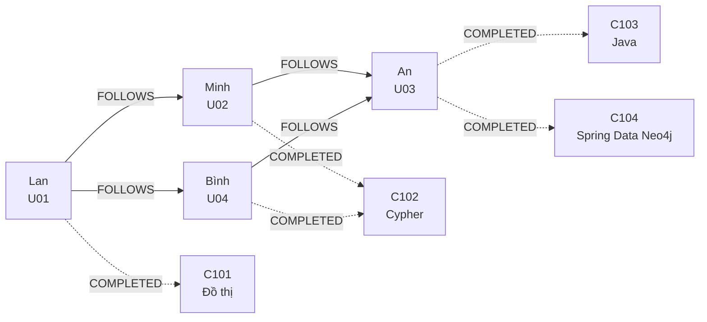
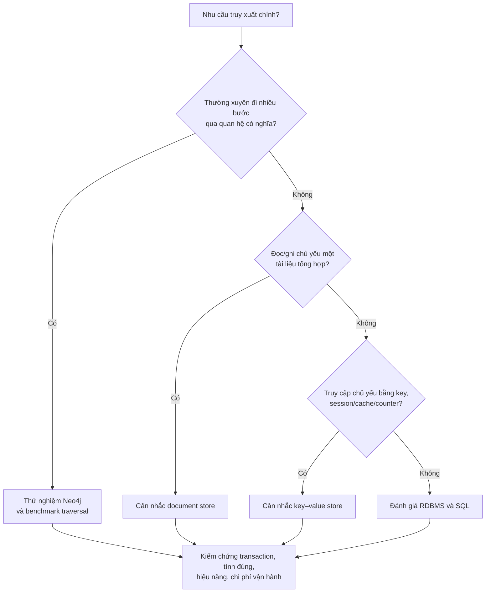
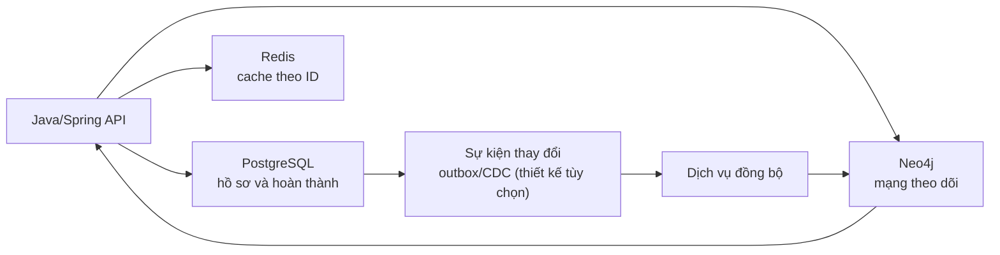

# So sánh Neo4j với cơ sở dữ liệu quan hệ, tài liệu và kho khóa–giá trị

> **Chương:** Tổng quan Neo4j  
> **Module:** `DATABASE_ENGINE_GRAPH_NEO4J`  
> **Phạm vi:** So sánh cách mô hình hóa, truy vấn, bảo đảm tính đúng đắn và vận hành dữ liệu trong Neo4j, cơ sở dữ liệu quan hệ, cơ sở dữ liệu tài liệu và kho khóa–giá trị. Trọng tâm là **hình dạng dữ liệu, đường truy cập và loại câu hỏi** mà ứng dụng thực sự cần trả lời.
>
> Neo4j dùng **property graph** (node, relationship, label, property) và **Cypher** để truy vấn quan hệ và đường đi. Bài này tạo nền tảng lựa chọn công nghệ trước khi đi sâu vào index, constraint, tối ưu truy vấn, nhập dữ liệu, Java Driver, Spring Data Neo4j và vận hành hệ thống đồ thị.

## 1. Mục tiêu học tập

Sau bài học, bạn có thể:

1. Phân biệt bốn cách tổ chức dữ liệu: **bảng quan hệ**, **tài liệu**, **khóa–giá trị** và **đồ thị thuộc tính**.
2. Biểu diễn **cùng một bài toán nghiệp vụ** bằng PostgreSQL, MongoDB, Redis và Neo4j; đọc ví dụ SQL, MongoDB aggregation, Redis commands và Cypher.
3. Giải thích khi nào quan hệ nhiều cấp và đường đi là đối tượng truy vấn trọng tâm, khi nào truy vấn bản ghi, tài liệu hoặc khóa lại tự nhiên hơn.
4. Hiểu khả năng và giới hạn của `JOIN`/recursive CTE, `$lookup`/`$graphLookup`, Redis sets và Cypher traversal.
5. So sánh các lựa chọn về tính nhất quán, transaction, định danh, index, tính linh hoạt của schema, khả năng mở rộng và chi phí vận hành **mà không dựa vào khẳng định tốc độ tuyệt đối**.
6. Phác thảo phương án dùng một hay nhiều hệ lưu trữ, phân định nguồn dữ liệu chuẩn và cách đồng bộ.
7. Thiết kế phép thử khách quan để quyết định Neo4j có đem lại lợi ích thực tế cho workload hay không.

## 2. Đặt câu hỏi đúng: chúng ta lưu gì và thường truy xuất như thế nào?

Một hệ quản trị cơ sở dữ liệu có thể lưu **cùng sự thật** theo nhiều cách. Nhưng hiệu quả và độ phức tạp phụ thuộc vào việc ứng dụng thường hỏi câu gì.

Giả sử hệ thống học tập quản lý học viên và khóa học. Các câu hỏi khác nhau gồm:

- **Tra theo định danh:** “Học viên `U01` tên gì?”
- **Đọc cả một đối tượng:** “Cho biết hồ sơ, sở thích và khóa đã hoàn thành của học viên `U01`.”
- **Đọc/ghi trạng thái thường xuyên:** “Phiên đăng nhập `session:abc` còn hợp lệ không?”
- **Tìm kết nối trực tiếp:** “Lan theo dõi học viên nào?”
- **Khám phá nhiều cấp:** “Những người Lan theo dõi trực tiếp hoặc qua tối đa hai cấp đã hoàn thành khóa học nào mà Lan chưa học?”
- **Giải thích đường đi:** “Khóa C104 được gợi ý qua chuỗi học viên nào?”

Tập hợp câu hỏi đó gợi ra bốn mô hình lưu trữ:

| Mô hình | Đơn vị được đặt ở trung tâm | Ví dụ triển khai | Điểm mạnh thường thấy |
| --- | --- | --- | --- |
| **Quan hệ (relational)** | Bảng, hàng, cột, khóa và ràng buộc | PostgreSQL, MySQL | Dữ liệu có cấu trúc, giao dịch, ràng buộc và SQL |
| **Tài liệu (document)** | Document có trường và cấu trúc lồng nhau | MongoDB | Đọc/ghi một đối tượng tổng hợp, schema linh hoạt theo tài liệu |
| **Khóa–giá trị (key–value)** | Khóa truy cập trực tiếp đến giá trị hoặc cấu trúc dữ liệu | Redis | Đọc/ghi theo khóa, cache, session, counter, tập hợp nhỏ có cách truy cập đã biết |
| **Đồ thị (graph)** | Node và relationship có hướng, có loại | Neo4j | Khám phá mối liên hệ, tìm mẫu kết nối và đường đi |

**Không có hệ nào độc quyền một loại truy vấn.** PostgreSQL có recursive CTE; MongoDB có aggregation và `$graphLookup`; Redis có sets, sorted sets và nhiều lệnh tập hợp; Neo4j vẫn truy vấn property theo ID. Khác biệt nằm ở **cách biểu diễn tự nhiên, tập công cụ tối ưu và chi phí cho workload cụ thể**.

### 2.1. Bốn kiểu tổ chức không đồng nghĩa bốn định nghĩa cố định về hiệu năng

- “Relational phải JOIN nên chậm” là sai. Hệ quản trị quan hệ có bộ tối ưu hóa và index rất mạnh.
- “Document không truy vấn được quan hệ” là sai. MongoDB hỗ trợ tham chiếu, `$lookup` và `$graphLookup`.
- “Redis chỉ là cache và luôn mất dữ liệu khi tắt” là sai. Redis có cơ chế lưu bền tùy cấu hình và các cấu trúc dữ liệu phong phú.
- “Neo4j duyệt cạnh luôn là O(1)” là sai. Số nhánh, số cấp, kiểu đường đi, điểm bắt đầu và số kết quả ảnh hưởng lớn đến chi phí.

Vì vậy, trước khi chọn công nghệ phải biết **những truy vấn cần chạy thường xuyên**, **kích thước và phân bố dữ liệu**, **quy tắc cập nhật**, **mức nhất quán**, **ngân sách và kinh nghiệm vận hành**.

## 3. Bài toán dùng chung để so sánh bốn hệ

Ta xây dựng một mạng học viên nhỏ. Một học viên có thể theo dõi nhiều học viên khác và hoàn thành nhiều khóa học. Yêu cầu là:

> **Gợi ý các khóa mà người Lan theo dõi trực tiếp hoặc gián tiếp trong tối đa hai bước đã hoàn thành, nhưng Lan chưa hoàn thành.**

### 3.1. Dữ liệu mẫu

**Học viên**

| ID | Tên |
| --- | --- |
| `U01` | Lan |
| `U02` | Minh |
| `U03` | An |
| `U04` | Bình |

**Khóa học**

| ID | Tên |
| --- | --- |
| `C101` | Nhập môn đồ thị |
| `C102` | Truy vấn Cypher |
| `C103` | Java căn bản |
| `C104` | Spring Data Neo4j |

**Quan hệ theo dõi**

| Người theo dõi | Người được theo dõi |
| --- | --- |
| Lan (`U01`) | Minh (`U02`) |
| Lan (`U01`) | Bình (`U04`) |
| Minh (`U02`) | An (`U03`) |
| Bình (`U04`) | An (`U03`) |

**Khóa đã hoàn thành**

| Học viên | Khóa |
| --- | --- |
| Lan | C101 |
| Minh | C102 |
| Bình | C102 |
| An | C103, C104 |

Đồ thị quan hệ:



Lan có đường đi một bước tới Minh và Bình; có **hai đường đi hai bước** tới An:

```text
Lan → Minh → An
Lan → Bình → An
```

An chỉ là **một** học viên dù có hai đường đi tới An. Minh và Bình cùng hoàn thành C102, nhưng C102 cũng chỉ nên xuất hiện **một lần** trong danh sách gợi ý.

**Kết quả mong đợi** cho cả bốn cách triển khai:

| Mã | Khóa được gợi ý | Nguồn dữ liệu |
| --- | --- | --- |
| C102 | Truy vấn Cypher | Minh và Bình đã hoàn thành |
| C103 | Java căn bản | An đã hoàn thành |
| C104 | Spring Data Neo4j | An đã hoàn thành |

C101 bị loại vì Lan đã hoàn thành. Đây là quy tắc gợi ý **minh họa**, không phải thuật toán gợi ý hoàn chỉnh: một sản phẩm thật còn cần xét điều kiện tiên quyết, quyền truy cập, sở thích, mức độ liên quan và xếp hạng.

## 4. Bốn cách mô hình hóa cùng dữ liệu

| Nội dung nghiệp vụ | Quan hệ | Tài liệu | Khóa–giá trị | Neo4j |
| --- | --- | --- | --- | --- |
| Học viên | Hàng bảng `learners` | Document `learners` | `learner:U01` → hash/giá trị | Node `(:Learner {id:'U01'})` |
| Khóa học | Hàng bảng `courses` | Document `courses` | `course:C101` → hash/giá trị | Node `(:Course {id:'C101'})` |
| Lan theo dõi Minh | Hàng `follows(U01,U02)` | Mảng `follows:['U02']` hoặc document tham chiếu | Set `learner:U01:follows` chứa `U02` | `(Lan)-[:FOLLOWS]->(Minh)` |
| Lan hoàn thành C101 | Hàng `completions(U01,C101)` | Mảng ID khóa đã học hoặc document ghi danh riêng | Set `learner:U01:completed` chứa `C101` | `(Lan)-[:COMPLETED]->(C101)` |
| Đi qua hai cấp theo dõi | Recursive CTE/joins | `$graphLookup` hoặc nhiều bước truy vấn | Client mở rộng các set theo cấp | Mẫu `[:FOLLOWS*1..2]` trong Cypher |
| Lấy tên khóa được gợi ý | Join `courses` | `$lookup` hoặc truy vấn theo ID | Đọc nhiều khóa `course:*` | Đi theo node `Course` rồi `RETURN` |

Chỉ cần nhìn bảng này có thể thấy **không phải mọi thông tin cần thành một phần tử riêng**. Trong document, những gì thường đọc cùng nhau có thể nhúng vào một document. Trong key–value, cách thiết kế tên khóa và loại giá trị quyết định đường truy cập. Trong Neo4j, kết nối có type/hướng được lưu trực tiếp trong graph.

Tiếp theo là bốn cách cài đặt; những ví dụ là **độc lập**. Chúng minh họa cùng dữ liệu, không yêu cầu chạy cả bốn hệ để hiểu bài.

## 5. Cơ sở dữ liệu quan hệ: bảng, khóa ngoại và JOIN

PostgreSQL là ví dụ điển hình của hệ quan hệ. Ta tổ chức thông tin thành những bảng với khóa chính và bảng liên kết.

### 5.1. Thiết kế schema

```sql
-- Ví dụ PostgreSQL, chạy trong database thực hành trống.
CREATE TABLE learners (
    id TEXT PRIMARY KEY,
    name TEXT NOT NULL
);

CREATE TABLE courses (
    id TEXT PRIMARY KEY,
    title TEXT NOT NULL
);

CREATE TABLE follows (
    follower_id TEXT NOT NULL REFERENCES learners(id),
    followed_id TEXT NOT NULL REFERENCES learners(id),
    PRIMARY KEY (follower_id, followed_id),
    CHECK (follower_id <> followed_id)
);

CREATE TABLE completions (
    learner_id TEXT NOT NULL REFERENCES learners(id),
    course_id TEXT NOT NULL REFERENCES courses(id),
    PRIMARY KEY (learner_id, course_id)
);

CREATE INDEX idx_follows_followed
    ON follows (followed_id);
CREATE INDEX idx_completions_course
    ON completions (course_id);
```

Hai bảng `follows` và `completions` mô tả quan hệ nhiều–nhiều. Khóa ngoại giúp ngăn liên kết tới học viên/khóa học không tồn tại; khóa chính tổ hợp ngăn hàng liên kết trùng theo mô hình bài tập. `CHECK` minh họa một quy tắc tránh tự theo dõi, nhưng một hệ thống thật có thể định nghĩa khác.

Để tìm người mà Lan theo dõi trực tiếp:

```sql
SELECT followed.id, followed.name
FROM follows AS f
JOIN learners AS followed
  ON followed.id = f.followed_id
WHERE f.follower_id = 'U01'
ORDER BY followed.id;
```

Kết quả: Minh và Bình. Câu hỏi một cấp như vậy rất tự nhiên với SQL và có thể chạy hiệu quả nhờ index phù hợp.

### 5.2. Tạo dữ liệu mẫu

```sql
INSERT INTO learners(id, name) VALUES
  ('U01', 'Lan'),
  ('U02', 'Minh'),
  ('U03', 'An'),
  ('U04', 'Bình');

INSERT INTO courses(id, title) VALUES
  ('C101', 'Nhập môn đồ thị'),
  ('C102', 'Truy vấn Cypher'),
  ('C103', 'Java căn bản'),
  ('C104', 'Spring Data Neo4j');

INSERT INTO follows(follower_id, followed_id) VALUES
  ('U01', 'U02'),
  ('U01', 'U04'),
  ('U02', 'U03'),
  ('U04', 'U03');

INSERT INTO completions(learner_id, course_id) VALUES
  ('U01', 'C101'),
  ('U02', 'C102'),
  ('U04', 'C102'),
  ('U03', 'C103'),
  ('U03', 'C104');
```

Đây là dữ liệu chạy một lần trên database thực hành chưa có các khóa đó. Nếu chạy lại toàn bộ `INSERT`, khóa chính sẽ báo lỗi trùng; khi thực hiện import thật cần quy trình upsert hoặc xử lý xung đột phù hợp.

### 5.3. Tìm mạng theo dõi nhiều cấp bằng recursive CTE

Để duyệt số bước có thể thay đổi, PostgreSQL hỗ trợ `WITH RECURSIVE`. Trong ví dụ, ta giới hạn **hai cấp** và mang theo danh sách ID đã đi qua để tránh lặp node trong cùng đường.

```sql
WITH RECURSIVE network(learner_id, depth, path) AS (
    -- Bước 1: những người Lan theo dõi trực tiếp.
    SELECT f.followed_id,
           1,
           ARRAY['U01', f.followed_id]::TEXT[]
    FROM follows AS f
    WHERE f.follower_id = 'U01'

    UNION ALL

    -- Bước tiếp: những người được các thành viên mạng theo dõi.
    SELECT f.followed_id,
           network.depth + 1,
           network.path || f.followed_id
    FROM network
    JOIN follows AS f
      ON f.follower_id = network.learner_id
    WHERE network.depth < 2
      AND NOT (f.followed_id = ANY(network.path))
)
SELECT DISTINCT c.id, c.title
FROM network
JOIN completions AS done
  ON done.learner_id = network.learner_id
JOIN courses AS c
  ON c.id = done.course_id
WHERE NOT EXISTS (
    SELECT 1
    FROM completions AS my_done
    WHERE my_done.learner_id = 'U01'
      AND my_done.course_id = c.id
)
ORDER BY c.id;
```

Kết quả: C102, C103, C104. Phần `network` tạo ra các hàng tới Minh, Bình và An (An có thể xuất hiện qua hai đường). `DISTINCT` gộp những khóa được nhiều người hoàn thành hoặc được tìm thấy qua nhiều đường thành một kết quả.

Đây là ví dụ **cú pháp PostgreSQL**, vì sử dụng `ARRAY`, `::TEXT[]` và `ANY`. Những hệ SQL khác có thể dùng cú pháp theo dõi đường đi và chống chu trình khác.

### 5.4. Lợi thế và điểm phải cân nhắc

**Lợi thế:**

- Các bảng và cột dễ mô tả cấu trúc nghiệp vụ; primary key, foreign key, unique, check constraint góp phần bảo vệ tính hợp lệ.
- SQL phù hợp giao dịch có cấu trúc, tổng hợp, báo cáo, join và nhiều loại truy vấn phân tích.
- Nhiều đội ngũ đã có kinh nghiệm vận hành, backup, giám sát, tối ưu và tích hợp Java qua JDBC/JPA.
- Có thể giải bài toán đồ thị bằng recursive CTE; **không bắt buộc chuyển Neo4j chỉ vì cần truy vấn hai hoặc ba cấp**.

**Điểm cần cân nhắc:** khi yêu cầu thường xuyên là nhiều mẫu quan hệ đan xen, chiều sâu linh hoạt, trả toàn bộ đường đi hoặc tìm mẫu kết nối có nhiều loại cạnh, truy vấn SQL có thể dài và khó diễn đạt. Đó là vấn đề về **khả năng biểu đạt và bảo trì** cần đo trong dự án, không phải chứng minh SQL luôn kém hiệu năng.

## 6. Cơ sở dữ liệu tài liệu: dữ liệu đi cùng nhau trong document

MongoDB là ví dụ của hệ cơ sở dữ liệu tài liệu. Document có thể chứa các trường đơn giản, mảng hoặc cấu trúc lồng nhau. Một thiết kế hướng document thường xem **đơn vị dữ liệu được đọc/ghi cùng nhau** là điểm bắt đầu.

### 6.1. Biểu diễn học viên và kết nối bằng tham chiếu

Dữ liệu có thể nằm trong collection `learners`:

```javascript
db.learners.insertMany([
  {
    _id: "U01",
    name: "Lan",
    follows: ["U02", "U04"],
    completedCourseIds: ["C101"]
  },
  {
    _id: "U02",
    name: "Minh",
    follows: ["U03"],
    completedCourseIds: ["C102"]
  },
  {
    _id: "U03",
    name: "An",
    follows: [],
    completedCourseIds: ["C103", "C104"]
  },
  {
    _id: "U04",
    name: "Bình",
    follows: ["U03"],
    completedCourseIds: ["C102"]
  }
]);

db.courses.insertMany([
  {_id: "C101", title: "Nhập môn đồ thị"},
  {_id: "C102", title: "Truy vấn Cypher"},
  {_id: "C103", title: "Java căn bản"},
  {_id: "C104", title: "Spring Data Neo4j"}
]);
```

Những mảng `follows` và `completedCourseIds` lưu **ID tham chiếu**. Người được theo dõi là document riêng, không bị sao chép cả hồ sơ vào hồ sơ của Lan. Với document lớn, có thể chọn mô hình tách collection các quan hệ thành bản ghi riêng nếu số lượng kết nối hoặc tần suất cập nhật khiến mảng trở nên bất lợi.

Một truy vấn đơn giản:

```javascript
db.learners.findOne(
  {_id: "U01"},
  {name: 1, follows: 1, completedCourseIds: 1}
);
```

Trả về hồ sơ Lan kèm mảng ID người theo dõi và khóa hoàn thành **trong một document**. Đây là kiểu truy cập tự nhiên của document store.

### 6.2. MongoDB vẫn truy vấn được quan hệ nhiều cấp

MongoDB hỗ trợ `$lookup` để ghép dữ liệu giữa collection và `$graphLookup` để truy vấn kết nối đệ quy giữa các document. Với dữ liệu `follows` trên:

```javascript
db.learners.aggregate([
  {$match: {_id: "U01"}},
  {
    $graphLookup: {
      from: "learners",
      startWith: "$follows",
      connectFromField: "follows",
      connectToField: "_id",
      as: "reachable",
      maxDepth: 1
    }
  },
  {
    $project: {
      myCourses: "$completedCourseIds",
      candidates: {
        $reduce: {
          input: "$reachable",
          initialValue: [],
          in: {$setUnion: ["$$value", "$$this.completedCourseIds"]}
        }
      }
    }
  },
  {
    $project: {
      recommendedIds: {$setDifference: ["$candidates", "$myCourses"]}
    }
  },
  {
    $lookup: {
      from: "courses",
      localField: "recommendedIds",
      foreignField: "_id",
      as: "recommendedCourses"
    }
  },
  {$project: {_id: 0, recommendedCourses: 1}}
]);
```

Ý nghĩa từng giai đoạn:

1. `$match` chọn Lan.
2. `$graphLookup` bắt đầu từ mảng `follows` của Lan và tìm các document khác có `_id` tương ứng; sau đó tiếp tục từ mảng `follows` của các document tìm thấy.
3. `maxDepth: 1` cho phép **hai lớp người theo dõi tính từ Lan**: người trực tiếp ở độ sâu 0, người cách hai cạnh ở độ sâu 1. Đây là quy ước depth của `$graphLookup`, khác cách đọc `*1..2` trong Cypher.
4. `$reduce` hợp nhất các mảng khóa hoàn thành từ người trong mạng bằng `$setUnion`.
5. `$setDifference` loại các khóa Lan đã hoàn thành.
6. `$lookup` lấy tên khóa từ collection `courses`.

Kết quả logic là ba khóa C102, C103 và C104; thứ tự phần tử của các mảng tập hợp **không được bảo đảm**, nên nếu sản phẩm cần sắp xếp thì phải bổ sung bước sắp xếp.

**Điều phải nắm:** MongoDB **không thiếu khả năng duyệt đồ thị**. Nhưng khi ứng dụng có nhiều kiểu quan hệ, ràng buộc trên cạnh, lịch sử mối liên hệ và đường đi phức tạp, việc lưu chúng thành mảng ID hoặc document tham chiếu có thể tăng công việc mô hình hóa, tạo chỉ mục và tổ hợp pipeline.

### 6.3. Khi nào nên nhúng và khi nào nên tham chiếu?

**Nhúng (embedding)** phù hợp khi một nhóm dữ liệu thuộc sở hữu rõ ràng của một document, có kích thước được kiểm soát và thường đọc/ghi cùng nhau. Ví dụ một số tùy chọn giao diện hoặc địa chỉ liên lạc của một học viên.

**Tham chiếu (referencing)** thường hợp lý khi thực thể được dùng chung, có vòng đời độc lập, số lượng kết nối lớn hoặc liên tục tăng. Ví dụ một khóa học có hàng triệu học viên; nhúng cả hồ sơ học viên vào document khóa học vừa tạo trùng dữ liệu vừa khó cập nhật.

Không có quy tắc “document phải chứa mọi dữ liệu liên quan”. MongoDB hỗ trợ chỉ mục, schema validation, transactions nhiều document trong các triển khai hỗ trợ, và các truy vấn aggregation; cần đánh giá các đặc tính ấy trên phiên bản và cấu hình cụ thể.

### 6.4. Lợi thế và giới hạn tương đối

Hệ tài liệu phù hợp với **đọc/ghi dữ liệu theo đối tượng**, cấu trúc có trường tùy chọn hoặc thay đổi giữa các loại document, miễn mô hình phù hợp kích thước và tần suất cập nhật. Nó có thể khiến việc xây API trả một hồ sơ tổng hợp rất thuận tiện.

Với mạng lưới liên kết nhiều tầng, một mối quan hệ có property riêng (như `FOLLOWS.since` hoặc mức độ tin cậy) và vòng đời độc lập, document store vẫn giải quyết được nhưng cần chọn cách biểu diễn và xử lý đồng bộ các tham chiếu. Đây là điểm nên so sánh với một graph database, thay vì chỉ nhìn vào tốc độ truy vấn theo `_id`.

## 7. Kho khóa–giá trị: truy cập qua khóa và cấu trúc dữ liệu

**Key–value store** đặt trọng tâm vào việc ứng dụng **đã biết khóa** và cần lấy/cập nhật giá trị rất nhanh. Redis là ví dụ nổi bật với nhiều loại giá trị như string, hash, set và sorted set. Không phải mọi kho khóa–giá trị đều có cùng bộ lệnh với Redis.

### 7.1. Biểu diễn cùng dữ liệu bằng Redis

Ta tổ chức các khóa theo quy ước:

| Khóa | Kiểu dữ liệu | Ý nghĩa |
| --- | --- | --- |
| `learner:U01` | Hash | Tên và thông tin cơ bản của Lan |
| `learner:U01:follows` | Set | Danh sách ID người Lan theo dõi |
| `learner:U01:completed` | Set | Các ID khóa Lan đã hoàn thành |
| `course:C102` | Hash | Thông tin khóa C102 |

Các lệnh Redis CLI minh họa:

```text
HSET learner:U01 name Lan
HSET learner:U02 name Minh
HSET learner:U03 name An
HSET learner:U04 name Bình

HSET course:C101 title "Nhập môn đồ thị"
HSET course:C102 title "Truy vấn Cypher"
HSET course:C103 title "Java căn bản"
HSET course:C104 title "Spring Data Neo4j"

SADD learner:U01:follows U02 U04
SADD learner:U02:follows U03
SADD learner:U04:follows U03

SADD learner:U01:completed C101
SADD learner:U02:completed C102
SADD learner:U04:completed C102
SADD learner:U03:completed C103 C104
```

`SET` và `SADD` ở đây phục vụ hai nghĩa khác nhau: `SET` trong thuật ngữ dữ liệu Redis có thể chỉ lệnh string `SET key value`, còn **Set data type** là tập hợp có lệnh `SADD`, `SMEMBERS`, `SUNION`, `SDIFF`. Dùng Set cho mối quan hệ nhiều ID giúp tránh phần tử trùng bên trong một tập.

Đọc hồ sơ Lan:

```text
HGETALL learner:U01
SMEMBERS learner:U01:follows
```

Lệnh `SMEMBERS` trả U02 và U04 (không bảo đảm thứ tự).

### 7.2. Truy vấn hai cấp: ứng dụng phải điều phối mở rộng

Bước 1, lấy người Lan theo dõi:

```text
SMEMBERS learner:U01:follows
# U02, U04
```

Bước 2, lấy người được các tài khoản đó theo dõi:

```text
SUNION learner:U02:follows learner:U04:follows
# U03
```

Bước 3, hợp nhất những khóa học các học viên U02, U04, U03 đã hoàn thành:

```text
SUNION learner:U02:completed learner:U04:completed learner:U03:completed
# C102, C103, C104 (thứ tự có thể khác)
```

Bước 4, loại những khóa Lan đã hoàn thành. Với các mã ứng viên đã biết, có thể kiểm tra hàng loạt:

```text
SMISMEMBER learner:U01:completed C102 C103 C104
# 0 0 0: Lan chưa hoàn thành cả ba khóa ứng viên
```

Sau đó backend đọc hash `course:C102`, `course:C103`, `course:C104` để lấy tên.

Mô tả thuật toán chung khi độ sâu có thể thay đổi:

```text
frontier = {U01}
visited = {U01}
candidates = {}

for depth in 1..2:
    next = {}
    for learnerId in frontier:
        for followedId in MEMBERS(follows(learnerId)):
            if followedId not in visited:
                next.add(followedId)
                visited.add(followedId)
    for learnerId in next:
        candidates += MEMBERS(completed(learnerId))
    frontier = next

recommendations = candidates - MEMBERS(completed(U01))
```

Đây là **giả mã điều phối ở ứng dụng**, không phải cú pháp Redis có thể chạy nguyên khối. Redis cung cấp các primitive về key và set rất hữu ích, nhưng không tự hiểu `FOLLOWS` là loại relationship của property graph hay tự chạy traversal tùy ý cho nghiệp vụ.

Với Redis, backend có thể dùng **pipelining**, thao tác tập hợp, scripting/Functions hoặc tính toán trước khi thích hợp để giảm số lượt mạng. Song việc có nhiều primitive không loại bỏ nhu cầu tự quản lý **độ sâu, tập node đã thăm, thứ tự cập nhật, trạng thái trung gian và xử lý khóa vắng mặt**.

### 7.3. Ưu thế của kho khóa–giá trị

Những tác vụ thường thích hợp:

- Tra session/token, thông tin trạng thái theo ID.
- Cache dữ liệu tổng hợp có thể xây dựng lại.
- Counter, giới hạn tần suất (rate limiting) và các cấu trúc dữ liệu thời gian thực với cơ chế đồng bộ phù hợp.
- Truy xuất danh sách thành viên/tập thuộc tính khi **đã biết khóa**.
- Thời hạn tồn tại (TTL) cho một số dữ liệu tạm thời.

Nhưng một mạng lưới đồ thị lớn cần tìm nhiều tuyến có thể buộc ứng dụng thực hiện nhiều lượt đọc key, theo dõi các kết nối và xử lý kết quả; đánh giá hiệu năng phải tính cả CPU phía ứng dụng, số lượt mạng và độ phức tạp đồng bộ.

### 7.4. Redis không đồng nghĩa với dữ liệu “không quan trọng”

Redis có thể sử dụng cơ chế persistence phù hợp với cấu hình triển khai, đồng thời có các cơ chế transaction, scripting và tính nguyên tử cho từng lệnh. Tuy vậy, **giao dịch và ràng buộc tham chiếu của Redis không giống foreign key trong RDBMS**, cũng không tự thực thi tính nhất quán nghiệp vụ của một mạng lưới nhiều key.

Ví dụ, việc xóa `learner:U03` không tự đảm bảo mọi tập `learner:*:follows` đều xóa tham chiếu U03. Ngoài ra, đặt TTL thiếu nhất quán giữa hồ sơ và các tập liên quan có thể tạo liên kết mồ côi. Nếu dùng Redis làm nguồn dữ liệu chính, phải thiết kế persistence, phục hồi, cập nhật liên khóa và quy tắc kiểm tra rõ ràng.

## 8. Neo4j: node và relationship là đơn vị truy vấn trực tiếp

Neo4j mô hình hóa cùng mạng lưới thành:

- Node `(:Learner {id, name})`.
- Node `(:Course {id, title})`.
- Relationship có hướng `(learner)-[:FOLLOWS]->(peer)`.
- Relationship có hướng `(learner)-[:COMPLETED]->(course)`.

Mối liên hệ được lưu theo **type và chiều** ngay trong mô hình. Khi hỏi “Lan kết nối tới An qua ai?”, ta có thể truy vấn **mẫu đường đi** và trả các node/relationship tham gia.

### 8.1. Tạo ràng buộc và dữ liệu mẫu

Các khối dưới dùng cú pháp Cypher của **Neo4j 5.x**. Chạy trên database thực hành không có dữ liệu xung đột.

```cypher
CREATE CONSTRAINT learner_id_unique IF NOT EXISTS
FOR (l:Learner) REQUIRE l.id IS UNIQUE;

CREATE CONSTRAINT course_id_unique IF NOT EXISTS
FOR (c:Course) REQUIRE c.id IS UNIQUE;
```

Constraint duy nhất hỗ trợ tránh node trùng `id` trong cùng label và tạo chỉ mục phục vụ tìm theo mã. `UNIQUE` không tự bảo đảm node nào cũng có `id`; nếu cần bắt buộc tồn tại property, phải thiết kế ràng buộc phù hợp phiên bản/edition và tầng nghiệp vụ.

Tạo node:

```cypher
UNWIND [
  {id:'U01', name:'Lan'},
  {id:'U02', name:'Minh'},
  {id:'U03', name:'An'},
  {id:'U04', name:'Bình'}
] AS row
MERGE (l:Learner {id:row.id})
SET l.name = row.name;

UNWIND [
  {id:'C101', title:'Nhập môn đồ thị'},
  {id:'C102', title:'Truy vấn Cypher'},
  {id:'C103', title:'Java căn bản'},
  {id:'C104', title:'Spring Data Neo4j'}
] AS row
MERGE (c:Course {id:row.id})
SET c.title = row.title;
```

Tạo relationship theo cặp node đã định danh:

```cypher
UNWIND [
  {from:'U01', to:'U02'},
  {from:'U01', to:'U04'},
  {from:'U02', to:'U03'},
  {from:'U04', to:'U03'}
] AS row
MATCH (a:Learner {id:row.from})
MATCH (b:Learner {id:row.to})
MERGE (a)-[:FOLLOWS]->(b);

UNWIND [
  {learnerId:'U01', courseId:'C101'},
  {learnerId:'U02', courseId:'C102'},
  {learnerId:'U04', courseId:'C102'},
  {learnerId:'U03', courseId:'C103'},
  {learnerId:'U03', courseId:'C104'}
] AS row
MATCH (l:Learner {id:row.learnerId})
MATCH (c:Course {id:row.courseId})
MERGE (l)-[:COMPLETED]->(c);
```

Dữ liệu có **8 node** và **9 relationship**: bốn quan hệ `FOLLOWS`, năm quan hệ `COMPLETED`. Trong dữ liệu mẫu, `MERGE` giúp chạy lại việc tạo cạnh khi đã có hai node đúng, nhưng nó không thay thế mọi cơ chế ngăn tranh chấp tạo relationship trùng trong ứng dụng ghi đồng thời.

### 8.2. Câu Cypher để giải bài toán gợi ý

```cypher
MATCH (me:Learner {id:'U01'})
      -[:FOLLOWS*1..2]->(peer:Learner)
      -[:COMPLETED]->(course:Course)
WHERE NOT EXISTS {
  MATCH (me)-[:COMPLETED]->(course)
}
RETURN DISTINCT course.id AS id, course.title AS title
ORDER BY id;
```

Cách đọc:

1. Chọn Lan bằng mã `U01`.
2. Theo quan hệ `FOLLOWS` **đúng hướng**, với độ dài từ **1 đến 2 bước**.
3. Từ các học viên tìm được, đi theo `COMPLETED` tới các node khóa học.
4. Loại khóa đã nối với Lan bằng `COMPLETED`.
5. Dùng `DISTINCT` để mỗi khóa chỉ xuất hiện một lần, dù có nhiều học viên và nhiều đường đi dẫn tới nó.

Kết quả: C102, C103, C104.

Mẫu `[:FOLLOWS*1..2]` thể hiện trực tiếp **loại quan hệ, hướng và độ dài đường đi**. Nó có tính gần gũi với câu hỏi nghiệp vụ khi trọng tâm của sản phẩm là cấu trúc mạng lưới.

### 8.3. Khi cần giải thích gợi ý bằng đường đi

Ví dụ, muốn biết những đường đi từ Lan đến An qua quan hệ theo dõi:

```cypher
MATCH path = (:Learner {id:'U01'})
             -[:FOLLOWS*1..2]->(:Learner {id:'U03'})
RETURN [n IN nodes(path) | n.name] AS duong_di,
       length(path) AS so_buoc
ORDER BY duong_di;
```

Kết quả dự kiến gồm **hai đường hai bước**:

```text
['Lan', 'Bình', 'An']
['Lan', 'Minh', 'An']
```

Điểm khác biệt: hỏi “có những khóa nào?” thì trả các node `Course` duy nhất; hỏi “vì sao khóa đó được gợi ý?” thì cần **đường đi** hoặc tập liên kết giải thích. Một graph database giúp mô tả kiểu câu hỏi thứ hai trực tiếp bằng Cypher.

### 8.4. Neo4j cũng có chi phí và giới hạn

- Truy vấn `*1..2` có phạm vi tương đối dễ kiểm soát; `*1..10` trong đồ thị nhiều nhánh có thể tạo số đường đi ứng viên rất lớn.
- Node có hàng triệu mối liên hệ có thể làm traversal tốn kém, ngay cả khi đã tìm được node bắt đầu.
- Nếu chỉ lọc khóa học theo ID hoặc tính tổng doanh thu hàng tháng, việc chuyển sang Neo4j không tự mang lại lợi ích.
- Constraint/index hỗ trợ xác định node xuất phát và tính đúng đắn, **không tự ngăn mọi loại quan hệ sai nghĩa, sai hướng hay chu trình nghiệp vụ**.
- Neo4j cung cấp transaction và khả năng lưu trữ dữ liệu nghiệp vụ; vẫn cần backup, phân quyền, monitoring, quản lý phiên bản và đánh giá kiến trúc.

Để tìm điểm nghẽn, dùng `EXPLAIN` hoặc `PROFILE` cho Cypher. Phải đánh giá **truy vấn và dữ liệu thực**, không suy từ hình thức câu lệnh ngắn.

## 9. So sánh chi tiết theo các khía cạnh kỹ thuật

### 9.1. Cách truy cập và ngôn ngữ truy vấn

| Tiêu chí | PostgreSQL / quan hệ | MongoDB / tài liệu | Redis / khóa–giá trị | Neo4j / đồ thị |
| --- | --- | --- | --- | --- |
| Khái niệm chính | Hàng, bảng, khóa | Document, collection | Key, value, data structure | Node, relationship |
| Truy vấn cơ bản | SQL `SELECT`, `WHERE` | `find`, aggregation | `GET`, `HGET`, `SMEMBERS`... | Cypher `MATCH` |
| Ghép dữ liệu | `JOIN` | `$lookup` | Ứng dụng/scripting, thao tác set | Pattern relationship |
| Đệ quy / traversal | `WITH RECURSIVE` | `$graphLookup` | Client mở rộng qua nhiều key | Cypher variable-length path |
| Dữ liệu lồng nhau | JSON/JSONB và các cấu trúc tùy hệ | Document/array tự nhiên | Hash/list/set hoặc mã hóa giá trị | Node và relationship, property |
| Đường đi có ý nghĩa | Có thể biểu diễn bằng CTE/mảng | Có thể truy hồi từ tham chiếu | Ứng dụng theo dõi | Biến `path`, `nodes(path)`, `relationships(path)` |
| Định danh | Primary key | Thường là `_id` | Tên key do ứng dụng chọn | Property định danh nghiệp vụ + constraint |
| Tính toán tổng hợp | SQL aggregation | Aggregation pipeline | Lệnh/cấu trúc chuyên biệt, code | Cypher aggregation; đánh giá workload |

Bảng chỉ khái quát cách tiếp cận. Mỗi sản phẩm có nhiều tính năng phát triển theo phiên bản và có thể mở rộng bằng plugin hoặc lớp công cụ khác.

### 9.2. Transaction, ràng buộc và tính nhất quán

Một điểm dễ nhầm là “NoSQL thì không có transaction”. Phát biểu đó **không đúng như một quy tắc chung**.

| Hệ | Điều có thể trông cậy ở mức khái niệm | Vấn đề cần thiết kế |
| --- | --- | --- |
| **PostgreSQL** | Transaction ACID, khóa chính, khóa ngoại, unique/check, index | Isolation level, khóa, contention, migration schema |
| **MongoDB** | Thao tác trên một document có tính nguyên tử; có hỗ trợ multi-document transactions trong môi trường phù hợp | Các tham chiếu giữa document, schema validation, chi phí transaction và consistency theo topology |
| **Redis** | Lệnh đơn nguyên tử; có các cơ chế transaction/scripting/persistence tùy triển khai | Nhiều key phải đồng bộ như thế nào, TTL, recovery, không có foreign key SQL mặc định |
| **Neo4j** | Transaction trên graph, index/constraint với tính năng tùy phiên bản/edition | Quy tắc hướng/type, ràng buộc liên-node, tính duy nhất cạnh và invariants nghiệp vụ |

Ví dụ, câu “Lan không được theo dõi chính mình” có thể được bảo đảm bằng `CHECK (follower_id <> followed_id)` trong bảng quan hệ. Trong mô hình đồ thị, dù relationship có thể nối một node với chính nó, ứng dụng cần **chủ động cấm** `(Lan)-[:FOLLOWS]->(Lan)` nếu đó là quy tắc nghiệp vụ.

### 9.3. Index và giá trị của điểm bắt đầu

Truy vấn gợi ý bắt đầu từ `U01`. Dù dùng hệ nào, bạn đều cần phương pháp **định vị nhanh đối tượng đó**:

- PostgreSQL có primary key/index trên `learners.id` và khóa của bảng liên kết.
- MongoDB có index mặc định trên `_id` và có thể tạo thêm index trên trường được lọc.
- Redis truy cập trực tiếp `learner:U01` hoặc set có tên khóa đã biết.
- Neo4j có thể dùng unique constraint/index trên `:Learner(id)` để tìm node xuất phát, sau đó traversal theo relationship.

**Index không thay thế mô hình quan hệ.** Neo4j index giúp tìm điểm bắt đầu; sau đó số relationship được mở rộng vẫn quyết định nhiều phần chi phí. SQL index làm join/recursive CTE hiệu quả hơn khi đúng access pattern. MongoDB index có thể hỗ trợ truy vấn các document liên quan trong pipeline. Redis tổ chức dữ liệu theo khóa đòi hỏi ứng dụng chọn đúng cấu trúc key và xử lý những phép tra cứu không dựa trên khóa.

### 9.4. Schema và thay đổi dữ liệu

- Với bảng quan hệ, thêm loại dữ liệu hoặc quan hệ mới có thể cần migration tạo bảng/cột/chỉ mục và điều chỉnh constraint.
- Document cho phép những document cùng collection có trường khác nhau; nhưng **schema linh hoạt không có nghĩa không cần hợp đồng dữ liệu**. Ứng dụng vẫn phải xử lý bản ghi cũ, chuyển kiểu và validation.
- Redis linh hoạt về tên khóa và cấu trúc value; đổi quy ước key là thay đổi API dữ liệu của ứng dụng và có thể cần di chuyển dữ liệu cũ.
- Neo4j cho phép bổ sung label, relationship type và property, nhưng phải quản lý nhất quán ngữ nghĩa, định danh, quy tắc cạnh và truy vấn phụ thuộc vào chúng.

Phân biệt **khả năng thay đổi schema kỹ thuật** với **chi phí thay đổi ngữ nghĩa nghiệp vụ**. Việc từ “theo dõi” đổi thành “quan hệ người hướng dẫn” đòi hỏi làm rõ nghiệp vụ ở mọi mô hình.

### 9.5. Thời gian phản hồi, quy mô và tài nguyên

Không thể đưa ra thứ hạng “Neo4j nhanh nhất, Redis nhanh nhì...” cho mọi bài toán. Mỗi công nghệ tối ưu những kiểu truy cập khác nhau, và kết quả phụ thuộc:

- Tỷ lệ truy vấn theo ID, đọc document, join, tổng hợp và traversal.
- Số node/hàng/document/key và lượng dữ liệu thực sự phải duyệt.
- **Bậc kết nối**: một học viên theo dõi 5 người khác rất khác một tài khoản theo dõi 2 triệu người.
- Độ sâu đường đi, chu trình và số tuyến cùng dẫn tới đích.
- Loại index, bộ nhớ, cache, storage, network và số request đồng thời.
- Ghi cập nhật thường xuyên hay đọc nhiều, yêu cầu consistency và transaction.
- Thiết kế API và chi phí đồng bộ giữa hệ thống.

Redis có thể rất hiệu quả khi đã biết key cần đọc nhưng không tự biến yêu cầu duyệt hàng chục loại cạnh thành một truy vấn đồ thị. Neo4j có cú pháp traversal rõ nhưng không miễn trừ chi phí duyệt nhánh. MongoDB có thể đọc một hồ sơ nhúng nhanh và thuận tiện mà không cần đi qua graph. PostgreSQL có thể thắng ở bài toán tổng hợp phức tạp có các phép join và index phù hợp. Chỉ benchmark trên dữ liệu đại diện mới cho biết đáp án.

## 10. Những bài toán phù hợp hơn với từng mô hình

### 10.1. Dữ liệu quan hệ: nghiệp vụ giao dịch và báo cáo có cấu trúc

**Ví dụ:** quản lý đơn hàng, đơn giá, hóa đơn, thanh toán và báo cáo doanh thu.

Nếu trọng tâm là các bất biến như “mỗi dòng hàng thuộc một đơn có thật” hoặc “tổng tiền theo kỳ”, mô hình quan hệ với ràng buộc và SQL rất phù hợp. Neo4j có thể tham gia khi cần phân tích mạng quan hệ phức tạp xung quanh đơn hàng hoặc thực thể nhưng không nhất thiết thay thế cơ sở dữ liệu giao dịch.

### 10.2. Dữ liệu tài liệu: một đối tượng tổng hợp có cấu trúc thay đổi

**Ví dụ:** hồ sơ sản phẩm với các thông số khác nhau theo ngành hàng, nội dung bài viết với những thành phần hiển thị lồng nhau, form metadata.

Khi ứng dụng đọc/ghi theo document và các thành phần chủ yếu thuộc một thực thể, lưu lồng nhau có thể đơn giản hóa đường truy cập. Nếu các thành phần trở thành thực thể dùng chung được nhiều phía liên kết, nên đánh giá lại mô hình tham chiếu.

### 10.3. Khóa–giá trị: truy cập đã biết key và dữ liệu nóng

**Ví dụ:** session, cache, counter, trạng thái tạm, tập mã khóa học hay ID người theo dõi dùng trong một bước truy vấn nhanh.

Redis phù hợp khi đã xác định key, kiểu value và vòng đời dữ liệu. Dữ liệu phải bền vững dài hạn hay phục vụ nghiệp vụ trọng yếu thì cần cấu hình persistence, backup, giới hạn bộ nhớ, quy tắc cập nhật và kiểm tra phù hợp.

### 10.4. Đồ thị: mạng lưới thực thể và quan hệ là sản phẩm cần truy vấn

**Ví dụ:** quan hệ bạn bè nhiều cấp; gợi ý khóa học qua mạng người dùng; điều tra tài khoản dùng chung thiết bị; chuỗi phụ thuộc giữa microservices; hành trình tiên quyết giữa các khái niệm.

Nếu yêu cầu là tìm “A liên quan B qua những bước nào”, mở rộng quan hệ với số cấp biến thiên, phát hiện cụm kết nối hoặc phân tích loại quan hệ khác nhau, **Neo4j là ứng viên đáng thử**. Vẫn phải định nghĩa câu hỏi cụ thể, giới hạn traversal và đo kết quả thực.

### 10.5. Sơ đồ lựa chọn theo nhu cầu



Đây chỉ là sơ đồ **định hướng thử nghiệm**, không phải thuật toán quyết định tuyệt đối. Một hệ thống thực tế thường có nhiều loại workload và có thể dùng nhiều kho dữ liệu với trách nhiệm tách biệt.

## 11. Kiến trúc phối hợp nhiều hệ lưu trữ

Một sản phẩm có thể cùng lúc cần:

- **PostgreSQL:** nguồn dữ liệu chuẩn cho học viên, thanh toán và hoàn thành khóa học.
- **Neo4j:** graph quan hệ theo dõi, tiên quyết và các kết nối cần traversal.
- **Redis:** cache kết quả gợi ý hoặc session theo khóa.
- **MongoDB:** lưu các document nội dung/phần tử giao diện với schema phù hợp, nếu có nhu cầu thực.

Không nhất thiết hệ thống nào cũng cần đủ cả bốn. Thêm kho lưu trữ mới có giá vận hành, đồng bộ và khôi phục, nên chỉ thêm khi có lợi ích đo được.



### 11.1. “Nguồn dữ liệu chuẩn” phải có một chủ sở hữu rõ ràng

Giả sử bảng `completions` trong PostgreSQL là nơi quyết định học viên hoàn thành khóa học. Neo4j có thể chứa bản sao relationship `COMPLETED` nhằm phục vụ gợi ý. Nếu ứng dụng ghi hai nơi bằng hai lời gọi độc lập, tình huống sau có thể xảy ra:

1. Ghi PostgreSQL thành công.
2. Kết nối mạng đến Neo4j lỗi.
3. API trả lỗi hoặc retry.
4. CSDL quan hệ và đồ thị có dữ liệu lệch nhau.

Vì không mặc định tồn tại một giao dịch ACID xuyên suốt hai sản phẩm, cần thiết kế **cơ chế đưa thay đổi từ nguồn chuẩn sang bản sao**: ví dụ outbox/CDC, consumer idempotent, checkpoint, retry, dead-letter theo chính sách, đối soát định kỳ và khả năng xây dựng lại graph.

**Bản sao phục vụ truy vấn** có thể trễ so với nguồn dữ liệu chuẩn. API cần biết khi nào cho phép eventual consistency, khi nào phải đọc dữ liệu chuẩn để ra quyết định quan trọng.

### 11.2. Redis cache cần có chính sách vô hiệu hóa

Giả sử gợi ý của Lan được cache ở khóa `recommendations:U01`. Khi Lan theo dõi thêm người hoặc hoàn thành C102, kết quả cũ trở nên lỗi thời. Cần có:

- TTL phù hợp, hoặc invalidation khi các nguồn quan hệ thay đổi.
- Quy tắc xử lý cache miss.
- Giám sát hit ratio và độ trễ dữ liệu.
- Phương án khi Redis không sẵn sàng.
- Không dựa vào cache để quyết định một nghiệp vụ yêu cầu consistency mạnh nếu chưa thiết kế đáp ứng.

Dùng cache giúp giảm tải, nhưng không tự làm thuật toán gợi ý đúng hơn.

### 11.3. Tầng Java/Spring chọn kết nối phù hợp

| Nơi lưu | Cách tích hợp Java/Spring thường gặp |
| --- | --- |
| PostgreSQL | JDBC, Spring Data JPA hoặc Spring Data JDBC |
| MongoDB | MongoDB Java Driver hoặc Spring Data MongoDB |
| Redis | Redis client như Lettuce, Spring Data Redis |
| Neo4j | Neo4j Java Driver hoặc Spring Data Neo4j |

Cách chọn driver/framework là quyết định **tầng ứng dụng**, không quyết định mô hình dữ liệu thay cho bạn. Ví dụ dùng Spring Data Neo4j vẫn cần hiểu label, relationship, Cypher, index, constraint và transaction. Còn dùng Java Driver trực tiếp không miễn trừ trách nhiệm bảo vệ parameter và đóng session.

## 12. Phương pháp benchmark công bằng trước khi lựa chọn

Một demo trên 4 học viên chỉ chứng minh **cú pháp và tính đúng về logic**, không chứng minh sản phẩm nào hiệu quả hơn khi có hàng triệu thực thể.

### 12.1. Viết ra workload và tiêu chí thành công

Ví dụ định nghĩa một bộ truy vấn:

| Workload | Câu hỏi / hành động | Kết quả cần đo |
| --- | --- | --- |
| W1 — tìm theo ID | Hồ sơ U01 | Độ trễ và lượng dữ liệu thực nhận |
| W2 — một cấp | Danh sách người U01 theo dõi | Độ trễ, kết quả đúng |
| W3 — hai cấp | Khóa gợi ý qua hai cấp | Độ trễ và không trùng kết quả |
| W4 — nhiều cấp | Mạng quan hệ 4–6 bước | Chi phí khi phân nhánh tăng |
| W5 — giải thích | Tìm các đường gợi ý đến một khóa | Số đường, tính đúng, chi phí bộ nhớ |
| W6 — cập nhật | Theo dõi mới, hủy theo dõi, hoàn thành khóa | Độ trễ ghi, tính nhất quán sau ghi |
| W7 — tải đồng thời | Nhiều người dùng hỏi/gửi yêu cầu | Throughput, lỗi, độ trễ đuôi |

Nếu yêu cầu giao dịch hoặc báo cáo lớn hơn, cần thêm workload tương ứng thay vì chỉ benchmark traversal để thiên vị một lựa chọn.

### 12.2. Chuẩn bị dữ liệu đại diện

Không chỉ tăng số bản ghi; hãy mô phỏng **phân bố kết nối**:

- Người theo dõi 1–10 tài khoản và người theo dõi hàng trăm nghìn tài khoản.
- Nhiều đường đi đến cùng một node.
- Chu trình và một số quan hệ hai chiều.
- Số lượng khóa hoàn thành khác nhau giữa người dùng.
- Tỷ lệ đọc/ghi và cập nhật theo giờ gần thực tế.
- Độ trễ mạng gần môi trường production, kích thước cache/bộ nhớ và index hợp lý cho từng hệ.

Với document hoặc key–value, cần tính cả **việc backend phải làm thêm** để duyệt đồ thị; với Neo4j cũng cần tính chi phí kết nối, query, serialization và ánh xạ vào DTO. Không so thời gian chạy truy vấn chỉ trên server của một sản phẩm với thời gian gọi API đầu cuối của sản phẩm khác.

### 12.3. Đo và đối chiếu

Một báo cáo thử nghiệm nên gồm:

1. **Tính đúng:** cùng định nghĩa độ sâu, chiều và quy tắc loại trùng; kết quả phải đồng nhất trước khi đo tốc độ.
2. **Latency:** median, p95/p99 cho từng workload theo tải dự kiến.
3. **Throughput:** số yêu cầu thành công mỗi giây khi tăng concurrency.
4. **Tài nguyên:** CPU, RAM, disk, network, chi phí hạ tầng và giới hạn lưu trữ.
5. **Cập nhật:** ảnh hưởng của index, transaction, đồng bộ và truy vấn ngay sau khi ghi.
6. **Khả năng bảo trì:** độ phức tạp code, số lớp logic, cách sửa khi thay đổi quan hệ.
7. **Vận hành:** backup/restore, monitoring, security, upgrade và chuyên môn của đội.

Đối với Neo4j, dùng `EXPLAIN` để xem kế hoạch mà không thực thi; dùng `PROFILE` để đo hoạt động của truy vấn trên môi trường phù hợp. Trong PostgreSQL có `EXPLAIN (ANALYZE, BUFFERS)`; với MongoDB có cơ chế `explain`. Redis có các công cụ theo dõi và đo lệnh/tải, nhưng nên đo ở cả lớp ứng dụng khi có thuật toán traversal tự triển khai.

**Đừng phát minh kết quả benchmark.** “Redis luôn dưới 1 ms” hoặc “Neo4j nhanh hơn SQL 100 lần” không có giá trị nếu thiếu kích thước dữ liệu, phần cứng, định nghĩa truy vấn, điều kiện tải và kết quả kiểm chứng.

## 13. Các hiểu nhầm cần tránh

**Hiểu nhầm 1 — “Neo4j thay thế tất cả cơ sở dữ liệu quan hệ.”**  
Neo4j đặc biệt hữu ích khi dữ liệu liên kết là yếu tố trọng tâm. Với báo cáo tổng hợp, giao dịch bảng có ràng buộc chặt hoặc workload không duyệt quan hệ, RDBMS vẫn có thể đơn giản và hiệu quả hơn.

**Hiểu nhầm 2 — “Nếu SQL có nhiều JOIN thì nhất định nên chuyển sang graph.”**  
Số lượng `JOIN` không phải thước đo đủ. Recursive CTE, index, view và cách viết SQL vẫn có thể xử lý tốt. Cần đánh giá độ phức tạp của đường đi, chiều sâu biến thiên, khả năng bảo trì và hiệu năng thật.

**Hiểu nhầm 3 — “MongoDB không làm được bài toán graph.”**  
MongoDB có `$graphLookup` và nhiều toán tử aggregation. Sự khác nhau nằm ở mô hình tài liệu, cách biểu diễn cạnh và mức thuận tiện khi liên tục truy vấn những mẫu liên kết phức tạp.

**Hiểu nhầm 4 — “Redis chỉ có một chuỗi giá trị cho mỗi khóa.”**  
Redis hỗ trợ hash, list, set, sorted set và các cấu trúc khác. Tuy vậy, hệ không tự có khái niệm node/relationship với mọi quy tắc traverse như property graph; ứng dụng phải tổ chức các khóa và cách duyệt.

**Hiểu nhầm 5 — “NoSQL không có transaction hoặc constraint.”**  
Các sản phẩm có cơ chế transaction, index và kiểm soát dữ liệu khác nhau. Phải tìm hiểu theo sản phẩm, phiên bản và yêu cầu sử dụng, không gộp mọi hệ phi quan hệ thành một nhóm thiếu nhất quán.

**Hiểu nhầm 6 — “Graph không cần schema.”**  
Labeled property graph linh hoạt, nhưng hệ thống vẫn cần tên label/type thống nhất, mã nghiệp vụ ổn định, constraint phù hợp, quy tắc chiều cạnh và cách xử lý dữ liệu thiếu/trùng.

**Hiểu nhầm 7 — “Nếu một đường đi xuất hiện thì phải gợi ý ngay.”**  
Có đường kết nối là **tín hiệu**. Xếp hạng, phù hợp chuyên môn, điều kiện tiên quyết, quyền truy cập, dữ liệu đã hết hạn và chính sách sản phẩm cần được kiểm tra thêm.

**Hiểu nhầm 8 — “Dùng nhiều database cùng lúc chỉ là thêm vài kết nối.”**  
Mỗi công nghệ mang thêm backup, quyền, giám sát, nâng cấp, xử lý lỗi, tính nhất quán và vận hành. Phải chứng minh lợi ích vượt chi phí.

## 14. Bài tập tự đánh giá

**Bài 1 — Chọn mô hình sơ bộ.** Với mỗi tình huống sau, hãy nêu mô hình phù hợp để thử đầu tiên và giải thích theo access pattern: (a) hệ thống tổng hợp doanh thu theo tháng; (b) API trả một document hồ sơ sản phẩm có nhiều trường tùy biến; (c) kiểm tra trạng thái session theo key; (d) tìm nhóm tài khoản liên hệ gián tiếp qua thiết bị và dòng tiền.

**Bài 2 — Đọc mô hình.** Trong ví dụ, Minh và Bình đều có kết nối tới An. Vì sao truy vấn gợi ý cần `DISTINCT`? Nếu không dùng `DISTINCT`, trường hợp nào có thể lặp C103 và C104?

**Bài 3 — SQL.** Từ schema PostgreSQL ở mục 5, viết truy vấn lấy tên tất cả học viên mà Lan theo dõi **trực tiếp**. Sau đó nêu phần nào phải bổ sung khi muốn đi theo số cấp thay đổi.

**Bài 4 — MongoDB.** Giải thích vì sao `$graphLookup.maxDepth: 1` trả tới hai lớp người theo dõi trong pipeline ở mục 6. Nếu đổi thành `maxDepth: 0` thì còn những học viên nào trong dữ liệu mẫu?

**Bài 5 — Redis.** Tại sao lệnh `SUNION learner:U02:completed learner:U03:completed learner:U04:completed` không tự động loại khóa Lan đã hoàn thành? Ai chịu trách nhiệm xác định những ID U02/U03/U04 cần đọc nếu giới hạn số bước tăng từ hai lên năm?

**Bài 6 — Cypher.** Viết truy vấn trả **hai chuỗi tên học viên** từ Lan tới An trong tối đa hai `FOLLOWS`. Truy vấn trả node cuối đơn thuần có thể phân biệt hai chuỗi không?

**Bài 7 — Thiết kế nhất quán.** Bạn giữ giao dịch hoàn thành khóa học trong PostgreSQL và bản sao quan hệ `COMPLETED` trong Neo4j. Mô tả cách phát hiện và xử lý khi PostgreSQL ghi thành công nhưng Neo4j không cập nhật được.

**Bài 8 — Đánh giá tuyên bố hiệu năng.** Một đồng nghiệp kết luận “Neo4j nhanh hơn PostgreSQL” sau khi chạy một câu Cypher trên 20 node và một câu SQL trên 2 triệu hàng. Nêu tối thiểu bốn điều kiện phải sửa để phép so sánh có ý nghĩa.

**Bài 9 — Mở rộng nghiệp vụ.** Mỗi lần học viên hoàn thành khóa cần lưu `completedAt`, `score`, `attemptId` và lịch sử nhiều lần thi lại. Với Neo4j, việc đặt `score` duy nhất trên quan hệ `COMPLETED` có đủ không? Gợi ý một cách mô hình hóa khác.

<details>
<summary>Gợi ý lời giải</summary>

1. (a) Quan hệ/SQL; (b) tài liệu; (c) khóa–giá trị; (d) đồ thị. Đây là các ứng viên ban đầu, cần đo hiệu quả theo bối cảnh.
2. An được tìm thấy qua Lan → Minh → An và Lan → Bình → An; các khóa của An có thể xuất hiện nhiều lần. C102 cũng xuất hiện vì Minh và Bình đều hoàn thành.
3. `SELECT l.name FROM follows f JOIN learners l ON l.id=f.followed_id WHERE f.follower_id='U01';`. Với nhiều cấp, dùng recursive CTE/thuật toán theo số bước và chống chu trình phù hợp.
4. `$graphLookup` gán độ sâu 0 cho người khớp đầu tiên từ `startWith`, nên `maxDepth:1` thêm một bước mở rộng. `maxDepth:0` chỉ gồm Minh và Bình.
5. `SUNION` chỉ hợp nhất những tập khóa hoàn thành được chỉ định. Backend phải loại tập của Lan (hoặc dùng tính toán tập hợp phù hợp) và tự quản lý frontier/visited khi mở rộng nhiều cấp.
6. `MATCH p=(:Learner {id:'U01'})-[:FOLLOWS*1..2]->(:Learner {id:'U03'}) RETURN [n IN nodes(p) | n.name];`. Nếu chỉ trả node An, mất thông tin về hai đường khác nhau.
7. Xác định PostgreSQL là nguồn chuẩn; tạo sự kiện thay đổi thông qua outbox/CDC hoặc quy trình tin cậy, consumer cập nhật idempotent, retry và đối soát sau lỗi. API phải nhận biết độ trễ của bản sao.
8. Dùng cùng tập dữ liệu và ngữ nghĩa, index phù hợp, môi trường phần cứng và tải tương đương, cùng loại metric (end-to-end), xác minh kết quả đúng, đo nhiều lần và khảo sát phân bố kết nối.
9. Nếu cần lịch sử từng lần thi, tạo node `(:CourseAttempt {attemptId, score, completedAt})` nối tới `Learner` và `Course` theo quan hệ có ý nghĩa. Một cạnh trạng thái duy nhất dễ bị ghi đè lịch sử.

</details>

## 15. Ghi nhớ cốt lõi

- **CSDL quan hệ** đặt bảng, khóa và ràng buộc ở trung tâm; `JOIN` và recursive CTE vẫn giải được các câu hỏi về liên kết nhiều cấp.
- **CSDL tài liệu** đặt document ở trung tâm; nhúng dữ liệu, dùng tham chiếu và aggregation (`$lookup`, `$graphLookup`) theo access pattern.
- **Kho khóa–giá trị** đặt key và cấu trúc dữ liệu ở trung tâm; rất phù hợp khi đã biết khóa cần đọc/ghi, nhưng ứng dụng có thể phải tự điều phối traversal.
- **Neo4j** đặt node và relationship ở trung tâm; Cypher diễn đạt trực tiếp các mẫu kết nối, chiều quan hệ, độ dài và đường đi.
- **Không có hệ nào nhanh nhất trong mọi tình huống.** Chọn theo tính đúng, loại truy vấn, độ sâu kết nối, dữ liệu thực, transaction, vận hành và phép đo.
- Nếu dùng nhiều hệ, phải xác định **nguồn dữ liệu chuẩn**, chiến lược đồng bộ, mức nhất quán chấp nhận được và cách xử lý lỗi. Những yếu tố đó quan trọng không kém một câu truy vấn ngắn.
