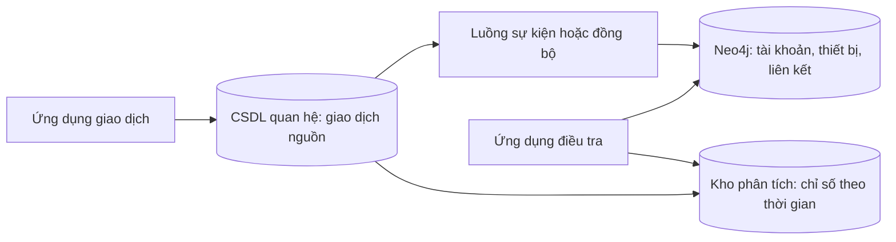

# Dấu hiệu bài toán phù hợp với đồ thị và trường hợp nên chọn hệ lưu trữ khác

## 1. Mục tiêu và nguyên tắc lựa chọn

Neo4j là cơ sở dữ liệu đồ thị theo mô hình **property graph**: thực thể được biểu diễn bằng **node** (đỉnh), liên kết bằng **relationship** (cạnh có hướng, có loại), và cả hai có thể mang thuộc tính. Cypher cho phép mô tả trực tiếp các mẫu liên kết và đường đi. Trong một hệ thống lớn, Neo4j thường được cân nhắc khi **mối liên hệ giữa các thực thể là phần cốt lõi của câu hỏi nghiệp vụ**, thay vì chỉ là khóa ngoại phục vụ việc ghép bảng.

Sau bài này, bạn có thể:

- Nhận diện các yêu cầu mà truy vấn đồ thị có giá trị thực tế: tìm các bước liên kết, phát hiện cụm, tìm đường đi, giải thích vì sao hai thực thể liên quan.
- Phân biệt việc *dữ liệu có quan hệ* với việc *nghiệp vụ cần khám phá mạng quan hệ*.
- Chọn giữa Neo4j, cơ sở dữ liệu quan hệ, document, key-value, search, time-series và kho phân tích theo kiểu truy vấn thực tế.
- Đề xuất thử nghiệm nhỏ, đo chi phí truy vấn và nêu điều kiện khiến lựa chọn ban đầu có thể thay đổi.

> **Nguyên tắc:** Không có quy tắc “có nhiều bảng JOIN là phải dùng graph”. Hãy bắt đầu từ **những câu hỏi hệ thống phải trả lời thường xuyên, độ trễ cần đạt và cách dữ liệu thay đổi**. Graph mạnh ở truy vấn khám phá liên kết; nhiều loại lưu trữ khác tối ưu hơn cho thao tác trên bản ghi, văn bản, chuỗi thời gian hoặc tổng hợp dữ liệu lớn.

## 2. Có quan hệ dữ liệu chưa đủ để cần Neo4j

Hầu hết hệ thống nghiệp vụ đều có quan hệ: đơn hàng thuộc về khách hàng, sản phẩm thuộc danh mục, nhân viên thuộc phòng ban. Quan hệ này thường cố định, ngắn và dễ xử lý bằng khóa ngoại, chỉ mục cùng một số phép JOIN trong SQL.

Hãy so sánh ba câu hỏi trên cùng một tập dữ liệu chuyển tiền:

| Câu hỏi nghiệp vụ | Bản chất truy vấn | Gợi ý ban đầu |
| --- | --- | --- |
| “Tổng tiền chuyển của tài khoản A trong tháng 10 là bao nhiêu?” | Lọc theo tài khoản, thời gian rồi tổng hợp số tiền | SQL hoặc hệ phân tích dạng cột thường phù hợp |
| “Hiển thị 20 giao dịch gần nhất của A” | Lọc và sắp xếp bản ghi theo chỉ mục | SQL/document tùy mô hình dữ liệu |
| “Trong tối đa ba lần chuyển tiếp, tiền từ A có thể đi tới những tài khoản nào; các tài khoản ấy có dùng chung thiết bị không?” | Duyệt quan hệ nhiều bước và ghép mẫu liên kết khác loại | Neo4j đáng để thử nghiệm |

Cơ sở dữ liệu quan hệ vẫn có thể trả lời câu hỏi thứ ba qua `JOIN` hoặc `WITH RECURSIVE` ở những hệ quản trị hỗ trợ. Điểm khác biệt là **mô hình đồ thị làm cho truy vấn theo đường đi và mẫu liên kết trở nên tự nhiên hơn**; việc nhanh hơn hay rẻ hơn phải được đo trên dữ liệu thật.

## 3. Những dấu hiệu nên đưa Neo4j vào danh sách lựa chọn

### 3.1. Câu hỏi liên tục đi qua nhiều bước quan hệ

Ví dụ: “Nhân viên nào có quyền truy cập tài nguyên X thông qua nhóm, vai trò và nhóm con?”, “Linh kiện nào chịu ảnh hưởng gián tiếp khi nhà cung cấp Y ngừng hoạt động?”. Số bước có thể thay đổi tùy cấu trúc thực tế, thay vì cố định thành hai bảng liên quan.

Trong mô hình đồ thị, ta có thể bắt đầu từ một đỉnh được xác định rõ và duyệt qua các cạnh liên quan. Cypher hỗ trợ mô tả mẫu đường đi, giới hạn độ dài và loại quan hệ. Khi nghiệp vụ thay đổi từ hai bước sang ba hoặc bốn bước, biểu thức đồ thị thường bám sát yêu cầu hơn việc bổ sung chuỗi JOIN thủ công.

**Dấu hiệu kiểm chứng:** Đội phát triển thường phải viết truy vấn đệ quy, nhiều self-join, hoặc tự xây thuật toán duyệt liên kết trong ứng dụng.

### 3.2. Cấu trúc liên kết nhiều-nhiều và thay đổi thường xuyên

Một người dùng có thể sử dụng nhiều thiết bị, một thiết bị liên quan nhiều tài khoản, tài khoản giao dịch với nhiều tài khoản khác, mỗi nhóm có thể thuộc nhóm lớn hơn. Nghiệp vụ thường thêm loại liên kết mới: `USES_DEVICE`, `MEMBER_OF`, `REFERRED_BY`, `TRANSFERRED_TO`.

Property graph cho phép biểu diễn các quan hệ như các cạnh có ý nghĩa riêng, mang thuộc tính nếu cần. Điều này hữu ích khi ứng dụng thường xuyên hỏi “những ai liên quan qua loại cạnh nào?” hoặc thêm những chiều liên kết mới.

**Giới hạn:** Mô hình đồ thị linh hoạt không có nghĩa là bỏ thiết kế dữ liệu. Cần thống nhất hướng cạnh, tên loại quan hệ, định danh, tính duy nhất và quy ước thời gian; nếu không, cùng một ý nghĩa có thể bị biểu diễn theo nhiều cách gây khó truy vấn.

### 3.3. Kết quả cần cho biết *vì sao* hai thực thể liên quan

Hệ thống gợi ý có thể giải thích “khách hàng A quan tâm sản phẩm P vì A theo dõi B, B đã mua P”. Hệ thống điều tra gian lận có thể xuất ra chuỗi giao dịch cụ thể nối hai tài khoản. Một đường đi có thể là bằng chứng để con người kiểm tra, khác với việc chỉ trả về một điểm số tương đồng.

Đồ thị có ích khi **các cạnh và đường đi có ý nghĩa nghiệp vụ cần giải thích**. Tuy nhiên, tìm thấy đường nối giữa hai đỉnh không tự động chứng minh quan hệ nhân quả hoặc hành vi gian lận.

### 3.4. Cần phát hiện cụm, vòng, nút trung gian hoặc mẫu mạng

Ví dụ gồm phát hiện nhóm tài khoản dùng chung thiết bị, các chu trình chuyển tiền, tác động lan truyền của lỗi trong hệ thống phụ thuộc, hoặc những điểm nghẽn trong mạng cung ứng. Có thể kết hợp mẫu Cypher với các thuật toán đồ thị chuyên dụng khi bài toán cần phân tích cấu trúc lớn.

**Cần phân biệt:** Truy vấn tương tác tìm một vùng nhỏ quanh đỉnh khởi đầu và phân tích toàn bộ đồ thị để chạy thuật toán trên hàng triệu đỉnh là hai khối lượng công việc khác nhau. Với tác vụ thuật toán toàn đồ thị, hãy đánh giá bộ nhớ, thời gian nạp dữ liệu và khả năng xử lý theo lô, kể cả các công cụ phân tích chuyên dụng.

### 3.5. Các truy vấn bắt đầu từ một thực thể cụ thể rồi mở rộng theo liên kết

Ví dụ: “Từ mã thiết bị D-17, tìm các tài khoản từng sử dụng nó, rồi các tài khoản được chuyển tiền trong tối đa hai bước”. Đây là truy vấn **duyệt có điểm xuất phát chọn lọc**. Nếu có chỉ mục/constraint giúp xác định nhanh đỉnh bắt đầu và số cạnh cần đi qua ở mức hợp lý, mô hình graph có thể hữu ích.

Ngược lại, nếu phần lớn câu hỏi yêu cầu đọc hầu hết bản ghi để tính tổng doanh thu, phân nhóm theo tháng hoặc xuất báo cáo định kỳ, lợi thế của việc duyệt cạnh thường không phải yếu tố chính.

### 3.6. Quan hệ là một phần của logic nghiệp vụ, không chỉ của báo cáo

Các ví dụ thường đáng thử nghiệm là phân quyền theo nhóm lồng nhau, truy vết nguồn gốc dữ liệu, phân tích phụ thuộc dịch vụ và phát hiện mạng lưới gian lận. Ở đây, ứng dụng đưa ra quyết định dựa trên **hình dạng mạng liên kết đang tồn tại**.

Một hệ thống gợi ý chỉ cần “top sản phẩm bán chạy tuần này” có thể không cần graph; còn hệ thống cần “gợi ý dựa trên người dùng có cùng cộng đồng sở thích và đường liên kết giải thích được” có cơ sở rõ hơn để xem xét graph.

### Bảng rà soát nhanh

| Tín hiệu quan sát | Câu hỏi nên hỏi đội nghiệp vụ | Điều cần xác minh |
| --- | --- | --- |
| Truy vấn nhiều hop | Có thường xuyên cần đi qua 2–N quan hệ không? | Độ sâu tối đa, số kết quả, thời gian đáp ứng |
| Quan hệ nhiều loại | Người dùng hỏi về những mẫu cạnh kết hợp nào? | Mô hình cạnh có phản ánh đúng ý nghĩa không? |
| Đường đi có giá trị | Có cần trả ra chuỗi liên kết để giải thích không? | Quy tắc kiểm chứng, quyền xem dữ liệu dọc đường đi |
| Liên kết thay đổi | Loại quan hệ và quy tắc nối có thường đổi không? | Chi phí sửa mô hình và ứng dụng |
| Bắt đầu từ một đỉnh | Có định danh rõ để tìm điểm xuất phát không? | Chỉ mục và mức phân nhánh thực tế |
| Phân tích cấu trúc mạng | Có cần phát hiện cộng đồng, vòng hay nút trung gian không? | Truy vấn thời gian thực hay batch, quy mô và tài nguyên |

## 4. Ví dụ xuyên suốt: tìm mạng tài khoản nghi vấn

Giả sử đội phòng chống gian lận cần xác định những tài khoản có thể nhận tiền từ một tài khoản đang kiểm tra trong tối đa ba lần chuyển tiếp, đồng thời tìm các tài khoản dùng chung thiết bị. Mô hình property graph đơn giản:

```text
(A-001:Account) --TRANSFERRED_TO--> (A-002:Account)
       |                                   |
       |                                   +--TRANSFERRED_TO--> (A-003:Account)
       +--TRANSFERRED_TO--> (A-004:Account) --TRANSFERRED_TO--> (A-003)
       |
       +--USED_DEVICE--> (D-7:Device) <--USED_DEVICE-- (A-004)
```

Tài khoản là node `:Account`, thiết bị là node `:Device`; `:TRANSFERRED_TO` và `:USED_DEVICE` là hai loại relationship. Có thể đặt `txId`, số tiền và thời điểm trên cạnh chuyển tiền. Với hệ thống thực tế, việc quyết định đặt giao dịch trên **relationship** hay tạo node `:Transaction` riêng phụ thuộc việc giao dịch có nhiều thuộc tính, nhiều phía tham gia, vòng đời riêng hoặc liên kết bổ sung hay không.

### 4.1. Tạo dữ liệu minh họa

Ví dụ dưới đây dùng Cypher theo cú pháp Neo4j 5; chạy trong môi trường thực hành riêng. Constraint giúp định danh duy nhất từng tài khoản và thiết bị.

```cypher
CREATE CONSTRAINT account_id_unique IF NOT EXISTS
FOR (a:Account) REQUIRE a.id IS UNIQUE;

CREATE CONSTRAINT device_id_unique IF NOT EXISTS
FOR (d:Device) REQUIRE d.id IS UNIQUE;

MERGE (a1:Account {id: 'A-001'})
MERGE (a2:Account {id: 'A-002'})
MERGE (a3:Account {id: 'A-003'})
MERGE (a4:Account {id: 'A-004'})
MERGE (d7:Device {id: 'D-7'})
MERGE (a1)-[:TRANSFERRED_TO {txId: 'TX-01', amount: 1000}]->(a2)
MERGE (a2)-[:TRANSFERRED_TO {txId: 'TX-02', amount: 800}]->(a3)
MERGE (a1)-[:TRANSFERRED_TO {txId: 'TX-03', amount: 500}]->(a4)
MERGE (a4)-[:TRANSFERRED_TO {txId: 'TX-04', amount: 400}]->(a3)
MERGE (a1)-[:USED_DEVICE]->(d7)
MERGE (a4)-[:USED_DEVICE]->(d7);
```

Trong ví dụ, `MERGE` giúp chạy lại kịch bản mà không tạo thêm quan hệ có cùng mẫu thuộc tính. Khi nạp dữ liệu sản xuất, cần thiết kế định danh giao dịch và chiến lược nạp idempotent phù hợp, thay vì mặc định rằng mọi `MERGE` trên quan hệ đều rẻ hoặc tự kiểm soát được trùng lặp theo nghiệp vụ.

### 4.2. Truy vấn những tài khoản có thể tới trong 1–3 bước

```cypher
// Cung cấp tham số accountId = 'A-001' từ ứng dụng hoặc Neo4j Browser.
MATCH p = (source:Account {id: $accountId})
          -[:TRANSFERRED_TO*1..3]->(target:Account)
WHERE target <> source
RETURN target.id AS accountId,
       min(length(p)) AS minimumHops
ORDER BY minimumHops, accountId;
```

Với dữ liệu trên, kết quả mong đợi là `A-002` và `A-004` ở **1 bước**, `A-003` ở **2 bước**. `min(length(p))` lấy độ dài nhỏ nhất trong **các đường đã được liệt kê trong giới hạn ba bước**, không mặc định là thuật toán tìm đường ngắn nhất tối ưu cho mọi bài toán. Nếu cần tìm đường ngắn nhất trên một mạng lớn, cần chọn cú pháp/thuật toán chuyên biệt theo phiên bản Neo4j, chiều cạnh và quy tắc trọng số.

Mẫu `*1..3` là cách viết độ dài biến thiên quen thuộc trong Cypher 5. Với cú pháp Cypher/GQL mới hơn, có thể gặp quantified path patterns; cần đối chiếu phiên bản thực tế của dự án.

### 4.3. Tìm tài khoản dùng chung thiết bị

```cypher
MATCH (source:Account {id: $accountId})-[:USED_DEVICE]->(d:Device)
      <-[:USED_DEVICE]-(other:Account)
WHERE other <> source
RETURN DISTINCT other.id AS relatedAccount, d.id AS sharedDevice;
```

Khi `accountId = 'A-001'`, truy vấn tìm được `A-004` qua thiết bị `D-7`. Đây chỉ là **tín hiệu liên kết**. Thiết bị dùng chung có thể là máy công cộng hoặc thiết bị gia đình; muốn kết luận rủi ro cần thêm bằng chứng như thời điểm, tần suất, tính bất thường và quy tắc nghiệp vụ.

### 4.4. Khi nào ví dụ này không cần Neo4j?

Nếu yêu cầu thực tế chỉ là lấy lịch sử giao dịch của một tài khoản, tra cứu thông tin người nhận và tính tổng số tiền theo ngày, một cơ sở dữ liệu quan hệ có chỉ mục trên `from_account_id`, `to_account_id`, `created_at` thường là điểm xuất phát hợp lý. Có thể chỉ cần SQL đệ quy nếu số lượng truy vấn nhiều bước thấp, độ sâu cố định và hiệu năng đo được đã đạt mục tiêu.

Điều cần đo không chỉ là một truy vấn Cypher chạy nhanh, mà còn gồm **thời gian nạp/cập nhật dữ liệu, chi phí đồng bộ, bộ nhớ, tính nhất quán, số lượng truy vấn đồng thời và công sức vận hành**.

## 5. Trường hợp nên ưu tiên hệ lưu trữ khác

Neo4j có thể tham gia kiến trúc tổng thể mà không cần trở thành cơ sở dữ liệu duy nhất. Chọn thành phần lưu trữ theo đường truy cập dữ liệu chủ yếu:

| Trường hợp sử dụng nổi bật | Lựa chọn đáng ưu tiên | Vì sao | Khi graph có thể bổ sung |
| --- | --- | --- | --- |
| Đơn hàng, thanh toán, tồn kho; giao dịch nhiều bản ghi với ràng buộc quen thuộc | **CSDL quan hệ** như PostgreSQL, MySQL | SQL, khóa ngoại, JOIN, giao dịch và báo cáo tabular phù hợp | Truy vết quan hệ phức tạp giữa đơn vị, đối tác, nguồn gốc |
| Hồ sơ/đơn đăng ký có cấu trúc lồng nhau, thường đọc và ghi theo một tài liệu | **Document database** | Mỗi tài liệu là một khối dữ liệu được truy xuất cùng nhau | Liên kết chéo giữa nhiều hồ sơ trở thành truy vấn trọng tâm |
| Tra cứu theo khóa, session, cache, bộ đếm đơn giản | **Key-value store** | Truy cập đơn giản và rất nhanh theo khóa | Cần duyệt mạng quan hệ giữa các khóa |
| Tìm văn bản, phân tích ngôn ngữ, autocomplete, lọc theo độ liên quan | **Search engine** | Chỉ mục ngược, xếp hạng văn bản, truy vấn tìm kiếm | Tìm mối quan hệ giữa các kết quả hoặc giải thích liên kết |
| Metric, log cảm biến, giá trị đo theo thời điểm, tính tổng theo cửa sổ thời gian | **Time-series database** | Tối ưu dữ liệu thời gian, retention, nén và phép tổng hợp theo thời gian | Truy vết quan hệ giữa thiết bị, vị trí, sự cố và thành phần phụ thuộc |
| Dashboard, phân tích hàng tỷ sự kiện, SUM/AVG/GROUP BY trên tập rất lớn | **Kho dữ liệu / OLAP dạng cột** | Quét cột và tổng hợp khối lượng lớn | Khám phá cấu trúc mạng lưới của thực thể sau khi phân tích |
| Tìm nội dung gần nghĩa bằng embedding | **Vector index / vector database** | Truy vấn tương đồng vector và nearest neighbors | Kết hợp độ tương đồng với liên kết có ý nghĩa và quy tắc đường đi |
| Truy vấn điểm, vùng, khoảng cách địa lý chuyên sâu | **CSDL/công cụ không gian** | Toán tử địa lý và chỉ mục không gian | Phân tích mạng tuyến đường, phụ thuộc giữa các địa điểm |

Các nhóm trên không loại trừ nhau. Một hệ quản trị quan hệ có thể hỗ trợ JSON, full-text, vector hoặc không gian; một sản phẩm graph cũng có thể cung cấp tính năng tìm kiếm và vector. Bảng là **hướng ưu tiên đánh giá theo truy vấn chính**, không phải ranh giới cứng về khả năng sản phẩm.

### 5.1. Chọn quan hệ khi quan hệ ít bước và nghiệp vụ xoay quanh bản ghi

Ví dụ hệ thống thương mại điện tử xử lý `Customer`, `Order`, `OrderItem`, `Product`. Những câu hỏi như “đơn hàng của khách X”, “sản phẩm bán chạy theo tháng” hoặc “hoàn tiền giao dịch Y” thường phù hợp với bảng, ràng buộc và chỉ mục SQL. Chuyển toàn bộ sang graph chỉ vì có khóa ngoại có thể làm tăng chi phí vận hành mà không cải thiện truy vấn chính.

Điểm cần lưu ý: **Neo4j cũng hỗ trợ transaction ACID**; không nên loại nó chỉ vì bài toán cần giao dịch. Khác biệt nằm ở kiểu truy vấn, cách mô hình, hệ sinh thái tích hợp và tổng chi phí.

### 5.2. Chọn document khi ranh giới dữ liệu là một tài liệu

Một trang cấu hình giao diện chứa nhiều thành phần con, thường được nạp và lưu cùng nhau, có thể thuận lợi hơn dưới dạng document. Nếu các thành phần hiếm khi cần nối sang tài liệu khác qua đường đi nhiều bước, biểu diễn từng phần tử thành node có thể làm mô hình phức tạp không cần thiết.

### 5.3. Chọn search hoặc vector khi bài toán cốt lõi là tương đồng nội dung

“Bài viết nào chứa cụm từ này?”, “đoạn văn nào có ngữ nghĩa gần với câu hỏi?” chủ yếu là nhu cầu lập chỉ mục và xếp hạng nội dung. Graph hữu ích khi kết quả còn phải đáp ứng quan hệ như “do tác giả mà tôi theo dõi viết”, “thuộc tài liệu phụ thuộc dự án này”, nhưng không mặc định thay thế cho công cụ tìm kiếm.

### 5.4. Chọn time-series hoặc OLAP khi chủ yếu quét và tổng hợp

Ví dụ: 100 triệu bản ghi nhiệt độ từ cảm biến và dashboard trung bình theo giờ. Các giá trị đo là chuỗi thời gian có thể nén và phân vùng; tạo một node cho mỗi giá trị đo rồi nối thành chuỗi thường khiến mô hình và chi phí duyệt tăng mà chưa mang lại lợi ích. Nếu mục tiêu là tìm “cảm biến nào liên quan gián tiếp tới trạm điện đang lỗi”, đồ thị của **các thực thể và phụ thuộc** lại có thể là lớp bổ sung hữu ích.

## 6. Các tình huống graph cũng có thể là lựa chọn kém

### 6.1. Độ phân nhánh quá lớn hoặc truy vấn không có điểm neo chọn lọc

Giả sử một tài khoản có liên kết tới hàng chục nghìn tài khoản khác và truy vấn mở rộng nhiều bước không có giới hạn. Số đường tiềm năng có thể tăng rất nhanh theo độ sâu. Với hệ số phân nhánh trung bình `d`, số nhánh ở bước `k` có thể xấp xỉ `d^k` trước khi xét các đường trùng, điều kiện lọc và cấu trúc thực tế.

Các đỉnh có số cạnh cực lớn (*supernode*) như “thiết bị dùng chung bởi mọi người”, “quốc gia” hoặc “sự kiện phổ biến” có thể khiến phép duyệt mở rộng nhiều kết quả. **Graph không tự động giải quyết hiện tượng bùng nổ tổ hợp**.

Biện pháp xem xét: chọn node xuất phát cụ thể, chỉ duyệt những loại cạnh cần thiết, chặn độ sâu, giới hạn kết quả theo nghiệp vụ, lọc theo thời gian/đặc tính cạnh, đánh giá lại mô hình supernode và sử dụng kế hoạch truy vấn phù hợp. `LIMIT` ở cuối truy vấn không phải lúc nào cũng tránh được công việc phát sinh trước đó.

### 6.2. Dữ liệu thay đổi liên tục nhưng đồ thị chỉ là bản sao khó đồng bộ

Nếu giao dịch gốc nằm trong SQL, dữ liệu graph có thể cần được cập nhật qua sự kiện hoặc pipeline đồng bộ. Phải xác định độ trễ đồng bộ cho phép, xử lý bản ghi trùng, cập nhật đến sai thứ tự, xóa dữ liệu và cơ chế khôi phục. Nếu truy vấn đồ thị hiếm dùng, chi phí giữ hai bản dữ liệu nhất quán có thể lớn hơn lợi ích.

Đặc biệt với quyết định có rủi ro như phong tỏa thanh toán hoặc cấp quyền truy cập, cần phân biệt dữ liệu nguồn có tính quyết định với bản đồ thị phục vụ phân tích, cũng như độ mới tối thiểu của dữ liệu trước khi đưa ra quyết định.

### 6.3. “Chỉ cần một kết quả xếp hạng” nhưng không cần biểu diễn liên kết

Gợi ý sản phẩm bằng thống kê đồng mua, embedding hoặc mô hình học máy có thể hiệu quả mà không cần lưu mọi tương tác thành cạnh. Chỉ chọn graph khi truy vấn theo quan hệ, các ràng buộc trên đường đi hoặc khả năng giải thích mang lại giá trị đủ lớn để bù chi phí xây dựng.

### 6.4. Mô hình nhiều chiều theo thời gian quá phức tạp so với nhu cầu

Quan hệ thay đổi theo thời gian: nhân viên từng thuộc nhóm nào vào một ngày quá khứ, quyền truy cập có hiệu lực từ khi nào, một cạnh được sửa/xóa lúc nào. Property graph không tự sinh lịch sử thời gian chính xác; cần mô hình khoảng hiệu lực, phiên bản, sự kiện và quy tắc truy vấn thời điểm. Nếu yêu cầu chủ yếu là báo cáo lịch sử theo thời gian, giải pháp temporal/warehouse có thể đơn giản hơn.

## 7. Quy trình quyết định dựa trên truy vấn và phép đo

Một quyết định lựa chọn công nghệ có thể được thực hiện theo sáu bước:

1. **Thu thập 5–10 truy vấn quan trọng nhất.** Ghi rõ người dùng hỏi gì, dữ liệu đầu vào, mức độ thường xuyên, số lượng truy vấn đồng thời và độ trễ chấp nhận được. Viết câu hỏi bằng ngôn ngữ nghiệp vụ trước khi nghĩ tới Cypher hay SQL.
2. **Phân loại truy vấn.** Đánh dấu truy vấn theo bản ghi, tổng hợp, tìm văn bản, tương đồng, chuỗi thời gian, duyệt nhiều hop hoặc thuật toán đồ thị. Tìm nhóm thực sự quyết định trải nghiệm sản phẩm.
3. **Vẽ mô hình nhỏ.** Xác định node, relationship, thuộc tính, chiều cạnh, định danh duy nhất và cách cập nhật. Với graph, thử trả lời trực tiếp các câu hỏi bằng mẫu cạnh thay vì bắt đầu từ cấu trúc bảng hiện có.
4. **Đối chiếu ít nhất một phương án thay thế.** Viết truy vấn tương đương trên SQL (kể cả truy vấn đệ quy nếu phù hợp), hoặc dùng công cụ chuyên biệt theo loại truy vấn. So sánh cả độ đơn giản của việc duy trì mô hình.
5. **Thử trên dữ liệu gần thực tế.** Dùng phân phối số cạnh, node nhiều cạnh, độ sâu truy vấn, kích thước và tỉ lệ đọc/ghi sát với sản xuất. Đo p50/p95 độ trễ, tài nguyên CPU/RAM, throughput, thời gian nạp/cập nhật và chi phí vận hành. Trên Neo4j, dùng `EXPLAIN` để đọc kế hoạch và `PROFILE` để xem thực thi thực tế; kiểm tra truy vấn có bắt đầu từ node đã được chỉ mục hỗ trợ và có mở rộng quá nhiều cạnh không.
6. **Chốt phương án và điều kiện đánh giá lại.** Ghi rõ nguồn dữ liệu chính, ứng dụng sẽ đọc từ đâu, các giới hạn về độ mới, bảo mật, backup, monitoring, cách rollback và khi nào phải đo lại (ví dụ độ sâu truy vấn tăng hoặc một node trở thành supernode).

Ma trận sau giúp tổ chức thảo luận, không thay thế benchmark:

| Tiêu chí | Nghiêng về Neo4j | Nghiêng về lưu trữ khác |
| --- | --- | --- |
| Truy vấn lõi | Duyệt quan hệ nhiều bước và mẫu đường đi | Tìm bản ghi, tổng hợp, tìm văn bản hoặc vector |
| Cách truy cập | Bắt đầu từ một vài thực thể rồi mở rộng | Quét nhiều bản ghi hoặc lấy toàn bộ tài liệu |
| Biến động nghiệp vụ | Thêm loại liên kết và quy tắc duyệt | Cấu trúc ổn định, một vài phép JOIN cố định |
| Kết quả mong muốn | Đường đi, mạng liên kết và lời giải thích | Bảng kết quả, chỉ số tổng hợp, top-k tương đồng |
| Chi phí tích hợp | Có lợi ích đủ lớn để duy trì graph và đồng bộ | Chức năng đã đáp ứng trên hạ tầng hiện có |

## 8. Kiến trúc kết hợp: dùng graph đúng nơi cần

Một kiến trúc thực tế cho bài toán phòng chống gian lận có thể như sau:



Trong ví dụ này:

- **CSDL quan hệ** lưu giao dịch nguồn với quy tắc nghiệp vụ và ràng buộc cần thiết.
- **Neo4j** phục vụ điều tra liên kết tài khoản, thiết bị, đường đi chuyển tiền và các mẫu quan hệ có thể giải thích.
- **Kho phân tích** phục vụ tổng hợp theo ngày/tháng, xu hướng và báo cáo quy mô lớn.

Nếu ứng dụng Java truy vấn graph, có thể sử dụng **Neo4j Java Driver** để chủ động thực thi Cypher theo tham số, hoặc **Spring Data Neo4j** khi mô hình ánh xạ đối tượng và repository thực sự phù hợp. Đây là quyết định ở lớp tích hợp: sử dụng Java Driver hay Spring Data Neo4j **không tự khiến mô hình graph trở thành lựa chọn tốt**. Vẫn phải đánh giá kiểu truy vấn, transaction, độ mới của dữ liệu và chi phí đồng bộ.

Các hệ thống đơn giản có thể chỉ cần một CSDL quan hệ. Kiến trúc đa lưu trữ chỉ có lợi khi giá trị của truy vấn chuyên biệt vượt chi phí đồng bộ và vận hành thêm thành phần.

## 9. Những ngộ nhận thường gặp

| Ngộ nhận | Cách hiểu đúng |
| --- | --- |
| “Có nhiều khóa ngoại thì chắc chắn cần graph.” | Khóa ngoại là bình thường; chỉ cân nhắc graph khi mạng liên kết là trung tâm của các truy vấn quan trọng. |
| “Neo4j luôn nhanh hơn SQL khi JOIN nhiều bảng.” | Hiệu năng phụ thuộc dữ liệu, chỉ mục, kế hoạch thực thi, độ sâu, bậc node và tải hệ thống; phải benchmark. |
| “Đã lưu thành đồ thị thì đường đi bất kỳ đều tìm nhanh.” | Mở rộng không giới hạn có thể sinh số đường rất lớn; bài toán đường ngắn nhất có trọng số còn cần thuật toán thích hợp. |
| “Graph thay thế mọi cơ sở dữ liệu còn lại.” | Search, time-series, OLAP, key-value và CSDL quan hệ vẫn có ưu thế rõ cho từng kiểu công việc. |
| “Hai tài khoản có đường nối là chắc chắn gian lận.” | Liên kết là dữ kiện để điều tra, cần ngữ cảnh và bằng chứng bổ sung. |
| “Graph linh hoạt nên không cần ràng buộc.” | Vẫn cần constraint, chỉ mục, thống nhất schema ứng dụng và quy tắc chất lượng dữ liệu. |

## 10. Bài tập áp dụng

**Tình huống A — Nền tảng quản lý khóa học.** Hệ thống cần danh sách khóa học mà sinh viên đã đăng ký, tính tổng học phí theo học kỳ và xuất báo cáo. Có thêm yêu cầu: “Một sinh viên có thể học khóa K thông qua những chuỗi điều kiện tiên quyết nào, và việc thay đổi khóa X ảnh hưởng gián tiếp đến khóa nào?”.

**Câu hỏi:** Bạn sẽ ưu tiên công nghệ nào cho hai nhóm yêu cầu? Chỉ ra những node/relationship phù hợp nếu bổ sung graph, và giới hạn độ sâu duyệt cần đặt.

**Tình huống B — Hệ thống IoT.** Mỗi phút có hàng triệu bản ghi nhiệt độ, nhưng người vận hành đôi khi cần tìm các cảm biến phụ thuộc trạm điện bị lỗi qua nhiều tầng kết nối.

**Câu hỏi:** Phần nào hợp với time-series, phần nào hợp với graph? Bạn sẽ lưu bản ghi nhiệt độ thành node hay giữ trong hệ time-series? Vì sao?

**Tình huống C — Dịch vụ gợi ý.** Yêu cầu hiện tại là đưa ra 10 bài viết gần nghĩa nhất với câu hỏi, có thể lọc theo ngôn ngữ. Yêu cầu trong tương lai có thể bổ sung “chỉ lấy bài từ tác giả thuộc cộng đồng mà người dùng theo dõi qua tối đa hai bước”.

**Câu hỏi:** Công nghệ nào giải quyết yêu cầu hiện tại? Điều kiện nào khiến graph có vai trò bổ sung? Bạn cần benchmark gì trước khi đưa Neo4j vào hệ thống?

### Gợi ý tự kiểm tra

- **A:** Đăng ký và học phí thường phù hợp SQL; mạng điều kiện tiên quyết có thể phù hợp graph với `(:Course)-[:REQUIRES]->(:Course)` và truy vấn ảnh hưởng nhiều bước. Cần quy tắc ngăn chu trình điều kiện tiên quyết không hợp lệ.
- **B:** Dữ liệu đo theo phút hợp time-series; đồ thị chỉ cần biểu diễn `Sensor`, `Station`, `PowerSource` và các quan hệ phụ thuộc. Không cần tạo node cho từng điểm đo chỉ để suy ra phụ thuộc trạm điện.
- **C:** Tìm gần nghĩa ưu tiên vector search; quan hệ tác giả–người theo dõi–cộng đồng có thể dùng graph nếu việc duyệt liên kết là điều kiện lọc thường xuyên và có giá trị. Phải đo trên dữ liệu/thời gian đáp ứng thật, gồm chi phí đồng bộ danh tính và quan hệ.

## Kết luận

Neo4j là ứng viên tốt khi hệ thống liên tục phải trả lời **“ai liên quan đến ai, qua những cạnh nào, trong bao nhiêu bước, và vì sao?”**. Khi nghiệp vụ tập trung vào giao dịch tabular, tài liệu trọn khối, tổng hợp thời gian, tìm kiếm nội dung hoặc tương đồng vector, nên đánh giá hệ lưu trữ chuyên dụng trước. Quyết định tốt được chứng minh bằng những truy vấn quan trọng, dữ liệu có phân phối thực tế, phép đo hiệu năng và chi phí vận hành toàn hệ thống.
