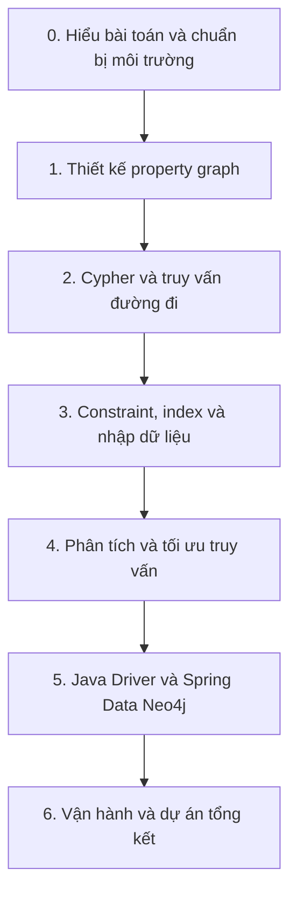
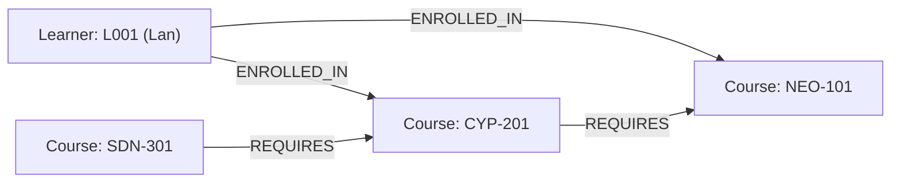

# Lộ trình học Neo4j: từ mô hình dữ liệu đến truy vấn, ứng dụng và vận hành

## 1. Học Neo4j để giải quyết bài toán gì?

Neo4j là hệ quản trị cơ sở dữ liệu đồ thị sử dụng **property graph**: dữ liệu được biểu diễn qua **node** (đỉnh), **relationship** (cạnh có hướng) và **property** (thuộc tính) của cả node lẫn relationship. Ngôn ngữ **Cypher** cho phép mô tả mẫu liên kết và truy vấn các đường đi giữa những thực thể. Cách tiếp cận này đặc biệt hữu ích khi câu hỏi nghiệp vụ xoay quanh *ai liên quan đến ai, thông qua quan hệ nào, và theo chuỗi liên kết dài bao nhiêu bước*.

Ví dụ: trên một nền tảng học tập, ngoài việc tìm khóa học mà một học viên đã đăng ký, hệ thống còn phải tìm toàn bộ môn tiên quyết của một khóa học, xác định học viên còn thiếu môn nào, hoặc gợi ý các khóa học tiếp theo. Các tình huống này giúp người học hiểu khi nào mô hình đồ thị tạo ra cách diễn đạt tự nhiên hơn so với nhiều phép nối bảng.

Bài này đưa ra **thứ tự học và tiêu chí hoàn thành** từ nền tảng mô hình hóa đến truy vấn, nhập dữ liệu, tối ưu, tích hợp **Neo4j Java Driver**, **Spring Data Neo4j** và vận hành. Đây là lộ trình thực hành: mỗi chặng tạo ra một sản phẩm dùng được ở chặng sau.

### Kết quả đầu ra mong đợi

Sau khi hoàn thành lộ trình, bạn có thể:

1. Chuyển yêu cầu nghiệp vụ thành mô hình node–relationship–property, chọn định danh ổn định và chiều quan hệ hợp lý.
2. Viết Cypher để tạo/cập nhật dữ liệu, lọc, tổng hợp, duyệt quan hệ và tìm đường đi có giới hạn.
3. Thiết lập **constraint**, **index**, quy trình nhập dữ liệu và kiểm tra chất lượng dữ liệu.
4. Đọc kế hoạch thực thi bằng `EXPLAIN`/`PROFILE` và điều chỉnh mẫu truy vấn dựa trên dữ liệu thực tế.
5. Truy cập Neo4j từ Java, thiết kế lớp truy cập dữ liệu bằng Spring Data Neo4j và xử lý giao dịch đúng phạm vi.
6. Tổ chức bảo mật, giám sát, sao lưu/khôi phục và quy trình đưa ứng dụng đồ thị vào vận hành.

## 2. Bản đồ lộ trình



Thời lượng bên dưới là **gợi ý cho người đã biết cơ bản về cơ sở dữ liệu và Java**; thời gian thực tế thay đổi theo kinh nghiệm và độ phức tạp của dữ liệu.

| Giai đoạn | Thời gian gợi ý | Việc phải làm được trước khi chuyển bước |
|---|---|---|
| 0. Chuẩn bị | 1–2 buổi | Kết nối được Neo4j, chạy được một truy vấn Cypher, mô tả được mục tiêu dữ liệu |
| 1. Mô hình hóa | Tuần 1 | Vẽ sơ đồ node/relationship, giải thích định danh, chiều quan hệ và thuộc tính |
| 2. Cypher | Tuần 2–3 | Tạo dữ liệu, truy vấn nhiều chặng, lọc, đếm và dùng tham số |
| 3. Toàn vẹn và nhập dữ liệu | Tuần 4 | Tạo constraint/index; nhập lại cùng dữ liệu không phát sinh bản ghi trùng |
| 4. Hiệu năng | Cuối tuần 4–đầu tuần 5 | Đọc được kế hoạch truy vấn, nhận biết điểm bắt đầu và phần mở rộng đồ thị tốn chi phí |
| 5. Tích hợp ứng dụng | Tuần 5–6 | API Java/Spring gọi được Cypher, có kiểm thử dữ liệu và quản lý giao dịch |
| 6. Vận hành và tổng kết | Tuần 7–8 | Có tài liệu triển khai, theo dõi, phục hồi và kết quả dự án đầu cuối |

Không cần học thuộc mọi hàm Cypher trước khi xây ứng dụng. Hãy đi theo vòng lặp **đặt câu hỏi nghiệp vụ → mô hình → dữ liệu mẫu → truy vấn → đo kiểm → điều chỉnh**.

## 3. Bài toán xuyên suốt: nền tảng học trực tuyến

Giả sử một hệ thống cần trả lời ba câu hỏi:

- Một học viên đang đăng ký những khóa học nào?
- Để học một khóa chuyên sâu, phải học những khóa tiên quyết nào, kể cả tiên quyết nhiều cấp?
- Học viên còn thiếu những khóa tiên quyết nào để theo học khóa chuyên sâu?

Mô hình ban đầu:

| Thành phần | Ý nghĩa | Thuộc tính minh họa |
|---|---|---|
| `(:Learner)` | Một học viên | `id`, `name` |
| `(:Course)` | Một khóa học | `code`, `title` |
| `(:Learner)-[:ENROLLED_IN]->(:Course)` | Học viên đăng ký khóa học | `enrolledAt` (nếu cần) |
| `(:Course)-[:REQUIRES]->(:Course)` | Khóa học bên trái yêu cầu khóa học bên phải làm tiên quyết | Có thể không cần thuộc tính |



**Quy ước chiều là một quyết định nghiệp vụ:** `(A)-[:REQUIRES]->(B)` nghĩa là học A phải có kiến thức B trước. Vì vậy, từ `SDN-301` đi theo `REQUIRES` sẽ lần lượt gặp `CYP-201` và `NEO-101`. Chiều này sẽ được giữ nhất quán trong tất cả ví dụ.

### Những nguyên tắc mô hình hóa nên nắm từ đầu

**Node hay property?** Biến một đối tượng thành node khi nó có định danh riêng hoặc cần tham gia quan hệ độc lập. Chẳng hạn `Course` nên là node, còn `title` thường chỉ là property của `Course`. Không nên biến mọi chuỗi ký tự thành một node nếu không có nhu cầu truy vấn liên kết.

**Relationship hay node trung gian?** `ENROLLED_IN` đủ khi quan hệ đăng ký chỉ mang vài thuộc tính đơn giản. Nếu mỗi lần đăng ký có vòng đời riêng, thanh toán, lịch sử trạng thái và nhiều liên kết khác, có thể cần một node `Enrollment` có định danh riêng. Quyết định dựa trên yêu cầu truy vấn và vòng đời dữ liệu.

**Định danh nào bền vững?** Chọn `Learner.id` và `Course.code` làm khóa nghiệp vụ ổn định; tên học viên và tiêu đề khóa học có thể thay đổi. Tránh dùng một thuộc tính có thể đổi như `title` để định danh khi `MERGE`.

**Có cần đồ thị cho mọi thứ?** Nếu nhu cầu chỉ là lưu danh sách và tra cứu theo khóa, cơ sở dữ liệu quan hệ có thể đã phù hợp. Đánh giá Neo4j dựa trên các câu hỏi có nhiều liên kết, kiểu truy cập thực tế và khả năng vận hành của đội ngũ.

**Bài tập cuối chặng 1:** tự vẽ đồ thị cho tính năng “giảng viên dạy khóa học”, nêu các node/relationship mới, khóa duy nhất và ít nhất ba câu hỏi nghiệp vụ mà mô hình trả lời được.

## 4. Chặng 0–2: chuẩn bị, tạo đồ thị và làm chủ Cypher

### 4.1. Chuẩn bị môi trường học

Sử dụng một cơ sở dữ liệu Neo4j riêng cho thực hành, với **Neo4j Browser** hoặc công cụ chạy Cypher tương đương. Xác nhận có thể kết nối, đọc dữ liệu và thực hiện các lệnh ghi ở phạm vi bài tập. Biết rằng ứng dụng Java thường kết nối qua **Bolt** bằng URI và tài khoản được cấu hình bên ngoài mã nguồn.

Trước khi thực hành, thống nhất cách dùng nhãn (`Learner`, `Course`), tên loại quan hệ (`ENROLLED_IN`, `REQUIRES`), tên thuộc tính (`id`, `code`) và bộ dữ liệu mẫu. Chạy từng câu lệnh dưới đây theo thứ tự trong môi trường thực hành.

### 4.2. Đặt constraint trước khi nhập dữ liệu

```cypher
CREATE CONSTRAINT learner_id_unique IF NOT EXISTS
FOR (l:Learner) REQUIRE l.id IS UNIQUE;

CREATE CONSTRAINT course_code_unique IF NOT EXISTS
FOR (c:Course) REQUIRE c.code IS UNIQUE;
```

Constraint duy nhất hỗ trợ ngăn hai học viên có cùng `id` hoặc hai khóa học có cùng `code`. Cú pháp và khả năng quản trị cụ thể nên được đối chiếu với phiên bản Neo4j và quyền tài khoản đang dùng. Constraint duy nhất khác với yêu cầu bắt buộc mọi node đều có property; nếu cần bắt buộc tồn tại property, hãy đánh giá các loại constraint có sẵn ở phiên bản/edition triển khai.

### 4.3. Tạo dữ liệu mẫu có thể chạy lại

```cypher
UNWIND [
  {id: 'L001', name: 'Lan'},
  {id: 'L002', name: 'Minh'}
] AS item
MERGE (l:Learner {id: item.id})
SET l.name = item.name;

UNWIND [
  {code: 'NEO-101', title: 'Nhập môn Neo4j'},
  {code: 'CYP-201', title: 'Cypher thực hành'},
  {code: 'SDN-301', title: 'Spring Data Neo4j'}
] AS item
MERGE (c:Course {code: item.code})
SET c.title = item.title;

MATCH (cypher:Course {code: 'CYP-201'}),
      (intro:Course {code: 'NEO-101'})
MERGE (cypher)-[:REQUIRES]->(intro);

MATCH (spring:Course {code: 'SDN-301'}),
      (cypher:Course {code: 'CYP-201'})
MERGE (spring)-[:REQUIRES]->(cypher);

MATCH (lan:Learner {id: 'L001'}),
      (intro:Course {code: 'NEO-101'})
MERGE (lan)-[r:ENROLLED_IN]->(intro)
ON CREATE SET r.enrolledAt = date('2026-11-01');

MATCH (lan:Learner {id: 'L001'}),
      (cypher:Course {code: 'CYP-201'})
MERGE (lan)-[:ENROLLED_IN]->(cypher);

MATCH (minh:Learner {id: 'L002'}),
      (intro:Course {code: 'NEO-101'})
MERGE (minh)-[:ENROLLED_IN]->(intro);
```

Ở đây `MERGE` tìm mẫu đã có hoặc tạo mẫu mới; kết hợp **khóa nghiệp vụ ổn định + constraint** giúp nạp lại dữ liệu an toàn hơn. Dùng `SET` để cập nhật thuộc tính có thể thay đổi. Với dữ liệu thực, cần xử lý cả chuẩn hóa khóa, xung đột và thao tác đồng thời.

### 4.4. Viết truy vấn từ đơn giản đến đường đi nhiều cấp

**Câu hỏi 1 — Lan đang học gì?**

```cypher
MATCH (l:Learner {id: $learnerId})-[:ENROLLED_IN]->(c:Course)
RETURN c.code AS code, c.title AS title
ORDER BY code;
```

Truyền tham số `learnerId = 'L001'` trong công cụ thực hành hoặc từ ứng dụng. Dữ liệu mẫu cho kết quả `CYP-201` và `NEO-101`. Tham số giúp tách dữ liệu người dùng khỏi văn bản Cypher và cho phép tái sử dụng truy vấn.

**Câu hỏi 2 — Các môn tiên quyết trực tiếp và gián tiếp của `SDN-301`?**

```cypher
MATCH (target:Course {code: $courseCode})
      -[:REQUIRES*1..4]->(required:Course)
RETURN DISTINCT required.code AS code, required.title AS title
ORDER BY code;
```

Với `courseCode = 'SDN-301'`, kết quả là `CYP-201` và `NEO-101`. Mẫu `*1..4` có nghĩa là lần theo từ **1 đến 4 relationship**; giới hạn độ sâu là một quyết định quan trọng khi đồ thị có nhiều nhánh. `DISTINCT` tránh lặp khóa học nếu nhiều đường đi cùng chạm đến một node.

**Câu hỏi 3 — Lan còn thiếu những môn tiên quyết nào của `SDN-301`?**

```cypher
MATCH (l:Learner {id: $learnerId})
MATCH (target:Course {code: $courseCode})
      -[:REQUIRES*1..4]->(required:Course)
WHERE NOT EXISTS {
  MATCH (l)-[:ENROLLED_IN]->(required)
}
RETURN DISTINCT required.code AS missingCode,
                required.title AS missingTitle
ORDER BY missingCode;
```

Với `learnerId = 'L001'` và `courseCode = 'SDN-301'`, tập môn còn thiếu **rỗng** vì Lan đã đăng ký cả hai môn tiên quyết. Nếu đổi `learnerId = 'L002'`, kết quả còn thiếu `CYP-201`. Lưu ý: *đã đăng ký* chưa đồng nghĩa *đã hoàn thành*. Nếu nghiệp vụ yêu cầu hoàn thành, phải bổ sung trạng thái/tiêu chí đạt môn vào mô hình và sửa điều kiện truy vấn tương ứng.

**Câu hỏi 4 — Mỗi khóa có bao nhiêu học viên đăng ký?**

```cypher
MATCH (c:Course)
OPTIONAL MATCH (l:Learner)-[:ENROLLED_IN]->(c)
RETURN c.code AS courseCode, count(DISTINCT l) AS learnerCount
ORDER BY learnerCount DESC, courseCode;
```

`OPTIONAL MATCH` giữ cả khóa học chưa có người đăng ký; `count(DISTINCT l)` không đếm giá trị `null`. Để tránh lỗi tư duy, luôn giải thích cụ thể **một dòng kết quả đại diện cho gì**, nhất là khi dùng nhiều `MATCH`, `OPTIONAL MATCH`, `WITH`, `UNWIND` và phép tổng hợp.

**Mốc hoàn thành chặng 2:** tự viết được một truy vấn đường đi có giới hạn; một truy vấn `OPTIONAL MATCH`/tổng hợp; một truy vấn có tham số; diễn giải được chiều relationship và ý nghĩa dữ liệu kết quả.

## 5. Chặng 3: bảo toàn dữ liệu, index và nhập dữ liệu

### 5.1. Phân biệt constraint và index

| Công cụ | Câu hỏi cần trả lời | Ví dụ |
|---|---|---|
| **Uniqueness constraint** | Hai node cùng loại có được trùng khóa không? | Không có hai `Course` trùng `code` |
| **Index** | Truy vấn thường bắt đầu từ property nào? | Tìm khóa học theo `title` |
| **Quy tắc ứng dụng** | Giá trị có hợp lệ về nghiệp vụ không? | Không tạo quan hệ `REQUIRES` tạo vòng tiên quyết |

Ví dụ index theo tiêu đề:

```cypher
CREATE INDEX course_title_idx IF NOT EXISTS
FOR (c:Course) ON (c.title);
```

Neo4j tự quản lý các chỉ mục hỗ trợ cho một số constraint; không mặc định tạo thêm index trùng trên cùng khóa `Course.code`. Hãy chọn index theo **điều kiện lọc và điểm khởi đầu** của các truy vấn thường dùng, không theo mọi property có trong dữ liệu.

### 5.2. Nạp dữ liệu theo đợt

Khi nhập CSV, quy trình tối thiểu là: kiểm tra định dạng → chuẩn hóa định danh → nạp node → nạp relationship khi các đầu mút đã có → đối soát số lượng và lỗi → thử chạy lại. Ví dụ tệp `courses.csv` có hai cột `code,title` và được đặt tại vùng import mà máy chủ Neo4j cho phép:

```cypher
LOAD CSV WITH HEADERS FROM 'file:///courses.csv' AS row
WITH row
WHERE row.code IS NOT NULL AND trim(row.code) <> ''
MERGE (c:Course {code: trim(row.code)})
SET c.title = row.title;
```

Vị trí `file:///` phụ thuộc cấu hình và môi trường triển khai; không suy ra rằng máy chủ tự nhìn thấy tệp trên máy cá nhân. Với dữ liệu lớn, cần **chia lô giao dịch**, đo tốc độ, quản lý lỗi từng lô và tránh một giao dịch ghi khổng lồ. Đảm bảo mỗi relationship tham chiếu đúng node đầu/cuối; dữ liệu tham chiếu thiếu cần được phát hiện thay vì âm thầm bỏ qua.

### 5.3. Kiểm tra dữ liệu sau nhập

```cypher
MATCH (l:Learner) RETURN count(l) AS learners;

MATCH (c:Course) RETURN count(c) AS courses;

MATCH ()-[r:REQUIRES]->() RETURN count(r) AS prerequisites;

MATCH (a:Course)-[:REQUIRES]->(a)
RETURN a.code AS selfDependency;
```

Với dữ liệu mẫu, các số đếm lần lượt là **2 học viên**, **3 khóa học**, **2 quan hệ tiên quyết**, và **không có quan hệ tự yêu cầu trực tiếp**. Truy vấn cuối chỉ phát hiện vòng một cạnh; vòng nhiều cạnh cần quy tắc kiểm tra riêng. Một constraint về khóa duy nhất **không tự đảm bảo** đồ thị tiên quyết không có vòng.

**Mốc hoàn thành chặng 3:** nhập lại dữ liệu mẫu hai lần mà không làm tăng số node/relationship, kiểm tra được khóa duy nhất và mô tả được cách xử lý bản ghi lỗi.

## 6. Chặng 4: hiểu chi phí và tối ưu Cypher

Một truy vấn đồ thị thường gồm hai phần: **tìm điểm bắt đầu** (ví dụ `Course.code`) và **mở rộng các relationship** từ những node đã tìm được. Truy vấn bắt đầu quá rộng, duyệt không giới hạn hoặc đi qua node có rất nhiều cạnh có thể tạo ra lượng đường đi trung gian lớn.

Thực hành trước bằng:

```cypher
EXPLAIN
MATCH (c:Course {code: $courseCode})-[:REQUIRES*1..4]->(p:Course)
RETURN DISTINCT p.code;
```

`EXPLAIN` hiển thị kế hoạch dự kiến mà không thực thi truy vấn; `PROFILE` thực thi và bổ sung số liệu thực tế. Đọc các thông tin như phương án tìm node, số dòng trung gian, số lần truy cập dữ liệu (*database hits*) và các bước mở rộng quan hệ. Kế hoạch/chi phí phụ thuộc phiên bản Neo4j, thống kê và bộ dữ liệu; cần quan sát trên lượng dữ liệu đại diện trước khi rút kết luận.

Thứ tự tối ưu nên là:

1. Xác nhận kết quả đúng nghiệp vụ, gồm xử lý trùng kết quả và đường đi có vòng.
2. Bắt đầu từ node được lọc chọn lọc bằng khóa/thuộc tính phù hợp; kiểm tra index/constraint hỗ trợ.
3. Chỉ duyệt loại relationship, chiều và độ sâu cần thiết; tránh quét toàn đồ thị khi không cần.
4. Giảm khối lượng dữ liệu trung gian và chỉ trả về các cột thực sự dùng. Xem xét phân trang ở tầng API khi kết quả lớn.
5. Dùng `PROFILE` để so sánh trước/sau với bộ dữ liệu đại diện và kiểm tra lại tính đúng đắn của kết quả.

Không có một mức sâu duyệt hay một index “tốt nhất” cho mọi bài toán. Đặt giới hạn dựa trên ý nghĩa nghiệp vụ; nếu chuỗi tiên quyết có thể dài hơn bốn cấp, truy vấn thực tế phải hỗ trợ độ sâu đó và có chiến lược kiểm soát chi phí.

**Mốc hoàn thành chặng 4:** trình bày được một kế hoạch `PROFILE`, giải thích vì sao truy vấn bắt đầu ở node nào, và chứng minh được một thay đổi tối ưu bằng số liệu thực tế.

## 7. Chặng 5: đưa truy vấn vào ứng dụng Java

### 7.1. Dùng Neo4j Java Driver khi cần kiểm soát Cypher trực tiếp

Ở mức ứng dụng, thường tổ chức `Driver` dùng chung theo vòng đời ứng dụng, mở `Session` theo phạm vi thao tác và đóng session đúng cách. URI, tài khoản và mật khẩu lấy từ cấu hình an toàn, **không ghi cố định vào mã nguồn**. Ví dụ dưới đây giả định ứng dụng đã cấu hình và khởi tạo `Driver`:

```java
import org.neo4j.driver.Driver;
import org.neo4j.driver.Session;
import org.neo4j.driver.SessionConfig;

import java.util.List;
import java.util.Map;

public class EnrollmentQueries {
    private final Driver driver;

    public EnrollmentQueries(Driver driver) {
        this.driver = driver;
    }

    public List<String> findCourseTitles(String learnerId) {
        try (Session session = driver.session(
                SessionConfig.forDatabase("neo4j"))) {
            return session.executeRead(tx -> tx.run("""
                    MATCH (l:Learner {id: $learnerId})-[:ENROLLED_IN]->(c:Course)
                    RETURN c.title AS title
                    ORDER BY title
                    """, Map.of("learnerId", learnerId))
                .list(record -> record.get("title").asString()));
        }
    }
}
```

`executeRead` quản lý giao dịch đọc, phù hợp cho luồng chỉ truy vấn; giao dịch ghi phải dùng cơ chế ghi tương ứng. Mã ví dụ tập trung vào thao tác đọc; trong ứng dụng thực tế cần xử lý lỗi kết nối/giao dịch, timeout, giới hạn kết quả và đóng `Driver` khi ứng dụng dừng. Tài liệu Java Driver của phiên bản đang sử dụng là nguồn đối chiếu tên API và cấu hình cụ thể.

### 7.2. Dùng Spring Data Neo4j để tổ chức tầng repository

Với Spring Boot, Spring Data Neo4j hỗ trợ ánh xạ node/relationship sang đối tượng miền và repository. Ví dụ giản lược mô hình `Course`:

```java
import org.springframework.data.annotation.Id;
import org.springframework.data.neo4j.core.schema.Node;
import org.springframework.data.neo4j.core.schema.Relationship;
import java.util.HashSet;
import java.util.Set;

@Node("Course")
public class Course {
    @Id
    private String code;
    private String title;

    @Relationship(type = "REQUIRES",
                  direction = Relationship.Direction.OUTGOING)
    private Set<Course> prerequisites = new HashSet<>();

    // Constructor/getter/setter theo quy ước project.
}
```

Và truy vấn repository cho các khóa tiên quyết:

```java
import org.springframework.data.neo4j.repository.Neo4jRepository;
import org.springframework.data.neo4j.repository.query.Query;
import org.springframework.data.repository.query.Param;
import java.util.List;

public interface CourseRepository extends Neo4jRepository<Course, String> {
    @Query("""
           MATCH (:Course {code: $code})-[:REQUIRES*1..4]->(required:Course)
           RETURN DISTINCT required
           """)
    List<Course> findPrerequisites(@Param("code") String code);
}
```

Các đoạn Java minh họa ý tưởng; cần bổ sung cấu hình dependency, quản lý bean `Driver`/repository, constructor và phương thức truy cập phù hợp với phiên bản Spring/Neo4j của dự án. Với truy vấn trả về nhiều quan hệ hoặc một đồ thị con, cần thiết kế ranh giới ánh xạ và tránh tự động tải những phần đồ thị không cần thiết.

**Khi nào chọn cách nào?** Java Driver phù hợp khi muốn kiểm soát Cypher, giao dịch và kiểu dữ liệu trả về trực tiếp. Spring Data Neo4j phù hợp khi ứng dụng đã theo mô hình Spring repository/domain. Hai cách có thể cùng tồn tại nhưng phải xác định ranh giới giao dịch và sở hữu kết nối rõ ràng.

### 7.3. Xây một API nhỏ để kiểm chứng tích hợp

Tạo endpoint, chẳng hạn `GET /learners/{id}/missing-prerequisites?courseCode=SDN-301`, với luồng xử lý:

```text
HTTP request
  -> kiểm tra tham số learnerId, courseCode
  -> service áp quy tắc nghiệp vụ
  -> repository/driver chạy Cypher có tham số
  -> ánh xạ danh sách khóa học còn thiếu
  -> trả JSON (có xử lý lỗi/không tìm thấy)
```

Viết kiểm thử tích hợp trên dữ liệu riêng: Lan không thiếu môn tiên quyết; Minh thiếu `CYP-201`; mã học viên không tồn tại được xử lý theo hợp đồng API. Không suy ra “đã hoàn thành môn” từ dữ liệu “đã đăng ký” nếu chưa có mô hình trạng thái học tập.

**Mốc hoàn thành chặng 5:** API trả về kết quả đúng với cả ba trường hợp, dùng tham số thay cho ghép chuỗi Cypher, và có cách kiểm thử lặp lại không phụ thuộc dữ liệu sản xuất.

## 8. Chặng 6: vận hành một hệ thống đồ thị

Truy vấn đúng trong Neo4j Browser chưa đủ để triển khai. Tối thiểu phải chuẩn bị các nhóm công việc sau:

| Chủ đề | Việc cần thực hiện | Bằng chứng hoàn thành |
|---|---|---|
| **Bảo mật** | Quản lý secret, phân quyền theo vai trò, giới hạn truy cập mạng và mã hóa kết nối phù hợp môi trường | Ứng dụng dùng tài khoản đủ quyền cần thiết; không có mật khẩu trong source |
| **Độ tin cậy dữ liệu** | Thực hiện nhập/migration có kiểm soát; sao lưu và thử khôi phục | Có biên bản phục hồi dữ liệu thử nghiệm và kiểm tra tính đúng đắn |
| **Giám sát** | Theo dõi thời gian truy vấn, lỗi/timeout, CPU, bộ nhớ, page cache, dung lượng đĩa, tốc độ tăng trưởng đồ thị | Dashboard và ngưỡng cảnh báo gắn với nhu cầu hệ thống |
| **Hiệu năng** | Theo dõi truy vấn chậm và mức độ sử dụng index; định kỳ `PROFILE` truy vấn trọng yếu | Có số liệu nền và kết quả đo sau thay đổi |
| **Triển khai** | Quản lý cấu hình theo môi trường, tương thích phiên bản driver/server, quy trình nâng cấp và khôi phục | Có hướng dẫn triển khai và phương án rollback/phục hồi |
| **Tính sẵn sàng** | Chọn kiến trúc triển khai phù hợp tải và yêu cầu dịch vụ; kiểm tra sự cố kết nối | Mô phỏng được tình huống lỗi và phản ứng của ứng dụng |

Để khảo sát cấu trúc đang có, có thể chạy các câu lệnh quản trị tương ứng với phiên bản/quyền được cấp, ví dụ:

```cypher
SHOW CONSTRAINTS;
SHOW INDEXES;
```

**Lưu ý triển khai:** chức năng backup, quản trị người dùng, clustering, các kiểu constraint và công cụ giám sát có thể khác nhau theo **phiên bản, edition và mô hình dịch vụ** (tự quản lý hay dịch vụ quản lý). Vì vậy, hãy xác nhận khả năng cụ thể trên hệ thống đang vận hành và kiểm thử quy trình khôi phục thay vì chỉ giả định rằng bản sao lưu dùng được.

## 9. Dự án tổng kết và tiêu chí đánh giá

**Đề tài:** “Trợ lý xác định môn tiên quyết” cho nền tảng học tập.

Yêu cầu tối thiểu:

1. **Mô hình:** hai loại node `Learner`, `Course`; hai loại relationship `ENROLLED_IN`, `REQUIRES`; ghi rõ chiều và ý nghĩa; nêu cách mở rộng nếu có trạng thái hoàn thành khóa học.
2. **Dữ liệu:** từ bộ dữ liệu nhỏ của bài học, bổ sung vài nhánh tiên quyết và nhiều học viên; tạo constraint/index; script nạp chạy lặp lại được; phát hiện khóa tham chiếu thiếu hoặc chu trình không hợp lệ.
3. **Cypher:** truy vấn khóa đã đăng ký, toàn bộ môn tiên quyết và môn còn thiếu; kiểm tra kết quả đúng trên đồ thị có nhiều đường đi đến cùng node.
4. **Tích hợp:** API Java/Spring trả JSON với tham số an toàn; kiểm thử trường hợp đủ điều kiện, thiếu điều kiện và đầu vào không tồn tại.
5. **Hiệu năng:** lưu kế hoạch `PROFILE` và số liệu đo một truy vấn quan trọng trên bộ dữ liệu đại diện; nêu rõ độ sâu duyệt và giới hạn trả về.
6. **Vận hành:** mô tả cách cấu hình kết nối, quản lý secret, theo dõi lỗi, sao lưu và thử khôi phục trong môi trường phù hợp.

Có thể tự đánh giá bằng bảng sau:

| Mức độ | Biểu hiện |
|---|---|
| **Chưa đạt** | Chỉ tạo được vài node và chưa giải thích được chiều quan hệ hay ý nghĩa kết quả |
| **Cơ bản** | Mô hình và truy vấn dữ liệu mẫu đúng; có khóa duy nhất và có thể chạy lại script nhập |
| **Ứng dụng được** | Có API/kiểm thử, sử dụng tham số, giới hạn duyệt và phân tích được kế hoạch truy vấn |
| **Sẵn sàng mở rộng** | Đánh giá được dữ liệu thực tế, trường hợp biên, chi phí truy vấn và quy trình vận hành/phục hồi |

### Những sai lầm cần tránh trong cả lộ trình

- **Mô hình theo thói quen bảng:** đưa tất cả thông tin vào một node lớn, hoặc biến mọi thuộc tính thành node mà không gắn với câu hỏi cần truy vấn.
- **Nhập trước, định danh sau:** chạy `CREATE` nhiều lần tạo dữ liệu trùng; dùng `MERGE` trên thuộc tính thay đổi hoặc bỏ qua constraint.
- **Quên hướng quan hệ:** truy vấn `REQUIRES` ngược chiều và suy diễn sai môn tiên quyết.
- **Duyệt đường đi không kiểm soát:** thiếu giới hạn chiều sâu, loại quan hệ hoặc điểm bắt đầu đủ chọn lọc.
- **Chỉ thử trên vài node:** truy vấn đúng ở dữ liệu mẫu nhưng nổ số lượng đường đi hoặc chậm khi dữ liệu tăng.
- **Đồng nhất đăng ký và hoàn thành:** kết luận nghiệp vụ vượt quá thông tin đang được mô hình hóa.
- **Chỉ quan tâm truy vấn:** bỏ qua quyền truy cập, vòng đời kết nối, theo dõi lỗi và kiểm tra khả năng phục hồi.

## 10. Bước học tiếp theo

Sau dự án đầu tiên, hãy đào sâu theo vấn đề thực sự gặp phải: mô hình hóa quan hệ có thuộc tính và thay đổi theo thời gian; các dạng truy vấn đường đi phức tạp; chiến lược nhập dữ liệu lớn; tối ưu trên đồ thị có node bậc cao; và ranh giới giao dịch, kiểm thử, quan sát trong ứng dụng Spring. Khi đọc tài liệu chính thức, luôn chọn đúng phiên bản **Neo4j, Cypher, Java Driver và Spring Data Neo4j** của môi trường đang sử dụng.

Lộ trình hoàn thành khi bạn có thể **giải thích lựa chọn mô hình, chứng minh truy vấn đúng, đo được chi phí thực thi, triển khai ứng dụng gọi được đồ thị và mô tả được cách phục hồi khi xảy ra sự cố**. Đó là chuỗi kỹ năng gắn kết từ mô hình dữ liệu tới hệ thống Neo4j vận hành thực tế.
