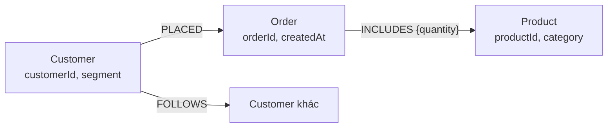

# Thống kê quan hệ, bậc nút và phân bố theo nhóm nghiệp vụ

Trong cơ sở dữ liệu đồ thị **Neo4j**, một thống kê thường bắt đầu từ các quan hệ: khách hàng đã đặt bao nhiêu đơn, ai đang được nhiều người theo dõi, mỗi phân khúc khách hàng tạo ra bao nhiêu đơn hàng, hay nhóm sản phẩm nào có lượng mua cao nhất. Khác với việc chỉ đếm bản ghi trong bảng, truy vấn **Cypher** phải xác định rõ **loại quan hệ, chiều quan hệ, nút đầu–cuối và số lần một đường đi được khớp**.

Bài thuộc chương **Tổng hợp dữ liệu** và tập trung vào ba nhóm phép đo trong *property graph*:

1. **Thống kê quan hệ:** số cạnh theo loại, số đối tượng liên quan duy nhất và tổng trọng số trên cạnh.
2. **Bậc nút (degree):** số quan hệ đi ra, đi vào hoặc tổng hai chiều của từng nút.
3. **Phân bố theo nhóm nghiệp vụ:** nhóm khách hàng, loại sản phẩm, khoảng thời gian và phân bố số quan hệ trên mỗi nút.

Các ví dụ dùng Cypher của Neo4j 5 trở lên, trong đó có biểu thức `COUNT { ... }`. Chúng có thể chạy độc lập trong Neo4j Browser sau khi tạo bộ dữ liệu mẫu.

## 1. Mô hình và dữ liệu mẫu

Giả sử hệ thống thương mại có các nút `Customer`, `Order`, `Product` và ba loại quan hệ:



`PLACED` và `FOLLOWS` có hướng mang ý nghĩa nghiệp vụ. `INCLUDES` nối một đơn hàng với sản phẩm và giữ số lượng mua trong thuộc tính `quantity` của quan hệ. Ví dụ, một đơn hàng gồm hai sản phẩm khác nhau có **hai quan hệ `INCLUDES`**, nhưng có thể mua nhiều hơn hai **đơn vị hàng hóa**.

Để chạy lại ví dụ mà không thêm trùng các nút theo mã nghiệp vụ, tạo ràng buộc duy nhất (trong cơ sở dữ liệu thực tế, kiểm tra các ràng buộc đang có trước khi áp dụng):

```cypher
CREATE CONSTRAINT customer_id IF NOT EXISTS
FOR (c:Customer) REQUIRE c.customerId IS UNIQUE;

CREATE CONSTRAINT order_id IF NOT EXISTS
FOR (o:Order) REQUIRE o.orderId IS UNIQUE;

CREATE CONSTRAINT product_id IF NOT EXISTS
FOR (p:Product) REQUIRE p.productId IS UNIQUE;
```

Chạy đoạn sau trong **cơ sở dữ liệu thử nghiệm**. `MERGE` tìm hoặc tạo nút/quan hệ tương ứng, còn `SET` đặt các thuộc tính cần dùng trong bài:

```cypher
MERGE (an:Customer {customerId: 'C01'})
SET an.name = 'An', an.segment = 'Retail'
MERGE (binh:Customer {customerId: 'C02'})
SET binh.name = 'Bình', binh.segment = 'Retail'
MERGE (chi:Customer {customerId: 'C03'})
SET chi.name = 'Chi', chi.segment = 'SMB'
MERGE (dung:Customer {customerId: 'C04'})
SET dung.name = 'Dũng', dung.segment = 'Enterprise'

MERGE (o1:Order {orderId: 'O01'})
SET o1.createdAt = date('2026-10-10')
MERGE (o2:Order {orderId: 'O02'})
SET o2.createdAt = date('2026-11-01')
MERGE (o3:Order {orderId: 'O03'})
SET o3.createdAt = date('2026-11-05')
MERGE (o4:Order {orderId: 'O04'})
SET o4.createdAt = date('2026-11-07')

MERGE (p1:Product {productId: 'P01'})
SET p1.category = 'Thực phẩm'
MERGE (p2:Product {productId: 'P02'})
SET p2.category = 'Sách'
MERGE (p3:Product {productId: 'P03'})
SET p3.category = 'Thực phẩm'

MERGE (an)-[:PLACED]->(o1)
MERGE (an)-[:PLACED]->(o2)
MERGE (binh)-[:PLACED]->(o3)
MERGE (chi)-[:PLACED]->(o4)

MERGE (an)-[:FOLLOWS]->(binh)
MERGE (an)-[:FOLLOWS]->(chi)
MERGE (chi)-[:FOLLOWS]->(binh)

MERGE (o1)-[l1:INCLUDES]->(p1)
SET l1.quantity = 2
MERGE (o1)-[l2:INCLUDES]->(p2)
SET l2.quantity = 1
MERGE (o2)-[l3:INCLUDES]->(p1)
SET l3.quantity = 1
MERGE (o3)-[l4:INCLUDES]->(p2)
SET l4.quantity = 3
MERGE (o4)-[l5:INCLUDES]->(p3)
SET l5.quantity = 2;
```

Sau khi tạo, có **4 khách hàng**, **4 đơn hàng**, **3 sản phẩm**, **4 quan hệ `PLACED`**, **3 quan hệ `FOLLOWS`** và **5 quan hệ `INCLUDES`**. Khách hàng Dũng chưa có đơn và chưa theo dõi ai; đây là trường hợp quan trọng khi thống kê cả các nút có bậc bằng `0`.

## 2. Đếm quan hệ: xác định rõ đang đếm gì

### 2.1. Số cạnh theo từng loại

```cypher
MATCH ()-[r]->()
RETURN type(r) AS relationshipType,
       count(r) AS relationshipCount
ORDER BY relationshipCount DESC, relationshipType;
```

Với dữ liệu mẫu:

| relationshipType | relationshipCount |
| --- | ---: |
| INCLUDES | 5 |
| PLACED | 4 |
| FOLLOWS | 3 |

Mẫu `()-[r]->()` khớp mỗi quan hệ có hướng một lần. `type(r)` trả về loại quan hệ, còn `count(r)` đếm số cạnh khớp. Nếu chỉ muốn biết có bao nhiêu quan hệ đặt hàng:

```cypher
MATCH (:Customer)-[r:PLACED]->(o:Order)
RETURN count(r) AS placedRelationships,
       count(DISTINCT o) AS distinctOrders;
```

Kết quả mẫu là `4` và `4`. Hai chỉ số này không luôn bằng nhau: nếu mô hình cho phép nhiều cạnh `PLACED` đến cùng một đơn hàng, `count(r)` đếm **các cạnh**, còn `count(DISTINCT o)` chỉ đếm **các nút đơn hàng duy nhất**.

### 2.2. `count(*)`, `count(x)` và `count(DISTINCT x)`

| Biểu thức | Đếm | Khi cần dùng |
| --- | --- | --- |
| `count(*)` | Tất cả dòng kết quả, kể cả dòng có giá trị `null` | Đếm dòng sau phép ghép mẫu hoặc sau khi đã gom theo mỗi khách hàng |
| `count(r)` | Những dòng có `r` khác `null` | Đếm quan hệ sau `MATCH` hoặc `OPTIONAL MATCH` |
| `count(DISTINCT o)` | Những giá trị `o` khác `null`, không trùng | Đếm số đơn hàng duy nhất khi một đơn xuất hiện trong nhiều đường đi |

`OPTIONAL MATCH` giữ lại nút không tìm thấy quan hệ bằng một dòng có giá trị quan hệ `null`. Vì vậy, truy vấn sau vẫn trả về Dũng với `orders = 0`:

```cypher
MATCH (c:Customer)
OPTIONAL MATCH (c)-[r:PLACED]->(:Order)
RETURN c.customerId AS customerId,
       count(r) AS orders
ORDER BY customerId;
```

Nếu dùng `count(*)` ở đây, Dũng sẽ được tính thành `1` do dòng rỗng mà `OPTIONAL MATCH` tạo ra. Đây là lỗi thường gặp khi muốn đếm quan hệ nhưng lại đếm dòng.

## 3. Bậc nút: đi ra, đi vào và theo loại quan hệ

**Bậc đi ra** (*out-degree*) là số quan hệ bắt đầu từ một nút; **bậc đi vào** (*in-degree*) là số quan hệ kết thúc tại nút đó. Phải nêu loại quan hệ khi so sánh: một khách hàng có thể có bậc `PLACED` bằng `2` nhưng bậc đi ra `FOLLOWS` bằng `0`.

`COUNT { ... }` đếm các mẫu đường đi liên quan tới từng nút mà không phải mở rộng thành nhiều dòng của truy vấn bên ngoài:

```cypher
MATCH (c:Customer)
RETURN c.customerId AS customerId,
       COUNT { (c)-[:FOLLOWS]->(:Customer) } AS followsOut,
       COUNT { (c)<-[:FOLLOWS]-(:Customer) } AS followsIn,
       COUNT { (c)-[:PLACED]->(:Order) } AS orders
ORDER BY customerId;
```

| customerId | followsOut | followsIn | orders |
| --- | ---: | ---: | ---: |
| C01 | 2 | 0 | 2 |
| C02 | 0 | 2 | 1 |
| C03 | 1 | 1 | 1 |
| C04 | 0 | 0 | 0 |

Khi cần **tổng bậc của mạng theo dõi có hướng**, có thể cộng `followsOut + followsIn`. Một cạnh tự nối `(:Customer)-[:FOLLOWS]->(chính_nó)` đóng góp một lần cho bậc vào và một lần cho bậc ra; vì vậy tổng bậc có hướng tính cạnh tự nối hai lần theo quy ước thông dụng của lý thuyết đồ thị.

Để lấy những khách hàng được theo dõi nhiều nhất (*in-degree* cao):

```cypher
MATCH (c:Customer)
WITH c, COUNT { (c)<-[:FOLLOWS]-(:Customer) } AS followers
RETURN c.customerId AS customerId, followers
ORDER BY followers DESC, customerId
LIMIT 5;
```

Kết quả đứng đầu là `C02` với `2` người theo dõi. `LIMIT` được đặt **sau** khi tính bậc và sắp xếp để tìm đúng top khách hàng; giới hạn tập nút từ trước có thể làm sai thứ hạng.

> **Phân biệt bậc và số hàng hóa:** `COUNT { (o)-[:INCLUDES]->(:Product) }` cho biết đơn hàng chứa bao nhiêu **dòng sản phẩm**; `sum(line.quantity)` mới là tổng số **đơn vị sản phẩm**. Thuộc tính trọng số không tự làm tăng bậc nút.

## 4. Phân bố bậc: có bao nhiêu nút ở mỗi mức hoạt động?

Biết trung bình mỗi khách hàng có một đơn chưa đủ để hiểu dữ liệu. Ta cần biết có bao nhiêu khách hàng chưa đặt đơn, bao nhiêu người đặt một đơn, bao nhiêu người đặt nhiều đơn. Đó là **phân bố bậc**.

```cypher
MATCH (c:Customer)
WITH COUNT { (c)-[:PLACED]->(:Order) } AS degree
RETURN degree AS ordersPerCustomer,
       count(*) AS customerCount
ORDER BY ordersPerCustomer;
```

| ordersPerCustomer | customerCount | Diễn giải |
| ---: | ---: | --- |
| 0 | 1 | Dũng chưa từng đặt đơn |
| 1 | 2 | Bình và Chi mỗi người đặt một đơn |
| 2 | 1 | An đặt hai đơn |

Mỗi khách hàng đi vào truy vấn đúng một lần trước khi nhóm theo `degree`, nên `count(*)` lúc này chính là số **khách hàng**, không phải số quan hệ.

Có thể gom các mức bậc thành *bucket* để dễ báo cáo khi dữ liệu có nhiều giá trị khác nhau:

```cypher
MATCH (c:Customer)
WITH COUNT { (c)-[:PLACED]->(:Order) } AS degree
WITH CASE
       WHEN degree = 0 THEN '0 đơn'
       WHEN degree <= 2 THEN '1-2 đơn'
       ELSE '3+ đơn'
     END AS bucket
RETURN bucket, count(*) AS customers
ORDER BY bucket;
```

Kết quả mẫu: `0 đơn = 1`, `1-2 đơn = 3`. Khi đưa lên biểu đồ, hãy chọn bucket sao cho phù hợp mục tiêu nghiệp vụ, chẳng hạn `0`, `1`, `2–5`, `6–20`, `20+` cho hệ thống có nhiều đơn hàng.

Để tính mức độ tập trung, dùng trung bình, trung vị và bậc lớn nhất trên **mỗi nút**:

```cypher
MATCH (c:Customer)
WITH COUNT { (c)-[:PLACED]->(:Order) } AS degree
RETURN count(*) AS customers,
       round(avg(toFloat(degree)), 2) AS meanDegree,
       percentileCont(degree, 0.5) AS medianDegree,
       max(degree) AS maxDegree;
```

Dữ liệu mẫu có `customers = 4`, `meanDegree = 1.0`, `medianDegree = 1.0`, `maxDegree = 2`. `percentileCont` nội suy giá trị phân vị liên tục; nếu muốn một mức bậc thực sự xuất hiện trong dữ liệu, cân nhắc `percentileDisc`.

## 5. Tổng hợp theo nhóm nghiệp vụ

### 5.1. Theo phân khúc khách hàng, kể cả nhóm chưa có đơn

Đếm từ tập `Customer` rồi dùng `OPTIONAL MATCH` sẽ giữ đủ các phân khúc, kể cả `Enterprise` chưa có đơn:

```cypher
MATCH (c:Customer)
OPTIONAL MATCH (c)-[r:PLACED]->(:Order)
WITH coalesce(c.segment, 'Chưa phân loại') AS segment,
     c,
     count(r) AS ordersOfCustomer
RETURN segment,
       count(*) AS customers,
       sum(ordersOfCustomer) AS orders,
       round(1.0 * sum(ordersOfCustomer) / count(*), 2)
         AS ordersPerCustomer
ORDER BY segment;
```

| segment | customers | orders | ordersPerCustomer |
| --- | ---: | ---: | ---: |
| Enterprise | 1 | 0 | 0.0 |
| Retail | 2 | 3 | 1.5 |
| SMB | 1 | 1 | 1.0 |

**Vì sao phải có hai tầng `WITH`/`RETURN`?** Tầng `WITH` tính số đơn **của từng khách hàng** trước. Tầng `RETURN` mới cộng chúng theo phân khúc. Cách này giữ được mẫu số `customers` khi so sánh mức độ hoạt động giữa các nhóm khác kích thước. `coalesce` cũng đưa khách hàng thiếu thuộc tính `segment` vào nhóm rõ ràng, tránh bỏ sót dữ liệu chưa phân loại.

### 5.2. Theo nhóm sản phẩm: số dòng và số lượng bán

```cypher
MATCH (:Order)-[line:INCLUDES]->(p:Product)
RETURN p.category AS category,
       count(line) AS orderLines,
       sum(line.quantity) AS unitsSold
ORDER BY unitsSold DESC, category;
```

| category | orderLines | unitsSold |
| --- | ---: | ---: |
| Thực phẩm | 3 | 5 |
| Sách | 2 | 4 |

`orderLines = 3` của Thực phẩm tương ứng ba quan hệ `INCLUDES` từ các đơn `O01`, `O02`, `O04`; `unitsSold = 5` là tổng số lượng `2 + 1 + 2` trên các quan hệ đó. Nếu một `Order` chứa nhiều dòng sản phẩm cùng loại, không được suy rằng số dòng chính là số đơn hàng riêng biệt.

### 5.3. Kết hợp phân khúc và nhóm sản phẩm

```cypher
MATCH (c:Customer)-[:PLACED]->(o:Order)-[line:INCLUDES]->(p:Product)
RETURN c.segment AS segment,
       p.category AS category,
       count(line) AS orderLines,
       count(DISTINCT o) AS distinctOrders,
       sum(line.quantity) AS unitsSold
ORDER BY segment, category;
```

| segment | category | orderLines | distinctOrders | unitsSold |
| --- | --- | ---: | ---: | ---: |
| Retail | Sách | 2 | 2 | 4 |
| Retail | Thực phẩm | 2 | 2 | 3 |
| SMB | Thực phẩm | 1 | 1 | 2 |

Truy vấn này trả lời câu hỏi **phân khúc nào mua sản phẩm thuộc nhóm nào**. Một đơn có thể nằm trong nhiều nhóm sản phẩm. Do đó, tổng `distinctOrders` của các nhóm sản phẩm có thể **lớn hơn** số đơn duy nhất của cả phân khúc; không cộng số đơn duy nhất của các nhóm như thể chúng là các tập rời nhau. Phân khúc `Enterprise` không xuất hiện ở kết quả này vì không có đường đi khớp. Khi cần bảng có cả nhóm bằng `0`, hãy bắt đầu từ danh sách nhóm cần báo cáo và dùng `OPTIONAL MATCH` thích hợp.

### 5.4. Thống kê theo khoảng thời gian

Thường cần giới hạn thời gian trên đơn hàng, sau đó mới tổng hợp theo phân khúc. Ví dụ, số đơn trong tháng 11/2026:

```cypher
MATCH (c:Customer)
OPTIONAL MATCH (c)-[r:PLACED]->(o:Order)
  WHERE o.createdAt >= date('2026-11-01')
    AND o.createdAt < date('2026-12-01')
RETURN c.segment AS segment,
       count(r) AS novemberOrders
ORDER BY segment;
```

Kết quả là `Enterprise = 0`, `Retail = 2`, `SMB = 1`. Điều kiện ngày gắn trực tiếp với `OPTIONAL MATCH` giúp giữ nhóm không có đơn hợp lệ. Khoảng thời gian dạng **[ngày bắt đầu, ngày kết thúc)** tránh chồng lấn khi lập báo cáo nhiều tháng liên tiếp. Dữ liệu thực dùng `datetime` cần thống nhất múi giờ và kiểu dữ liệu của thuộc tính lọc.

## 6. Tránh đếm sai do nhân bản dòng khi ghép nhiều quan hệ

Một lỗi nguy hiểm là nối hai tập quan hệ độc lập của cùng một khách hàng trong một truy vấn. Ví dụ:

```cypher
// SAI khi dùng để đếm từng loại quan hệ độc lập
MATCH (c:Customer)
OPTIONAL MATCH (c)-[placed:PLACED]->(:Order)
OPTIONAL MATCH (c)-[follow:FOLLOWS]->(:Customer)
RETURN c.customerId AS customerId,
       count(placed) AS orders,
       count(follow) AS follows;
```

An có `2` đơn và `2` cạnh theo dõi. Hai phép ghép mẫu tạo `2 × 2 = 4` dòng cho An; vì vậy `count(placed)` và `count(follow)` đều báo sai thành `4`. `count(DISTINCT placed)` có thể sửa trong tình huống này, nhưng nếu chỉ muốn hai số bậc độc lập thì biểu thức `COUNT { ... }` rõ ràng hơn:

```cypher
MATCH (c:Customer)
RETURN c.customerId AS customerId,
       COUNT { (c)-[:PLACED]->(:Order) } AS orders,
       COUNT { (c)-[:FOLLOWS]->(:Customer) } AS follows
ORDER BY customerId;
```

Với các phép tính cần cộng trọng số hoặc lọc phức tạp theo từng nhánh, có thể **tổng hợp từng nhánh trước khi ghép** bằng `CALL { ... }` hoặc các tầng `WITH`. Nguyên tắc là kiểm soát số dòng đầu vào của phép tổng hợp: một quan hệ bị lặp trên nhiều đường đi sẽ làm `count`, `sum` hoặc `avg` sai nếu không có chiến lược loại trùng phù hợp.

Một số tình huống khác cũng cần xác định rõ:

- **Quan hệ trùng đầu–cuối:** Neo4j có thể chứa nhiều cạnh cùng loại giữa hai nút. `count(r)` đếm tất cả cạnh, `count(DISTINCT other)` đếm số nút đích; chọn theo định nghĩa KPI.
- **Chiều quan hệ:** `(a)-[:FOLLOWS]->(b)` nghĩa là `a` theo dõi `b`; đảo chiều sẽ đổi ý nghĩa của `followers` và `following`.
- **Nút không có quan hệ:** bắt đầu từ `MATCH (c:Customer)` rồi dùng `OPTIONAL MATCH` hoặc `COUNT { ... }` nếu cần bậc `0`.
- **Giá trị thiếu:** `count(x)` bỏ qua `null`, `sum` bỏ qua giá trị `null`; kiểm tra tính đầy đủ của `quantity`, `segment` và `createdAt` trước khi sử dụng làm chỉ số.
- **Đơn vị thống kê:** số cạnh, số nút đích, số đơn duy nhất và tổng số lượng sản phẩm là bốn phép đo khác nhau.

## 7. Tối ưu khi dữ liệu đồ thị lớn

Với hàng triệu nút và quan hệ, hiệu năng phụ thuộc mạnh vào **điểm bắt đầu, độ chọn lọc của bộ lọc, hướng mở rộng quan hệ và số dòng trung gian**.

1. **Bắt đầu từ tập nút được lọc rõ ràng.** Khi phân tích một khách hàng cụ thể, lọc bằng khóa định danh có ràng buộc/index trước khi duyệt quan hệ: `MATCH (c:Customer {customerId: 'C01'})`.
2. **Chỉ mở rộng những loại quan hệ cần thiết.** `[:PLACED]` hoặc `[:FOLLOWS]` giúp Cypher tập trung vào cạnh liên quan, thay vì quét mọi loại quan hệ trong một mẫu tổng quát.
3. **Tránh mở rộng nhiều nhánh độc lập cùng lúc.** Dùng `COUNT { ... }`, tổng hợp theo từng nhánh hoặc subquery để giảm số dòng trung gian và sai số nhân bản.
4. **Lọc trước khi tổng hợp khi đúng nghiệp vụ.** Giới hạn thời gian hoặc tập khách hàng trước khi `count`, `sum`; đặt `LIMIT` sau khi tính KPI nếu cần top theo KPI.
5. **Đừng thu thập toàn bộ nút/quan hệ chỉ để đếm.** `collect(r)` tạo danh sách trong bộ nhớ; dùng `count(r)` khi chỉ cần số lượng.
6. **Xem kế hoạch truy vấn.** `EXPLAIN` chỉ hiển thị kế hoạch; `PROFILE` thực thi truy vấn để hiển thị số dòng, số lần truy cập dữ liệu (*DB hits*) và các bước mở rộng/aggregation.

Ví dụ dùng kế hoạch thực thi để đánh giá truy vấn top người được theo dõi:

```cypher
PROFILE
MATCH (c:Customer)
WITH c, COUNT { (c)<-[:FOLLOWS]-(:Customer) } AS followers
RETURN c.customerId AS customerId, followers
ORDER BY followers DESC
LIMIT 10;
```

Quan sát xem số dòng có tăng đột biến ở các bước duyệt cạnh hay không. Index trên `customerId` hữu ích cho truy vấn tra một khách hàng; nó **không** tự khiến truy vấn xếp hạng toàn bộ khách hàng theo bậc nhanh, bởi muốn xếp hạng chính xác vẫn phải tính bậc cho các khách hàng đủ điều kiện.

## 8. Kiểm tra kết quả và bài tập thực hành

Có thể kiểm tra nhanh bộ dữ liệu mẫu bằng hai truy vấn:

```cypher
MATCH (c:Customer)
RETURN count(c) AS customers;
```

```cypher
MATCH ()-[r]->()
RETURN type(r) AS relationshipType, count(r) AS edges
ORDER BY relationshipType;
```

Với database chỉ chứa dữ liệu mẫu, hai truy vấn lần lượt cho `4` khách hàng và `FOLLOWS = 3`, `INCLUDES = 5`, `PLACED = 4`. Nếu đang sử dụng database có sẵn dữ liệu khác, cần lọc theo phạm vi thử nghiệm để so sánh.

**Bài tập 1.** Viết truy vấn tìm khách hàng có `orders = 0`, kèm `customerId` và `segment`. Với dữ liệu mẫu, kết quả chỉ có `C04`.

**Bài tập 2.** Tính phân bố **bậc đi vào** của `FOLLOWS` trên các khách hàng, kể cả bậc `0`. Kết quả kỳ vọng: `degree 0 → 2 khách hàng` (`C01`, `C04`), `degree 1 → 1 khách hàng` (`C03`), `degree 2 → 1 khách hàng` (`C02`).

**Bài tập 3.** Tính tỷ lệ khách hàng có ít nhất một đơn trong từng phân khúc bằng `100.0 * số_khách_hàng_có_đơn / tổng_số_khách_hàng`. Kết quả: `Retail = 100%`, `SMB = 100%`, `Enterprise = 0%`. Hãy giải thích vì sao không thể dùng tổng số đơn làm tử số.

**Bài tập 4.** Thay `count(line)` bằng `sum(line.quantity)` trong thống kê theo `Product.category`, rồi so sánh thứ tự nhóm. Diễn giải sự khác nhau giữa *dòng sản phẩm* và *đơn vị sản phẩm* đối với báo cáo tồn kho.

### Ghi nhớ

Khi tổng hợp dữ liệu trong Neo4j, luôn xác nhận ba câu hỏi trước khi viết Cypher: **Đếm thực thể nào? Đếm theo hướng và loại quan hệ nào? Nhóm trên đơn vị nghiệp vụ nào?** Dùng `count(r)` cho số cạnh, `count(DISTINCT n)` cho số nút duy nhất, `COUNT { ... }` cho bậc theo mẫu, `OPTIONAL MATCH` để giữ các nút có bậc `0`, và `sum(relationshipProperty)` khi quan hệ mang số lượng hoặc trọng số. Kiểm tra số dòng trung gian khi kết hợp nhiều đường đi để chỉ số phản ánh đúng hoạt động nghiệp vụ.
