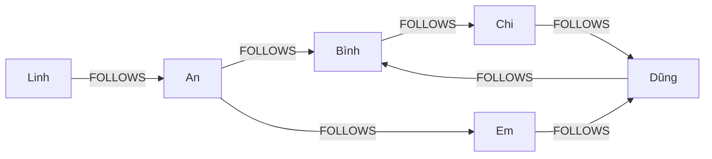

# Độ dài đường đi, số bước nhảy và chiều duyệt quan hệ trong Neo4j

Trong Neo4j, dữ liệu liên kết được biểu diễn bằng **property graph**: mỗi **node** mô tả một thực thể, còn mỗi **relationship** biểu diễn một liên kết có **kiểu** và **chiều** xác định. Truy vấn Cypher có thể đi qua một hoặc nhiều relationship để trả lời những câu hỏi như “An theo dõi ai?”, “Từ An đến Dũng cần ít nhất bao nhiêu bước?” hoặc “Có thể đi ngược chiều quan hệ để tìm người liên quan không?”.

Bài học thuộc chương **Đường đi và duyệt đồ thị**, tập trung vào ba khái niệm cần phân biệt rõ:

- **Đường đi (path)** là một chuỗi node nối với nhau bởi các relationship phù hợp mẫu truy vấn.
- **Độ dài đường đi / số bước nhảy (hop count)** là số relationship đã đi qua, không phải số node và cũng không mặc nhiên là thời gian hay chi phí di chuyển.
- **Chiều duyệt** quy định có đi theo chiều mũi tên của relationship, ngược chiều đó hay chấp nhận cả hai chiều.

Sau bài học, bạn có thể viết truy vấn Cypher với số bước cố định hoặc thay đổi, lấy thông tin của một path, chọn hướng duyệt phù hợp, tránh một số lỗi khi mở rộng nhiều bước và hiểu phạm vi áp dụng của tìm đường đi ngắn nhất.

## 1. Dựng đồ thị ví dụ

Giả sử hệ thống có các tài khoản `Person` và quan hệ `FOLLOWS` (A theo dõi B). Đây là quan hệ **có hướng**: A theo dõi B không có nghĩa B cũng theo dõi A.

Chạy lần lượt hai câu lệnh sau trong Neo4j Browser hoặc môi trường hỗ trợ Cypher. `MERGE` giúp tránh tạo thêm node và relationship trùng theo chính mẫu đã chỉ định khi chạy lại ví dụ.

```cypher
UNWIND [
  {id: 'an',   name: 'An'},
  {id: 'binh', name: 'Bình'},
  {id: 'chi',  name: 'Chi'},
  {id: 'dung', name: 'Dũng'},
  {id: 'em',   name: 'Em'},
  {id: 'linh', name: 'Linh'}
] AS item
MERGE (p:Person {id: item.id})
SET p.name = item.name;
```

```cypher
UNWIND [
  {source: 'an',   target: 'binh'},
  {source: 'binh', target: 'chi'},
  {source: 'chi',  target: 'dung'},
  {source: 'an',   target: 'em'},
  {source: 'em',   target: 'dung'},
  {source: 'dung', target: 'binh'},
  {source: 'linh', target: 'an'}
] AS link
MATCH (source:Person {id: link.source})
MATCH (target:Person {id: link.target})
MERGE (source)-[:FOLLOWS]->(target);
```

Đồ thị thu được:



Hãy để ý hai lộ trình có hướng từ **An** đến **Dũng**: `An → Em → Dũng` và `An → Bình → Chi → Dũng`. Ngoài ra có chu trình `Bình → Chi → Dũng → Bình`; chi tiết này sẽ giúp hiểu vì sao số đường đi có thể tăng mạnh khi duyệt nhiều bước.

> Trong một hệ thống thực tế, nên có ràng buộc duy nhất cho mã định danh của `Person`, chẳng hạn `CREATE CONSTRAINT person_id IF NOT EXISTS FOR (p:Person) REQUIRE p.id IS UNIQUE;` trên phiên bản Neo4j hỗ trợ cú pháp này. Ví dụ ở đây giả định dữ liệu ban đầu không có những node `Person` trùng `id`.

## 2. Đường đi là gì? Độ dài được tính thế nào?

Xét đường đi có hướng:

```text
An --FOLLOWS--> Bình --FOLLOWS--> Chi --FOLLOWS--> Dũng
 ^                ^                ^               ^
 node 1           node 2           node 3          node 4
       hop 1            hop 2            hop 3
```

Đường đi trên có **4 node nhưng chỉ có 3 relationship**, vì vậy **độ dài bằng 3**. Một bước nhảy (hop) tương ứng với việc đi qua đúng một relationship. Với một path `p` gồm `k` relationship:

\[
\operatorname{length}(p) = k = \operatorname{size}(\operatorname{relationships}(p))
\]

\[
\operatorname{size}(\operatorname{nodes}(p)) = k + 1
\]

Trong Cypher, có thể gán toàn bộ đường đi cho biến `p` rồi truy xuất các thành phần:

```cypher
MATCH p = (a:Person {id: 'an'})-[:FOLLOWS]->(b:Person)
RETURN
  a.name AS bat_dau,
  b.name AS ket_thuc,
  length(p) AS so_buoc_nhay,
  size(nodes(p)) AS so_node,
  size(relationships(p)) AS so_relationship;
```

Vì mẫu trên chứa **một** relationship, mỗi path trả về có `so_buoc_nhay = 1`, `so_node = 2` và `so_relationship = 1`.

Các hàm thường dùng với path:

| Biểu thức | Ý nghĩa | Ví dụ với `An → Em → Dũng` |
| --- | --- | --- |
| `length(p)` | Số relationship trên đường đi | `2` |
| `nodes(p)` | Danh sách node theo thứ tự duyệt | `[An, Em, Dũng]` |
| `relationships(p)` | Danh sách relationship theo thứ tự duyệt | Hai relationship `FOLLOWS` |
| `size(nodes(p))` | Số node xuất hiện trong path | `3` |
| `size(relationships(p))` | Số relationship xuất hiện trong path | `2` |

**Lưu ý:** “Số bước nhảy” ở đây là khoảng cách về mặt cấu trúc đồ thị. Nếu mỗi relationship có thuộc tính `minutes`, `price` hoặc `distanceKm`, tổng các thuộc tính đó là **trọng số của đường đi**, không phải kết quả của `length(p)`.

## 3. Chiều duyệt relationship trong Cypher

Một relationship trong property graph có node đầu, node cuối và một kiểu cụ thể. Với `(:Person {id: 'an'})-[:FOLLOWS]->(:Person {id: 'binh'})`, chiều lưu trong đồ thị là **An → Bình**.

Cypher cung cấp ba mẫu duyệt cơ bản:

| Mẫu Cypher | Ý nghĩa khi xuất phát từ `a` |
| --- | --- |
| `(a)-[:FOLLOWS]->(b)` | Đi **cùng chiều** relationship, từ `a` sang `b` |
| `(a)<-[:FOLLOWS]-(b)` | Đi **ngược chiều** relationship, tìm `b` có mũi tên trỏ đến `a` |
| `(a)-[:FOLLOWS]-(b)` | Cho phép relationship theo **một trong hai chiều** |

### 3.1. Duyệt theo chiều đi ra (outgoing)

```cypher
MATCH (an:Person {id: 'an'})-[:FOLLOWS]->(nguoi:Person)
RETURN nguoi.name AS an_theo_doi
ORDER BY an_theo_doi;
```

Kết quả: **Bình, Em**. Vì mũi tên hướng ra khỏi `an`, truy vấn tìm người mà An theo dõi.

### 3.2. Duyệt theo chiều đi vào (incoming)

```cypher
MATCH (an:Person {id: 'an'})<-[:FOLLOWS]-(nguoi:Person)
RETURN nguoi.name AS theo_doi_an;
```

Kết quả: **Linh**. Đây là truy vấn tìm người theo dõi An. Truy vấn không làm thay đổi relationship đã lưu; nó chỉ khớp quan hệ theo hướng đối diện khi nhìn từ node `an`.

### 3.3. Duyệt không ràng buộc chiều (undirected matching)

```cypher
MATCH (an:Person {id: 'an'})-[:FOLLOWS]-(nguoi:Person)
RETURN nguoi.name AS lien_ket_voi_an
ORDER BY lien_ket_voi_an;
```

Kết quả: **Bình, Em, Linh**. Mẫu không có mũi tên nhận cả relationship đi vào lẫn đi ra khỏi An.

**Điểm dễ nhầm:** bỏ mũi tên trong mẫu `MATCH` **không biến** relationship `FOLLOWS` thành quan hệ hai chiều trong dữ liệu. Nó chỉ mở rộng cách truy vấn có thể đi qua cạnh. Chiều lưu của cạnh vẫn giữ nguyên. Nếu cần “theo dõi hai chiều” về mặt nghiệp vụ, hãy kiểm tra hai relationship riêng biệt hoặc mô hình hóa một kiểu quan hệ phù hợp.

## 4. Duyệt đúng n bước và trong một khoảng bước

Mẫu Cypher với độ dài thay đổi sử dụng ký hiệu `*` sau kiểu relationship. Các ví dụ dưới đây dùng cú pháp variable-length relationship phổ biến trong Neo4j/Cypher 5; các phiên bản mới còn cung cấp quantified path patterns.

| Mẫu | Điều kiện về số bước |
| --- | --- |
| `-[:FOLLOWS]->` | Đúng 1 bước |
| `-[:FOLLOWS*2]->` | Đúng 2 bước |
| `-[:FOLLOWS*1..3]->` | Từ 1 đến 3 bước, tính cả hai đầu |
| `-[:FOLLOWS*0..2]->` | Từ 0 đến 2 bước, cho phép path không đi qua relationship |
| `-[:FOLLOWS*1..3]-` | Từ 1 đến 3 bước, cho phép đi qua cạnh theo cả hai chiều |

### 4.1. Chính xác hai bước

```cypher
MATCH (an:Person {id: 'an'})-[:FOLLOWS*2]->(nguoi:Person)
RETURN DISTINCT nguoi.name AS den_sau_2_buoc
ORDER BY den_sau_2_buoc;
```

Kết quả: **Chi, Dũng**.

- `An → Bình → Chi`: đúng hai relationship.
- `An → Em → Dũng`: đúng hai relationship.

`DISTINCT` chỉ loại bản ghi có cùng người đích ở kết quả. Nó không mang nghĩa “tìm đường đi ngắn nhất”; nếu có nhiều đường khác nhau cùng đến một người, các đường đó vẫn có thể tồn tại trong đồ thị.

### 4.2. Từ một đến ba bước: trả về từng đường đi

```cypher
MATCH p = (an:Person {id: 'an'})-[:FOLLOWS*1..3]->(dung:Person {id: 'dung'})
RETURN
  [n IN nodes(p) | n.name] AS cac_node_theo_thu_tu,
  length(p) AS so_buoc_nhay
ORDER BY so_buoc_nhay;
```

Với dữ liệu mẫu, kết quả là:

| `cac_node_theo_thu_tu` | `so_buoc_nhay` |
| --- | ---: |
| `[An, Em, Dũng]` | 2 |
| `[An, Bình, Chi, Dũng]` | 3 |

Phân biệt hai cách đặt câu hỏi:

- **“Có thể đến Dũng bằng những đường nào dài tối đa 3 bước?”**: truy vấn path như trên, mỗi path phù hợp là một kết quả.
- **“Dũng cách An ít nhất bao nhiêu bước theo chiều FOLLOWS?”**: khoảng cách ngắn nhất là **2**; cần tính giá trị nhỏ nhất hoặc dùng toán tử tìm đường ngắn nhất nếu không cần liệt kê toàn bộ path.

### 4.3. Đường đi không bước nhảy (zero-hop path)

```cypher
MATCH p = (an:Person {id: 'an'})-[:FOLLOWS*0..2]->(nguoi:Person)
RETURN nguoi.name AS den_node, length(p) AS so_buoc
ORDER BY so_buoc, den_node;
```

Vì cho phép `0` bước, một kết quả hợp lệ là `den_node = 'An'`, `so_buoc = 0`. Path đó chứa **một node, không có relationship**, không phải một cạnh tự nối (self-loop). Những kết quả còn lại gồm Bình và Em ở 1 bước; Chi và Dũng ở 2 bước.

Zero-hop path rất hữu ích khi nghiệp vụ chấp nhận “điểm xuất phát cũng được coi là có thể tiếp cận”, nhưng có thể gây sai lệch nếu yêu cầu **phải đi qua ít nhất một quan hệ**. Khi đó dùng `*1..N`.

## 5. Chiều duyệt ảnh hưởng trực tiếp đến khả năng đến đích

Xét câu hỏi: “Từ Dũng có đến An không?”. Câu trả lời phụ thuộc vào chiều duyệt:

```cypher
// Chỉ đi theo chiều FOLLOWS: không có đường từ Dũng tới An trong đồ thị mẫu.
MATCH p = (dung:Person {id: 'dung'})-[:FOLLOWS*1..4]->(an:Person {id: 'an'})
RETURN [n IN nodes(p) | n.name] AS duong_di;
```

```cypher
// Được đi qua relationship theo cả hai chiều: có đường nối Dũng với An.
MATCH p = (dung:Person {id: 'dung'})-[:FOLLOWS*1..2]-(an:Person {id: 'an'})
RETURN [n IN nodes(p) | n.name] AS duong_di;
```

Truy vấn thứ nhất không có kết quả. Truy vấn thứ hai có các path dài 2 bước: `Dũng — Em — An` và `Dũng — Bình — An`. Những dấu gạch ngang trong hai path này chỉ có nghĩa là **đã bỏ ràng buộc chiều khi duyệt**; chúng không khẳng định `Dũng` thực sự theo dõi `Em` hoặc `Bình` theo hướng được hiển thị.

Cần chọn hướng dựa trên câu hỏi nghiệp vụ:

- **Hệ thống theo dõi:** người A theo dõi B là chiều `A → B`; “ai theo dõi A?” là chiều ngược lại.
- **Phả hệ:** `(:Person)-[:PARENT_OF]->(:Person)` đi xuống con và `<-[:PARENT_OF]-` đi lên cha/mẹ là hai truy vấn khác nhau.
- **Mạng đường đi:** một tuyến một chiều phải được duyệt đúng chiều; nếu đường cho phép cả hai chiều, có thể lưu hai quan hệ có hướng hoặc sử dụng mẫu truy vấn không ràng buộc chiều khi mô hình nghiệp vụ cho phép.

**Cẩn thận với chiều trong path:** `nodes(p)` liệt kê node theo thứ tự từ điểm bắt đầu tới điểm kết thúc của mẫu truy vấn, kể cả khi bạn duyệt ngược chiều relationship đã lưu. Vì vậy, thứ tự trong path không đồng nghĩa mọi relationship đều trỏ theo thứ tự đó.

## 6. Đường đi, chu trình và số kết quả

Trong đồ thị ví dụ có chu trình `Bình → Chi → Dũng → Bình`. Có thể khớp chu trình xuất phát và kết thúc tại Dũng:

```cypher
MATCH p = (dung:Person {id: 'dung'})-[:FOLLOWS*1..4]->(dich:Person {id: 'dung'})
RETURN [n IN nodes(p) | n.name] AS chu_trinh,
       length(p) AS so_buoc;
```

Kết quả có path `Dũng → Bình → Chi → Dũng` dài **3 bước**. Điều này minh họa hai ý:

1. **Node có thể xuất hiện lại** trên một path; ví dụ node Dũng vừa ở đầu vừa ở cuối chu trình.
2. Với cách khớp path độ dài biến thiên thông thường của Cypher, **cùng một relationship không được đi qua lặp lại trong một path được khớp**. Điều này không đồng nghĩa với việc các node đều phải khác nhau.

Ngoài ra, **số path** và **số node đích duy nhất** là hai đại lượng khác nhau. Khi duyệt nhiều bước, một node đích có thể được tìm thấy bằng nhiều đường khác nhau. Ví dụ, từ An đến Dũng có hai path trong khoảng 1–3 bước, nhưng chỉ có một node đích `Dũng`.

```cypher
MATCH p = (an:Person {id: 'an'})-[:FOLLOWS*1..3]->(dung:Person {id: 'dung'})
RETURN count(p) AS so_duong_di,
       count(DISTINCT dung) AS so_node_dich;
```

Kết quả: `so_duong_di = 2`, `so_node_dich = 1`. Nếu mở rộng giới hạn bước, số đường đi có thể tăng nhanh vì đồ thị có nhiều nhánh, có chu trình và có thể gặp cùng một node qua những lộ trình khác nhau.

### Gộp đường đi theo node đích

Nếu chỉ cần số bước nhỏ nhất từ An tới **từng người có thể đến trong tối đa ba bước**, có thể gộp theo đích:

```cypher
MATCH p = (an:Person {id: 'an'})-[:FOLLOWS*1..3]->(nguoi:Person)
WITH nguoi, min(length(p)) AS buoc_it_nhat
RETURN nguoi.name AS nguoi_dich, buoc_it_nhat
ORDER BY buoc_it_nhat, nguoi_dich;
```

Các khoảng cách nhỏ nhất: Bình = 1, Em = 1, Chi = 2, Dũng = 2. Hãy nhớ rằng cách này **liệt kê các path trong giới hạn đã đặt rồi tổng hợp**; với đồ thị lớn, đó có thể là công việc tốn kém nếu chỉ muốn một đường đi ngắn nhất giữa hai node.

## 7. Đường đi ngắn nhất theo số bước

Khi chỉ cần đường đi có **ít relationship nhất**, có thể dùng `shortestPath` thay vì liệt kê mọi path và sắp xếp. Ví dụ bên dưới giới hạn tối đa 5 bước:

```cypher
MATCH (an:Person {id: 'an'}), (dung:Person {id: 'dung'})
MATCH p = shortestPath((an)-[:FOLLOWS*..5]->(dung))
RETURN [n IN nodes(p) | n.name] AS duong_di_ngan_nhat,
       length(p) AS so_buoc;
```

Kết quả trong đồ thị mẫu: `An → Em → Dũng`, **2 bước**. Hàm này chọn một trong những path ngắn nhất nếu có nhiều path đồng hạng về số bước.

Muốn lấy **tất cả** path ngắn nhất theo số bước, dùng `allShortestPaths`. Ví dụ khi không ràng buộc chiều:

```cypher
MATCH (an:Person {id: 'an'}), (dung:Person {id: 'dung'})
MATCH p = allShortestPaths((an)-[:FOLLOWS*..5]-(dung))
RETURN [n IN nodes(p) | n.name] AS duong_di,
       length(p) AS so_buoc
ORDER BY duong_di;
```

Trong ví dụ, cả `An — Em — Dũng` và `An — Bình — Dũng` đều là các path không ràng buộc chiều dài 2 bước.

**Phạm vi áp dụng:** `shortestPath`/`allShortestPaths` tính “ngắn nhất” theo **số relationship** trong mẫu, không tự động dựa trên các thuộc tính trọng số. Cú pháp ở đây minh họa dạng được dùng rộng rãi trong Cypher 5; khi dùng các phiên bản Cypher mới có hỗ trợ `SHORTEST` và quantified path patterns, có thể chọn cú pháp phù hợp với phiên bản đang triển khai.

### Nếu đường đi có trọng số thì sao?

Với dữ liệu giao thông, đường dài 2 chặng có thể mất 90 phút, trong khi đường 3 chặng chỉ mất 35 phút. Nếu relationship `:ROUTE` có thuộc tính số `minutes`, tổng thời gian có thể tính bằng `reduce` trên các relationship của path:

```cypher
// Minh họa trên một mô hình khác, có :Station và :ROUTE {minutes: <so>}.
MATCH p = (a:Station {code: 'A'})-[:ROUTE*1..4]->(b:Station {code: 'B'})
WITH p,
     reduce(total = 0, r IN relationships(p) | total + r.minutes) AS tong_phut
RETURN [n IN nodes(p) | n.code] AS cac_tram,
       length(p) AS so_chang,
       tong_phut
ORDER BY tong_phut, so_chang;
```

Đây là phép **tính và so sánh trọng số của các path được khớp trong giới hạn 1–4 bước**, với giả định mọi relationship đều có `minutes` là số hợp lệ. Nó không tự tìm tất cả path ngoài giới hạn đó. Với bài toán tối ưu tổng trọng số trên đồ thị lớn, thường cân nhắc thuật toán như **Dijkstra** trong Neo4j Graph Data Science (GDS) cùng mô hình trọng số phù hợp.

## 8. Truy vấn hiệu quả và những lỗi thường gặp

| Tình huống | Vấn đề | Cách xử lý |
| --- | --- | --- |
| Dùng `*` không chặn trên ở đồ thị dày | Số path có thể tăng rất lớn; chu trình làm việc duyệt khó dự đoán | Chọn giới hạn bước rõ ràng như `*1..3` theo yêu cầu nghiệp vụ |
| Quên mũi tên | Truy vấn nhận cả cạnh đi vào và đi ra, có thể trả về những đường không hợp lệ với nghiệp vụ | Dùng `->` hoặc `<-` khi chiều có ý nghĩa |
| Dùng `size(nodes(p))` làm số bước | Kết quả lớn hơn số hop đúng 1 | Dùng `length(p)` |
| Có nhiều path cùng đến một node | Kết quả lặp người đích, dù đường đi khác nhau | Dùng `DISTINCT` nếu chỉ cần node đích; giữ `p` nếu cần phân tích từng đường |
| Dùng `shortestPath` cho lộ trình rẻ nhất/nhanh nhất | Ít hop nhất có thể khác tổng chi phí thấp nhất | Mô hình trọng số và dùng thuật toán tối ưu trọng số |
| Lọc số bước sau khi duyệt quá rộng | Engine có thể phải xét nhiều path trước khi lọc | Giới hạn bước ngay trong mẫu và neo truy vấn vào node cụ thể |

Một số thực hành hữu ích khi phát triển truy vấn:

1. **Neo điểm bắt đầu/đích:** chỉ định label và thuộc tính xác định node, ví dụ `(an:Person {id: 'an'})`; tạo constraint/index phù hợp với dữ liệu thật.
2. **Giới hạn kiểu relationship:** dùng `:FOLLOWS` thay vì duyệt mọi kiểu quan hệ nếu câu hỏi chỉ liên quan đến theo dõi.
3. **Giới hạn chiều và số bước sớm:** đặt chúng trực tiếp trong mẫu path để thu hẹp phạm vi duyệt.
4. **Phân biệt path và node đích:** chọn `RETURN p`, `RETURN DISTINCT nguoi` hoặc phép tổng hợp tùy kết quả cần lấy.
5. **Dùng `EXPLAIN`/`PROFILE` trong môi trường thích hợp:** kiểm tra kế hoạch thực thi và số dòng trung gian khi truy vấn chậm. `LIMIT` ở cuối truy vấn không phải lúc nào cũng loại bỏ được chi phí mở rộng path đã thực hiện trước đó.

Với mạng xã hội, mạng thiết bị và dữ liệu phụ thuộc nhiều tầng, việc giới hạn số bước thường là **ràng buộc nghiệp vụ** chứ không chỉ tối ưu hiệu năng: “bạn của bạn trong tối đa 3 lớp” là một câu hỏi khác với “bất kỳ ai liên kết được, dù qua rất nhiều lớp”.

## 9. Bài thực hành có đáp án

Các bài sau dùng đúng dữ liệu `Person`/`FOLLOWS` ở mục 1. Hãy dự đoán kết quả trước khi chạy truy vấn.

**Bài 1.** Ai theo dõi An trực tiếp? Tính bao nhiêu bước từ người đó đến An theo chiều FOLLOWS?

```cypher
MATCH p = (nguoi:Person)-[:FOLLOWS]->(an:Person {id: 'an'})
RETURN nguoi.name AS nguoi_theo_doi, length(p) AS so_buoc;
```

**Đáp án:** Linh, `so_buoc = 1`.

**Bài 2.** Ai có thể đến từ An sau **đúng hai** bước theo chiều FOLLOWS?

```cypher
MATCH (an:Person {id: 'an'})-[:FOLLOWS*2]->(dich:Person)
RETURN DISTINCT dich.name AS nguoi_dich
ORDER BY nguoi_dich;
```

**Đáp án:** Chi và Dũng.

**Bài 3.** Linh tới Dũng theo chiều FOLLOWS ngắn nhất bao nhiêu bước (tối đa 5)?

```cypher
MATCH (linh:Person {id: 'linh'}), (dung:Person {id: 'dung'})
MATCH p = shortestPath((linh)-[:FOLLOWS*..5]->(dung))
RETURN [n IN nodes(p) | n.name] AS duong_di,
       length(p) AS so_buoc;
```

**Đáp án:** `Linh → An → Em → Dũng`, `so_buoc = 3`. Đường `Linh → An → Bình → Chi → Dũng` cần 4 bước.

**Bài 4.** Từ Dũng tới An trong tối đa 2 bước có hướng kết quả không? Nếu bỏ ràng buộc chiều thì sao?

```cypher
// Có hướng: không có kết quả.
MATCH p = (dung:Person {id: 'dung'})-[:FOLLOWS*1..2]->(an:Person {id: 'an'})
RETURN p;
```

```cypher
// Không ràng buộc chiều: có hai path dài 2 bước.
MATCH p = (dung:Person {id: 'dung'})-[:FOLLOWS*1..2]-(an:Person {id: 'an'})
RETURN [n IN nodes(p) | n.name] AS cac_node,
       length(p) AS so_buoc;
```

**Đáp án:** không có path theo chiều đi ra; có `Dũng — Em — An` và `Dũng — Bình — An` nếu được đi qua cạnh theo cả hai chiều.

## 10. Ghi nhớ

- `length(p)` là **số relationship** trong path; số node xuất hiện theo thứ tự trong path bằng số hop cộng 1.
- `-[:TYPE]->`, `<-[:TYPE]-` và `-[:TYPE]-` đặt ra ba cách khớp **chiều duyệt** khác nhau; không có mũi tên chỉ là cách truy vấn, không sửa chiều quan hệ đã lưu.
- `*2`, `*1..3`, `*0..2` lần lượt biểu diễn **đúng 2 bước**, **1 đến 3 bước**, và **0 đến 2 bước**. Zero-hop path gồm một node và không có relationship.
- Nhiều path có thể dẫn tới cùng một node. Node có thể lặp trong path có chu trình, trong khi cùng một relationship không được lặp trong một path độ dài biến thiên theo cách khớp thông thường.
- Đường đi **ít hop nhất** không nhất thiết là đường đi **chi phí nhỏ nhất**. Chọn phương pháp tìm đường phù hợp với điều kiện nghiệp vụ, chiều quan hệ và trọng số.

Khi mô hình hóa hoặc truy vấn dữ liệu liên kết trong Neo4j, hãy luôn hỏi theo thứ tự: **bắt đầu từ node nào, đi theo loại relationship nào, theo chiều nào, tối thiểu và tối đa bao nhiêu bước, và kết quả cần từng path hay chỉ các node đích?** Trả lời rõ năm điều đó thường đã xác định được mẫu Cypher chính xác cần viết.
