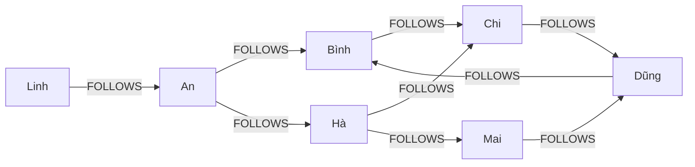

# Mẫu quan hệ có độ dài biến thiên và giới hạn độ sâu trong Neo4j

Khi truy vấn dữ liệu liên kết bằng Cypher, đôi khi ta biết chính xác số quan hệ cần đi qua; đôi khi cần tìm tất cả đường đi từ một node trong phạm vi **tối đa N bước nhảy**. Neo4j biểu diễn liên kết bằng relationship có hướng và kiểu cụ thể trong **property graph**. Mẫu quan hệ có độ dài biến thiên (variable-length relationship pattern) cho phép mô tả nhiều lần đi qua quan hệ bằng một mẫu Cypher ngắn gọn.

Bài thuộc chương **Đường đi và duyệt đồ thị** của `DATABASE_ENGINE_GRAPH_NEO4J`. Nội dung tập trung vào cú pháp độ dài biến thiên, cách đặt **độ sâu tối thiểu/tối đa**, ý nghĩa kết quả và các rủi ro khi truy vấn mở rộng quá rộng. Đây là kỹ năng nền tảng trước khi triển khai truy vấn theo Java Driver hoặc Spring Data Neo4j, cũng như trước khi phân tích kế hoạch truy vấn trong môi trường thực tế.

**Mục tiêu học tập:** sau bài này, bạn có thể viết các mẫu `*2`, `*1..3`, `*0..2`; phân biệt một path với node đích; chọn chiều và loại quan hệ; xử lý chu trình; đặt giới hạn duyệt an toàn; hiểu khi nào nên dùng đường đi ngắn nhất hoặc cú pháp quantified path pattern.

## 1. Độ sâu và mẫu quan hệ độ dài biến thiên

Một **path** gồm các node và relationship nối tiếp nhau. Trong nội dung duyệt đồ thị, **độ sâu** thường được đo bằng số relationship đi qua kể từ node xuất phát, tức **số bước nhảy (hop count)**. Bởi vậy, độ sâu 0 là node xuất phát; độ sâu 1 là node có thể tới qua một relationship; độ sâu 2 cần hai relationship, v.v.

```text
Độ sâu 0        Độ sâu 1        Độ sâu 2        Độ sâu 3
    An  ----------> Bình ----------> Chi ----------> Dũng
    |
    +-------------> Hà -----------> Mai ----------> Dũng
```

Trong Cypher, `length(p)` trả về số relationship của path `p`. Với path có 3 bước nhảy, `size(relationships(p)) = 3` và `size(nodes(p)) = 4`. Độ sâu truy vấn khác với số node của path và **không có nghĩa** là độ dài theo mét, thời gian hoặc tổng trọng số quan hệ.

### Cú pháp cơ bản

```cypher
MATCH p = (bat_dau:TraversalPerson)-[:FOLLOWS*1..3]->(dich:TraversalPerson)
RETURN p, length(p) AS so_buoc_nhay;
```

Trong `[:FOLLOWS*1..3]`, `FOLLOWS` là kiểu quan hệ, `*` yêu cầu khớp **số quan hệ biến thiên**, `1` là độ sâu nhỏ nhất, `3` là độ sâu lớn nhất và `->` chỉ cho phép đi theo hướng relationship đã lưu. Mỗi path dài 1, 2 hoặc 3 bước phù hợp mẫu đều có thể xuất hiện trong kết quả.

| Mẫu quan hệ | Diễn giải | Độ sâu được phép |
| --- | --- | --- |
| `-[:FOLLOWS]->` | Quan hệ một bước thông thường | Chỉ 1 |
| `-[:FOLLOWS*2]->` | Độ dài cố định | Chỉ 2 |
| `-[:FOLLOWS*1..3]->` | Độ dài biến thiên, giới hạn cả hai đầu | 1, 2, 3 |
| `-[:FOLLOWS*0..2]->` | Có thể không đi qua quan hệ nào | 0, 1, 2 |
| `-[:FOLLOWS*3..3]->` | Khoảng có hai đầu bằng nhau | Chỉ 3 |
| `-[:FOLLOWS*1..]->` | Không giới hạn trên trong mẫu | Từ 1 trở lên |
| `-[:FOLLOWS*]->` | Dạng không khai báo giới hạn | Từ 1 trở lên |

**Khuyến nghị:** với truy vấn ứng dụng, hãy ưu tiên ghi rõ cận trên khi mục tiêu nghiệp vụ chỉ quan tâm một phạm vi hữu hạn. Dạng mở rộng không giới hạn có thể sinh rất nhiều path và gây tốn CPU, bộ nhớ hoặc thời gian truy vấn.

## 2. Chuẩn bị đồ thị mẫu để thực hành

Xây dựng mạng người dùng có hướng `(:TraversalPerson)-[:FOLLOWS]->(:TraversalPerson)`; chiều của relationship nghĩa là **người ở đầu theo dõi người ở cuối**. Nhãn `TraversalPerson` được dành riêng cho bài thực hành để không lẫn với các node `Person` hoặc ví dụ của bài khác trong cùng database. Mọi truy vấn có kết quả dự đoán trong bài sẽ dùng bộ dữ liệu này.

**Tạo các node:**

```cypher
UNWIND [
  {id: 'an',   name: 'An'},
  {id: 'binh', name: 'Bình'},
  {id: 'chi',  name: 'Chi'},
  {id: 'dung', name: 'Dũng'},
  {id: 'ha',   name: 'Hà'},
  {id: 'linh', name: 'Linh'},
  {id: 'mai',  name: 'Mai'}
] AS item
MERGE (p:TraversalPerson {id: item.id})
SET p.name = item.name, p.active = true;
```

**Tạo các relationship:**

```cypher
UNWIND [
  {f: 'an',   t: 'binh'},
  {f: 'an',   t: 'ha'},
  {f: 'binh', t: 'chi'},
  {f: 'ha',   t: 'chi'},
  {f: 'ha',   t: 'mai'},
  {f: 'chi',  t: 'dung'},
  {f: 'mai',  t: 'dung'},
  {f: 'dung', t: 'binh'},
  {f: 'linh', t: 'an'}
] AS edge
MATCH (a:TraversalPerson {id: edge.f})
MATCH (b:TraversalPerson {id: edge.t})
MERGE (a)-[:FOLLOWS]->(b);
```

Đồ thị có các nhánh hội tụ về Chi và Dũng, đồng thời có chu trình **Bình → Chi → Dũng → Bình**:



Trong môi trường thực, thuộc tính định danh nên được bảo vệ bởi unique constraint để thao tác `MERGE` không tạo dữ liệu không mong muốn. Ví dụ này giả định cơ sở dữ liệu chưa có node `Person` trùng `id`; chạy lặp các câu lệnh trên với dữ liệu mẫu nhất quán sẽ tái sử dụng các node và cạnh đã khớp.

## 3. Phân biệt truy vấn đúng một độ sâu và truy vấn trong khoảng

### 3.1. Đúng hai bước

```cypher
MATCH p = (an:TraversalPerson {id: 'an'})-[:FOLLOWS*2]->(dich:TraversalPerson)
RETURN [n IN nodes(p) | n.name] AS duong_di,
       dich.name AS nguoi_dich,
       length(p) AS do_sau
ORDER BY nguoi_dich, duong_di;
```

Ba path hợp lệ là:

| Đường đi | Độ sâu |
| --- | ---: |
| An → Bình → Chi | 2 |
| An → Hà → Chi | 2 |
| An → Hà → Mai | 2 |

**Chi xuất hiện hai lần** vì có hai path khác nhau đến cùng một node. Điều kiện độ sâu được áp dụng trên path; nó không tự gộp các node đích.

Nếu mục tiêu chỉ là danh sách người có thể đến sau đúng hai bước, dùng:

```cypher
MATCH (:TraversalPerson {id: 'an'})-[:FOLLOWS*2]->(dich:TraversalPerson)
RETURN DISTINCT dich.name AS nguoi_dich
ORDER BY nguoi_dich;
```

Kết quả chỉ còn **Chi** và **Mai**. `DISTINCT` loại trùng ở kết quả, không thay đổi tập path được khớp và không làm cho truy vấn trở thành thuật toán tìm đường ngắn nhất.

### 3.2. Từ một đến ba bước

```cypher
MATCH p = (an:TraversalPerson {id: 'an'})-[:FOLLOWS*1..3]->(dich:TraversalPerson)
RETURN length(p) AS do_sau, dich.name AS nguoi_dich
ORDER BY do_sau, nguoi_dich;
```

Có **8 path** trong phạm vi này:

| Độ sâu | Các node đích theo từng path | Số path |
| ---: | --- | ---: |
| 1 | Bình, Hà | 2 |
| 2 | Chi, Chi, Mai | 3 |
| 3 | Dũng, Dũng, Dũng | 3 |
| **Tổng** | **5 node đích khác nhau** | **8** |

Ở độ sâu 3, ba đường đến Dũng là `An → Bình → Chi → Dũng`, `An → Hà → Chi → Dũng` và `An → Hà → Mai → Dũng`. Ví dụ này cho thấy số path thường nhiều hơn số node đích.

### 3.3. Cho phép độ sâu 0

```cypher
MATCH p = (an:TraversalPerson {id: 'an'})-[:FOLLOWS*0..2]->(dich:TraversalPerson)
RETURN dich.name AS nguoi_dich, length(p) AS do_sau
ORDER BY do_sau, nguoi_dich;
```

Path độ sâu 0 là **An → An với không relationship nào được đi qua**: `nodes(p)` chỉ chứa An, `relationships(p)` rỗng và `length(p) = 0`. Đó không phải một relationship tự nối. Trong dữ liệu mẫu, truy vấn cho 1 path ở độ sâu 0, 2 path ở độ sâu 1 và 3 path ở độ sâu 2; tổng **6 path**.

Chỉ dùng cận dưới 0 khi nghiệp vụ chấp nhận điểm bắt đầu thuộc kết quả, chẳng hạn truy vấn tất cả đối tượng tiếp cận được **kể cả chính đối tượng đó**. Nếu bắt buộc phải đi qua ít nhất một cạnh, chọn `*1..N`.

## 4. Giới hạn độ sâu tác động thế nào đến tập kết quả?

Giới hạn trên `N` trong `*1..N` quy định **độ sâu tối đa của từng path được khớp**, không phải số lượng dòng trả về. Một node có thể xuất hiện ở nhiều path và nhiều độ sâu khác nhau.

Ví dụ yêu cầu ‘tìm tất cả người trong phạm vi ba lớp theo dõi từ An’ có hai cách diễn giải:

1. **Tìm tất cả đường kết nối:** trả về mỗi path dài tối đa 3 bước để phân tích lộ trình.
2. **Tìm những người có thể tới:** trả về mỗi node đích một lần, bất kể có bao nhiêu path dẫn tới.

```cypher
// Đếm path và số node đích duy nhất trong cùng phạm vi.
MATCH p = (an:TraversalPerson {id: 'an'})-[:FOLLOWS*1..3]->(dich:TraversalPerson)
RETURN count(p) AS so_path, count(DISTINCT dich) AS so_node_dich;
```

Kết quả tương ứng là `so_path = 8`, `so_node_dich = 5`.

Nếu muốn lấy **độ sâu nhỏ nhất tìm được trong phạm vi tối đa 3** cho từng node đích:

```cypher
MATCH p = (an:TraversalPerson {id: 'an'})-[:FOLLOWS*1..3]->(dich:TraversalPerson)
WITH dich, min(length(p)) AS do_sau_it_nhat
RETURN dich.name AS nguoi_dich, do_sau_it_nhat
ORDER BY do_sau_it_nhat, nguoi_dich;
```

Kết quả: Bình, Hà (1); Chi, Mai (2); Dũng (3). Phép `min(length(p))` chỉ xét các path đã khớp **trong giới hạn 3 bước**. Nếu không có path dưới cận trên thì node đích không xuất hiện, dù có thể tồn tại một đường xa hơn.

### Biểu diễn tầng duyệt và số path

```text
                 Đích theo từng path FOLLOWS từ An
Độ sâu 0         An                                1 path
Độ sâu 1         Bình, Hà                          2 path
Độ sâu 2         Chi, Chi, Mai                     3 path
Độ sâu 3         Dũng, Dũng, Dũng                  3 path
```

Độ sâu tăng không có nghĩa số path luôn tăng hoặc luôn giảm; kết quả phụ thuộc cấu trúc mạng, ràng buộc quan hệ và chu trình. Trong một mạng có nhiều nhánh, số đường cần xét có thể tăng nhanh theo độ sâu.

## 5. Kết hợp giới hạn độ sâu, chiều và loại quan hệ

**Chiều duyệt** và **số bước** là hai ràng buộc độc lập:

| Pattern | Ý nghĩa |
| --- | --- |
| `(a)-[:FOLLOWS*1..3]->(b)` | 1–3 bước, đi theo chiều FOLLOWS |
| `(a)<-[:FOLLOWS*1..3]-(b)` | 1–3 bước, đi ngược chiều FOLLOWS |
| `(a)-[:FOLLOWS*1..3]-(b)` | 1–3 bước, mỗi quan hệ có thể được duyệt theo một trong hai chiều |
| `(a)-[*1..3]->(b)` | 1–3 bước theo chiều mũi tên, không giới hạn kiểu relationship |

Ví dụ từ Chi có thể lần ngược về An sau đúng hai bước bằng các đường `Chi ← Bình ← An` và `Chi ← Hà ← An`:

```cypher
MATCH p = (chi:TraversalPerson {id: 'chi'})<-[:FOLLOWS*2]-(an:TraversalPerson {id: 'an'})
RETURN [n IN nodes(p) | n.name] AS thu_tu_node_tu_chi, length(p) AS do_sau;
```

`nodes(p)` được liệt kê theo thứ tự duyệt của mẫu, tức `Chi, Bình, An` hoặc `Chi, Hà, An`, dù chiều relationship đã lưu trỏ theo hướng ngược lại. Mẫu không mũi tên cho phép đi qua các relationship theo cả hai hướng, **không tự tạo ra** các quan hệ đối xứng trong dữ liệu.

### Nhiều kiểu quan hệ trong cùng đường đi

Giả sử hệ thống còn lưu mối liên hệ công việc, được khai báo thêm:

```cypher
MATCH (binh:TraversalPerson {id: 'binh'})
MATCH (mai:TraversalPerson {id: 'mai'})
MERGE (binh)-[:WORKS_WITH]->(mai);
```

Cho phép **mỗi bước** dùng `FOLLOWS` **hoặc** `WORKS_WITH`:

```cypher
MATCH p = (an:TraversalPerson {id: 'an'})-[:FOLLOWS|WORKS_WITH*1..2]->(dich:TraversalPerson)
RETURN [n IN nodes(p) | n.name] AS duong_di,
       [r IN relationships(p) | type(r)] AS kieu_quan_he;
```

Với cạnh mới, path `An → Bình → Mai` cũng hợp lệ: bước đầu là `FOLLOWS`, bước sau là `WORKS_WITH`. Cú pháp chọn kiểu quan hệ có tác dụng **trên từng bước** của mẫu biến thiên; nó không bắt buộc tất cả bước có cùng một kiểu. Khi câu hỏi chỉ nói về ‘người mà An theo dõi’, giữ riêng `:FOLLOWS` để tránh lẫn quan hệ nghiệp vụ.

## 6. Chu trình, tái xuất hiện node và số lượng path

Trong mạng mẫu có chu trình `Bình → Chi → Dũng → Bình`. Xét:

```cypher
MATCH p = (dau:TraversalPerson {id: 'binh'})-[:FOLLOWS*1..4]->(cuoi:TraversalPerson {id: 'binh'})
RETURN [n IN nodes(p) | n.name] AS chu_trinh, length(p) AS so_buoc;
```

Truy vấn có thể trả path `Bình → Chi → Dũng → Bình` dài 3 bước. Node Bình xuất hiện hai lần, nhưng ba relationship trong path là ba relationship khác nhau.

Với cách khớp relationship độ dài biến thiên truyền thống của Cypher, **một relationship không được sử dụng lại trong cùng một path của mẫu**. Node vẫn có thể xuất hiện lại, nhất là khi có chu trình. Quy tắc này cũng có nghĩa `*1..100` không đảm bảo tìm được path dài 100 nếu đồ thị không có đủ relationship phù hợp có thể đi qua mà không lặp relationship.

Ở nhiều đồ thị, việc có rất nhiều path khác nhau đến cùng node đích mới là nguyên nhân chính gây bùng nổ kết quả. Do đó nên xác định rõ: yêu cầu của ứng dụng cần **toàn bộ path**, **một đường hợp lệ**, **đường ngắn nhất**, hay chỉ **tập node đạt được**.

## 7. Giới hạn độ sâu khác `LIMIT` và bộ lọc `WHERE`

Ba công cụ sau có tác dụng khác nhau:

| Công cụ | Giới hạn điều gì? | Điều cần nhớ |
| --- | --- | --- |
| `*1..3` | Độ sâu tối đa của path được khớp | Ràng buộc trực tiếp trong pattern |
| `WHERE length(p) <= 3` | Giữ lại path đáp ứng điều kiện | Nếu pattern ban đầu mở rộng quá rộng, vẫn có thể phải xét nhiều path trước khi lọc |
| `LIMIT 10` | Số dòng kết quả cuối cùng | Không đồng nghĩa với chỉ duyệt 10 path hoặc duyệt tối đa 10 bước |

Ví dụ:

```cypher
MATCH p = (an:TraversalPerson {id: 'an'})-[:FOLLOWS*1..3]->(dich:TraversalPerson)
RETURN [n IN nodes(p) | n.name] AS duong_di
ORDER BY size(nodes(p))
LIMIT 5;
```

Truy vấn trên trả tối đa năm dòng, nhưng mẫu vẫn cho phép các path ở độ sâu 1–3. `ORDER BY` còn có thể yêu cầu engine thu thập nhiều kết quả trung gian để sắp xếp. **Đừng dùng `LIMIT` thay cho cận trên của mẫu quan hệ.**

### Giới hạn độ sâu theo tham số ứng dụng

Trong cú pháp legacy `*m..n`, cận trên của pattern phải là giá trị nguyên literal trong câu lệnh Cypher; viết `*1..$maxDepth` trực tiếp không phải cách truyền tham số được hỗ trợ. Có thể đặt một **cận cứng** trong mẫu và dùng tham số để lọc phạm vi nhỏ hơn:

```cypher
// Ứng dụng truyền $maxDepth trong khoảng 1..5.
MATCH p = (an:TraversalPerson {id: 'an'})-[:FOLLOWS*1..5]->(dich:TraversalPerson)
WHERE length(p) <= $maxDepth
RETURN DISTINCT dich.name AS nguoi_dich;
```

Ví dụ với `$maxDepth = 2`, các path ở độ sâu 3–5 không được trả về. Tuy nhiên, cận cứng 5 **vẫn có thể chi phối lượng path engine phải xét**, nên dùng cận gần với yêu cầu thực tế. Với một tập mức duyệt nhỏ được phép, ứng dụng cũng có thể chọn sẵn câu truy vấn đã định nghĩa tương ứng từng cận.

**Không nối chuỗi một giá trị depth bất kỳ từ đầu vào người dùng vào câu lệnh Cypher.** Hãy kiểm tra giới hạn hợp lệ và chỉ dùng các mẫu đã kiểm soát để giảm rủi ro truy vấn quá rộng và rủi ro tạo truy vấn không an toàn.

### Bộ lọc dựa trên đường đi

Nếu chỉ muốn các đường mà tất cả node đều đang hoạt động:

```cypher
MATCH p = (an:TraversalPerson {id: 'an'})-[:FOLLOWS*1..3]->(dich:TraversalPerson)
WHERE all(n IN nodes(p) WHERE n.active = true)
RETURN [n IN nodes(p) | n.name] AS duong_di;
```

Với dữ liệu mẫu, tất cả người dùng đều có `active = true` nên bộ lọc không loại path nào. Trong dữ liệu thực, bộ lọc này bảo đảm **kết quả** thỏa điều kiện; không nên mặc định rằng engine sẽ dùng nó để cắt bỏ nhánh duyệt từ sớm. Muốn tối ưu việc mở rộng có điều kiện, cần kiểm tra `EXPLAIN`/`PROFILE`, cân nhắc quantified path patterns hoặc chiến lược duyệt phù hợp.

## 8. Cú pháp mới: quantified path patterns (Cypher 5.9+)

Ngoài cú pháp legacy `[:FOLLOWS*1..3]`, các phiên bản Neo4j/Cypher mới hỗ trợ **quantified path patterns (QPP)** từ Neo4j 5.9. QPP dùng bộ lượng từ `{m,n}` đặt sau **một mẫu đường đi trong ngoặc**. Cách viết này có thể diễn tả các mẫu lặp phức tạp hơn một relationship đơn lẻ.

Ví dụ tương ứng với việc đi theo `FOLLOWS` từ một đến ba lần:

```cypher
// Yêu cầu phiên bản Neo4j/Cypher có hỗ trợ quantified path patterns.
MATCH p = (an:TraversalPerson {id: 'an'})
          ((nguon)-[:FOLLOWS]->(ke_tiep)){1,3}
          (dich:TraversalPerson)
RETURN dich.name AS nguoi_dich, length(p) AS so_buoc
ORDER BY so_buoc, nguoi_dich;
```

Phần `((nguon)-[:FOLLOWS]->(ke_tiep)){1,3}` lặp mẫu một bước từ 1 đến 3 lần. Khi biến được khai báo **bên trong** phần lặp, chúng có thể trở thành **group variables** trong phạm vi phù hợp; không nên giả định chúng là một node đơn lẻ như biến khai báo ngoài phần lặp.

QPP có ích khi muốn áp ràng buộc trên cấu trúc từng bước hoặc một đoạn đường gồm nhiều quan hệ. Nếu hệ thống đang ở phiên bản cũ, dùng cú pháp legacy ở các phần trước. Khi chuyển cú pháp, kiểm tra lại compatibility, định nghĩa giới hạn và kết quả thực tế.

## 9. Khi nào dùng đường đi ngắn nhất?

Nếu cần **một path ít hop nhất** giữa hai node đã biết, quét rồi trả về mọi path độ sâu `*1..10` có thể là quá nhiều. Một truy vấn đường đi ngắn nhất thích hợp hơn:

```cypher
MATCH (an:TraversalPerson {id: 'an'})
MATCH (dung:TraversalPerson {id: 'dung'})
MATCH p = shortestPath((an)-[:FOLLOWS*..5]->(dung))
RETURN [n IN nodes(p) | n.name] AS duong_ngan_nhat,
       length(p) AS so_buoc;
```

Trong đồ thị mẫu, đường ngắn nhất theo chiều `FOLLOWS` từ An đến Dũng cần **3 bước**, với nhiều path cùng độ dài. `shortestPath` trả về một path ngắn nhất; `allShortestPaths` dùng khi muốn toàn bộ path đồng hạng ngắn nhất.

**Giới hạn quan trọng:** đường ít hop nhất không nhất thiết là đường ít chi phí, ít thời gian hoặc ít rủi ro nhất. Nếu các relationship mang trọng số, cân nhắc thuật toán tối ưu có trọng số như Dijkstra trong Neo4j Graph Data Science. Các toán tử shortest path của Cypher ở ví dụ trên tối ưu theo số relationship.

Đồng thời, `*1..N` chỉ xác định **phạm vi độ dài**, không cam kết engine duyệt theo thuật toán breadth-first search (BFS) hoặc depth-first search (DFS) mà ứng dụng có thể điều khiển trực tiếp. Thuật toán và kế hoạch thực thi cụ thể phụ thuộc mẫu truy vấn, phiên bản và query planner.

## 10. Hướng dẫn tối ưu truy vấn duyệt nhiều bước

Với mô hình người dùng, thiết bị, phân quyền, phụ thuộc dịch vụ hoặc thành phần hệ thống, số nhánh duyệt lớn có thể làm số path tăng nhanh. Các nguyên tắc sau giúp giảm chi phí không cần thiết:

1. **Neo node xuất phát đủ cụ thể.** Sử dụng label và thuộc tính định danh, ví dụ `(an:TraversalPerson {id: 'an'})`, cùng index/constraint phù hợp. Nếu bắt đầu từ mọi `Person`, mỗi node đều có thể trở thành gốc duyệt.
2. **Giới hạn kiểu và chiều relationship.** Mẫu `[:FOLLOWS*1..3]->` có phạm vi hẹp và ý nghĩa nghiệp vụ rõ hơn `-[*1..3]-`.
3. **Đặt cận trên càng sát bài toán càng tốt.** Cận 3 cho đề bài ‘ba lớp’ phù hợp hơn cận 20 rồi lọc kết quả.
4. **Chọn kết quả cần thiết.** Nếu chỉ cần node đích, dùng `DISTINCT`; nếu cần độ sâu gần nhất trong khoảng hữu hạn, dùng `min(length(p))`; nếu cần một đường ngắn nhất, ưu tiên cơ chế shortest path.
5. **Quan sát số path trung gian.** `PROFILE` có thể chỉ ra các bước expand, cardinality và chi phí. Hiệu năng phụ thuộc mật độ cạnh, cấu trúc chu trình, điểm bắt đầu và điều kiện lọc.
6. **Có giới hạn vận hành ngoài truy vấn.** Với API phục vụ người dùng, kiểm tra đầu vào depth và dùng timeout/giới hạn tài nguyên thích hợp trong hệ thống vận hành Neo4j.

Ví dụ đo phạm vi kết quả trước khi trả một danh sách lớn:

```cypher
PROFILE
MATCH p = (an:TraversalPerson {id: 'an'})-[:FOLLOWS*1..3]->(dich:TraversalPerson)
RETURN count(p) AS so_path;
```

`PROFILE` thực thi truy vấn và cung cấp số liệu của kế hoạch; chỉ dùng ở môi trường phù hợp, đặc biệt chú ý với truy vấn có cập nhật dữ liệu. Với truy vấn duyệt lớn chưa rõ chi phí, xem `EXPLAIN` trước để tham khảo kế hoạch mà không chạy truy vấn.

## 11. Bài tập tự luyện có lời giải

### Bài 1 — Độ sâu đúng hai và số node khác nhau

**Yêu cầu:** liệt kê người có thể tới từ An sau đúng 2 bước; giải thích vì sao số node đích khác số path.

```cypher
MATCH p = (an:TraversalPerson {id: 'an'})-[:FOLLOWS*2]->(dich:TraversalPerson)
RETURN count(p) AS so_path,
       count(DISTINCT dich) AS so_node_dich;
```

**Đáp án:** `so_path = 3`, `so_node_dich = 2`; Chi nhận 2 path (`An → Bình → Chi`, `An → Hà → Chi`), Mai nhận 1 path.

### Bài 2 — Tìm đường trong phạm vi 1–3 bước đến Dũng

**Yêu cầu:** viết query trả về từng path và độ sâu của path.

```cypher
MATCH p = (an:TraversalPerson {id: 'an'})-[:FOLLOWS*1..3]->(dung:TraversalPerson {id: 'dung'})
RETURN [n IN nodes(p) | n.name] AS cac_node,
       length(p) AS do_sau;
```

**Đáp án:** ba path đều dài 3: qua `Bình → Chi`, qua `Hà → Chi`, hoặc qua `Hà → Mai` trước khi đến Dũng.

### Bài 3 — Khi bắt đầu có thể là đích

**Yêu cầu:** tìm các node đến được từ An trong nhiều nhất 1 bước, kể cả An.

```cypher
MATCH p = (an:TraversalPerson {id: 'an'})-[:FOLLOWS*0..1]->(dich:TraversalPerson)
RETURN dich.name AS nguoi_dich, length(p) AS do_sau
ORDER BY do_sau, nguoi_dich;
```

**Đáp án:** An ở độ sâu 0; Bình và Hà ở độ sâu 1.

### Bài 4 — Phân biệt chiều và độ sâu

**Yêu cầu:** từ Chi tìm An trong đúng 2 bước đi **ngược** chiều `FOLLOWS`.

```cypher
MATCH p = (chi:TraversalPerson {id: 'chi'})<-[:FOLLOWS*2]-(an:TraversalPerson {id: 'an'})
RETURN [n IN nodes(p) | n.name] AS cac_node;
```

**Đáp án:** `Chi, Bình, An` và `Chi, Hà, An`. Dùng `->` ở vị trí này sẽ không cho ra các path đó, vì các quan hệ trong dữ liệu trỏ từ An về phía Chi.

### Bài 5 — Chọn `*1..N` hay shortest path

**Tình huống:** API chỉ cần một lộ trình có ít nhất số bước nhảy từ An đến Dũng, không cần toàn bộ cách đi. Có nên liệt kê `*1..10` và sắp xếp kết quả không?

**Đáp án:** ưu tiên cú pháp hoặc toán tử shortest path phù hợp với phiên bản Neo4j, có hướng và kiểu quan hệ xác định. Việc liệt kê mọi path rồi sắp xếp có thể tạo nhiều kết quả trung gian không cần thiết; giới hạn `*1..10` vẫn hữu ích khi chính nghiệp vụ yêu cầu kiểm tra **toàn bộ path** trong mười bước.

## 12. Tóm tắt

- `*m..n` biểu diễn đường đi gồm từ **m đến n relationship**, tính cả hai đầu; độ sâu khớp với `length(p)`.
- `*0..n` chấp nhận một path độ sâu 0, chứa node xuất phát và không có relationship nào.
- Giới hạn độ sâu **không** giới hạn số path hay số node đích. Một node có thể xuất hiện trong nhiều path; dùng `DISTINCT` khi muốn loại kết quả node trùng.
- Chiều `->`, `<-` hoặc không mũi tên và kiểu `:FOLLOWS` quyết định loại cạnh được duyệt ở **mỗi bước**.
- Các chu trình làm tăng số khả năng duyệt; trong cách khớp variable-length truyền thống, node có thể xuất hiện lại trên path nhưng một relationship không được lặp trong cùng path.
- `LIMIT` khống chế số dòng kết quả, không thay thế cận trên `N`. `WHERE length(p) <= N` cũng không nhất thiết giảm khối lượng duyệt như đặt cận ngay trong mẫu.
- Nếu cần đường ngắn nhất theo hop, cân nhắc `shortestPath`; nếu cần trọng số tối thiểu, chọn thuật toán trọng số. Với Neo4j 5.9+, có thể dùng quantified path patterns cho những mẫu lặp phức tạp hơn.

Trước mỗi truy vấn duyệt đồ thị, hãy xác định **điểm xuất phát, kiểu và hướng relationship, độ sâu nhỏ nhất, độ sâu lớn nhất và dạng kết quả cần trả về**. Năm quyết định này xác định rõ phạm vi duyệt, ngăn việc mở rộng quá mức và giúp kết quả Cypher khớp yêu cầu nghiệp vụ.
