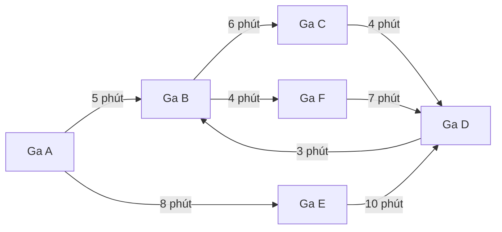

# Quantified path patterns khi phiên bản Cypher hỗ trợ

Trong Neo4j, một **path** là chuỗi node và relationship nối tiếp nhau theo một mẫu truy vấn. Khi cần đi qua nhiều cạnh, Cypher truyền thống cho phép viết `-[:TYPE*1..3]->`. Từ **Neo4j 5.9**, Cypher bổ sung **quantified path patterns (QPP)**: đặt bộ lượng từ `{m,n}` sau **một mẫu đường đi nằm trong ngoặc**, để lặp lại toàn bộ mẫu đó nhiều lần.

Bài học thuộc chương **Đường đi và duyệt đồ thị** của module `DATABASE_ENGINE_GRAPH_NEO4J`, nơi Neo4j được dùng để mô hình hóa dữ liệu liên kết theo **property graph** và truy vấn node, relationship, đường đi bằng Cypher. Nội dung tập trung vào cách đọc, viết và sử dụng QPP đúng phiên bản, chuẩn bị cho việc ứng dụng trong truy vấn Java Driver, Spring Data Neo4j và tối ưu truy vấn đồ thị.

Sau bài này, bạn sẽ có thể:

- Nhận biết cú pháp QPP, các dạng bộ lượng từ và sự khác nhau với variable-length relationship pattern truyền thống.
- Hiểu **singleton variables** và **group variables**, lấy các node/cạnh theo từng lần lặp và tổng hợp dữ liệu trên path.
- Dùng **inline predicates** để áp ràng buộc cho từng đoạn lặp, giới hạn số lần lặp và kiểm soát kết quả.
- Phân biệt `quantified path pattern`, `quantified relationship`, bộ lọc trên toàn path và bài toán tìm đường đi ngắn nhất.
- Nhận ra những giới hạn về phiên bản Cypher, hiệu năng và cách tham số hóa truy vấn.

## 1. QPP giải quyết điều gì?

Xét hệ thống tuyến đường với relationship `:CONNECTS`, mỗi cạnh có thuộc tính `minutes`. Một truy vấn có thể cần “đi từ A đến D qua **một đến ba chặng**”. Với mẫu một cạnh lặp, cách viết truyền thống là:

```cypher
MATCH p = (a:QppStation {code: 'A'})-[:CONNECTS*1..3]->(d:QppStation {code: 'D'})
RETURN p, length(p) AS so_chang;
```

Cú pháp truyền thống này lặp **một kiểu relationship**. QPP biểu diễn ý tưởng tương ứng bằng cách đóng **toàn bộ một đoạn mẫu** trong cặp ngoặc rồi đặt lượng từ phía sau:

```cypher
MATCH p = (a:QppStation {code: 'A'})
          ((x:QppStation)-[r:CONNECTS]->(y:QppStation)){1,3}
          (d:QppStation {code: 'D'})
RETURN p, length(p) AS so_chang;
```

Hai truy vấn trên có cùng mục tiêu ở đồ thị mẫu: từ A đến D bằng 1–3 cạnh `CONNECTS` đi **theo chiều mũi tên**. Tuy nhiên QPP còn có thể lặp **một đoạn gồm nhiều relationship**, thêm điều kiện ngay trong đoạn và cung cấp các **group variables** cho node/relationship ở mỗi lần lặp.

> **Điều kiện phiên bản:** cú pháp quantified path patterns và quantified relationships được giới thiệu từ **Neo4j 5.9**. Nếu phiên bản đang chạy không hỗ trợ chúng, dùng cú pháp truyền thống hoặc nâng cấp môi trường phù hợp. Các ví dụ có lượng từ `{m,n}` trong bài giả định đã có hỗ trợ QPP.

## 2. Tạo dữ liệu thực hành độc lập

Ta dùng nhãn riêng `QppStation` và quan hệ `CONNECTS` để tránh trộn node minh họa với những bài thực hành khác. Mỗi `:CONNECTS` có `minutes` là thời gian đi của một chặng và `enabled` chỉ trạng thái khai thác tuyến.

Tạo sáu ga:

```cypher
UNWIND [
  {code: 'A', name: 'Ga A'},
  {code: 'B', name: 'Ga B'},
  {code: 'C', name: 'Ga C'},
  {code: 'D', name: 'Ga D'},
  {code: 'E', name: 'Ga E'},
  {code: 'F', name: 'Ga F'}
] AS item
MERGE (s:QppStation {code: item.code})
SET s.name = item.name;
```

Tạo các chặng đường có hướng:

```cypher
UNWIND [
  {source: 'A', target: 'B', minutes: 5},
  {source: 'B', target: 'C', minutes: 6},
  {source: 'C', target: 'D', minutes: 4},
  {source: 'A', target: 'E', minutes: 8},
  {source: 'E', target: 'D', minutes: 10},
  {source: 'B', target: 'F', minutes: 4},
  {source: 'F', target: 'D', minutes: 7},
  {source: 'D', target: 'B', minutes: 3}
] AS item
MATCH (u:QppStation {code: item.source})
MATCH (v:QppStation {code: item.target})
MERGE (u)-[r:CONNECTS]->(v)
SET r.minutes = item.minutes, r.enabled = true;
```

`MERGE` giúp tái sử dụng mẫu cạnh đã có khi chạy lại dữ liệu minh họa. Trong ứng dụng thực, nên tạo unique constraint cho `QppStation.code` trước khi nạp dữ liệu, để tránh trùng node định danh. Ví dụ này giả định database không có các `QppStation` trùng `code`.



Từ A đến D có ba path không lặp cạnh, dài tối đa ba chặng:

| Path | Số chặng | Tổng số phút |
| --- | ---: | ---: |
| A → E → D | 2 | 18 |
| A → B → C → D | 3 | 15 |
| A → B → F → D | 3 | 16 |

Đồ thị còn có chu trình **B → C → D → B**. Nhờ đó ta có thể thấy tác động của độ sâu và chu trình lên tập path.

## 3. Đọc đúng cú pháp của một quantified path pattern

Đây là truy vấn QPP có gán tên toàn bộ đường đi:

```cypher
MATCH p = (start:QppStation {code: 'A'})
          ((leftNode:QppStation)-[leg:CONNECTS]->(rightNode:QppStation)){1,3}
          (finish:QppStation {code: 'D'})
RETURN [n IN nodes(p) | n.code] AS cac_ga,
       length(p) AS so_chang
ORDER BY so_chang, cac_ga;
```

Phân tích từng thành phần:

| Thành phần | Vai trò |
| --- | --- |
| `start` | Node xuất phát, chỉ có một node với `code = 'A'` |
| `((leftNode)-[leg:CONNECTS]->(rightNode))` | Đoạn mẫu lặp, ở đây chứa một cạnh có hướng |
| `{1,3}` | Lặp đoạn mẫu từ **1 đến 3 lần**, bao gồm cận 1 và 3 |
| `finish` | Node kết thúc có `code = 'D'` |
| `p` | Biến path cho **toàn bộ** chuỗi đã khớp |
| `length(p)` | Số relationship thực tế trên toàn path |

Truy vấn trả ba path đã nêu: một path dài 2 chặng, hai path dài 3 chặng. Ký hiệu `->` vẫn có ý nghĩa: chỉ các cạnh `CONNECTS` đi cùng chiều quan hệ mới phù hợp.

**Quan trọng:** lượng từ gắn với **đoạn trong ngoặc**, không nhất thiết tương đương số relationship. Nếu đoạn lặp có hai relationship thì một lần lặp đã tạo **hai bước nhảy**. Ta sẽ kiểm tra trường hợp đó ở mục 7.

## 4. Các dạng bộ lượng từ

Với `((x)-[:CONNECTS]->(y))` là một đoạn mẫu một cạnh, QPP hỗ trợ:

| Lượng từ | Ý nghĩa | Số lần lặp |
| --- | --- | --- |
| `{2}` | Chính xác hai lần | 2 |
| `{1,3}` | Từ một đến ba lần | 1, 2, 3 |
| `{0,2}` | Cho phép đoạn không xuất hiện | 0, 1, 2 |
| `{1,}` | Tối thiểu một lần, không ghi cận trên | 1 trở lên |
| `+` | Một hoặc nhiều lần | 1 trở lên |
| `*` | Không hoặc nhiều lần | 0 trở lên |

Trong cú pháp truyền thống, `*1..3` nằm **bên trong relationship pattern**; với QPP, `{1,3}` nằm **sau cả mẫu đường đi được nhóm**. Không trộn vị trí hai kiểu lượng từ.

### 4.1. Đúng hai lần lặp

```cypher
MATCH p = (a:QppStation {code: 'A'})
          ((x)-[:CONNECTS]->(y)){2}
          (d:QppStation {code: 'D'})
RETURN [n IN nodes(p) | n.code] AS duong_di,
       length(p) AS so_chang;
```

Vì đoạn được lặp gồm **một relationship**, kết quả duy nhất là `A → E → D`, dài đúng 2 chặng.

### 4.2. Cho phép không lặp

```cypher
MATCH p = (a:QppStation {code: 'A'})
          ((x)-[:CONNECTS]->(y)){0,2}
          (destination:QppStation)
RETURN destination.code AS den_ga,
       min(length(p)) AS so_chang_it_nhat
ORDER BY so_chang_it_nhat, den_ga;
```

Kết quả có A ở độ sâu **0**, B và E ở độ sâu **1**, C, D và F ở độ sâu **2**. Với path độ sâu 0, `nodes(p)` chứa node A; `relationships(p)` là danh sách rỗng. Đây không phải cạnh tự nối A → A.

### 4.3. Vì sao nên có cận trên?

Lượng từ `+`, `*` hoặc `{1,}` có thể khiến công cụ xét số lượng path rất lớn trên mạng nhiều nhánh. Khi yêu cầu nghiệp vụ là “tối đa 3 chặng”, hãy ghi `{1,3}` trực tiếp. Một `LIMIT 10` cuối truy vấn chỉ ràng buộc số dòng kết quả và không có nghĩa là “duyệt 10 cạnh”.

## 5. Group variables: điểm khác biệt quan trọng của QPP

Biến khai báo **ngoài** đoạn có lượng từ, chẳng hạn `start` và `finish`, là **singleton variables** trong ví dụ: mỗi biến tham chiếu tới một node trong một kết quả. Các biến `leftNode`, `rightNode`, `leg` xuất hiện **bên trong đoạn lặp** là **group variables**. Chúng thu thập các giá trị tương ứng qua các lần lặp thành **danh sách**.

```cypher
MATCH p = (start:QppStation {code: 'A'})
          ((leftNode:QppStation)-[leg:CONNECTS]->(rightNode:QppStation)){1,3}
          (finish:QppStation {code: 'D'})
RETURN [s IN leftNode | s.code] AS dau_moi_chang,
       [s IN rightNode | s.code] AS cuoi_moi_chang,
       [r IN leg | r.minutes] AS phut_tung_chang,
       size(leg) AS so_lan_lap,
       reduce(total = 0, r IN leg | total + r.minutes) AS tong_phut
ORDER BY tong_phut;
```

Kết quả dự kiến:

| `dau_moi_chang` | `cuoi_moi_chang` | `phut_tung_chang` | `so_lan_lap` | `tong_phut` |
| --- | --- | --- | ---: | ---: |
| [A, B, C] | [B, C, D] | [5, 6, 4] | 3 | 15 |
| [A, B, F] | [B, F, D] | [5, 4, 7] | 3 | 16 |
| [A, E] | [E, D] | [8, 10] | 2 | 18 |

Với đoạn lặp **một cạnh**, `size(leg)` bằng `length(p)` trong các ví dụ này. Nếu đoạn lặp chứa nhiều cạnh hoặc path còn có cạnh bên ngoài QPP, hai đại lượng có thể khác nhau.

Không dùng `leg.minutes` như thể `leg` là **một relationship**: trong QPP, `leg` là **danh sách relationship**. Dùng list comprehension như `[r IN leg | r.minutes]` hoặc `reduce(...)` để tổng hợp. Tương tự, `leftNode` và `rightNode` là danh sách các node theo lần lặp, không phải chỉ node đầu hoặc cuối của cả path.

Việc group variables có thứ tự giúp giữ liên hệ giữa đầu chặng, cuối chặng và relationship của từng lần lặp. Chẳng hạn phần tử thứ hai ở ba danh sách cùng mô tả chặng thứ hai.

## 6. Inline predicates: lọc từng lần lặp

Một lợi thế của QPP là có thể viết `WHERE` **ngay trong đoạn được lặp**. Điều kiện đó được áp dụng vào mẫu của **mỗi lần lặp**, thuận tiện khi cần mọi chặng đều thỏa một ràng buộc.

Ví dụ chỉ cho phép chặng đang hoạt động và có thời gian **không quá 8 phút**:

```cypher
MATCH p = (start:QppStation {code: 'A'})
          ((u:QppStation)-[leg:CONNECTS]->(v:QppStation)
            WHERE leg.enabled = true AND leg.minutes <= 8){1,3}
          (finish:QppStation {code: 'D'})
RETURN [n IN nodes(p) | n.code] AS duong_di,
       length(p) AS so_chang
ORDER BY duong_di;
```

Có **hai path** phù hợp:

- `A → B → C → D` với thời gian các chặng 5, 6 và 4 phút.
- `A → B → F → D` với thời gian các chặng 5, 4 và 7 phút.

Đường `A → E → D` bị loại vì chặng E → D mất **10 phút**, vượt mức 8 phút. Đây là **giới hạn mỗi chặng**, không phải giới hạn tổng thời gian.

### Bộ lọc trên toàn path có ý nghĩa khác

Nếu bài toán yêu cầu **tổng thời gian** không vượt 16 phút, cần tính tổng các relationship trên path:

```cypher
MATCH p = (start:QppStation {code: 'A'})
          ((u)-[leg:CONNECTS]->(v)){1,3}
          (finish:QppStation {code: 'D'})
WHERE reduce(total = 0, r IN leg | total + r.minutes) <= 16
RETURN [n IN nodes(p) | n.code] AS duong_di,
       reduce(total = 0, r IN leg | total + r.minutes) AS tong_phut
ORDER BY tong_phut;
```

Kết quả gồm đường 15 phút và đường 16 phút; đường 18 phút bị loại. `WHERE` trên toàn path có thể cần xét các path trước khi tính tổng, còn inline predicate có thể giúp bộ lập kế hoạch loại nhánh sớm hơn khi điều kiện cho phép. Cần dùng `PROFILE` để kiểm tra hiệu quả thực tế, không mặc định mọi inline predicate đều được đẩy xuống sớm.

Ta cũng có thể viết bộ lọc một chặng ở ngoài QPP:

```cypher
MATCH p = (a:QppStation {code: 'A'})
          ((u)-[leg:CONNECTS]->(v)){1,3}
          (d:QppStation {code: 'D'})
WHERE all(r IN leg WHERE r.enabled = true AND r.minutes <= 8)
RETURN [n IN nodes(p) | n.code] AS duong_di;
```

Với dữ liệu này, kết quả logic giống ví dụ inline predicate, nhưng cách tối ưu kế hoạch truy vấn có thể khác. `all(...)` yêu cầu **mọi** relationship trong danh sách thỏa điều kiện; việc lọc theo tổng chi phí cần `reduce(...)` hoặc phép tổng hợp tương đương.

## 7. QPP có thể lặp đoạn gồm nhiều relationship

Lượng từ của QPP đếm **số lần lặp đoạn mẫu**, không đếm trực tiếp số cạnh. Đây là điểm khác cơ bản so với lặp một relationship.

Ví dụ mỗi lần lặp phải đi qua **hai chặng liên tiếp**:

```cypher
MATCH p = (a:QppStation {code: 'A'})
          ((x)-[:CONNECTS]->(mid)-[:CONNECTS]->(y)){1,2}
          (d:QppStation {code: 'D'})
RETURN [n IN nodes(p) | n.code] AS duong_di,
       length(p) AS so_chang;
```

Đoạn `((x)-[:CONNECTS]->(mid)-[:CONNECTS]->(y))` chứa **2 relationship**. Vì vậy:

- Lặp **1 lần** tạo path dài **2 chặng**.
- Lặp **2 lần** tạo path dài **4 chặng**.

Với dữ liệu mẫu và đích D, kết quả là `A → E → D` (2 chặng). Hai path đến D dài 3 chặng **không** phù hợp vì 3 không phải bội số của 2. Đây là ví dụ hữu ích khi một đoạn nghiệp vụ có cấu trúc “đi từ ga A đến ga kế, rồi từ ga kế đến ga tiếp theo” cần lặp như một đơn vị.

QPP cho phép mô tả các đơn vị lặp phức tạp hơn một cạnh, chẳng hạn một đoạn gồm nhiều kiểu quan hệ hoặc điều kiện liên quan đến các node trung gian. Tuy nhiên, lặp đoạn dài có thể tăng đáng kể số tổ hợp; phải chọn cận phù hợp và kiểm tra kết quả.

## 8. Quantified relationships: dạng rút gọn khi chỉ lặp một cạnh

Cũng từ Neo4j 5.9, **quantified relationship** là cách viết ngắn hơn cho trường hợp mỗi lần lặp chỉ gồm **một relationship**. Lượng từ được đặt sau mũi tên của relationship:

```cypher
MATCH p = (a:QppStation {code: 'A'})-[:CONNECTS]->{1,3}(d:QppStation {code: 'D'})
RETURN [n IN nodes(p) | n.code] AS duong_di,
       length(p) AS so_chang;
```

So sánh ba cách diễn đạt cùng một yêu cầu:

| Cách viết | Mẫu |
| --- | --- |
| Legacy variable-length relationship | `(a)-[:CONNECTS*1..3]->(d)` |
| Quantified relationship (5.9+) | `(a)-[:CONNECTS]->{1,3}(d)` |
| Quantified path pattern (5.9+) | `(a)((x)-[:CONNECTS]->(y)){1,3}(d)` |

Khi chỉ cần một kiểu relationship lặp nhiều lần, dạng quantified relationship ngắn và dễ đọc. Khi cần nhóm nhiều node/relationship hoặc có `WHERE` cho một đoạn lặp phức tạp, chọn QPP đầy đủ.

Cần phân biệt **dấu `*` trong legacy** với lượng từ `*` đặt **sau một quantified path pattern**. Ý nghĩa “lặp nhiều lần” tương tự nhưng chúng thuộc hai cú pháp khác nhau; không thể đổi vị trí tùy ý.

## 9. Chu trình, số path và nguy cơ mở rộng quá rộng

Trong dữ liệu có chu trình `B → C → D → B`. Truy vấn sau tìm đường đi khép kín từ B về B:

```cypher
MATCH p = (start:QppStation {code: 'B'})
          ((u)-[:CONNECTS]->(v)){1,4}
          (finish:QppStation {code: 'B'})
RETURN [n IN nodes(p) | n.code] AS chu_trinh,
       length(p) AS so_chang;
```

Path `B → C → D → B` dài 3 chặng là một kết quả. Node B xuất hiện ở đầu và cuối, nên **node có thể lặp trên path**. Với quy tắc khớp đường đi không lặp relationship thông thường trong Cypher, một relationship không được dùng hai lần trong cùng path được khớp; điều này vẫn có thể cho phép chu trình khép kín bằng các relationship khác nhau.

Một node đích có thể được tìm thấy bằng nhiều path. Ví dụ từ A đến D trong 1–3 chặng có **3 path nhưng chỉ 1 node đích**:

```cypher
MATCH p = (start:QppStation {code: 'A'})
          ((u)-[:CONNECTS]->(v)){1,3}
          (finish:QppStation {code: 'D'})
RETURN count(p) AS so_path,
       count(DISTINCT finish) AS so_node_dich;
```

`DISTINCT` giúp loại bản ghi trùng node đích, nhưng không phải một cơ chế tự động ngăn công cụ phải khớp nhiều path trước đó. Khi chỉ cần một hoặc một nhóm đường đi ngắn nhất, cân nhắc toán tử tìm đường ngắn nhất thay vì liệt kê mọi path trong một cận lớn.

## 10. Cận lặp, tham số và tối ưu thực thi

### 10.1. Độ sâu tối đa phải được kiểm soát

Các bộ lượng từ như `{1,3}` và `{1,5}` dùng **giá trị số nguyên literal trong cú pháp mẫu**, không viết trực tiếp `{1,$maxHops}` như cách tham số hóa property. Nếu một API nhận cận từ người dùng, có thể sử dụng cận cứng được kiểm soát trong query rồi lọc độ sâu được yêu cầu:

```cypher
// Ví dụ: $maxHops đã được ứng dụng kiểm tra thuộc khoảng 1..5.
MATCH p = (a:QppStation {code: $from})
          ((u)-[:CONNECTS]->(v)){1,5}
          (d:QppStation {code: $to})
WHERE length(p) <= $maxHops
RETURN [n IN nodes(p) | n.code] AS duong_di,
       length(p) AS so_chang;
```

Cận cứng 5 vẫn cho phép kế hoạch truy vấn xét path tới 5 bước trước khi áp bộ lọc, nên hiệu năng có thể tốn hơn cận sát giá trị đầu vào. Khi ứng dụng chỉ cho vài mức depth, có thể chuẩn bị **các câu truy vấn cố định** cho từng mức được phép. Không ghép một giá trị depth chưa kiểm tra trực tiếp vào chuỗi Cypher.

### 10.2. Chỉ lấy những gì cần dùng

- Chỉ cần **node đích**: trả `DISTINCT d` hoặc `DISTINCT d.code` thay vì xuất toàn bộ path.
- Cần **số chặng ít nhất trong phạm vi đã đặt**: tổng hợp `min(length(p))` theo node đích.
- Cần **đầy đủ lộ trình**: giữ biến `p` và dùng `nodes(p)`, `relationships(p)`.
- Cần **đường ngắn nhất theo hop** giữa hai node cụ thể: dùng chức năng shortest path phù hợp, thay vì luôn liệt kê tất cả path QPP rồi sắp xếp.
- Cần **tuyến ít phút nhất**: đó là bài toán trọng số; so sánh tổng `minutes` trong phạm vi QPP chỉ cho kết luận trong phạm vi ấy, không tự thay thế thuật toán shortest path có trọng số trên toàn đồ thị.

### 10.3. EXPLAIN và PROFILE

Có thể kiểm tra kế hoạch truy vấn trước khi triển khai:

```cypher
EXPLAIN
MATCH p = (a:QppStation {code: 'A'})
          ((u)-[:CONNECTS]->(v)){1,3}
          (d:QppStation {code: 'D'})
RETURN length(p) AS so_chang;
```

`EXPLAIN` hiển thị kế hoạch mà không chạy truy vấn. `PROFILE` thực thi truy vấn và cung cấp số liệu thực tế như số dòng trung gian, thích hợp khi đã kiểm soát phạm vi chạy. Hiệu năng còn phụ thuộc điểm xuất phát, bậc node, số nhánh, khả năng dùng index/constraint và khả năng lọc sớm.

**Lưu ý:** `LIMIT 10` ở cuối chỉ giới hạn tối đa 10 dòng kết quả, không tương đương giới hạn lặp `{1,10}`. `WHERE length(p) <= 3` là bộ lọc path, cũng không chắc tương đương về chi phí với việc khai báo `{1,3}` trực tiếp.

## 11. So sánh QPP với đường đi ngắn nhất theo hop hoặc trọng số

Nếu câu hỏi là “từ A đến D cần **ít chặng nhất**?”, câu trả lời là **2**, theo `A → E → D`. Không cần liệt kê tất cả đường 1–3 chặng rồi tìm giá trị nhỏ nhất nếu bài toán thực chất là shortest path.

Trong các phiên bản hỗ trợ cú pháp truyền thống dưới đây, có thể viết:

```cypher
MATCH (a:QppStation {code: 'A'})
MATCH (d:QppStation {code: 'D'})
MATCH p = shortestPath((a)-[:CONNECTS*..5]->(d))
RETURN [n IN nodes(p) | n.code] AS duong_it_chang_nhat,
       length(p) AS so_chang;
```

Kết quả là `A → E → D`: **2 chặng, 18 phút**. Nhưng nếu yêu cầu **tổng thời gian thấp nhất**, đường `A → B → C → D` chỉ mất **15 phút** dù dài 3 chặng. Khi áp dụng trên dữ liệu lớn, cân nhắc thuật toán tìm đường ngắn nhất có trọng số như **Dijkstra** trong Neo4j Graph Data Science (GDS), với thuộc tính trọng số được mô hình hóa đúng.

QPP giải quyết việc **mô tả các path thỏa cấu trúc và số lần lặp**. Nó không mặc nhiên bắt buộc công cụ chạy BFS/DFS theo thứ tự cụ thể, cũng không tự tối ưu một hàm tổng trọng số bất kỳ.

## 12. Bài tập thực hành và lời giải

Các bài dưới đây dùng lại `QppStation`, `CONNECTS` ở mục 2.

### Bài 1 — Tìm path hai chặng bằng QPP

**Yêu cầu:** từ A đến D, đúng hai chặng `CONNECTS`, dùng QPP với `{2}`.

```cypher
MATCH p = (a:QppStation {code: 'A'})
          ((x)-[:CONNECTS]->(y)){2}
          (d:QppStation {code: 'D'})
RETURN [n IN nodes(p) | n.code] AS cac_ga;
```

**Đáp án:** `[A, E, D]`. Hai tuyến qua B đều cần ba cạnh.

### Bài 2 — Tính tổng thời gian bằng group variable

**Yêu cầu:** tìm các tuyến A → D tối đa 3 chặng và thời gian từng chặng; sắp tăng theo tổng thời gian.

```cypher
MATCH p = (a:QppStation {code: 'A'})
          ((x)-[r:CONNECTS]->(y)){1,3}
          (d:QppStation {code: 'D'})
RETURN [n IN nodes(p) | n.code] AS cac_ga,
       [edge IN r | edge.minutes] AS phut_tung_chang,
       reduce(total = 0, edge IN r | total + edge.minutes) AS tong_phut
ORDER BY tong_phut;
```

**Đáp án:** `A-B-C-D` (15 phút), `A-B-F-D` (16 phút), `A-E-D` (18 phút).

### Bài 3 — Phân biệt điều kiện mỗi chặng và tổng thời gian

**Yêu cầu:** (a) loại mọi path có chặng hơn 8 phút; (b) loại path có tổng thời gian hơn 16 phút. Có cho ra cùng tập path không?

**Đáp án:** Trong **bộ dữ liệu này**, cả hai điều kiện đều trả `A-B-C-D` và `A-B-F-D`, loại `A-E-D`. Nhưng **hai điều kiện không tương đương** nói chung: tuyến có ba chặng 8 phút đều thỏa “mỗi chặng không quá 8 phút”, nhưng tổng lên đến 24 phút và không thỏa “tổng không quá 16 phút”.

### Bài 4 — Hai relationship trong mỗi lần lặp

**Yêu cầu:** dự đoán path dài bao nhiêu cạnh khi mẫu `((x)-[:CONNECTS]->(m)-[:CONNECTS]->(y)){2}` được khớp.

**Đáp án:** **4 cạnh**. Lượng từ 2 là số lần lặp đoạn **hai cạnh**, nên `length(p) = 2 × 2 = 4`. Không được hiểu `{2}` là hai bước nhảy trong mọi QPP.

### Bài 5 — Kiểm tra khả năng tương thích phiên bản

**Yêu cầu:** môi trường Neo4j không chấp nhận cú pháp `((x)-[r:CONNECTS]->(y)){1,3}`. Cần xử lý ra sao?

**Đáp án:** kiểm tra phiên bản Neo4j và lựa chọn Cypher đang dùng. QPP yêu cầu phiên bản **có hỗ trợ**, từ Neo4j 5.9 trở đi. Nếu hệ thống đang dùng phiên bản cũ hơn, với bài toán chỉ lặp một relationship, thay bằng `-[:CONNECTS*1..3]->`; không sử dụng group variables QPP trong bản thay thế. Nếu cần lặp đoạn phức tạp, cân nhắc chuyển đổi truy vấn thành nhiều mẫu truyền thống hoặc nâng cấp môi trường sau khi kiểm tra tương thích.

## 13. Tổng kết

- **QPP** lặp một **đoạn mẫu có thể gồm nhiều node và relationship**, với lượng từ như `{1,3}`, `{2}`, `{0,2}`, `+` và `*`.
- Với đoạn một cạnh, mỗi lần lặp là một hop; với đoạn hai cạnh, `{2}` tương ứng **4 hop**.
- Node/relationship được khai báo **bên trong đoạn lặp** là **group variables**: sử dụng list comprehension, `size(...)` và `reduce(...)` để làm việc với chúng.
- **Inline predicates** cho phép diễn đạt ràng buộc trên **mỗi lần lặp**; cần phân biệt với phép lọc và tổng hợp trên **toàn path**.
- **Quantified relationships** `-[:TYPE]->{1,3}` là dạng ngắn gọn khi chỉ lặp một cạnh; cú pháp legacy là `-[:TYPE*1..3]->`.
- Luôn xác minh **phiên bản Neo4j/Cypher**, đặt cận lặp hợp lý, phân biệt **số path** với **số node đích** và kiểm tra kế hoạch `EXPLAIN`/`PROFILE` khi mở rộng đồ thị lớn.
- QPP dùng để **khớp cấu trúc đường đi**; tối ưu **ít hop nhất** hay **tổng trọng số nhỏ nhất** là các yêu cầu khác nhau, cần lựa chọn toán tử hoặc thuật toán phù hợp.

Khi viết truy vấn đường đi nâng cao, hãy mô tả rõ **mẫu con nào cần lặp, lặp bao nhiêu lần, biến nào đại diện cho từng lần lặp và điều kiện nào áp cho mỗi bước hoặc toàn path**. Đó là cách tận dụng QPP mà vẫn giữ kết quả và chi phí truy vấn trong phạm vi kiểm soát.
